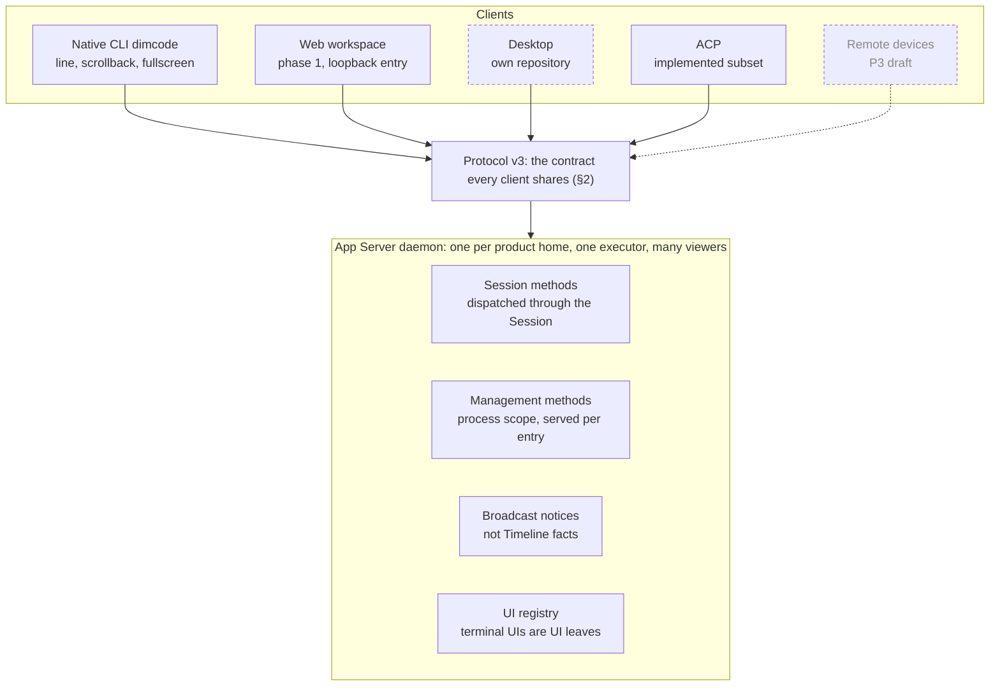
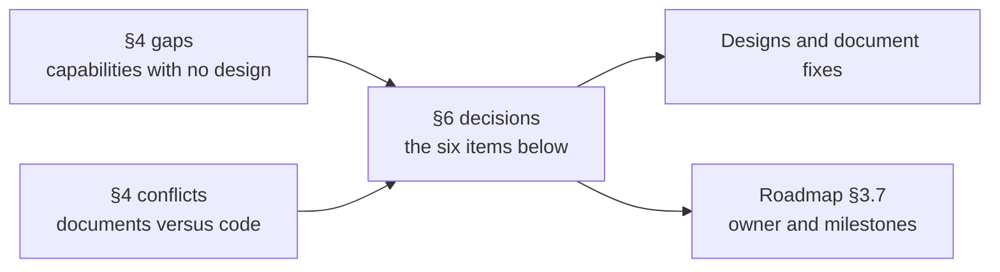

# Clients

Status: Draft. This document is the overall view of Dim's clients: which clients exist, what they share, which capabilities each covers, and which gaps have no design yet. It does not restate lower-level contracts; each row links to the document that owns it. Overall design: [overview](overview.md); plan: [roadmap](roadmap.md) §3.7 (client lane).

Client work has so far been designed per feature. This document collects those designs, records where they disagree with each other or with the code, and lists the decisions needed before the client lane can be planned (§6).

## 1. Clients

Every client is a protocol v3 client of the App Server daemon. The daemon is headless and shared: one per product home, one executor with many viewers ([Tui §3.6](plugins/Tui.md#36-ui-registry-and-ui-leaves)). A client owns presentation, protocol adaptation and local interaction; the App Server owns execution, host configuration and persisted Sessions ([feature list](../feature-list.md)).

Dashed boxes are outside this repository (Desktop) or not implemented (remote devices); dashed arrows are connections that do not exist yet.

| Client | Where | Form | Status | Design |
| --- | --- | --- | --- | --- |
| Native CLI `dimcode` | `crates/dim-cli`, `crates/dimcode` | Three interfaces in one executable: the line client (`--no-tui` or no terminal), the scrollback terminal UI (default) and the fullscreen terminal UI; `/tui` switches the two terminal UIs in-process | Implemented | [Tui](plugins/Tui.md), [CLI commands](cli-commands.md), [native CLI contract](../../crates/dim-cli/README.md) |
| Web workspace | `web/` (Vue 3), entry in `crates/dim-app-server/src/web_entry.rs` | Browser frontend over a loopback-only web entry, opened by `dimcode web` or `/web` | Phase 1 implemented | [Web workspace](web-workspace.md) |
| Desktop | Its own repository | Desktop application | Outside this repository | This repository owns only the App Server contract it uses (§5) |
| ACP | `crates/dim-acp` | reusable client-host rutis plugin; `dimcode acp` is the stdio entry, public RPC v3 to the shared daemon | Supported subset implemented, unreleased (#436, PR #441); acpx basic chat verified; Lody MCP GUI verification awaits login | [AcpGateway](plugins/AcpGateway.md), [acceptance](acp-gateway-acceptance.md) |
| Remote devices | — | Paired devices through RemoteGateway; absorbs the phase-1 web entry | Draft, P3, not implemented | [RemoteGateway](plugins/RemoteGateway.md) |

## 2. What clients share

| Contract | Owner document |
| --- | --- |
| Wire protocol v3: framing, `hello` and feature advertisement, notifications | `crates/dim-app-server/src/protocol.rs` (no prose reference exists, §4 item 5); [App Server README](../../crates/dim-app-server/README.md) |
| Session methods versus management methods, and which entry is served which | [Session boundary](contracts/session-boundary.md) (A.3 entries), [management methods](appserver/management-methods.md) |
| Reading a Session: `session.attach`, then `session.history` up to a fixed head, then live `session.event`, `session.state`, `session.model.progress`; clients fold these themselves. The attach reply carries that Session's `SessionInfo`, whose `model` follows the Session's latest adopted configuration, so a client that opens a known Session takes the model from it and reads no catalog; `session.summaries` items still report the creation model until [#795](https://github.com/arcships/dim/issues/795) lands. A reload leaves the title fields absent and `running` false, and the notices that follow correct them. The `session.create` and `session.attach` replies also carry `modelPreferences`, the preferences the Session's adopted configuration sends, derived from it and absent when it carries none; `session.summaries` items do not carry it | [Session access](contracts/session-access.md), [CLI commands](cli-commands.md); triage of [#276](https://github.com/arcships/dim/issues/276) |
| Broadcast notices that are not Timeline facts (`session.notice`, e.g. titles) | [Session notices](appserver/session-notices.md) |
| Approvals and questions: `approval.request` / `cancelled` / `resolved`; a question is a pending `ask_user` call answered by `session.question.respond` | [ADR 003](../adr/003-approval-scope.md), [Questions](plugins/Questions.md) |
| MCP App views: the document a tool declares (`session.mcp.app.widget`), a view's tool call (`session.mcp.app.call`), a view's message through `session.submit` | [MCP Apps](appserver/mcp-apps.md) |
| Interfaces viewing a Session: the UI registry, terminal UIs as UI leaves (`ui.open`, `ui.attach`, `ui.status`) | [Tui §3.6](plugins/Tui.md#36-ui-registry-and-ui-leaves) |
| Provider management for every client | [Provider management](appserver/provider-management.md) |

The CLI requires protocol v3 and the `session.create` and `session.history` features; the web client and its assets require an exact protocol match ([web workspace §2.4](web-workspace.md)).

### Member tool approval

[Collaboration](subagent-tool-approval.md) owns member approval routing and its detail query.
Clients receive the leader's ordinary approval request for `member_approval_allow`, fetch the
server-owned original action with `session.collaboration.approval.get`, then answer that leader
request. No client merges member pending approvals into the leader's raw approval queue.

Every supporting client shows both the requesting leader branch and original member identity,
member branch, tool, complete arguments/target and original reason. It offers allow once or reject;
no remembered decision or policy escalation. Detail loading, failure or an unsupported query must
not enable allow. Collaboration's `memberApprovalEnded` Session notice retires the matching route prompt (and
clients query live status again after reconnect); the final server checks remain
authoritative. [CLI commands](cli-commands.md#subagent-tool-approval) owns terminal rendering.

Web applies this contract to the leader's normal approval card, even when a member detail is open;
it retains the full original arguments in an accessible detail view. ACP maps the trusted original
action into its permission request information and exposes only allow-once/reject-once options;
if the detail read fails, it shows the error with Reject only and waits for the user before
answering. An error during the final recheck also shows this rejection prompt. Ended requests
close without an allow. If its client cannot convey a permission prompt, it rejects rather than
silently approving an opaque id.
These are requirements for member-route support, separate from existing ordinary approvals.
Older clients can continue ordinary tools; rich member-approval review requires the new query and
corresponding client support. No frozen v1/v2 notification set or Approval envelope is extended.

### Timeline block identity

- A text/thinking block is identified by the `id` of its **first raw event**. Following same-kind events belong to that block until a durable event of the other kind (thinking for text, text for thinking) or a tool event starts the next block. Provider `TextEnd`/`ThinkingEnd` are not durable and do not split a block. Replay, history and storage preserve the event ids.
- Tools use `call_id`; user inputs use the `input/message` event id.
- `session.model.progress` carries `textPartId` / `thinkingPartId` for the open blocks. They equal the first-event id that will publish that block.
- Clients must key timeline blocks/groups by that first-event id (or `call_id` for tools), not by local ordinals, request ids or synthetic `:progress` ids. UI-only group/expansion keys may derive from those stable ids.

## 3. Capability coverage

Rows follow the sections of the [feature list](../feature-list.md), which describes target capabilities of `dimcode`; this table adds the other clients. Legend: **done** implemented; **partial** part implemented; **designed** design exists, not implemented; **none** neither designed nor implemented; **out** out of scope by decision; **—** not applicable or not planned for that client. Desktop is not tracked here (§5).

### 3.1 Providers and models

| Capability | CLI | Web | Source |
| --- | --- | --- | --- |
| Sign in, sign out (OAuth, every Provider the daemon describes) | done | — | [Provider accounts](cli-commands.md#provider-accounts) |
| API-key Providers, add/edit/test/enable/disable/switch | done; removal: none in the CLI (server supports it); model-list editing: `/models` → `Edit models` and `dimcode models PROVIDER` | done, including the model list and preferences (`provider.models.*`, `provider.preferences.update`) | [Provider management](appserver/provider-management.md) |
| Switch model | done | done | `session.model.update` |
| Reasoning effort, fast mode | done (`/effort`, `/fast`, and ←/→ in `/models`) | — | [Model configuration](model-configuration.md) |
| Subagent model policy | done (`/models` → Subagent models) | — | [Subagent model policy](subagent-model-policy.md), [#263](https://github.com/arcships/dim/issues/263) |
| Auxiliary models | designed server-side per owner (e.g. SessionTitle); no client UI | — | [AuxiliaryModel](appserver/auxiliary-model.md) |

### 3.2 Session management

| Capability | CLI | Web | Source |
| --- | --- | --- | --- |
| New, resume, Session list | done; `/resume` opens on this workspace and `Ctrl+S` cycles it, this repository's worktrees when offered, and every workspace. It labels each row by creation origin and hides ACP Sessions unless the preference says otherwise | done (grouped by directory) | [Session classification](appserver/session-classification.md), [CLI commands](cli-commands.md#the-resume-picker) |
| Export conversation | done in the line client and `dimcode session export`; inside the terminal UIs: none | — | [CLI commands](cli-commands.md) |
| `/timeline` and message actions | done in the TUI; it also replaces `/history`'s paging | — | [Timeline UI §4.6](timeline-ui.md#46-timeline-jumping-to-a-message) |
| Titles | automatic: done (optional SessionTitle package); manual rename: designed | — | [SessionTitle](plugins/SessionTitle.md) |
| Fork | designed in the CLI (server `session.fork` done) | later phase | [Session deletion and fork](appserver/session-deletion-and-fork.md) |
| Deletion and cleanup | designed in the CLI (server `session.delete` done) | later phase | same |
| File rollback, file and conversation rollback | out | out | [overview](overview.md) App. A |
| Request snapshot export | done (`dimcode export`); filters: designed | — | [Timeline export](appserver/timeline-export.md) |

### 3.3 In-session interaction

| Capability | CLI | Web | Source |
| --- | --- | --- | --- |
| Send, queue (`Enter` while running), automatic sending, steer (`Ctrl+S`, or `Enter` on an empty draft), interrupt | done | send and stop: done; queue: later phase | InputQueue (S1) |
| Lines: tree, switch, create, send, stop, approvals, end | done | done (right-side Lines panel) | [Timeline branches](timeline-branches.md) §14, [Web workspace](web-workspace.md#41-lines-and-branch) |
| `/queue` panel and queue deletion | none | — | server contract done (S1) |
| Retrieve a queued message for editing | done; a message with attachments loses them (§4 item 4) | — | |
| Multiline, paste, large paste, images, mixed attachments, `@` files, `!` / `!!` | done | attachments: later phase | [CLI attachment input](cli-attachment-input.md), [ShellInput](plugins/ShellInput.md) |
| Skill references: the `/` palette lists them, and `$skill: <name>` loads one with the message | done | none | [Skills](plugins/Skills.md#9-references-load-with-the-operators-input) |
| Clipboard text, images, files; selection copy; OSC 52 | done | browser | |
| Message copying through message actions | none | — | |
| Open links, tool groups, `/tools` | done | done (rendering) | |
| Streaming output, run status, terminal status and progress | done | done | |
| File change feedback | done | done | |
| Tool approvals | done (`/permissions` selects the preset and manages command rules; `/approvals` and `/approval` are aliases) | done | [ADR 003](../adr/003-approval-scope.md) |
| Member tool-approval forwarding and original-action review | done | done | [Member approval](subagent-tool-approval.md), [shared client requirements](#member-tool-approval) |
| User questions (`ask_user`) | done (line client and terminal UIs) | none | [Questions](plugins/Questions.md) (implemented in #269, #336, #351) |
| Todo status | out | out | [overview](overview.md) §1 |
| Background tasks: commands and members (detail, stop one, stop all) | done | — | [Background-task list](background-task-list.md), [output](background-task-output.md), [member conversation](member-conversation.md) |
| Background tasks: Workflow runs | done | later phase | [Workflow task view](workflow-task-view.md), [#264](https://github.com/arcships/dim/issues/264) |
| Member transcript cards | done | — | [Member conversation](member-conversation.md) §7–9, [#263](https://github.com/arcships/dim/issues/263) |

### 3.4 System management

| Capability | CLI | Web | Source |
| --- | --- | --- | --- |
| `/settings`: theme, language, startup form, mouse, notifications, approvals | done | later phase (needs a decision on management methods, §6) | Model selection uses `/model` (`/models`), not `/settings`. |
| `/settings`: subagent model, auxiliary model, default multimodal model, execution shell, sandbox, prompt language | designed elsewhere, no client UI | — | overview B.1, [Modality](plugins/Modality.md) |
| `/settings`: VS Code focus, resource monitoring, plan usage display | none | — | |
| `/settings`: ACP Session display | done: a saved "Show ACP sessions" switch, off by default; `/resume` labels rows by creation origin | — | [AcpGateway](plugins/AcpGateway.md#a5-client-labels), [Session classification](appserver/session-classification.md) |
| `/usage` | context usage and, for active Dim OAuth models, account usage | — | [CLI usage report](cli-commands.md#usage-report) |
| `/stats` | out | — | [overview](overview.md) App. A |
| `/debug`, debug-log configuration | none (only the daemon's `daemon.log`) | — | [Web workspace §4.3](web-workspace.md#diagnostics-the-legacy-logging-controls) |
| `/tui` mode switch | done | — | [Tui](plugins/Tui.md) |
| Plugin runtimes: see, install, switch source, turn on by configuration | `/runtime` panel and typed forms (designed, [#872](https://github.com/arcships/dim/issues/872)); `dimcode runtime` | — | [CLI commands](cli-commands.md#plugin-runtimes), [RuntimeManager](plugins/RuntimeManager.md) |
| Version and upgrade | done (upgrade dialog); `dimcode upgrade` subcommand: none | — | |
| Web access (`/web`, `dimcode web`) | done | — | [Web workspace](web-workspace.md) |

## 4. Gaps and conflicts

Undesigned capabilities from §3, in feature-list order:

1. Message copying (`/timeline` and its other message actions: [Timeline UI §4.6](timeline-ui.md#46-timeline-jumping-to-a-message)).
2. The `/queue` panel and queue deletion (the server contract exists).
3. Retrieving a queued message that has attachments: `QueuedInput` keeps only text, so the attachments are lost. Either the client refuses it, as the feature list says, or the queue keeps the attachments.
4. A prose reference for protocol v3: the wire is defined only in `protocol.rs`, and its description is spread over the App Server README and per-feature designs.
5. Questions in the Web workspace: it handles approvals but not `ask_user`, and web-workspace §4 does not list it as deferred.
6. Session list project/all switch, `/debug`, the remaining `/settings` items, export inside the terminal UIs, `dimcode upgrade`.

Documents that disagree with the code or with each other:

| Statement | Where | Fact |
| --- | --- | --- |
| Only scrollback is designed; fullscreen-only items (rollback, mouse, `/stats`) are out of scope | [overview](overview.md) line 15, App. A | The fullscreen terminal UI, its mouse mode and `/tui` are implemented and documented in the [native CLI contract](../../crates/dim-cli/README.md); rollback and `/stats` are not |
| F6 does not implement a fullscreen interface | [CLI commands](cli-commands.md) | Same as above |
| `/web` is new work for RemoteGateway | [overview](overview.md) App. A | Delivered by the phase-1 web entry |
| Remote entries never get management methods; no web entry in the entries table | [Session boundary](contracts/session-boundary.md) A.3, [RemoteGateway](plugins/RemoteGateway.md) | The web entry serves the read-only model discovery methods defined in [web workspace §2.5](web-workspace.md#25-protocol-on-the-entry) |
| RemoteGateway does not reference the web entry that implements part of it | [RemoteGateway](plugins/RemoteGateway.md) | [Web workspace](web-workspace.md) §2.6 lists the differences |

## 5. This repository and Desktop

Desktop lives in its own repository. This repository owns the App Server contract that Desktop uses and nothing of its UI. The rule from the Desktop triage ([#276](https://github.com/arcships/dim/issues/276)–[#281](https://github.com/arcships/dim/issues/281)) is that the App Server changes only where existing facts and mechanisms cannot back a capability; the triage answered each gap without a protocol change:

| Desktop need | Answer |
| --- | --- |
| Current turn, branch head, live Session list | Derived from history and paging `session.catalog` ([#276](https://github.com/arcships/dim/issues/276)) |
| Rename and goal on the stock daemon | Today `--session-rows` installs SessionTitle and Goal ([#277](https://github.com/arcships/dim/issues/277), #290); with [PluginManager](plugins/PluginManager.md) they are built-in plugins of the default CLI |
| Approval outcome, pending question | `approval.resolved` (#289); a pending question is read from history ([#278](https://github.com/arcships/dim/issues/278)) |
| Attachment read, archive, file history | Attachment path from `attachment.put`; archive is client-local; rewind is `session.fork` ([#279](https://github.com/arcships/dim/issues/279)) |
| Branch metadata, rename, per-branch model | From `branch/*` facts; rename client-local; per-branch model not built ([#280](https://github.com/arcships/dim/issues/280)) |
| Local tools, edit/retry, usage, subagent relations | Client-run MCP server; `session.fork` + `session.submit`; client-side usage; `collaboration/*` facts ([#281](https://github.com/arcships/dim/issues/281)) |
| MCP App views (widget document, a view's tool call, its message) | The Session's own MCP connection through `session.mcp.app.*`; rendering and sandboxing stay in the client ([MCP Apps](appserver/mcp-apps.md), [#451](https://github.com/arcships/dim/issues/451)) |

Desktop's own feature coverage and UI acceptance are tracked in its repository. A capability that this repository's contracts cannot back becomes an issue here, under the same rule.

## 6. Decisions for the maintainer

1. **Fullscreen terminal UI.** The code ships it; the overview says it is out of scope. Either accept it in scope (update the overview and CLI commands, and decide whether rollback and `/stats` stay out) or freeze it.
2. **Web phase 2 scope**, including whether the loopback web entry may carry management methods for settings pages (web-workspace Q2), and whether Questions is required in the Web workspace.
3. **Which §4 gaps get designs**, and in which milestone: `/timeline` and message actions, `/queue`, queued attachments.
4. **A protocol v3 reference** (§4 item 4): write one, or keep the code as the reference.
5. **Milestones for the open client issues**: [#263](https://github.com/arcships/dim/issues/263) (member transcript cards, subagent model policy runtime), [#264](https://github.com/arcships/dim/issues/264) (Workflow view), [#386](https://github.com/arcships/dim/issues/386) (UI events toward the agent).
6. **Owner of the client lane** in the roadmap.
