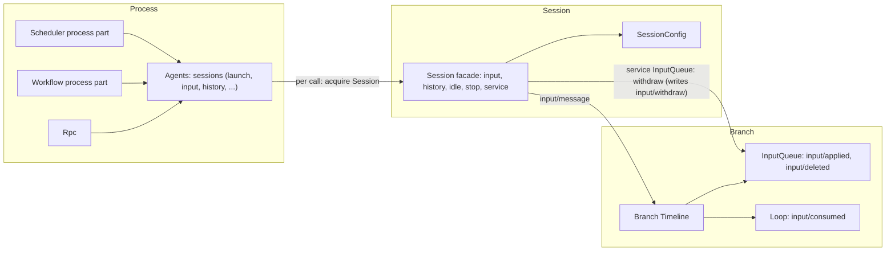
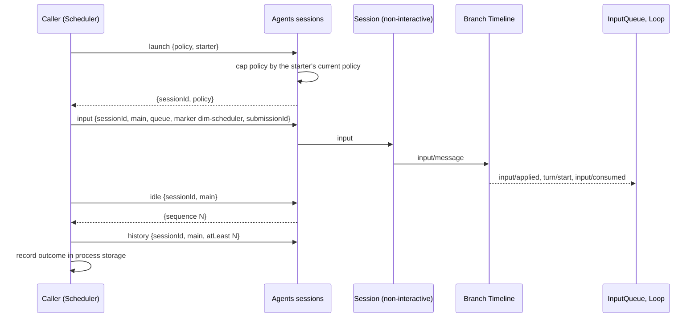
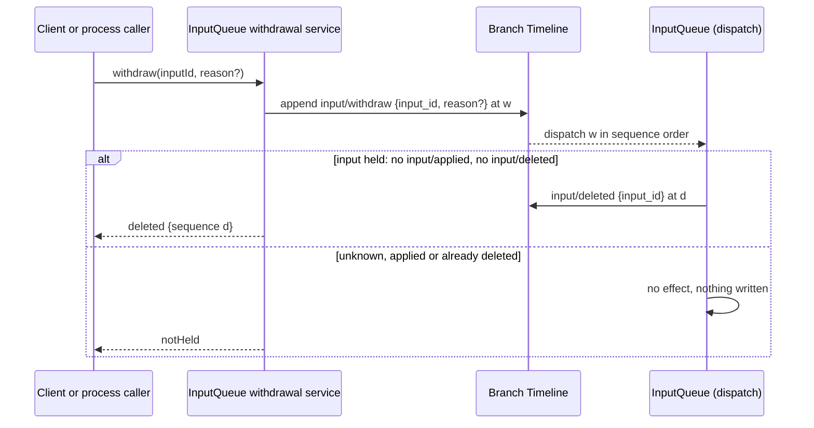

# Session access: Agents and Session public-interface supplement

Status: Draft. Overall design: [overview §3 integration](../overview.md#3-integration-by-existing-mechanisms), [Appendix B Agents and InputQueue](../overview.md#appendix-b-supplements-to-existing-plugins); rules: [ADR 002](../../adr/002-plugin-scope.md) D1–D3, D5. Phase: P0. Language: neutral contract; Rust binding in [Appendix E](#appendix-e-rust-binding).

> **Offline resource nodes.** Rows about an offline resource node describe P3 multi-node behaviour. #5 is withdrawn (rutis is an external dependency, and it withdraws imported services when a link drops), so these rows are redesigned in P3 following overview §6.3: node services are looked up on each call by the Session's resource node, which P3 adds to `SessionConfig` ([A.3](#a3-sessionconfig-fields)). In P1/P2 every Session uses the control node.

Process plugins reach Sessions the way Collaboration already does: through Agents and the public Session interface. This document defines that access as the language-neutral process service `sessions` (ADR 002 D5), provided by Agents, so a TypeScript or Python process plugin (Scheduler, Workflow) uses it by name. Its methods are `launch`, `input`, `lookup`, `history`, `withdraw`, `stop`, `idle` and `delete`, with request and reply as data ([A.1](#a1-the-sessions-service)). In Rust it is `AgentIndex` plus the `Session` facade ([Appendix E](#appendix-e-rust-binding)). It adds no host or facade plugin. Agents provides it from its directory part, which does not reload, so an Agents reload ends cancellable calls, retains own-outcome calls, and never reloads a caller (D3, #35); the binding, the lifecycle and the spike behind them are in the [sessions service](../appserver/sessions-service.md) design.

| Supplement | Owner | Used by |
| --- | --- | --- |
| `sessions` service: named, data-only access to Sessions | Agents | Scheduler, Workflow process parts |
| `launch` with a policy capped by the starter | Agents | Scheduler, Workflow |
| `SessionConfig` field `interactive` | Agents | Plugins that read it from the Session's `SessionConfig` (Questions, SessionTitle) |
| Input with source raw blocks (marker, keys, `submissionId`) | InputQueue data contract, runtime facade | Scheduler, Workflow; Goal branch parts write the same form, and Hooks branch parts (to be designed) would too |
| Fixed-prefix read | Runtime facade (`sequence` and `history`) and the page read `AgentIndex::history_page` (A.5) | Process callers and branch parts deciding from Timeline facts |
| Withdrawal (command `input/withdraw` with optional `reason`, proposed in [overview Appendix B.1](../overview.md#b1-session-and-branch-capabilities), result `input/deleted`, `session.input.withdraw` through InputQueue's `sessionMethods`) | InputQueue | Clients, AcpGateway, Scheduler, Workflow |

Session-scoped and branch-scoped plugins do not use this interface to reach their own Session. They use their Session's and branch's services, the branch Dispatcher and the Session broadcast directly.

## 1. Structure



| Part | Scope | Status |
| --- | --- | --- |
| `sessions` (Agents) | Process | Supplement; maps to the existing `acquire` and facade, plus `launch` |
| `SessionConfig` field `interactive` | Session record | Supplement |
| Session facade ([agent.rs](../../../crates/dim-agent-runtime/src/agent.rs), [branch.rs](../../../crates/dim-agent-runtime/src/branch.rs)) | Session, branch | Existing |
| InputQueue | Branch | Change: consumes `input/withdraw`, writes `input/deleted`; withdrawal service |

Contracts defined here are the `sessions` service with `LaunchRequest`, `InputWrite`, `RawBlock`, `HistoryRequest`, `HistoryPage`, `LookupReply`, `WithdrawRequest`, `WithdrawReply` and `SessionsError`; the `SessionConfig` field `interactive` and the `interactive` parameter of `session.create`; the source marker, key and `submissionId` conventions; and the withdrawal contract. Contracts used are the runtime facade, Agents loading, the `input/message` data and consumption contract, the existing context-block element format and the Session input path.

## 2. Data and state

| State | Owner | Rebuild |
| --- | --- | --- |
| `SessionConfig` with `interactive` | Agents, Session record | From the record on restore |
| Inputs and their applied, consumed and deleted facts; InputQueue's held set | InputQueue, Loop | From local history on reload: an input is held while it has neither `input/applied` nor `input/deleted` |
| Leases held during a `sessions` call | Agents | Runtime only |
| Keyed block effect | History projection ([history.rs](../../../crates/dim-agent-capabilities/src/history.rs)) | From the fixed prefix and compaction facts |
| Caller progress (runs, pending `submissionId`s) | Caller's process storage | Caller's document |

An input is pending from its `input/message` until either `input/applied` followed by `input/consumed`, or `input/deleted`, references its event id. `input/withdraw` alone never changes whether an input is pending; only InputQueue's result fact does. Every "pending input" derivation (Goal, AcpGateway, Scheduler, Workflow) uses exactly this rule.

## 3. Flows

### 3.1 Launch, write, wait



The caller holds no lock. Facts committed after its read are ordered before its write and are resolved by the input owners. A caller that may retry after an uncertain outcome resubmits with the same `submissionId`: the branch accepts each id once and replies the first input's receipt.

### 3.2 Withdrawal



`input/withdraw { input_id, reason? }` is a command event, and `input/deleted { input_id }` is InputQueue's result fact. Legitimate producers write the command: clients through `session.input.withdraw`, which InputQueue provides through `sessionMethods` ([session-boundary](session-boundary.md#a1-method-contributions)), and process callers through `sessions.withdraw`. InputQueue consumes commands in sequence order and decides from its own decision state only ([time bus §4](../../architecture/rust-agent/time-bus.md#4-写入前的复核归各状态机)): the command takes effect only if InputQueue still holds that `input/message` unapplied. Once InputQueue has written `input/applied` for an input, the input belongs to Loop and cannot be withdrawn; Loop needs no change. For one input, at most one of `input/applied` and `input/deleted` exists.

## 4. Timing and conflicts

| Scenario | Order | Outcome | Owner |
| --- | --- | --- | --- |
| Input before a turn `stop/interrupt`, not consumed | applied < interrupt | Stays pending; consumed by the next turn | Loop |
| Input after `stop/interrupt` | interrupt < input | Queue/Steer start a turn, Append waits | InputQueue, Loop |
| Withdraw while the input is held | input < `input/withdraw`, no `input/applied` | `input/deleted`; never applied or consumed; not pending | InputQueue |
| Withdraw after the input is applied | `input/applied` < `input/withdraw` | No effect, nothing written; reply `notHeld`; the input is consumed normally | InputQueue |
| Agents reload during a `sessions` call | — | The call fails `reloading`; the caller does not reload (#35); committed inputs stay; the caller calls `lookup` before rewriting. An admitted `launch` and a `delete` instead reply their own outcome ([sessions service §8.3](../appserver/sessions-service.md#83-agents-index-reload)) | Agents, caller |
| Session's resource node offline | — | Input committed; tool calls on that node fail `node_unavailable`; nothing goes Pending | rutis link (#5) |
| Launch with a policy wider than the starter's | — | Capped to the starter's current policy | Agents |

Full table: Appendix B.

## 5. Context mapping

| Input form | What the model sees | Placement |
| --- | --- | --- |
| Marker block | One user-role message with the verbatim `<dim-<source> kind="...">` element | First, at the input's consumed position |
| Other raw blocks | One user-role message each, verbatim, in order | After the marker |
| User content (text, images) | One user message | After all blocks of the same input |
| Keyed block (`Live`) | As a raw block; the latest block per key stays in effect | Consumed position |
| Retire block | Delivered once; the key leaves effect | Consumed position |
| Deleted input (never applied) | Nothing: its user content and raw blocks never enter context, its keyed blocks never take effect, and compaction never sees it. Clients may show it as deleted from `input/deleted` | — |

Queue inputs are consumed when Loop starts the turn they drive. Steer inputs are consumed at the next boundary of the running turn and start a turn when the branch is idle. Append inputs are consumed with the next model request and never start a turn. Through compaction, consumed inputs survive only in the summary, except that the latest block of each live key is replayed verbatim. A child branch sees the ancestor prefix up to its cut, including the keys in effect at the cut, and never adopts the parent's pending inputs. The model never sees `submissionId`, mode, `SessionConfig` fields or leases.

## 6. Interfaces (summary)

| Interface | Mode | Purpose |
| --- | --- | --- |
| `sessions.launch(LaunchRequest) -> {sessionId, policy}` | async | Create a non-interactive Session for automation with a capped policy |
| `sessions.input(InputWrite) -> {inputId, sequence}` | async | Write input with source raw blocks |
| `sessions.lookup({sessionId, branchId, submissionId}) -> LookupReply` | async | Find a committed input after an uncertain outcome |
| `sessions.history(HistoryRequest) -> HistoryPage` | async | Read history, optionally as a fixed prefix bounded by the published head |
| `session.input.withdraw {sessionId, branchId, inputId, reason?}` | RPC | Client withdrawal; InputQueue's `sessionMethods` (namespace `session.input`) |
| `sessions.withdraw(WithdrawRequest) -> WithdrawReply` | async | Write `input/withdraw` for an input the caller wrote, by its `input_id`, and return InputQueue's decision |
| `sessions.stop({sessionId, branchId, reason?}) -> {sequence}` | async | Interrupt the branch's turn |
| `sessions.idle({sessionId, branchId}) -> {sequence}` | async | Wait until the branch is idle; the returned sequence is the last committed one, a whole-batch boundary |
| `sessions.delete({sessionId}) -> {}` | async | Delete a Session: Agents closes it and removes its rows and files ([session deletion](../appserver/session-deletion-and-fork.md#3-deletion)) |
| `SessionConfig.interactive` | data | Creation-time configuration |
| `session.create {interactive}` | RPC | Non-interactive creation |

## 7. Security

Only plugins in the control node's process hold `sessions`, and it is never exported over RPC entries or rutis links. Process callers withdraw an input by the `input_id` they received when writing it, and clients withdraw through Rpc's Session authorization. Markers are model-facing text: shared components (InputQueue, Agents, the runtime) never parse them; the plugin that wrote a marker may interpret its own content. Writing input confers no authority, because the resulting tool calls are admitted by Approval and Permission under the Session's policy. The policy cap of `launch` is a convention for well-behaved callers, not a security boundary: the caller supplies `starter` itself, and without one the cap is the host's Session defaults ([sessions service §11](../appserver/sessions-service.md#11-security-and-authority)). Inputs are replayed into model context, so callers must not put credentials or host security settings into them.

## 8. Rule check

| Rule | How this document complies |
| --- | --- |
| §4 rule 1 (command events) | Withdrawal is the command `input/withdraw`; only InputQueue writes the result `input/deleted`, and a withdraw with no effect writes nothing and replies `notHeld`. |
| §4 rule 2 (handover) | `input/applied` hands an input from InputQueue to Loop; after it the input cannot be withdrawn, only interrupted with `stop/interrupt`. |
| §4 rule 3 (before callbacks only) | Entries check only param shape and authorization; no before callback is used. |
| §4 rule 4 (no business meaning in core) | `reason`, markers, keys and `submissionId` are generic data; InputQueue and Agents never interpret a source. |
| §4 rule 5 (batch) | InputQueue handles `input/message` and `input/withdraw` in sequence order; "withdraw and re-submit as Steer" writes the withdraw first in one batch. |
| §4 rule 6 (model context) | A deleted input never enters context; consumed inputs are placed at their consumed position (§5). |
| §4 rule 7 (public events and services) | Process callers reach Sessions only through `sessions`, and withdraw only through InputQueue's public withdrawal service. |
| §4 rule 8 (requirements) | #4 and optional-part assembly are raised in §9; the fixed-prefix read is composed from the existing facade (§9.2). |
| §4 rule 9 (only decision facts in the Timeline) | `SessionConfig`, leases and caller progress stay out of the Timeline; only inputs, withdrawal commands and results, and `stop/interrupt` from `stop` are events; the descriptive `reason` on the required `input/withdraw` is allowed by rule 9. `submissionId` is a field of the required `input/message` that callers' recovery decisions read through `lookup` (#32). |
| §1 (Capability and App Server boundary) | Agents only exposes access; callers keep their business logic in their own plugins. |
| ADR 002 D1 | `sessions` is a process service of Agents; InputQueue's withdrawal stays in its branch part, served to clients by its Session part. |
| ADR 002 D2 | No access host or facade plugin; callers use Agents as Collaboration does. |
| ADR 002 D3 | An Agents reload fails the calls in flight with `reloading` and never reloads a caller (#35); callers resolve uncertain writes with `lookup`. |
| ADR 002 D4 | `SessionConfig.interactive` is creation data of the Session record, not plugin configuration. |
| ADR 002 D5 | `sessions` is named with data-only methods and errors; Rust types appear only in Appendix E. |

## 9. Requirements raised to mechanism owners

### 9.1 Runtime services exposed by name (#4)

| Item | Content |
| --- | --- |
| Blocked by | ADR 002 D5: non-Rust parts (SessionTitle, Goal, Web, the Scheduler and Workflow Session parts, ExternalAgent, PluginManager) must use the runtime's typed services (Timeline, Dispatcher, InputQueue, Session broadcast) without a hand-written Rust binding. App Server services they also use (SessionStore metadata, Settings, `AuxiliaryModel`) are named by their owners' supplements ([overview Appendix B.2](../overview.md#b2-app-server-process-plugins)). |
| Existing mechanisms considered | rutis named services (`TypeKey::named`, `host_key`): work only for services registered by name, and the runtime registers these by Rust type. Hand-written bindings per plugin: rejected by D5. Starting in Rust: the fallback until this lands. |
| Generic capability | The runtime registers each public typed service also under a stable service name with a data-only method shape, at the same scope and key. |
| Effect on sequence, batch, interrupt, reload | None: calls by name keep the typed service's ordering, batch and interrupt rules; a named service reloads with its owner. |
| Owner and issue | Runtime; [#4](https://github.com/arcships/dim/issues/4). |

### 9.2 Fixed-prefix read

Withdrawn ([#50](https://github.com/arcships/dim/issues/50)): the existing Session facade composes it, so no runtime change is needed. `Session::sequence(branch)` returns the published head; if it is below `atLeast` the read fails `future_sequence`, otherwise `Session::query(branch, query)` reads that head and below. Both read only published events and the head only grows, so the prefix is fixed (A.5). Process callers page the same prefix with `AgentIndex::history_page` (A.5).

### 9.3 Caller source fixed from plugin identity

Withdrawn ([#24](https://github.com/arcships/dim/issues/24)): a caller withdraws by the `input_id` it received when writing the input, so no caller source is needed.

### 9.4 Optional parts per enabled plugin

| Item | Content |
| --- | --- |
| Blocked by | ADR 002 consequences: optional Session and branch parts are installed only when enabled. |
| Existing mechanisms considered | Installing every part and checking inside it: placeholders the ADR rejects. Host-side `AgentBuilder` calls that install each plugin's parts: not language-neutral (D5); a plugin registers its own parts, and the profile only names the parts it requires. |
| Generic capability | Every plugin is one process row that registers its Session and branch parts with the part registry while it runs ([ADR 006 D3](../../adr/006-plugin-contract.md#d3-a-plugin-is-one-row-each-instance-mounts-the-parts-registered-for-it)). A plugin installed but disabled has no running row and registers nothing, so its parts are not mounted. The profile requires the parts the Session waits for (`AgentBuilder::require_part`); any other registered part is optional: the Session lets one registered when it opens settle before publication but does not require it to be Active, and only that plugin's features are unavailable while it is missing, Pending or Failed. For tools, a part registers them with ToolRegistry when it applies, and ToolRegistry follows the registrations: a tool registered later is offered from the next request and one withdrawn when its part unloads is no longer offered, without a Session reload (session-boundary A.5, ADR 002 D3, #34, #241). No generator chooses its part by `SessionConfig` fields such as `interactive`, so the tool set and prompt prefix stay the same across a fork (#30). A part already loading when its Session is created is settled before publication; one that never settles fails creation at the deadline. |
| Effect on sequence, batch, interrupt, reload | The first registry read during branch initialization fixes the first request's tools before Session publication. Later activation or retirement of a part changes the tools of later requests only; a bound request keeps its snapshot, and a configuration with a tool part records the change as an adoption. A plugin enabled or disabled while Sessions are open has its parts mounted into or unmounted from each of them, with the same effect on later requests. |
| Owner and issue | Runtime (part registry and mounters); implemented in [#402](https://github.com/arcships/dim/issues/402). |

#5, used by the offline rows, in [ExternalAgent §9](../plugins/ExternalAgent.md#9-requirements-raised-to-mechanism-owners). The optional `reason` on `input/withdraw` and the `LaunchRequest.agent` default are changes of InputQueue and Agents, listed in [overview Appendix B](../overview.md#appendix-b-supplements-to-existing-plugins).

## Appendix A. Interface details

### A.1 The sessions service

`sessions` is a process service provided by Agents, without an instance key. Shapes are JSON with camelCase fields; a `?` after a field name marks it optional and `|` separates alternatives. Each call except `launch` and `delete` acquires the Session (restoring it if needed) and holds it loaded until the reply. The calls carry no caller identity. The [sessions service](../appserver/sessions-service.md) design gives each method's steps, the policy cap and the lifecycle.

| Method | Mode | Request | Reply | Errors |
| --- | --- | --- | --- | --- |
| `launch` | async | `LaunchRequest` | `{sessionId, policy}` | `rejected`, `agent_unknown`, `session_closed`, `branch_missing` (the starter), `branch_ended` (the starter), `reloading`, `failed` |
| `input` | async | `InputWrite` | `{inputId, sequence}` | `rejected`, `ambiguous`, `session_closed`, `branch_missing`, `branch_ended`, `reloading`, `publication_unknown`, `failed` |
| `lookup` | async | `{sessionId, branchId, submissionId}` | `LookupReply` | `ambiguous`, `session_closed`, `branch_missing`, `branch_ended`, `reloading` |
| `history` | async | `HistoryRequest` | `HistoryPage` | `rejected`, `future_sequence`, `session_closed`, `branch_missing`, `reloading` |
| `withdraw` | async | `WithdrawRequest` | `WithdrawReply` | `rejected`, `session_closed`, `branch_missing`, `branch_ended`, `reloading`, `publication_unknown` |
| `stop` | async | `{sessionId, branchId, reason?}` | `{sequence}` | `session_closed`, `branch_missing`, `branch_ended`, `reloading` |
| `idle` | async | `{sessionId, branchId}` | `{sequence}` | `session_closed`, `branch_missing`, `branch_ended`, `reloading` |
| `delete` | async | `{sessionId}` | `{}` | `rejected`, `reloading`, `failed` |

```text
// LaunchRequest
{ "agent?": "string",                // Agent profile id; absent: Agents' default profile
  "cwd": "string",
  "model?": { "providerId": "string", "modelId": "string" },  // takes precedence over the profile's model
  "policy?": { /* PermissionPolicy data */ },  // narrowed request; absent: starter's or read-only default
  "starter?": { "sessionId": "string", "branchId": "string" } } // upper bound; absent: host configuration bound
// InputWrite
{ "sessionId": "string", "branchId": "string",
  "mode": "queue" | "steer" | "append",
  "submissionId": "<source>:<uuid>",
  "rawBlocks": [ RawBlock ],         // first block is the caller's marker (A.2)
  "content": [ { "type": "text", "text": "..." } | { "type": "image", "...": "..." } ] }
// RawBlock
{ "text": "string", "key?": { "use": "live" | "retire", "name": "string" } }
// LookupReply
{ "status": "accepted", "inputId": "string", "sequence": 0 } | { "status": "unknown" }
// HistoryRequest
{ "sessionId": "string", "branchId": "string",
  "after?": 0,                        // exclusive lower bound; absent: from the start of the branch
  "through?": 0,                      // read up to this sequence
  "atLeast?": 0,                      // fixed-prefix read (A.5); not together with through
  "limit?": 256 }                     // page size, 1 to 256; absent: 256
// HistoryPage: the branch's own events in (after, through], ending on a batch boundary,
// as AgentEvent records in the form session.history returns them
{ "through": 0, "events": [ { "id": "string", "sequence": 0, "type": "turn/end", "data": {} } ] }
// WithdrawRequest
{ "sessionId": "string", "branchId": "string", "inputId": "string",
  "reason?": "string" }                 // copied into input/withdraw; shown by clients
// WithdrawReply
{ "status": "deleted", "sequence": 0 }   // sequence of input/deleted
| { "status": "notHeld" }                  // unknown, already applied or already deleted; InputQueue wrote nothing
// SessionsError
{ "code": "rejected" | ..., "message": "string", "retryable": false }
```

Every method can also fail `failed` (A.6). Cancellation: the caller dropping an `idle` or `history` call ends it with no effect. Dropping an `input` before the reply leaves the outcome uncertain; the caller resolves it with `lookup`.

`launch` creates a Session with `interactive = false`. The effective policy is the requested policy capped by the starter's current policy, which is a Timeline fact read at launch. Without a starter, a run started by a management method defaults to read-only unless the request declares a policy, and it is always capped by host configuration.

`delete` is Agents' Session delete (S5c): it closes the Session if it is loaded, then removes its rows and files. An absent or already deleted Session replies `{}`, so a caller deletes again after any error ([sessions service §6.8](../appserver/sessions-service.md#68-delete)). The caller that launched a Session deletes it when it drops the last record that names it ([§8.7](../appserver/sessions-service.md#87-deleting-run-sessions)).

Implemented: every method above, served by Agents' directory part (S2, [#98](https://github.com/arcships/dim/pull/98); `delete` after S5c, [#97](https://github.com/arcships/dim/pull/97)). `input` and a `withdraw` that deletes reply once their event is published.

### A.2 Source input conventions

| Item | Rule |
| --- | --- |
| Marker | The first raw block is the element `<dim-<source> kind="..." ...>body</dim-<source>>` in the existing context-block format. It is model-facing text written by the producing plugin; shared components never parse it, and only the producing plugin may interpret its own content (for example Goal folding its own blocks) |
| Keys | `RawBlock.key` with `use: live` or `retire`, per branch Timeline. The writer chooses the full key; by convention it starts with the writer's own prefix (overview constraint 14), and nothing checks it |
| Submission identity | `<source>:<uuid>`, generated per logical submission. A branch accepts each identity once: a resubmission writes nothing and replies the first input's receipt, also after the input is consumed or withdrawn. `sessions.lookup` (same semantics as `session.input_lookup`) finds a committed input (`accepted`, `unknown`) without writing. Error `ambiguous` (from `input` or `lookup`) means several inputs share the identity, written before branches accepted each once. The identity is the `submission_id` field of the committed `input/message`, so it commits, forks and is deleted with the input; no separate record exists ([sessions service §6.3](../appserver/sessions-service.md#where-the-submission-identity-lives), #32) |
| Never possible | Writing events other than `input/message`, `input/withdraw` through `withdraw` and `stop/interrupt` through `stop`; writing `input/deleted`; editing history |

### A.3 SessionConfig fields

```text
// SessionConfig (new field; existing: permissionPolicy, cwd, model, systemPrompt, tools?, collaborationRole)
{ "interactive": true }             // false: exec, automation; absent: true
```

`interactive` means the Session has an interaction counterpart that can answer its questions and approvals: the user through a client, or another Session's or branch's agent (for example a Collaboration leader). It does not require a human. An ACP Session is interactive: the editor answers its approvals. `interactive` is fixed at creation. Assembly never reads it (ADR 002 D3, #30), so the tool set stays the same and a fork keeps the prompt prefix and its KV cache. Plugins that care read it from the Session's config directly: Questions (`ask_user` stays declared and answers that no one is available to answer) and SessionTitle (titles interactive leader Sessions only).

`session.create` gains `interactive?: bool` (default `true`), checked at the boundary only. `session.create` rejects unknown fields, so an older daemon fails a request that carries `interactive` with invalid params; clients therefore send it only when it is `false`.

A fork copies the source Session's whole `SessionConfig`; the permission preset follows with the copied `permission/changed` facts (#26).

Format decision: the native store stays on version 13. `interactive` is an additive optional field of the stored config JSON, and a stored record without it means `true`, because every Session created before the field existed was a client Session. An older daemon ignores the field and reads a non-interactive record as interactive; this is accepted. No version 14.

Implemented (C2): `session.create` sets the field, and the native store writes it only when it is `false`, so an interactive record keeps the form records had before the field existed. The omission is part of `SessionConfig`'s serde form, which only the native store serializes; exposing `SessionConfig` anywhere else (for example in a protocol reply) inherits it and needs its own decision. Its readers are Questions and SessionTitle, which read it from the Session's config. Session fork (S5c) copies the stored `config` text byte for byte, so the omission carries over to the fork.

| Stored `config` | Daemon with C2 | Older daemon |
| --- | --- | --- |
| No `interactive` (every record before C2, interactive records after it) | Interactive | Interactive |
| `"interactive": false` | Non-interactive | Interactive (field ignored; accepted) |

`tools` is the Session's optional mount list, fixed at creation. `session.create {tools?}` sets it; without the parameter the Session takes its Agent profile's optional `tools`, and a profile without one gives none (the product default). A profile's or member's list limits what that agent sees; a Collaboration member with a list always mounts `agent`. Without a mount list the Session declares every host tool, in the host's order, and every tool a part registers with `toolRegistry`, by name. With one it declares exactly the host and registered tools the list names, in its order; `[]` declares none of them. Other sources' tools (MCP) follow in both cases and are governed by their own configuration. A named tool that nothing has registered is not declared and is reported once; it is declared once something registers it. Duplicate names fail Session creation. Permission decides whether a declared tool's call runs and never changes the declarations ([session-boundary A.5](session-boundary.md#a5-tool-contribution)). The native store writes `tools` only when the Session has a mount list.

Not in this contract: `createdBy` (the Session's origin) and the `client` parameter of `session.create` are added when something decides with them. The resource node is a P3 addition (overview §6.3): an additive optional `SessionConfig` field, where a missing value means the control node.

### A.4 Withdrawal

| Item | Content |
| --- | --- |
| Command | `input/withdraw { input_id, reason? }`, a branch command event. `reason` is generic optional text with no business meaning, which clients show for the deleted input; events written without it are unchanged. Producers: the withdrawal service (clients, process callers). It is never a fact about the input by itself |
| Result fact | `input/deleted { input_id }`, written only by InputQueue, only when it consumes an `input/withdraw` while it holds that input unapplied |
| Held | InputQueue holds an input from its `input/message` until it writes `input/applied` or `input/deleted` for it. |
| No effect | Unknown id, input already applied, or already deleted: InputQueue writes nothing and no failure event exists; the caller's reply is `notHeld` |
| Client path | `session.input.withdraw {sessionId, branchId, inputId, reason?, steer?}`, provided by InputQueue through `sessionMethods` (namespace `session.input`; Session-scoped part `InputMethods`, implemented in S1, that calls the branch's withdrawal service), so Rpc names no owning service → `{status: "deleted", sequence}` or `{status: "notHeld"}`. With `steer` (a `UserInput`), the reply also carries `steer: {inputId, sequence}` for the new Steer input |
| Process and branch-part path | `sessions.withdraw` for process callers, InputQueue's branch withdrawal service for branch parts: by the `input_id` returned when the caller wrote the input |
| Write path | The service appends `input/withdraw`, then replies with InputQueue's decision for that command. InputQueue's recheck uses only its own decision state (held set), never a lock on another owner's facts |
| Withdraw and re-submit as Steer | One atomic batch: `input/withdraw` for the old input plus the new Steer `input/message`. The withdraw takes effect only if the old input is still held; the new input is written either way |
| After apply | An applied input cannot be withdrawn; Loop consumes it as usual and needs no change |

### A.5 Fixed-prefix read

`sessions.history` acquires and holds the Session, restoring it when unloaded. With `atLeast` it fixes `through` as the published head at call time. It fails with `future_sequence` if that head is below `atLeast`, and otherwise returns the branch's own events through that head, paged by `after` and `limit`. It is composed from the existing facade: read the head with `Session::sequence(branch)`, then page with `AgentIndex::history_page`. A live line pages through its query; an ended line pages through `TimelineTree` at its fixed head and batch boundaries. This entry has no store-read fallback for a Session the process does not hold. A branch part that needs the ancestor prefix reads the chain with the same query (§9.2). Every event delivered by the branch Dispatcher or the Session broadcast is published, so `atLeast = event.sequence` succeeds while the branch exists.

### A.6 Errors

| Code | Meaning |
| --- | --- |
| `session_closed`, `branch_missing` | Nothing written (for `launch`, the starter is closed or missing) |
| `branch_ended` | The branch has ended; nothing written (for `launch`, the starter) |
| `agent_unknown` | `launch` names no loaded Agent |
| `reloading` | The Agents index, the model-selection host or the Session's capabilities are not active or are reloading; retryable (an `input` with the same `submissionId`) |
| `rejected` | Param shape and the method's boundary checks (input validation, a history cursor inside a batch, the withdrawal service's checks); nothing written |
| `future_sequence` | Fixed-prefix read beyond the published head |
| `ambiguous` | More than one input has the `submissionId`, written before branches accepted each once; `input` writes nothing |
| `publication_unknown` | Committed (an `input`, or the `input/deleted` of a `withdraw`), publication failed; resubmit, `lookup` or `history` after recovery |
| `node_unavailable` | Not returned by `sessions`: calls on an offline resource node fail inside the Session's tools |
| `failed` | Session fault, storage, model resolution, project authorization or Session build |

**Input lifetime.** Under [S2 §6.2](../appserver/sessions-service.md#62-input),
`reloading` caused by index stop, or by the calling row having stopped, before input
admission means nothing was written.
After admission, typed Rust and named callers await the task's actual outcome
across index reload. The caller's own lifetime is not tied to the write: a calling
row reloads without waiting for it, and a lost reply is an accepted loss. The next
generation resubmits with the same `submissionId` and gets the same receipt, also
while the first write is still unpublished.

## Appendix B. Full conflict table

| Scenario | Sequence order | Outcome | Owner of the decision |
| --- | --- | --- | --- |
| Input before `stop/interrupt`, not consumed | applied < interrupt | Consumed with the next turn | Loop |
| Input after `stop/interrupt` | interrupt < input | Queue/Steer start a turn; Append waits | InputQueue, Loop |
| Input consumed by the interrupted turn | consumed < interrupt | Cancelled with that turn; stays in history | Loop |
| Branch close | close < write | `SessionClosed`/`BranchMissing` | Runtime facade |
| Concurrent writers | Timeline order | Applied by mode in sequence order | InputQueue |
| Tool batch not settled | input < `step/tool-result` | Steer and Append after the batch; Queue after `turn/end` | Loop |
| `input/withdraw` while held | input < withdraw, no `input/applied` | `input/deleted`; never applied or consumed | InputQueue |
| `input/withdraw` after apply | `input/applied` < withdraw | No effect; `notHeld`; consumed normally | InputQueue, Loop |
| Two withdraws for one input | withdraw₁ < withdraw₂ | First deletes (if held); second `notHeld` | InputQueue |
| Withdraw of an unknown id | — | No effect; `notHeld` | InputQueue |
| Withdraw and re-submit as Steer, old input already applied | applied < batch | Old input consumed normally; new Steer input applied as usual | InputQueue |
| Compaction between write and consumption | input < compaction < consumed | Placed after the summary; a deleted input is never seen by compaction | ContextPreparation |
| Child branch cut between write and consumption | input < cut < consumed | Child does not adopt it | InputQueue (child) |
| Two writers, same key | Timeline order | Later supersedes; owner prefixes avoid collisions by convention | History projection |
| Decision read, newer fact, then write | through < fact < write | Write ordered after the fact | Input owners |
| Agents reload | — | Calls in flight fail `reloading`, except admitted `launch`/`input` and `delete`, which reply their own outcome; callers do not reload (#35); committed inputs stay | Agents |
| Index reload after input admission | admission < index stop | Admitted `input` also replies its own append/publication outcome; pre-admission stop replies `reloading` without a write (S2 §6.2 / §8.3) | Agents |
| Restart after commit, reply lost | — | `lookup` returns `accepted`; no duplicate | Caller |
| Session not loaded | — | Agents restores it before the call | Agents |
| Resource node offline | — | Input committed; the turn runs and calls on that node fail `node_unavailable`; no dependent reloads or goes Pending (requirement on #5) | rutis link |

## Appendix C. Acceptance

1. `sessions.launch` creates a Session with `interactive = false` whose policy is capped by the starter, and a TypeScript process plugin can call it by name.
2. `session.create {interactive: false}` produces `interactive = false` in the Session's `SessionConfig`; `ask_user` is declared and answers that no one is available to answer. A stored record without the field loads as interactive.
3. Queue, Steer and Append written during a tool batch are consumed in the documented order, with the marker before the user content.
4. A keyed block survives compaction, a retired key does not, and a child branch inherits keys independently.
5. `input/withdraw` while InputQueue holds the input yields `input/deleted` and the input is never applied; after `input/applied` it writes nothing and replies `notHeld`; for one input at most one of `input/applied` and `input/deleted` exists. A deleted input's raw and keyed blocks never reach the model.
6. `history` with `atLeast` after a dispatched `turn/end` returns `through` ≥ that sequence.

## Appendix D. Assumptions

| # | Assumption | Basis | Effect if rejected |
| --- | --- | --- | --- |
| A1 | Every source input starts with one marker block | Existing context-block format | Each plugin defines recognition |
| A2 | Moved to the format decision in [A.3](#a3-sessionconfig-fields) | — | — |
| A3 | Process callers may call `idle` and `stop` on Sessions they started | Collaboration precedent | Another stop path |
| A4 | "Withdraw and re-submit as Steer" is written as one batch by InputQueue's `session.input.withdraw` through its optional `steer` parameter, the new input's user content (S1) | Judgment | A separate built-in |

## Appendix E. Rust binding

| Neutral | Rust |
| --- | --- |
| `sessions` | Typed `AgentIndex` methods (Agents) over the `Session` facade ([agent.rs](../../../crates/dim-agent-runtime/src/agent.rs), [branch.rs](../../../crates/dim-agent-runtime/src/branch.rs)); Agents' directory part exposes them by name ([sessions service, Appendix A](../appserver/sessions-service.md#appendix-a-rust-binding)) |
| `launch` | `AgentIndex::launch(LaunchRequest) -> Result<LaunchReply, SessionsError>` |
| per-call acquire | `AgentIndex::acquire(id)` (existing, crate-internal) returning a `SessionUse` lease |
| `input` | `Session::input(InputMessageData, branch)` (existing; returns the committed input for an id the branch already holds); a key is `InputBlock::Raw { key: Some(name), retire }` |
| `lookup` | `Session::lookup(branch, submission_id)`, shared with `session.input_lookup`: the branch's index of submission ids; waits for the found input's publication |
| `history` | `Session::sequence(branch)`, failing `future_sequence` below `at_least`, then `AgentIndex::history_page(id, branch, after, limit, through)` |
| `withdraw` | `Session::service::<InputQueue>(branch)` then `InputQueue::withdraw(InputWithdrawData { input_id, reason }, None) -> Result<(Withdrawal, Option<Arc<AgentEvent>>), AgentError>` (S1): appends `input/withdraw` and replies with InputQueue's decision once it is written; `Withdrawal::Deleted { sequence }` or `Withdrawal::NotHeld`. Agents replies `deleted` once that `input/deleted` is published |
| `stop`, `idle` | `Session::stop`, `Session::idle` (existing) |
| `delete` | `AgentIndex::delete(id)` (S5c, crate-internal): admission gate, close, `SessionStore::delete_session`, forget |
| `SessionConfig` | Rust struct below |
| Errors | `SessionsError` with the codes of A.6, mapped from `AgentError`: `Closed` → `session_closed`, `UnknownBranch` → `branch_missing`, `BranchEnded` → `branch_ended`, `Reloading` → `reloading`, `InvalidInput` → `rejected`, others → `failed` |

```rust
pub struct LaunchRequest {
    pub agent: Option<String>,            // absent: Agents' default profile
    pub cwd: String,
    pub model: Option<ModelId>,           // takes precedence over the profile's model
    // no source field: callers withdraw by input id (§9.3)
    pub policy: Option<PermissionPolicy>,
    pub starter: Option<SessionRef>,
}
impl AgentIndex {
    pub async fn launch(&self, request: LaunchRequest) -> Result<LaunchReply, SessionsError>;
}
pub struct SessionConfig {
    // existing: permission_policy, cwd, model, system_prompt, tools, collaboration_role
    // absent in stored records: true; only false is written
    #[serde(default = "default_interactive", skip_serializing_if = "is_interactive")]
    pub interactive: bool,
}
pub enum Withdrawal {                     // dim_agent_capabilities::input_queue (S1)
    Deleted { sequence: u64 },            // sequence of input/deleted
    NotHeld,                              // unknown, applied or already deleted
}
```

Session-scoped and branch-scoped Rust plugins read the configuration as `S:SessionConfig` or `Session::config()`.
