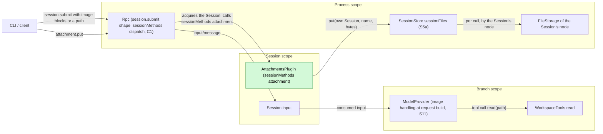
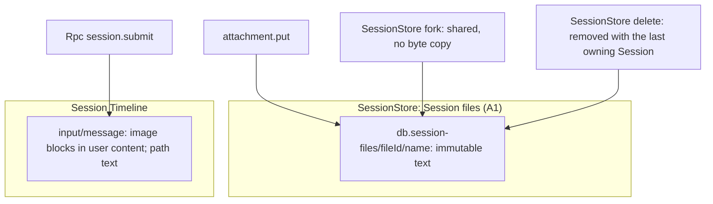
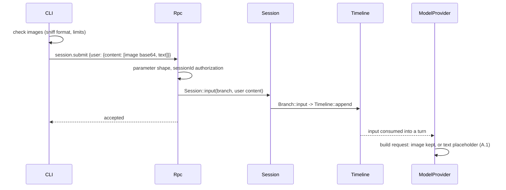

# Attachments

Status: Implemented ([#102](https://github.com/arcships/dim/pull/102)); capability page [Attachments](../../architecture/rust-agent/plugins/Attachments.md). Overall design: [overview §4](../overview.md#4-plugin-catalog). Phase: P1. Language: Rust. Scope: Session ([ADR 002](../../adr/002-plugin-scope.md)). Roadmap item P2 ([#66](https://github.com/arcships/dim/issues/66)). Its dependencies have merged: C1 ([#47](https://github.com/arcships/dim/issues/47), [#83](https://github.com/arcships/dim/pull/83)), S5a ([#59](https://github.com/arcships/dim/issues/59), [#95](https://github.com/arcships/dim/pull/95)), S6 ([#51](https://github.com/arcships/dim/issues/51), [#87](https://github.com/arcships/dim/pull/87)) and S11 ([#56](https://github.com/arcships/dim/issues/56), [#92](https://github.com/arcships/dim/pull/92)) ([roadmap §3.3](../roadmap.md#33-插件开工顺序)).

Lets the user attach images and large text to a submission. Images need no plugin: the CLI checks them (format sniffing, limits) and sends them as image content blocks in `session.submit`; Rpc checks only the parameter shape, and ModelProvider handles the model's image capability when it builds each request (S11, [overview Appendix B.1](../overview.md#b1-session-and-branch-capabilities)). Attachments is a small Session plugin that provides one Session method, `attachment.put`, by registering the namespace `attachment` with its Session's `sessionMethods` ([session-boundary](../contracts/session-boundary.md)); contracts are language-neutral, and the Rust form is [Appendix G](#appendix-g-rust-binding). The method stores a text attachment (a large paste) as an immutable Session file through SessionStore's `sessionFiles` service and returns its path; the user's text quotes the path and the model reads the file with `read` when it needs it. Fork sharing and deletion of those files are SessionStore behaviour ([session files](../appserver/session-files.md)). No events.

Roadmap item P2 implements the server side: the Attachments capability, its installation in the App Server and the flow test that the model can read a stored file (Appendix D). The image half belongs to ModelProvider (S11) and the CLI (A.1, A.3) and is not part of P2.

## 1. Structure



| Part | Scope | Depends on | Provides |
| --- | --- | --- | --- |
| `AttachmentsPlugin` | Session | `S:SessionIdentity`; `P:sessionFiles` (SessionStore); `S:sessionMethods` | Registers `attachment` (`attachment.put`) with `sessionMethods` |

Attachments never writes the Timeline, never sees images and owns no data. Its only process dependency, SessionStore, is a core part that Agents already depends on (`When<(SessionStore, SqliteStorage)>` in [agents.rs](../../../crates/dim-app-server/src/agents.rs)), so it adds no reload edge (ADR 002 D3).

**Installation.** The App Server's `serve` ([lib.rs](../../../crates/dim-app-server/src/lib.rs)) installs Attachments next to Mcp's Session part when the host has native storage and local execution (`native_home`): SessionStore exists only with native storage, and only local execution gives the model `read`. The part registers `attachment` with its Session's `sessionMethods` when it applies, so every Session of that host has `attachment`; a host without Attachments answers `attachment.put` with `unknown_method`, because no namespace of the Session holds the name ([session-boundary A.1](../contracts/session-boundary.md#a1-method-contributions)).

Contracts depended on:

- `sessionMethods` dispatch, errors and call ownership (C1, [session-boundary A.1](../contracts/session-boundary.md#a1-method-contributions)): Rpc authorizes `sessionId`, acquires the Session (restoring an unloaded one), holds it until the call settles and reads the provider from the Session's method table. Attachments uses `drain` interruption (A.2) and no progress.
- SessionStore `sessionFiles.put` (S5a, [session files §9](../appserver/session-files.md#9-interface)): `{sessionId, name, content} -> {fileId, path, bytes}`, codes `not_found`, `invalid`, `too_large`, `node_unavailable`, `cancelled`, `storage`. SessionStore owns the name rule and the 16 MiB cap, and checks cancellation right before its commit (txn 2).
- FileStorage (S6, [#87](https://github.com/arcships/dim/pull/87)): reached only through SessionStore, which looks the Session's node up on each call (#38). Attachments names no FileStorage operation.
- `read` (WorkspaceTools): reads an absolute path; the Session-owned file `put` returns satisfies file scope without a grant. Tool admission still follows the preset and tool lists ([Permission contract](../../architecture/rust-agent/plugins/Permission.md#policy-contract)).
- ModelProvider's image handling at request build (S11; requirements in [A.4](#a4-requirements-to-other-owners)).
- The transport frame limit, 16 MiB per request (`MAX_FRAME_BYTES`, [outbound.rs](../../../crates/dim-app-server/src/outbound.rs)).

Contracts defined here: `attachment.put`, its error codes and limits, the CLI image checks and the paste reference format. Attachments names no other plugin's internal type.

## 2. Data and state



Attachments has no state: files are SessionStore's data, and images exist only inside the `input/message` Rpc writes with the user as author. `attachmentId` is the Session file's `fileId`, a random UUID chosen by SessionStore. A fork's inherited history keeps valid paths because SessionStore shares the files instead of copying them, and their directory belongs to no single Session (A6).

Events: none. Images are part of the existing `input/message`; text attachments appear only as paths in user text.

## 3. Flows

### 3.1 Image at submit



The CLI rejects an unsupported or oversized image before sending and keeps the draft. Rpc does not inspect images. ModelProvider decides per request from the request's model, so the input in history never changes.

### 3.2 Text paste

```text
Client        Rpc (C1)            Attachments          SessionStore          FileStorage
  |                               (Session)            (process)             (Session's node)
  |-- attachment.put {sessionId, name?, text | pdfBase64} -->|        |                    |
  |             | authorize sessionId,           |                    |                    |
  |             | acquire the Session            |                    |                    |
  |             |-- sessionMethods attachment -->|                    |                    |
  |             |                 | text empty? over 10 MiB?          |                    |
  |             |                 |-- put(own id, name, bytes) ------>|                    |
  |             |                 |                    | name, size; txn 1 (pending row)    |
  |             |                 |                    |-- create_directory, replace ------>|
  |             |                 |                    |   (read-only, synced)              |
  |             |                 |                    | token fired? abandon               |
  |             |                 |                    | txn 2: owner row, commit           |
  |             |                 |<-- {fileId, path, bytes} ---------|                    |
  |<-- {attachmentId, path, bytes} --------------|                    |                    |
  |-- session.submit {text: "... [Pasted text: <path> (<lines> lines)]"} --> input/message
```

The path is returned only after the file and its directory entries are synced and txn 2 has committed ([session files §5.1](../appserver/session-files.md#51-put)). Each call stores a new file (A7). A client disconnect cancels nothing: the put completes, the file stays with the Session and the reply is dropped.

An unload during a put (Session close; a reload of the Session, Attachments or SessionStore; or the unload of the Rpc load that admitted the call) fires the call's cancellation token. The call is `drain`: it replies with its own result, so the client always learns whether a file exists.

```text
token fires during a put
  |
  SessionStore checks the token right before txn 2
  |-- txn 2 already committed --> reply {attachmentId, path, bytes}; the file stays with the Session
  '-- not committed ------------> cancelled: nothing owned, directory swept --> reply service_reloading
```

The unload waits for the put, as it waits for every call the provider admitted (C1).

### 3.3 How the model reads the file

```text
Client      Rpc        Branch Timeline                      Model           WorkspaceTools
  |-- session.submit "... [Pasted text: /db-dir/dimcode.sqlite.session-files/<id>/paste.txt (120 lines)]"
  |          |-- input/message ->|
  |          |                   | input/applied, then consumed with a model request
  |          |                   |-- user text with the path ------>|
  |          |                   |<-- step/tool-call read {path, offset?, limit?}
  |          |                   |-- read(path) -------------------------------------->|
  |          |                   |<-- step/tool-result: numbered lines in content -----|
  |          |                   |-- the text, from this tool result on ------------>|
```

The model sees the path only in adopted user input and the content only in a `read` result. `read` pages a large file by `offset` and `limit`, as for any file. In a Session whose tools do not include `read`, the model sees only the path.

## 4. Timing and conflicts

| Scenario | Outcome |
| --- | --- |
| Host without Attachments | `attachment.put` gets `unknown_method`; images unaffected |
| Unload during a put | The reply is the path if txn 2 committed, else `service_reloading` with nothing stored; never `operation_interrupted` (§3.2) |
| Model switched after submit to one without images | ModelProvider sends a text placeholder instead of the image (A.1) |
| `input/deleted` of an image input | Never applied or consumed; text files stay with the Session |
| Fork racing delete of the source | A fork committed first keeps the files, shared and never copied; otherwise the fork fails ([session files §6](../appserver/session-files.md#6-deletion-crash-recovery-and-serialization)) |
| FileStorage of the Session's node not active | `attachment.put` fails `node_unavailable`; images unaffected; nothing reloads or goes Pending; a retry succeeds once it is active |

Full table: Appendix B.

## 5. Context mapping

| Attachment | What the model sees | Placement |
| --- | --- | --- |
| Image | Image content block inside the input's user message (after its raw blocks); a text placeholder when the request's model cannot take it (A.1) | Consumed position (`input/consumed`) |
| Text attachment | The path inside the user text; content only through a later `read` result | User message at the consumed position; content at that tool result's position |

Compaction keeps neither images nor file contents verbatim, only the summary (a path survives if the summary keeps it; the file stays). Child branches inherit consumed inputs before the cut; forked Sessions inherit the fixed prefix and the shared files stay readable. Images from any writer get the same ModelProvider handling (A8). The model sees an attachment id only as part of a path, and never sees images the CLI rejected or diagnostics.

## 6. Interfaces (summary)

| Interface | Kind | Purpose |
| --- | --- | --- |
| `attachment.put` | `sessionMethods` (Session, namespace `attachment`) | Store a text attachment or a PDF as a Session file, return its path. Exactly one of `text` and `pdfBase64` is given; bytes that do not open with `%PDF-` fail `attachment_invalid`, and the 10 MiB limit counts the decoded bytes |
| CLI image checks and paste reference | Client contract (A.1, A.3) | Sniff the format and enforce limits before submitting; quote a stored paste by its path |
| Image handling at request build | ModelProvider supplement (implemented, S11, A.1) | Send each image block or replace it with a text placeholder per the request's model |
| `attachment.put` errors | `appError` (A.2, Appendix C) | Rejection reasons |

## 7. Security

The CLI decodes images only to check headers and limits; ModelProvider decodes them only to check what the request's adapter accepts; Rpc does not inspect them. Text attachments are written by SessionStore under its Session-files directory, never at client-chosen paths: `name` is one file name, validated by SessionStore. A path confers no authority of its own: the file `put` returns is Session-owned, satisfying read scope without a grant, not bypassing tool admission ([session files §11](../appserver/session-files.md#11-security)). `attachment.put` is a user action, not an agent decision, so no Approval applies ([ADR 003](../../adr/003-approval-scope.md) D1). A fork shares every file its source owns ([session files §4](../appserver/session-files.md#4-sharing-on-fork)); its model learns paths only from its inherited history. Contents are user data replayed to the model; the CLI must not attach secrets implicitly. Error messages and diagnostics carry no content.

## 8. Rule check

Rules: [principles §1 and §4](../../architecture/rust-agent/principles.md), [ADR 002](../../adr/002-plugin-scope.md) D1–D5.

| Rule | How this document complies |
| --- | --- |
| §4.1 Command events for others' state | Attachments changes no Timeline state. Session files are SessionStore's process-level state, changed only through its typed `put`. |
| §4.2 No recall after handoff | Attachments never touches inputs; images and paths enter only inside `input/message` and are handed to Loop by `input/applied` as usual. |
| §4.3 Only before callbacks, never block | No before callback. At the entry Rpc checks only param shape and `sessionId` authorization (C1). The feature checks belong to their owners: Attachments checks its content rules (non-empty, 10 MiB), SessionStore the name it turns into a path component, and the CLI and ModelProvider the images (A.1). |
| §4.4 No business meaning in core | No core change: Rpc reaches Attachments by namespace, and ModelProvider's image handling applies to every image block regardless of writer. |
| §4.5 Atomic batches | Not applicable: Attachments writes and reads no Timeline event. A put commits in SessionStore's native store (txn 2), not in a Timeline batch, and the later `session.submit` is one ordinary input. |
| §4.6 Context only from handed-off events | The path reaches the model only in a consumed input and the content only in a `read` result; images only from consumed inputs; deleted inputs never enter context. |
| §4.7 Public events and services only | Attachments uses `S:SessionIdentity`, SessionStore's `sessionFiles` and the `sessionMethods` contract. |
| §4.8 Requirements to mechanism owners | Infrastructure is unchanged and nothing is raised to the runtime or rutis (§9). The Session facade's keyed read that Rpc uses comes from the methods contract (session-boundary §9.1) and is implemented in C1. What Attachments needs from ModelProvider (S11), SessionStore (S5a) and the App Server assembly is in A.4. |
| §4.9 Only facts later decisions use enter the Timeline | Attachments writes no event; Session files are process-level state written through SessionStore's typed operation, and images ride in the existing `input/message`. |
| §1 Capability and App Server boundary | Attachments is a Session Capability in its own crate; the App Server only installs it (§1), and Rpc holds no image or attachment logic. |
| ADR 002 D1 Scope | Session scope: `attachment.put` acts for its own Session. The files are that Session's data, kept by the process-scoped SessionStore because forks share them. |
| ADR 002 D2 No wiring modules | Rpc reaches `attachment.put` through the Session's `sessionMethods` by namespace; nothing names Attachments. |
| ADR 002 D3 Scope dependencies | Attachments depends on a core part in the enclosing process scope. No core part depends on it: Rpc looks the namespace up per call, and its process dependency, SessionStore, is one Agents already has, so Attachments adds no reload edge. |
| ADR 002 D4 Configuration | Installation is the host's assembly (structural, §1); Attachments has no business configuration (limits are fixed, A2). |
| ADR 002 D5 Language-neutral contracts | `attachment.put`, its errors and the client contract are neutral; Appendix G is the Rust binding. |

## 9. Requirements raised to mechanism owners

None to the runtime or rutis. Rpc reads the Session's one method table, `sessionMethods`, through the Session facade ([session-boundary A.1](../contracts/session-boundary.md#a1-method-contributions)). What Attachments needs from other plugins and from the App Server assembly is in [A.4](#a4-requirements-to-other-owners).

## Appendix A. Interface details

### A.1 Image handling (CLI checks and ModelProvider)

Rpc checks only the `session.submit` parameter shape (well-formed content blocks) and `sessionId` authorization; it does not decode, sniff or limit images (principles §4 rule 3). The current code does the same.

CLI checks, before submitting:

| Image | Handling |
| --- | --- |
| File, clipboard or pasted path | Decode; sniff the format from magic bytes (any declared type ignored); accept PNG, JPEG, WebP, GIF (feature list); scale it to the shared rule (below); set `media_type` |
| URL | Never sent (A3) |
| Rejected | Not sent; the draft is kept and the reason shown |

Images are scaled, not refused. The rule is the one `read` uses, written once in [WorkspaceTools § read results and images](../../architecture/rust-agent/plugins/WorkspaceTools.md#read-results-and-images): `images::scale_image` makes an image acceptable within 2048 px on its longest edge and 5,000,000 bytes of base64, applying the EXIF orientation so the pixels are upright, keeping a PNG while its scaled PNG fits and using JPEG otherwise, and sending an animation as its first frame. The only size refusal is that function's 100-megapixel guard, which names the dimensions; bytes that are not an image, a format this build cannot decode and invalid data are refused as before.

Limits (A2): at most 20 images per submission and the 16 MiB transport frame for the whole encoded request; a submission that still exceeds the frame is refused and the draft kept. Blocks keep their order.

ModelProvider supplement (implemented in S11, `model_provider/images.rs`; [overview Appendix B.1](../overview.md#b1-session-and-branch-capabilities)), applied to every image block when it builds a model request:

| Image block | Request content |
| --- | --- |
| The request's model accepts image input and the adapter accepts the block's format and size | Sent as is |
| The model does not accept image input (Provider catalog) | Text `[Image omitted: the current model does not accept images.]` |
| Capability unknown | Sent as is; the provider decides (A4) |
| URL source, missing or undecodable base64 data, or a format other than PNG, JPEG, WebP or GIF | Text `[Image omitted: the image cannot be sent to this model.]` (A10) |

Size is not checked here: no adapter publishes a per-model image size limit, so an oversized image is sent and the provider decides, as for unknown capability (A4). The CLI's scaling rule and limits (A2) still apply before submitting.

The history is never changed; each request decides again from its own model.

Why ModelProvider: image checks may not sit at the RPC entry or in App Server (principles §4 rule 3 and §1), and CLI checks do not cover raw clients or other writers. Rejected: Rpc validation on `session.submit` (an entry check); a before callback on `input/message` (the model of the consuming request is not known at write time); an Attachments upload method (other writers would be missed). The handling writes no event and leaves history unchanged; it decides per request from the adopted `context/configured` and the Provider catalog, so interrupts and reloads affect only the request being built. [#27](https://github.com/arcships/dim/issues/27) confirmed that a placeholder at request build converts the format of an adopted input and is not a new context path.

### A.2 `attachment.put`

Namespace `attachment`, registered with the Session's `sessionMethods`. Its declarations are one `MethodDecl`: `{name: "attachment.put", mutating: true, interruption: drain, progress: false, notifications: [], reply: direct}`. The part's `call(MethodCall, cancelled, progress)` takes params `{sessionId, name?, text}` and replies `{attachmentId, path, bytes}`; errors are `MethodError` data.

| Field | Rule |
| --- | --- |
| `sessionId` | Rpc reads it to authorize and acquire the Session (C1). Attachments stores for its own Session (`SessionIdentity`), the Session Rpc resolved |
| `name` | Optional, default `paste.txt`. SessionStore owns the rule (`[A-Za-z0-9._-]{1,64}`, no leading dot, not `auth.json` or `auth.json.lock` in any letter case, one path component the node accepts; [session files §10](../appserver/session-files.md#10-errors-limits-and-immutability)); Attachments passes the name through and maps `invalid` |
| `text` | Non-empty; at most 10 MiB of UTF-8 (A2). Stored as its UTF-8 bytes |
| `attachmentId` | SessionStore's `fileId`, the file's directory name |
| `path` | SessionStore's `path`: absolute on the Session's resource node, as `read` resolves it for the Session (`<db>.session-files/<fileId>/<name>`, A1) |
| `bytes` | SessionStore's `bytes`, the stored length |
| Size of one request | One transport frame, at most 16 MiB of JSON. A larger frame ends the connection before Rpc dispatches it, so the client checks the encoded request (A.3) |

Params with any other field are of the wrong shape (`invalid_params`), as for `session.input.withdraw` (Q10). The reply passes SessionStore's reply through and adds nothing derived: the client has the text, and the reference format is the client's (A5).

Errors. Attachments' own codes are `-32000`, except `invalid_params`:

```text
attachment.put {sessionId, name?, text}
  |
  Rpc (C1): dispatch errors of the contract (unknown_method, -32602, service_reloading)
  v
Attachments
  |-- params of the wrong shape ------------------------------> invalid_params (-32602)
  |-- text empty ---------------------------------------------> attachment_invalid
  |-- text over 10 MiB ---------------------------------------> attachment_too_large
  v
sessionFiles.put(own sessionId, name or "paste.txt", UTF-8 bytes, call token)
  |-- {fileId, path, bytes} ----------------------------------> {attachmentId, path, bytes}
  |-- not_found: Session record gone before txn 2 ------------> session_closed
  |-- invalid: name rejected ---------------------------------> attachment_invalid
  |-- too_large: over 16 MiB (cannot follow the 10 MiB check) -> attachment_too_large
  |-- node_unavailable: node's FileStorage not reachable -----> node_unavailable
  |-- cancelled: an unload fired the call's token ------------> service_reloading
  '-- storage: SQLite or FileStorage failure, Unsynced -------> storage_failed
```

`storage_failed` is the code SessionTitle gives the same SessionStore failure ([SessionTitle Appendix C](SessionTitle.md#appendix-c-errors-and-recovery)), as decided in [#66](https://github.com/arcships/dim/issues/66). `cancelled` becomes `service_reloading` because nothing was stored and a retry is safe, which is what that code tells a client; the Mcp and SkillsCatalog providers answer a call whose service closed under it the same way. `operation_interrupted` does not occur, because the call is `drain`.

### A.3 CLI contract

The CLI reads images (clipboard, `@`, pasted paths), checks them (A.1) and sends them as base64 image blocks in `session.submit`. A paste above its threshold goes through `attachment.put`; the CLI then inserts `[Pasted text: <path> (<lines> lines)]`, counting the lines itself (A5). It refuses a paste whose encoded request would exceed the 16 MiB frame, as it refuses one over 10 MiB. On any rejection the draft is kept. Temporary image files are deleted by the CLI after the submit reply. This contract is implemented with the CLI's paste and image handling ([overview Appendix D](../overview.md#appendix-d-cli-layer)), not in roadmap item P2; until then any v3 client can call `attachment.put`.

### A.4 Requirements to other owners

**ModelProvider: image handling (S11, [#56](https://github.com/arcships/dim/issues/56), implemented in [#92](https://github.com/arcships/dim/pull/92)).** `attachment.put` does not call ModelProvider; the image half of the feature relies on it. Attachments needs:

| # | Needed | Why |
| --- | --- | --- |
| M1 | Decide at request build, per request, from that request's model (the adopted `context/configured` and the Provider catalog). History, the Timeline and the input are unchanged; no event is written | A switched model must not rewrite history, and every later request decides again |
| M2 | Apply to every image block in user content, whoever wrote the input (CLI, raw clients, paired devices, other plugins) | Feature checks belong to their owner (A8); CLI checks do not cover other writers |
| M3 | A model known not to accept image input gets a text placeholder in the block's place, keeping block order | Non-vision models keep working with an image in history |
| M4 | An unknown capability sends the image as is | A4 |
| M5 | A URL source, undecodable data, or a format or size the adapter does not accept becomes a placeholder instead of failing the model call | A10: a failing call would repeat every turn while the input stays in context |
| M6 | The placeholder says that an image was omitted and why; A.1 suggests wording, and S11 owns the final text | The model should know an image was there |

#92 meets M1 to M4 and M6. It narrows M5: image size is not checked (A.1 gives the reason). Attachments accepts the narrowing.

Images in tool results are outside this requirement. How S11 reads the capability and where in ModelProvider it converts are S11's design.

**SessionStore: `sessionFiles` (S5a, [#59](https://github.com/arcships/dim/issues/59), merged in [#95](https://github.com/arcships/dim/pull/95)).** Nothing beyond S5a's design: `put` with the codes above, the name rule and the 16 MiB cap, the token checked right before txn 2, and `SessionFilesHost` in dim-agent-capabilities `host` (session files Appendix A). This review aligns session files §9.2 with A.2: the reply has no `lines`, `cancelled` maps to `service_reloading`, and `storage` to `storage_failed`.

**FileStorage (S6, [#51](https://github.com/arcships/dim/issues/51)).** None: Attachments reaches files only through SessionStore.

**Rpc and Session facade: C1 ([#47](https://github.com/arcships/dim/issues/47), merged in [#83](https://github.com/arcships/dim/pull/83)).** Nothing beyond the merged contract: namespace `attachment`, dispatch through the Session (restoring an unloaded one), `unknown_method` when no part of the Session registered `attachment`, `service_reloading` while its provider is not active, and call ownership with `drain` interruption. Per-call progress is not used.

**App Server assembly (`serve`, assembly lane).** Install Attachments when `native_home` is set (§1). These are a few lines in P2's implementation, appended after the assembly lane's work like other registrations ([roadmap §3.4](../roadmap.md#34-合入顺序与冲突点)).

## Appendix B. Full conflict table

| Scenario | Sequence order | Outcome | Owner of the decision |
| --- | --- | --- | --- |
| Image submitted while a turn runs | input by mode | Applied and consumed like any input | InputQueue, Loop |
| Turn interrupt before the image input is consumed | applied < I | Pending; consumed by the next turn | Loop |
| `input/withdraw` of the input while held (S1) | input < withdraw < `input/deleted` | Never applied or consumed; text files stay with the Session | InputQueue |
| Branch close between submit and write | close < write | `Session::input` fails `BranchMissing`; nothing written | Runtime facade |
| Model switched after submit | input < `context/configured` < consumed | Placeholder if the new model does not accept images (A.1) | ModelProvider |
| Image the adapter cannot accept (undecodable, unsupported format, too large) | consumed < request | Placeholder in each request; the input in history is unchanged | ModelProvider |
| Concurrent Steer/Queue/Append | Timeline order | Unaffected | InputQueue |
| `attachment.put`, submit never sent | — | File stays with the Session; removed with it | SessionStore |
| Two puts, same or different text | — | Two files, two paths (A7) | SessionStore |
| `attachment.put` on an unloaded Session | — | Rpc restores it before dispatch (C1) | Rpc, AgentIndex |
| Session close during a put (S5c's delete closes the Session first) | — | The close waits for the put: the path if txn 2 committed (a delete then releases the file), else `service_reloading`; `session_closed` if the record is already gone at txn 2 ([session files §6](../appserver/session-files.md#6-deletion-crash-recovery-and-serialization)) | Attachments, SessionStore |
| Attachments, Session or SessionStore reload during a put | — | The path if txn 2 committed, else `service_reloading`; new calls get `service_reloading` until the provider is active | Attachments (call owner), Rpc |
| Rpc reload during a put | — | The call's token fires, with the same outcome; Rpc's unload waits for the reply | Attachments, Rpc |
| Rpc reload during `session.submit` | — | `service_reloading`; client checks `session.input_lookup` then retries with the same `submissionId` | Rpc, client |
| Client detach or disconnect during a put | — | The put completes; the file stays with the Session; the reply is dropped | Rpc |
| Process restart during a put | — | Reply lost; a committed file stays with the Session, an uncommitted one is swept | SessionStore |
| Fork racing delete of the source | — | A fork committed first keeps the files; otherwise the fork fails ([session files §6](../appserver/session-files.md#6-deletion-crash-recovery-and-serialization)) | SessionStore |
| Compaction | consumed < compaction | Only through the summary; files stay | ContextPreparation |
| Child branch cut | consumed < cut | Child inherits image and path; same files | History projection |
| Session whose tools do not include `read` | — | The model sees the path but cannot read the content | Session configuration |
| Request frame over 16 MiB | — | The transport ends the connection before dispatch; nothing stored; the CLI checks first (A.3) | Transport |
| Paired remote device submits (P3) | — | No CLI checks; ModelProvider handling applies (A.1) | ModelProvider |
| FileStorage of the Session's node not active (P2: the control node's FileStorage reloading or closed; P3: an offline node) | — | `node_unavailable`; nothing stored; Attachments stays loaded; a retry succeeds once it is active (SessionStore looks FileStorage up per call, #38) | SessionStore |

## Appendix C. Errors and recovery

| Code | JSON-RPC | When | Stored | Retry |
| --- | --- | --- | --- | --- |
| `invalid_params` | `-32602` | Params of the wrong shape | Nothing | After fixing the request |
| `attachment_invalid` | `-32000` | Empty `text`; `name` rejected by SessionStore | Nothing | After fixing the request |
| `attachment_too_large` | `-32000` | `text` over 10 MiB | Nothing | No |
| `session_closed` | `-32000` | The Session record was gone at txn 2 (`not_found`) | Nothing owned; swept | No |
| `node_unavailable` | `-32000` | The FileStorage of the Session's node is not reachable | Nothing owned; swept | Yes, later |
| `service_reloading` | `-32000` | An unload cut the put short before txn 2 (`cancelled`) | Nothing owned; swept | Yes |
| `storage_failed` | `-32000` | SessionStore storage failure (`storage`), including unconfirmed durability | Nothing owned; swept | Yes |

Dispatch errors (`unknown_method` when no part of the Session registered `attachment`, `-32602` without `sessionId`, `service_reloading` while the Session or Attachments reloads, and Rpc's errors for a Session it cannot acquire) are the contract's ([session-boundary Appendix C](../contracts/session-boundary.md#appendix-c-errors-and-recovery)). A retry stores a new file; nothing is retried automatically. An image the CLI rejects is never sent. A file stored without a later submit is removed with its Session.

## Appendix D. Acceptance

P2 flow tests, through public RPC on an App Server with native storage and local execution, using a disposable `--home`:

1. `attachment.put {sessionId, text}` returns `{attachmentId, path, bytes}`: `path` is `<database directory>/<db>.session-files/<attachmentId>/paste.txt` and `bytes` is the text's UTF-8 length. A `session.submit` quotes the path; a scripted model calls `read` with it, and the tool result's content holds the text. A second put of the same text returns another path.
2. A given `name` is kept. An empty `text`, a `name` such as `../x`, `.hidden` or `AUTH.JSON`, and a `text` of 10 MiB plus one byte are rejected with `attachment_invalid` or `attachment_too_large`, and no file appears in the Session-files directory.
3. A host without native storage answers `attachment.put` with `unknown_method`.

The rest of the A.2 mapping is also tested (Q11). Through RPC, a storage failure (an entry occupying `<db>.session-files`) answers `storage_failed` with nothing owned, and a retry stores the file; a closed Session answers `session_closed`. An unload, a Session record gone before the commit and an inactive node cannot be triggered reliably through RPC, so they run at the `sessionMethods` contract Rpc dispatches to, over the real SessionStore: `service_reloading`, `session_closed` and `node_unavailable`, each with nothing stored. SessionStore's own `too_large` cannot follow the 10 MiB check and has no test. Fork sharing and deletion are covered by S5a at SessionStore's Rust API and by S5c through RPC (`session.fork` and `session.delete` do not exist yet). Tests: [attachments_flow.rs](../../../crates/dim-app-server/tests/attachments_flow.rs).

Image half, owned by S11 and the CLI:

1. Non-vision model: the request carries the placeholder and the input in history is unchanged; unknown capability: the image is sent. A raw `session.submit` with an undecodable image is accepted by Rpc and replaced by the placeholder in the request (S11).
2. CLI: PNG, JPEG, WebP and GIF accepted with sniffed media types; a mislabeled JPEG corrected; BMP and URL rejected before sending; 21 images, a 6 MiB image and a 9000 px side rejected before sending; the draft is kept.

Verification: `./dev check`, `cargo clippy --workspace --all-targets --locked -- -D warnings`, `cargo test --workspace --locked`, and `cargo run --locked -p xtask -- graph` then `check`, because a new Capability is assembled. The capability page is [architecture/rust-agent/plugins/Attachments](../../architecture/rust-agent/plugins/Attachments.md) ([roadmap §5.1](../roadmap.md#51-设计状态)): xtask's local graph installs Attachments as `serve` does, with a graph-only `sessionFiles` that stores nothing, so `check` validates the page.

## Appendix E. Assumptions

| # | Assumption | Basis | Effect if rejected |
| --- | --- | --- | --- |
| A1 | Text attachments are Session files owned by SessionStore and stored on the Session's resource node under `<db>.session-files/<fileId>/`, a directory no single Session owns, so the path survives forks and the source's deletion; SessionStore keeps the ownership rows on the control node ([session files](../appserver/session-files.md)) | Judgment; `read` runs on the resource node | Other layout or inline text content |
| A2 | Limits: 20 images per submission and the 16 MiB encoded request frame (CLI), 10 MiB text (`attachment.put`); a larger image is scaled to 2048 px on its longest edge and 5,000,000 bytes of base64, not refused. Vision models read images at about two thousand pixels on the long edge, so the extra pixels only add bytes. 10 MiB of text leaves room under the 16 MiB frame for the JSON escaping of ordinary text | Edge-case reference; judgment | Different limits or no scaling |
| A3 | The CLI never sends URL image sources; ModelProvider replaces them | Overview "final content"; judgment | Provider fetches URLs |
| A4 | With unknown model capability ModelProvider sends images | Judgment | Unknown replaced by the placeholder |
| A5 | The CLI chooses the paste threshold and the reference format, and counts lines itself | [Overview Appendix D](../overview.md#appendix-d-cli-layer) (CLI); judgment | Server returns a formatted reference |
| A6 | Fork shares immutable files (SessionStore behaviour) | Maintainer decision; copied bytes at a new path would break inherited paths | Byte copy plus path rewriting, impossible for fixed history |
| A7 | No deduplication | Judgment | Content-addressed ids |
| A8 | Image handling happens in ModelProvider at request build, so it covers images from every writer | Maintainer decision: feature checks belong to their owners | Each writer checks its own images |
| A9 | A fork keeps the source's resource node; fork to another node is out of scope | Maintainer decision | Files must be made available on the other node |
| A10 | An image the request cannot carry becomes a text placeholder instead of failing the model call | Judgment: the input stays in history, so a failing call would repeat every turn | Model calls fail until the input leaves context |

## Appendix F. Decisions and deferrals

| # | Question | Outcome |
| --- | --- | --- |
| Q1 | Interruption of `attachment.put` | Decided: `drain`. An unload waits for every admitted call either way (C1), so `drain` adds no wait, and the client learns whether a file exists: the path, or `service_reloading` with nothing stored. `report` would answer `operation_interrupted` ("may already have committed"), which the client cannot resolve because no method lists attachments |
| Q2 | Reply fields | Decided: `{attachmentId, path, bytes}`, SessionStore's reply passed through. `lines` is dropped: the client has the text and owns the reference format (A5), and a wire field nothing needs is not added (principles §3) |
| Q3 | Who checks `name` | Decided: SessionStore, which turns it into a path component and owns the rule (session files §10). Attachments maps `invalid` to `attachment_invalid` and keeps only its content rules |
| Q4 | Mapping of `sessionFiles` errors, including the storage failure | Decided (A.2): `storage` becomes `storage_failed`, as for SessionTitle ([#66](https://github.com/arcships/dim/issues/66)); `not_found` becomes `session_closed`; `cancelled` becomes `service_reloading` (Q1) |
| Q5 | Where Attachments is installed | Decided: in `serve`, when the host has native storage and local execution (§1). Every Session of such a host mounts the part, so there is no per-Session enablement. Turning it off in such a host is deferred to PluginManager (P3): Attachments has no configuration and holds no state, so P2 needs no switch |
| Q6 | Scope of roadmap item P2 | Decided: the capability, its installation and the flow test (Appendix D). The CLI half (A.1 checks, A.3) is CLI work, and the image placeholder is S11. `attachment.put` does not call S11 |
| Q7 | Transport frame against the 10 MiB limit | Decided: the limit stays; a request over 16 MiB never reaches Attachments, so the client checks its encoded size (A.3) |
| Q8 | Resource nodes | Deferred to P3, which looks node services up on each call by `SessionConfig.resourceNode` ([overview §6.3](../overview.md#63-multiple-nodes)). SessionStore already looks FileStorage up per call and records each file's node (session files §3.1), so an offline node yields `node_unavailable` with no change to Attachments. In P2 every Session uses the control node. The earlier rows relied on [#5](https://github.com/arcships/dim/issues/5), which is withdrawn |
| Q9 | Paired devices | Deferred to RemoteGateway (P3). Rpc serves `attachment.put` to every connection that is served Session methods (E3); Attachments does not read the connection, so it needs no change |
| Q10 | Unknown params fields | Decided in implementation: rejected as `invalid_params`, as `session.input.withdraw` and `session.create` reject them. A client sends a new field only after a contract change |
| Q11 | Tests of the error mapping | Decided in implementation: P2 tests every reachable A.2 code. Codes RPC cannot trigger reliably are tested at the `sessionMethods` contract over the real SessionStore (AGENTS.md allows a dedicated test there) |

## Appendix G. Rust binding

Attachments is implemented in Rust in its own crate, `dim-agent-attachments` ([lib.rs](../../../crates/dim-agent-attachments/src/lib.rs)), which depends on dim-agent-runtime and dim-agent-capabilities and not on dim-app-server; `xtask check` keeps it below the App Server composition layer. C1's names below are those merged in [#83](https://github.com/arcships/dim/pull/83).

| Neutral contract | Rust binding |
| --- | --- |
| Plugin | `TypedPlugin`; `Deps = (Keyed<SessionIdentity>, Keyed<SessionFilesHost>, Keyed<SessionMethods>)` |
| Installation | `dim_agent_attachments::install(builder)`: `builder.require_feature(Feature::new("Attachments").session("Attachments", |names| names.part(AttachmentsPlugin)))`, a plugin that registers its Session part, required by the profile. `serve` calls it when `native_home` is set; xtask's local graph calls it too |
| Namespace `attachment` | `methods.register(ctx, "attachment", vec![MethodDecl::new("attachment.put", true, Interruption::Drain)], handler)` on the `Keyed<SessionMethods>` dependency (`dim_agent_capabilities::methods`), called in `apply` after the plugin's own effects. `Handler` takes `(method, params, CancellationToken, Progress)`; `Progress` is unused (`progress: false`) |
| Params and reply | `methods::params::<T>(params)` (`invalid_params` on a wrong shape, unknown fields included) and `methods::reply(value)` |
| `sessionFiles.put` | `SessionFilesHost(Arc<dyn SessionFilesService>)`: `put(session_id, name, content: Vec<u8>, cancel)` returns `StoredSessionFile {file_id, path, bytes}` or `SessionFileError {code: SessionFileErrorCode, message}` ([session files Appendix A](../appserver/session-files.md#appendix-a-rust-binding)); `session_id` comes from `SessionIdentity`, `cancel` is the handler's token |
| Errors | `NotFound` → `RpcError::closed()`; `Cancelled` → `RpcError::reloading()`; `Invalid`, `TooLarge`, `NodeUnavailable`, `Storage` and Attachments' own checks → `RpcError::app(-32000, code, message)` with the codes of A.2 |
| Image content block | `ContentBlock::Image { source: ImageSource { source_type: Base64 \| Url, media_type, data, url } }` ([content.rs](../../../crates/dim-agent-types/src/content.rs)) |
