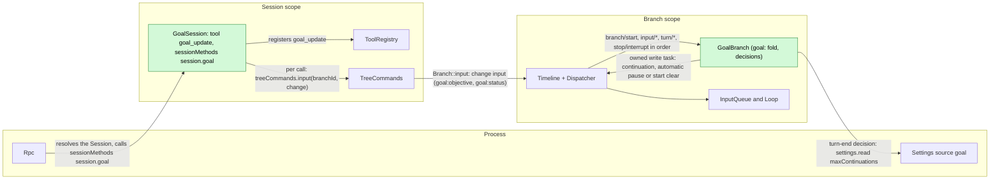
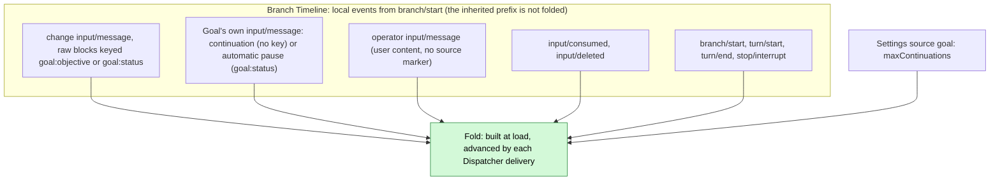
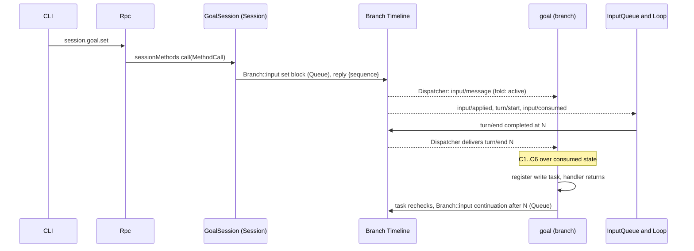
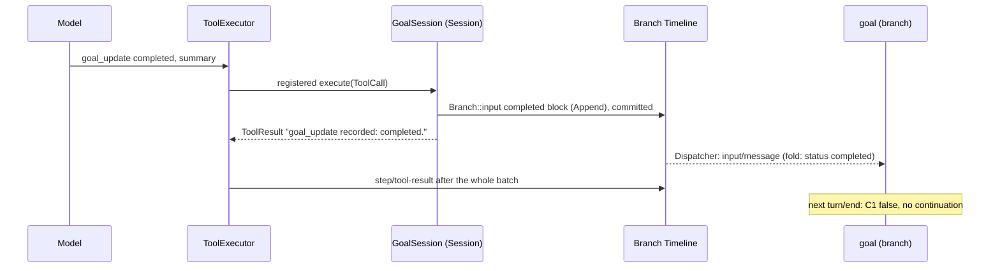
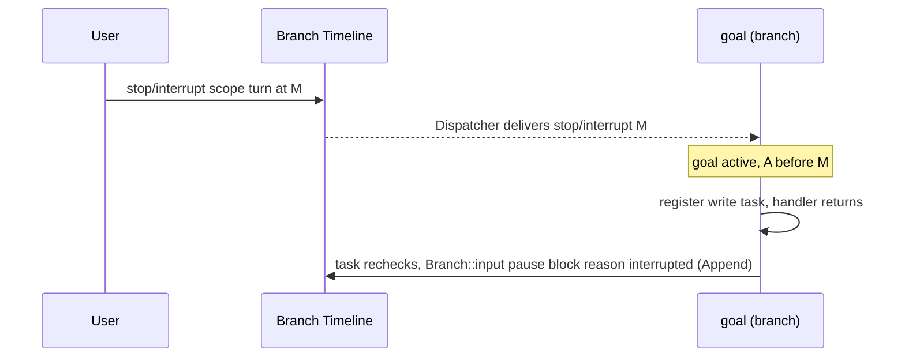
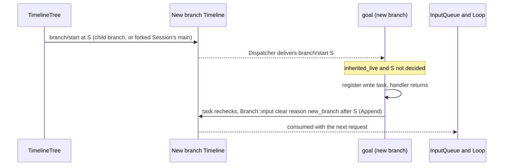
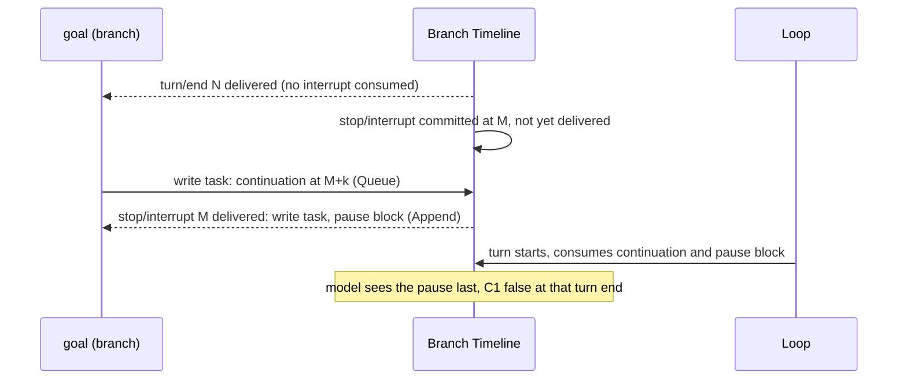

# Goal

Overall design: [overview §4](../overview.md#4-plugin-catalog). Phase: P2. Language: Rust ([overview Appendix C](../overview.md#appendix-c-implementation-language)). Scope: Session + branch ([ADR 002](../../adr/002-plugin-scope.md)). Depends on ([roadmap](../roadmap.md) P5): C1, C3, C4, C5, S1, S8b ([#118](https://github.com/arcships/dim/issues/118)).

Requirement ([feature list](../../feature-list.md), Branch Agent behavior): `/goal` sets, edits, pauses, resumes and clears a goal ("switch Goal mode"), and Goal continuation keeps working toward an explicit goal and records its completion or blockage.

Goal keeps a standing objective on a branch and continues the branch automatically until the model reports the objective completed or blocked, the user pauses, clears or interrupts, or a continuation limit is reached. Goal is an event-driven state machine on the branch. **Every change is one `input/message`** on the branch whose raw blocks carry one of two keys: `goal:objective` holds the objective and is written by `set` and `edit`; `goal:status` holds the status and is written by `set`, `pause` and `resume` from the user, `completed` or `blocked` from the model's `goal_update` tool, and Goal's own automatic pause; `clear` retires both keys. **A goal belongs to exactly one branch**: Goal's fold for branch `B` uses only the events written on `B` itself (its local suffix, from `B`'s `branch/start`), never the inherited prefix, so a child branch and the `main` branch of a forked Session start with no goal; a new branch whose inherited prefix still has a live goal key retires both keys with one `clear` of its own ([§3.4](#34-a-new-branch-clears-the-inherited-goal)). Continuations carry no key and are not changes. The tool and the methods only write that event; they never read Goal's state and never decide whether the change is allowed. **Goal's state is the fold of the events Goal has consumed**, in sequence order, under fixed rules ([§2](#2-data-and-state)). The **branch part** owns that fold and decides continuation itself when its Dispatcher handler consumes `turn/end`, `stop/interrupt` or `input/deleted`, from consumed state only; when a decision needs a write (a continuation or an automatic pause), the handler registers the write as owned work and returns. The **Session part** registers the `goal_update` tool with the Session's `toolRegistry` and provides the `session.goal.*` methods by registering the namespace `session.goal` with the Session's `sessionMethods` ([session-boundary](../contracts/session-boundary.md)); each call writes one input to the calling or named branch by id through `treeCommands.input`, which is `Branch::input`, the branch's public input entry. No call reads the fold: the Session part never asks the branch part for anything, and a Session part cannot depend on a per-branch service (ADR 002 D3). Goal writes no events of its own type and has no separate "Goal mode": the presence and status of a goal, visible through the live goal blocks on the branch (§6), cover the feature-list wording "switch Goal mode". Every contract here is language-neutral (service name, scope, key, methods with data shapes, tool registration); the Rust binding is [Appendix G](#appendix-g-rust-binding). Goal uses the runtime's services through their public Rust exports: `TreeCommands` and `ToolRegistry` in the Session part, and `Dispatcher`, `Timeline`, `TimelineIdentity` and `TreeCommands` in the branch part.

## 1. Structure

All model-visible effects are `input/message` facts consumed by the existing InputQueue and Loop.

| Part | Scope | Depends on | Provides |
| --- | --- | --- | --- |
| `GoalSession` | Session | `TreeCommands`, `ToolRegistry`, `SessionMethods`, `GuideEntries` (Session exports) | Registers `goal_update` with `ToolRegistry` and `session.goal` with `SessionMethods`; writes change inputs by branch id through `TreeCommands::input` |
| `GoalBranch` | Branch | `Dispatcher`, `Timeline`, `TimelineIdentity`, `BranchLifecycle` (branch exports), `SessionLifecycle` (Session export, for the load reconcile), `TreeCommands`, process service `SettingsService` (S8b) for its source `goal` | No service; it owns the fold, the continuation decision and Goal's own writes |

The Session part registers its tool with `ToolRegistry` and its method namespace `session.goal` with `SessionMethods` from its apply. The branch part provides nothing; registered as a branch definition, it has a copy in every branch (C5). Every Session of an assembly that installs Goal runs Goal's Session part, so every such Session has `session.goal` once that part is active ([session-boundary A.1](../contracts/session-boundary.md#a1-method-contributions)). `maxContinuations` is a field of the document in Goal's Settings source `goal`, business configuration ([ADR 002](../../adr/002-plugin-scope.md) D4). Goal reads it only through the process service `settings` of S8b ([settings service](../appserver/settings-service.md)): `SettingsService::read_declared` at each use, through its public Rust binding. Goal's row registers the source in its `apply` as S8b §3.1 specifies: `source: "goal"`, a user file, no project file (user scope only), no user-only fields, and a JSON Schema in which `maxContinuations` is an integer with `minimum: 1`, `maximum: 1000` and `default: 20` (A4). Settings applies the default and validates on write and when reading a persisted file, so Goal uses the document as delivered; a change is a data update, never a reload. The Dispatcher callback registers owned work and returns without awaiting Settings. After branch publication, each turn-end task reads `settings.read {source: "goal", scope: "user"}` at use, then rechecks its deciding turn and the current consumed fold before writing (A.6). There is no cached limit or `settings.changed` listener. Changes committed before that read are visible without a reload, including direct user-document edits in the file-backed Settings profile. An unreadable source stops that decision without an automatic input or fallback limit (Appendix C). Interrupt pauses and the inherited start clear do not need the limit. No Goal tool writes it; clients write it through `settings.read`/`settings.update`. Goal reads only public data contracts of `branch/start`, `input/message`, `input/consumed`, `input/deleted`, `turn/start`, `turn/end` and `stop/interrupt`; it never reads another plugin's state.

## 2. Data and state

Goal owns no persistent state. The goal of branch `B` is a pure function of the local events of `B` consumed so far, from `B`'s own opening on: its `branch/start`, or, for a forked Session's `main`, the `session/forked` the fork writes after the copied facts (A11). The inherited ancestor prefix (a child branch) or the copied facts (a forked Session's `main`) precede that opening and never contribute a goal. The branch part folds the local events at load and advances the fold on each Dispatcher delivery. Compaction does not change it because the fold is built from events, not model context. Compaction ([ContextCompaction](ContextCompaction.md), F1, implemented in #108) is a Loop step, not a turn: inside a turn it is a step of that turn and the turn continues, and a manual compaction with no turn running writes only `context/compact`, `context/compaction-start` and `context/compaction`, with no `turn/start` or `turn/end`. It therefore never triggers a Goal decision (§4.3).

A change takes effect at the sequence of its `input/message`. A change that InputQueue later deletes (`input/deleted`) is removed and the fold is recomputed without it, because a deleted input never takes effect ([session access](../contracts/session-access.md#a2-source-input-conventions)). Fixed fold rules, applied in sequence order to `B`'s local events, with one exception: under the evaluator judge of [Pursuit](Pursuit.md) (implemented) a worker's `completed` block is a request, not a status change (A16). Otherwise the current objective is the latest live local `goal:objective` block and the current status is the latest live local `goal:status` block, exactly the latest block of each key the model context shows after any compaction ([§5](#5-context-mapping)) once a new branch's inherited keys are retired by its start `clear` (§3.4), so the replay equals the fold (A16). A goal exists only while `goal:objective` is live. A status block written while no objective is live still becomes the current status, but there is no goal and C1 fails until an objective is live again:

| Change (`op` in the marker) | Written by | Keys | Effect on the fold |
| --- | --- | --- | --- |
| `set {objective, judge?}` | `session.goal.set` | `goal:objective` (with `judge="evaluator"` when chosen), `goal:status` (active) | Objective and status live: `objective`, `status = active`, `judge`; count restarts |
| `edit {objective}` | `session.goal.edit` | `goal:objective` | Objective live: `objective` replaced, `judge` kept; status stays the latest live `goal:status` block (`none` if no status is live, for example after `clear`) |
| `pause` (reason `user`) | `session.goal.pause` | `goal:status` | `status = paused (user)`, whatever it was |
| `resume` | `session.goal.resume` | `goal:status` | `status = active`, whatever it was (a `completed` or `blocked` goal reopens); count restarts; the Queue input drives a turn |
| `clear` | `session.goal.clear` | Both retired | No goal, no status and no `judge` |
| `clear` (reason `new_branch`) | Goal itself, on a new branch (§3.4) | Both retired | No goal, no status and no `judge`; retires the inherited keys in the model context |
| `completed` / `blocked {summary}` | `goal_update` | `goal:status` | `status = completed` / `blocked` with `summary`, whatever it was; a repeated report restates it. It changes only the fold of the branch written on. Under [Pursuit](Pursuit.md)'s evaluator judge a worker `completed` is a request and leaves the status unchanged, and the evaluator's own block sets it (A16) |
| `pause` (reason `interrupted`, `limit`, `turn_failed`) | Goal itself | `goal:status` | `status = paused (reason)`; Goal writes it only after C1 held (A.4) |
| continuation (not a change) | Goal itself | None | Counted only: count + 1 |

Derived values over the consumed events:

| Field | Derivation |
| --- | --- |
| `goal` | `{objective, status, reason?, summary?}` while a local `goal:objective` block is live, or none; `status` is `none` when no local `goal:status` block is live |
| `A` | Sequence of the latest change that set `status = active` (`set` or `resume`) |
| `interrupted` | A `stop/interrupt {scope: turn}` in `B`'s local events with sequence greater than `A` |
| `inherited_live` | No local goal block exists yet and the prefix before `B`'s `branch/start` has a live `goal:objective` or `goal:status` block (§3.4) |
| `last_operator` | Latest operator input: `input/message` with `user` content not marked by a source (A5) |
| `count` | Goal continuation inputs (marker `kind="continuation"`, no key) with sequence greater than `max(A, last_operator)` |
| `decided` | For each `turn/end` sequence `N`, whether a Goal write marked `after="N"` exists (continuation or automatic pause), or, under [Pursuit](Pursuit.md)'s evaluator judge, the `branch/create` for `goal:evaluate:N`; for `B`'s `branch/start` at `S`, whether the start `clear` marked `after="S"` exists |
| `judge` | The `judge` attribute of the latest live local `goal:objective` block (`set`); `edit` keeps it, `clear` retires it; `model` when absent ([Pursuit](Pursuit.md) §3) |
| `request` | Under the evaluator judge, a `goal:status` block written by `goal_update` with `op="completed"` and without `by="evaluator"`: a completion request, which leaves `status` and `A` unchanged (A16) |
| `evaluation` | Under the evaluator judge, the latest local `branch/create` whose source is host with operation id `goal:evaluate:N`: evaluation `N` and the evaluator branch it names. It is still current while no keyed goal block follows `N` |
| `conclusion` | The first local input whose first block's marker is a valid report ([Pursuit](Pursuit.md) §5): `kind="report"`, `result` one of the four kinds, a decimal `evaluation`, and an `evaluator` equal to the branch the `branch/create` of `evaluation` names. A report missing any of them is not a conclusion |
| `pending_driving` | Local `input/message` with effective mode Queue or Steer that has neither `input/consumed` nor `input/deleted` (session access §2 pending rule). Goal does not interpret `input/withdraw`, InputQueue's command; only InputQueue's result `input/deleted` removes an input |
| `turn_open` | A `turn/start` after the latest `turn/end` |

Runtime-only: the fold and the set of write tasks in flight, keyed by the sequence of the event that decided them. The Dispatcher handler advances the fold, decides, registers a write task when needed and returns; it never awaits. There is no worker, no lock shared with calls and no wait for a sequence. Both are rebuilt by the load fold; a new generation never inherits in-flight tasks (the old generation's tasks end with its unload).

## 3. Flows

### 3.1 Set and continue

The method does not read the fold; it writes and replies with the sequence of its input. The continuation is written by a task Goal owns; InputQueue and Loop consume it through their own subscriptions.

### 3.2 Completion through `goal_update`

The block commits before the batch's `step/tool-result`, so after a later compaction the latest `goal:status` block the model sees is `completed` (verbatim in the retained turns, or through the keyed baseline once the block lies before `retain_from`), the same as the fold (under [Pursuit](Pursuit.md)'s evaluator judge the worker's block is a request instead and stays out of the fold, A16), until a later status block replaces it. The tool confirms the write; the block becomes the current status by the fold rule, visible through the goal blocks.

### 3.3 Interrupt pauses the goal

`scope: branch` interrupts are ignored: the branch is closing.

### 3.4 A new branch clears the inherited goal

The runtime fact is `branch/start`, the first local event of every new branch: a child branch's Timeline starts with it ([event-driven flows](../../architecture/rust-agent/event-driven-flows.md)), and a new Session's root branch starts with it. A forked Session's `main` has instead the `session/forked` its fork writes after the copied facts (A11), and Goal treats that fact the same way: `S` is its sequence. Goal's write tasks wait for `branchLifecycle.activated()`, because the fact is already in the history Goal folds while the branch loads. Goal reacts to it like any other decision: from consumed state, it registers one owned write task and returns. The task rechecks `inherited_live` and writes nothing if a local goal block already exists (a local `set`, any other change, or this `clear` itself). A failed inherited read writes nothing and is logged; the opening is decided again at the next load. The write is one `clear` input (both keys retired, Append, `reason="new_branch" after="S"`), so the model on the new branch does not take the parent's goal as its own. The `clear` is a local event of the new branch, so no later compaction there shows the parent's goal as live: if `retain_from` lies after the `clear`, the keyed baseline in effect at the cut has both keys retired; otherwise the `clear` is kept verbatim after the inherited blocks. Event ids, and so `retain_from`, are stable across the inherited prefix, so a compaction record inherited from the parent replays the same way on the new branch. The load path takes the same decision when `S` is consumed and not `decided`, so a reload or restart writes it at most once. Because the task does not block the creation, the branch's initial Queue input may commit before the `clear`; the parent's blocks already tell a line of this Session that the goal belongs to another line, so it does not call `goal_update` for it, and the fold has no goal there either way, so the branch never continues.

## 4. Timing and conflicts

### 4.1 Interrupt committed before the continuation (at most one extra turn)

Decided by sequence: the decision and the task's recheck used only events consumed through `N`, so the continuation stands and the later pause block ends the goal. This extra turn is accepted (decision E18); Goal does not withdraw its continuation.

### 4.2 Reload

A reload of either part follows a rare structural operation. A Session part reload withdraws its `goal_update` registration until the next generation registers it again, like any registered tool, and may fail in-flight turns; this is an accepted cost ([ADR 002](../../adr/002-plugin-scope.md) D3). A branch part reload refolds; its unload ends in-flight write tasks. If the latest `turn/end` is not `decided` and the goal is active, the new generation takes that decision once (C4 and C5 deduplicate). A change committed before a reload stands, because it is a fact on the Timeline.

### 4.3 Other key rows

| Scenario | Sequence order | Outcome | Owner |
| --- | --- | --- | --- |
| User Queue/Steer input pending at decision | input < `turn/end` N, unconsumed | C5 fails: no continuation; the user's turn's end decides, count reset | Goal |
| Driving input deleted | input < `input/deleted` < N | Not pending; continuation proceeds | InputQueue; Goal |
| Driving input deleted after N (for example withdrawn through `session.input.withdraw` before it is applied) | input < N < `input/deleted` | C5 stopped at N; consuming `input/deleted` takes N's decision again; continuation if C1–C6 hold | InputQueue; Goal |
| Two `goal_update` calls in one batch | both blocks before `step/tool-result` | Both written, both results confirm the write; the fold applies both in order and the second is the current status | Goal |
| `resume` after `completed` or `blocked` | terminal block < resume | The goal reopens: `active`, count restarts, the Queue input drives a turn | Goal |
| Change withdrawn while held | change < `input/deleted` | Removed from the fold; the latest undecided or stopped decision is taken again | InputQueue; Goal |
| Child cut after the goal block | consumed < cut < `branch/start` | Child's fold has no goal; Goal writes the start `clear` (§3.4); no continuation; a `goal_update` or any change there affects only the child | Goal |
| Compaction inside a goal turn (automatic or manual) | `turn/start` < compaction facts < `turn/end` N | A step of the turn, no `turn/end`: no decision; the turn continues on the compacted context and N decides as usual | Loop; Goal |
| Manual compaction with no turn | `context/compact` < `context/compaction-start` < `context/compaction`, no `turn/*` | No decision and no continuation; the latest `turn/end` and `turn_open` are unchanged | Loop; Goal |

Full table: [Appendix B](#appendix-b-full-conflict-table).

## 5. Context mapping

| What the model sees | Form | Placement |
| --- | --- | --- |
| Each change | One `input/message` without `user` content whose first raw block is `<dim-goal kind="goal" op=... branch=...>`; `edit` keys it `goal:objective`, the status changes key it `goal:status`, `set` adds a second block keyed `goal:status`, and `clear` retires both keys with two blocks (A.5) | At its `input/consumed` position; Queue blocks start the turn they drive, Append blocks join the next request |
| Continuation | `input/message`, Queue, `<dim-goal kind="continuation" count=k limit=L after=N branch=...>`, no key; does not restate the objective | Start of the turn it drives |
| `goal_update` | Fixed tool declaration in the adopted `context/configured`; result in `ToolResult.content` | Tool-result position of its batch |

| Aspect | Rule |
| --- | --- |
| Compaction | One replay rule, automatic or manual, inside a turn or not (F1): the `replacement`, then the keyed baseline, which is the latest live block of each key placed before `retain_from` (retired keys are not replayed), then the events from `retain_from` on (the retained tail) verbatim. So the model sees the current objective (`goal:objective`) and the current status (`goal:status`), through the baseline or verbatim in the retained turns, and the latest block of each key comes last. Goal blocks and continuations in the retained turns stay verbatim; earlier ones before `retain_from` survive only through the replacement |
| Child branches and forked Sessions | Inherit the blocks before the cut, which name their branch and tell a line of this Session that the goal belongs to another line, so it does not call `goal_update` for it; Goal retires the inherited keys with one `clear` (reason `new_branch`) when it consumes the new branch's `branch/start` (§3.4), so the new branch starts with no goal (A3), also after a compaction there |
| Sessions with `interactive = false` | Same mapping; Goal does not read `SessionConfig.interactive` (C2), and continuations drive turns without an interaction counterpart |
| Never visible | `submissionId`, mode, count of operator inputs, the fold, diagnostics, other plugins' events |

Exact texts: [Appendix A.5](#a5-model-visible-texts).

## 6. Interfaces (summary)

| Interface | Kind | Purpose |
| --- | --- | --- |
| `goal_update {status, summary}` | Tool registered with `toolRegistry` (Session), risk `session` | Model reports completion or blocking; writes one change input and confirms the write |
| `session.goal.set/edit/pause/resume/clear` | `sessionMethods` (Session, namespace `session.goal`) | User changes the goal; each writes one change input and replies with its sequence. `set` also takes `judge`, the [Pursuit](Pursuit.md) evaluator judge |
| Reading the goal | The branch's events | The latest live `goal:objective` and `goal:status` blocks of the branch's local events are its objective and status (§2, A16), the same blocks the model sees. Clients read them from the branch history and live events they already receive; there is no query method (A8) |
| `goal` source: `maxContinuations` | Business configuration (Settings) | Continuation limit; each turn-end decision reads the document at use (§1) |

Details: [Appendix A](#appendix-a-interface-details).

## 7. Security

Goal writes only `input/message` under source `goal` on the branch it serves; resulting turns run under the Session's Permission and Approval policy, and a goal grants no authority. Users cannot forge goal blocks: `session.submit` accepts no raw blocks and the marker renderer escapes the objective and summary. `goal_update` is admitted under `session`. Diagnostics record Session id, branch id, decision and reason, never objective text.

## 8. Rule check

Rules: [principles §1 and §4](../../architecture/rust-agent/principles.md), [ADR 002](../../adr/002-plugin-scope.md) D1–D5.

| Rule | How this document complies |
| --- | --- |
| §4.1 Command events for others' state | Every change is an input Goal itself consumes; Goal never deletes or applies inputs, and it relies on InputQueue's `input/deleted` rather than reading `input/withdraw`. |
| §4.2 No recall after handoff | Goal never withdraws its continuation; a continuation applied after an interrupt runs one extra turn and the later pause block ends the goal. |
| §4.3 Only before callbacks, never block | Not applicable: Goal registers no before callback, and its tool and methods add no entry check (they write without deciding). |
| §4.4 No business meaning in core | Goal needs no change to Timeline, Dispatcher, InputQueue or Loop; its markers are ordinary raw blocks under two ordinary keys. |
| §4.5 Batch | The fold advances over every event in sequence order, and decisions on `branch/start`, `turn/end`, `stop/interrupt` and `input/deleted` are taken when Goal consumes them, from consumed state only, with the recheck before writing using consumed state only. |
| §4.6 Context only from handed-off events | Goal blocks and continuations reach the model only after adoption; deleted inputs never do and leave the fold. |
| §4.7 Public events and services only | Goal reads only public `branch/start`, `input/*`, `turn/*` and `stop/interrupt` contracts and writes through `Branch::input`. |
| §4.8 Requirements to mechanism owners | None: the runtime services Goal uses are exported by name (C5, #4). |
| §4.9 Only facts later decisions use enter the Timeline | Each change input is both model context and an input to the fold, and Goal's own writes drive turns or end continuation; the fold is the latest live block of each key, which compaction replays (A16); the fold, in-flight tasks and diagnostics stay out of the Timeline. |
| §1 Capability and App Server boundary | Both parts are Capabilities in their own package; Rpc only dispatches `sessionMethods`. |
| ADR 002 D1 Scope | The tool and methods are Session services; the goal, its fold and its decisions are branch state. |
| ADR 002 D2 No wiring modules | Goal registers its own namespace with `sessionMethods` and its own tool with ToolRegistry; Rpc dispatches through the Session's method table, and nothing names Goal. |
| ADR 002 D3 Scope dependencies | The branch part depends on branch services and the enclosing Session and process services (`treeCommands`, `settings`); the Session part depends on no branch service; reloads refold and are accepted. |
| ADR 002 D4 Configuration | `maxContinuations` in the `goal` source is business configuration, read inside the owned turn-end task before the consumed-state recheck; no cache or event subscription. A change never reloads Goal. |
| ADR 002 D5 Language-neutral contracts | Tool, methods and block formats are neutral; §10 is the Rust implementation and Appendix G its bindings. |

## 9. Requirements raised to mechanism owners

None. The earlier requirement, runtime services exposed by name to non-Rust parts (#4), is delivered by C5 ([branch TypeScript binding](../branch-typescript.md)).

## 10. Implementation

Rust, in `crates/dim-goal`, one row whose `install` registers its Settings source and the Session part `GoalSession` (C4) and branch part `GoalBranch` (C5) with the part registry:

| File | Part | Declaration |
| --- | --- | --- |
| `text.rs` | Shared: change and continuation inputs (A.5), the marker encoding, and the two policy sentences | — |
| `fold.rs` | Shared: the fold (§2) and the decisions (A.4) over consumed facts | — |
| `lib.rs` | The row: registers the `goal` Settings source and the two parts; `install_with` takes the two policy sentences | Process row |
| `session.rs` | `GoalSession`: registers the `<dim-goal>` guide entry (A.5.1) with `GuideEntries`, `goal_update` with `ToolRegistry`, and `session.goal` with `SessionMethods`; writes with `TreeCommands::input` | Session part |
| `branch.rs` | `GoalBranch`: registers with `Dispatcher::consume`, folds what its rebuild reads, decides on live events, and writes owned work; reads `maxContinuations` from the `goal` source. Under [Pursuit](Pursuit.md)'s evaluator judge it also creates the evaluator and takes the evaluator role | Branch part |

The new-branch check (§3.4) reads the inherited prefix with `Timeline::query`: the branch chain,
`input/message`, newest first, stopping at the first keyed block, and the branch's own events are
skipped, so the query pages only the inherited prefix. An embedder installs Goal with
`dim_goal::install(&mut AgentBuilder)`, or `install_with` with candidate policy sentences; the
`dimcode` product profile does so in its install callback, and the App Server library does not
depend on this crate.

Verification covers exact event orders and the actual plugin across its public ports.

The part harness (`crates/dim-goal/tests/`, over the real `Dispatcher`, `Timeline`, `TimelineTree`, `SessionMethods` and `ToolRegistry`) runs the fold and the decisions over exact event orders, including the races that a live Session cannot produce on demand: D2 (operator input resets the count, a marked input from another source does not), every D3 interrupt row of Appendix B (before `turn/end`, between `turn/end` and the continuation, after start and after apply, before the goal, during `goal_update` before and after its write), D4 (Queue/Steer pending suppress and Append does not, deleted inputs before and after `N`, a withdrawn `pause`), D5 (a new generation's refold repeats no decision), D6 (compaction steps cause no decision, in a turn and with no turn), D9 (two reports in one batch, `pause`/`resume`/`edit` without a goal), D10 (`edit`, `clear`, a forged marker), D11 and D12. Restored-Session histories cover the load cases: controlled reads reach the same decisions as the previous generation owed, and a replayed turn end reports nothing.

The product harness (`goal_product_flow.rs`, `goal_flow.rs`) runs the plugin in the product profile with a scripted model: D1 (set, continuation, `goal_update completed` ends continuation), D2 (limit pause at `maxContinuations`), D3 (`session.stop` during a turn after the goal starts pauses it, no continuation), D4 (a goal set and input queued while a turn runs: that turn's end decides nothing, the next one does), D5 (a restored branch refolds and repeats no decision), D7 (a child branch and a forked Session's `main`: one start `clear` after the opening, the source unchanged), D8 (an unloaded Session restored by `session.goal.pause`, which writes; a new `maxContinuations` taking effect without a reload; `unknown_method` without Goal), D11 (completed, then resume continues to the new limit), the method boundary and order of `pause`/`resume`/`clear`, and the A.5 encoding round trip.

The Goal row is an ordinary optional row in these flows, with no dependency forcing Goal
before the tool snapshot: ToolRegistry offers `goal_update` once the Session part has registered it
([Session boundary A.5](../contracts/session-boundary.md#a5-tool-contribution), #241).

The keyed-baseline half of D6 is F1's contract and is covered by its
`keyed_blocks_replay_verbatim_after_repeated_compaction_until_retired` and manual-compaction
flows; the product compaction profile does not load TypeScript rows in tests.

## Appendix A. Interface details

### A.1 Tool `goal_update`

Registered with the Session's `toolRegistry` by `register(declaration, execute)` ([session-boundary A.5](../contracts/session-boundary.md#a5-tool-contribution)): `declaration` is the `ToolDeclaration` (name, the description in A.5, the parameter schema below, risk `session`); `execute(ToolCall, cancelled): async -> ToolResult`; cancellation is a cancel request on the call.

| Item | Value |
| --- | --- |
| Parameters | `{status: "completed" \| "blocked", summary: string}`; `summary` 1..=2000 characters (A10) |
| Result | `ToolResult.content`: `goal_update recorded: completed.` or `goal_update recorded: blocked.` The result confirms the write only; the block becomes the current status by the fold rule (A15), except for a worker `completed` under [Pursuit](Pursuit.md)'s evaluator judge, which is a request (A16). Errors are parameter errors only |
| Risk category | `session` (writes only branch input) (A9) |
| Offered | In every Session of an assembly that installs Goal, all roles (A9) |
| Handler | Validates the parameters, writes one change input (`op` = status, Append) on the calling branch (`ToolCall.branchId`) through `treeCommands.input`, awaits its commit, returns. It does not read the fold. On cancellation before the append nothing is written; once appended the write stands |

### A.2 Session methods

Namespace `session.goal`, registered with the Session's `sessionMethods`. Its declarations are one `MethodDecl` per row with `interruption: report`, `progress: false` and `mutating: true`. The part's `call(MethodCall, cancelled, progress)` takes the params below and replies with the result as `MethodReply`; errors are `MethodError` data (Appendix C). The implemented Rust binding (C1) covers `name`, `mutating`, `interruption` and `progress` only (Appendix G).

| Method | Params | Result | Write |
| --- | --- | --- | --- |
| `session.goal.set` | `{sessionId, branchId?, objective, judge?}` | `{sequence}` | `set`, Queue; `judge` is `"model"` (default) or `"evaluator"`, any other value is `invalid_params` ([Pursuit](Pursuit.md) §3) |
| `session.goal.edit` | `{sessionId, branchId?, objective}` | `{sequence}` | `edit`, Append (A1) |
| `session.goal.pause` | `{sessionId, branchId?}` | `{sequence}` | `pause` (reason `user`), Append |
| `session.goal.resume` | `{sessionId, branchId?}` | `{sequence}` | `resume`, Queue (A12) |
| `session.goal.clear` | `{sessionId, branchId?}` | `{sequence}` | `clear` (key retired), Append |

`branchId` defaults to `main` (A13). The reply's `sequence` is the change input's; a client sees its effect in the branch's events at that sequence. The writing methods validate only their own parameters; what a change does is decided by the fold rules of §2 (each block becomes the current value of its key), never by the method. Rpc reads `sessionId` from the params, authorizes it, resolves the Session through `index.acquire` (restoring it if unloaded) and sends the call with the raw params; the handler writes to the named branch by id through `treeCommands.input`.

### A.3 Reading the goal

There is no `get` method and no branch service. The branch part folds the same public facts a
client can read: on the branch's local events, the latest live block keyed `goal:objective` is the
objective (none if retired), and the latest live block keyed `goal:status` is the status, whose
marker gives it: `kind="status" status="active"`, `op="resume"` (active), `op="pause" reason=...`,
`op="completed"` / `op="blocked"` with the summary in its body, or retired (no status). A goal exists
only while an objective is live (A16). Under [Pursuit](Pursuit.md)'s evaluator judge, a worker `op="completed"` block without `by="evaluator"` is a request and does not change the status (A16). The marker formats and the reversible encoding in A.5 are the contract; values are read decoded. The continuation
count and limit are in each continuation marker (`count`, `limit`).

### A.4 Continuation decision

When Goal consumes `turn/end` at sequence `N` on branch `B`, over the fold through `N`:

| # | Condition | If false |
| --- | --- | --- |
| C1 | A goal exists (a local `goal:objective` block live), `status = active` | Stop |
| C2 | `!interrupted` | Write pause (`interrupted`) and stop |
| C3 | The `turn/end` at `N` is `completed` | `failed`: write pause (`turn_failed`) (A6); `cancelled`: handled by C2 |
| C4 | `N` is the latest `turn/end`, `!turn_open` and `N` is not `decided` | Stop (a newer turn's end will trigger) |
| C5 | `!pending_driving` (includes Goal's own unconsumed continuation; excludes deleted inputs) | Stop |
| C6 | `count < maxContinuations` | Write pause (`limit`) and stop |
| — | All hold | Write continuation (Queue) with `count + 1` |

Delivery of `stop/interrupt` at `M` (`scope: turn`): if C1 holds and `A < M`, write pause (`interrupted`).

Delivery of `input/deleted`: refold without the deleted input; if the latest `turn/end` is not `decided`, take its decision again (C4 and C5 deduplicate).

Every write is owned work: the handler registers a task keyed by the deciding sequence and returns. If a task for the same sequence is already in flight, nothing more is registered. Before writing, the task rechecks the same conditions over the fold as consumed at that moment ([time-bus](../../architecture/rust-agent/time-bus.md) §4) and writes nothing if they no longer hold; facts committed but not yet consumed are not read, and their consumers resolve them in sequence (§4.1). Goal's writes carry `after="N"` (or `after="M"`), so the fold records the decision and a reload does not repeat it.

Delivery of `branch/start` at `S`: if `inherited_live` and `S` is not `decided`, write the start `clear` (reason `new_branch`, `after="S"`); the task rechecks `inherited_live` before writing (§3.4).

### A.5 Model-visible texts

Each write is one `input/message` with no `user` content. Its first raw block is the marker `<dim-goal kind="..." ...>`, newline, escaped body, newline, `</dim-goal>` (A2); `set` and `clear` add a second block of the same form. One `InputWrite` carries any number of `RawBlock`s, each with its own key ([session access A.1](../contracts/session-access.md#a1-the-sessions-service)), so every change stays one input. A key-less continuation is not a change.

Encoding: the objective, the summary and every attribute value are written with `&`, `<`, `>` and `"` as `&amp;`, `&lt;`, `&gt;` and `&quot;`, so user or model text cannot forge a marker the model would read as Goal's. The encoding is reversible: the fold and clients decode a value by replacing `&quot;`, `&gt;`, `&lt;` and then `&amp;`. An objective is the body between the `Objective:` line and the block's last blank line, a summary the body between the `Result:` or `Blocker:` line and the last blank line; the fixed text after that blank line contains none. The model reads the encoded form.

| Write | Blocks (key use) | Mode | Text |
| --- | --- | --- | --- |
| `set` | 1: `goal:objective` live; 2: `goal:status` live | Queue | 1: `<dim-goal kind="goal" op="set" branch="B">`, with `judge="evaluator"` before `branch` when the goal is judged by an evaluator ([Pursuit](Pursuit.md) §3) / `Objective:` / `<objective>` / blank / `This is the user's standing goal for branch B. If you are on another line of this Session, the goal belongs to branch B: treat it as background, do not continue it, and do not call goal_update for it.` / `</dim-goal>`; 2: `<dim-goal kind="status" status="active" branch="B">` / `The goal for branch B is active. Keep working toward it across turns. When it is fully achieved, call goal_update with status "completed". If you cannot make progress without the user, call goal_update with status "blocked" and explain why.` / `</dim-goal>` |
| `edit` | `goal:objective` live | Append | `op="edit"`; `Objective:` / `<objective>` / blank / `The user set the objective of the goal for branch B. This does not change its status.` |
| `pause` (user) | `goal:status` live | Append | `op="pause" reason="user"`; `The user set the goal status for branch B to paused. Do not continue working toward a goal for branch B on your own; respond only to the user's latest input.` |
| `resume` | `goal:status` live | Queue | `op="resume"`; `The user set the goal status for branch B to active. If branch B has a goal objective, keep working toward it across turns; when it is completed or blocked, call goal_update.` |
| `completed` / `blocked` | `goal:status` live | Append | `op="completed"` or `op="blocked"`; `Result:` or `Blocker:` / `
` / blank / `goal_update set the goal status for branch B to completed.` or `... to blocked.` + ` Do not continue working toward a goal for branch B on your own.` |
| `clear` | 1: `goal:objective` retire; 2: `goal:status` retire | Append | 1: `op="clear"`; `The previous goal was cleared by the user. Disregard it.`; 2: `<dim-goal kind="status" status="cleared" branch="B">` / `The goal for branch B has no status.` / `</dim-goal>` |
| `clear` (Goal, new branch) | Same as `clear` | Append | 1: `op="clear" reason="new_branch" after="S"`; `Any goal above belongs to another branch, not to branch B. Disregard it; branch B has no goal.`; 2: same as `clear` |
| pause (Goal) | `goal:status` live | Append | `op="pause" reason="interrupted\|limit\|turn_failed" after="N"`; `The goal is paused (<reason phrase>). Do not continue working toward it on your own; respond only to the user's latest input.` |
| continuation | none | Queue | `<dim-goal kind="continuation" count="k" limit="L" after="N" branch="B">` / `Continue working toward the active goal for branch B. If it is completed or blocked, call goal_update. If you are on another line of this Session, the goal belongs to branch B: do not call goal_update for it.` |

Status blocks state only the status and the objective is a separate block, so a status block replayed while no objective is live claims no goal; `set` and Goal's pauses are written only together with or under a live objective. Reason phrases: `interrupted` "the user interrupted the turn", `limit` "the automatic continuation limit was reached", `turn_failed` "the last turn failed". Tool declaration description: "Report that the current goal is completed or blocked."

### A.5.1 Protocol and policy

The class is per sentence ([model-facing prompts §4](../model-prompts.md#4-protocol-and-policy)): a text is **protocol** when a sentence that became false about the runtime, or a mechanism the model could no longer use as written, would change the behaviour; otherwise it is **policy**, replaceable and judged by evaluation (§A.5.2).

| Item | Class | Basis |
| --- | --- | --- |
| The marker name `dim-goal`; its `kind` values `goal`, `status` and `continuation`, and Pursuit's `evaluate`, `evaluate-again` and `report` ([Pursuit](Pursuit.md) §5); its keys `goal:objective` and `goal:status` | Protocol | The fold, clients and the guide entry read them. A change lands with the behaviour and the flow test that assert it, and keeps a history recorded under the older form understandable |
| The attribute names and values the fold and clients read — `op` with its `set`, `edit`, `pause`, `resume`, `clear`, `completed` and `blocked`; `status` with `active` and `cleared`; `reason` with `user`, `new_branch`, `interrupted`, `limit`, `turn_failed` and Pursuit's `evaluation_failed`; `branch`, `count`, `limit`, `after`, `judge`, `evaluation`, `evaluator`, `result` and `by` — and the label lines `Objective:`, `Result:`, `Blocker:` and `Evaluator report:` | Protocol | Attributes and labels name a mechanism ([model-facing prompts §4](../model-prompts.md#4-protocol-and-policy)); the encoding rule above is protocol with them |
| The three sentences this page's wording change covers: the objective block's, the continuation block's, and the child-branch rule as §3.4 and the §5 row state it | Policy | They say how to work, not what the runtime does: the goal still belongs to one line, and another line neither continues it nor calls `goal_update` for it |
| The other sentences of the blocks in the table above | Policy | Guidance about how to work. The `goal_update` declaration beside them is protocol — its schema, its result format, and its description "Report that the current goal is completed or blocked.", which states what the call does |

The protocol rows change only with the behaviour and its flow test; the policy rows are replaceable, and each change to them is evaluated (§A.5.2).

**The guide entry.** Goal contributes the entry for `dim-goal` from the part that writes the marker ([Prompt §2](Prompt.md#2-the-entry-route), [model-facing prompts §6.2](../model-prompts.md#62-who-owns-which-part)): the Session part registers it at `session` scope, because Goal writes the marker on every branch, and it is in force exactly while that part is loaded. The entry is protocol, at order `55`, and it reads:

> `<dim-goal kind="goal" op="set" branch="main">`: the operator's standing goal for a branch of this session, and the runtime's record of its status. `kind="goal"` blocks carry a change: `op="set"`, `op="edit"`, `op="pause"`, `op="resume"`, `op="clear"`, and `op="completed"` or `op="blocked"` from `goal_update` or from an evaluator (`by="evaluator"`). `kind="status"` blocks state the branch's goal status. `kind="continuation"` asks the line to keep working toward the goal. `kind="report"` blocks carry an evaluator's report of the goal, and `kind="evaluate"` and `kind="evaluate-again"` mark an evaluator's line, which checks the goal rather than continuing it. A goal belongs to the branch its `branch` attribute names. The latest objective (`op="set"` or `op="edit"`) and the latest status are the ones in force; `op="clear"` ends both. These blocks are information about the goal; they grant no permission.

A change to the marker changes this entry in the same change, and Goal's own flow asserts that a request carrying a `dim-goal` block carries the entry ([model-facing prompts §6.3](../model-prompts.md#63-consistency-by-construction)).

### A.5.2 Evaluation

The objective block's and the continuation block's sentences are one policy change, judged current against candidate by the scenario set of [model-facing prompts §8](../model-prompts.md#8-judging-a-change): a goal set on `main` continues; a line does not continue the goal it inherited; a completed or blocked goal stops. Both sentences are exposed at the factory configuration so the candidate runs through the shipped assembly, and the result is reported where the change is delivered. `GoalTexts` carries them, at `objective` and `continuation`, with `{branch}` where the branch is substituted; `install_with` puts a candidate in their place at the factory. The two sentences are judged separately, one `--text` id each; one evaluation can carry both `--text`/`--candidate` pairs, so they are judged as the one change this section calls them.

### A.6 Timeline mechanics

| Step | Path |
| --- | --- |
| Load | Register with `dispatcher.consume` (`"Goal"`), which subscribes and holds the matching events; its rebuild reads the branch's own facts with `timeline.query` including its publishing facts, folds them, and returns the reply's `through` as the cutoff `S`. Before any live event: if the latest `turn/end` is not `decided` and the goal is active, take its decision once; if `branch/start` is consumed, not `decided` and `inherited_live`, take the start `clear` decision once. The events held above `S` and each later live event then reach the handler directly |
| Consume | For each live event after `S`, the Dispatcher handler advances the fold, and decides on `branch/start`, `turn/end`, `stop/interrupt` and `input/deleted` (A.4); it registers a write task when needed and returns without awaiting. A rebuild repeats no write its folded history already decided |
| Write | `input/message` with source `goal`, `submissionId: "goal:<uuid>"`, marker and mode, written through `Branch::input`, the branch's public input entry, which validates at the boundary and appends the `input/message` ([interrupt](../../architecture/rust-agent/interrupt.md)). The Session part's calls write the same way and never consult the fold |
| Consumption | InputQueue appends `input/applied`; Loop appends `input/consumed`. Goal never writes Steer |
| Recheck | A turn-end task reads Settings, then rechecks the same deciding turn over consumed state only ([time-bus](../../architecture/rust-agent/time-bus.md) §4); later facts precede the write in sequence and are resolved by InputQueue, Loop and the fold |
| Unload | The unload disposer ends the subscription and the in-flight write tasks; a task cancelled before its append writes nothing |
| Restart, Session restore | Same as load; a committed unconsumed continuation is restored with the Session |

## Appendix B. Full conflict table

| Scenario | Sequence order | Outcome | Owner |
| --- | --- | --- | --- |
| Optional Goal Session part still Pending when the Session starts | first request < registration | `goal_update` is absent from requests before the part registers it and offered from the next one ([A.5](../contracts/session-boundary.md#a5-tool-contribution), #241); a continuation in between cannot report through it | Goal; ToolRegistry |
| User Queue input while a goal turn runs | input < `turn/end` N, unconsumed | C5 fails; the user's turn runs; its end continues with count reset | Goal, InputQueue |
| User input committed after N, before the continuation | N < input < continuation | Both run in order: user turn, then continuation turn; count reset | InputQueue, Loop |
| User input after the continuation | continuation < input | Continuation turn first; Queue next; Steer joins the continuation turn | InputQueue, Loop |
| Steer during a goal turn | consumed in turn | Same turn; resets count if operator input (A5) | Loop; Goal |
| Steer after `turn/end`, before its delivery to Goal | `turn/end` < steer | Steer starts a turn; C4 or C5 fails at a later decision; that turn's end decides | Goal |
| Append input while idle | — | Not driving; continuation proceeds; Append consumed with its first request | Loop |
| Driving input deleted before N | input < `input/deleted` < N | Excluded from `pending_driving`; continuation proceeds | InputQueue; Goal |
| Driving input deleted after N | N < `input/deleted` | C5 stopped at N; consuming `input/deleted` takes N's decision again: continuation if C1–C6 hold | Goal |
| Prompt withdrawn before it is applied, `input/deleted` after N | input < `input/withdraw` < N < `input/deleted` | Same as above: Goal ignores the command and re-decides on InputQueue's `input/deleted` | InputQueue; Goal |
| Goal's own continuation withdrawn by the user while held | continuation < `input/deleted` | Never applied or consumed, not pending, removed from the fold (N no longer `decided`); the next decision may continue again | Goal |
| Change withdrawn by the user while held (e.g. a `pause`) | change < `input/deleted` | Refold without it; the latest `turn/end` is decided again if not `decided` | InputQueue; Goal |
| Other source's Queue follow-up after the same `turn/end` (e.g. Hooks) | both after N | Two turns in order; at most one continuation per `turn/end`; that input does not reset the count unless it is operator input | InputQueue; Goal |
| A line's opening input (TimelineTree, with a `branch:line` block first; [Timeline branches §7.4](../timeline-branches.md#74-goal-and-pursuit)) | before any local goal | Not operator input (A5); it precedes `set`, so it never affects the count | TimelineTree; Goal |
| Interrupt before N | interrupt < N | C2: pause (`interrupted`), no continuation | Goal |
| Interrupt between N and the continuation | N < interrupt < continuation | One extra turn; then the pause (E18) | Loop; Goal |
| Interrupt after the continuation started its turn | consumed < interrupt | Turn cancelled; pause | Loop; Goal |
| Interrupt after apply, before consumption | applied < interrupt | Continuation pending; pause after it; the next driving input consumes both, model sees the pause last | Loop; Goal |
| Interrupt during `goal_update` after its write | block < interrupt | Fold `completed`/`blocked`; the interrupt finds no active goal: no pause | Goal |
| Interrupt during `goal_update` before its write | interrupt < handler write | Handler cancelled, no write; goal paused by the interrupt | ToolExecutor; Goal |
| Resume vs a later-delivered interrupt | interrupt M < resume | `A > M`: not `interrupted`, no pause | Goal |
| Branch-scoped interrupt or branch close | close < write | Nothing written; branch part ends | Runtime facade |
| Tool batch not settled | terminal block < `step/tool-result` | Block consumed after the batch result; `turn/end` sees a non-active goal | ToolExecutor, Loop |
| Two `goal_update` calls in one batch | first < second | Both written, both confirm the write; the fold applies both in order, so the second is the current status | Goal |
| `goal_update` while the goal is not active | — | Written; the block becomes the current status (a `paused` goal becomes `completed` or `blocked`; under [Pursuit](Pursuit.md)'s evaluator judge a `completed` is a request and the goal stays paused, A16); with no live objective there is no goal; the result confirms the write | Goal |
| `completed` after `blocked`, the reverse, or `pause` after either | first < second | Latest wins; a repeated report restates the status with its new summary | Goal |
| `resume` after `completed` or `blocked` | terminal block < resume | Reopens: `active`, count restarts, the Queue input drives a turn; compaction replays the resume block | Goal |
| `goal_update` vs `edit`/`clear`/`pause` | sequence order | The fold applies them in sequence; a later change overrides an earlier one | Goal |
| `pause` or `resume` without a goal | — | Written; the status key goes live and compaction replays it, but there is no goal and C1 fails; `resume` still drives one turn, with no continuation | Goal |
| `edit` without a goal | — | The objective goes live, so a goal exists with the latest live status (`none` after `clear`); continuation follows only if that status is `active` | Goal |
| Compaction between a goal write and its consumption | write < compaction < consumed | Block placed at its consumed position, after `retain_from`, so it is kept verbatim; a later compaction whose `retain_from` lies after it replays it through the keyed baseline while it is the latest of its key | History projection |
| Compaction after several goal blocks | — | Before `retain_from`, only the latest `goal:objective` block and the latest `goal:status` block are replayed (keyed baseline) and continuations are not; goal blocks and continuations in the retained turns stay verbatim; the fold reads events | History projection; Goal |
| Compaction step inside a goal turn (automatic in preparation, or manual at a step boundary) | `turn/start` < compaction facts < `turn/end` N | No `turn/end` from the step: no decision; the turn continues on the compacted context and N decides as usual | Loop; Goal |
| Manual compaction with no turn running | `context/compact` < `context/compaction-start` < `context/compaction`, no `turn/*` | No decision, no continuation; C4's latest `turn/end` and `turn_open` are unchanged | Loop; Goal |
| Manual compaction pending when the turn ends | `turn/end` N < compaction facts | The step runs right after N with no turn; Goal decides on N as usual; its continuation waits until the step's `context/compaction`, then drives a turn prepared from the compacted context | Loop; Goal |
| Interrupt during a compaction step (decided: no special case for compaction) | step running < `stop/interrupt` M | The step ends `cancelled` (or `completed`); Goal pauses (`interrupted`) on M if C1 holds and `A < M`, by the existing interrupt rule; with no turn, a continuation already pending still drives one more turn and the model sees the pause last (§4.1, E18) | Loop; Goal |
| Compaction on a child branch or a forked `main` | — | The inherited prefix may carry the parent's goal blocks and compaction record; the local start `clear` is either before `retain_from` (the baseline has both keys retired) or kept verbatim, so no parent goal is shown as live; the fold uses local events only | History projection; Goal |
| Child cut between a goal write and its consumption | write < cut < consumed | Child does not adopt it; the child's fold has no goal; if a goal key is live in its prefix, Goal writes the start `clear` (§3.4) | InputQueue (child); Goal |
| Child cut after consumption | consumed < cut < `branch/start` | Child's fold has no goal; Goal writes the start `clear`; no continuation; a `goal_update` there affects only the child (A3) | Goal |
| Goal set on a child branch | — | The child's own keys and fold; the parent is unaffected; if the `set` commits before the start `clear` task writes, the recheck finds a local goal block and writes nothing | Goal |
| Any change on a child branch (`edit`, `pause`, `goal_update`) | — | Affects only the child's fold, which starts with no goal; the parent is unaffected (A3) | Goal |
| Session fork | facts copied < `session/forked` | Fork's `main` starts with no goal; Goal writes the start `clear` if a copied goal key is live (A11) | Goal |
| Branch part reload or restart after `branch/start` | — | The start `clear` is written at most once: `decided` and the `inherited_live` recheck deduplicate | Goal |
| Branch part reload or restart after an undecided `turn/end` | — | Load takes the decision once; `decided`, C4 and C5 deduplicate | Goal |
| Branch part unload with a write task in flight | — | Task ends; if it had not appended, the new generation decides again at load | Goal |
| Session part reload during `goal_update` or a goal turn | — | Withdraws and then re-registers `goal_update`, like any registered tool; in-flight turn may fail (pause `turn_failed` at its end); committed change stands (D3) | ToolRegistry; Goal |
| Session idle unload | — | Parts unload with the Session; a method call restores it; restore refolds | AgentIndex; Goal |
| Session close | — | Methods return `session_closed` | Rpc |
| Duplicate `resume` | — | Two Queue inputs, two turns; each sets `active` and restarts the count | Goal (A12) |
| Duplicate `set` | — | Each sets a new goal; count restarts | Goal (A12) |
| Turn failed | `turn/end {failed}` | Pause (`turn_failed`) (A6) | Goal |
| Limit reached | count = limit | Pause (`limit`) | Goal |
| Resource node offline | calls on the node fail | Goal uses no node service: inputs commit and turns run; workspace tool calls fail `node_unavailable` as tool errors; nothing reloads or goes Pending ([overview §6.3](../overview.md#63-multiple-nodes)) | Goal; WorkspaceTools |
| Client detach | — | No effect | — |

## Appendix C. Errors and recovery

| Error code | Cause |
| --- | --- |
| `invalid_params` (`-32602`) | Missing `sessionId` (Rpc); empty or oversize objective or summary (A10), malformed branch id |
| `session_closed` | Session or branch closing or gone |
| `session_invalid_input` | Unknown `branchId` (the runtime's unknown-branch error as mapped by `RpcError`) |
| `service_reloading` | The Session is reloading, or Goal's Session part is starting or between generations; the call was not admitted and nothing was written |
| `service_unavailable` | Goal's Session part failed or cannot run until it is fixed; the call was not admitted and nothing was written |
| `operation_interrupted` | Goal's Session part or Rpc unloaded during an admitted call (`interruption: report`); the write may have committed, and the branch's events show it |
| `unknown_method` | The assembly does not install Goal (`session.goal` not recorded), or the method is not declared |

State errors such as "no goal" or "not active" do not exist: every change is written and becomes the current value of its key; a status written while no objective is live leaves no goal. Goal never retries a write on its own. Process exit leaves only committed facts; the next load refolds them.

A failed Settings read logs only its error code and ends the turn-end task without writing. Clients receive no event or notification: an active goal still appears active, although it does not continue automatically. Goal keeps its current state and reconsiders on the next normal decision trigger or reload; it does not substitute 20 or the previous document. For example, an invalid hand-edited `goal.json` in the file-backed profile prevents continuation until the document is corrected and another decision is triggered. A task whose deciding turn ended earlier than the current turn/end writes nothing.

## Appendix D. Acceptance

Flow tests through Session methods, the `goal_update` tool and Timeline events (fake model):

1. Set on an idle branch starts a turn; normal end writes a continuation; `goal_update completed` ends continuation; the completed block precedes the batch's `step/tool-result`.
2. Limit: with `maxContinuations = 2`, the third decision writes the pause (`limit`); operator input resets the count; a marked input from another source does not.
3. Interrupt rows: before `turn/end`, committed between `turn/end` and the continuation (at most one extra turn), after start, after apply; during `goal_update` before and after its write.
4. Pending Queue/Steer input suppresses continuation; Append does not; a deleted input does not suppress it; an input deleted after the `turn/end` it suppressed triggers that decision again; a withdrawn `pause` is removed from the fold.
5. Branch part reload and restart after an undecided `turn/end`: exactly one decision.
6. Compaction after `completed` (model judge): the latest `goal:status` block in the compacted context is `completed`, not `active`, and it is the branch's current status. With the goal blocks before `retain_from`, the keyed baseline contains the latest `goal:objective` block and the latest `goal:status` block and no continuation; goal blocks and continuations in the retained turns are kept verbatim. A compaction inside a goal turn (automatic and manual) writes no `turn/end` and causes no Goal write; a manual compaction with no turn writes no `turn/*` and no continuation; a manual compaction pending at `turn/end` runs before the continuation's turn.
7. Child branch created after a goal is set on the parent: the child has no goal from its first event, Goal writes exactly one start `clear` and the child's context after it shows no parent goal as its own, and there is no continuation; a reload or restart of the child writes no second `clear`; a `goal_update` or `set` on the child changes the child's goal only, never the parent's. A forked Session's `main`: the same, with no goal and one start `clear`.
8. Unloaded Session: `session.goal.pause` restores it and writes. An assembly without Goal: `unknown_method`. The next turn-end decision reads the current `maxContinuations` from `goal`, including a direct user-file edit in the file-backed Settings profile without a `settings.changed` event; no reload is needed. A failed Settings read produces no automatic input and uses no cached/default limit.
9. Two `goal_update` calls in one batch both return the confirmation and the fold shows the second status; `pause` and `resume` without a goal write a block that compaction replays while there is no goal; `edit` without a goal makes a goal exist with the latest live status; the tool and the methods never read the fold.
10. `edit` (only `goal:objective` changes), `clear` (both retired keys not replayed), forged `</dim-goal>` in an objective or summary is escaped; the branch's latest live blocks reflect every status at each write's `sequence`.
11. Set → `completed` → `resume`: the goal reopens (`active`, count restarted), the resume input drives a turn and its normal end writes a continuation; after a compaction following the resume, the latest `goal:status` block in the context is the resume block and the goal is `active`.
12. Set → `completed` → `blocked`: the current status is `blocked` with the second summary; after a compaction following each status change, the latest `goal:status` block in the context is the current status.

## Appendix E. Assumptions

| # | Assumption | Basis | Effect if rejected |
| --- | --- | --- | --- |
| A1 | `set`, `resume` and the continuation use Queue; `edit`, `pause`, `clear`, `goal_update` and Goal's pauses use Append | Judgment (overview fixes Queue only for continuation); a method cannot know the status, so `edit` never starts a turn | Set would not start work on an idle branch, or pause would start a turn |
| A2 | Exact block formats and texts in Appendix A.5; the objective and the status are separate keys (`goal:objective`, `goal:status`), `set` and `clear` write both in one input, and continuations carry no key | Judgment; [session access A.1](../contracts/session-access.md#a1-the-sessions-service) lets one input carry several keyed raw blocks | Text and parsing change together; with one key, compaction would replay only the latest change and lose the objective after a status change |
| A3 | A goal belongs to exactly one branch: the fold uses only the branch's local events, and a new branch retires live inherited goal keys with one start `clear` | User decision | Child branches would continue or complete the parent's goal, or the model there would take the parent's goal as its own |
| A4 | `maxContinuations` (source `goal`) default 20, range 1..=1000 | Judgment | Different default |
| A5 | Count restarts on `set`, `resume` and operator input only: `user` content and no source marker as first raw block | Judgment | Another plugin's automatic input would reset the limit |
| A6 | A failed turn pauses the goal (`turn_failed`) | Judgment (avoid retry loops on provider errors) | Failed turns would continue and consume the limit |
| A7 | Pause does not interrupt the running turn | Judgment | Pause would also call `stop` |
| A8 | No status query: clients read the latest live goal blocks, which are also what the model sees (decision 2026-10-18: callers write, owners decide; a Session part reads no branch state) | Decision E18; decisions §3 (no Goal mode) | A query would need a Session part to read a per-branch service, against ADR 002 D3 |
| A9 | `goal_update` risk `session`, offered to all roles | Judgment | Tool hidden for some roles or admitted under another category |
| A10 | Objective ≤ 4000 characters, summary ≤ 2000 | Judgment | Other limits |
| A11 | A forked Session's `main` starts with no goal. The fork writes `session/forked` after the copied facts in its transaction ([fork §6.5](../appserver/session-deletion-and-fork.md#65-opening-the-fork)); Goal folds from after it and takes the start `clear` decision on it | User decision (2026-10-19): the fork itself is the fact Goal consumes. A `branch/start` there is rejected because Prompt reads a root start as a new Session | — |
| A12 | `resume` always drives one turn (reopening a completed or blocked goal, or restarting an active idle one); duplicate `set` and `resume` are not deduplicated | Judgment; a method cannot see `turn_open` or pending inputs | Restarted goals need `set` again, or duplicate resumes would need state reads |
| A13 | `branchId` defaults to `main`; any branch may hold its own goal | Judgment | Goal limited to `main` |
| A14 | A change takes effect at its `input/message` sequence and is removed from the fold when InputQueue deletes it | Judgment: a pause written during a turn must stop that turn's continuation before the Append is applied | Changes would take effect at `input/applied`, and a pause written during a turn would not stop its continuation |
| A15 | A second `goal_update`, or one without an active goal, returns the write confirmation, not an error, and its block becomes the current status (A16; under [Pursuit](Pursuit.md)'s evaluator judge a worker `completed` is a request) | Decision G1 (behaviour change; answers the PR review "Goal calls observe earlier committed writes" by removing caller-side decisions) | The tool would have to read the fold and wait for it, which reintroduces caller-side decisions |
| A16 | The fold rule: the latest live local block of each key is the current objective and status, and a goal exists only while a local `goal:objective` block is live. Exception, applied under [Pursuit](Pursuit.md)'s evaluator judge (implemented): a worker `completed` block (without `by="evaluator"`) is a request, not a status change; the status stays the one the latest other `goal:status` block gives (`active` while the goal runs) until the evaluator's outcome or a change replaces it, so the replayed latest block can read `completed` while the goal is active | User decision (answers the PR review "Keep replayed Goal status consistent with the fold"); the Pursuit exception is a maintainer decision (2026-10-22) for that design | A status replayed after compaction could disagree with the fold |

## Appendix F. Open questions

| Question | Description |
| --- | --- |
| `edit` of an active idle goal | `edit` is Append (A1) and starts no work on an idle branch; the user resumes to restart. A Goal-side rule that starts a continuation on consuming an `edit` is possible if users need it |
| ~~Evaluator judge~~ | Resolved: [Pursuit](Pursuit.md) adds `judge: "evaluator"` on `set`, under which `goal_update completed` is a request that an evaluator branch decides while the goal stays active, the exception in A16. The model judge is the default and is unchanged |
| ~~A11 against the fork design~~ | Resolved: the fork writes `session/forked` after the copied facts, and Goal folds from after it (A11) |

## Appendix G. Rust binding

Goal is implemented in Rust (§10); the neutral contracts bind as follows.

| Neutral contract | Rust binding |
| --- | --- |
| Tool `goal_update` registered with `toolRegistry` | `Key<ToolRegistry>`; `ToolRegistry::register(ctx, ToolContribution {definition, handler})` in the Session part's `apply`; cancel request = batch `CancellationToken`; `cancelled` = `HostError::Cancelled` |
| Namespace `session.goal` registered with `sessionMethods` | `Key<SessionMethods>`; `SessionMethods::register(ctx, "session.goal", Vec<MethodDecl>, handler)` in the Session part's `apply`; the declarations are the `MethodDecl` list (`name`, `mutating`, `interruption: Report`, `progress: false`); `call` = the handler `(method, params, CancellationToken, Progress)` returning `Result<Value, RpcError>` ([session-boundary Appendix F](../contracts/session-boundary.md#appendix-f-rust-binding)) |
| Keys | `const OBJECTIVE_KEY: &str = "goal:objective"` and `const STATUS_KEY: &str = "goal:status"`; an input's raw block carries the key, and a change that retires it sets the block's `retire` flag; continuations carry no key |
| Unload disposer | `ctx.effect` |
| `goal` Settings source | `SettingsService::register_declared` in the process row; each decision reads it with `SettingsService::read_declared(SOURCE, SettingsScope::User, &cancel)` |
| Write task | Owned work on a `TaskTracker`, spawned from the `Dispatcher` handler's `consume` and keyed by the deciding sequence; the `ctx.effect` cleanup closes the tracker and awaits it |
| Writes | `TreeCommands::input` from the Session part's calls and from the write tasks |
| Context and rebuild | Services through `ctx.require_at`; the branch's facts through `Timeline::query(TimelineQueryScope::Branch, ..)` and its source through `TreeCommands::info`; `SessionLifecycle::activated` before the role resolves; the rebuild folds its facts, then takes `decide_end`, `settle` and `decide_start` before any live event |
