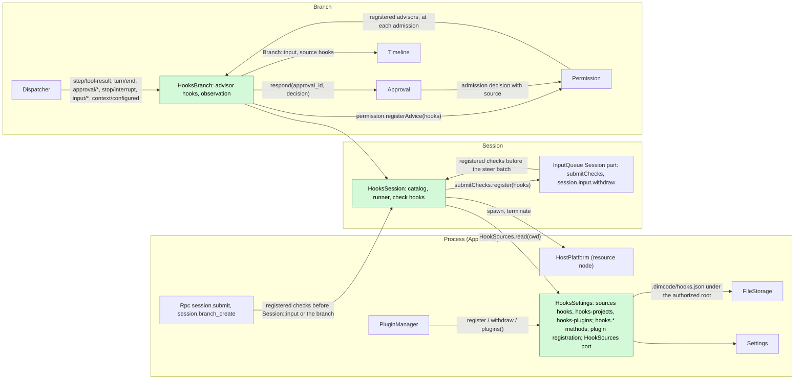
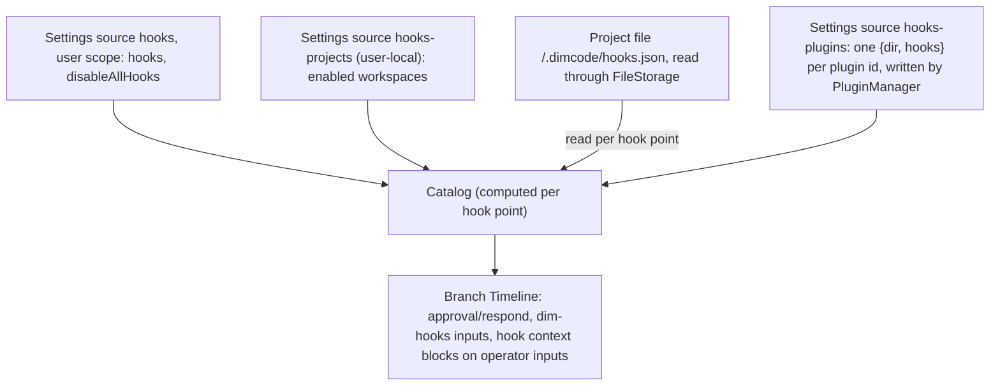
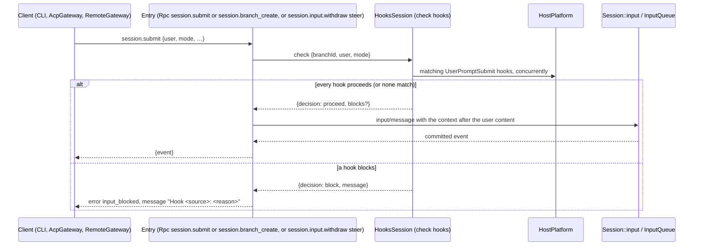
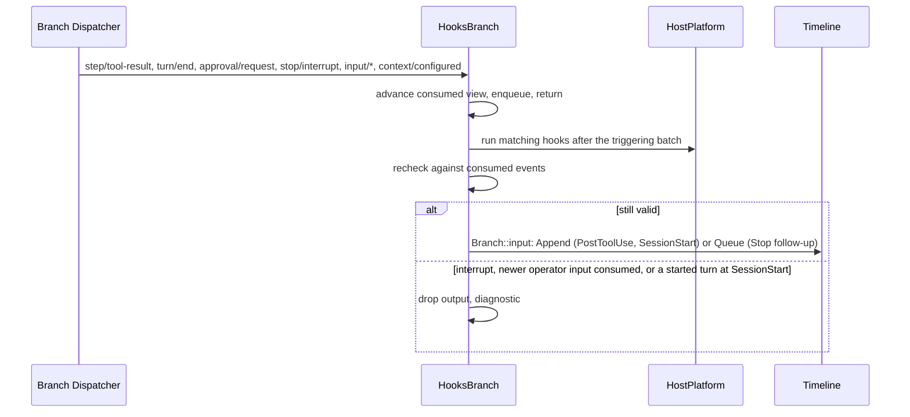

# Hooks

Status: Ready ([#143](https://github.com/arcships/dim/issues/143)); maintainer decisions of 2026-10-22 and 2026-10-31 are applied (§10). Overall design: [overview](../overview.md) (Hooks). Phase: M1 (user, project and plugin sources). Language: Rust. Scope: [ADR 002](../../adr/002-plugin-scope.md) (process + Session + branch).

Hooks runs user-configured commands at fixed points of a Session's **business operations** and hands each command's decision to the owner of that operation. Dim reads only its own hooks configuration; it does not load Claude Code or Codex hook files. For easy migration, the document shape (event names, matcher groups, command handlers, `timeout`, `onFailure`) and the script protocol (stdin JSON, exit codes, decision and output fields) follow Claude Code and Codex, so existing scripts and pasted configuration work (Appendix G).

Hooks never hooks infrastructure. The withdrawn design ([#21](https://github.com/arcships/dim/issues/21)) made Timeline `before` callbacks asynchronous so a command could hold a write; that is not done, and Hooks registers no before callback. Timeline, Dispatcher, the event envelope and assembly are unchanged. Each hook point instead attaches to the business owner that already decides the operation, through that owner's public events or services:

| Hook point | Business operation | Owner that decides | How the hook's decision reaches the owner |
| --- | --- | --- | --- |
| `PreToolUse` | Admission of a tool call | Permission (called by Approval's `admit`) | During the admission decision, Permission calls the advisors registered with it; `HooksBranch` registers `hooks` (new generic advice registration, A.6.1) |
| `PermissionRequest` | An approval question | Approval | Hooks answers through Approval's public `respond`, like a client (existing) |
| `UserPromptSubmit` | Submission of operator input | The operator-input entries: Rpc `session.submit` and `session.branch_create`, and InputQueue's `session.input.withdraw {steer}` | Before it writes, the entry calls the checks registered with the Session's `submitChecks`; `HooksSession` registers `hooks` (new generic submit-check table, A.6.2) |
| `PostToolUse`, `PostToolUseFailure`, `Stop`, `SessionStart` | Context after a tool result, after a turn, at Session start | InputQueue (inputs) | Hooks writes branch input with source `hooks` (existing) |
| `Notification` | An approval waiting for the user | — (observation) | Nothing reaches an owner (existing) |

`UserPromptSubmit` is not a Timeline hook point: Session input is not necessarily the user's (Goal, Scheduler, Collaboration, ShellInput and Hooks itself write inputs), so the command runs only where operator input enters, before anything is written. Commands run through HostPlatform (the Session's resource node); a hook command waits only in Hooks' own tasks or in the caller's own task (Permission's admission decision runs in ToolExecutor's per-call admission task; a submit check runs in the Rpc call), never in a Dispatcher handler or under the commit lock. Contracts are given in neutral form ([ADR 002 D5](../../adr/002-plugin-scope.md#d5-contracts-are-language-neutral)); the Rust binding is Appendix H.

### Owner check

Each hook point was checked against what its owner exposes on `main`:

| Hook point | Owner today | Gap | Resolution |
| --- | --- | --- | --- |
| `PreToolUse` | `Approval::admit(AdmitCall {source, call}, risk, cancel)` calls `Permission::decide(call, risk, cancel)` for the admission and again for the recheck after an allow; `decide` already awaits the command-rules port; a Deny becomes `HostError::failed(reason)`, the error text of the call's result | `decide` cannot ask anyone else, does not receive `source` (the call id is only in `AdmitCall.source`), and cannot tell the admission from the recheck | A.6.1: Approval passes `source` to the admission decision only; Permission calls its registered advisors there. ToolExecutor needs no change |
| `PermissionRequest` | `approval/request {approval_id, source, call, reason}`; `Approval::respond(approval_id, decision)` accepts the first consumed response, else `Unknown`/`Cancelled`/`Closed`; `approval/respond {approval_id, decision}` has no reason | No reason on a deny | Usable as is; a hook deny shows Approval's generic text (decision 7) |
| `UserPromptSubmit` | Rpc `session.submit {sessionId, submissionId?, branchId?, text? \| user?, mode?}` builds `InputMessageData` and calls `Session::input`; Rpc `session.branch_create {sessionId, parentBranchId, at, prompt}` creates a host branch whose first Queue input is the prompt, as the operator's words (TimelineTree `first_input`); InputQueue's `session.input.withdraw {…, steer?}` writes the withdrawal and the new Steer input as one batch. Other inputs (Goal, Scheduler, Collaboration, ShellInput, Hooks) enter through `Branch::input` from their owners | No entry asks anyone before writing. An input with `user` content whose first raw block is a `<dim-…>` marker reads as a source input (Goal A5), and history renders raw blocks before the user content, so context cannot be a raw block of the operator's input | A.6.2: the three entries call the checks registered with `submitChecks` first and append the returned context to the input's `user` content after the operator's own content, so the input stays operator input and needs no history or convention change |
| `PostToolUse(Failure)` | `step/tool-result {turn_id, request_id, call_event_id?, results: [{call_id, result}]}`, `ToolResult.is_error` | None | Dispatcher subscription |
| `Stop` | `turn/end {turn_id, status: completed \| failed \| cancelled}` | None | Dispatcher subscription, `completed` only |
| `SessionStart` | No Session-start fact; `branch/start` and the absence of `turn/start` on `main` | None needed | Derived from history (§3.4) |
| `Notification` | `approval/request` | None | Dispatcher subscription |
| `PreCompact`, `PostCompact` | `context/compaction-start {trigger}` (the strategy is already called), `context/compaction {outcome}` | Blocking would need a compaction-admission port in ContextCompaction | Unsupported (decision 6) |
| `SessionEnd` | Session close is lifecycle, not a Timeline fact; work must settle before services are removed (AGENTS rule 8) | A command at close would delay close | Unsupported (decision 6) |
| Configuration | Settings `BusinessDocument` sources with a user file and an optional project file; both are plain filenames (`validate_file` rejects any path separator), so a project file sits at the authorized project root (MCP: `mcp` with `.mcp.json`, enablement in `mcp-projects`). Project files in a directory, such as Workflow's `.dimcode/workflows/*.yaml`, are not Settings sources: their owners read them through FileStorage under the root Settings authorizes ([overview](../overview.md), Configuration). Rust sources have no generic client write, so each Rust owner keeps its management methods | `.dimcode/hooks.json` cannot be the project file of a Settings source | `HooksSettings` in App Server, as MCP (decision 5; §1, A.7): the user document is the Settings source `hooks`, and `HooksSettings` reads `.dimcode/hooks.json` through FileStorage under the project root Settings authorizes for the `cwd` (A.2) |

## 1. Structure



| Part | Scope | Depends on | Provides |
| --- | --- | --- | --- |
| `HooksSettings` | Process, App Server (where Settings and MCP's management live) | Settings (`BusinessDocument` sources `hooks`, user scope only, `hooks-projects` and `hooks-plugins`; the project root it authorizes for a `cwd`); FileStorage (reads `<project>/.dimcode/hooks.json` under that root) | Management methods `hooks.catalog`, `hooks.save`, `hooks.set_enabled` (A.7); the owner operations `register`, `withdraw` and `plugins()` for plugin hook documents ([PluginManager §3.7](PluginManager.md#37-content-registration)); the Session port `HookSources` that returns the effective sources for a `cwd` (A.2) |
| `HooksSession` | Session (optional; registered by the Hooks plugin while it is enabled) | `HookSources`; HostPlatform; `SessionConfig.cwd`; `submitChecks` (InputQueue's Session part) | Registers the submit check `hooks` with `submitChecks`, which the operator-input entries call (A.6.2); a private catalog and command runner used by `HooksBranch` |
| `HooksBranch` | Branch (optional; registered by the Hooks plugin while it is enabled) | `HooksSession`'s runner; `Dispatcher`, `Approval`, `Permission`, `Branch::input` | Registers the advisor `hooks` with the branch's Permission (A.6.1); observation and context hooks |

`HookSources` follows the existing host-port pattern of `CommandRulesHost` and `SkillSettingsHost`: the agent-side parts never name Settings or App Server. Hooks' parts register with their owners: `HooksBranch` with Permission, `HooksSession` with `submitChecks`. Permission and the entries depend on no advisor or check ([ADR 002 D3](../../adr/002-plugin-scope.md#d3-dependencies-follow-scope-and-point-from-extensions-to-the-core)): with none registered, Permission decides from policy and command rules alone, and the entries write operator input unchecked.

**Reload.** Enabling, disabling or upgrading Hooks reloads only the Hooks plugin (D3). Open Sessions and branches mount or unmount its parts as its registrations change ([ADR 006 D3](../../adr/006-plugin-contract.md#d3-a-plugin-is-one-row-each-instance-mounts-the-parts-registered-for-it)). Before its parts unload they settle accepted work (AGENTS rule 8): running commands are terminated, and each pending submit check is answered by the `onFailure` of the hooks that were running (A.5). Their registrations are withdrawn with them. Calls whose advice was pending see that advice dropped, counted as none, and Permission decides without it; approvals Hooks was answering stay with the user. Submissions and calls while Hooks' parts are not mounted pass without Hooks (A9). Editing hook documents, enablement or `disableAllHooks` is business configuration, read at the next hook point, and never reloads ([D4](../../adr/002-plugin-scope.md#d4-structural-configuration-and-business-configuration-are-separate)).

**Node.** On an offline resource node, spawning fails with `node_unavailable`; each hook point treats that as a hook failure (Appendix C).

**Contracts depended on:** `Approval::admit` and `AdmitCall.source`, `Permission::decide` and `permission.registerAdvice` (A.6.1); `Approval::respond` and the `approval/request`, `approval/respond`, `approval/cancelled` facts; Rpc `session.submit` and `session.branch_create`, and InputQueue's `session.input.withdraw {steer}`, with the Session table `submitChecks` (A.6.2); `InputMessageData.user` (context appended after the operator's own content); `step/tool-result`, `turn/start`, `turn/end`, `stop/interrupt`, `context/configured` (read only); source input conventions ([session access A.2](../contracts/session-access.md#a2-source-input-conventions)); Settings `BusinessDocument`, `settings.changed` and the authorized project root; FileStorage reads; App Server `ManagementMethods`; HostPlatform `build_process_spec`, process supervision and a process start whose stdin carries the given bytes (A.6.3). **Contracts defined here:** the hook document format, the command protocol, the advice and check replies of Hooks' `hooks` registrations, the `hooks.*` methods, `HookSources`, source name `hooks` (marker `dim-hooks`, key namespace `hooks:`). Hooks declares no event.

## 2. Data and state



Hooks owns no `StateCell`, declares no event and caches nothing. The catalog is recomputed from `HookSources` at each hook point (A6). The one thing Hooks keeps is what PluginManager registered: the Settings source `hooks-plugins`, as Mcp keeps `mcp-plugins` (A.2), so plugin documents survive Hooks' own reload. Everything else Hooks decides from is a branch fact it consumed through its Dispatcher subscription: approval requests, tool results, turns and interrupts. A blocked submission writes nothing, so it leaves no state. A reloaded `HooksBranch` has no open work to rebuild; commands are side effects and are never re-run.

## 3. Flows

### 3.1 PreToolUse through Permission

```mermaid
sequenceDiagram
  participant TE as ToolExecutor (admission task)
  participant AP as Approval
  participant PM as Permission
  participant HB as HooksBranch (advisor hooks)
  participant HP as HostPlatform
  TE->>AP: admit({source, call}, risk, batch cancel)
  AP->>PM: admission decision (call, source, risk)
  PM->>PM: policy and command rules
  alt policy Deny
    PM-->>AP: Deny (no advice asked)
  else Allow or Ask
    PM->>HB: advise {source, name, input, risk, decision}
    HB->>HP: matching PreToolUse hooks, concurrently
    HP-->>HB: deny / ask / allow / no opinion / failure (onFailure)
    HB-->>PM: {advice: none | allow | ask | deny, reason?}
    PM-->>AP: Deny{reason} if deny; Ask if ask; Allow if allow; else policy decision
  end
  AP->>AP: Ask: approval/request as today
  AP-->>TE: admitted or error result
```

The wait happens inside Permission's asynchronous decision, which already runs in ToolExecutor's per-call admission task and already awaits a host port (command rules). Nothing on the Timeline or Dispatcher waits. `deny` makes Permission deny with `Hook <source>: <reason>`, which Approval returns as `HostError::failed` and ToolExecutor writes as the call's error text in its batch `step/tool-result`. `ask` turns an Allow into an approval question. `allow` turns an Ask into an Allow, so the call runs without a question (decision 1; §7). A hook never overrides a policy or command-rule Deny, because advice is not asked then. Approval's recheck after a user response is a plain decision and does not ask for advice again. An interrupt cancels the batch token, Permission drops the advice call, and Hooks terminates the commands. A call whose tool is unknown to the request's binding fails before `admit` and runs no hook.

### 3.2 PermissionRequest through Approval

```mermaid
sequenceDiagram
  participant AP as Approval
  participant TL as Timeline
  participant HB as HooksBranch
  participant HP as HostPlatform
  participant C as Client
  AP->>TL: approval/request {approval_id, source, call, reason}
  TL-->>HB: through the Dispatcher (handler enqueues, returns)
  TL-->>C: through the Session broadcast
  HB->>HP: matching PermissionRequest hooks
  alt a hook allows or denies
    HB->>AP: respond(approval_id, allow | deny)
    AP->>TL: approval/respond, consumed by Approval as from a client
  else no opinion, failure or timeout
    HB->>HB: nothing; the user answers
  end
```

This uses Approval exactly as Rpc's `approval.respond` does. Approval decides: it accepts the first response it consumes, answers a later one `Unknown`, and rechecks policy after an allow. If the user answers first, or Approval writes `approval/cancelled` (interrupt, close), Hooks consumes that and terminates the commands. Clients see the request and then the hook's `approval/respond` like any other response.

### 3.3 UserPromptSubmit at the operator-input entries



The entry runs the check in its own Rpc call before anything is written; the call waits for the hooks, bounded by their timeouts (default 30 seconds for `UserPromptSubmit`). On proceed, the hooks' contexts become text blocks with marker `<dim-hooks kind="prompt-submit">`, one per hook in catalog order, appended to the same `input/message`'s `user` content after the operator's own content; the operator's own content is never edited. The input has no raw blocks, so it stays operator input and Goal still restarts its count on it (Goal A5). Consumers of the input's `user` content (clients rendering it, SessionTitle's title text) see these blocks after the operator's text. On block, nothing is written: no `input/message`, no event and no turn; the call fails with the app error `input_blocked` (code `-32000`, `data.appError` `input_blocked`) whose message is `Hook <source>: <reason>`. `input_blocked` joins the `session.submit` errors that guarantee nothing was committed, so the CLI reports the block instead of an outcome that may already be queued. A `session.input.withdraw` whose `steer` is blocked writes neither the withdrawal nor the Steer input, so the old input stays queued. A `session.branch_create` whose prompt is blocked creates no branch; when it proceeds, the hooks' contexts are dropped with a diagnostic, because a branch's first input is built from the prompt alone. A blocked submission's `submissionId` stays unknown to `session.input_lookup`, so a retry runs the hooks again. A client's disconnect cancels nothing, as for any accepted call ([session-boundary A.1](../contracts/session-boundary.md#a1-method-contributions)): the check finishes and the entry writes or refuses the input as for a connected client. Only an interruption of the entry's own call ends the check early (the Rpc load or the entry's provider unloads, or the Session closes): the commands are terminated, nothing is written, and the call fails with that interruption's existing error. The AcpGateway reports a `session.submit` that fails with `input_blocked` as the ACP stop reason `refusal`, with the message as an `agent_message_chunk` (decision 9).

### 3.4 Observation and context hooks



`PostToolUse` runs per matching call of a `step/tool-result` batch whose result is not an error, `PostToolUseFailure` per matching call whose result has `is_error`; one batch writes one Append input. `Stop` runs on `turn/end` with status `completed`; a block writes a Queue follow-up carrying the reason, at most 3 consecutive (A8). `SessionStart` runs once on `main` when its history has no `turn/start` and no `hooks:session-start/*` keyed block; its Append input waits, as any idle Append does, for the first driving input. `SessionStart` output is also dropped once a turn has started on the branch, because its block must come before the first turn. `Notification` runs on `approval/request` and writes nothing. Handlers with `async: true` run on any of these points and nothing waits for or reads their output. `HooksBranch` resolves the migration alias of each tool event from the declaration in force on the branch (G.2).

## 4. Timing and conflicts

| Scenario | Sequence order | Outcome | Owner |
| --- | --- | --- | --- |
| Interrupt while PreToolUse runs | batch cancelled | Permission drops advice; commands terminated; call settles as cancelled | ToolExecutor, Permission |
| User answers before a PermissionRequest hook | `approval/respond` (user) < hook's respond | Hook's respond gets `Unknown`; commands terminated when the user's response is consumed | Approval |
| Two submissions on one branch while hooks run | — | Each call waits for its own check; inputs are written in the order their checks finish | Entries |
| Interrupt during a submit check | nothing written yet | No effect on the check; the input is written afterwards like any input arriving after the interrupt | Entries, InputQueue |
| Client disconnects during a submit check | — | Nothing is cancelled: the check finishes and the input is written or refused as for a connected client | Entries |
| Stop follow-up vs newer operator input | `turn/end` < input consumed < write | Follow-up not written | Hooks |
| Hooks reload during a submit check | — | Answered by the running hooks' `onFailure` before unload; later submissions pass without Hooks (A9) | Hooks, Lifecycle |
| Resource node offline | per call | `node_unavailable` = hook failure → `onFailure` | Hooks |

Full table: Appendix B.

## 5. Context mapping

| Source | What the model sees | Placement | Compaction | Child branches |
| --- | --- | --- | --- | --- |
| `SessionStart` context | Append input, marker `<dim-hooks kind="session-start">`, keyed raw block `hooks:session-start/<n>` per hook | With the first driving input | Latest block per key replayed | Inherited while live at the cut |
| `UserPromptSubmit` context | Text blocks, marker `<dim-hooks kind="prompt-submit">`, one per hook | In the operator's input, after the operator's own content; not attached to a `session.branch_create` prompt | Summary only | As inputs |
| `UserPromptSubmit` block | Nothing: no input is written | — | — | — |
| `PreToolUse` deny | Error text `Hook <source>: <reason>` in ToolExecutor's `step/tool-result` | Paired with the call | Summary only | If before the cut |
| `PreToolUse` allow, `PermissionRequest` | Nothing beyond the call's ordinary outcome | — | — | — |
| `PostToolUse(Failure)` context or block reason | Append input, marker `kind="post-tool"` with `call_id` and `tool` | Next model request of the turn | Summary only | As inputs |
| `Stop` block reason | Queue input, marker `kind="follow-up"` | Start of the turn it drives | Summary only | As inputs |
| `Notification`, `async` handlers | Nothing | — | — | — |

The model never sees hook configuration, commands, exit codes, diagnostics or a `UserPromptSubmit` block reason.

## 6. Interfaces (summary)

| Interface | Kind | Purpose |
| --- | --- | --- |
| Advisor `hooks` (`permission.registerAdvice`) | Registered by `HooksBranch` with the branch's Permission while it runs; Permission calls it at each admission (A.6.1) | `PreToolUse` decision |
| Check `hooks` (`submitChecks.register`) | Registered by `HooksSession` with the Session's `submitChecks` (InputQueue) while it runs; the operator-input entries call it before writing (A.6.2) | `UserPromptSubmit` decision |
| `Approval.respond` | Existing branch service | `PermissionRequest` outcome |
| `input_blocked` | Rpc app error of `session.submit`, `session.branch_create` and `session.input.withdraw`; message `Hook <source>: <reason>` | A blocked submission |
| `hooks.catalog`, `hooks.save`, `hooks.set_enabled` | App Server management methods (namespace `hooks`), like `mcp.*` | Effective hooks, user document writes, project enablement (A.7) |
| `HookSources` | Session port bound by App Server | Effective sources for a `cwd` (A.2) |
| `hooks` (user scope), `hooks-projects` | Settings sources (`BusinessDocument`) | The user's hook document; user-local project enablement (A.1, A.2) |
| `.dimcode/hooks.json` | Project file read by `HooksSettings` through FileStorage | The project's hook document (A.1, A.2) |
| Hook document format, command protocol | Defined here | A.1, A.3 |

## 7. Security

Hook commands run because of configuration, not an agent decision, so they need no approval and run when enabled ([ADR 003](../../adr/003-approval-scope.md) D2, AGENTS rule 11). The user's hooks are enabled as the user writes them. The project source `.dimcode/hooks.json` starts disabled: a repository runs nothing until the user enables project hooks for that workspace (D3). The enablement lives in the user-local source `hooks-projects`, written only through `hooks.set_enabled`, so a project file cannot enable itself. After enabling, edits in the file take effect at the next hook point (D4). There are no grants, fingerprints, hashes or trust prompts.

**`PreToolUse` `allow` widens authority, and this is accepted (decision 1).** An `allow` admits a call that Permission's policy would have asked about. That authority comes from configuration the user enabled, not from the agent: a user hook is the user's own rule, like an allow command rule, and a project hook can do it only after the user enabled that workspace's project hooks, which under ADR 003 D3/D4 means trusting that project's configuration. It never overrides a Deny (policy, disallowed tool or command rule), because advice is not asked then, and a `deny` or `ask` from any hook wins over `allow`. Approval and Permission still govern only agent decisions: the call is still the agent's, and the admission is still Permission's decision with the advice it asked for.

`PermissionRequest` answers a question Approval asked, through the same path as the user; Approval still rechecks policy and records the answer as `approval/respond`. `UserPromptSubmit` only blocks a submission or adds attributed blocks; it never edits the user's text. No hook edits tool input (`updatedInput` is ignored). A hook command is a configuration command ([ADR 003](../../adr/003-approval-scope.md) D2): HostPlatform starts it on the Session's resource node without the agent sandbox, as an MCP stdio server is started. The sandbox setting governs agent-decided commands, `exec` and the persistent shell, not configuration ([ADR 010](../../adr/010-sandbox-opt-in.md) D1). stdin contains prompts and tool input; diagnostics keep only source, event, exit status, duration and a bounded stderr excerpt.

## 8. Rule check

Rules: [principles §1 and §4](../../architecture/rust-agent/principles.md), [ADR 002](../../adr/002-plugin-scope.md) D1–D5, AGENTS rule 11 and [ADR 003](../../adr/003-approval-scope.md).

| Rule | How this document complies |
| --- | --- |
| §4.1 Command events for others' state | Hooks changes no other owner's state: approvals only through Approval's `respond` (Approval writes `approval/respond`), tool admission is decided by Permission from advice it asked for, and a submission is written by its entry. Hooks writes only its own inputs. |
| §4.2 No recall after handoff | `UserPromptSubmit` decides before the input exists; tool advice is part of admission, before execution; after a handoff Hooks only writes new inputs. |
| §4.3 Before callbacks only transform synchronously; entries validate only shape and authorization | Hooks registers no before callback. The entries do not check prompts themselves: they call the checks registered with the generic table `submitChecks` and write what they answer. Running at the entry, not on the Timeline, is the maintainer's decision (2026-10-22), because only entry input is known to be the operator's. |
| §4.4 No business meaning in core | Timeline, Dispatcher and before are unchanged; Permission's advisors and the Session's `submitChecks` are generic registrations with no Hooks semantics. |
| §4.5 Read the whole batch | Observation hooks and rechecks run after the whole triggering batch; `PostToolUse(Failure)` writes one input per result batch. |
| §4.6 Context only from handed-off events | A blocked submission is never written; prompt context enters as part of the adopted operator input; deny reasons enter through ToolExecutor's result; other output enters as adopted Hooks inputs. |
| §4.7 Public events and services only | Hooks reads public events and calls `Approval.respond` and `Branch::input`; Permission and the entries call the advisors and checks registered with them. No internal state is read. |
| §4.8 Infrastructure unchanged | No change to Timeline, Dispatcher, envelope, assembly, lifecycle or facades. Needs from business owners are in A.6 in this rule's format. |
| §4.9 Only decision facts in the Timeline | Hooks adds no event and no field; configuration lives in Settings, diagnostics in the catalog. |
| §1 Capability and App Server boundary | `HooksSession` and `HooksBranch` are Capabilities in their own crate; `HooksSettings` lives in App Server next to Settings, like MCP's management, and binds `HookSources`. |
| ADR 002 D1 Scope | Configuration and its methods are per host (process); catalog, runner and the submit check follow the Session; advice and observation follow the branch whose facts they use. |
| ADR 002 D2 No wiring modules | Hooks attaches to owners through their own registrations and services; `HookSources` is the agent-side port of Hooks' own configuration owner, not an adapter for others. |
| ADR 002 D3 Dependencies | Hooks depends on core parts (Approval, Permission, InputQueue's `submitChecks`, Timeline) and registers with them; Permission and the entries depend on no advisor or check and work without Hooks. |
| ADR 002 D4 Configuration | Hook documents and enablement are business data in Settings sources, read at use; no reload. |
| ADR 002 D5 Language-neutral contracts | Document format, command protocol, `permission.registerAdvice`, `submitChecks`, `HookSources` and `hooks.*` are neutral; Rust binding is Appendix H. |
| AGENTS 11 / ADR 003 | Hook commands need no approval and run when enabled; the project source starts disabled and only the user-local `hooks-projects` enables it; Approval and Permission keep governing only tool calls, and `allow` advice is authority from user-enabled configuration (§7). |

## 9. Requirements raised to mechanism owners

None to the runtime or rutis: Hooks needs no infrastructure change and no event or persistence change. It needs three generic capabilities from their owners, stated in A.6 in the five items of §4 rule 8 and listed in [overview Appendix B.1](../overview.md#b1-session-and-branch-capabilities):

- Permission and Approval: advisors registered with the branch's Permission (`permission.registerAdvice`) and called during the admission decision, with Approval passing the call's `source` (A.6.1).
- InputQueue (the Session table `submitChecks` and `InputMethods` for `session.input.withdraw {steer}`), Rpc (`session.submit`, `session.branch_create`) and the native CLI: checks registered with `submitChecks` and called before operator input is written, the `input_blocked` error, and its place among the `session.submit` errors that guarantee nothing was committed (A.6.2).
- HostPlatform: a process start whose stdin receives the given bytes and is then closed (A.6.3).

AcpGateway's own design reports a Hooks `input_blocked` rejection from `session.submit` as the rejection's message plus the stop reason `refusal` ([AcpGateway §4.2](AcpGateway.md#42-prompt-and-cancellation)), so Hooks raises no requirement for it (decision 9). Not requirements: the Settings sources `hooks` (user scope only), `hooks-projects` and `hooks-plugins` are `BusinessDocument` sources (existing mechanism, additive `user/<source>` rows in v13), and `hooks-plugins` is written only by the owner operations, never by a `hooks.*` method; `.dimcode/hooks.json` is a project file in a directory, which its owner reads through FileStorage under the root Settings authorizes, as Workflow's definition files are read ([overview](../overview.md), Configuration); the `hooks.*` methods use the existing `ManagementMethods`; HostPlatform's shell-form `build_process_spec` covers `command` (exec-form `args` is unsupported, Appendix G).

## 10. Decisions

### 10.1 Maintainer decisions

#### 2026-10-22

| # | Decision |
| --- | --- |
| — | Dim reads only its own hooks configuration: no import of Claude or Codex files; the document shape and script protocol stay compatible for migration (Appendix G) |
| — | Project hooks: Dim's own `.dimcode/hooks.json`, disabled by default, enabled per workspace in the user's local configuration (ADR 003) |
| — | `UserPromptSubmit` runs at the operator-input entries, not on the Timeline; no `hold`, no `input/release`, no before callback, no prompt-hold flag, no persistence change |
| 1 | `PreToolUse` `allow` admits the call (§7) |
| 2 | `onFailure` defaults to `continue` |
| 5 | Configuration owner: `HooksSettings` in App Server with sources `hooks`, `hooks-projects` and `hooks.*` methods, as MCP |
| 6 | The eight events of the summary table are supported; all others are unsupported (the reasons are in Appendix G.1) |
| 7 | A `PermissionRequest` deny shows Approval's generic text; `approval/respond` is unchanged |
| 8 | stdin `permission_mode` carries Dim's preset value; there is no `transcript_path` |
| 9 | AcpGateway reports a hook block as `refusal` |

#### 2026-10-31

| # | Decision |
| --- | --- |
| — | The phase is M1 and covers user, project and plugin sources; A.6.1 and A.6.2 are accepted (§10.2) |
| — | A hook command is a configuration command: HostPlatform starts it on the Session's resource node without the agent sandbox, as an MCP stdio server is started (§7) |
| — | Plugin hooks: PluginManager calls Hooks' owner operations `register`, `withdraw` and `plugins()`; Hooks keeps the documents in `hooks-plugins`, lists them in `hooks.catalog` and gives their commands `DIM_PLUGIN_ROOT` (A.2, A.7) |
| — | The event's stdin object (A.3) goes to a process HostPlatform starts for it, whose stdin is closed after the bytes; the environment adds `DIMCODE_HOME` and `DIM_PLUGIN_ROOT` (A.6.3) |
| — | A hook reads the Session's Timeline with `dimcode export "$DIM_SESSION_ID"`; there is no `transcript_path` (A.3) |
| — | `PreCompact`/`PostCompact`, `SessionEnd` and `SubagentStart`/`SubagentStop` stay unsupported, for the reasons in G.1 |
| — | The native CLI gets `dimcode hooks list`, `dimcode hooks enable\|disable`, `dimcode hooks edit` and `dimcode hooks set PATH` ([CLI commands](../cli-commands.md#commands)) |

### 10.2 Accepted owner changes

| Item | Owner | Issue |
| --- | --- | --- |
| A.6.1: advisors registered with the branch's Permission and called during the admission decision, `allow` included | Permission, Approval | [#758](https://github.com/arcships/dim/issues/758) |
| A.6.2: the `submitChecks` table, `input_blocked` and its place among the `session.submit` errors that guarantee nothing was committed | Rpc (App Server), InputQueue, CLI | [#757](https://github.com/arcships/dim/issues/757) |
| Plugin source: the owner operations, `hooks-plugins`, `DIM_PLUGIN_ROOT` ([PluginManager §3.7](PluginManager.md#37-content-registration)) | Hooks, PluginManager | [#756](https://github.com/arcships/dim/issues/756) |

No question in this document is waiting for a maintainer answer.

## Appendix A. Interface details

### A.1 Hook document format

The user's document is the Settings source `hooks` (user scope only); the project document is `<workspace>/.dimcode/hooks.json`, which `HooksSettings` reads through FileStorage under the project root Settings authorizes and validates with the same document type. Both use the Claude Code / Codex shape: an object keyed by event name, each holding matcher groups with command handlers.

```json
{
  "hooks": {
    "PreToolUse": [
      { "matcher": "Bash|mcp__fs__.*",
        "hooks": [ { "type": "command", "command": "$DIM_PROJECT_DIR/scripts/guard.sh", "timeout": 10, "onFailure": "block" } ] }
    ],
    "UserPromptSubmit": [ { "hooks": [ { "type": "command", "command": "~/bin/prompt-check" } ] } ]
  },
  "disableAllHooks": false
}
```

| Field | Rule |
| --- | --- |
| `hooks.<Event>` | `SessionStart`, `UserPromptSubmit`, `PreToolUse`, `PermissionRequest`, `PostToolUse`, `PostToolUseFailure`, `Stop`, `Notification`. Other event names are listed `unsupported` and never run |
| `matcher` | As in Claude: empty, absent or `*` matches all; a value of only letters, digits, `_`, `-`, space, `,` and `|` is a list of exact names split on `|` or `,`; anything else is an unanchored regular expression. Tool events match the Dim tool name or its migration alias (G.2). `SessionStart`: `startup`. `Notification`: `permission_prompt`. Ignored for `UserPromptSubmit` and `Stop`. An invalid expression makes the group `invalid` |
| `hooks[].type` | `command`. Other types (`http`, `mcp_tool`, `prompt`, `agent`) are `unsupported` |
| `hooks[].command` | Shell form, run by the node's execution shell with `SessionConfig.cwd` as working directory. `commandWindows`, when present, replaces it on a Windows node |
| `hooks[].timeout` | Positive integer seconds; default 600, and 30 for `UserPromptSubmit` |
| `hooks[].onFailure` | `continue` (default) or `block`; what a failure, timeout or cancellation means (A.5) |
| `hooks[].async` | `true`: runs, nothing waits for it and its output is ignored |
| `hooks[].args`, `hooks[].if` | The handler is `unsupported` and never runs: exec form and permission-rule filters are not implemented, and ignoring them would change what runs |
| `hooks[].statusMessage`, other unknown fields | Ignored |
| `disableAllHooks` | Honored only in the user document: no hook runs from any source. Ignored in the project file |

Project enablement is the user-local source `hooks-projects`: `{ "enabled": ["<workspace>", …] }`, keyed by the canonical project root Settings authorized (as MCP's `mcp-projects`, with one source per workspace instead of entry ids).

### A.2 Sources and order

| Source id | Document | Enabled |
| --- | --- | --- |
| `user` | Settings source `hooks`, user scope | As written |
| `project` | `<workspace>/.dimcode/hooks.json`, read through FileStorage | When `hooks-projects` lists the workspace |
| `plugin:<id>` | A plugin package's hook document, registered by PluginManager with `register({plugin, dir, document})` | While PluginManager keeps it registered; `withdraw({plugin})` removes it |

Plugin documents are kept in the Settings source `hooks-plugins`, one `{dir, hooks}` entry per plugin id, as Mcp keeps `mcp-plugins`; `plugins()` lists the ids Hooks holds, and Hooks restores them after its own reload. A registered document is validated like any other (A.1): a document Hooks refuses is reported to PluginManager under `refused`, leaves no entry, and none of its hooks run. A plugin source's commands get `DIM_PLUGIN_ROOT` set to `dir` (A.3), and its catalog entry's `path` is that `dir`, with its enabled state.

`HookSources.read(cwd, cancel)` returns, per source, its id, path, enabled state and document or error. The workspace is the project root Settings authorizes for `cwd`, as `mcp.catalog` resolves it; a `cwd` with no project has no project source. Catalog order is the table order, then document order. Handlers at one hook point with the same `command` string and the same plugin directory run once; a plugin's commands are never merged with another plugin's, because `DIM_PLUGIN_ROOT` gives them different meanings (A.3). Documents are read at each hook point; a missing project file is empty, an unreadable or invalid one is listed `invalid` with a diagnostic and none of its hooks run.

### A.3 Command protocol

| Channel | Content |
| --- | --- |
| stdin | One UTF-8 JSON object, then EOF. Common: `hook_event_name`, `session_id`, `cwd`, `permission_mode` (Dim preset: `read-only`, `ask`, `workspace-write`, `full-access`), `turn_id` when turn-scoped, plus Dim fields `branch_id`, `dim_source` (`user`, `project` or `plugin:<id>`). No `transcript_path` |
| Environment | HostPlatform's base environment plus `DIM_PROJECT_DIR`, `DIM_HOOK_EVENT`, `DIM_SESSION_ID` and `DIMCODE_HOME`; `DIM_PLUGIN_ROOT` for plugin sources only |
| Exit 0 | stdout empty, one JSON object (A.4), or plain text — anything that is not one JSON object, other JSON values included — which is context for `SessionStart` and `UserPromptSubmit` and otherwise ignored |
| Exit 2 | Blocking result for the event (A.4); stderr (first 2 KiB) is the reason |
| Other exit, signal, timeout, spawn failure, stdout over 64 KiB, `node_unavailable` | Failure: diagnostic, then the handler's `onFailure` (A.5) |

Event fields:

| Event | stdin fields |
| --- | --- |
| `PreToolUse` | `tool_name`, `tool_input`, `tool_use_id`, `risk`, `permission_decision` (`allow` or `ask`: Permission's own) |
| `PermissionRequest` | `tool_name`, `tool_input`, `tool_use_id`, `approval_id`, `reason` |
| `PostToolUse`, `PostToolUseFailure` | `tool_name`, `tool_input`, `tool_use_id`, `tool_response: {content, is_error}` |
| `UserPromptSubmit` | `prompt` (text blocks joined by newlines; images not passed), `mode` |
| `Stop` | `stop_hook_active` (the turn was driven by a Hooks follow-up) |
| `SessionStart` | `source: "startup"` |
| `Notification` | `notification_type: "permission_prompt"`, `message` |

`tool_name` is the Dim tool name and `tool_input` is Dim's input; `tool_use_id` is the `call_id` of the call's `source` (`BranchSource::Tool`).

`DIMCODE_HOME` is the product home the App Server that runs the Session is configured with, not the daemon's inherited environment: a product daemon always has one and sets it, while a development profile (`--model-config`, `--mock-model`) has no product home and sets none, so a hook that archives there passes `dimcode export --database PATH` itself. `DIM_PLUGIN_ROOT` is the `dir` a plugin source was registered with (A.2); user and project sources have none.

**Archiving.** A hook that needs the Session's history reads the Session's Timeline with `dimcode export "$DIM_SESSION_ID"` ([Timeline export](../appserver/timeline-export.md)), which reads the home `DIMCODE_HOME` names ([ADR 005](../../adr/005-observability.md) D3). There is no `transcript_path` (decision 8).

### A.4 Outcomes

| Event | stdout JSON read | Exit 2 | Result |
| --- | --- | --- | --- |
| `PreToolUse` | `hookSpecificOutput.permissionDecision` (`deny`, `ask`, `allow`, `defer`) with `permissionDecisionReason`; legacy `decision: "block"` / `"approve"` with `reason` | deny | `deny` → advice deny; `ask` → advice ask; `allow`/`approve` → advice allow; `defer` → no opinion |
| `PermissionRequest` | `hookSpecificOutput.decision.behavior` (`allow`, `deny`) | ignored | `respond(allow)` / `respond(deny)`; none → nothing |
| `UserPromptSubmit` | `decision: "block"` with `reason`; `hookSpecificOutput.additionalContext` | block | Block → `input_blocked`; context → a text block after the operator's content |
| `PostToolUse(Failure)` | `decision: "block"` with `reason`; `hookSpecificOutput.additionalContext` | stderr as context | Append input |
| `Stop` | `decision: "block"` with `reason`; `hookSpecificOutput.additionalContext` | stderr as reason | Queue follow-up (reason, then context) |
| `SessionStart` | `hookSpecificOutput.additionalContext` | failure | Keyed Append block |
| `Notification` | — | failure | — |

A `Stop` block whose reason is empty, an exit 2 with no stderr or a `decision: "block"` without a `reason`, writes no follow-up; the runner logs a warning naming the handler's source and the event.

Context and reasons are each at most 16 KiB per hook. Fields Dim does not support (`updatedInput`, `updatedPermissions`, `updatedToolOutput`, `message`, `continue`, `stopReason`, `suppressOutput`, `systemMessage`, `initialUserMessage`, `sessionTitle`) are ignored with a diagnostic.

### A.5 Concurrency, combination, timeouts and failure

| Item | Rule |
| --- | --- |
| Concurrency | The matching handlers of one hook point run concurrently; results are combined in catalog order, so the outcome and the chosen reason do not depend on finishing order |
| `PreToolUse` | Any deny → deny; else any ask → ask; else any allow → allow; else no opinion. The reason is the first deny in catalog order: once a deny is known, handlers after it in catalog order are terminated, and handlers before it run to completion because their deny would take precedence |
| `PermissionRequest` | Any deny → deny; else any allow → allow; else nothing |
| `UserPromptSubmit` | Any block → block (first block in catalog order, by the same early-termination rule); else proceed with each context as one text block after the operator's content, in catalog order. An `async` handler is not part of the decision and is not terminated by a block: it ends at its own timeout, when the entry's call is interrupted, or when Hooks' parts unload |
| `PostToolUse(Failure)`, `Stop` | All outputs in catalog order in one input |
| Timeout | Per handler `timeout`; the process tree is terminated |
| Failure | Failure, timeout and cancellation are mapped by the handler's `onFailure`: `continue` = no opinion (`PreToolUse`), nothing (`PermissionRequest`), proceed without its context (`UserPromptSubmit`); `block` = deny, deny, block with `Hook <source> did not finish`. Observation hooks: diagnostic only |
| Cancellation | `PreToolUse`: Permission drops the advice call (batch cancelled, branch closing). `PermissionRequest`: the request is answered or `approval/cancelled` is consumed. `UserPromptSubmit`: the entry drops the check only when its own call is interrupted (the Rpc load or the entry's provider unloads, the Session closes); a client disconnect cancels nothing. Unload: pending checks answered by `onFailure` (§1). Processes always end through `ctx.effect` |

### A.6 Changes to other plugins

#### A.6.1 Tool advice in Permission

| Item | Content |
| --- | --- |
| Blocked by | §4 rule 3 forbids waiting in a before callback, and rule 8 keeps Timeline unchanged, so a `PreToolUse` command cannot hold `step/tool-call`. Rule 7 forbids deciding for Permission. Permission is the owner of "may this call run" for every call, including calls its preset allows without asking. Today `Permission::decide(call, risk, cancel)` asks only its command-rules port, receives no call identity, and is called identically for the admission and for Approval's recheck after an allow. |
| Existing mechanisms considered | Async before on `step/tool-call` (withdrawn, #21); a Dispatcher subscription to `step/tool-call` (runs after the handoff to ToolExecutor, races execution, rule 2); answering `approval/request` (only exists for calls that already ask); `CommandRulesHost` (one Session port bound by the profile, only for commands of `execute_process` calls, and it decides by static rules). Registration with an owner, as tools register with ToolRegistry ([rutis usage R6](../rutis-usage.md#r6-contributions-register-with-their-owner)): reused for the advisors. |
| Generic capability | Approval's `admit` passes `AdmitCall.source` to Permission for the admission decision; the recheck stays a plain `decide`. Permission keeps the branch's advisors. A branch part registers an advisor with the branch's Permission while it runs: `permission.registerAdvice(name, advise)`. The registration belongs to the calling part and is withdrawn when it unloads; a second advisor of the same name fails. `HooksBranch` registers `hooks`. In the admission decision, after policy and command rules and only when the result is not Deny, Permission calls each advisor registered at that moment, in name order: `advise {source, name, input, risk, decision: "allow" \| "ask"}` → `{advice: "none" \| "allow" \| "ask" \| "deny", reason?}` (async; cancellation = Permission drops the call). Any deny → `Deny {reason}`; else any ask → `Ask {reason}`; else any allow → `Allow`; else Permission's own decision. A provider error counts as `none`. Permission depends on no advisor; `HooksBranch` depends on Permission. No business meaning: any branch part may register an advisor. Advice never overrides a Deny, since it is not asked then. ToolExecutor is unchanged: it already puts the call id in `AdmitCall.source`. |
| Effect on sequence, batch, interrupt, reload | Sequence and batch: no new event; a denied call's error text is in ToolExecutor's existing batch result; an allowed call writes no `approval/request`. Interrupt: the batch token cancels the decision and so the advice call. Reload: an advisor withdrawn mid-call has its pending advice dropped, counted as `none`; with no advisor registered, Permission decides from policy and command rules alone. Latency of a call's admission grows by the advice time. |
| Owner and issue | Permission and Approval (`dim-agent-capabilities`); [#758](https://github.com/arcships/dim/issues/758) (§10.2). |

#### A.6.2 Submit check at the operator-input entries

| Item | Content |
| --- | --- |
| Blocked by | A `UserPromptSubmit` command must decide before the operator's input is written: once committed, InputQueue applies a Steer, Append or idle Queue input in the same Dispatcher step (rule 2), and §4 rule 3 forbids waiting in a before callback. Session input is not necessarily the operator's (Goal, Scheduler, Collaboration, ShellInput, Hooks write inputs too), so a Timeline-level hook cannot tell a user prompt from other input. Only the entries where operator input arrives know it. Today `session.submit`, `session.branch_create {prompt}` (whose prompt becomes the new branch's first input, as the operator's words) and `session.input.withdraw {steer}` write without asking anyone. |
| Existing mechanisms considered | Async before (withdrawn, #21); a synchronous before callback holding the input with a new `hold` field and an `input/release` command (the previous revision: needs InputQueue, history and a persistence-format change, and cannot tell operator input from other inputs except by the absence of a marker); `input/withdraw` after the fact (unreliable once applied); a check inside the client (CLI, gateways: every client would need it and none could be relied on). Registration with an owner, as tools register with ToolRegistry ([rutis usage R6](../rutis-usage.md#r6-contributions-register-with-their-owner)): reused for the checks. |
| Generic capability | The Session's submit checks are the Session table `submitChecks`, a Session service of InputQueue's Session part, which the operator-input entries read. A Session part registers a check with it while it runs: `submitChecks.register(name, check)`. The registration belongs to the calling part and is withdrawn when it unloads; a second check of the same name fails. `HooksSession` registers `hooks`, and the Skills Session part registers `skills` (Skills §9). Before writing operator input, `session.submit` and `session.branch_create` (Rpc) and `session.input.withdraw` with `steer` (InputQueue's `InputMethods`) call each check registered at that moment, in name order: `check {entry: "submit" \| "branch" \| "steer", branchId, user, mode}` → `{decision: "proceed", blocks?: [text]} \| {decision: "block", message}` (async; the entry's call waits). The first block ends the call: the checks after it in name order are not called. `session.branch_create` checks its prompt as `{entry: "branch", branchId: parentBranchId, user: {content: [prompt]}, mode: "queue"}`. A caller's disconnect cancels nothing, as for any accepted call ([session-boundary A.1](../contracts/session-boundary.md#a1-method-contributions)); only an interruption of the entry's own call (the Rpc load or the entry's provider unloads, the Session closes) cancels the check, and then nothing is written and the call fails with that interruption's existing error. Any block → the call fails with the app error `input_blocked` (`-32000`, `data.appError` `input_blocked`, message = the reply's `message`) and nothing is written (with `steer`, neither the withdrawal nor the new input; with `branch`, no branch). `input_blocked` joins the protocol v3 `session.submit` errors that guarantee nothing was committed (the App Server README's submission errors and the native CLI's matching list, which otherwise prints that the input may already be queued). Else the entry writes the input with all `blocks` appended to its `user` content as text blocks, in name order, after the operator's own content; the input carries no raw blocks for them, so it stays operator input. `session.branch_create` cannot attach them, since the branch's first input is built from the prompt alone, and creates the branch without them. A provider error counts as proceed. The entries depend on no check; `HooksSession` and Skills depend on `submitChecks`. No business meaning: any Session part may register a check. |
| Effect on sequence, batch, interrupt, reload | Sequence: the input takes its sequence when written, after the check; inputs from other sources are unaffected. Batch: the steer batch stays one batch, written or not. Interrupt: no effect on a running check. Reload: a check withdrawn mid-call answers before it is withdrawn, or its answer is dropped and counts as proceed. While the `submitChecks` table itself is absent, because InputQueue's Session part is between generations, `session.submit` and `session.branch_create` answer `service_reloading` and write nothing, and `session.input.withdraw {steer}` answers `service_reloading` too, because its `session.input` namespace is withdrawn with that part (`service_unavailable` once the part failed); no entry writes unchecked then. With the table present and no check registered, because Hooks is unloaded, the entries write operator input unchecked (A9). Persistence: none; text blocks in `user` content are an existing form. Latency of a submission grows by the check time. |
| Owner and issue | App Server Rpc (`session.submit`, `session.branch_create`), InputQueue (`submitChecks`, `InputMethods`) and the native CLI (`dim-app-server`, `dim-agent-capabilities`, `dim-cli`); `input_blocked` joins the Rpc error table and the did-not-commit set; [#757](https://github.com/arcships/dim/issues/757) (§10.2). |

#### A.6.3 Process start with an initial stdin

| Item | Content |
| --- | --- |
| Blocked by | A hook command receives one JSON object on stdin, then EOF (A.3). HostPlatform's `spawn` starts a process with its stdin closed, and `ProcessTree` exposes no stdin, so a command cannot be handed the object. |
| Existing mechanisms considered | A command-line argument: it is visible in the process list, and each shell's quoting changes it. A temporary file the command reads: the protocol changes, and the command needs its path, permissions and cleanup, so a pasted Claude/Codex script is no longer portable (G.3). HostPlatform's `spawn_pty` (`crates/dim-agent-capabilities/src/host_platform.rs:1913`): a terminal, not a pipe, so echo and line discipline alter the bytes and there is no plain EOF. |
| Generic capability | HostPlatform's process start takes optional stdin bytes: it starts the process, writes the bytes to the child's stdin and closes it. A caller that passes none gets today's behaviour, with stdin closed at start. No business meaning: any caller may start a process with an initial stdin. |
| Effect on sequence, batch, interrupt, reload | No event, batch or lock is involved; the write happens in the caller's own process task, never in a Dispatcher handler or under the commit lock. A hook's write is bounded by the same wait and cancellation as the run, and terminating the process tree ends it. |
| Owner and issue | HostPlatform (`dim-agent-capabilities`); part of the core implementation ([#755](https://github.com/arcships/dim/issues/755)). |

### A.7 Management methods

`HooksSettings` registers the namespace `hooks` with App Server's `managementMethods`, like `mcp.*`; never served to paired remote devices.

| Method | Parameters | Result |
| --- | --- | --- |
| `hooks.catalog` (not mutating) | `{cwd?}` | `userRevision`, `userDocument` (the user's document as stored, which `hooks.save` replaces with that revision), `projectsRevision`; per source: `source`, `path` (`dir` for a plugin source), `enabled`, `state` (`ok`, `missing`, `invalid` with message); per handler: `event`, `matcher`, `command`, `timeout`, `onFailure`, `async`, `state` (`ok`, `unsupported`, `invalid`); `disableAllHooks` |
| `hooks.save` | `{expectedRevision, document}` | `{revision}`; CAS write of the user scope of `hooks`, validated by its `BusinessDocument` |
| `hooks.set_enabled` | `{cwd, enabled, expectedRevision}` | `{revision}`; CAS write of `hooks-projects` for the project root Settings authorizes for `cwd` |

The project file is edited in the repository, not through these methods. `hooks-plugins` is written only by the owner operations (§1), never by a method here. Hooks has no tool and no agent-reachable path that writes configuration. The native client's management surfaces are the client surface for `hooks.catalog`, `hooks.save` and `hooks.set_enabled`: the `/hooks` panel, `dimcode hooks list|enable|disable`, `dimcode hooks edit` and `dimcode hooks set PATH` ([CLI commands](../cli-commands.md#commands)).

## Appendix B. Full conflict table

| Scenario | Sequence order | Outcome | Owner |
| --- | --- | --- | --- |
| PreToolUse deny for one call of a batch | one batch | That call's admission fails with the hook reason; others run; one batch result | Permission, ToolExecutor |
| PreToolUse allow under the `workspace-write` preset for a call the preset asks about (`exec`) | — | Admitted; no `approval/request` | Permission |
| PreToolUse allow under the `read-only` preset for a write or `exec` call | — | The preset denies it (read-only never asks); no advice asked; denied | Permission |
| PreToolUse allow for a disallowed tool or a command-rule deny | — | No advice asked; denied | Permission |
| PreToolUse allow and ask from two hooks | — | Ask | Permission |
| PreToolUse ask under a permissive preset | — | `approval/request`; the user (or a PermissionRequest hook) answers | Approval |
| Two PreToolUse denies finish in reverse order | — | Earlier handler awaited; its reason is used | Hooks |
| Interrupt during PreToolUse | batch cancelled | Advice dropped, tree terminated, call cancelled | ToolExecutor |
| Policy tightened while an approved call is rechecked | after `approval/respond` | Recheck decides; no advice asked again | Approval, Permission |
| PermissionRequest hook allows, user denies later | hook respond < user respond | Hook's answer stands; user's gets `Unknown` | Approval |
| `approval/cancelled` during PermissionRequest | — | Commands terminated, nothing written | Approval, Hooks |
| PermissionRequest in a non-interactive Session | — | Same; a hook may answer what no user would | Approval |
| Prompt blocked | — | `input_blocked`; no event; no turn | Entry, Hooks |
| Prompt allowed with context | — | One `input/message` with the context as text blocks after the operator's own content; Goal restarts its count on it | Entry |
| `session.branch_create` prompt blocked | — | `input_blocked`; no `branch/create`, no branch | Rpc, Hooks |
| `session.branch_create` prompt allowed with context | — | Branch created from the prompt alone; the context is dropped with a diagnostic | Rpc, Hooks |
| Steer re-submission blocked | — | Neither withdrawal nor Steer written; the old input stays queued | InputQueue `InputMethods` |
| Retry with the same `submissionId` after a block | — | Hooks run again; lookup was `unknown` | Entry |
| Two prompts on one branch | checks concurrent | Written in the order their checks finish; each caller gets its own event | Entries |
| Source input (Goal, Hooks, Scheduler, Workflow, Collaboration, ShellInput) | — | No submit check | — |
| Client disconnects during a check | — | Nothing cancelled; the check finishes and the input is written or refused | Entry |
| Rpc or entry provider unloads, or the Session closes, during a check | — | Commands terminated; nothing written; the call fails with the interruption's existing error | Entry, Hooks |
| PostToolUse output vs following interrupt | result < interrupt consumed < write | Not written | Hooks |
| Stop follow-up vs user input | `turn/end` < input consumed < write | Not written | Hooks |
| Stop follow-up limit | 3 consecutive follow-ups | No further follow-up; diagnostic | Hooks |
| Stop follow-up vs Goal continuation | both after `turn/end` | Both Queue inputs stand, in order | InputQueue |
| Child branch | — | Its own `HooksBranch`; `session.submit {branchId}` to a child is checked like `main` | Hooks |
| Compaction | — | Session-start keyed blocks replayed; others through the summary; no compaction hook runs | History projection |
| Hooks or Settings reload | — | Hooks parts settle pending checks and reload; document edits never reload | Lifecycle, Hooks |
| Session restore before the first turn | — | `SessionStart` runs again if no session-start block was written | Hooks |
| Session fork | copied turns | No `SessionStart` | Hooks |
| `cwd` outside any project | — | User source only | HooksSettings |
| Project file edited after enabling | — | New content applies at the next hook point | Hooks |
| Resource node offline | — | Hook failures → `onFailure` | Hooks |
| Client detach | — | No effect on tool and observation hooks or on a check running in that client's call | — |

## Appendix C. Errors and recovery

| Case | Result |
| --- | --- |
| Timeout, spawn failure, bad exit, oversized output, `node_unavailable` | Hook failure → `onFailure` (A.5); diagnostic |
| Invalid document or matcher | Listed `invalid`; none of its hooks run |
| Unsupported event, handler type or handler field (`args`, `if`) | Listed `unsupported`; never runs |
| Branch input rejected (branch closed) | Output dropped; diagnostic |
| `Approval.respond` returns `Unknown`, `Cancelled` or `Closed` | Ignored |
| `HookSources` read fails | Every source `invalid`; the hook point runs no hooks |
| Project file read through FileStorage fails or does not parse | The project source is listed `invalid`; the user source still runs |
| Unload with pending checks | Answered by `onFailure` before services are removed |

## Appendix D. Acceptance

1. Each exit-code and stdout case of A.3/A.4 per event, including timeout and `onFailure`.
2. Under a full-access preset, a `PreToolUse` deny for one call of three: no `approval/request`, no execution of that call, its error text in the one batch `step/tool-result`; Hooks writes no `step/tool-result`.
3. Under a preset that asks for `exec`, a `PreToolUse` `allow` runs the call with no `approval/request`; an `ask` from another hook at the same point produces an ordinary `approval/request`; a command-rule deny is not overridden; Approval's recheck after an answer runs no hook.
4. A `PermissionRequest` hook allow writes `approval/respond` through Approval and the call runs after the policy recheck; a user answer first makes the hook's answer `Unknown`.
5. `UserPromptSubmit` block: `session.submit` fails with `input_blocked`, message `Hook <source>: <reason>`, and the branch has no new event; the native CLI reports the block, not an uncertain outcome. Allow with context: one `input/message` whose context text blocks follow the operator's own content in the model request, and Goal restarts its count on it. A `session.branch_create` whose prompt is blocked creates no branch. A client that disconnects during the check still gets its input written or refused. A Goal or Scheduler input runs no prompt hook.
6. `session.input.withdraw` with a blocked `steer` writes nothing; the old input is still applied later.
7. Through AcpGateway, a blocked prompt ends with `refusal` and the reason as text.
8. A repository with `.dimcode/hooks.json` runs nothing until `hooks.set_enabled` enables that workspace; a later edit of the file takes effect at the next hook point without asking. Claude or Codex files in the repository or home are never read.
9. A pasted Claude `PreToolUse` group with matcher `Bash` runs for `exec` and reads `tool_input.command`.
10. Two denying `PreToolUse` handlers that finish in reverse catalog order yield the first handler's reason.
11. Timeline, Dispatcher, the before mechanism and the event formats are unchanged; no write waits for a hook command.

## Appendix E. Assumptions

| # | Assumption | Basis | Effect if rejected |
| --- | --- | --- | --- |
| A1 | Claude/Codex document shape is the native format | Migration by copy and paste; one parser | A Dim format and a converter |
| A2 | Handlers of one point run concurrently; combined in catalog order | Claude behavior; bounded latency | Serial, summed latency |
| A3 | Documents are re-read at each hook point | No watcher and no cache | A watcher |
| A4 | Project enablement is per workspace | One project source (decision) | Per handler ids |
| A5 | Matcher aliases cover names only; `tool_name` and `tool_input` stay Dim's | Input schemas differ | Per-tool input translation |
| A6 | Prompt hooks see text only | Images are not text | Pass attachment paths |
| A7 | `SessionStart` runs only `startup`, for every Session whose `main` has no turn | Dim has no resume/clear/compact start; keyed blocks already survive compaction | More sources |
| A8 | At most 3 consecutive Stop follow-ups | Goal precedent; Claude's `stop_hook_active` | Unbounded loops |
| A9 | Submissions and calls while Hooks is unloaded pass without Hooks | Rare structural operation (D3); calls still pass Permission and Approval | Entries refusing input while Hooks reloads |
| A10 | Reading the Session with `dimcode export` needs the product home on the resource node's host, or a `--database` path the hook passes (A.3) | The node runs the Session and the hook processes | A remote resource node has no such home, and a hook there cannot read the Session |

## Appendix F. Open questions

| Question | Description |
| --- | --- |
| Questions as a notification | Questions asks through the `ask_user` tool call ([Questions](Questions.md)); a Claude `Notification` `elicitation_dialog` analogue would observe that call. Questions is Ready; this analogue is not designed and stays unsupported |
| pi extensions | pi hooks are TypeScript extension handlers, not commands; running them needs a TypeScript plugin runtime (#4), outside this mechanism |

Neither is part of this design, and both stay unsupported.

## Appendix G. Migrating from Claude Code and Codex

Dim does not read Claude or Codex files and has no import command. To migrate, copy the `hooks` object: from `~/.claude/settings.json` or `~/.codex/hooks.json` into the user document (`dimcode hooks edit`, `dimcode hooks set PATH`, or Ctrl+E in `/hooks`, which call `hooks.save`), and from a repository's `.claude/settings.json`, `.claude/settings.local.json` or `.codex/hooks.json` into `.dimcode/hooks.json`, then enable that workspace (`hooks.set_enabled`). Codex `[hooks]` tables in `config.toml` are rewritten as JSON. Scripts keep working when they use only the compatible parts below.

### G.1 Events

| Claude Code | Codex | Dim | Notes |
| --- | --- | --- | --- |
| `PreToolUse` | `PreToolUse` | `PreToolUse` → Permission advice | `allow` admits, `deny`/`ask` as in Claude; `defer` is no opinion; `updatedInput` ignored |
| `PermissionRequest` | `PermissionRequest` | `PermissionRequest` → Approval | `updatedInput`, `updatedPermissions`, `message` ignored |
| `PostToolUse` | `PostToolUse` | `PostToolUse` | Non-error results; `updatedToolOutput` ignored |
| `PostToolUseFailure` | — | `PostToolUseFailure` | Error results |
| `UserPromptSubmit` | `UserPromptSubmit` | `UserPromptSubmit` at the submit entries | Text only; a block is an `input_blocked` error |
| `Stop` | `Stop` | `Stop` → Queue follow-up | Bounded (A8) |
| `SessionStart` | `SessionStart` | `SessionStart` → keyed Append | `startup` only |
| `Notification` | — | `Notification` on `approval/request` | `permission_prompt` only |
| `PreCompact`, `PostCompact`, `SessionEnd`, `Subagent*`, others | `PreCompact`, `PostCompact`, `SessionEnd`, `Interrupt`, `Subagent*` | Unsupported | Listed `unsupported` in the catalog. `PreCompact`/`PostCompact`: blocking would need a compaction-admission port in ContextCompaction; an observation-only form needs no owner change and can be added later. Compaction removes nothing from the Timeline, and `Stop` runs after every completed turn, so archiving loses nothing. `SessionEnd`: Session close is lifecycle, including idle unload, and work must settle before services are removed (AGENTS rule 8); a command at close would delay close. `SubagentStart`/`SubagentStop`: a Collaboration member is its own Session, which gets its own `SessionStart` and `Stop` |

### G.2 Tool names

Matchers are tested against the Dim tool name and its alias, so pasted matchers keep selecting the same tools; `tool_name` on stdin is always the Dim name. The alias is a property of the tool's declaration, and `HooksBranch` resolves it the same way on every tool event: when the branch has adopted a tool part, the aliases come from that part's declarations, and the registry is read only when it has adopted none.

| Dim tool | Alias accepted by matchers |
| --- | --- |
| Any tool with declared risk `execute_process` (`exec`, the shell tool) | `Bash` |
| `read` | `Read` |
| `write` | `Write` |
| `edit` | `Edit` |
| `glob` | `Glob` |
| `grep` | `Grep` |
| MCP tools (Dim names them `mcp_<label>_<digest>`) | `mcp__<server id>__<original tool name>`, from the declaration's `metadata.mcpServerId` and `metadata.mcpOriginalToolName`, which `HooksBranch` reads from the branch's adopted `context/configured`; MCP tools are always declared through an adopted tool part ([tool contributions §7](../../architecture/rust-agent/tool-contributions.md#7-动态工具来源)) |

Codex `apply_patch` has no alias: its input is a patch, while Dim's `write` and `edit` take file arguments, so a script for it must be rewritten.

### G.3 Differences

| Area | Claude Code / Codex | Dim |
| --- | --- | --- |
| Configuration files | `settings.json` levels, `hooks.json`, `config.toml` `[hooks]`, managed, plugin, skill and subagent hooks | User document (Settings `hooks`) and `.dimcode/hooks.json` only |
| Project trust | Codex: hash-bound trust and `/hooks` review; Claude: an interactive session's workspace trust dialog lists the hooks a folder's settings would activate, and `claude -p` or SDK runs never show it | Disabled until the user enables the workspace; no hashes; later edits apply (ADR 003 D4) |
| `disableAllHooks` | Claude: highest-precedence file wins; a project `false` overrides a user `true` | User document only |
| Handler types and fields | `command`, `http`, `mcp_tool`, `prompt`, `agent`; `args`, `if` | `command` only; `args`/`if` handlers are not run |
| Timeouts | Claude: 600 s (30 s for `UserPromptSubmit`); Codex: 600 s | Same as Claude |
| stdin | `transcript_path`; `permission_mode` (`default`, `plan`, `acceptEdits`, `bypassPermissions`, …); `tool_name` with the product's names | `transcript_path` is replaced by `dimcode export` reading the Session (A.3); `permission_mode` is `read-only`, `workspace-write` or `full-access`; `tool_name` and `tool_input` are Dim's (G.2), so an MCP tool's `tool_name` is its Dim name, not `mcp__<server>__<tool>` |
| Environment | `CLAUDE_PROJECT_DIR`, `CLAUDE_PLUGIN_ROOT` | `DIM_PROJECT_DIR`, `DIMCODE_HOME`; replace `$CLAUDE_PROJECT_DIR` in pasted commands. `CLAUDE_PLUGIN_ROOT` and `GROK_PLUGIN_ROOT` are not set, so a pasted command that references them does not resolve; a plugin ships its Dim form with `$DIM_PLUGIN_ROOT` |
| `PreToolUse` | `allow` skips the prompt; `updatedInput` rewrites input | `allow` skips the question but never overrides a Deny; input is never rewritten |
| `PermissionRequest` deny | Claude/Codex show `message` | Approval's generic text |
| `UserPromptSubmit` block | Prompt erased, reason shown | `session.submit` fails with `input_blocked`; ACP `refusal` |
| Output fields | `continue`, `stopReason`, `systemMessage`, `suppressOutput`, … | Ignored with a diagnostic (A.4) |

## Appendix H. Rust binding

| Neutral | Rust |
| --- | --- |
| Admission decision | `Permission::admit_decision(call, source: &BranchSource, risk, cancel)` used by `Approval::admit`; `decide` stays for the recheck |
| `permission.registerAdvice` | Trait `AdviseTool` with `advise(ToolAdviceRequest, CancellationToken) -> HostFuture<ToolAdviceReply>`; `Permission::register_advice(ctx, name, Arc<dyn AdviseTool>)` on the branch's `Keyed<Permission>`, kept in a `Registrations` table and withdrawn with the caller; `HooksBranch` registers `hooks`; Permission calls the advisors it holds at each admission (A.6.1) |
| `submitChecks` | Session service `SubmitChecks`, a name registered in the Session group and a `PublicService`, so Rpc reads it through `Session::session_service::<SubmitChecks>()`; provided by InputQueue's Session part; `SubmitChecks::register(ctx, name, Arc<dyn CheckSubmission>)` with `check(SubmitCheckRequest, CancellationToken) -> HostFuture<SubmitCheckReply>`, kept in a `Registrations` table and withdrawn with the caller; `HooksSession` registers `hooks` and Skills registers `skills` through `Keyed<SubmitChecks>`; `Connection::submit`, `Connection::create_branch` and `InputMethods` call the registered checks before `Session::input`, `Session::branch` / the steer batch (A.6.2) |
| `input_blocked` | `RpcError::app(-32000, "input_blocked", message)`; `data` is `{appError}` only |
| `Approval.respond` | `Approval::respond(approval_id, ApprovalDecision)` from `Keyed<Approval>` |
| `HookSources` | Session port `HookSourcesHost(Arc<dyn ReadHookSources>)`, bound by App Server as `CommandRulesHost` and `SkillSettingsHost` are |
| `hooks`, `hooks-projects`, `hooks-plugins` | `BusinessDocument` types in App Server (`hooks`: `USER_FILE` `hooks.json`, no `PROJECT_FILE`; `hooks-projects`: `USER_FILE` `hooks-projects.json`; `hooks-plugins`: `USER_FILE` `hooks-plugins.json`, one `{dir, hooks}` entry per plugin id, as `McpPluginServers` in `mcp/config.rs`) |
| `.dimcode/hooks.json` | Read by `HooksSettings` through `FileStorage::path(root, ".dimcode/hooks.json")` and `read_limited`, `root` from `SettingsService::project_root(cwd)`, parsed into the `hooks` document type |
| `register`, `withdraw`, `plugins()` | `HooksService::register_plugin(plugin: String, dir: PathBuf, document: serde_json::Value, cancel: &CancellationToken) -> Result<()>`, `withdraw_plugin(plugin: String, cancel: &CancellationToken) -> Result<()>`, `plugins(cancel: &CancellationToken) -> Result<Vec<String>>` and `plugin_refusal(&self, plugin: &str) -> Option<String>`, as `McpService`'s (`crates/dim-app-server/src/mcp.rs`): a refused document leaves no entry and is remembered for `plugin_refusal`; PluginManager reads the service through `names.key()` in its `Owners`, its `Kind::Hooks` added to `OWNERS` and `CONTENT` ([PluginManager §3.7](PluginManager.md#37-content-registration)) |
| `hooks.*` | `Keyed<ManagementMethods>`; `methods.register(ctx, "hooks", …)` |
| Runner | Session service `HooksRuntime`, private to Hooks; processes from `HostPlatform::build_process_spec` and `spawn`, with the event's stdin object (A.3) as the initial stdin (A.6.3), owned by `ctx.effect` |
