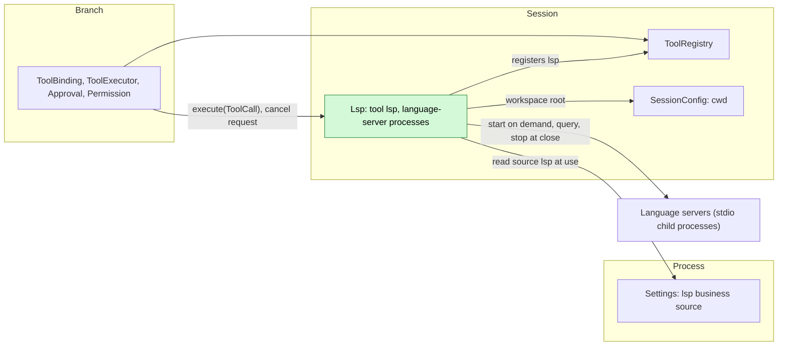

# Lsp

Status: Implemented as a built-in Rust plugin in `dim-app-server`. Language: Rust. Scope: [ADR 002](../../adr/002-plugin-scope.md) (Session). Reference: the deepseek-harness LSP seam (`docs/subsystems/lsp.md`, `packages/lsp/{lsp,lsp-stdio,tool-lsp}`).

Lsp is a Session plugin that gives the model one read-only tool, `lsp`, with four semantic queries: `goToDefinition`, `findReferences`, `goToImplementation` and `hover`. It registers the tool with the Session's `toolRegistry` ([tool contributions](../../architecture/rust-agent/tool-contributions.md); [session-boundary A.5](../contracts/session-boundary.md#a5-tool-contribution)). A language server answers each call. Lsp starts the server for the Session's workspace at the first call that needs it, keeps it while its part is loaded, and stops it when the part unloads: when the Session closes or is unloaded while idle. Servers come from the user's Settings source `lsp` and from four built-in commands looked up on `PATH`. Lsp writes no Timeline event, since every call and result is already a tool call fact. It reads its configuration at use time, so editing it never reloads anything ([ADR 002 D4](../../adr/002-plugin-scope.md#d4-structural-configuration-and-business-configuration-are-separate)).

## 1. Structure



| Part | Scope | Depends on | Provides |
| --- | --- | --- | --- |
| `lsp` | Process, where the App Server executes locally | `settings`, `partRegistry` | Registers the `lsp` Settings source and the Session part `Lsp` |
| `Lsp` | Session | `settings`, `toolRegistry`, `sessionConfig` | Registers `lsp`; owns the Session's language-server processes; provides no name |

**Contracts depended on:** the implemented [C4 tool binding](../session-typescript.md), [Settings declared sources](../appserver/settings-service.md), `SessionConfig.cwd`, and Permission's existing `read_filesystem` risk. **Contracts defined here:** the `lsp` tool, its result format and error codes, and the `lsp` document.

Lsp is a built-in process row, registered with the rows of local execution (HostPlatform, WorkspaceTools, MCP), because its servers are local child processes that read the local workspace. Like Web it adds no registry or host port. [PluginManager](PluginManager.md) owns the built-in row's on/off state, as for Web; explicit `plugin.reload` returns `not_reloadable`. A Settings reload reloads the dependent `Lsp` parts: their registrations are withdrawn, their servers stopped, and the tool is offered again once the next generation registers it, without a Session reload (#241).

## 2. Data and state

| Data | Owner | Lifetime |
| --- | --- | --- |
| `servers` in the `lsp` document | Settings (written by clients only) | Read at every call |
| Language-server processes, one per server id | `Lsp` (Session) | From the first call that selects the server until the part unloads (Session close or idle unload), the server ends, or a call finds its launch changed |
| In-flight calls | `Lsp` (Session) | One call |

Lsp owns no Timeline state and no `StateCell`. Nothing is rebuilt: after a reload or restore, servers start again at the next call. Each server sees one workspace folder, the canonical Session `cwd`.

## 3. Flows

### 3.1 A call

```mermaid
sequenceDiagram
  participant X as ToolExecutor
  participant L as Lsp handler
  participant S as Settings
  participant P as Language server
  X->>L: execute(ToolCall: operation, path, line, character)
  L->>S: read source lsp
  L->>L: resolve path inside the workspace, select a server by extension
  alt no running server for this launch
    L->>P: spawn; initialize; initialized
  end
  opt rust-analyzer
    P-->>L: experimental/serverStatus until quiescent
  end
  L->>P: textDocument/didOpen (current text)
  L->>P: definition / references / implementation / hover
  P-->>L: result
  L->>P: textDocument/didClose
  L-->>X: ToolResult: locations or hover text
```

1. Arguments are checked in the handler (Appendix A). `line` and `character` are 1-based; `character` counts UTF-16 code units. Lsp converts them to the protocol's 0-based UTF-16 position and checks it against the file's text, and converts result positions back to 1-based.
2. `path` is relative to the Session workspace or absolute. After symlinks it must name a UTF-8 file of at most 4 MiB inside the workspace.
3. The server is selected by the file's lowercased extension (§3.2). With none, the call fails with `LSP_UNAVAILABLE`; the `lsp` declaration does not change.
4. Every query sends the file's current text with `didOpen` (version 1) and closes it after the reply, so the server answers for the file as it is on disk and no document state outlives the call. The queries of one server run one at a time; different servers run in parallel.
5. `findReferences` always includes the declaration. `LocationLink` results use their target selection range.
6. The result lists at most 100 locations and the whole text is at most 16 000 characters; marks say what was omitted. The call's whole budget is 60 seconds.

### 3.2 Server selection

A configured server lists the extensions it serves in `extensionToLanguage`, which also gives each extension's LSP language id. For an extension:

1. The configured server that lists it is used. Two that list it fail the call with `LSP_SETTINGS_INVALID`.
2. Else the built-in server that lists it, unless a configured server has its id. A configured entry replaces the built-in of the same id entirely.
3. Else the call fails with `LSP_UNAVAILABLE`.

| Built-in id | Command | Extensions |
| --- | --- | --- |
| `rust-analyzer` | `rust-analyzer` | `.rs` |
| `typescript-language-server` | `typescript-language-server --stdio` | `.ts`, `.tsx`, `.mts`, `.cts`, `.js`, `.jsx`, `.mjs`, `.cjs` |
| `gopls` | `gopls` | `.go` |
| `pyright` | `pyright-langserver --stdio` | `.py`, `.pyi` |

A built-in command is looked up on the App Server's `PATH` when its server starts; a command that is not found makes the call fail with `LSP_UNAVAILABLE`. Two built-in servers start with `initializationOptions`, which a configured entry of the same id replaces:

- `rust-analyzer` turns off build scripts and proc-macro expansion, which run workspace code a `read_filesystem` call must not run, and turns on its own file watcher, since Lsp sends no file-change notifications.
- `typescript-language-server` sets `tsserver.useSyntaxServer` to `never`. Otherwise a syntax server that knows only open files answers until the project has loaded, and since a query opens only its own file, a first `goToDefinition` would stop at the import and `findReferences` would miss other files.

### 3.3 Server lifetime

- **Start.** The process runs the command with its arguments, the Session workspace as working directory, and the App Server's environment with the entry's `env` on top. It speaks JSON-RPC over stdin and stdout with `Content-Length` framing; its stderr is kept as a bounded tail for error messages. `initialize` sends the App Server's process id, the workspace as `rootUri` and only workspace folder, the entry's `initializationOptions`, and client capabilities for UTF-16 positions, definition and implementation links, markdown or plain-text hover, workspace folders and rust-analyzer's `experimental/serverStatus`. A server that chooses another position encoding, refuses `initialize`, exits or does not answer within 60 seconds is unavailable.
- **Readiness.** rust-analyzer, identified by `serverInfo.name`, answers before its workspace has loaded. A query to it waits for an `experimental/serverStatus` with `quiescent: true`. Other servers are ready after `initialized`.
- **Requests from the server.** `workspace/configuration` gets `null` for each item, `workspace/workspaceFolders` the workspace, and `workspace/applyEdit` `applied: false`; progress, capability registration and refresh requests get an empty result. Anything else is "method not found". Lsp never applies an edit or runs a server command.
- **Replacement.** A call whose launch (id, command, arguments, environment, initialization options, workspace) differs from the running server's, or that finds the server ended, retires it after its current query and starts another.
- **Unload.** When the part unloads, because the Session closes or is unloaded while idle ([idle unload](../appserver/idle-unload.md)), Lsp cancels its in-flight calls, then sends each server `shutdown` and `exit`, closes its input, and stops a process that has not exited within 2 seconds. A restored Session starts its servers again at their next call.

## 4. Timing and conflicts

| Scenario | Outcome | Owner |
| --- | --- | --- |
| Turn interrupt or call cancellation during a request | `$/cancelRequest`; the call returns `LSP_CANCELLED`; a server that has not settled the request within 2 seconds is stopped and replaced at the next call | Lsp |
| The budget ends while rust-analyzer loads | `LSP_TIMEOUT` saying it is still loading; the server keeps loading for the next call | Lsp |
| The budget ends during a request | As cancellation, with `LSP_TIMEOUT` | Lsp |
| Two calls for one server | The second waits for the first, within its own budget | Lsp |
| A server exits | The call in flight fails with `LSP_SERVER_FAILED`; the next call starts another | Lsp |
| Configuration edit | Used from the next call; a changed launch replaces the process | Lsp |
| The agent edits a file between calls | The queried file is sent as it is now; other files reach the server through the server's own file watching | Lsp |
| Lsp or Settings reload mid-call | The call is settled as reloaded; the old part's cleanup stops its servers | ToolExecutor |
| Process restart mid-call | ToolExecutor settles the committed call; Lsp repeats nothing | ToolExecutor |
| App Server killed | Servers see their input close and the client process gone, and exit on their own | Servers |

## 5. Context mapping

| The model sees | Form | Position |
| --- | --- | --- |
| `lsp` name, description, input schema | Tool declaration | Adopted `context/configured.tools` when the Session mounts it: always without a mount list (`SessionConfig.tools`), and when its list names it |
| Locations, hover text, errors | `ToolResult.content` (text only) | Tool result position of the call's batch |

- Compaction: the declaration survives as configuration; results only through the summary.
- Never visible: `structuredContent` (an error's `code`), the configuration, the processes.
- The declaration is the same whether or not any server is installed or configured.

### 5.1 Model-facing texts

The declaration is built-in and protocol ([model-facing prompts §4](../model-prompts.md#4-protocol-and-policy)): the schema and the description "Ask the workspace's language server about the symbol at a position: goToDefinition, findReferences (includes the declaration), goToImplementation or hover. line and character are 1-based; character counts UTF-16 code units. Returns path:line:character locations or hover text." The result texts are protocol:

| Text | Class |
| --- | --- |
| `<path>:<line>:<character>` lines, `No results.`, `No hover information.` | Protocol: the result format; paths are workspace-relative inside the workspace and absolute outside, other URIs as sent |
| `… <n> more locations omitted (limit 100).` and `… truncated (limit 16000 characters).` | Protocol: the bounds |
| `lsp failed: <code>: <message>` | Protocol: the codes of Appendix A.3; the model reads the code and acts on it |
| Hover text, and a rust-analyzer health message after an empty result | The server's own content, carried as material |

Lsp writes no marker and contributes no guide entry.

## 6. Interfaces (summary)

| Interface | Kind | Purpose |
| --- | --- | --- |
| `lsp` | Tool registered with `toolRegistry` (Session), risk `read_filesystem` | One of four read-only queries at a position |
| `lsp` source | Business configuration in Lsp's Settings source, read at use | Configured language servers |

No Session methods, `managementMethods` or CLI subcommand; clients configure servers with `settings.read`/`settings.update`.

### 6.1 Registration and source

The process row `lsp` is registered with the App Server where it executes locally. Its apply registers the Settings source `lsp` (user file `lsp.json`, no project file, user-only `/servers`) and the Session part `Lsp` with `partRegistry`. Each Session mounts that part; it injects `settings`, `toolRegistry` and `sessionConfig`, registers its cleanup and the tool, and performs no I/O until a call.

The source has no project file and its servers are user-only because a server's command runs without approval whenever a call selects it: a command that runs because of configuration needs no host-local approval, and only the user's local configuration may enable one ([ADR 003](../../adr/003-approval-scope.md)). A project file would let a repository choose commands to run.

```json
{
  "type": "object",
  "additionalProperties": false,
  "properties": {
    "servers": {
      "type": "object",
      "default": {},
      "additionalProperties": {
        "type": "object",
        "required": ["command", "extensionToLanguage"],
        "additionalProperties": false,
        "properties": {
          "command": { "type": "string", "minLength": 1 },
          "args": { "type": "array", "items": { "type": "string" } },
          "env": { "type": "object", "additionalProperties": { "type": "string" } },
          "extensionToLanguage": {
            "type": "object",
            "minProperties": 1,
            "propertyNames": { "pattern": "^\\.[a-z0-9_+-]+$" },
            "additionalProperties": { "type": "string", "minLength": 1 }
          },
          "initializationOptions": {}
        }
      }
    }
  }
}
```

Every call reads the user-scoped `lsp` source; a read failure or a document that does not match fails the call with `LSP_SETTINGS_INVALID` and starts nothing.

## 7. Security

- Admission: `lsp` declares `read_filesystem`; every call passes Approval and Permission.
- The queried file must resolve inside the Session workspace. Result locations may point outside it, for example into a standard library, and are only reported.
- Servers are trusted local programs that run with the App Server's authority and environment, as MCP stdio servers do; Lsp adds no sandbox, and the `Process isolation` switches, which govern model commands, do not apply to them.
- Lsp refuses `workspace/applyEdit` and sends no `workspace/executeCommand`.
- The built-in rust-analyzer runs no build scripts or proc macros. Other server behavior is the server's own, for example `cargo metadata` resolving dependencies.

## 8. Rule check

Neither part is a Capability: neither injects `dispatcher` or `timeline` ([plugin contract §6](../plugin-contract.md#6-capability)).

| Rule | How this document complies |
| --- | --- |
| Principles §4 rule 1 (commands for others' state) | Lsp changes no other module's state; tool results are written by ToolExecutor, their owner. |
| Principles §4 rule 2 (handover) | Not applicable: Lsp takes over no object; it runs the calls ToolExecutor hands it. |
| Principles §4 rule 3 (before callbacks only) | No intervention before a write; argument checks are inside the tool handler. |
| Principles §4 rule 4 (no business meaning in core) | No core change; the tool uses the generic tool registration contract. |
| Principles §4 rule 5 (batch) | Not applicable: Lsp decides from call arguments and configuration, not from events. |
| Principles §4 rule 6 (context from handed-over events) | Results reach the model only as `step/tool-result` facts written by ToolExecutor. |
| Principles §4 rule 7 (public events and services only) | Lsp uses only `toolRegistry`, `sessionConfig` and the Settings business source. |
| Principles §4 rule 8 (requirements to mechanism owners) | None raised (§9). |
| Principles §4 rule 9 (only facts later decisions use) | Lsp writes no event; its processes are I/O resources settled at close, not state. |
| Principles §1 (Capability and App Server boundary) | Not a Capability. Like Web, Lsp is a built-in App Server row (`lsp`) with a Session part (`Lsp`): its configuration is a Settings source and its servers run only where the App Server executes locally. It adds no host port. |
| ADR 002 D1 (scope follows state) | Session scope: the processes serve one Session's workspace and end when its part unloads; nothing is shared across Sessions. |
| ADR 002 D2 (no wiring modules) | No wiring module; the built-in servers are a table in the part. |
| ADR 002 D3 (dependencies follow scope) | Settings is a process service, `toolRegistry` and `sessionConfig` belong to the Session; a missing required service fails the part's assembly and the Session continues without it. |
| ADR 002 D4 (structural vs business configuration) | PluginManager owns the row's on/off state; the `lsp` document is business configuration read at each call. |
| ADR 002 D5 (language-neutral contracts) | The tool, its results and the document are neutral; the Rust form is Appendix C. |

## 9. Requirements raised to mechanism owners

None. Tool registration, declared Settings sources and `SessionConfig` already have contracts and implementations. Lsp raises no core, rutis, loader, lifecycle or HostPlatform requirement; it starts its processes itself, as MCP stdio servers are started.

## Appendix A. Tool

### A.1 Parameters

| Parameter | Type | Rule |
| --- | --- | --- |
| `operation` | string | Required; `goToDefinition`, `findReferences`, `goToImplementation` or `hover` |
| `path` | string | Required; non-empty; relative to the Session workspace or absolute |
| `line` | integer | Required; 1-based; at most the file's line count |
| `character` | integer | Required; 1-based UTF-16 code unit; at most one past the line's end |

Unknown parameters fail with `LSP_INVALID_INPUT`.

### A.2 Results

```
src/lib.rs:12:8
src/main.rs:3:5
/Users/me/.rustup/toolchains/stable/lib/rustlib/src/rust/library/core/src/option.rs:572:1
```

Locations are grouped by file in the order the server returned them, at most 100, followed by `… <n> more locations omitted (limit 100).` when there are more. An empty result is `No results.`; hover without content is `No hover information.`; hover text is the server's markdown or plain text, a language-tagged string as a fenced block, parts joined by a blank line. When rust-analyzer reports a health other than `ok`, its message follows an empty result. The complete text is at most 16 000 characters. No `structuredContent`.

### A.3 Errors

Every error is an error `ToolResult` (`isError: true`) with content `lsp failed: <code>: <message>` and `structuredContent` `{ "code": "<code>" }`. No error affects other calls or the Session.

| Code | Meaning |
| --- | --- |
| `LSP_INVALID_INPUT` | A parameter violates A.1, or the file is missing, outside the workspace, not a regular file, larger than 4 MiB or not UTF-8 |
| `LSP_UNAVAILABLE` | No server is configured or built in for the extension, its command is not found, or it could not start (exited, refused `initialize`, chose another position encoding, no answer within 60 seconds); the message carries the server's stderr tail |
| `LSP_UNSUPPORTED_OPERATION` | The server does not advertise the operation |
| `LSP_SERVER_FAILED` | A started server exited, answered with an error, or sent a malformed result |
| `LSP_TIMEOUT` | The 60-second budget ended: waiting for an earlier query, for start or loading, or for the reply |
| `LSP_SETTINGS_INVALID` | The `lsp` source could not be read, does not match, or two servers list the extension |
| `LSP_CANCELLED` | The call was cancelled or the Session is closing |

### A.4 Assumptions

| # | Assumption | Effect if rejected |
| --- | --- | --- |
| A1 | One workspace folder, the Session `cwd`; nested projects are found by the server's own discovery | Per-file project roots and several processes per server |
| A2 | The model uses 1-based lines and UTF-16 characters, as in the reference seam | Character columns would need conversion of every result file |
| A3 | The four built-in servers and their options are an implementation choice | The table changes |
| A4 | 60-second budget, 100 locations, 16 000 characters, 4 MiB documents | Limits change |
| A5 | rust-analyzer is the only server whose readiness Lsp waits for, recognized by `serverInfo.name` | Readiness becomes configurable per server |
| A6 | Servers stay until the part unloads; Lsp has no idle timer of its own | An idle timer per server |
| A7 | The operation set is closed; symbols, call hierarchy, diagnostics and rename are not offered | A new operation is a change of this tool's contract |

## Appendix B. Acceptance

1. With an isolated home and a local mock model, a Session in a small Rust or TypeScript workspace calls `lsp`: `goToDefinition` returns the definition's `path:line:character` and `findReferences` the declaration and every use.
2. Without a server on `PATH` for the file, the call returns `LSP_UNAVAILABLE` and the declaration is unchanged.
3. Unloading the part (Session close, idle unload, App Server stop) stops the server process.

## Appendix C. Rust binding

| Neutral | Rust |
| --- | --- |
| Row `lsp` | `lsp::LspPlugin`, registered with `register_part` among the App Server's local-execution rows; its apply calls `SettingsService::register_declared` and `PartRegistry::register(…, PartScope::Session, "Lsp", …)` |
| `toolRegistry.register` for `lsp` | The Session part injects `Key<ToolRegistry>` and calls `tools.register(ctx, ToolContribution {definition, handler})`; the registration is withdrawn when the part unloads |
| Cleanup | `ctx.effect` cancels in-flight calls, waits for them and shuts the servers down |
