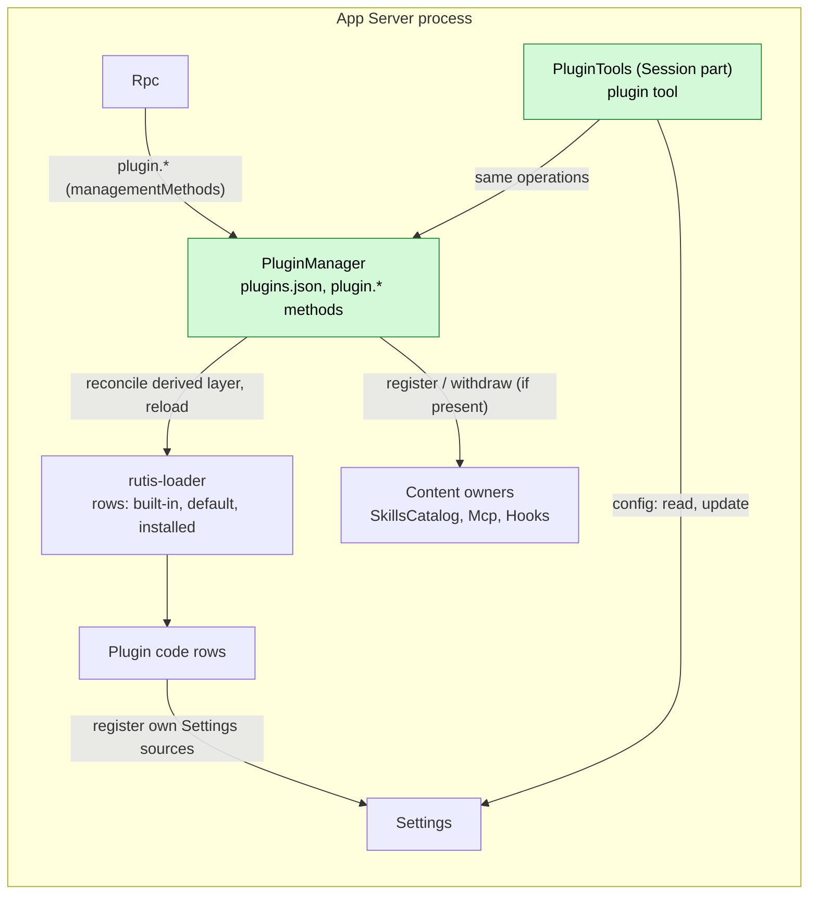

# PluginManager

Status: Draft, aligned with the maintainer on 2026-10-27. Requirements: [plugin management](../plugin-management.md) ([#432](https://github.com/arcships/dim/issues/432)). Issues: [#3](https://github.com/arcships/dim/issues/3), [#384](https://github.com/arcships/dim/issues/384). Scope: [ADR 002](../../adr/002-plugin-scope.md) (process: installation is per host). Language: Rust. Milestone: M1 for the parts marked in §0.

PluginManager keeps the plugin configuration of a host: which plugins are installed, where they came from, which plugin each name uses, and which names are turned off. It keeps this configuration in its own file, `plugins.json`, in Dim's own format. It keeps no runtime state, except, in memory, the content it refused itself (§3.7). Whether a plugin is loaded, running or failed is rutis' state, read from rutis-loader. What content an owner holds (skills, MCP servers, hooks) is that owner's state. PluginManager carries out a configuration change by giving commands to the owners: rutis-loader for plugin code, and SkillsCatalog, Mcp and Hooks for content. Each owner decides and keeps its own state.

A plugin is a directory with a manifest. It may carry code (a rutis plugin in TypeScript or Python), content (skills, MCP configuration, hooks), or both. Plugins are identified by **name**. Several plugins with the same name may be installed, but only one of them is used at a time. Turning another one on replaces the one in use. This is how a built-in plugin is replaced.

## 0. Implementation boundary

| Part | M1 (2026-11-01) | Later |
| --- | --- | --- |
| `plugins.json`, the default configuration file, the startup layer (§2, §3.1) | yes | |
| Install from a local path or Git, update, remove, list (§3.2–§3.6) | yes | marketplace |
| Plugin code: create, turn on/off, replace, reload loader rows (§3) | yes, TypeScript and Python, once their runtimes are supplied (§2.5) | |
| `plugin.*` management methods and `dimcode plugin` commands (§6, A.1) | yes | client notifications of changes |
| Agent tools through a Session part (§6) | yes | |
| The default CLI loads the built-in SessionTitle, Scheduler, Goal and Web and the configured default plugin (plugin-authoring) | yes | |
| Settings sources registered at run time by every plugin itself (§9 R1) | yes, built-in and TypeScript plugins together | |
| Content kinds: skills, MCP configuration, hooks (§3, §9 R2) | skills and MCP if their owners land in time; hooks (Hooks is M1) | |

M1's acceptance is: a user or the agent writes a TypeScript plugin, installs it from a local path, uses its tools, edits it and reloads it, and the change takes effect without a restart; the default CLI starts with the default plugins loaded. Plugin code needs its runtime, which [#476](https://github.com/arcships/dim/issues/476) supplies.

## 1. Structure



- PluginManager is one process row. It is locked (§2.3): it cannot be turned off or replaced, because nothing could turn it back on.
- It injects the loader handle and `managementMethods`. It reads the content owners only if present (`Option<Keyed<_>>`, not a gate): a missing owner skips only that kind of content.
- It registers a Session part, `PluginTools`, with `partRegistry`. The part registers the `plugin` tool with the Session's `toolRegistry`; each call goes to PluginManager's process service, and `config` goes to Settings (§6).
- Owners never look for plugins and never read `plugins.json`.

## 2. Data

### 2.1 The plugin directory and its manifest

A plugin is a directory with `dim-plugin.json` at its root. The keys present say which kinds the plugin carries.

```json
{
  "name": "my-tool",
  "description": "Adds the echo tool",
  "code": {
    "entry": "index.ts",
    "inject": ["partRegistry", "settings"],
    "provides": {},
    "instanceNames": {},
    "config": {}
  },
  "skills": "skills",
  "mcp": "mcp.json",
  "hooks": "hooks.json"
}
```

| Key | Kind | Meaning |
| --- | --- | --- |
| `name` | — | The plugin's name. Plugins with the same name replace each other. |
| `code` | code | The rutis row fields ([rutis usage §2](../rutis-usage.md#2-plugins-are-rows-instances-mount-their-parts)) except `id` and `name`: `entry` is a path inside the directory; `inject`, `provides` and `instanceNames` are copied into the row; `config` is the row's configuration, with the host's patch for that plugin name deep-merged over it (below). |
| `skills` | skills | A directory inside the plugin of Skill documents, registered with SkillsCatalog. |
| `mcp` | MCP | A file inside the plugin holding MCP server entries, registered with Mcp. |
| `hooks` | hooks | A file inside the plugin holding a hooks document, registered with Hooks. |

Every path is relative, resolved inside the directory after following symbolic links; a path that leaves the directory is refused at install and at reload (`invalid_manifest`). The manifest is parsed at this boundary; owners receive documents already read.

**Row configuration.** A row's `config` is the manifest's `code.config` with the host's patch for that plugin name deep-merged over it: objects merge member by member, and any other value, arrays included, replaces the manifest's. A host sets a patch before startup; the product sets none, so a shipped plugin reads its manifest's value. A host that runs a candidate text puts the text at the member the plugin's author exposed, as the evaluation tooling does ([model-prompts §8.1](../model-prompts.md#81-the-rule)), so both arms run the same plugin code.

**Data directory.** The plugin files root is the root an embedding host names, else the product home, else the execution home the host was started with (`--home`). A host started with only a database file has none of them, so it has no plugin files root and runs no PluginManager; the root is never the database's directory or the working directory. When a plugin with code is turned on, PluginManager creates `<pluginFiles root>/<id>/` if it does not exist: `<id>` is the installed id, or a default plugin's name, both checked by the id rule (§7). It never deletes the directory, on turning off or on remove, as Settings documents stay in the home. An existing entry is used only if it is a directory, not a symbolic link, that resolves to itself inside the root; otherwise nothing is created and the plugin's file operations fail as they would without it. A plugin writes only under its own id directory through `pluginFiles` ([process TypeScript §5.2](../process-typescript.md#52-public-pluginfiles-binding)).

A plugin's business configuration (its Settings sources) is not in the manifest: the plugin's code registers its sources with Settings when it starts (§9 R1). The `settings` member of today's TypeScript rows goes away.

The repository's own TypeScript plugins (`runtime/plugins/*`) get a `dim-plugin.json` in place of their row files (`web.json`, `process.json`, `settings.json`). SessionTitle is a built-in plugin, not a TypeScript package.

### 2.2 `plugins.json`

`<home>/plugins.json`, read and written only by PluginManager. It holds configuration only.

```json
{
  "version": 1,
  "installed": [
    {
      "id": "my-tool",
      "name": "my-tool",
      "source": { "path": "/Users/me/src/my-tool" },
      "dir": "/Users/me/src/my-tool",
      "kinds": ["code", "skills"]
    },
    {
      "id": "hooks-plus",
      "name": "Hooks",
      "source": { "git": "https://example.com/hooks-plus.git", "ref": "main", "commit": "4f1c…" },
      "dir": "<home>/plugins/hooks-plus/4f1c…",
      "kinds": ["code", "hooks"]
    }
  ],
  "names": {
    "my-tool": { "use": "my-tool" },
    "Hooks": { "use": "hooks-plus" },
    "web": { "off": true }
  }
}
```

| Field | Meaning |
| --- | --- |
| `installed[].id` | Unique among installed plugins; the key of the record and the name of the clone directory. Matches `[a-z0-9_-]{1,64}` (lowercase, so two ids never name one directory on a case-insensitive file system) and is not `builtin` or `default` (§7). When the caller gives none, the id is the manifest name lowercased (`Hooks` → `hooks`); a collision after lowercasing is `plugin_exists`, and the caller then gives another id. The example's `hooks-plus` was given by the caller (`--id hooks-plus`). |
| `installed[].name` | The manifest name at install or last reload. |
| `installed[].source` | `{path}` for a local directory, used in place and never copied; `{git, ref?, commit}` for Git. |
| `installed[].dir` | The directory that is loaded: the local path itself, or the clone under `<home>/plugins/<id>/<commit>`. |
| `installed[].kinds` | The kinds the manifest carried at install or last reload. |
| `names.<name>.use` | Which plugin the name uses: an installed id, `"builtin"` or `"default"`. Absent: the built-in plugin of that name if there is one, else the default plugin of that name. |
| `names.<name>.off` | `true` when the user turned the name off. |

A name with no entry is in its shipped state: a built-in or default plugin on. Writing goes to a temporary file in the same directory, flushed on its own writable handle (`sync_all`, which also works on Windows), then renamed over `plugins.json`. A file that does not parse fails startup with its path; PluginManager never overwrites a file it could not read. The format is versioned; an unknown version fails startup.

A persisted `use: "default"` selects the same-name built-in when the distribution no longer
ships that default package. An existing default package remains the explicit selection while
it is shipped. This source transition does not rewrite the record; `off` and installed source
selections retain their meaning.

### 2.3 The default configuration file

Shipped with Dim, read-only, given to the App Server with `--defaults PATH` (the default CLI passes the file in its release; `./dev` stages this file and the plugins it lists into the checkout's ignored `staging/dev-plugins` and passes that copy, so the plugins resolve the runtime's single copy of `@deepseek-ai/cordis`).

```json
{
  "plugins": {
    "plugin-authoring": "plugins/plugin-authoring"
  },
  "locked": ["PluginManager", "Rpc", "Transport"]
}
```

- `plugins` maps each default plugin's name to its directory, relative to this file. A default plugin is a plugin directory like any other (§2.1).
- Built-in SessionTitle, Scheduler and Goal are installed by the native product profile and have no entry in this file.
- `locked` lists names that cannot be turned off and whose plugin cannot be switched. Other plugins of a locked name may still be installed. Locking is product configuration; PluginManager applies it.

### 2.4 State PluginManager does not keep

| State | Owner | Read through |
| --- | --- | --- |
| Which rows exist and their `EntryStatus` | rutis-loader | `Loader::entries()`, `Loader::get(id)`, `Loader::waits`; shown as in A.1 |
| Which built-in rutis plugins exist | the App Server's assembly | rows of the `assembly` layer in `Loader::entries()`; the row id is the plugin's name |
| Skills, MCP servers, hooks registered from a plugin | SkillsCatalog, Mcp, Hooks | the owner's own methods |
| A plugin's business configuration | the plugin's Settings sources | Settings |

### 2.5 Runtimes

Plugin code runs in the Node or Python rutis runtime. Supplying them is not PluginManager's business: how runtimes are acquired, pinned and verified, and how plugin rows start once a runtime is available, is [RuntimeManager](RuntimeManager.md) ([#476](https://github.com/arcships/dim/issues/476), M1). PluginManager only creates rows; a row whose runtime is not there is `pending` in `plugin.list`, waiting for the runtime's connection row (`session-node` or `py`). How far the runtime itself got (acquiring, failed, starting, down) is `runtime.list`'s. Reload re-imports only the entry module ([requirement 3](../plugin-management.md)).

A TypeScript row is named by its entry file's absolute path. A Python plugin is imported through a link PluginManager keeps: `<home>/plugins/.python/<package>` points to the plugin directory, where `<package>` is its id (a default plugin's name) with `-` as `_`; its row is named `py:<package>.<entry module>`, and the plugin uses relative imports inside its package. PluginManager creates the link when the plugin is turned on, points it at the new directory after an update, and removes it when the plugin is removed. The Python runtime imports from `<home>/plugins/.python/` (#476).

## 3. Flows

How PluginManager's configuration maps onto rutis-loader. The loader has two layers. `assembly` holds the built-in rows. `plugins` is derived from `plugins.json` and the default configuration file; rutis keeps no copy of it beyond the running tree. It holds the rows of default and installed plugins in use and the `disabled` overrides of built-in rows. PluginManager's rows have the row id `plugin:<name>`: one row per name, which cannot collide with a built-in row id, since the built-in row of that name stays in the composed tree when it is disabled.

| Name N in `plugins.json` | In the derived `plugins` layer |
| --- | --- |
| Uses a default or installed plugin P with code | The row `plugin:N` from P's manifest |
| Uses its built-in | Nothing: the built-in row runs |
| Off, or uses a plugin other than its built-in | `disabled: true` on the built-in row N, if there is one |

A configuration change writes `plugins.json`, derives the `plugins` layer again and gives the loader `reconcile([assembly, plugins])`. A row rutis refuses stays in the loader and `plugin.list` shows rutis' status and reason, as after a restart. A reload is `Loader::reload("plugin:N")` when the row's fields are unchanged. rutis lets a layer disable a built-in row and override its fields, but not rename or remove it, so replacing a built-in disables its row and adds a row for the new plugin. rutis reloads the dependents of the rows that change.

Content follows the same switch: when name N stops using P, PluginManager withdraws P's content from each present owner; when N starts using P, it registers P's content with each present owner (§3.7).

### 3.1 Startup

1. The App Server calls PluginManager's startup function with the home and the default configuration file. The function reads `plugins.json` and each used plugin's manifest and returns:
   - the initial `plugins` layer: the rows of the default and installed plugins that are on, and `disabled: true` for each built-in name that is off or uses another plugin;
   - the names whose `instanceNames` the catalog needs (§4);
   - the built-in rows that are off, which the App Server drops from the rows it requires to become Active.
2. The App Server reconciles `[assembly, plugins]`. A built-in that is off never starts.
3. PluginManager's row applies, registers `plugin` with `managementMethods` and `PluginTools` with `partRegistry`, then, after activation, deletes leftover staging directories and Git clones no installed entry refers to.

A default or installed plugin whose row fails does not fail startup; `plugin.list` shows it as failed with rutis' error. A used plugin whose manifest cannot be read runs nothing: it gets no row, and its content of every kind is withdrawn from every present owner. Once the process rows are up, before clients are admitted, the App Server calls PluginManager's content startup, which brings every present owner to the record (§3.7).

### 3.2 Install

`plugin.install {source, id?, enable?}`. `enable` defaults to `true` ([requirement 2](../plugin-management.md): installed means usable).

1. When the caller gives `id`, check it (§7) and refuse an `id` already installed (`plugin_exists`) before acquiring anything.
2. Acquire (§7): a local path is checked in place; a Git source is cloned into a staging directory and its manifest read; without a given `id`, the id is the manifest name lowercased, checked and refused if installed in the same way, before the staging directory is renamed to `<home>/plugins/<id>/<commit>`. Any failure deletes the staging directory.
3. Write `plugins.json` with the new entry, and, when `enable` is true and the name is not locked, `names.<name>.use = id`.
4. If it was turned on: reconcile the derived layer (§3). The reply carries the row's status and any content an owner refused.

Installing a plugin whose name is locked records it without turning it on, and says so in the reply.

### 3.3 Turn on, turn off, switch

- `plugin.enable {name, use?}`: `use` is an installed id, `"builtin"` or `"default"`; absent, the name's current `use`. Refused for a locked name when `use` changes (`plugin_locked`). Writes `names.<name>` (clears `off`, sets `use`), then reconciles the derived layer (§3).
- `plugin.disable {name}`: refused for a locked name. Writes `off: true`, then reconciles the derived layer.

When a content owner itself is turned on (Hooks, for example), PluginManager registers the content of every plugin in use that carries that kind (§3.7).

### 3.4 Reload

`plugin.reload {name}` reloads the plugin the name uses. The host watches no files; the call is the signal that something changed.

1. Read the manifest again. A read that fails refuses the reload (`invalid_manifest`) before changing anything: the plugin keeps its last good row and content until the next change of the record, from any command, or a restart. Both read the manifest again and run none of the plugin's content while it cannot be read (§3.1). If its name changed, refuse (`name_changed`); the user installs it again under the new name.
2. Code: `Loader::reload("plugin:<name>")`, and nothing else: there is no resolver cache to clear, since the runtime describes the module again at every resolution. rutis re-imports the plugin's entry module (modules it imports are not re-imported; [requirement 3](../plugin-management.md)) and starts a new generation; its parts in Sessions and branches are replaced and its dependents reload. If the manifest's `code` fields changed, PluginManager reconciles the derived layer, which carries the row with the new fields.
3. Content: register each kind again with its present owner; the new document replaces the old one. A kind the manifest no longer carries is withdrawn.
4. Update `kinds` in `plugins.json` if they changed.

A name using a built-in Rust plugin cannot be reloaded (`not_reloadable`): it needs a rebuild; it can be replaced (§3.3).

### 3.5 Update

`plugin.update {id, ref?}` for a Git plugin: fetch and check the new commit into a new directory as in §3.2, write the new `commit` and `dir`, then, if the plugin is in use, reconcile the derived layer (its row carries the new entry path). The old directory is deleted afterwards. A local-path plugin has nothing to update (`not_updatable`); reload it. Asking the user to confirm an update is the client's business.

### 3.6 Remove and list

- `plugin.remove {id}`: if a name uses it, the name stops using it: when the name has a built-in or default plugin, `names.<name>.use` is dropped and the name goes back to that plugin (still `off` if it was off); otherwise the `names.<name>` entry is removed and nothing runs under that name. Remove the entry from `plugins.json`, then delete its Git directory. A local directory is never deleted. Built-in and default plugins cannot be removed (`not_removable`); they can be turned off.
- `plugin.list {}`: one item per name, built from `plugins.json`, the default configuration file and the `assembly` rows, with each candidate and the one in use; status comes from `Loader::get` at the time of the call.

### 3.7 Content registration

For each kind P carries and each owner present, PluginManager calls the owner's `register({plugin, dir, document})` and, to withdraw, `withdraw({plugin})`, where `plugin` is the plugin's id: its installed id, or a default plugin's name (§7), so it is safe in server ids and file names. When a name switches from one plugin to another, the old plugin's content is withdrawn; a kind the plugin no longer carries is withdrawn. The owner keeps what was registered as its own state, persists it, and restores it after its own reload. PluginManager does not watch owners and registers nothing again on their behalf. An owner that is absent when PluginManager would call it is skipped; the reply names the skipped kinds. An owner reports the plugin ids it holds. At startup, and when PluginManager turns an owner's name on, PluginManager registers that kind of content of every plugin in use and withdraws it for every other id the owner holds; owners never look for plugins. So content restored by an owner for a plugin removed while the owner was off, or left by a process that stopped between writing `plugins.json` and commanding the owner, does not run again, and a refusal is reported again after a restart.

An owner validates what it is given. Content it refuses (an MCP document that fails Mcp's validation, a Skill whose `SKILL.md` does not parse) does not stop the plugin's other content or code: the reply names it under `refused`, and `plugin.list` shows what the owners report for the plugin at the time of the call. PluginManager refuses a JSON content file it cannot read or that is not JSON. It keeps that refusal in memory, keyed by plugin id and kind, only while the last read of that kind failed: any later handling of the kind that reads nothing or reads it successfully clears it (the document handed over, the manifest no longer naming the kind, the kind skipped because its owner is absent), as do withdrawing the kind and removing the plugin. `plugin.list` shows it in the same `refused` entry, in place of the owner's, and only while the kind's owner is present; the replies of `plugin.install`, `plugin.enable`, `plugin.reload` and `plugin.update` name it under `refused`. A refusal in the startup or owner-on reconcile is logged at `warn` with the plugin id, the kind and the error.

## 4. Timing and conflicts

- PluginManager changes `plugins.json` in one step on its in-memory table, then writes the file, then reconciles the layer derived from it and gives owners their commands. A second operation on the same id or name sees the first one's change (`plugin_exists`, or it acts on the new state). Deriving the layer and reconciling it run one at a time, each from the record as it is then, so the layer reconciled last is the latest record's. rutis-loader runs its own operations one at a time.
- A row that rutis or a command that an owner refuses leaves the configuration as written; the item shows the refusal in `plugin.list` (for example, the new plugin failed because another plugin of a different name provides the same service).
- `instanceNames`: rutis needs the names a plugin's parts provide in Sessions and branches in the catalog before the runtime starts ([rutis usage §2](../rutis-usage.md#2-plugins-are-rows-instances-mount-their-parts)). Installing, switching or reloading to a plugin whose `instanceNames` are not in the running catalog records the change and replies `restartRequired`; the row is created at the next start. Plugins that only register tools, methods or prompt sources do not have this limit.
- A reload or replacement in use: the old generation unloads, rutis cancels its running calls, and in-flight turns using it may fail ([ADR 002](../../adr/002-plugin-scope.md) consequences). This is documented, not prevented.

## 5. Context mapping

PluginManager adds no text of its own to model context beyond the `plugin` tool. A plugin's tools and prompt sources reach the model through their own registrations ([ADR 006 D4](../../adr/006-plugin-contract.md)). The tool's texts are marked by [model-facing prompts §4](../model-prompts.md#4-protocol-and-policy). The declaration's schema is protocol, and so is "Manage Dim plugins.", which states the tool's reach; the one-line command list it carries, with the command names and each command's argument grammar, is protocol too, because the tool parses them exactly. "Run `help <command>` for a command's details." is policy guidance, with `help <command>` protocol because it names the command to call; that sentence has no factory member yet, and gets one in the change that first evaluates a candidate for it. In a usage text the `Usage:` line is protocol, and the sentences after it, and in `help`, that say what a command does or does not touch are policy. A malformed command's error result carries the command list or that command's usage, and a refused call's error carries its code (A.2) — both protocol. A completed call's result says what changed, the status, and `restartRequired` when it applies; that is protocol too, because the model decides its next step by it.

## 6. Interfaces (summary)

- Management methods, namespace `plugin` (A.1): `list`, `install`, `enable`, `disable`, `reload`, `update`, `remove`.
- CLI: `dimcode plugin list | install <path|git-url> [--ref R] [--id ID] [--no-enable] | enable <name> [--use ID|builtin|default] | disable <name> | reload <name> | update <id> | remove <id>`.
- Agent tool from `PluginTools`: one tool, `plugin`, with one string parameter `command`, written like the CLI's arguments: whitespace separates words, single or double quotes group one (a path with spaces is quoted), and a backslash is an ordinary character, so a Windows path is written as is:

  | Command | Does |
  | --- | --- |
  | `list`, `install …`, `enable …`, `disable <name>`, `reload <name>`, `update <id>`, `remove <id>` | The `plugin.*` method of the same name, with the CLI's arguments; a relative path is resolved against the Session's working directory. Same result and errors. |
  | `config <name>` | The declared (JSON Schema) Settings sources the plugin that `<name>` uses registered (R4); Rust typed sources, such as Mcp's, are not served here and are not listed: for each, its user document, revision, schema and user-only fields. A member the schema marks `writeOnly` (a secret, [settings-service §1.2](../appserver/settings-service.md#12-decision-secrets-belong-to-their-owner)) is left out of the document and listed in `writeOnlySet` when it holds a value. A plugin that is not running has registered none. |
  | `config <name> set <key> <value>` | Replaces one top-level member of a source through Settings: reads the user document, sets `<key>` (`<source>.<key>` when the plugin has several sources) to `<value>` (JSON, else a string) and updates with the revision it read. Settings checks the revision and schema; the write is an owner write, so a user-only field is refused, and a member that is or contains a `writeOnly` member is refused too. The owner reads its source when it needs it, so the value takes effect without a restart. Structural row configuration is not edited here. |
  | `help [command]` | The command list, or one command's usage and details. |

  The tool's description carries only the one-line command list; `help` gives the details, and a malformed command's error result carries that command's usage. The tool is a tool call: Permission decides each one ([requirement 5](../plugin-management.md), [ADR 003](../../adr/003-approval-scope.md)). Its declared risk is `persistent_configuration`; `list` and `help` are admitted as `read_filesystem` (R3); `config`, whose documents may hold secrets and user content, is admitted at the declared risk, as the sources' own tools are.
- Plugin authoring: the default plugin `plugin-authoring` carries one Skill, `plugin-authoring`, which teaches the agent to write a TypeScript plugin and install it with this tool. It is content only (§2.1) and can be turned off like any default plugin.
- Owner operations PluginManager calls: `register` / `withdraw` on SkillsCatalog, Mcp and Hooks (§9 R2).

## 7. Security

Installing and turning on are host configuration done through management methods or tool calls; enabled plugin code runs without host-local approval ([ADR 003](../../adr/003-approval-scope.md)). PluginManager adds no scope, approval or trust step ([requirements](../plugin-management.md)). What it guards is the acquisition itself:

- Git sources are `https://` or `ssh://` URLs only; other schemes (`file://`, `ext::`, scp-style paths) and arguments starting with `-` are refused before Git runs. Clones run with submodules off (`--no-recurse-submodules`), hooks off (`core.hooksPath` set to an empty directory), `protocol.file.allow=never` and no terminal prompt.
- **Paths.** One rule covers every operation that touches the file system for a plugin: install (staging, clone, rename), update, remove and the startup cleanup. Before any file system change, PluginManager checks that the id, whether the caller gave it or it came from the manifest name, matches `[a-z0-9_-]{1,64}` and is not `builtin` or `default`, and that every directory it is about to create, rename or delete resolves to exactly one of `<home>/plugins/.staging/<random>`, `<home>/plugins/.python`, `<home>/plugins/<id>` or `<home>/plugins/<id>/<commit>` (`.staging` and `.python` cannot be ids, since an id has no dot). The Python links in `.python` are replaced or removed as links; what they point to is never touched. A failed check refuses the operation with `invalid_id` or `path_outside_plugins` and changes nothing: no directory, no `plugins.json` write, no loader command. A local-path plugin's own directory is never created, renamed or deleted, so the rule does not apply to it.
- A clone goes to `<home>/plugins/.staging/<random>` and is renamed into place only after its manifest and paths are checked. A failure deletes the staging directory; startup deletes leftovers and clones no entry refers to.
- No manifest path may leave the plugin directory after following symbolic links; a symbolic link inside a Git clone that points outside it is refused.
- `plugins.json` is written atomically (§2.2).

The acquisition and link-check code behind these rules is one crate-internal implementation, `crates/dim-app-server/src/plugin_manager/acquire.rs`, shared with the Skills installation ([Skills](Skills.md) §4), which reads a local directory or clones a repository for its own destination, staging directory and record. The rules above are stated once because there is one implementation.

## 8. Rule check

PluginManager is not a Capability: it has no Timeline state, writes no Timeline event and has no branch part.

| Rule | How this document complies |
| --- | --- |
| Principles §4 rule 1 (commands for others' state) | Loader rows are rutis' state and content is its owners' state; PluginManager only gives them commands and reads their state when asked. |
| Principles §4 rule 2 (handover) | Not applicable: no input or Timeline handover. |
| Principles §4 rule 3 (before callbacks only) | No intervention before a write. |
| Principles §4 rule 4 (no business meaning in core) | The owner `register`/`withdraw` operations and Settings registration (§9) carry no plugin-management meaning; any caller may use them. |
| Principles §4 rule 5 (batch) | Not applicable. |
| Principles §4 rule 6 (context from handed-over events) | Nothing enters model context except tool results (§5). |
| Principles §4 rule 7 (public events and services only) | rutis-loader's public `Loader` API, `managementMethods`, `partRegistry`, `toolRegistry` and the owners' public services. |
| Principles §4 rule 8 (requirements to mechanism owners) | §9: Settings, SkillsCatalog, Mcp, Hooks, ToolExecutor and Permission; none to rutis. |
| Principles §4 rule 9 (only facts later decisions use) | Configuration lives in `plugins.json`, the only record; runtime state is read from its owners. |
| Principles §1 (Capability and App Server boundary) | A process plugin of the App Server; no Capability. |
| ADR 002 D1 (scope follows state) | Process: installation is per host. `PluginTools` is a Session part only because tools are registered per Session. |
| ADR 002 D2 (no wiring modules) | No wiring: owners are called through their registration operations. |
| ADR 002 D3 (dependencies follow scope) | Process dependencies only; owners are optional reads, so their reload does not reload PluginManager. |
| ADR 002 D4 (structural vs business configuration) | Structural configuration (installed, used, off) is `plugins.json`; business configuration stays in each plugin's Settings sources, registered by the plugin. |
| ADR 002 D5 (language-neutral contracts) | Methods and owner operations are JSON contracts. |
| ADR 006 D3 as corrected by ADR 007 (a plugin's code is one row) | Each plugin with code is one process row, created, turned off and reloaded by PluginManager's commands; content is not a row ([ADR 007](../../adr/007-plugin-configuration.md)). |

## 9. Requirements raised to mechanism owners

None to rutis: every loader operation used exists in rutis-loader 0.19.3.

**R1. Settings: sources registered at run time (M1).**

| Item | Content |
| --- | --- |
| Blocked by | Settings sources are fixed when the App Server builds Settings: built-in Rust owners are listed in code (`.reserve::<T>()`), TypeScript rows' `settings` members are read at startup (`.declare()`). A plugin installed, replaced or removed at run time cannot add or withdraw its sources. |
| Existing mechanisms considered | PluginManager registering sources from the manifest (business configuration is not plugin management, ADR 002 D4); a restart per install (violates requirement 3). |
| Generic capability | `settings.register(declaration)` on the named `settings` service, with the declaration of today's `settings` member (`source`, `userFile`, `projectFile?`, `schema`, `userOnly`). The registration belongs to the caller and is withdrawn when it unloads; a second registration of the same source name fails. Every owner, built-in Rust and TypeScript alike, registers its sources in its `apply`. The stored documents stay in the home whether or not a source is registered. The hard-coded `.reserve::<T>()` and `.declare()` paths are removed. |
| Effect on sequence, batch, interrupt, reload | No Timeline effect. A reload registers again from the new generation. |
| Owner and issue | Settings (App Server); to be filed with #384. |

**R2. SkillsCatalog, Mcp, Hooks: register plugin content and keep it (M1 for all three; SkillsCatalog and Mcp if they land in time).**

| Item | Content |
| --- | --- |
| Blocked by | Owners read only user and project sources; there is no way to hand them a plugin's content. |
| Existing mechanisms considered | A `pluginContents` service owners read (owners would look for plugins; rejected); content as loader rows (Dim product state in rutis; rejected). |
| Generic capability | A process operation `register({plugin, dir, document})` that adds or replaces the content of `plugin` (a plugin id, §3.7), and `withdraw({plugin})`, plus a read of what the owner refused for `plugin`. The owner keeps registered content as its own state, persists it in its own storage, and restores it after its own reload. Mcp prefixes server ids with `plugin` (`<plugin>:<server>`); Hooks names the source `plugin:<plugin>` and gives commands `DIM_PLUGIN_ROOT = dir`; SkillsCatalog reads Skills under `dir`. |
| Effect on sequence, batch, interrupt, reload | As each owner's existing sources: a change is a data update the owner announces its own way. |
| Owner and issue | SkillsCatalog, Mcp, Hooks ([Hooks](Hooks.md)). |

**R3. ToolExecutor and Permission: the risk of one call (M1).**

| Item | Content |
| --- | --- |
| Blocked by | A tool's risk is fixed in its definition, so one tool with read-only and changing commands is admitted at its highest risk: `plugin list` would ask for approval under workspace-write and be denied under read-only. |
| Existing mechanisms considered | One tool per operation (the seven tools this replaces; too many for the model); `execute_process` with a `command` input (Permission would apply shell command rules to plugin commands). |
| Generic capability | A tool handler may name the risk of one call; Approval and Permission admit the call under it, and a handler that names none is admitted under its definition's risk. |
| Effect on sequence, batch, interrupt, reload | None: admission order and events are unchanged. |
| Owner and issue | ToolExecutor and Permission (capabilities); with #384. |

**R4. Settings: the sources a plugin registered (M1).**

| Item | Content |
| --- | --- |
| Blocked by | Settings knows each source's name and schema but not which plugin registered it, so `plugin config <name>` cannot find a plugin's sources. |
| Existing mechanisms considered | Listing sources in the manifest (business configuration is not plugin management, R1); naming sources after plugins (not a rule; one plugin may register several). |
| Generic capability | Settings keeps, with each registration, the identity of the registering plugin's fiber, and lists the declared sources one fiber registered. PluginManager finds the fiber of the row a name uses through the loader. |
| Effect on sequence, batch, interrupt, reload | None. A reloaded row keeps its fiber identity and registers again. |
| Owner and issue | Settings (App Server); with #384. |

## Appendix A. Interface details

### A.1 Methods (`managementMethods`, namespace `plugin`)

| Method | Params | Result |
| --- | --- | --- |
| `plugin.list` | `{}` | `[{name, use, off, locked, candidates: [{id \| "builtin" \| "default", source?, kinds}], status?, error?, waitingFor?, refused?}]` |
| `plugin.install` | `{source: {path} \| {git, ref?}, id?, enable?}` | `{id, name, enabled, status?, skipped?: [kind], refused?: [{kind, error}], restartRequired?}` |
| `plugin.enable` | `{name, use?}` | `{status?, skipped?, refused?, restartRequired?}` |
| `plugin.disable` | `{name}` | `{}` |
| `plugin.reload` | `{name}` | `{status?, skipped?, refused?, restartRequired?}` |
| `plugin.update` | `{id, ref?}` | `{commit, status?, skipped?, refused?, restartRequired?}` |
| `plugin.remove` | `{id}` | `{}` |

`status`, for a name whose plugin in use has code, is the row's `EntryStatus` from `Loader::get`: `Inactive` → `pending` (with `waitingFor`, the services of `Loader::waits`; a row waiting for its runtime names the runtime's connection row, `session-node` or `py`), `Unresolved` → `failed` (with `error`), `Running` → `running`, `Stopped` → `stopped`. A name that is off has no plugin in use and shows `off` instead of a status. `install` and `update` report the phases `fetch`, `check` and `load` through the call's progress sink.

The client RPC boundary omits Git source userinfo, query and fragment, preserving
the repository path, ref and commit. The persisted source is unchanged and remains
available to update. Only catalog candidate sources, top-level status errors and
direct content-refusal errors are projected; plugin-owned settings are not traversed.
Status and content-refusal errors carry a generic message at this boundary, including
in mutation replies: arbitrary Git, loader, manifest and content-error text can contain
credentials.

### A.2 Errors

`plugin_exists`, `plugin_not_found`, `invalid_id`, `path_outside_plugins` (both before any file system change, §7), `plugin_locked`, `not_removable`, `not_reloadable`, `not_updatable`, `name_changed`, `invalid_manifest` (with the field and reason), `invalid_source` (scheme or argument refused), `acquire_failed` (Git's message), `record_unreadable` (startup). A loader or owner refusal after the configuration was written is not an error of the call: it is reported in the result and in `plugin.list`.

The codes are stable across clients. Client RPC errors identify their code with a
stable, actionable description without including the owner's raw diagnostic message
or echoing request fields; the descriptions above identify the owner's error, not a
permission to publish secrets.

## Appendix B. Conflict table

| Scenario | Outcome | Who decides |
| --- | --- | --- |
| Two installs of one id | The second sees the first entry: `plugin_exists` | PluginManager |
| Plugin of a different name provides a service already provided | rutis fails the new row; `plugin.list` shows the error | rutis |
| Replace a built-in that others depend on | The built-in row turns off, the new row starts; rutis reloads the dependents | rutis |
| Reload while a Session uses the plugin's tools | Old generation unloads, calls cancelled, new parts mounted | rutis, the instance's mounters |
| Content owner absent at install | That kind is skipped and reported; registered when PluginManager turns the owner on | PluginManager, owner |
| Content owner reloads | It restores its own registered content | owner |
| Plugin removed while its owner is off | Its content is withdrawn when the owner is turned on or at the next start | PluginManager |
| `instanceNames` not in the running catalog | Configuration recorded, `restartRequired`; row created at next start | PluginManager |
| Process stops during a Git install | Staging directory deleted at next start; `plugins.json` was not written | PluginManager |
| Process stops after `plugins.json` was written, before the loader or owner command | Next start builds rows from `plugins.json` and brings the owners to it | PluginManager startup |

## Appendix C. Acceptance (M1)

1. With an isolated home, `dimcode` starts with plugin-authoring loaded. `dimcode plugin list` shows it and the built-in plugins, including SessionTitle, Scheduler, Goal and Web. Workflow is absent until it is explicitly installed and enabled.
2. `dimcode plugin install ./my-tool` (a TypeScript plugin registering one tool) makes the tool visible to the model in a new turn without a restart.
3. Editing `index.ts` and running `dimcode plugin reload my-tool` changes the tool's behavior in the open Session.
4. The agent does steps 2–3 through the `plugin` tool, each call decided by Permission; `plugin config goal set maxContinuations 5` changes goal's setting without a restart.
5. `dimcode plugin disable web` removes web's tools; `enable web` brings them back; the state survives a restart.
6. Installing a plugin named like a built-in and enabling it replaces the built-in; `enable <name> --use builtin` switches back.
7. `disable PluginManager` is refused with `plugin_locked`.
8. A Git install with a `file://` URL is refused; a failed clone leaves nothing under `<home>/plugins`; an install with the id `../x` is refused with `invalid_id` and creates nothing.
9. `dimcode plugin install <git-url>` of a fixture repository installs and turns on its plugin; after a second commit, `dimcode plugin update <id>` loads the new commit and deletes the old directory.
10. A default plugin's Settings source appears when it starts and disappears when it is turned off.
11. A Python plugin installed from a local path registers its tool, and reload picks up an edit to its entry module (with the Python runtime supplied by [#476](https://github.com/arcships/dim/issues/476)).
12. In a new Session the agent lists the `plugin-authoring` Skill and, asked to write a plugin with an echo tool and install it, does so without reading Dim's source.

## Appendix D. Open questions

None in this design. Runtime acquisition, including how a Python plugin's module is imported from its directory, is [#476](https://github.com/arcships/dim/issues/476).
