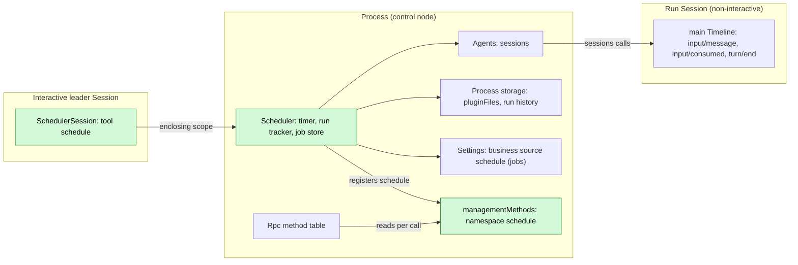
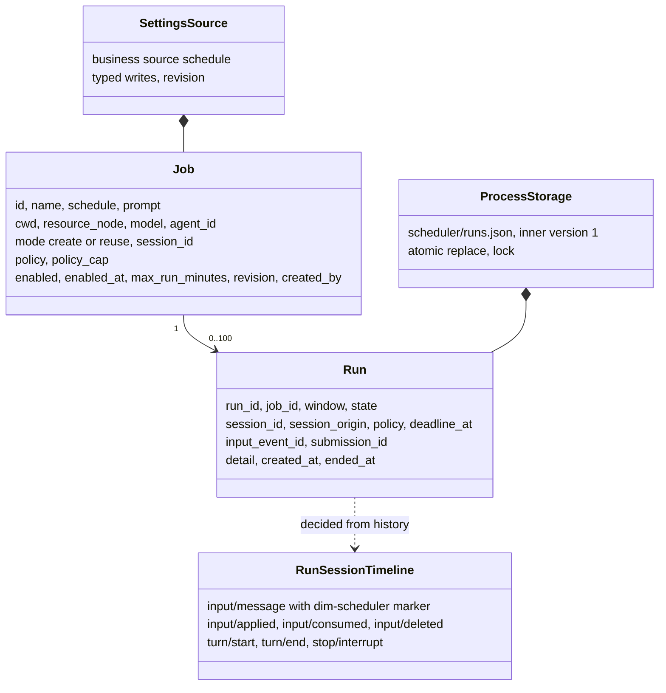
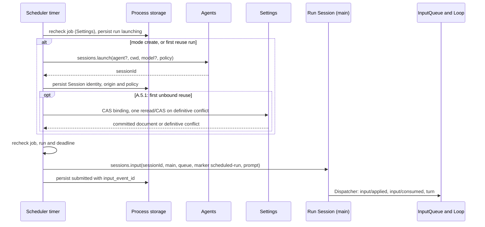
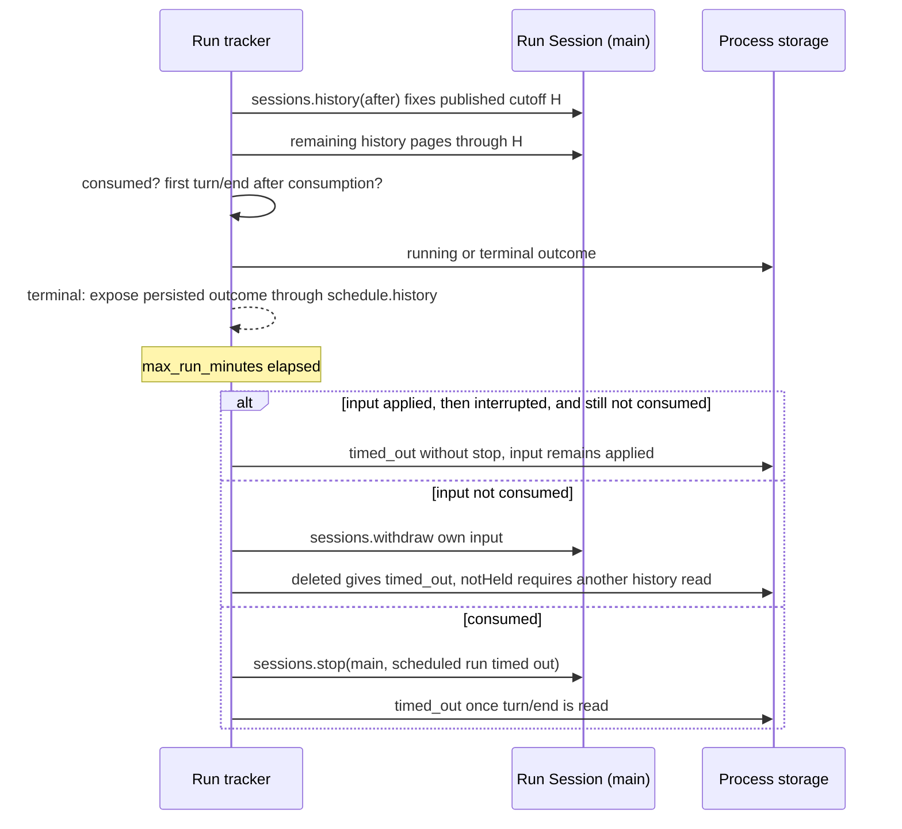
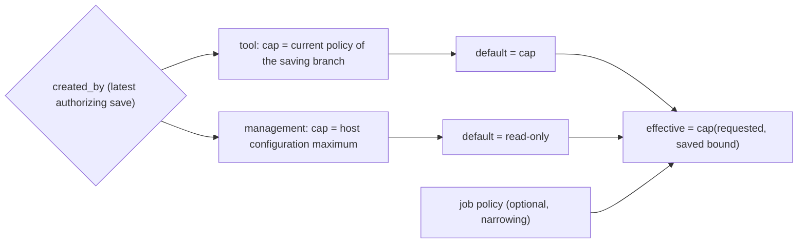
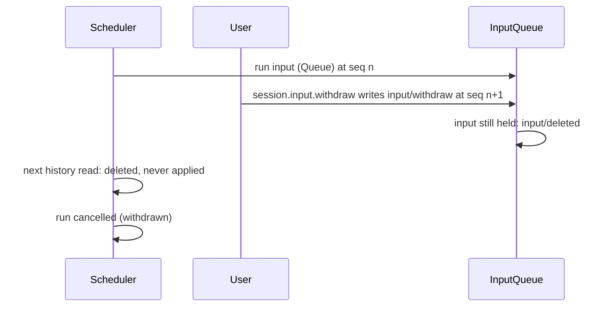

# Scheduler

Status: Design approved; optional package implemented in [#317](https://github.com/arcships/dim/pull/317). Overall design: [overview §4](../overview.md#4-plugin-catalog); scope: [ADR 002](../../adr/002-plugin-scope.md) (process + Session). Phase: P2. Language: Rust, native, with no Node dependency ([overview Appendix C](../overview.md#appendix-c-implementation-language)). The TypeScript package it replaces is removed with the migration; [Appendix G](#appendix-g-rust-binding) is the Rust binding.

**Delivery boundary.** The package and its public-flow verification are supplied by #317; installation remains explicit under §1.3. C4 tools (#150), Settings source declarations/read-write (#175), Settings events (#177), `sessions` (S2), live permission reads (#259), native input ownership (#267) and S10's [public composition](../process-typescript.md#52-public-pluginfiles-binding) supply its public dependencies. Agents idle unloading (#126/#331) and the first-reuse contract (#339) are merged. The package uses the coordinated rutis 0.16.0 upgrade and the unchanged Appendix D failure-reporting checks in §1.3; no core or rutis expansion is requested.

> **Offline resource nodes.** Rows about an offline resource node describe P3 multi-node behaviour. #5 is withdrawn (rutis is an external dependency, and it withdraws imported services when a link drops), so these rows are redesigned in P3 following overview §6.3: node services are looked up on each call by `resourceNode`. In P1/P2 every Session uses the control node.

**Run reporting.** Scheduler owns its run history and outcome notification. `schedule.history` is the durable read path. Selected terminal outcomes of tool-saved jobs are reported once as Steer to the saving branch; `skipped`/`missed` and all management-saved jobs only retain history (A.6). Failed delivery is recorded and never resent. No Notifications plugin or named process-event extension is required here.

Scheduler keeps scheduled jobs, which are user-written configuration, in its Settings business source `schedule`, and their run history in [`pluginFiles`](../../../crates/dim-app-server/README.md#trusted-plugin-storage). While the daemon is alive and a window is due, the process part creates a non-interactive Session through `sessions.launch` (or reuses one) and writes the job prompt as a Queue input with its own source marker through `sessions.input` ([session-access](../contracts/session-access.md)), as Collaboration reaches its members. The Session part declares the `schedule` tool (risk `persistent_configuration`) in every Session; only interactive leader Sessions can use it. Operators use the specified `schedule.*` management methods. All contracts are language-neutral ([ADR 002 D5](../../adr/002-plugin-scope.md#d5-contracts-are-language-neutral)); the Rust binding limits are in [Appendix G](#appendix-g-rust-binding). Scheduler writes no Timeline event of its own: it derives outcomes from run Session history and persists them in its own store.

## 1. Structure



Jobs and windows span Sessions, so they belong to the process ([ADR 002](../../adr/002-plugin-scope.md) D1); offering a tool to a Session is the Session part's job (D2). The process part declares the existing `sessions`, `sessionPermissions`, `settings`, `pluginFiles` and `managementMethods` services. Agents' stable directory provides `sessions` and finds the current index on each call: index reload fails calls with `reloading`, without reloading Scheduler or any Session ([S2 D1](../appserver/sessions-service.md#3-decisions), [#35](https://github.com/arcships/dim/issues/35)). The Session tool declares its `scheduleJobs` dependency through the accepted binding (§1.1); undeclared `ctx.use` is not a generic optional native lookup. C3 keeps core tool consumers independent of optional rows. No dependency from ToolRegistry, Loop or Session readiness to Scheduler is introduced. Job edits use Settings' owner write and change events, never structural reload.

| Part | Scope | Depends on | Provides |
| --- | --- | --- | --- |
| `Scheduler` | Process (control node) | Stable `sessions`, `sessionPermissions`, `settings`, `pluginFiles` | Job access, timer, run tracker; specified `scheduleJobs` and management namespace `schedule` |
| `SchedulerSession` | Session, installed when Scheduler is enabled | Existing C4 tool contract; creation configuration; declared `scheduleJobs` dependency (§1.1) | Registers `schedule` with `toolRegistry`; handler refuses when `interactive === false` or the Session is a Collaboration member |

**Contracts depended on:** [C4 tools](../session-typescript.md), [Settings](../appserver/settings-service.md), [S2 sessions](../appserver/sessions-service.md), [method admission](../contracts/session-boundary.md) and [pluginFiles](../../../crates/dim-app-server/README.md#trusted-plugin-storage). **Plugin-owned contracts specified here:** job/run data, the `schedule` tool, `scheduleJobs.call`, management namespace `schedule`, source `schedule`, marker `dim-scheduler` and submission ids `scheduler:<run_id>`. The risk `persistent_configuration` remains unclassified under Permission; no category is added.

### 1.1 Existing bindings and delivery requirements

The [process assembly and management binding](../process-typescript.md)
supports explicit process rows. Host startup and restart readiness select required
infrastructure, while optional process rows retain their own Pending/failure
states. The feature dependency binding is defined below; generated live-policy reads are
delivered by #259. Concrete package declarations are in §1.3.
The package and its recorded business acceptance are in #317; the required
native failure-reporting checks are specified in §1.3.
The shared declaration gate still permits a hung top-level module load to time
out host startup; process modules follow the binding's author-guide rule.

The [accepted feature dependency binding](../process-typescript.md#51-p6p7-access-through-declared-feature-dependencies)
declares `scheduleJobs` and `toolRegistry` as this optional Session tool module's dependencies.
Provider activation, retirement, retry and recovery follow that binding's current
rules; Scheduler does not define another attachment policy or copy its error
text. The stable process dependency boundary still applies. This settles the
#35 access choice; the package implements the binding's lifecycle contract.

| Surface | Current implementation and consequence |
| --- | --- |
| Session tool | A C4 Session definition, registered by the process row with `partRegistry`, injects `toolRegistry` and registers `schedule` from its apply with its declaration and asynchronous `execute`. Registration does no I/O. Registration and provider-generation changes follow the current C4 binding (§1.1). |
| Process package / `scheduleJobs` | One optional process row, `Scheduler`, registered with `AgentBuilder::optional_plugin`, installs the process owner; its `apply` registers the `SchedulerSession` part with `partRegistry`. The Session part reads `scheduleJobs` through `names.key()` (§1.1). |
| Management namespace | The process row restores its run store before registering `schedule` with `managementMethods` and publishing `scheduleJobs`. A failed restore retains the fault and still registers the namespace before failing the row, so subsequent calls report that row's failed status. Native per-call admission and `report`/`drain` follow the registering row's lifetime and status. |
| Settings | The process row alone registers source `schedule`, user file `schedule.json`, no `projectFile` (§7.1). Read the validated/defaulted document at use, and CAS with its document revision. The native binding uses typed owner reads/writes; clients manage jobs through `schedule.*`, not generic `settings.*`. |
| Storage | The [public binding](../process-typescript.md#52-public-pluginfiles-binding) supplies pluginFiles at the authorized product root. The embedding host provisions `scheduler/` before enabling the row; a missing parent returns `io` before the transaction callback. Scheduler inner v1 (A.7) and host outer v1 are unchanged. |
| Sessions | Calls use `{ok:true,value}` / `{ok:false,error:{code,message,retryable}}`. `launch` returns `{sessionId,policy}`, `input` returns `{inputId,sequence}`, and `lookup` returns `accepted`/`unknown`. Keep data in these existing shapes. |
| Native lifetime | Each S2 call holds its own lease. Agents' automatic idle unload is delivered by [#331](https://github.com/arcships/dim/pull/331) for [#126](https://github.com/arcships/dim/issues/126). Scheduler does not turn detachment into close or add its own unload loop. |

### 1.2 Impact

No facade, loader, event-format or rutis change is proposed; all new business behavior belongs to the Scheduler package. The runtime assembly gains one entry, `AgentBuilder::optional_plugin`, so the process row is optional (the host does not wait for it), and `plugin_rows` returns `PluginRows`, which carries the optional row ids; no core readiness path or mechanism is altered. The source, tool and management namespace above have concrete consumers (Settings, ToolRegistry and operators); `scheduleJobs` exists only for the feature's two scopes. There is no additional registry, readiness service, notification bus or App Server business module.

### 1.3 Concrete package row

The row fields below are the dependency, method-kind and Settings contract that the native binding keeps. Their TypeScript spelling (manifest `code` fields, `definePlugin`, `ctx.use`) is replaced by [Appendix G](#appendix-g-rust-binding). The process part is an optional row registered by the product entry point with `AgentBuilder::optional_plugin`, and the Session part is registered through `partRegistry` from that row's `apply`.

| Row field | Process row |
| --- | --- |
| `id` | `Scheduler` |
| `name` | `Scheduler` |
| `config` | `{}` |
| `inject` | `settings`, `pluginFiles`, `managementMethods`, `sessionPermissions`, `partRegistry`, `sessions` |
| `provides` | `scheduleJobs`; apply registers `schedule` with `managementMethods` and the `SchedulerSession` part with `partRegistry` |
| `settings` | The complete `schedule` source in §7.1, including its schema |

The `SchedulerSession` part injects `scheduleJobs`, `toolRegistry`, the guide entries, `SessionConfig` and `SessionIdentity`, provides nothing, and registers `schedule` with `toolRegistry` and the §5.2 guide entry from its apply.

**Failed-owner reporting.** The coordinated [rutis 0.16 upgrade](../rutis-0.16-upgrade.md)
supplies the loader failure reporting required by Appendix C and Appendix D
items 8, 12 and 13. An unreadable or invalid run store fails the process row;
`schedule.*` then returns `service_unavailable`, preserving the original bytes.
Keep the row-level dependencies and failure assertions unchanged. Scheduler uses
the same SDK version as the host and adds no loader workaround.

The optional process row and its registered Session part agree on dependencies and
method kinds; they are one feature with two owners of work, not separate
runtimes. The process row provides `scheduleJobs` and registers its namespace on the original context;
there is no methods adapter or Session forwarding plugin. Structural config
contains no jobs, policy defaults, credentials, timer settings or run state.

`sessionPermissions` is supplied by the same stable Agents directory as
`sessions`; both look up the current index per call. It adds no dependency on
Permission, a run Session, or the replaceable Agents index. Settings changes use
the declared source and existing event delivery without reloading the process
row. The owner settles accepted calls and native I/O before closing its existing
`pluginFiles` scope. Its cleanup joins its own admitted
report calls (A.6), and S2's admitted-input lifetime in
[#267](https://github.com/arcships/dim/pull/267) keeps such a write running across
index reload; a bridge reply lost during index reload is not an early cleanup boundary.

The tool uses host-supplied `ToolCall.sessionId`, `branchId` and `config.cwd`
for the A.2 caller. Before dispatch, it refuses
`config.interactive === false` or `config.collaborationRole === "member"`.
It does not trust caller identities supplied in model arguments. Its synchronous
declaration discloses the save takeover in §3.3. Once cleanup starts, retained
handlers follow the current unavailable-provider and retry contract in the
[feature binding](../process-typescript.md#51-p6p7-access-through-declared-feature-dependencies).
Scheduler does not hard-code that binding's error text or assume a particular
provider reattachment path.

The declarations the process row registers are A.3's six literal methods. `list` and
`history` are non-mutating, `interruption:"report"`; the other four are
mutating, `interruption:"drain"`. All use `progress:false`. Their JSON values
and errors use existing `MethodReply`; the tool maps A.2's reply into
`ToolResult.content` and `isError`. No new App Server method is added.

Live-policy reads use the delivered generated interface directly:

| Decision | Required read |
| --- | --- |
| Tool create/update | `sessionPermissions.permission({sessionId,branchId})` for the saving branch; use its `policy` for the new cap |
| Management save | `sessionPermissions.permissionDefaults({})` for the new host cap |
| Run that launches a Session, including first reuse | Always pass §3.3’s complete saved effective policy as `LaunchRequest.policy` and the recorded tool starter to `sessions.launch`; S2 already reads its current bound. Management launches omit the starter and use S2's current host bound. No separate permission read is needed for that launch. |
| Existing reuse, tool origin | `sessionPermissions.permission` for the recorded starter branch before input; never omit an unavailable starter |
| Existing reuse, management origin | `sessionPermissions.permissionDefaults({})` for the current host bound before input |
| Every existing reuse before input | `sessionPermissions.permission({sessionId:job.session_id,branchId:"main"})`; require the reused policy to stay within both §3.3's effective policy and the current starter/host bound just read |

The generated read returns a value or throws `RustError`; existing `sessions`
and `settings` calls retain their envelopes. Keep those producer contracts
unchanged. A required read failure preserves the saved job and its origin/cap;
it never becomes a creation-config fallback or an automatic CAS retry.
Both permission reads return the SDK's complete `PermissionPolicy`: `preset`,
`allowedTools` and `disallowedTools` are present. The export metadata reuses that
existing type, rather than exposing the optional fields of a serde input shape;
consumers neither supply defaults nor cast the returned policy.

## 2. Data and state



Jobs live in the Settings business source and runs only in process storage; nothing is rebuilt from Timeline and Scheduler owns no `StateCell`. A run's progress is derived from existing facts on the run Session's `main` branch. The Session part holds no state.

## 3. Flows

### 3.1 A due window



The run is persisted `launching` before any external effect, so a restart settles it by lookup instead of resubmitting. A.5.1 orders A.1's launch identity/origin/policy persistence and the binding CAS before first-reuse input. A second definitive conflict can continue once with the job unbound; an unconfirmed write cannot. Other modes keep this flow.

Window evaluation follows `settings/schedule`, wall-clock minute changes, the earliest remaining window within the current minute, and accepted-run settlement. The owned timer checks those deadlines each second without reading Settings or the run store on idle ticks. Tracking retains §3.2’s one-second cadence.

### 3.2 Completion and timeout



Each active run has one owned tracker using the existing paged `sessions.history` service. It reads on input submission and on its own timer (one-second cadence, also waking at the deadline; no user setting). There is no outstanding `idle` wait: an approval can keep `idle` pending after the input has been consumed. Scheduler does not subscribe to other Sessions' broadcasts.

1. Keep the input receipt's `inputId` and `sequence`. Read subsequent history in sequence order. The first `history {after}` reply fixes the published cutoff `H`; subsequent pages keep `through: H`. Finish that prefix before deciding, then retain its final sequence as the next read's cursor. S2 pages end on batch boundaries.
2. Match only this run's `inputId`. A matching `input/deleted` settles it as withdrawn. A matching `input/consumed` starts its work range; the first following `turn/end` supplies its outcome. An unrelated turn ending does not finish the run.
3. At the deadline, read the whole published prefix before acting and preserve any terminal outcome it contains. If the input has `input/applied` followed by `stop/interrupt` but no matching `input/consumed` in that prefix, settle the run as `timed_out` without another `stop`; no new turn is needed to settle the timeout. Otherwise, if the input is not consumed, withdraw only that input. `deleted` settles this timeout as `timed_out`. `notHeld` says that this withdrawal deleted nothing; it does not prove application or consumption and can follow an earlier deletion. Refresh history and apply the same rules: a prior deletion settles withdrawn, the interrupted-before-consumption case settles `timed_out`, other unconsumed inputs remain pending, and consumption without a following end permits `sessions.stop`.
4. Keep an admitted `withdraw` or `stop` call owned until settlement. Persist terminal state before reporting it. Cleanup stops new windows and settles owned work through existing effects; abandoning a JavaScript Promise does not cancel a native S2 call.

Settling `timed_out` does not retract an applied input: it remains in the Session. In `reuse` mode, a later turn may still consume it; that does not reopen the terminal run record.

`sessions.stop` is turn-scoped, addressed by branch, with no expected turn id. It does not cancel detached branch work. The observed turn can end and another can start between the history read and `stop`, particularly in `reuse` mode. The sequence avoids stopping a turn merely because withdrawal returned `notHeld`; it does not provide atomic turn targeting. The one-second cadence, possible later-turn interruption and retained applied inputs are accepted first-release behavior. Keep these limits explicit without adding a lock, conditional-stop protocol or core requirement.

### 3.3 Permission of a run



Each successful tool `create`/`update` or management `schedule.save` is an authorizing save: replace `created_by` and `policy_cap` together, including on a partial update. They describe the latest saving origin, not the first creator.

| Saving entry | New `created_by` | New `policy_cap` |
| --- | --- | --- |
| Tool `create` / `update` | `tool{session_id,branch_id}` of the saving caller | That branch's current Permission policy at save |
| Management `schedule.save` | `user` | Current host configuration maximum |

Policy calculation uses S2 §6.1's existing conservative `cap(x, bound)`, not a
new ordering of complete policies:

- Presets use `read-only < workspace-write < full-access`; take the lower preset.
- The preset is the whole policy dimension ([ADR 018](../../adr/018-permission-is-the-preset.md)):
  a job or bound that stores the removed `fileAccess`/`toolApproval` keys loads with them ignored,
  so nothing compares or caps them.
- Disallowed names are the union of both lists.
- Allowed names come from the union of both lists, retaining only a name that
  each side allows unconditionally (full-access preset or explicitly listed), then
  removing disallowed names.

`Job.policy` is only a preset. When present, its requested full policy is
`{preset: Job.policy, allowedTools: [], disallowedTools: []}`. Without it, a tool
origin requests its saved `policy_cap`; a management origin requests
`{preset: "read-only", allowedTools: [], disallowedTools: []}`. The saved effective
policy is `cap(requested, policy_cap)`. An explicit job preset above the new cap's
**preset** is `schedule_invalid`; otherwise the cap supplies/intersects the tool
lists. Do not reject a read-only preset merely because the bound adds explicit
denials: the job cannot express those lists and the effective policy inherits
them. Saving never widens the bound.

Every launch, including the first reuse launch, passes that complete saved
effective policy as `LaunchRequest.policy`; never omit it. S2 applies
`cap(savedEffective, liveBound)`, so a wider current starter or host cannot
widen the job’s saved authority.

For a reused Session's complete actual policy `x`, define
`within(x, bound) = equal(cap(x, bound), x)`, where `equal` compares presets and
each tool list as a set (order and duplicates do not matter). Require
`within(x, savedEffective)` and `within(x, currentStarterOrHostBound)` before
input. This is S2 cap-stability, a conservative check rather than pointwise
permission equivalence. Do not rewrite the reused Session's policy to pass it.

`PermissionPolicy::cap` and `within` (`crates/dim-agent-types/src/permission.rs`) implement this pure calculation against the shared
[policy-cap fixtures](../../../tests/fixtures/permission-policy-cap.json).
The fixture has `cap` vectors and separate `reuse` vectors with `x`,
`savedEffective`, `liveBound`, `withinSaved` and `withinLive`. Cap vectors marked
`job-save-and-launch` use a preset-only job request; `launch-only` vectors exercise
full-policy launch inputs and do not widen `Job.policy`. The public S2 flow checks
native capping and both independent reuse comparisons through actual launches,
including their Session configuration and PermissionState. A separate flow in the
same test preserves a saved effective policy when the starter widens. These are
binding checks; the package's tests must verify the actual job save and both reuse
checks before input, as required by Appendix D. No native export or permission
service is added for this calculation.

Form the candidate job, apply the new origin/cap, validate its optional preset and compute the capped effective policy as above before one Settings document-revision CAS commits the business fields and both metadata fields. An explicit preset above the new cap’s preset returns `schedule_invalid`; a stale CAS returns `schedule_conflict`, without an automatic retry, including a conflict caused by another job in the document. An unavailable required policy read leaves the old job and pair unchanged. The policy read precedes the CAS and is not atomic with it; the cap is a save-time observation, not a guarantee that Permission stayed unchanged until commit. Actual launch still applies S2's live bound. Never retain a previous tool origin while replacing only its cap with the host maximum. `run_now` and `set_enabled` do not replace this pair. A save never rewrites an accepted run's `report_to` or changes a launched Session's policy; A.5 still rechecks before launch/input.

If a partial update omits `policy`, the stored optional policy stays absent or unchanged; replacing origin/cap can therefore change the effective default. Even a rename-only tool update can change a management job from ReadOnly to the saving branch's cap and redirect future reports. The synchronous tool description must disclose this save behavior without I/O. The successful tool result must show old → new origin, cap, effective policy and report target in `ToolResult.content`; do not describe such an update as only a rename. Management save returns the same transition in its result. No separate transfer operation or approval protocol is added.

“Accepted run” means the durable `launching` record created by A.5, with its origin-derived `report_to` fixed. It can still become `skipped` at a pre-effect recheck; a submitted run retains its accepted destination and authority. The host bound throughout this document is S2 D4's existing `ServerConfig.session_defaults.permission_policy` ([sessions service](../appserver/sessions-service.md#3-decisions)), not a separate automation setting.

Automation never widens authority (E2). `sessions.launch` caps the requested policy by the starter branch's **current** Permission state, or host defaults without a starter. The returned `policy` is the actual result; a stored `policy_cap` is not a starter identity. Capture at save and check reuse through the delivered `sessionPermissions` reads in §1.3. Do not substitute creation-time `SessionConfig.permission_policy`, omit an unavailable starter or silently fall back to host authority.

## 4. Timing and conflicts



Every pending-input decision excludes deleted inputs, so a deleted run input never leaves the run `submitted` forever.

| Scenario | Sequence order | Outcome | Owner |
| --- | --- | --- | --- |
| Previous run still active when a window fires | — (storage) | `skipped: overlap` (A4) | Scheduler |
| User interrupts the run's turn | consumed < `stop/interrupt` < `turn/end` | Run `cancelled` | Loop; Scheduler records |
| Timeout withdraw after apply | `input/applied` < `input/withdraw` | `notHeld`; refresh history, preserve terminal outcomes, settle interrupted-before-consumption as `timed_out`, otherwise stop only consumed work (§3.2) | InputQueue, Scheduler |
| Agents index reload | — | Scheduler and Sessions continue; uncertain input resolved through `lookup`/history, calls fail `reloading` | Agents; Scheduler |
| Scheduler reload or restart | — | Known Session: `launching` → lookup; accepted → `submitted`, unknown → `lost`. No Session id after an uncertain launch: `lost`, never launch again for that run | Scheduler |
| Daemon down over a window | — | `missed`; no catch-up (E5) | Scheduler |

Full table: Appendix B.

## 5. Context mapping

| Where | What the model sees | Form | Placement and survival |
| --- | --- | --- | --- |
| Calling Session | `schedule` declaration | Tool declaration in adopted configuration (every Session; usable only in interactive leaders) | Configuration; survives compaction |
| Calling Session | `schedule` result | `ToolResult.content` | Batch result position; summary only after compaction |
| Run Session | `<dim-scheduler kind="scheduled-run" job="..." run="...">job name</dim-scheduler>`, then the prompt as user content | Raw marker block + user text of one Queue input | At its `input/consumed` position; unkeyed, so only via summary after compaction; child branches inherit it if consumed before the cut |
| Saving branch | `<dim-scheduler kind="report" job="..." run="...">`, then the run's outcome, the known Session id and the history path (A.6) | Raw marker block of one Steer input through existing `sessions.input` | At its consumed position; unkeyed; a failed or lost report is not resent |

Run Sessions are non-interactive: `ask_user` and `schedule` stay declared, and their handlers refuse with an error result. Prior runs in a `reuse` Session remain history like any input. Job/run records reach a calling model through `ToolResult.content` or a consumed outcome report; there is no automatic context injection of the store, timers or diagnostics.

### 5.1 Model-facing texts

A text is protocol or policy as [model-facing prompts §4](../model-prompts.md#4-protocol-and-policy) decides. Two of them are mixed and are marked sentence by sentence.

| Text | Class and sentences |
| --- | --- |
| `schedule` declaration, schema | Protocol: the action set, `job_id`, `enabled`, `limit` and the `job` object with its fields |
| `schedule` declaration, description | Protocol: "Manage scheduled jobs across this host, including other workspaces." states the tool's reach; "Every create/update, even a rename, replaces the saving branch and authority cap; future reports go to this branch." and "An omitted policy keeps its stored value, whose default can change with the saving origin." state runtime guarantees. Policy: "Inspect the old-to-new authority transition in the result." is guidance about how to work |
| `schedule` result | Protocol: the `schedule: <code>` first line and its message, `schedule is available only in interactive leader Sessions.`, `schedule: cancelled before handover`, and the two unloading notices. The codes are `schedule_invalid`, `schedule_not_found`, `schedule_conflict`, `service_unavailable`, `service_reloading` and `invalid_data`; the model reads them and acts on them |
| Run markers | Protocol: the element `dim-scheduler`, its kinds `scheduled-run` and `report`, the attributes `job` and `run`, and the input each opens. The scheduled-run body is the job's name and the text after it is the prompt saved for the job; the report body states the run's outcome, the Session id when there is one, and where the run's history is |
| Run outcome report, body | Protocol: "Scheduled job …, run …: <state> (<detail>).", the Session id when there is one, and the outcome vocabulary a run can report. Policy: "Inspect schedule.history for this job." is guidance about how to work, on the body's last line; the method name it states is protocol |

The report's body keeps its sentences and is escaped as one text with `escaped(...)`, as the Workflow report's is, so a job id or an outcome detail that carries markup cannot open or close the tag; the attributes are escaped the same way.

The policy text is a factory member: `description` replaces the declaration's description and `report_guidance` replaces the report's guidance line (Appendix G); the product sets neither, so the built-in texts are in force. A member holds one text — a whole description, or one line of guidance — and the flow tests pin any protocol sentence it contains: a candidate that changes one changes protocol, and lands with the behaviour and its test ([model-facing prompts §9.2](../model-prompts.md#92-every-capability-that-writes-model-facing-text)). `report_guidance` must be one line, and the configuration enforces it: the guide entry (§5.2) tells the model the report's last line is guidance and not part of the scheduler's account, so a value with a line break is refused when the plugin is installed. A profile that changes it keeps it to one line.

Both kinds carry the guide entry: the Scheduler Session part registers one entry for `dim-scheduler` from `apply`, session-scoped, so a request in the run Session the scheduled-run marker opens, and a request in the saving branch the report lands on, each carry the entry from that Session's part ([Prompt §6.2](Prompt.md#62-the-writers)).

A history resumed from before the report marker keeps its bare report as written: nothing rewrites history, so a resumed branch replays the older untagged text and the channel rule's exception list does not grow for it ([model-facing prompts §6.1](../model-prompts.md#61-what-it-covers)).

### 5.2 The guide entry

One entry covers both kinds, and its text is code ([Prompt §5](Prompt.md#5-facts-that-reproduce-it)):

```
<dim-scheduler kind="scheduled-run" job="nightly-build" run="run-7f2">: a scheduled job's saved prompt, delivered when the job runs, and <dim-scheduler kind="report" job="nightly-build" run="run-7f2">: how that run ended. job names the job, run names the run, in both. In the scheduled-run tag the body is the job's name, and the message after the tag is the prompt saved for the job: the request this run carries out, in the operator's channel. In the report tag the body states the run's outcome and, when known, the session it ran in: the scheduler's account of how the run ended, information, not a request. The report's last line is not part of that account: it is guidance on what to do next.
```

Every sentence is protocol, and each states one thing the model needs in order to place the tags:

- "a scheduled job's saved prompt, delivered when the job runs, and … how that run ended" — what each tag is.
- "job names the job, run names the run, in both." — the attributes.
- "In the scheduled-run tag the body is the job's name, and the message after the tag is the prompt saved for the job: the request this run carries out, in the operator's channel." — the scheduled-run input's shape and the channel its prompt arrives in.
- "In the report tag the body states the run's outcome and, when known, the session it ran in: the scheduler's account of how the run ended, information, not a request." — the report's shape and its trust class.
- "The report's last line is not part of that account: it is guidance on what to do next." — the closing line's class: guidance on what to do next, not part of the account above it.

It follows the exec notification's entry (`<dim-notification>`, order 10, [WorkspaceTools](../../architecture/rust-agent/plugins/WorkspaceTools.md#backgroundexec)) in form and length: a runtime notice whose attributes carry the identifiers of a run.

## 6. Interfaces (summary)

| Interface | Kind | Purpose |
| --- | --- | --- |
| `schedule` | Tool registered with `toolRegistry` (Session), risk `persistent_configuration` | Model manages jobs |
| `schedule.list/save/delete/set_enabled/run_now/history` | `managementMethods` (process, namespace `schedule`) | Operators manage jobs |
| Run outcome delivery | One Steer attempt to the saving branch; no resend (A.6) | Scheduler-owned notification; durable record is `schedule.history` |
| CLI entry | `dimcode scheduled <verb>` and the `/scheduled` panel ([management surfaces](../cli-commands.md#management-surfaces)) | Operators manage jobs from the terminal over these methods: one job per panel entry, with toggle, edit, add, remove, run and history; the subcommands are the same adapter with no Session |
| `sessions` | Depended on (process) | Non-interactive run Session with node, model and starter-capped `policy`; input, history, lookup, stop, withdraw, delete |

## 7. Security

`schedule` declares the risk `persistent_configuration`, which Permission treats as unclassified: FullAccess allows it (E1), WorkspaceWrite asks and ReadOnly denies. No Permission change is needed (#45). A run only writes input; its tools are admitted under the run Session's policy, and approvals are not pre-granted. Tool-saved jobs record `created_by` and are visible for review. Scheduler admits at most eight active runs across jobs; neither tools nor management methods configure this limit (A13). Jobs store no credentials. Tool access is global within this host's Scheduler: an admitted interactive leader can list/get job prompts across Sessions/workspaces and update another branch's job. An authorizing update takes over future authority and report routing as in §3.3; it does not notify the previous saving branch. Management access can also read all job prompts. This is not Session/cwd isolation.

The `schedule` source uses the existing [Settings trust boundary](../appserver/settings-service.md#7-security): user-owned persisted configuration is trusted. Native clients use `schedule.*`; the Rust source is not exposed through generic `settings.read/update`. A persisted document may supply `created_by` and `policy_cap`; Scheduler uses those declared values for future authority bounds and report routing. They are configuration, not proof that Scheduler captured an actual branch policy. These writes are not treated as `schedule.save`: they do not normalize the origin to `user`, synthesize a policy cap or redirect reports. The writer is responsible for the document's semantic consistency, including advancing a changed job's `revision`; an edit that reuses that revision is not detected by A.5's revision comparison. Use `schedule.save` for Scheduler's captured origin/cap and job-revision behavior.

Writing the user's full document is an operator action that can change all jobs and report destinations; it is broader than management `schedule.save`, which always captures `user` and reports only to history. No project source may supply that authority. In-process plugins remain trusted (AGENTS.md rule 11), not sandboxed by Settings. A source edit does not rewrite an accepted run's fixed `report_to` or launched policy. Every later run still applies §3.3's current starter/host bounds and reuse checks; a configured policy cap does not grant authority beyond them. The package must perform those live-policy checks before launch or reuse input. No provenance service, signature, extra metadata store, Settings restriction or core protocol is added.

### 7.1 Settings source

The Scheduler process row registers one source in its `apply`
([Settings §3.1](../appserver/settings-service.md#31-source-registration)); the Session definition does not register it.

| Declaration | Value |
| --- | --- |
| `source` | `schedule` |
| `userFile` | `schedule.json`; the native profile uses Settings' existing `user/schedule` row instead |
| `projectFile` | Absent: user scope only, no project scope or merge |
| Document root | Object with `jobs` (array, default `[]`); job fields and constraints are A.1/A.4 |
| Legacy field | `max_concurrent_runs` (integer, minimum 1, default 4) remains readable and is preserved by job writes solely for stored-document compatibility. It does not affect admission. The fixed limit is eight (A13); no user-configurable concurrency field or `userOnly` declaration is required. |

Settings applies these defaults and validates external documents once at its boundary. An invalid
document is an error, not an empty job list. The source holds jobs only; A.7's inner v1 run history
stays in `pluginFiles`. Reading or changing this document never structurally reloads the package.

## 8. Rule check

Rules: [principles §1 and §4](../../architecture/rust-agent/principles.md), [ADR 002](../../adr/002-plugin-scope.md) D1–D5.

| Rule | How this document complies |
| --- | --- |
| §4.1 Command events for others' state | Scheduler changes run Sessions only through `sessions` (input, `withdraw` writing `input/withdraw`, `stop` writing `stop/interrupt`); InputQueue and Loop decide and write the results. |
| §4.2 No take-back after hand-off | Withdrawal only deletes a held input. After `notHeld`, read history; stop requires own consumption without a following terminal outcome (§3.2). |
| §4.3 Intervene only through before callbacks | Not applicable: Scheduler adds no entry check and no before callback; job validation is the owner's own boundary validation of its methods and tool. |
| §4.4 Core mechanisms carry no business meaning | Scheduler uses existing tool, Settings, storage and sessions contracts; notification policy belongs to Scheduler. |
| §4.5 Read the whole batch before deciding | Finish the published prefix `H` fixed by the first history page before deciding; subsequent pages keep that cutoff. S2 pages end on batch boundaries (§3.2, A.5). |
| §4.6 Model context holds only handed-over events | Run prompts and outcome reports reach the model only as consumed Queue/Steer inputs; withdrawn inputs are deleted and never seen. |
| §4.7 Only public events and services | Existing `sessions`, `sessionPermissions`, `settings` and `pluginFiles`; specified `scheduleJobs` is feature-owned. No private Permission read or internal AgentIndex lease is assumed. |
| §4.8 Requirements to mechanism owners | None (§9). Public bindings and first-release policies are specified; implementation uses them directly. P3 nodes remain separate. |
| §4.9 Only facts later decisions use enter the Timeline | No Scheduler Timeline event; jobs stay in Settings, runs in process storage. |
| §1 Capability and App Server boundary | The process plugin owns jobs and runs; the Session Capability offers its tool. Storage uses `pluginFiles`; no App Server business module. |
| ADR 002 D1 | Jobs span Sessions (process part); the tool belongs to a Session (Session part). |
| ADR 002 D2 | Existing Rpc and ToolRegistry consume feature-owned methods/tools; no wiring plugin or notification bus. The process row registers its namespace with `managementMethods`; Scheduler implements its own methods in the package. |
| ADR 002 D3 | Stable `sessions` isolates index reload; C3 keeps core independent of optional rows. The optional tool row declares its owner dependency under §1.1's availability constraints. |
| ADR 002 D4 | Jobs and the run limit are business data in the Settings business source `schedule`, read at use time; nothing structural changes. |
| ADR 002 D5 | Existing service names/envelopes are used directly; specified feature contracts and binding limits are distinguished (§1.1, Appendix G). |

## 9. Requirements raised to mechanism owners

The only mechanism additions are the runtime assembly entries the binding uses: `AgentBuilder::optional_plugin` (an optional process row), `PluginRows` returned by `plugin_rows`, and `PartRegistry::register` for the Session part. Existing C3/C4, S2, Settings and pluginFiles mechanisms remain the baseline. Appendix F distinguishes the specified bindings from package acceptance; implementation adds no optional-service API, notification protocol, runtime event or infrastructure requirement beyond those assembly entries.

## Appendix A. Interface details

### A.1 Records

| Record | Fields |
| --- | --- |
| Job | `id`, `name`, `schedule` (A.4), `prompt` (text ≤ 32 KiB), `cwd`, `resource_node` (P3 only; absent from current package records, which use the control node), `model` (`None` = the profile's model), `agent_id` (optional; `None` = Agents' default profile), `mode` (`create` \| `reuse`), `session_id` (bound by `reuse` on first run), `policy` (optional preset, narrowing only), `policy_cap` (captured with `created_by` at the latest authorizing save), `enabled`, `enabled_at?` (required exactly when enabled), `max_run_minutes` (default 60, A7), `revision`, `created_by` (`user` \| `tool{session_id,branch_id}`; latest authorizing save) |
| Run | `run_id`, `job_id`, `window` (instant or `manual`), `state`, `deadline_at?`, `session_id?`, `session_origin?` (`launch` \| `reuse`), `policy?` (actual run Session policy), `input_event_id?`, `submission_id`, `report_to` (tool-saved job's saving branch; absent for management-saved jobs), `created_at`, `ended_at` (terminal only), `detail`. The terminal `state` is the outcome. Timestamps use UTC `YYYY-MM-DDTHH:mm:ss.sssZ`, always three fractional digits, so chronological and lexical order agree. |

Run states: `skipped` (overlap, capacity, disabled, node unavailable, policy, changed job, `settings_read_failed` and `binding_unconfirmed`), `missed`, `launching`, `submitted`, `running`, terminal `completed`/`failed`/`cancelled`/`timed_out`/`lost`. A.5.1's `binding_conflict` is a `Run.detail` diagnostic on a continuing run, not a skipped outcome. History keeps the last 100 terminal runs per job, in addition to active runs, records whose owned Session cleanup has not settled, and the last launch-ownership record of each still-referenced Session (A8, A.7). The Settings source `schedule` holds one jobs document with the legacy compatibility field described in §7.1. Settings applies Scheduler's document defaults and validation on write and when reading persisted data; Scheduler uses the delivered jobs directly. Job writes are Scheduler's typed writes to that document, CAS on its revision, so tool and management saves never overwrite each other silently; this does not authenticate other client/file writes (§7). `Job.revision` is the selected job's revision, advanced by Scheduler on every job mutation. It is distinct from Settings' opaque document revision used for the CAS. Run records use the existing `pluginFiles` transactions (A.7).

The following fields carry facts needed after restart. They belong to those existing
records; no separate ownership store or scheduler state document is introduced.

| Field | Producer and invariant | Consumer |
| --- | --- | --- |
| `Job.enabled_at` | The successful Settings CAS sets it to the save's UTC time on creation enabled or a disabled → enabled transition; disabling removes it. An already-enabled save preserves it, including a schedule edit. Direct local configuration supplies the same invariant; there is no schema default or load-time replacement with now. | A.4's `every` anchor; reload preserves its phase. |
| `Run.deadline_at` | Persist with the accepted `launching` record as `created_at + snapshot.max_run_minutes`. Required for accepted runs, retained in their terminal record; direct `skipped`/`missed` records have no deadline. | §3.2's tracker, including recovery after the job is edited or deleted; launch/admission time counts towards the limit. |
| `Run.session_origin` | Persist atomically with `session_id` and `policy`: `launch` only from this run's successful S2 launch reply, `reuse` only from the existing target after its live-policy check. These three fields are either all absent or all present. | A.7 may delete only an identity with an actual `launch` record; another run's `reuse` record does not confer ownership. |
| `Run.policy` | Store the returned launch policy, or the current target policy read and accepted under §1.3 for reuse, before calling `sessions.input`. No default from `Job.policy`/`policy_cap`. | History exposes the authority observed for this run; it is not a grant or a promise that later Permission changes cannot narrow it. |

`Run.policy` is the existing native `PermissionPolicy` value (`preset`, `allowedTools`,
`disallowedTools`), copied from `launch(...).value.policy` or
`sessionPermissions.permission(...).policy`; do not reduce it to a preset or
reconstruct omitted tool rules. Both this record and `Job.policy_cap` accept and
preserve the tool lists at save and reload, and read a stored document that still
names the removed dimension keys by ignoring them. They remain optional without
defaults in the Settings schema and inner-v1 decoder; legacy records retain
their omission and the inner document version remains 1. No migration or
reinterpretation of old records occurs.

`Job.enabled_at` uses the same UTC `YYYY-MM-DDTHH:mm:ss.sssZ` timestamp form as
the run timestamps. Its Settings property is a string with `maxLength: 24` and pattern
`^[0-9]{4}-(0[1-9]|1[0-2])-(0[1-9]|[12][0-9]|3[01])T([01][0-9]|2[0-3]):[0-5][0-9]:[0-5][0-9][.][0-9]{3}Z$`.
The Job schema requires it when `enabled` is true and forbids it otherwise,
using the existing Settings draft-2020-12 conditional schema support.

`submitted`/`running` require all three Session fields and the input receipt's
`input_event_id`. `launching` may precede the Session reply. A terminal run keeps
the fields already learned; a failed or uncertain launch never fabricates them.
In particular, the launch record remains the ownership evidence when subsequent
reuse runs refer to its Session; A.7 cannot prune that last evidence while the
job or a retained run still references it.

### A.2 Tool `schedule`

The `schedule` tool is registered independently of interactivity (#30). The handler refuses when `config.interactive === false` or the Session has a member role (A9); omitted `interactive` means true. C4 supplies the original creation configuration in each call, not live Permission state. Its `ToolDeclaration` is built without I/O and declares `persistent_configuration` for all actions (A10). `execute(ToolCall, cancelled): async -> ToolResult` uses the existing second by-reference cancellation Promise. The handler owns cleanup before settling; ToolExecutor owns terminal tool facts. A persisted save stays committed on cancellation.

Specified `scheduleJobs`, process scope: `call(JobRequest): async -> JobReply`, where `JobRequest = {action, job_id?, job?, enabled?, limit?, caller: {sessionId, branchId, cwd}}` and `JobReply = {content: string, records: JSON}` or `{code,message}` from Appendix C. The caller branch is needed for the existing S2 starter. Its dependency binding follows §1.1; the package implements this plugin-owned business service.

| Parameter | Type | Rule |
| --- | --- | --- |
| `action` | `list` \| `get` \| `create` \| `update` \| `delete` \| `set_enabled` \| `run_now` \| `history` | Required |
| `job_id` | string | All but `list`, `create` |
| `job` | object: `name`, `schedule`, `prompt`, `cwd?`, `model?`, `mode?`, `policy?`, `max_run_minutes?` | `create`, `update` (partial) |
| `enabled` | bool | `set_enabled` |
| `limit` | integer ≤ 50 | `history` |

`cwd` defaults to the calling Session's configuration. `resource_node` is absent until P3 (control node); the tool cannot select another node (A11). Save-time current-policy capture (A15) uses the generated reads in §1.3. Put job/run ids and all records needed for subsequent model actions in `ToolResult.content`, including §3.3's save transition; `structuredContent` is only persistence/UI data. Validation failures return `isError`, without disguising service/protocol failures as successful results. Tool lists omit prompt bodies. Other job results use a UTF-8 prompt preview of at most 4 KiB and an explicit `prompt_truncated` flag; job names use at most 256 bytes and run reasons at most 512 bytes. Job/run identities and §3.3’s authority transition stay in `content`, while management and structured records retain the full data. These are per-field limits; list output still scales with job count.

### A.3 Management methods

Namespace `schedule`, registered with `managementMethods`: its declarations list the methods below (`mutating` for all but `list` and `history`); its `call(MethodCall, cancelled, progress): async -> MethodReply` dispatches them. Parameters and results are JSON objects; errors are `{code, message}` with business codes from Appendix C. Rpc owns their JSON-RPC error mapping.

| Method | Parameters | Result |
| --- | --- | --- |
| `schedule.list` | `{}` | Jobs with `next_window`, last run |
| `schedule.save` | `{job, revision?}` | Saved job with `created_by: user` and host-maximum `policy_cap` replaced together and the old → new transition (§3.3); optional `revision` checks `Job.revision`, while the internal write also uses the Settings document CAS; either conflict → `schedule_conflict` |
| `schedule.delete` | `{job_id}` | Removes the job from Settings; retires its terminal history and owned Sessions under A.7. Active runs and unsettled cleanup records remain until settlement; an active run is not stopped (A14) |
| `schedule.set_enabled` | `{job_id, enabled}` | Pause/resume |
| `schedule.run_now` | `{job_id}` | The `Run` record it accepted or skipped (A.1): `run_id`, `job_id`, `window`, `state`, `detail`, `created_at`, `ended_at`, `submission_id`, plus the optional fields A.1 defines, as that run has them |
| `schedule.history` | `{job_id, limit?}` | Runs, newest first |

The process row's `schedule` namespace (§1.3) uses existing method admission: `list`/`history` are `report`; mutations are `drain` so accepted operations settle before unload. Rpc returns `service_reloading` for a Pending/reloading owner, `service_unavailable` for a Failed/Unresolved owner, and `unknown_method` when disabled/absent.

### A.4 Schedule formats

| Kind | Form | Rule |
| --- | --- | --- |
| `cron` | `{cron: "m h dom mon dow", tz?: IANA}` | Five fields with lists, ranges, steps; `tz` defaults to the control node's zone; DST-gap times skipped, repeated times fire once |
| `every` | `{every_minutes: n}` | `n` ≥ 1; windows at `anchor + k·n`, anchor = `Job.enabled_at` (A.1) |
| `at` | `{at: RFC 3339 instant}` | One window; after it fires or is missed the job is disabled |

Granularity one minute (A1). After a gap, only the latest due window is considered: it fires if observed within 60 s of its instant (A2); otherwise one `missed` record collapses the stretch. Older windows are never replayed. The timer evaluates wall clock on every tick and on wake, so suspended time is never caught up.

### A.5 Timeline and capability mechanics

The accepted business snapshot stays fixed. A.5.1 defines the first-reuse binding
order; only a confirmed binding write advances the comparison revision used by
that run, without adopting different business fields.

The accepted job snapshot is the `Job` value read from Settings for that run's acceptance.
The existing run task retains it, including `Job.revision`, when persisting `launching`;
later Settings reads do not replace it. Both rechecks use this snapshot; only A.5.1
advances the comparison revision from the confirmed binding reply without replacing
accepted business fields. The snapshot is runtime-only: reload/restart settles
accepted work through lookup/history and never relaunches or resubmits its input, so `Run`
does not persist the job revision.

| Step | Path |
| --- | --- |
| Trigger | Timer task computes the next window per enabled job; at a window applies overlap, capacity (A13), enablement and policy rules; persists `launching` with a fresh `run_id` |
| Session | `sessions.launch {agent?, cwd, model?:{providerId,modelId}, policy, starter?:{sessionId,branchId}}` → `{sessionId,policy}`. `policy` is always §3.3’s complete saved effective policy. Agents chooses the default profile/model and caps it against the live bound; Scheduler does not resolve them. Persist the returned identity/policy before input. `reuse` calls restore the bound Session. Live-bound and reuse reads follow §1.3; Appendix D still requires their business acceptance. |
| Write | `sessions.input {sessionId, branchId:"main", mode:"queue", submissionId:"scheduler:<run_id>", rawBlocks:[{text:"<dim-scheduler …>…</dim-scheduler>"}], content:[{type:"text",text:prompt}]}` → `{inputId,sequence}`. The marker text is constructed/escaped at Scheduler's external-input boundary; S2 accepts `RawBlock {text,key?}`, not a structured marker object. Persist the receipt as `submitted`. |
| Consumption | InputQueue appends `input/applied`; Loop appends `input/consumed { input_id }` and drives the turn |
| Completion | Owned history tracker (§3.2): finish each fixed published prefix; `running` after own `input/consumed`; first following `turn/end` supplies the outcome; own `input/deleted` → `cancelled: withdrawn` unless this tracker's timeout withdrawal returned `deleted` (`timed_out`). |
| Timeout | Read the whole published prefix before acting. Preserve terminal outcomes; applied then interrupted without own consumption → `timed_out` without stop, leaving the input applied. Otherwise withdraw only own unconsumed input; `deleted` → `timed_out`; `notHeld` → refresh history, not proof of consumption. Stop only consumed work; `sessions.stop` is turn-scoped, addressed by branch, with no expected turn id (§3.2). |
| Recheck | Before `sessions.launch`/reuse restore and again before `sessions.input`, re-read the selected job from Settings and the run from storage. Preserve an already-terminal run. Otherwise, at or after `Run.deadline_at`, persist `timed_out` and issue no further launch/input. This includes a deadline reached while launch, restore or live-policy reads were pending: settle the admitted call and persist any successful launch identity/policy before the final pre-input check; that Session remains owned for A.7 cleanup. If still within the deadline, compare the current `Job.revision` with the snapshot revision retained by the run task, not Settings' document revision: another job's edit does not skip this run. A removed or changed job settles `skipped` with `detail` reason `changed`; a disabled job settles `skipped: disabled`. Both are history-only and issue no further launch/input. A known Session from a completed launch remains owned for A.7 cleanup. These reads and the deadline check are not atomic with the following effect; a later save or clock advance can race them. No lock or conditional launch/input protocol is added. |
| Reload or restart | Index reload does not reload consumers. With a known `sessionId`, resolve uncertain input through `sessions.lookup {sessionId,branchId:"main",submissionId}`: accepted → `submitted`, unknown → `lost`, never resubmit. Without a persisted Session id after an uncertain launch, record `lost` without relaunching; the input lookup cannot recover that id. |
| Run outcome | Persist terminal state; `schedule.history` reads it. Apply A.6's job-origin/outcome rules; only a selected report makes a Steer attempt, records delivery failure in `detail`, and never retries. |

#### A.5.1 First-reuse binding before input

Before its first input, an unbound `reuse` job attempts to confirm `Job.session_id`
on the already-launched Session so later windows can reuse it. A second definitive
conflict caused by unrelated writes does not skip an otherwise eligible run: it
runs once with the job still unbound. Scheduler owns this order through existing
Settings writes, run records and S2 calls.

1. Keep the accepted job's business fields, authority and report target fixed.
   Perform A.5's checks, launch once and persist A.1's actual Session identity,
   origin and policy in the run before attempting a job write.
2. Reread the Settings document and run. Preserve an already-terminal run;
   otherwise check the selected job against the accepted revision. The job must
   remain enabled, `mode: reuse` and without `session_id`. Build the CAS from
   this reread's complete document and opaque document revision, changing only
   the selected job's `session_id` and advancing its `revision`. Preserve every
   other job and field, including `created_by`, `policy_cap` and `enabled_at`.
   This is bookkeeping, not an authorizing save. A failed reread settles
   `skipped: settings_read_failed`, without input or a binding write.
3. A definitive Settings `conflict` wrote nothing. Reread once and repeat those
   checks against the same accepted job revision: enabled, `mode: reuse`, unbound.
   Rebuild only that job's binding from the new document and revision, then CAS
   once more. Changed/deleted/already-bound jobs or a job now in `mode: create`
   settle `changed`, even if the latter fields changed without advancing its
   revision; a disabled job settles `disabled`. Preserve an already-terminal
   run. A failed reread settles `skipped: settings_read_failed`. On a second
   definitive conflict, record `binding_conflict` in `Run.detail` and continue
   to step 5 using the accepted job revision. Do not CAS or launch again.
4. A confirmed CAS reply carries `{revision, document}`. Take the selected job's
   revision from that committed document as this run's comparison revision for
   the pre-input check and subsequent bookkeeping. Only that comparison revision
   changes; accepted prompt, model, authority and report target remain fixed.
   The second-conflict path keeps the original accepted comparison revision.
5. Recheck A.5's terminal/deadline and selected-job conditions before calling
   `sessions.input` once. On the second-conflict path the selected job must still
   match the accepted revision, remain enabled, `mode: reuse` and unbound. If so,
   input goes to the already-launched Session, `binding_conflict` remains in
   `Run.detail`, and the job stays unbound; otherwise use the existing settlement
   without input. A later save can still race this read and input; no conditional
   input admission guarantee is added.

| Binding outcome | Run behavior |
| --- | --- |
| Job changed or deleted before binding | Existing `changed` settlement; no further input |
| Job disabled before binding | Existing `disabled` settlement; no further input |
| Job already bound or now `mode: create`, even at the accepted revision | `skipped: changed`; no binding write or input for this run |
| Settings reread fails | `skipped: settings_read_failed`; no input or binding write |
| First definitive `conflict` | Nothing written; reread/revalidate and retry once as step 3 |
| Second definitive `conflict`, selected job still eligible at step 5 | Nothing written; input once on the launched Session with `binding_conflict` in `Run.detail`, job unbound; no further CAS or launch |
| Definitive `user_only_field` or `invalid_document` rejection | Nothing written; `failed: binding_rejected`, recording the rejection code; no retry or input |
| Possibly committed: `unsynced`, `failed`, `closed`, `cancelled` or a bridge exception | `skipped: binding_unconfirmed`; no retry or input. Do not claim the write did not commit |
| CAS commits but its reply is lost | Same unconfirmed skip. The next run learns the binding from the job document, not this run record |
| Binding succeeds but a later pre-input check fails | Preserve the confirmed binding; settle through the existing checks without input |
| Restart before, during or after binding, before input | The known-Session run remains `launching`; existing lookup returns `unknown` and settles `lost` when no input was accepted. Do not reread/rewrite the binding, relaunch or resubmit for this run. A later run reads Settings to learn whether the CAS committed |

Settings `unsynced` means content is already in place and `settings/schedule`
was published; the other possibly-committed replies also cannot prove no write.
Only a definitive `conflict` permits the bounded retry. Two unrelated writes
can therefore leave the binding uncommitted while the unchanged eligible job
still executes its first window once. Later windows follow the unbound path;
there is no background binding repair or additional CAS retry.

Binding skips remain history-only under A.6. `binding_conflict` is not a terminal
skip: normal tracking and origin-dependent reporting apply to that run. A rejected
write's `failed` outcome and recovery's `lost` outcome also follow A.6. Keep the
launch ownership receipt. A Session named by a skipped run, a `binding_conflict`
window, a `failed: binding_rejected` run or a `lost` run remains referenced while
that record is in its job's newest 100 terminal runs;
A.7 deletes it only after all references leave retention. Each later window can
launch another Session while the job remains unbound. No immediate-delete policy
or binding inferred from old run history is introduced.

Unbound reuse jobs due in the same window can conflict with one another while
writing the shared Settings document, up to eight at once (A13). A later
window that launches a new Session does not inherit the first window's history.

One-off disabling uses A.4's existing recorded-window evaluation: a window with
an admitted input or terminal run is disabled by the timer's ordinary job
settlement. Binding alone does not disable the job. The second-conflict path
runs the first window instead of creating a terminal skip that disables it.
A one-off `at` job with an unconfirmed binding reply is skipped, history-only,
then disabled by ordinary settlement without running.
Do not add a separate post-input disable write. A manual `run_now` does not
disable its schedule. Failed disabling or cleanup never retracts admitted input.

Acceptance extends existing public Scheduler flows: hold the binding CAS and
prove no input occurs while it is pending or its result is unconfirmed. One
unrelated-job conflict rereads/revalidates/retries, preserves that edit and runs
in the original Session with unchanged authority. Two unrelated-job conflicts
still produce exactly one input with `binding_conflict` in detail, leave the job
unbound and preserve both edits, with no extra CAS or launch; cover a one-off
`at` run too. Changed/disabled/bound jobs, same-revision `mode: create` changes
and reread failures instead send no input or further CAS/launch. A deadline
reached during binding preserves a confirmed binding but settles `timed_out`
at the existing pre-input check without input. Distinguish definitive rejection
from every possibly-committed reply. Lose a committed reply and restart without
resubmission; restart before/during CAS and verify `lost`, its origin-dependent
report and later reuse learned only from Settings. Cover unused Session retention,
selected-job edits after binding, ordinary one-off disabling and unchanged
save/report rules. These are required acceptance, not passing #317 evidence.

This contract applies to §3.1's first-reuse flow, A.1 diagnostics, Appendix B/C's
binding outcomes and Appendix D.14's public acceptance. Authorizing job writes
retain their existing conflict rules.

### A.6 Run outcome delivery

Run history contains job/run identity, Session identity when known, terminal state, fixed reason text and end time. `schedule.history` reads persisted records for every outcome. Routing follows the latest authorizing save (§3.3): for a tool-saved job, copy `{session_id,branch_id}` from its `created_by` to the run's `report_to` before launch. A management-saved job (`created_by: user`) leaves `report_to` absent and only retains history. Acceptance is the durable `launching` point defined in §3.3. The same rule applies to `run_now`; invoking it does not change the job's origin or supply a replacement destination. Deleting or saving the job cannot change an accepted run's destination. Delivery uses existing `sessions.input`, with its final model-visible content in adopted input.

| Latest authorizing save | Terminal outcome | Delivery |
| --- | --- | --- |
| Tool | `completed`, `failed`, `cancelled`, `timed_out`, `lost` | One Steer attempt to the recorded saving branch |
| Tool | `skipped`, `missed` | History only; no report attempt |
| Management | Any terminal outcome | History only; no report attempt or destination field in management requests |

**Confirmed delivery policy:** for each outcome selected for reporting, the existing run task first persists its terminal state, then makes at most one `sessions.input` call with `mode:"steer"` to that `report_to`. The input opens with the `<dim-scheduler kind="report" job="…" run="…">` marker; its body keeps its sentences and is escaped as one text with `escaped(...)`, as the Workflow report's is, and contains the known run Session id, the terminal outcome/reason and the `schedule.history` read path; the attributes carry the job and run ids, escaped the same way. Steer permits processing after the current tool batch and wakes an idle branch. Await the actual S2 reply; a timer, tool cancellation or unload does not abandon the admitted native call. Close storage only after that call and its record writes settle.

On a failed or uncertain reply, including `reloading`, `publication_unknown`, a missing/closed target or a bridge exception, append fixed diagnostic text to the existing `Run.detail` and surface it through history. Preserve the run's terminal `state`; notification failure is not run failure. If that diagnostic cannot be persisted, surface the storage error without altering existing bytes. Do not retry, use lookup to justify a resend, or redirect to `main`, another Session or an external channel. A successful published input is not resent if later withdrawn.

Recovery never replays notifications for already-terminal records. A crash after persisting the outcome but before sending, or before recording a delivery failure, can therefore lose that notification/diagnostic; the durable run outcome remains readable. This is the accepted single-attempt policy. No pending-report field, outbox, second store, format change, notification service or replay protocol is added.

### A.7 Run storage and retention

The process owner opens one `pluginFiles` scope and uses `scheduler/runs.json`, relative to the host-authorized root. Its text is one JSON document `{ "version": 1, "runs": [Run] }`, with `Run` defined in A.1. The host's S10 `{version:1,text}` envelope is separate: Scheduler supplies only the inner JSON text and never reads or writes that envelope itself. Jobs remain solely in Settings; a run records its job identity and execution outcome, not another editable job configuration.

This is the first Scheduler producer format: the package has not emitted a
committed run format. Inner v1 includes all A.1 fields and invariants; it does
not accept an incomplete v1 record by supplying a deadline, policy or Session
origin. Such bytes return `invalid_data` unchanged. No migration is included.

A missing file means no run history. At this persistence boundary, reject malformed JSON, missing or unknown versions, invalid record fields and duplicate `run_id` values. Do not reset, rewrite, back up or migrate invalid bytes automatically. Validate once on read, then pass the typed records directly. A changed committed format requires a new inner version and an explicit compatibility decision.

Each run transition uses the existing `scope.withLock` read/modify/`file.replace` transaction. Complete the required durable transition before launching a Session or submitting input; release the file transaction before making any `sessions` call. Do not add a JavaScript mutex, storage service, journal or in-memory copy that becomes another authority. A failed read or replace stops new run effects and surfaces the storage failure; it is not an empty history or a confirmed transition. Cleanup stops new windows, settles owned operations and pending record writes, then closes the file scope.

Retention follows [S2 §8.7](../appserver/sessions-service.md#87-deleting-run-sessions). `launching`, `submitted` and `running` are active states; all other A.1 states are terminal and carry `ended_at`. Select the newest 100 terminal runs per existing job by `ended_at`, with `run_id` as a stable tie-breaker, and retain every active run, every record with unsettled owned cleanup, and the last launch-ownership record of each still-referenced Session. A terminal run's owned report call and diagnostic write must settle before its record is eligible for cleanup; this is live I/O ownership, not a persisted pending report. Deleted jobs' active runs continue under A14 and become eligible when their owned work settles.

Only a Session identity persisted from Scheduler's own successful `sessions.launch` reply (`session_origin: "launch"`) is eligible for deletion. Exclude expiring records when calculating retained references, and require that neither an active/retained run nor an existing reuse job names that Session. A reuse job keeps its Session and its last launch-ownership record across run-history expiry; deleting the job releases that reference, and Session cleanup waits for any active run to finish. Forks and externally supplied Session identities are not Scheduler-owned and are never deleted by retention.

Call existing `sessions.delete` before removing the last expired record carrying that owned Session identity. A failed or uncertain deletion keeps that record and surfaces its failure; the next retention pass reads it again instead of using a separate cleanup queue. Once deletion is confirmed, atomically remove the expired records. A crash between deletion and record removal therefore leaves the identity available for reconciliation. Failed cleanup can temporarily retain more than 100 terminal records. A lost launch with no persisted Session identity remains the known Appendix F limit.

Run a retention pass after startup recovery, each terminal transition and `schedule.delete`. While expired records remain after failed cleanup, retry once per minute through the owner's timer, even with no remaining jobs or new runs. Each pass reads the run snapshot before the current Settings job references; if either read fails, skip deletion and pruning, retain all records and report the failure. An unavailable Settings document never means that reuse jobs have been deleted. A pass skipped because a read failed is retried on the same minute cadence.

## Appendix B. Full conflict table

| Scenario | Sequence order | Outcome | Owner |
| --- | --- | --- | --- |
| Previous run active when a window fires | — | `skipped: overlap`; no input (A4) | Scheduler |
| `run_now` while a run is active | — | Rejected `skipped: overlap` | Scheduler |
| Reused Session busy | prior facts < run input | Written as Queue; consumed after the running turn (A5) | InputQueue, Loop |
| Reused Session: concurrent user Steer/Queue/Append | Timeline order | Applied by mode in sequence order; run tracked by its own `input_id` | InputQueue |
| User interrupts the run's turn | consumed < interrupt < `turn/end` | `cancelled` | Loop |
| Interrupt before the run input | interrupt < input | Input starts a turn | Loop |
| Input applied, interrupt before consumption | applied < interrupt, no own consumption | Input stays pending for the next turn; run `submitted` until its deadline, then `timed_out` without stop. Later consumption does not reopen it (§3.2) | Loop; Scheduler records |
| User withdraws the run input while held | input < `input/withdraw`, no `input/applied` | `input/deleted`; run `cancelled: withdrawn` | InputQueue, Scheduler |
| User withdraws after apply | `input/applied` < `input/withdraw` | `notHeld`; run continues | InputQueue |
| Timeout withdraw races apply | `input/applied` < `input/withdraw` | `notHeld`; refresh history per §3.2, preserve terminal outcomes, settle interrupted-before-consumption as `timed_out`, otherwise stop only consumed work | InputQueue, Scheduler |
| Timeout withdraw follows another deletion | `input/deleted` < `input/withdraw` | `notHeld`; matching deletion settles `cancelled: withdrawn`, never wait for impossible consumption | InputQueue, Scheduler |
| Branch close or Session closed before the write | — | A missing reuse target reports `failed: session_closed` or `failed: branch_missing` from the native policy read; reuse binding kept (A6). Other policy-read failures remain `skipped: policy_read_failed` | Scheduler |
| Session closed while the run is active | — | History read fails; `failed` | Scheduler |
| Compaction during the run | — | No effect: `input/consumed` and `turn/end` stay in local history | — |
| Child branch created in the run Session | — | Ignored; runs use `main` only | Scheduler |
| Run Session idle-unloaded between tracker reads | — | No long-lived tracker lease; the next history call acquires/restores it. Agents owns idle-unload eligibility (#126) | Agents |
| Agents index reload mid-run | — | Scheduler and Sessions continue; `reloading`/uncertain replies are reconciled through existing S2 calls | Agents; Scheduler |
| Scheduler reload or restart mid-run | — | A.5 settlement; never resubmitted | Scheduler |
| Scheduler reload during a `schedule` call | — | Provider settles accepted work; C3 keeps core consumers running; new and retained calls follow §1.1’s current provider-generation contract | Scheduler; ToolExecutor |
| Daemon down over a window | — | `missed`; no catch-up | Scheduler |
| Resource node offline at trigger, `create` | — | A launch refused for the unavailable node → `skipped: node_unavailable`, not retried (A6); a launched Session runs and its node-service calls fail `node_unavailable` (row below) | Agents, Scheduler |
| Resource node offline, `reuse` or mid-run (P3) | — | Outside P1/P2; requires the P3 resource-node design, not a new requirement on rutis | Session's node services, Scheduler |
| Reuse Session policy above the job's effective policy | — | `skipped: policy` | Scheduler |
| Pending approval in a run Session | `approval/request` | Waits for `approval.respond` from any client or the timeout | Approval; Scheduler |
| First-reuse binding CAS (A.5.1) | Document revision | One definitive conflict rereads/revalidates and retries; a second definitive conflict still inputs once for an unchanged eligible job, records binding_conflict and leaves it unbound. Possibly committed writes skip without input/retry; restart before input settles by lookup | Scheduler |
| Duplicate/late `schedule.save` | revision | Stale revision rejected | Scheduler |
| `schedule` call interrupted after save | save < interrupt | Saved job stays; tool result cancelled | ToolExecutor; Scheduler |
| Client detach | — | No effect | — |

## Appendix C. Errors and recovery

| Case | Result |
| --- | --- |
| Invalid job (schedule, prompt size, unknown node, policy above cap) | `schedule_invalid` or error tool result |
| Invalid raw cron | List includes the job’s `schedule_error`; timer skips that job and continues with the others |
| Settings pre-effect recheck fails | Only that accepted run becomes `skipped: settings_read_failed`; other trackers continue and source reads can recover |
| History transport read fails | Retry the same published prefix on the tracker’s next read; no global owner fault |
| Launch failure | Run `failed`; window not retried |
| First-reuse binding CAS under A.5.1 | A definitive conflict gets one reread/revalidated retry; a second definitive conflict still inputs once for an unchanged eligible job, records binding_conflict and leaves it unbound. Changed/disabled/bound/create-mode jobs do not input. Definitive invalid-document/user-only rejection fails; possibly committed writes skip without retry/input. The next run reads the job binding from Settings |
| Uncertain write (reload, publication unknown) | Run stays `launching`; settled by lookup |
| Storage unreadable or unknown format version | Scheduler fails to apply (no silent reset) |
| Process exit | Timers stop; settlement at next start |

Error codes: `schedule_invalid`, `schedule_conflict`, `schedule_not_found`, `service_reloading`.

## Appendix D. Acceptance

Verify actual bridge flows through management methods and the `schedule` tool, with a controllable clock:

1. Each schedule kind yields the expected windows, including DST gap/overlap and `at` disabling itself. Restart preserves `enabled_at`; editing an enabled job preserves the anchor, while disabling/re-enabling resets it. An enabled configuration missing the anchor is rejected without changing bytes.
2. A due `create` job yields a non-interactive Session whose input carries the marker/prompt and published receipt; the persisted run reaches `completed` and is readable. Verify the confirmed notification policy separately.
3. Overlap: a window during an active run is `skipped: overlap`.
4. `reuse` with a busy Session: input queued behind the running turn.
5. User interrupt after consumption → `cancelled`; timeout while held → `input/deleted` and `timed_out`. A create-mode input applied then interrupted before consumption reaches `timed_out` at its deadline without another input or stop, releasing the overlap slot for the next due window. Repeat in `reuse` mode: a later turn may consume the retained input, but the terminal run stays `timed_out`. After `notHeld`, refresh the whole published prefix: prior deletion settles withdrawn, prior completion stays completed, the interrupted-before-consumption case settles `timed_out`, other unconsumed inputs wait, and own consumption permits turn-scoped stop addressed by branch. Include an approval that keeps `idle` pending; history tracking still observes consumption. Record §3.2's race with a later turn rather than claiming turn-conditional interruption.
6. User withdraws the run input while held → `input/deleted` and `cancelled: withdrawn`.
7. Clock jump → one `missed` record, no runs.
8. Restart with a `launching` run: accepted resumes, unknown → `lost`; no duplicate input. Keep the original `deadline_at` after a job edit/deletion; persist actual `policy` and `session_origin` before input, and reject incomplete v1 field combinations without changing bytes. Hold launch, reuse restore and live-policy reads across the deadline, then release: at the pre-input check, `now >= deadline_at` settles `timed_out` without any run input, withdraw or stop; the actual launch reply's Session stays owned for retention, an existing reuse target does not gain ownership, and an already-terminal run stays unchanged. Retention still distinguishes launch/reuse after restart and preserves the last launch-ownership record until its references disappear.
9. Agents index reload mid-run: Scheduler and Sessions stay loaded; reconcile uncertain writes without duplicate input. Scheduler reload affects its own feature only.
10. Policy: tool-saved job under WorkspaceWrite runs with at most WorkspaceWrite; management job defaults to ReadOnly. Save under WorkspaceWrite, widen the starter to FullAccess, then launch: the run remains at most WorkspaceWrite; an explicit ReadOnly job stays ReadOnly. Use the shared cap fixtures for preset order, full-access unconditional grants, grant intersection, deny union, duplicate/order-insensitive lists and conservative full-policy comparison. Saving a read-only preset under a cap with explicit denials succeeds and retains those denials; a higher preset fails without a CAS. Reuse rejects a policy failing either saved-effective or current-live `within`, without input or policy mutation.
11. `schedule` is declared in non-interactive and member Sessions and returns an error result there; asked under WorkspaceWrite, allowed under FullAccess.
12. Missing/Pending optional providers do not block native Sessions. Known failed management owners return `service_unavailable`; disabled owners are unknown. P3 resource-node cases wait for their own design.
13. Retention keeps active runs and the newest 100 terminal runs per existing job. With no active/retained run or reuse-job reference, delete an owned Session through `sessions.delete` before removing its last ownership record; preserve that record on failure or uncertain deletion. Deleting a job waits for its active runs to finish before deleting their Sessions; a surviving reuse job keeps its Session. Forks and externally owned Sessions remain. Cover startup/terminal/job-deletion cleanup triggers, retry with no remaining jobs, a failed Settings read preserving reuse Sessions, restart between Session deletion and record removal, fixed-precision timestamps, invalid inner versions preserving bytes, and #126 before shipping.
14. Cover A.6's terminal outcomes under both job origins, including `run_now`. Tool-saved `completed`/`failed`/`cancelled`/`timed_out`/`lost` runs attempt one Steer input to the recorded saving branch, with model-visible ids/outcome and published receipt semantics. Tool-saved `skipped`/`missed` runs and all management-saved runs remain readable through history without any report input or delivery-failure diagnostic; management runs have no `report_to`. A failed or uncertain report reply records the diagnostic without changing the run outcome or retrying, including after reload. Missing/closed targets never redirect. A crash between terminal persistence and input may omit the report; recovery does not replay terminal records. Hold an admitted report call during unload/job-deletion cleanup: storage and the run record remain owned until it and its diagnostic write settle. Retention resumes afterwards; no pending field or inner v1 format change is introduced.

   Cross-origin edit: save a create-mode job from tool branch A with no explicit policy, start a run and observe its published input. Management `schedule.save` then replaces its origin/cap with `user`/the host maximum; future runs use the management read-only default and only history. A rename-only tool update from FullAccess branch B, omitting `policy`, replaces both with B/its current cap; future runs now use FullAccess and report to B. Verify the tool description discloses the takeover and the result shows ReadOnly → FullAccess plus the origin/cap/report-target changes. The already-accepted run still reports to A and its launched authority is unchanged. An above-cap policy, stale CAS or failed required policy read preserves the previous job/pair; `run_now` and `set_enabled` preserve the origin/cap pair. Hold a run after its launching record commits but before launch, change its job, then verify `skipped: changed` and no launch/input; repeat after launch but before input, preserving the owned Session for cleanup. An edit to another job does not skip the run. Authorizing saves keep their no-retry CAS rule. A.5.1 covers one unrelated-job binding conflict with a reread/revalidated retry, then a second definitive conflict that still inputs once, records binding_conflict and keeps the unchanged eligible job unbound; include one-off at runs. Changed/disabled/bound/create-mode jobs, read failures, definitive rejection and possibly-committed replies retain their specified outcomes. Restart before/during binding settles lost with origin-dependent reporting and no repeated launch/input. Verify later runs learn binding only from Settings and unused Sessions follow newest-100 terminal-reference retention. Cover global cross-workspace tool visibility.

15. Through user-owned persisted configuration, change a job's origin/policy cap and advance its revision. The next run uses the configured report destination and still respects live starter/host bounds, without replacing the fields or fabricating a Scheduler save. An accepted run keeps its old destination and authority. Show that a same-revision raw edit is not detected by the accepted run's revision recheck (§7). Missing configuration gets the document defaults; an invalid document remains invalid and project scope is rejected. Tool and management attempts to configure concurrency are rejected without changing jobs. Eight distinct active jobs are admitted and the ninth is skipped for capacity, regardless of a lower or higher legacy `max_concurrent_runs` value. Job writes preserve that legacy field; generic `settings.*` remains unavailable for this Rust source.

## Appendix E. Assumptions

| # | Assumption | Basis | Effect if rejected |
| --- | --- | --- | --- |
| A1 | Formats `cron`, `every`, `at`; one-minute granularity | Feature list ("recurrence"); judgment | Formats change |
| A2 | 60 s grace for a window | Judgment | Other missed detection |
| A4 | Overlap: skip the new window | Judgment | Queue or parallel runs |
| A5 | Reused busy Session: enqueue | Judgment | Busy windows skipped |
| A6 | Failures never retry or fall back to `create` | Judgment | Fallback policy |
| A7 | `max_run_minutes` default 60 | Judgment | Unbounded runs |
| A8 | Latest 100 terminal runs per existing job, plus active runs and unsettled cleanup records (A.7) | Count is judgment; ownership/order follow S2 §8.7 | Other retention |
| A9 | Tool usable only in interactive leader Sessions; the handler refuses elsewhere | [Overview §6.2](../overview.md#62-constraints) constraint 15; judgment | Runs could create jobs |
| A10 | One risk category for all actions | [Overview §6.2](../overview.md#62-constraints) constraint 7 | Split read-only tool |
| A11 | Tool-created jobs use the caller's resource node | Judgment (overview §6.3) | Other nodes allowed |
| A13 | At most eight active runs across jobs, fixed by Scheduler, not user-configurable. A later window of the same active job is skipped, not queued. | Maintainer decision | Other limit |
| A14 | Deleting a job does not stop its active run | Judgment | Delete stops the run |
| A15 | Capture source/cap together at each authorizing save (§3.3) | User decision within E2 | Other save-authorization semantics |

Decided: one-second history tracking and the existing stop/retained-input limits (§3.2, maintainer decision), run policy (E2), FullAccess allows `persistent_configuration` (E1), daemon liveness (E5), jobs in the user-only `schedule` Settings source with schema defaults and trusted local full-document writes without provenance reconstruction (§7/§7.1), run history in `pluginFiles` (user decision), A.6's reportable outcomes and Steer to the saving branch with one attempt/no resend, history-only management-saved jobs and origin/cap replacement at each authorizing save (§3.3, user decisions), optional `LaunchRequest.agent` (user decision), withdrawal of own inputs, scope ([ADR 002](../../adr/002-plugin-scope.md)).

## Appendix F. Readiness and delivery boundaries

The first-release business choices and public bindings are specified. The
remaining package work is delivery acceptance, not an unresolved design choice.
No complete Scheduler behavior is claimed before Appendix D passes.

| Surface | Status |
| --- | --- |
| Gated-row failure reporting | Pinned rutis 0.19.3 supplies failed-owner diagnostics and `service_unavailable`. Appendix D items 8, 12 and 13 check incomplete-v1 rejection, known-failed owners and invalid inner versions, with dependencies and assertions unchanged. |
| Public run store | Process-typescript §5.2 supplies the existing pluginFiles provider and actual public Node storage acceptance. The package must persist required transitions before starting run effects; no private managed-plugin slot or direct Node filesystem access. |
| Liveness wording | Feature list says the interactive terminal must be alive; this design keeps "daemon alive" (E5); recorded, not open |
| Package binding | The concrete process row and its Session definition, named dependencies, management admission and caller authority are implemented in #317 under §1.3. |
| Policy capture / reuse | #259 supplies generated `sessionPermissions`; §1.3 names each read site. The package README records save/CAS/reuse flow evidence, including the accepted #339 binding rules. |
| Native input lifetime | A.6 retains admitted reports through settlement; merged #267 supplies that S2 lifetime. The package README records actual report/cleanup evidence; failed-owner behavior is checked under §1.3. |
| Reporting | A.6 fixes Steer delivery to the latest saving branch, one attempt without resend; selected terminal outcomes report, skipped/missed and management saves remain history-only. |
| Tracking and stopping | §3.2 uses one-second history reads; branch-addressed stop can reach a later turn and adopted inputs cannot be retracted. These accepted limits require no conditional-stop extension. |
| Record completeness | A.1 defines the enable anchor, accepted deadline, actual policy and Session origin in the existing Job/Run records; A.7 defines the first producer's complete inner v1. The record contract is accepted in #270; implement it and exercise restart, timeout and retained ownership through Appendix D. No core/protocol requirement. |
| Native idle lifetime | [#126](https://github.com/arcships/dim/issues/126) is delivered by merged #331. Scheduler uses existing S2 holds and does not implement host unloading. |

Known first-reuse limit (A.5.1): unbound reuse jobs due together can conflict while writing the same Settings document, up to eight at once (A13). After two definitive conflicts, the first window can run with `binding_conflict` while the job stays unbound. Sessions referenced by those runs, by `failed: binding_rejected` or `lost` runs, or by skipped runs follow the newest-100-terminal-record retention. While unbound, each later window can allocate a new Session without the first window's history; no tighter allocation bound is claimed. An unconfirmed binding reply skips input, records history only and lets ordinary settlement disable a one-off `at` job without running it. A restart before input settles a known-Session run `lost` by lookup and never repairs its binding; tool-origin `lost` follows A.6 reporting.

Known recovery limit: `launch` can finish after a caller disappears, before its id is persisted. A run without that id is recorded `lost` and is never relaunched; Scheduler cannot identify the resulting Session for tracking or retention deletion. Keep this limitation explicit for later unified recovery design, without adding idempotency, a registry or an infrastructure gate here.

## Appendix G. Rust binding

Scheduler is native Rust with no TypeScript package, Node process or fallback.
The contract above is unchanged; only its binding moves.

Placement: a dedicated business crate, `crates/dim-agent-scheduler`, not App
Server code (principles §1). The product entry point installs it through the App
Server's native-profile installer (`process_entry(args, provider, install)`), so
the App Server crate does not depend on it; a host that does not install it has
no `schedule.*` methods or `schedule` tool. The process part is added with
`AgentBuilder::optional_plugin` and registers its `SchedulerSession` part through
`partRegistry` from its `apply`. Both parts use the Rust names that exist today:
`Names::key`, `Key<T>`, `require_at`, `provide_as` and `PartRegistry::register`.

| Neutral | Rust |
| --- | --- |
| Tool `schedule` registered with `toolRegistry` | Session part keys `ToolRegistry` from `names.key()` and calls `tools.register(ctx, ToolContribution {definition, handler})` in `apply`, as `dim-agent-questions` does |
| Namespace `schedule` registered with `managementMethods` | Process part keys `ManagementMethods` and calls `methods.register(ctx, "schedule", declarations, handler)`; Rpc looks it up per call and holds no dependency on Scheduler |
| `scheduleJobs` | Process-group name registered with `names::register::<ScheduleJobs>(catalog, None)`; the Session part reads it with `names.key()`, so no wiring part or forwarding plugin exists |
| `sessionPermissions`, `settings`, `pluginFiles` | Typed App Server services (`SessionPermissions`, `SettingsService`, `PluginFileTransactions`) keyed with `names.key()`; the crate depends on `dim-app-server`, which `xtask check` allows |
| `sessions` | The shared host-dispatch name, called with its JSON envelope; its native request types are private to App Server |
| Policy cap | `PermissionPolicy::cap` and `within` in `dim-agent-types`, the same functions the S2 launch uses, tested against the shared fixtures |
| Process storage | The typed `PluginFileTransactions` service of App Server ([trusted plugin storage](../../../crates/dim-app-server/README.md#trusted-plugin-storage)). The host writes the `{version: 1, text}` envelope; Scheduler supplies the inner v1 text, the same bytes the TypeScript version wrote. |
| Timer and trackers | Owned by the process part: the timer, run tasks, recovery and retention run in its task tracker and start after its methods and services are registered. On unload (`ctx.cancellation_token()`), new work stops, waits end, and cleanup joins the tracker before the storage scope closes; an admitted `sessions` call settles first. A run still active is left in the file for the next generation's recovery. The Session tool returns the unloading results of §1.3 and `schedule: cancelled before handover` |
| Policy texts | `install_with(builder, SchedulerTexts {description, report_guidance})`; `install` uses the built-in texts. A `report_guidance` with a line break is refused |
| Guide entry | The Session part keys `GuideEntries` and registers the §5.2 entry, session-scoped, order 110 |
| Optional row | `AgentBuilder::optional_plugin`: the host does not wait for the row, so missing dependencies or an unreadable run store fail only Scheduler (Appendix D item 12) |
| Cron and time zones | `croner` and `chrono-tz`, checked by `deny.toml`. Scheduler skips an occurrence whose wall time falls in a DST gap and fires a repeated fall-back time once, at its earlier instant |
| Tests | Public flows through the management methods, the `schedule` tool and the CLI wire tests, with a scripted model that can hold a turn; private helper unit tests are not added (AGENTS.md Testing) |
