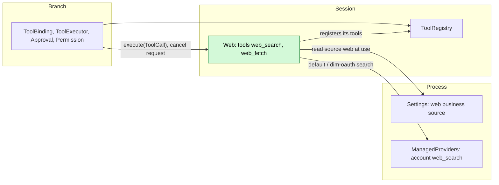
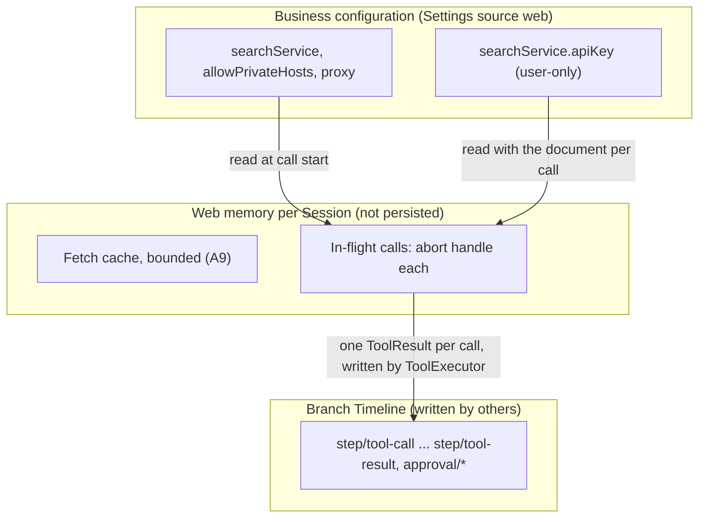
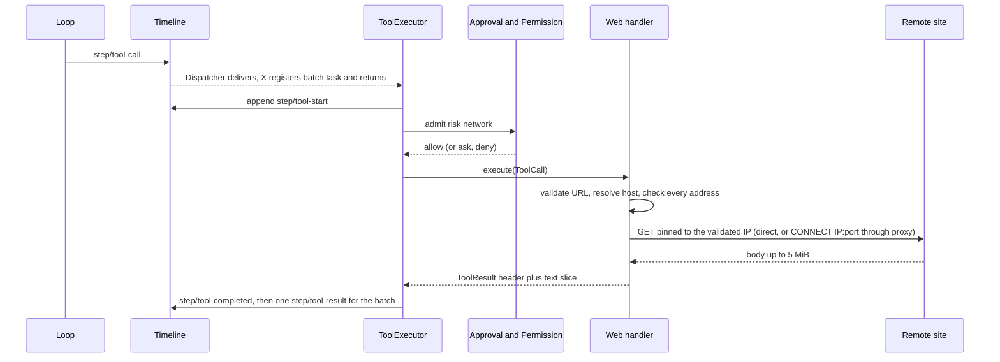
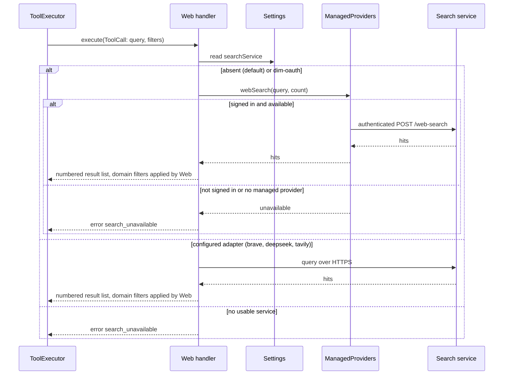
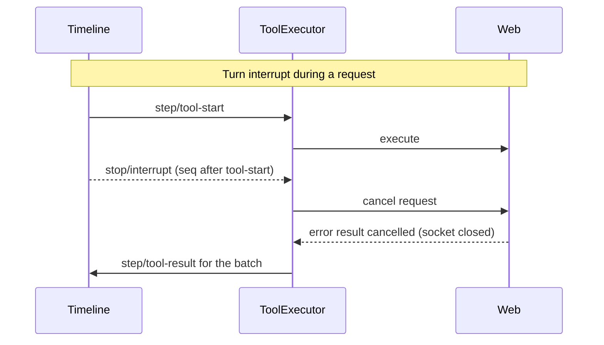

# Web

Status: Implemented as a built-in Rust plugin in `dim-app-server`. Overall design: [overview](../overview.md) (Web). Phase: P2. Language: Rust. Scope: [ADR 002](../../adr/002-plugin-scope.md) (Session).

Web is a Session plugin that gives the model `web_search` and `web_fetch`, two tools it registers with the Session's `toolRegistry` ([tool contributions](../../architecture/rust-agent/tool-contributions.md); [session-boundary A.5](../contracts/session-boundary.md#a5-tool-contribution), [ADR 002 D5](../../adr/002-plugin-scope.md#d5-contracts-are-language-neutral)). Search goes to a configured built-in search adapter; fetch downloads one public page and returns bounded text. Web holds no state shared across Sessions, writes no Timeline event (every call and result is already a tool call fact) and reads its business configuration from its Settings source `web` at use time, so editing it never reloads anything ([ADR 002 D4](../../adr/002-plugin-scope.md#d4-structural-configuration-and-business-configuration-are-separate)).

## 1. Structure



| Part | Scope | Depends on | Provides |
| --- | --- | --- | --- |
| `web` | Process, when a home exists | `settings`, `partRegistry` | Registers the `web` Settings source and the Session part `Web` |
| `Web` | Session | `settings`, `toolRegistry`, `managedProviders` | Registers `web_search` and `web_fetch`; owns the Session fetch cache; provides no name |

**Contracts depended on:** the implemented [C4 tool binding](../session-typescript.md), [named Settings/source declarations](../appserver/settings-service.md), [managed provider contract](../../../crates/dim-app-server/README.md#managed-provider-contract), and Permission's existing `network` risk. #150 supplies tools, #166/#175 supply Settings, and #177 supplies Settings events. Web consumes no Session broadcast and does not wait for #168. **Contracts defined here:** the two tools, result formats and the `web` document.

Web is a built-in process row in the App Server. That row registers the `web` Settings source and the Session part; it adds no Web-specific registry or host port. When `searchService` is absent (default) or `{"kind": "dim-oauth"}`, `web_search` delegates the authenticated relay query to `managedProviders` so OAuth tokens stay inside the Rust managed provider; when `searchService` names an explicit adapter such as `brave`, Web queries that adapter directly. Calls read Settings at use time, so the existing events require no additional subscription or cache-invalidation protocol. Non-fatal configuration diagnostics use existing `ToolResult.structuredContent`.

The search API key is `searchService.apiKey`, a user-only field in Web's Settings source ([settings-service §1.2](../appserver/settings-service.md#12-decision-secrets-belong-to-their-owner)). On Unix, the file-backed profile writes the user document with mode 0600. The native profile stores it as `user/web` in SQLite; its boundary is the product home, created with mode 0700 for a new directory on Unix (Windows inherits the parent DACL). Existing home permissions are preserved, and the database has no separate 0600 guarantee. `userOnly` restricts writes, not local reads: the field is written through the client method `settings.update`, never by Web, and local clients can read it through `settings.read`; remote and paired clients cannot. Web reads it with the document at each call, never keeps it, and never places it in definitions, results, `structuredContent`, diagnostics, errors or logs.

**Reload.** PluginManager owns the built-in `web` row's on/off state; see §6. Explicit `plugin.reload` returns `not_reloadable`. Web depends on the process service Settings and on the Session's `toolRegistry`, which it registers with. A Settings reload reloads its dependent Web parts: ToolRegistry does not depend on Web (session-boundary A.5), so the Session keeps running: Web's registrations are withdrawn while Web reloads and its tools are offered again from the next request once it registers them again, without a Session reload (#241); an in-flight call is settled by ToolExecutor as reloaded. This follows the dependency lifecycle ([ADR 002 D3](../../adr/002-plugin-scope.md#d3-dependencies-follow-scope-and-point-from-extensions-to-the-core)). Configuration edits never reload.

**Node.** Requests leave from the App Server process that hosts the Session, not from the Session's resource node (A2).

## 2. Data and state



Web owns no Timeline state and no `StateCell`. The cache starts empty when Web is applied; nothing is rebuilt from the Timeline.

## 3. Flows

### 3.1 A `web_fetch` call



The handler runs on ToolExecutor's task and decides only from its arguments and the configuration read at call start. Longer pages are read with further calls using `start_char`; a cross-host redirect is returned as a notice so the new host gets its own admission (A10).

### 3.2 A `web_search` call



While a Session's Web part is Active, `web_search` is always declared; by default (when `searchService` is absent or `{"kind": "dim-oauth"}`) it uses the signed-in Dim account via `managedProviders`, and fails with `search_unavailable` until a usable account or configured service is available (A3). Changing the service or account sign-in state takes effect at the next call.

## 4. Timing and conflicts



| Scenario | Outcome | Owner |
| --- | --- | --- |
| Configuration edit during a call | Call continues with values read at its start; next call uses the new values | Web |
| Service removed between calls | Next `web_search` returns `search_unavailable` | Web |
| Web or Settings reload mid-call | The call is settled as reloaded; ToolRegistry and Loop keep running, and Web's tools are absent until Web registers them again, then offered from the next request (D3, #241) | ToolExecutor |
| Process restart mid-call | ToolExecutor settles the committed call as not surviving recovery; Web never repeats a request | ToolExecutor |
| Compaction after a result | Fetched text survives only through the summary | ContextPreparation |

Full table in Appendix B.

## 5. Context mapping

| The model sees | Form | Position |
| --- | --- | --- |
| `web_search`, `web_fetch` name, description, input schema | Tool declarations | Adopted `context/configured.tools` when the Session mounts them: always without a mount list (`SessionConfig.tools`), and those its list names with one |
| Search results, fetched text, errors, redirect notices | `ToolResult.content` (text only) | Tool result position of the call's batch |

- Compaction: declarations survive as configuration; results only through the summary.
- Child branches inherit results in their ancestor prefix.
- Non-interactive Sessions see the same tools and can use them; the tool set stays the same across Sessions (#30).
- Never visible: `structuredContent`, the service name, configuration, the API key, private-host exceptions, diagnostics.
- Fetched page text is untrusted third-party content placed in a tool result without instruction framing (A14).

### 5.1 Model-facing texts

The two declarations are built-in and protocol throughout ([model-facing prompts §4](../model-prompts.md#4-protocol-and-policy)): both schemas, and both descriptions, which state what each call does and returns — "Search the web. Returns numbered titles, URLs and snippets." and "Read a public web page as text. Use start_char to continue at the returned final URL.", the second naming the continuation argument and the final URL the result carries. Both result texts are protocol:

| Text | Class |
| --- | --- |
| `web_fetch failed: <code>: <message>` and `web_search failed: <code>: <message>` | Protocol: the result format and its codes (Appendix C); the model reads the code and acts on it |
| The `web_fetch` header's `URL:`, `Title:`, `Content-Type:` and `Characters: <start>-<end> of <total>` lines | Protocol: the result format |
| `[Truncated: call web_fetch again with start_char=<end> to continue.]` and `Redirected to <url>; call web_fetch with that URL to follow it.` | Protocol: the handles that continue a read; the model passes them back |
| The search result list, the fetched text slice and the redirect notice's URL | The service's and the page's own content, carried as material |

Web writes no marker and contributes no guide entry; its declarations have no policy text.

## 6. Interfaces (summary)

| Interface | Kind | Purpose |
| --- | --- | --- |
| `web_search` | Tool registered with `toolRegistry` (Session), risk `network` | Query the configured service; numbered result list |
| `web_fetch` | Tool registered with `toolRegistry` (Session), risk `network` | Fetch one public `http(s)` URL; bounded text slice with pagination |
| `web` source | Business configuration in Web's Settings source, read at use | Search service, private-host exceptions, proxy |

No Session methods, `managementMethods` or CLI subcommand: protected client configuration uses the implemented `settings.read`/`settings.update`. No `/settings` UI is assumed. Details in Appendix A.

### 6.1 Registration and source

The process row `web` is registered with the App Server when a home exists. Its apply registers the Settings source `web` (user file `web.json`, no project file) and the Session part `Web` with `partRegistry`. Each Session mounts that part. The part injects `settings`, `toolRegistry` and `managedProviders`. Its apply registers cleanup and the two tools, and performs no I/O until a call. The Rust spelling is Appendix G.

The source schema the row registers, with `userOnly` paths `/searchService` and `/allowPrivateHosts`:

```json
{
  "type": "object",
  "additionalProperties": false,
  "properties": {
    "searchService": {
      "type": "object",
      "required": ["kind"],
      "additionalProperties": false,
      "properties": {
        "kind": { "type": "string", "minLength": 1 },
        "endpoint": { "type": "string", "format": "uri" },
        "apiKey": { "type": "string", "minLength": 1, "writeOnly": true }
      }
    },
    "allowPrivateHosts": {
      "type": "array",
      "items": { "type": "string" },
      "default": []
    },
    "proxy": { "type": "string", "format": "uri", "writeOnly": true }
  }
}
```

Execution follows the tool handler with the call's cancellation token. Every call reads the user-scoped `web` source. A read failure, or a stored document that does not deserialize into the web document, fails the call with `settings_unavailable` and opens no connection. Web does not substitute defaults for that document. When an API-key adapter is configured, the key is `searchService.apiKey`. When `searchService` is absent or `{"kind":"dim-oauth"}`, `web_search` calls `managedProviders` and does not read OAuth tokens.

Settings treats `format: "uri"` as an annotation. Web parses `searchService.endpoint` and `proxy` when constructing an HTTP request, rather than revalidating the Settings document. An unparsable endpoint fails `web_search` with `search_unavailable`. An unparsable proxy fails `web_search` with `search_unavailable` or `web_fetch` with `connect_failed`. No connection is attempted, no direct-connection fallback is used, and diagnostics omit configuration values.

The initial source is the user file `web.json`, read at user scope, with no projectFile or implicit user/project merge (A16). Clients write private-host exceptions; Web has no configuration-writing tool. The App Server registers the built-in Web row whenever a product home exists; Web requires no package installation. [PluginManager acceptance item 5](PluginManager.md#appendix-c-acceptance-m1) governs its on/off state: `plugin.disable {"name":"web"}` withdraws its tools from the next turn of an open Session; `plugin.enable {"name":"web"}` restores them there and in new Sessions. The state survives a restart. Explicit `plugin.reload` returns `not_reloadable`.

## 7. Security

- Admission: both tools declare `network`; every call passes Approval and Permission (read-only denies, workspace-write asks, FullAccess allows).
- SSRF: Web resolves names itself, checks every address against the blocked ranges and connects only to the checked address, with or without `proxy`; cross-host redirects need a new call and a new admission (A.4, A10).
- No ambient authority: `GET` only; no cookies, stored site credentials or client certificates; nothing from the Session except the URL the model wrote (A8).
- API key: read with the document per call; never in definitions, results, `structuredContent`, diagnostics or errors.
- Exfiltration through URLs is the inherent risk of the `network` category and is controlled by admission.
- With `proxy`, Web asks the proxy for an HTTP `CONNECT` to the validated IP and port, never to the hostname, so the proxy does not resolve the target name; TLS SNI and the `Host` header carry the original hostname. Pinning and private-address protection are the same as for a direct connection (A.4).

## 8. Rule check

| Rule | How this document complies |
| --- | --- |
| Principles §4 rule 1 (commands for others' state) | Web changes no other module's state; tool results are written by ToolExecutor, their owner. |
| Principles §4 rule 2 (handover) | Not applicable: Web takes over no object; it only runs calls ToolExecutor hands it. |
| Principles §4 rule 3 (before callbacks only) | No intervention before a write; argument checks are inside the tool handler. |
| Principles §4 rule 4 (no business meaning in core) | No core change; the tools use the generic tool registration contract. |
| Principles §4 rule 5 (batch) | Not applicable: Web decides from call arguments and configuration, not from events. |
| Principles §4 rule 6 (context from handed-over events) | Results reach the model only as `step/tool-result` facts written by ToolExecutor. |
| Principles §4 rule 7 (public events and services only) | Web uses only `toolRegistry`, `managedProviders` and the Settings business source. |
| Principles §4 rule 8 (requirements to mechanism owners) | Reuse implemented C4, `managedProviders` and Settings bindings; adapter API keys live in Web's own user-only field and account OAuth tokens stay in the Rust managed provider. |
| Principles §4 rule 9 (only facts later decisions use) | Web writes no event; its fetch cache is memory only. |
| Principles §1 (Capability and App Server boundary) | Web is a built-in Session capability. Its code is the App Server process row `web` and the Session part `Web`. It adds no Web-specific host port. |
| ADR 002 D1 (scope follows state) | Session scope: Web holds no state shared across Sessions. |
| ADR 002 D2 (no wiring modules) | No wiring module; search adapters are built in (A1). |
| ADR 002 D3 (dependencies follow scope) | Settings is a process service; a missing required service fails the Web part's assembly and the Session continues without it. |
| ADR 002 D4 (structural vs business configuration) | PluginManager owns the built-in row's structural on/off state (§6); the `web` document is business configuration in Web's own Settings source, read at each call. |
| ADR 002 D5 (language-neutral contracts) | Contracts are neutral; the Rust form is Appendix G. |

## 9. Requirements raised to mechanism owners

None. Tool registration, source declarations, Settings read/write/events already have contracts and implementations; the API key is Web's own field. Web raises no additional core, rutis, loader, lifecycle, optional-dependency or diagnostics-service requirement. A missing required service fails assembly of this row.

## Appendix A. Interface details

### A.1 Tools

Web registers each tool once, from its apply, with the Session's `toolRegistry` ([session-boundary A.5](../contracts/session-boundary.md#a5-tool-contribution)):

| Method | Kind | Request | Reply |
| --- | --- | --- | --- |
| `toolRegistry.register` | async | `ToolDeclaration {name, description, inputSchema, risk: "network"}`, `execute` | Nothing once registered |
| `execute` (Web's function) | async | `ToolCall {sessionId, branchId, turnId, callId, arguments, config}, cancelled: Promise<void>` | `ToolResult {content: [{type: "text", text}], isError, structuredContent?}` |

C4 supplies the existing by-reference `cancelled` Promise as the second argument. When it settles, Web aborts requests and releases sockets/timers before settling its call; row effects likewise release owned resources. ToolExecutor owns interruption terminal facts: Web writes no second cancellation fact and never retries an unknown outcome. Business errors are `ToolResult`s with `isError: true` (Appendix C); runtime/protocol binding failures retain C4 call-failure behavior rather than being masked as success or business data. Parameters are validated by the handler; a violation returns an error result without network access.

### A.2 `web_search`

| Parameter | Type | Rule |
| --- | --- | --- |
| `query` | string | Required; 1 to 500 characters after trimming (A4) |
| `max_results` | integer | Optional; 1 to 10; default 5 (A4) |
| `allowed_domains` | string[] | Optional; at most 10 hostnames; results restricted to these hosts and subdomains |
| `blocked_domains` | string[] | Optional; at most 10; mutually exclusive with `allowed_domains` |

Domain filters are passed to the service when supported and applied by Web to the returned list in every case. `ToolResult.content`:

```
Search results for "<query>" (<n> results)

[1] <title>
<url>
<snippet>

[2] ...
```

Titles and snippets are plain text, one line each, each at most 500 Unicode scalar values. Zero results yield `No results for "<query>".` (not an error). The service name is not shown. `structuredContent` carries `{ results: [{ title, url, snippet, published_at? }], diagnostics?: [{code, message}] }` for clients. Total time limit 20 s (A5).

### A.3 `web_fetch`

| Parameter | Type | Rule |
| --- | --- | --- |
| `url` | string | Required; absolute `http` or `https`; at most 2048 characters; no userinfo; fragment removed (A6) |
| `start_char` | integer | Optional; default 0; offset into the converted text |
| `max_chars` | integer | Optional; 1000 to 50000; default 20000 (A7) |

`ToolResult.content`:

```
URL: <final url>
Title: <title, if any>
Content-Type: <media type>
Characters: <start>-<end> of <total>
[Truncated: call web_fetch again with start_char=<end> to continue.]
[Download limit reached: the page exceeds <limit> and later content is missing.]

<converted text slice>
```

The title is independently limited to 500 Unicode scalar values in both result fields. `max_chars` applies to the body slice. Bracketed lines appear only when they apply. `structuredContent`: `{ url, final_url, status, content_type, title?, start, end, total, truncated, download_limited, diagnostics?: [{code, message}] }`.

| Item | Rule |
| --- | --- |
| Method and headers | `GET` only; `User-Agent: dim-web/<version>`; `Accept` preferring HTML and text; no cookies, credentials or referrer (A8) |
| Limits | Connect 10 s; whole call 30 s; at most 5 MiB decoded body, then the connection is closed and `download_limited` set (A5) |
| Status | 2xx converted; 3xx redirect rules; 4xx/5xx error `http_status` with code and reason phrase, no body |
| Redirects | Up to 5 hops, each revalidated. A redirect to a different host (lowercased, leading `www.` removed) is not followed: non-error notice `Redirected to <url>; call web_fetch with that URL to follow it.` (A10) |
| `text/html`, `application/xhtml+xml` | Charset from header, then `<meta>`, else UTF-8 with replacement; `script`, `style`, `noscript`, `template`, `svg`, `iframe`, navigation and form controls removed; main content preferred; Markdown with absolute links; whitespace normalized |
| `text/plain`, `text/markdown`, `text/csv`, `application/json`, `application/xml`, `text/xml`, `*+json`, `*+xml` | Decoded text as is (valid JSON pretty-printed) |
| Other types | Error `unsupported_content_type` naming the type (A11) |
| Empty conversion | Non-error result with header and `(no text content)` |
| Slicing | By Unicode scalar values `[start_char, start_char + max_chars)`; `start_char >= total` returns an empty slice with the header |
| Cache | Converted text keyed by final URL, per Session, 15 minutes, at most 50 MiB, so pagination does not refetch (A9) |

### A.4 Address policy

| Rule | Content |
| --- | --- |
| Resolution | Web resolves the hostname, validates every resolved address and tries only validated addresses in DNS order until connected or the shared connect deadline expires (pinned), directly or through `proxy`, so DNS rebinding between check and connect is impossible |
| Blocked by default | Loopback (`127.0.0.0/8`, `::1`), unspecified, RFC 1918, link-local (`169.254.0.0/16`, `fe80::/10`, including cloud metadata), CGNAT `100.64.0.0/10`, unique local `fc00::/7`, multicast, broadcast, reserved ranges, IPv4-mapped and IPv4-compatible IPv6 forms of these; hostnames `localhost` and `*.localhost` |
| Literal IPs | Allowed only when public by the same rules |
| Ports | Any port on a public address (A12) |
| Exceptions | `allowPrivateHosts`: exact hostnames or CIDRs; empty by default. A user-only field: written through the client method `settings.update`, never by a Web write (S8b). Settings checks only that it is an array of strings; Web parses each entry at use, ignores one that is neither a hostname nor a CIDR and reports it as a diagnostic |
| Proxy | With `proxy`, Web resolves and validates as above, then sends an HTTP `CONNECT <validated IP>:<port>` to the proxy for both `http` and `https`; TLS SNI and the `Host` header use the original hostname; the proxy never receives the hostname as the connect target. A proxy that refuses the `CONNECT` fails the call with `connect_failed` (A15) |

Fake-IP DNS answers remain subject to this policy. Synthetic benchmark addresses (`198.18.0.0/15`) are blocked by default; use real-address DNS answers or an explicit trusted-host exception in `allowPrivateHosts`. Neither the search endpoint nor a configured proxy implicitly bypasses address checks.

### A.5 Business configuration (Settings source `web`)

| Field | Type | Default |
| --- | --- | --- |
| `searchService` | `{ kind: "brave" \| "deepseek" \| "tavily" \| "dim-oauth", endpoint?: string, apiKey?: string }` or absent; user-only. Each adapter but `dim-oauth` requires `apiKey`; `endpoint` replaces its default URL | absent (uses `dim-oauth` via `managedProviders` when signed in; otherwise `web_search` returns `search_unavailable`) |
| `allowPrivateHosts` | string[] | `[]` |
| `proxy` | string (URL) | absent |

Read at each call and used as delivered: Settings validates the document against the schema Web declares and applies its defaults on write and when reading a persisted file, and Web does not validate it again. Web has no tool that writes configuration, so the document is written only through the client methods (S8b). A change is a data update with notification, never a reload. The row's structural on/off state belongs to PluginManager (§6). Built-in adapter ids are an implementation choice (A13). The API key is `searchService.apiKey` (§1).

### A.6 Timeline and capability mechanics

| Step | Path |
| --- | --- |
| Provide | Web registers `web_search` and `web_fetch` with `toolRegistry` until its row unloads; ToolRegistry declares those the Session mounts (both without a mount list, those named with one); ToolBinding adopts them. Web writes nothing |
| Call | ToolExecutor consumes `step/tool-call` on the Dispatcher, registers the batch task and returns; per call `step/tool-start`, admission, handler on the executor's task, `step/tool-completed`, then one `step/tool-result` per batch |
| Dispatcher | Web has no subscription |
| State and recheck | No `StateCell`; no consumed facts; decisions use arguments and configuration read at call start |
| Terminal facts | Written by ToolExecutor; Web returns exactly one `ToolResult` per call |
| Reload | Unload withdraws Web's registrations and aborts in-flight requests; ToolExecutor settles them as reloaded ([tool contributions §4](../../architecture/rust-agent/tool-contributions.md)); the next generation registers again |
| Process restart | Committed calls without results are settled by ToolExecutor's rebuild; Web never repeats a request |

## Appendix B. Full conflict table

| Scenario | Sequence order | Outcome | Owner |
| --- | --- | --- | --- |
| Turn `stop/interrupt` before dispatch | interrupt < `step/tool-call` consumption | Not executed | ToolExecutor |
| Turn `stop/interrupt` during approval | `approval/request` < interrupt | `approval/cancelled`; no request sent | Approval |
| Turn `stop/interrupt` during the request | `step/tool-start` < interrupt | Call cancelled; socket aborted; error `cancelled`; a response fully converted before the abort is returned as is | ToolExecutor, Web |
| Branch-scoped interrupt or branch close | branch interrupt | As turn interrupt | ToolExecutor |
| Batch with another long call | Web returned, other call running | Result held until the batch's `step/tool-result` | ToolExecutor |
| Concurrent Steer/Queue/Append | any | No effect on the call; Steer consumed after the batch result | Loop |
| `input/withdraw` / `input/deleted` of a held input | any | No effect; Web consumes no inputs | InputQueue |
| Compaction after the result | `step/tool-result` < compaction | Text survives only via the summary | ContextPreparation |
| Child branch cut | cut after `step/tool-result` | Child inherits the result | — |
| Configuration edit while a call runs | — | Call continues with values read at its start | Web |
| `web_search` with no usable service | — | Error `search_unavailable` | Web |
| Web or Settings reload mid-call | no result yet | Call settled as reloaded; dependents reload (D3) | ToolExecutor |
| Process restart mid-call | committed, no result | Settled as not surviving recovery; not repeated | ToolExecutor |
| Session unload and restore | `branch/resume` | Web applied again; cache empty | Lifecycle |
| Session resource node offline | — | No effect; Web uses no node services | — |
| Late handler call after cancellation | cancel request already received | Returns `cancelled` without network access | Web |
| Two branches fetch the same URL | — | Independent requests; cache filled by the first to finish | Web |
| Client detach | — | No effect | — |

## Appendix C. Errors and recovery

Every error is an error `ToolResult` (`isError: true`) with content `web_fetch failed: <code>: <message>` or `web_search failed: ...`. No error affects other calls or the Session.

| Code | Meaning |
| --- | --- |
| `invalid_input` | Parameter violates Appendix A |
| `blocked_address` | Host or a redirect hop resolves to a blocked address; the message names the rule only |
| `dns_failed`, `connect_failed`, `tls_failed` | Network errors; `connect_failed` includes an unparsable proxy or a proxy refusing the `CONNECT` |
| `timeout` | Connect or whole-call limit reached |
| `http_status` | Non-2xx final status |
| `too_many_redirects` | More than 5 same-host hops |
| `unsupported_content_type` | Type not in A.3 |
| `search_unavailable` | No usable service or signed-in account, endpoint/proxy unparsable, adapter unusable, or a required API key missing |
| `search_failed` | Service error or invalid data; message shortened and stripped of secrets |
| `settings_unavailable` | The `web` source could not be read, or the stored document does not match the web document |
| `cancelled` | Call cancelled |

Recovery: Web holds no durable work; reload and restart lose only the cache.

## Appendix D. Acceptance

Flow tests through public interfaces: tool calls in a test Session, a local HTTP server reachable only through a test `allowPrivateHosts` entry, a fake search adapter.

1. Without a service `web_search` returns `search_unavailable`; configuring one makes the next call succeed with no reload; removing it fails the next call. Schema-valid but unparsable endpoint/proxy values produce the errors in §6.1 without opening a connection or falling back to a direct connection.
2. `web_search` format, domain filters, zero results, service error.
3. `web_fetch` HTML header and Markdown; `start_char` pagination to the end; `max_chars`; download limit notice.
4. Plain text, JSON, unsupported type, 404, empty page.
5. Same-host redirects up to 5; sixth fails; cross-host redirect returns the notice.
6. Loopback, private, link-local, IPv4-mapped IPv6, `localhost` and a private-resolving hostname blocked; DNS rebinding test not connected, both directly and with `proxy` (the test proxy receives only `CONNECT <validated IP>:<port>`, with SNI and `Host` set to the hostname).
7. Permission: read-only denies, workspace-write asks, FullAccess allows.
8. Interrupt before dispatch, during approval and during a slow response (socket closed, one result).
9. Restart settlement repeats no request.
10. Non-interactive Session declares both tools.
11. Diagnostics and results never contain the API key.

## Appendix E. Assumptions

| # | Assumption | Basis | Effect if rejected |
| --- | --- | --- | --- |
| A1 | Search services, including account-backed ones, are built-in adapters; no backend registry | ADR 002 D2 | A search-backend contract owned by Web |
| A2 | Requests leave from the App Server process hosting the Session | Judgment | Network access through the resource node's services |
| A3 | An Active Web part always declares `web_search`, failing when no search service is usable | ADR 002 D4 (configuration never reloads) | Declaration would follow configuration |
| A4 | Query length 500; `max_results` 1 to 10, default 5 | Judgment | Limits change |
| A5 | 10 s connect, 30 s fetch, 20 s search; 5 MiB download | Judgment | Limits change |
| A6 | Only `http`/`https`, at most 2048 characters, no userinfo | Judgment | Wider input surface |
| A7 | `max_chars` 1000 to 50000, default 20000, `start_char` pagination | Judgment | Different bounding of results |
| A8 | `GET` only, fixed user agent, no cookies or credentials | Judgment | Authenticated fetching needs its own design |
| A9 | Cache per Session, 15 minutes, at most 50 MiB, keyed by final URL | Judgment | Each slice refetches; slices may differ |
| A10 | Cross-host redirects reported, not followed | Judgment | Redirects reach hosts never admitted |
| A11 | PDFs and images not converted | Judgment | Add extraction or image content blocks |
| A12 | Any port on public addresses | Judgment | Restrict to 80/443 |
| A13 | Built-in adapter list is an implementation choice | Overview names no service | A service is fixed by the overview |
| A14 | No framing text around fetched content | Judgment | Model-visible framing to define |
| A15 | A configured proxy supports HTTP `CONNECT` to an IP address for both `http` and `https` targets | Maintainer decision: one pinning guarantee with and without a proxy | Proxies that only accept hostnames cannot be used; private-address protection would depend on the proxy |
| A16 | Initial source is user file `web.json`, read at user scope; no implicit project merge | Maintainer decision | Define project source/merge semantics before using existing projectFile |

## Appendix F. Implementation boundaries

| Question | Current boundary |
| --- | --- |
| Initial scope | Tool parameters, network/content policy and A1–A16 are maintainer-confirmed. Web is the built-in process row `web` and its Session part. Product installation of optional packages remains PluginManager work. |
| Configuration diagnostics | Non-fatal configuration diagnostics for UI/persistence use ToolResult.structuredContent; model-actionable information still belongs in content, with no new channel |
| HTML to text | A scanner, not a browser. A `<` followed later by `>` starts a tag, including a bare `<` in prose. Script, style and navigation are removed by regular expressions before that scan. |
| Content encoding | `gzip`, `deflate` and `identity` are decoded. `br` and any other encoding fail as `connect_failed`. An incomplete gzip, zlib-wrapped deflate or raw deflate stream fails with `connect_failed`, unless the download limit was already reached, in which case the capped body is returned with `download_limited`. Raw deflate is the fallback for servers that omit the zlib wrapper. |
| User-Agent | `dim-web/` plus the `dim-app-server` package version |

## Appendix G. Rust binding

The current Rust binding. Tool names and data shapes are unchanged.

| Neutral | Rust |
| --- | --- |
| `toolRegistry.register` for `web_search`, `web_fetch` | The Session part injects `Keyed<ToolRegistry>` and calls `tools.register(ctx, ToolContribution {definition, handler})` for each in its `apply`; the registration is withdrawn when the part unloads |
| declaration / `execute` | `ToolDefinition` / handler with `CancellationToken`; the disposer aborts in-flight requests ([tool contributions §4](../../architecture/rust-agent/tool-contributions.md)) |
