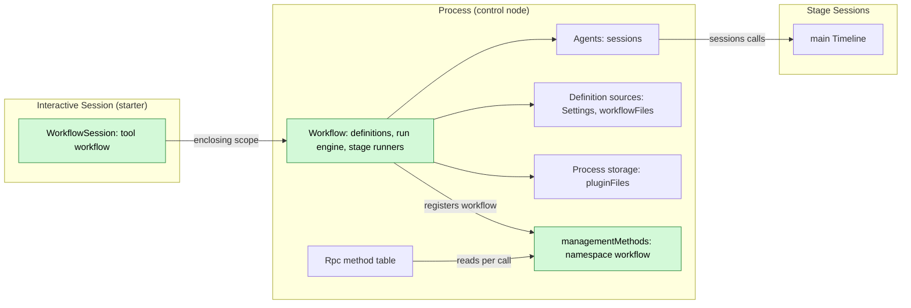
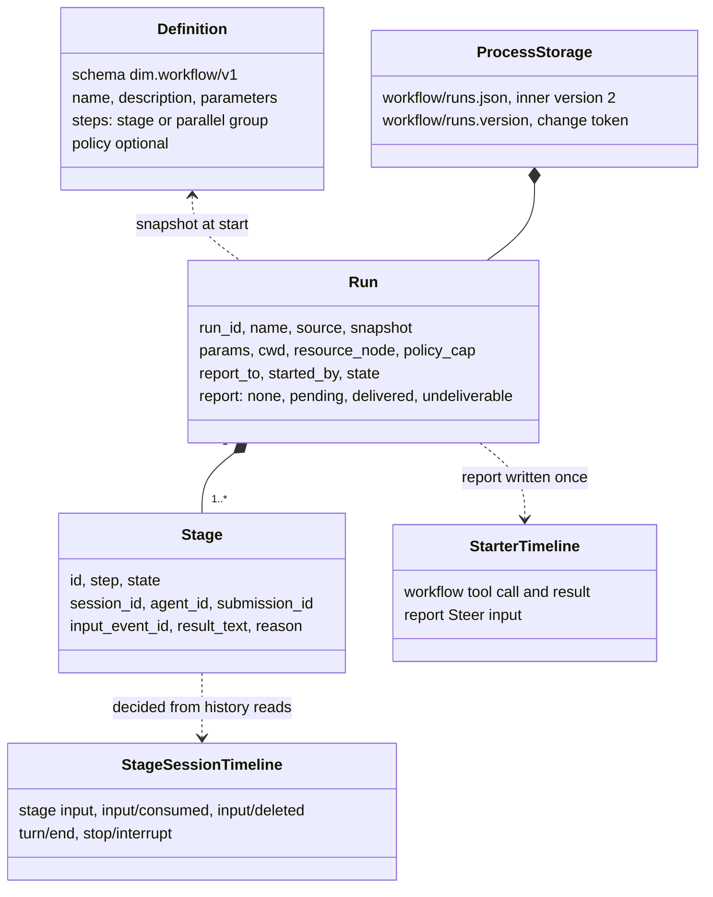
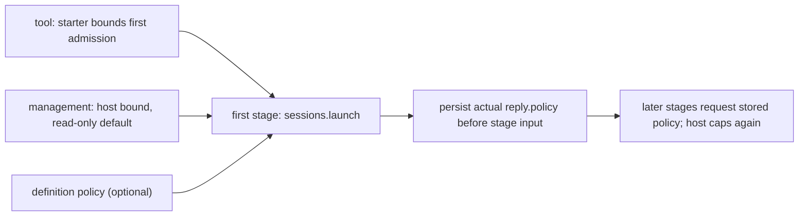
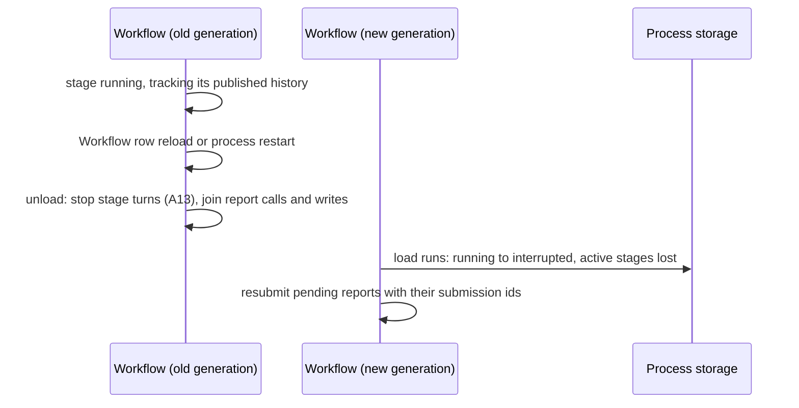

# Workflow

Status: Optional package implemented. Overall design: [overview §4](../overview.md#4-plugin-catalog); scope: [ADR 002](../../adr/002-plugin-scope.md) (process + Session). Phase: P2. Language: TypeScript first ([overview Appendix C](../overview.md#appendix-c-implementation-language)).

**Delivery boundary.** The optional [Workflow package](../../../runtime/plugins/workflow/README.md) implements definition sources, the run engine, Session tool and management methods through the existing public bindings. Its SDK and actual Node/App Server flows map to [Appendix D](../../../runtime/plugins/workflow/README.md#acceptance-coverage), including live admission authority, source trust, stop, retention and background report recovery. Native retention covers deletion/read/replace failures, protected references and minute retries without active runs. Installation is explicit under §1.3; Agents idle unloading (#126) remains required before shipping repeated stage creation. No core or rutis change is needed.

> **Offline resource nodes.** Rows about an offline resource node describe P3 multi-node behaviour. #5 is withdrawn (rutis is an external dependency, and it withdraws imported services when a link drops), so these rows are redesigned in P3 following overview §6.3: node services are looked up on each call by `resourceNode`. In P1/P2 every Session uses the control node.

Workflow owns workflow definitions and runs. A run advances a fixed list of steps; each stage runs in its own new non-interactive Session launched through Agents. The process part owns runs and reaches launched Sessions through the process service `sessions` ([session-access](../contracts/session-access.md)), as Collaboration does. User-saved definitions live in Workflow's Settings source `workflow`, project definitions stay project files that Workflow reads through FileStorage, and run records live in `pluginFiles`. The Session part registers the `workflow` tool with `toolRegistry` in every Session, and only interactive Sessions can use it; operators use the `workflow.*` management methods, the namespace `workflow` the process part registers with `managementMethods`. All contracts are language-neutral named services ([ADR 002 D5](../../adr/002-plugin-scope.md#d5-contracts-are-language-neutral)); the Rust forms are in [Appendix G](#appendix-g-rust-binding). When a run ends, its result is reported once to the starting branch as Steer input. Workflow writes no Timeline event of its own.

## 1. Structure



A run spans Sessions, so runs belong to the process ([ADR 002](../../adr/002-plugin-scope.md) D1); the tool belongs to the Session (D2). The process declares the existing `sessions`, `settings`, `pluginFiles`, `workflowFiles` and `managementMethods` services. Agents' stable directory provides `sessions` and finds the current index on each call, so index reload fails calls with `reloading` without reloading Workflow or Sessions ([S2 D1](../appserver/sessions-service.md#3-decisions), [#35](https://github.com/arcships/dim/issues/35)). Agents also resolves the requested stage/profile/default model; Workflow needs no separate Provider dependency. The Session tool declares its `workflowRuns` dependency through the accepted binding (§1.1); undeclared `ctx.use` is not a generic optional native lookup. C3 keeps core consumers independent of optional rows. Definition edits are business data read at use, never structural reload.

| Part | Scope | Depends on | Provides |
| --- | --- | --- | --- |
| `Workflow` | Process (control node) | Existing `sessions`, `settings`, `pluginFiles`, `workflowFiles` | Run engine; `workflowRuns` and management namespace `workflow` |
| `WorkflowSession` | Session, installed when enabled | C4 tool contract, creation configuration; declared `workflowRuns` and `toolRegistry` dependencies (§1.1) | Registers `workflow` with `toolRegistry`; handler refuses when `interactive === false` |

**Existing contracts:** [C4 tools](../session-typescript.md), [S2 sessions](../appserver/sessions-service.md), [Settings](../appserver/settings-service.md), [method admission](../contracts/session-boundary.md), [pluginFiles](../../../crates/dim-app-server/README.md#trusted-plugin-storage). **Plugin-owned contracts specified here:** `dim.workflow/v1`, the `workflow` tool, `workflowRuns.call`, management namespace `workflow`, Settings source `workflow`, stage/report marker text and run records. Project/package file access is delivered by #265; the concrete package binding is §1.3. No `PluginContents` service is assumed.

### 1.1 Existing bindings and delivery requirements

The [process assembly and management binding](../process-typescript.md)
supports explicit process rows. Host startup and restart readiness select required
infrastructure, while optional process rows retain their own Pending/failure
states. The feature dependency binding is defined below; definition sources
are specified in §1.3 and report resubmission is verified under §3.4.
First-stage authority follows A17. The package and its business-flow acceptance are present; installation remains explicit.
The shared declaration gate still permits a hung top-level module load to time
out host startup; process modules follow the binding's author-guide rule.

The [accepted feature dependency binding](../process-typescript.md#51-p6p7-access-through-declared-feature-dependencies)
uses `definePlugin.inject: ["workflowRuns"]` in this optional Session tool module.
Provider activation, retirement, retry and recovery follow that binding's current
rules; Workflow does not define another attachment policy or copy its error
text. The stable process dependency boundary still applies. This settles the
#35 access choice; source readers and report settlement use their specified,
verified bindings.

| Surface | Current implementation and consequence |
| --- | --- |
| Tool / process package | C4 supports Session parts registered as definitions with `partRegistry`; tool attachment and provider generations follow the current feature binding (§1.1). One row in `ServerConfig.session_typescript.rows` installs the process owner, which registers the Session tool's definition; each Session mounts a copy in the same runtime. The Session tool declares `workflowRuns` in `definePlugin.inject` (§1.1); the optional package supplies the row. |
| Management | The process row injects `managementMethods` and registers `workflow` from its apply; the registration uses native per-call admission and `report`/`drain`. The package implements all five methods. |
| Definitions / Settings | Settings owner read/update/CAS/events and generated workflowFiles are delivered. The source, file authority and package identity follow the accepted native access contract; §1.3 fixes their package placement. The package supplies the source schema and A.1 semantic diagnostics. No direct filesystem access. |
| Storage | The [public binding](../process-typescript.md#52-public-pluginfiles-binding) supplies pluginFiles at the authorized product root. The embedding host provisions `workflow/` before enabling the row; a missing parent returns `io` before the transaction callback. The run store and its change token, unchanged-byte v1 rejection and deferred migration remain A.4. |
| Sessions | Use existing `{ok:true,value}` / `{ok:false,error:{code,message,retryable}}` envelopes. `launch` returns `{sessionId,policy}`, `input` returns `{inputId,sequence}`, and the branch accepts each `submissionId` once; `lookup` finds committed inputs without writing. |
| Authority | S2 caps policy at actual stage admission. §3.3 uses its returned policy for the run's later stages (confirmed A17), rather than inventing a policy-query service or reading creation config as live Permission. |
| Lifetime | Per-call S2 leases do not close a Session when dropped. Existing [#126](https://github.com/arcships/dim/issues/126) is required before shipping repeated stage creation; retention uses existing `sessions.delete` under confirmed ownership. |

A17 is confirmed: capture the cap at first stage admission. Permission changes between tool start and that admission affect the first launch bound. The remaining package work and its acceptance follow Appendix D.

### 1.2 Impact

No runtime, facade, loader, event format or rutis change. New business behavior belongs to the Workflow package; source, tool and management namespace are consumed by Settings, ToolRegistry and operators. `workflowRuns` connects the feature's actual two scopes. No registry, readiness service, new context path or App Server business module is added.

### 1.3 Concrete package row

The optional package lives at `runtime/plugins/workflow`, named
`@dimcode/workflow`. Its root module owns runs and, from its apply, registers
`session.ts` with `partRegistry` as the Session definition `WorkflowSession`,
which provides the Session tool. The plugin directory carries `dim-plugin.json`
and is installed and enabled explicitly through [PluginManager](PluginManager.md).
The base CLI's default development, alpha and release payloads omit it; without
the plugin, its tool and management methods are unavailable, and its Settings
documents and run records remain untouched. An installed copy retains the user's
explicit selection and enablement. The base CLI no longer acquires the Node
runtime on its first start, so an installed Workflow needs `runtime.install`
(`dimcode runtime install node`) before it runs. External packaging and distribution are
tracked in [#1091](https://github.com/arcships/dim/issues/1091). An embedding host
may build the row below from the manifest's `code` fields.

| Row field | Process row |
| --- | --- |
| `id` | `workflow` |
| `name` | `@dimcode/workflow` |
| `config` | `{packages:[{id,root}, ...]}`; an empty list installs no package definitions |
| `inject` | `sessions`, `settings`, `pluginFiles`, `workflowFiles`, `managementMethods`, `partRegistry` |
| `provides` | `workflowRuns: {call:"async"}`; apply registers `workflow` with `managementMethods` and the Session definition with `partRegistry` |
| `settings` | One user-only `workflow` source, `userFile:"workflow.json"`, no `projectFile`, `userOnly:["/projectEnabled"]`, with definitions, enablement and A11 concurrency fields from the source contract |

The Session definition injects `workflowRuns` and `toolRegistry`, provides
nothing, and registers `workflow` with `toolRegistry` from its apply.
Module declarations and the supplied row agree on dependencies and method kinds.
Each Session's copy runs in the row's runtime. `workflowFiles` shares the Settings
generation this process row already injects, so it adds no independent reload
source or Provider/index dependency. The process's original row provides its
business and management services directly. No adapter, readiness service or
Session wiring plugin is added. Definitions, enablement, concurrency limits
and run state are business data, not structural row options.

`config.packages` is the trusted installation declaration from the
[delivered file contract](../p6-p7-bindings.md#3-workflow-definition-files): unique
package ids and canonical roots already authorized in the host's FileStorage
roots. The native factory binds that scope to this original row. Workflow uses
only package ids as file selectors; it never uses the paths with Node filesystem
APIs or accepts roots/ids from model arguments to grant authority.

User definitions use the existing Settings owner read/CAS. Project definitions
use `workflowFiles` with `{project:canonicalCwd}`; package definitions use
`{package:packageId}`. All four generated methods return values or throw
`WorkflowFilesError`, separately from the existing Settings/S2 envelopes.
The fixed paths, protected enablement, package/name collision and source precedence
rules remain in the file contract. Settings-certified data is consumed directly;
UTF-8/YAML from project/package bytes is decoded and checked once at Workflow's
external-data boundary. S10 wrapping applies only to the run store.

The tool constructs A.2's caller from host `ToolCall` metadata and refuses
`config.interactive === false`. It does not add Scheduler's member-role rule to
Workflow. Retired handlers return the exact unavailable/non-retryable content
from the accepted feature binding. The process describes A.3's five literal
methods: list/status are non-mutating report calls; save/start/stop are mutating
drain calls; all use `progress:false` and existing `MethodReply` values/errors.
Tool results put actionable ids and diagnostics in `ToolResult.content`.

A17 keeps the first actual launch reply as the authority capture point; Workflow
does not add a `sessionPermissions` dependency. Report recovery requires the
native input lifetime in [#267](https://github.com/arcships/dim/pull/267) and the
persisted-attempt/host-restart probes in §3.4. These establish the selected binding;
The package acceptance mapping is in its README.

## 2. Data and state



Definitions are read from their sources per call (A1); runs live in process storage and are persisted on every transition before the effect they guard. Stage progress is derived from existing facts in each stage Session; only a bounded result text is copied. Nothing is rebuilt from Timeline; Workflow owns no `StateCell` and the Session part holds no state. A stage's wait for its run state reads the change token (A.4), not the store.

## 3. Flows

### 3.1 Start from the tool and run a stage

```mermaid
sequenceDiagram
  participant M as Model (starter branch)
  participant WF as Workflow
  participant ST as Process storage
  participant AG as sessions.launch (launched stage)
  participant SS as Stage Session
  M->>WF: workflow start (tool handler of WorkflowSession)
  WF->>WF: validate definition/params; retain starter identity
  WF->>ST: persist Run running
  WF-->>M: ToolResult run_id (batch result)
  WF->>ST: persist stage launching
  WF->>AG: launch(starter?, policy?, model?)
  AG-->>WF: sessionId, actual policy
  WF->>ST: persist Session and first-stage policy cap (A17)
  WF->>SS: sessions.input main Queue, marker stage, rendered prompt
  WF->>ST: persist stage running with input_event_id
  SS->>SS: Dispatcher: input/applied, input/consumed, turn
  WF->>SS: sessions.history pages through one fixed published cutoff
  WF->>ST: stage completed or failed, next step
```

The handler persists the run and returns at once; stage advancement runs on the process part's task tracker. Completion is decided only after reading the stage Session's whole fixed published prefix (§3.2).

### 3.2 Report and stop

```mermaid
sequenceDiagram
  participant WF as Workflow
  participant ST as Process storage
  participant STB as Starter branch
  alt run completed, failed or interrupted, with report_to
    WF->>ST: report pending(submission_id)
    WF->>STB: sessions.input Steer, marker report
    WF->>ST: delivered, or undeliverable on branch missing or Session closed
  else workflow stop
    WF->>ST: stopping
    WF->>WF: read history; withdraw own inputs; stop only consumed work
    WF->>ST: stopped, no report
  end
```

An explicit owner stop never wakes the starter ([event-driven flows §3](../../architecture/rust-agent/event-driven-flows.md)). Report ownership, settlement and recovery follow §3.4. `delivered` means published input, not model consumption: withdrawing that input later does not cause another report.

Each stage has one owned history tracker using its persisted input receipt. It reads on submission and on a one-second timer, without leaving a native `idle` wait outstanding. The first `history {after}` reply fixes the published cutoff `H`; subsequent pages keep `through: H`. Finish the prefix before deciding, then keep its final sequence as the next cursor. Match the stage's own `inputId`, preserve its published terminal outcome and never treat an unrelated turn's end as stage completion. A pending approval does not prevent these history reads.

On stop, read the whole published prefix and preserve any terminal outcome. An own input applied then interrupted, without matching consumption in that prefix, settles the stage as `stopped` without another `stop`, as in A.6. Otherwise withdraw only the stage's own input if not yet consumed. `deleted` settles it as stopped. `notHeld` only says that this withdrawal deleted nothing; the input may already have been deleted or consumed. Refresh history and apply the same rules: a matching deletion or the interrupted-before-consumption case settles the stage; other unconsumed inputs remain pending. Only observed consumption without a following end permits `sessions.stop`. A local stopped outcome does not retract an applied input. Keep each admitted mutation owned until settlement; a discarded JavaScript Promise is not native cancellation.

`sessions.stop` is turn-scoped, addressed by branch, with no expected turn id; it does not cancel detached branch work. The observed turn can finish and another can start before the call takes effect. The one-second cadence, possible later-turn interruption and retained applied inputs are accepted first-release limits; no atomic turn targeting, lock, protocol or core requirement is added. Stage tracking does not settle report writes (§3.4).

### 3.3 Policy of a stage



A run never widens authority (E2). **Confirmed admission flow (A17):** the first stage uses existing `sessions.launch` with the tool's `{sessionId,branchId}` starter and the definition's optional policy; management starts omit the starter, so S2 supplies the existing host bound and read-only default. Agents resolves the live bound and returns the effective `policy`. Persist that reply as `Run.policy_cap` before any stage input; this field is absent only while first admission has no confirmed reply. Later stages pass that stored policy explicitly and omit the starter: Agents caps it again by current host defaults, so a closed starter does not widen authority or prevent already-owned work from continuing. No fallback is allowed before the first confirmed policy.

`Run.policy_cap` preserves the complete public `PermissionPolicy` — the preset and the two tool
lists — in storage, reload and later launch requests. A stored cap that still names the removed
`fileAccess`/`toolApproval` keys is read without them and written back without them
([ADR 018](../../adr/018-permission-is-the-preset.md)); the inner document version is unchanged and
no record is migrated. Workflow delegates capping to
[S2 §6.1](../appserver/sessions-service.md#61-launch).

If the first step is parallel, obtain and persist the first declared stage's launch reply before admitting its siblings; the existing concurrency limit still applies. A definition policy is converted once at the definition boundary to the existing `PermissionPolicy` shape, and S2 applies its normal cap rather than a second policy-comparison implementation. Cap capture occurs at first stage admission under confirmed A17; no policy-query method, auxiliary Session or new core capability is needed.

### 3.4 Report ownership and recovery

The existing run task owns terminal settlement and its report (E15). Stage trackers supply outcomes to it; status reads and retention never send reports. A run has at most one outstanding report operation. Different runs may progress independently; no process-wide report queue or new lock is needed.

1. In one A.4 file transaction, persist the run's terminal state, `ended_at` and `report: pending{submission_id, attempt_open:false}` for `completed`, `failed` or `interrupted` with `report_to`. Allocate the submission id once. Explicit `stopped` runs and runs without a destination keep `report: none`. The terminal result and destination are fixed; every retry renders the same report from that result and uses the same submission id. A stop after terminal settlement does not erase a pending report.
2. Before each `sessions.input`, persist `attempt_open:true` and await that replacement. Release the file transaction, then call input. Await the actual S2 reply; a timer, tool cancellation or unload must not abandon the call through `Promise.race` or treat a discarded Promise as cancellation. No file transaction is held while awaiting input.
3. Apply the reply table below. In one replacement, persist either the terminal report outcome or `pending` with `attempt_open:false` after a settled input reply. The implemented [S2 input lifetime](../appserver/sessions-service.md#62-input) retains admitted append/publication work until its actual reply, including across index reload. On a persistence failure stop new run effects as in A.4.
4. Recovery resubmits every `pending` report with step 2. The destination branch accepts the submission id once ([S2 §6.2](../appserver/sessions-service.md#62-input)): a report an earlier attempt or generation wrote, published or still in flight, is answered with that input's receipt and never written again. `attempt_open` is persisted but decides nothing; removing it needs a format decision. Recovery of running/stopping runs atomically records `interrupted` and a new pending report as in step 1; stages are not relaunched.

The reply rules use existing [S2 input](../appserver/sessions-service.md#62-input):

| Reply | Run task action |
| --- | --- |
| Input success | Persist `delivered`; this is also the reply to a resubmission of a report already written. |
| `session_closed` or `branch_missing` | Persist `undeliverable{reason}`; do not redirect the report. |
| Input `rejected` | Nothing was written. Persist `undeliverable{reason:"rejected"}` and log the invalid report; never retry it. |
| Input `ambiguous` | Several reports with this id were written before branches accepted each id once. Persist `delivered` and log the duplicate-report violation; never add another input or rewrite history. |
| Input `publication_unknown` or `reloading` | Keep `pending` with `attempt_open:false`, log the error, and resubmit on the owner's existing one-second timer, never concurrently. |
| `failed` or another non-terminal error | Keep `pending`, log the error, and stop automatic delivery for the current load. A later load resubmits under step 4. |

Orderly cleanup stops new run admission and report retries, joins admitted run/report calls and their record writes, then closes the file scope. A pending record with no outstanding call may remain for the next load. A13's ten-second stage-stop bound does not bound report settlement: delayed publication can hold unload. This is ordinary owned work, not a new readiness or shutdown protocol.

A bridge/runtime failure is not an S2 reply. The report stays `pending` and the next load resubmits it; no proof that an old native writer stopped is needed, because the destination branch decides by submission id. No host epoch, PID or row handle is persisted.

The binding probes in `sessions::workflow_reports` cover held native appends, crashes between marker persistence and input, unavailable reply-record storage, and complete host restarts before input and after publication. They establish that a resubmission is answered with the first input; they do not replace the package’s background-task acceptance.

The actual package’s `workflow` Node flows cover background-report resubmission across fixed-row/runtime replacement, a resubmitted report written once, unchanged bytes after failed atomic reply-record replacement, full host restart, sources, stages and invalid run formats. SDK flows also cover stage-local S2 errors, bounded tool status, pre/post-handover retirement guidance and recovery without stopping old stages. Native retention verifies actual deletion, store read/replace failures, minute retries without active runs or definitions, retained Session references, user forks, and Node restart between deletion and record removal. The native fixture's active/pending runs are newer than expired history; protection of older active/pending records against the terminal limit is SDK-proven. Terminal/report-settlement retention continues while the definition source is unreadable. Stage tool declaration depends on the selected agent/default profile including `workflow`; package launch does not force that selection. The [package README](../../../runtime/plugins/workflow/README.md#acceptance-coverage) maps these flows to Appendix D. None supplies conditional stopping or a native-writer protocol.

## 4. Timing and conflicts



Workflow's own reload or restart settles runs `interrupted`; nothing is relaunched (E15). An Agents index reload is different: the stable `sessions` service remains, Workflow and stage Sessions stay loaded, and uncertain replies are reconciled with existing S2 calls. A committed input is not submitted again merely because its reply was lost.

| Scenario | Sequence order | Outcome | Owner |
| --- | --- | --- | --- |
| Starter turn interrupt after the tool result | result < interrupt | Run continues | Workflow |
| Tool batch not settled when the run ends quickly | report < `step/tool-result` | Steer consumed after the batch result; model sees `run_id` first | Loop |
| `workflow.stop` races a stage's own `turn/end` | `turn/end` < `stop/interrupt` | Stage `completed` with result; run `stopped` | Stage Session order |
| Stage input withdrawn (user or stop) while held | input < `input/withdraw` < `input/deleted` | Stage `stopped`; never applied or consumed | InputQueue, Workflow |
| Workflow reload or restart | — | Runs `interrupted`, active stages `lost`, nothing relaunched; preserve E15 by resubmitting reports with their submission ids | Workflow |
| Agents index reload | — | Workflow and stage Sessions continue; calls may return `reloading`; an uncertain input is resubmitted with its id, other writes use lookup/history | Agents; Workflow |
| Starter branch closed while a stage runs | close < report | Stage continues; report `undeliverable` | Workflow |

Full table: Appendix B.

## 5. Context mapping

| What the model sees | Form | Placement |
| --- | --- | --- |
| `workflow` declaration | Tool declaration in adopted configuration (every Session; usable only in interactive Sessions) | Requests whose prefix holds that configuration |
| Start, status, stop | `ToolResult.content` (text incl. `run_id`) | Tool result position of its batch |
| Report | One raw block `<dim-workflow kind="report" run="..." status="...">`; body: the run's outcome line, per-stage status, bounded preview of the last step's results (A16), how to get full results (`status`) | Consumed position of the Steer input; unkeyed |
| Stage task (stage Session) | Marker `<dim-workflow kind="stage" run="..." stage="...">` then the rendered prompt as user content | First input of the launched stage Session |

Report and stage inputs are unkeyed: after compaction they survive only through the summary; child branches inherit them only if consumed before the cut. Stage Sessions are non-interactive: interactive-only tools such as `ask_user` and `workflow` stay declared when the profile mounts them (a profile without a mount list mounts every tool), but their handlers refuse, so runs never nest. Model-actionable run/Session ids, status and result previews belong in `ToolResult.content` or the adopted report input. `structuredContent` is for persistence/UI; stores, logs and diagnostics are not automatically injected into context.

### 5.1 Model-facing texts

A text is protocol or policy as [model-facing prompts §4](../model-prompts.md#4-protocol-and-policy) decides. Two of them are mixed and are marked sentence by sentence.

| Text | Class and sentences |
| --- | --- |
| `workflow` declaration | Protocol: the description "List workflow definitions, start a run, inspect stored stage results, or stop a run. A listing marked truncated omits later definitions." states what the tool does, and the schema states the actions, `run_id`, `name`, `source` and `params` |
| `workflow` result | Protocol: the `workflow: <code>` first line and its message, `workflow: invalid_definition. Use list to inspect the definition issues.`, `workflow is available only in interactive Sessions.`, `workflow: cancelled before handover`, the two unloading notices, and the `run_id`, state and `result_preview` fields the model acts on. Policy: "Use list to inspect the definition issues." is guidance |
| Report marker | Protocol: the element `dim-workflow`, `kind="report"`, `run` and `status`, and the Steer input the marker opens; the body's outcome line, `Workflow <run_id>: <state>.`, and its per-stage status are the run's data, and the bounded preview carries the stages' own last-step results. Policy: "Use workflow status with run_id … for stored stage results." is guidance, on the report's last line; the action name it states is protocol |
| Stage marker | Protocol: the element `dim-workflow`, `kind="stage"`, `run` and `stage`, and the Queue input the marker opens; the body is empty, and the prompt after it is the run's own text |

The policy text is a factory member: `code.config.report_guidance` replaces the report's guidance line, with `{run_id}` in it replaced by the run's id, and `code.config.invalid_definition_guidance` replaces the recovery hint the `invalid_definition` refusal carries; the product sets none, so the built-in texts are in force. A member holds one text — a line of guidance or a recovery hint — and the flow tests pin any protocol sentence it contains: a candidate that changes one changes protocol, and lands with the behaviour and its test ([model-facing prompts §9.2](../model-prompts.md#92-every-capability-that-writes-model-facing-text)). `report_guidance` must be one line, and the configuration enforces it: the guide entry (§5.2) tells the model the report's last line is guidance and not part of the workflow's account, so a value with a line break is refused when the plugin loads (`workflow/index.ts`). A profile that changes it keeps it to one line.

Both markers carry their guide entry: the Workflow Session part registers one entry for `dim-workflow` from `apply`, session-scoped, so a request carrying either kind carries the entry ([Prompt §6.2](Prompt.md#62-the-writers)).

### 5.2 The guide entry

One entry covers both kinds, and its text is code ([Prompt §5](Prompt.md#5-facts-that-reproduce-it)):

```
<dim-workflow kind="report" run="wf-7f2" status="completed">: how a workflow run ended, and <dim-workflow kind="stage" run="wf-7f2" stage="build">: the start of one of its stages. run names the run, status its outcome and stage the stage. The report's body gives the run's outcome, each stage's state and a bounded preview of the stages' own last-step results: the workflow's account of the run, information, not a request. The report's last line is not part of that account: it is guidance on what to do next. The stage tag has an empty body and stands before the text that follows it, which is the prompt the stage was launched with.
```

Every sentence is protocol, and each states one thing the model needs in order to place the tags:

- "how a workflow run ended, and … the start of one of its stages" — what each tag is.
- "run names the run, status its outcome and stage the stage." — the attributes.
- "The report's body gives the run's outcome, each stage's state and a bounded preview of the stages' own last-step results: the workflow's account of the run, information, not a request." — the report's shape, whose results the preview carries, and the report's trust class.
- "The report's last line is not part of that account: it is guidance on what to do next." — the closing line's class: guidance on what to do next, not part of the account above it.
- "The stage tag has an empty body and stands before the text that follows it, which is the prompt the stage was launched with." — the stage input's shape.

It follows the collaboration report's entry (`<dim-agent-report>`, order 20, [Collaboration](Collaboration.md)) in form and length: a runtime report about work the model started.

## 6. Interfaces (summary)

| Interface | Kind | Purpose |
| --- | --- | --- |
| `workflow` (`list`, `start`, `status`, `stop`) | Tool registered with `toolRegistry` (Session), risk category of Collaboration's `agent` tool | Model runs workflows |
| `workflow.list/save/start/status/stop` | `managementMethods` (process, namespace `workflow`) | Operators manage definitions and runs |
| CLI entry | [Management surfaces](../cli-commands.md#the-workflow-area) | The client lists, enables, saves and starts definitions over A.3; it adds no method |
| `sessions` | Depended on | Stage Sessions: launch, input, history, lookup, stop, withdraw, delete |
| `dim.workflow/v1` | Defined here | Definition format (Appendix A) |

## 7. Security

Workflow has no host-local approval ([overview §6.4](../overview.md#64-conventions)). Starting through the tool is an agent action governed by Approval/Permission; management runs and enabled definitions belong to their configuration/operator. Project definitions start disabled ([ADR 003 D3](../../adr/003-approval-scope.md#d3-enablement-is-ordinary-configuration-project-entries-start-disabled)): a project file cannot enable itself. User-only enablement lives in the user source keyed by workspace/name; the implemented protected client `settings.update` can change it, the owner/tool cannot. Opening a repository runs nothing until enabled; later file edits apply to future runs without another approval (D4). Use the delivered source/file authority and source schema; implement definition semantics at Workflow’s external-data boundary. Stage authority follows confirmed A17; creation config is not a live Permission read. Params/results become adopted input content; definitions contain no credentials.

## 8. Rule check

Rules: [principles §1 and §4](../../architecture/rust-agent/principles.md), [ADR 002](../../adr/002-plugin-scope.md) D1–D5.

| Rule | How this document complies |
| --- | --- |
| §4.1 Command events for others' state | Stage Sessions change only through `sessions` (input, `input/withdraw`, `stop/interrupt`); the owners write the results. |
| §4.2 No take-back after hand-off | Withdrawal only deletes a held input. After `notHeld`, read history; stop requires own consumption without a following terminal outcome (§3.2). |
| §4.3 Intervene only through before callbacks | Not applicable: Workflow adds no entry check and no before callback; definition validation is its own boundary validation. |
| §4.4 Core mechanisms carry no business meaning | The runtime gets nothing Workflow-specific; Workflow uses only the generic `sessions` operations. |
| §4.5 Read the whole batch before deciding | Finish the published prefix `H` fixed by the first history page before deciding; subsequent pages keep that cutoff. S2 pages end on batch boundaries (§3.2, A.6). |
| §4.6 Model context holds only handed-over events | Stage tasks and reports reach models only as consumed inputs; withdrawn inputs are deleted and never seen. |
| §4.7 Only public events and services | Existing sessions/Settings/pluginFiles/workflowFiles; Agents resolves models and policy. No private Permission/AgentIndex lease API. |
| §4.8 Requirements to mechanism owners | None (§9); specified public bindings and verified report ownership suffice. Business implementation stays with Workflow; P3 nodes remain separate. |
| §4.9 Only facts later decisions use enter the Timeline | Workflow writes no Timeline event; runs stay in process storage, and only stage tasks and reports, which models consume, enter Timelines as inputs. |
| §1 Capability and App Server boundary | The process plugin owns definitions and runs; the Session Capability offers its tool. Storage uses `pluginFiles`; no App Server business module. |
| ADR 002 D1 | Runs span Sessions (process part); the tool belongs to a Session (Session part). |
| ADR 002 D2 | Existing Rpc consumes feature-owned methods and ToolRegistry keeps the tool the feature registers; no wiring plugin, extra Provider port or registry. The TS management binding is available. |
| ADR 002 D3 | Stable sessions isolates index reload; C3 keeps core independent of optional rows; the Session tool definition declares its owner dependency under §1.1's availability constraints. |
| ADR 002 D4 | Definitions and run limits are business data read at use time; nothing structural changes. |
| ADR 002 D5 | `workflowRuns`, the tool, the methods and the definition format are named services or data; Rust forms are in Appendix G. |

## 9. Requirements raised to mechanism owners

None. Use the delivered C3/C4, S2, Settings and pluginFiles contracts. Appendix F distinguishes verified bindings from package acceptance. A report-once requirement implies no idempotency extension, generation token or new registry. P3 resource-node behavior remains outside this implementation scope.

## Appendix A. Interface details

### A.1 Definition format `dim.workflow/v1`

YAML (A2). User definitions are entries in the Settings source `workflow` (A3); project definitions remain `<workspace>/.dimcode/workflows/<name>.yaml` under project-file authority (E11); packages contain the same documents. Project/package source bindings are specified in §1.3 and use delivered workflowFiles; no PluginContents service is assumed. Keep the definition format and source authority; do not silently replace them with loader options or a second manifest.

```yaml
schema: dim.workflow/v1
name: review-and-fix                 # [a-z0-9-]{1,64}; unique per source
description: Analyze, fix in parallel, summarize
policy: workspace_write              # optional; narrowing only
parameters:
  - { name: target, description: Path to review, required: true }
  - { name: style, default: concise }
steps:
  - stage: { id: analyze, prompt: "Analyze {{params.target}}." }
  - parallel:
      - { id: fix-a, agent: <agent id>, prompt: "Fix part A.\n{{stages.analyze.result}}" }
      - { id: fix-b, prompt: "Fix part B.\n{{stages.analyze.result}}" }
  - stage: { id: summarize, model: { providerId: p, modelId: m }, prompt: "Summarize: {{stages.fix-a.result}} {{stages.fix-b.result}}" }
```

| Field | Rule |
| --- | --- |
| `steps` | 1–32 steps in order; a step is one `stage` or a `parallel` group of 2–8 stages (A4) |
| `stage.id` | `[a-z0-9-]{1,32}`, unique in the definition |
| `parameters[].name` | `[a-z0-9-]{1,32}`, unique in the definition |
| `stage.agent` | Optional Agent id of an Agents profile (a stage is a launched Session, so external agents, which are Collaboration members, are not stage agents); when absent the launch request omits `agent` and Agents uses its default profile |
| `stage.model` | Optional existing `ModelId {providerId,modelId}`; omitted: Agents resolves profile/default selection (A5) |
| `stage.prompt` | Template ≤ 32 KiB after rendering (A6); placeholders `{{params.<name>}}`, `{{stages.<id>.result}}` |
| `policy` | `read_only` \| `workspace_write` \| `full_access`; capped (3.3) |
| References | `stages.<id>` must name a stage of an earlier step; plain substitution only (A7) |
| Parameters | Strings; missing required or unknown names → `invalid_parameters`; defaults fill the rest |

Settings validates/defaults the declared source's schema at its boundary; Workflow uses the returned document directly without another format check. User entries are a name-to-definition map; their optional definition fields carry no schema defaults, because Settings fills only declared `properties`, not map entries. Absence keeps the field's A.1 business meaning; parameter `default` is an explicit value, not a schema default. [Settings §3.2](../appserver/settings-service.md#32-documents-validation-and-defaults) leaves rules beyond JSON Schema to the owner at use time. Workflow owns stage/parameter identity uniqueness and template references: each referenced parameter must be declared, and each referenced stage must belong to an earlier step. A sibling in the same parallel group is not an earlier step.

The complete `workflow` source schema is in the [source contract](../p6-p7-bindings.md#32-source-selection-and-authority), including A11's
`max_concurrent_runs` and `max_concurrent_stages` (both default 4). Each start
reads both limits; its stage limit remains fixed for that run. Definition saves
preserve both fields and protected `projectEnabled`.

The user-source entry key or project file basename `<name>.yaml` determines the definition's identity; the document's `name` must match it. A mismatch is an `invalid_definition` issue, not a rename or alias. `workflow.save` uses the validated document's `name` as its target entry key or basename. The delivered native access contract fixes package identity as package id plus basename, with document-name agreement and duplicate plugin-name rejection.

Only `stage.prompt` is template text. Scan only `{{` openers in it. Each must close with `}}` and form `{{params.<name>}}` or `{{stages.<id>.result}}`; an unknown token (including `{{stage.analyze.result}}` or whitespace-padded `{{ params.x }}`) or an unterminated opener is an issue. A `}}` without an opener is literal text, so nested JSON such as `{"a":{"b":1}}` is unchanged. V1 has no literal-`{{` escape; pass such text through a parameter value or its explicit `default`. Defaults and supplied values are data, not templates; substituted values are not scanned or recursively substituted. After excluding recognized tokens, literal text exceeding A6's 32 KiB UTF-8 bound is a definition issue at save/list/start.

| Boundary | Workflow's action |
| --- | --- |
| `workflow.save` | Decode the external definition request under A.1 and check its semantics before its user-source CAS or project-file write. Reject `invalid_definition` without changing the source or enabling a project definition. |
| Generic client `settings.update` | Settings certifies schema/defaults and persistence, not executable Workflow semantics. A structurally valid entry with an invalid reference may be saved; Workflow does not add a Settings callback or reinterpret the write receipt as execution acceptance. The client's own request carries the whole document in one frame; Workflow's save is the path that keeps authored documents within A.18's payload, and a document another client grows past it keeps that client's transport limit. |
| Definition listing / start | Check the current definition's semantics. Both tool and management lists expose issues under their existing visibility rules; `start` rejects an invalid selected definition before persisting a run or launching a Session. Preserve the source entry for correction. A failed source read is an error, not an empty catalog. |
| Project/package text | Parse and check structure once at this external-data boundary, then apply the same Workflow semantic rules. The delivered workflowFiles binding supplies these reads; no direct filesystem access. |

Definition YAML files are limited to 8 MiB at the native `workflowFiles` read/replace boundary, leaving room for base64 and the JSON envelope within the existing 16 MiB bridge frame. Reads check the opened file length before allocating its contents and enforce the cap while reading if it grows. Project saves check the serialized YAML's UTF-8 byte length before directory creation or a binary write call; excess returns `invalid_definition` without changing the file. Larger existing files remain unchanged and appear as invalid entries. New decoded definitions, including user-source entries and alias-expanded YAML, are limited to 1 MiB of compact JSON (A.18). One Workflow payload crossing the bridge is limited to 8 MiB of its serialized bytes, leaving half the 16 MiB frame for the service envelope. A user save that would make the `workflow` document — every user definition plus enablement and limits — exceed that payload returns `invalid_definition` without writing; A.4 keeps the run store within the same payload. A user document written before these bounds that exceeds 8 MiB is still read while it fits one frame: its entries over 1 MiB appear as invalid, `workflow.save` refuses a save whose result stays over the payload, and shrinking such a document is the protected `settings.update` client's operation. Accepted parameter values, including defaults and unused declared parameters, remain limited to 32 KiB each and 256 KiB in total, measured as UTF-8 bytes. Reject excess as `invalid_parameters` before storing a run. The inner-v2 decoder for already committed run snapshots is unchanged and does not reapply these admission bounds.

At start, validate the supplied parameter names/values once, reject missing required or unknown parameters, and apply the definition's parameter defaults as its business transformation. Persist the accepted definition and params in the existing run snapshot; later source edits do not change it. Before admitting any stage of a step, render and size-check every stage in that step using its parameters and stored earlier-stage results. Overflow follows Appendix C for the first step as well as later steps; no sibling is launched or receives input in a step that fails this check. Later stages use that snapshot directly, without another parse/default/normalization pass. Agent/model availability and effective authority are resolved by Agents at actual admission, not by a new catalog check during definition validation.

### A.2 Tool `workflow`

The `workflow` tool is registered independently of interactivity (#30). The handler refuses when `config.interactive === false` (A8); omission means true. C4 supplies creation configuration, not current Permission state. Registration does no I/O; `execute(ToolCall, cancelled)` uses the existing second by-reference cancellation Promise. Accepted run work belongs to the process owner; cleanup and the pre/post-persistence cancellation behavior use that ownership, not cancellation inferred from a JavaScript Promise. ToolExecutor owns terminal tool facts.

`workflowRuns`, process scope, no key, defined here: `call(RunRequest): async -> RunReply`, where `RunRequest = {action, name?, source?, params?, run_id?, caller: {sessionId, branchId, callId, cwd}}` uses the actions below and `RunReply = {content: string, structured?: JSON}` or an error `{code, message}` from the list below. Risk: the category Collaboration's `agent` tool declares (today none, so unclassified: ReadOnly denies, WorkspaceWrite asks, FullAccess allows; E2).

| Action | Parameters | `ToolResult.content` |
| --- | --- | --- |
| `list` | — | `{"definitions":[...],"truncated":bool}` for enabled definitions visible for the caller's cwd: name, source, description, parameters; invalid entries remain visible, marked invalid with their first 10 issues and total issue count. Description, parameter text and issues are bounded previews. Entries stop at the reply's payload and `truncated` says later definitions were omitted; the listing is sent once, in `content` |
| `start` | `name`, `source?` (`project`, then `user`, then `plugin`), `params` | `{"run_id", "status": "running", "stages": [...]}` and a sentence that the result arrives as a report input |
| `status` | `run_id` | State, per-stage state, Session id, bounded result preview, last log entries |
| `stop` | `run_id` | Final state after propagation |

On `invalid_definition`, the tool writes that code and a direction to use `list` for the definition's issues into `ToolResult.content`. The feature-local service error carries its code and diagnostic message; the Session tool includes that diagnostic in `content`, not only `structuredContent`. Unavailable calls use the exact pre-invocation or issued-call guidance from §1.3. If the owner already returned a known reply, preserve that reply even when the Session handler retires; uncertainty guidance applies to an issued call whose outcome is unknown.

Tool `status` and `stop` require the calling Session to match the run's tool `started_by.session_id` or `report_to.session_id`, regardless of branch. Otherwise return `run_not_found` without exposing the record or changing it. The process owner enforces this from trusted tool caller metadata, including before a stop mutation. Management methods remain process-global.

Tool `status` and `stop` omit the definition snapshot and complete stage text from model content. Their result preview is bounded to 4 KiB; only the last ten logs are included, each message bounded to 512 UTF-8 bytes. Complete records remain in `structuredContent` and management `workflow.status`. Service and management error messages are bounded to 4 KiB.

`start` records `report_to = {session_id,branch_id}` and the caller's cwd; first-stage admission captures the actual policy under confirmed §3.3/A17, without pretending that a separate live-policy query exists. `resource_node` is absent until P3. Errors: `definition_not_found` (also for a disabled project definition), `invalid_definition`, `invalid_parameters`, `run_not_found`, `limit_exceeded` (A11).

### A.3 Management methods

Namespace `workflow`, registered with `managementMethods`: its declarations list the methods below (`mutating` as shown); its `call(MethodCall, cancelled, progress): async -> MethodReply` dispatches them with JSON params and results.

| Method | Params | Result | `mutating` |
| --- | --- | --- | --- |
| `workflow.list` | `cwd` | `{definitions, truncated}` with source, enabled state, bounded field previews and issues; same payload bound as the tool list | no |
| `workflow.save` | `source: user\|project`; `user`: `expectedRevision?`, `document`; `project`: `cwd`, `document` | `{name}` after A.1's semantic checks; `user`: Workflow's typed write of the entry into the `workflow` document, CASed on `expectedRevision` when the caller sends one and on the revision it read otherwise; `project`: the project file, written through FileStorage (file authority), with no revision; saving does not enable a project definition | yes |
| `workflow.start` | `name`, `source?`, `cwd`, `resource_node?` (P3), `params`, `report_to?` | `{run_id}`; first launch records its returned policy (A17); management uses the existing host bound/read-only default | yes |
| `workflow.status` | `run_id?` | One run or recent runs | no |
| `workflow.stop` | `run_id` | Final run state | yes |

The CAS unit of a `user` save is the user `workflow` document, the only revision the owner holds: a save also answers `conflict` when another definition or a project definition's enablement changed since the caller read the document. Nothing is written; the caller reads again and writes the revision it then has. A `project` save takes no revision, because it replaces the file; a request that carries one is `invalid_params`.

Use the delivered binding and existing method admission: list/status are `report`; save/start/stop are `drain`, so accepted mutations settle before unload. Rpc returns `service_reloading` for Pending/reloading owners, `service_unavailable` for Failed/Unresolved owners and `unknown_method` for disabled/absent owners. The TypeScript management projection is delivered; Workflow implements the methods in its process row.

### A.4 Run record

```text
Run { run_id, name, source: user|project|plugin, definition (snapshot),
      params, cwd, resource_node? (absent until P3: control node), policy_cap? (absent until first confirmed launch reply, A17), report_to?: {session_id, branch_id},
      started_by: tool{session_id, branch_id, call_id} | management, created_at, ended_at? (terminal only),
      state: running | stopping | completed | failed | stopped | interrupted,
      stages: [Stage], log: [LogEntry] (bounded, A9),
      report: none | pending{submission_id, attempt_open: boolean} | delivered | undeliverable{reason} }
Stage { id, step, state: waiting | launching | running | completed | failed | stopped | skipped | lost,
        session_id?, agent_id?, submission_id?, input_event_id?, result_text?, reason? }
```

The process owner stores one JSON text document `{ "version": 2, "runs": [Run] }` at `workflow/runs.json` through its own `pluginFiles` scope, and a change token at `workflow/runs.version`. Inner v2 requires the pending report's `attempt_open` marker (§3.4); v1, a missing pending-report marker, or another version is rejected as `invalid_data` without changing bytes. No implicit conversion to a closed attempt is allowed. The maintainer has confirmed this compatibility policy; migration is deferred to coordinated migration work. No migration runs during reads or recovery. Scheduler's independent inner v1 document is unchanged.

`workflow/runs.version` is derived state, not a second run store: it holds the token of the last committed write to `workflow/runs.json`, and startup recovery and every store write read the store itself. A reader serves the owner's snapshot while the token it reads equals the snapshot's, and re-reads and decodes the store when the token differs; a running stage's one-second wait therefore carries the token, not the store, so its per-second cost does not grow with the store or the number of retained runs. The token is written in its own transaction nested under the store lease, after the store replace, so a crash or a failed token write between the two leaves the token naming older text; recovery reads past that because startup and every write read the store. A store written before this token existed, or a missing token, only forces the next read to decode the store. A failed token read or write is a storage failure like a failed store read or replace: new effects stop and committed bytes remain, and a failed store access drops the snapshot so a committed replace whose token write failed stays visible to the next read.

`created_at` and terminal `ended_at` use UTC `YYYY-MM-DDTHH:mm:ss.sssZ`, always three fractional digits, so chronological and lexical order agree. The host's S10 `{version:1,text}` envelope is separate and remains host-owned. Definitions remain in their declared sources; the run's definition snapshot is the accepted execution input and is never edited as source configuration.

One bridge frame carries the store's text, its replacement and a status reply. Sizes are measured as the bytes cross: a stored string's committed JSON form (quotes and backslashes escape, control characters expand) and, for the store text, the JSON string the file service carries, where those escapes can double again. The stored stage result texts of one run total at most 512 KiB of committed JSON; a later result is truncated at a UTF-8 boundary to the remaining payload. Each stored log message and stage reason is at most 512 bytes of committed JSON, within A9's 500 log entries, and a run's stored definition is the admitted one (A.1). A start projects the store's text as the file service carries it — the JSON string, not its raw text — from every active run's record, the stage identities, results, logs and `agent_id` copies it can gain later, plus the new run's own record; future fields are charged at the most their serialized form can take. If that exceeds the 8 MiB payload, the start first expires the oldest settled terminal runs (A.4) and otherwise returns `limit_exceeded` without persisting the run. Runs admitted under these bounds therefore keep every store read, write and reply within one frame; a record committed before them is still decoded, with its original size. The change token is its own small payload in the same frame bound, never the store's, so a poll cannot reach the frame with the store.

A missing file means no runs. Parse and validate only at this persistence boundary: malformed JSON, missing/unknown versions, invalid record fields and duplicate `run_id` or stage identities within a run fail without changing the bytes. No automatic reset, backup or migration. Use the typed records directly afterwards; incompatible committed formats require a new inner version and an explicit compatibility decision.

Persist each required transition using existing `scope.withLock` read/modify/`file.replace`; release that transaction before any `sessions` call. Record launch/input/report intent before the corresponding effect and persist its reply before advancing. No additional mutex, journal, second run store or public service is introduced: the token only names the last committed write. Failed read/replace/bump stops new run effects and surfaces the storage failure. On unload, stop admission, settle owned calls and record writes, then close the file scope; A13 does not bound an accepted writer's settlement.

Retention follows [S2 §8.7](../appserver/sessions-service.md#87-deleting-run-sessions): keep all running/stopping runs, every `pending` report, and the latest 100 otherwise terminal runs by `ended_at` (`run_id` breaks ties). Logs retain at most 500 entries (A9). Retention can remove a run only after its report is `none`, `delivered` or `undeliverable` and every owned stage operation has settled. A start whose frame projection exceeds the payload may also expire the oldest settled terminal runs inside that latest 100 before admission: the latest 100 is the retention target while the store fits, not a lower bound on what a start may expire for space. Pending reports and unsettled ownership are never expired for space. For Sessions recorded from Workflow's own successful launch replies, calculate references from active and retained runs first. If none remains, call existing `sessions.delete` before removing the expired run's last ownership record. Failed/uncertain deletion retains the record and surfaces the failure for the next retention pass; no separate cleanup queue is needed. Forks and externally supplied Session identities are not Workflow-owned. The limit can temporarily exceed 100 while reports or cleanup remain unsettled. A Session without a persisted launch identity stays subject to the known Appendix F recovery limit.

Run a retention pass after startup recovery, each terminal transition and each report settlement. While expired records remain after failed cleanup, retry once per minute through the owner's timer, even with no active runs. A failed run-store or change-token read skips deletion and pruning, preserves records and surfaces the error. Ownership references come from the run store; deleting or failing to read a definition source never makes an active run or pending report expire. A pass skipped because a read failed is retried on the same minute cadence.

### A.5 Depended-on contracts

| Contract | Owner | Use |
| --- | --- | --- |
| `sessions.launch {agent?,cwd,model?:{providerId,modelId},policy?,starter?:{sessionId,branchId}}` → `{sessionId,policy}` | Existing [S2](../appserver/sessions-service.md) | Agents resolves model and policy; every stage is non-interactive; Workflow writes the first input |
| `sessions.withdraw {sessionId, branchId, inputId}` of an own input; `sessions.lookup` by `submissionId` | session-access (InputQueue) | Withdraw own unconsumed stage inputs on stop; reply `deleted` or `notHeld` |

### A.6 Timeline and capability mechanics

| Step | Path |
| --- | --- |
| Start | Validate definition/params, retain starter identity, persist Run running with first admission pending, then return run_id; advancement belongs to the process task owner. No direct Timeline write. A17 is confirmed. |
| Stage launch | Render and size-check the whole step under A.1 before any sibling admission, recheck run state, persist launching, use S2 launch (omit agent/model when absent). First reply persists sessionId and policy cap before input; remaining launches use the explicit stored policy. Persist `submissionId = workflow:<uuid>`. |
| Stage input | `sessions.input {sessionId,branchId:"main",mode:"queue",submissionId,rawBlocks:[{text:"<dim-workflow …>…</dim-workflow>"}],content:[{type:"text",text:prompt}]}` → `{inputId,sequence}`. Construct/escape marker text at Workflow's input boundary; S2 takes `RawBlock {text,key?}`, not a structured marker object. Persist the receipt before proceeding. |
| Consumption | Stage Session's InputQueue and Loop on their Dispatchers (`input/applied`, `input/consumed`), then turns |
| Completion | Owned history tracker (§3.2), with one fixed published cutoff per read. Before own `input/consumed`: matching `input/deleted`, or own `input/applied` followed by `stop/interrupt` → `stopped`, else wait again. After consumption: the first following `turn/end` decides `completed`/`failed`/`stopped`; that turn's last response text is the result. |
| Advance | Persist the stage result; when all stages of a step are terminal, start the next step or end the run; a failed stage stops running siblings and fails the run (A4) |
| Report | §3.4: atomically persist the terminal run and pending report; persist its open-attempt marker before each Steer input. One run task owns settlement; recovery resubmits with the same submission id, which the destination writes once. |
| Stop | Persist `stopping`; waiting stages `skipped`; follow §3.2 to withdraw own inputs and refresh history after `notHeld`. Preserve published outcomes; applied then interrupted without own consumption → `stopped` without another stop, leaving the input applied; other unconsumed inputs wait. Consumption without an end permits turn-scoped `sessions.stop`, addressed by branch with no expected turn id. Run `stopped`, no report. |
| Reload, restart | Agents index reload does not reload Workflow. For its own unload, stop new work, stop owned stages (A13), and join admitted calls/writes before closing storage. Recovery records interrupted/lost without relaunch, then reconciles pending reports as in §3.4. Binding ownership is verified; actual stage/run recovery remains package acceptance. |

## Appendix B. Full conflict table

| Scenario | Sequence order | Outcome | Owner |
| --- | --- | --- | --- |
| Starter interrupt before the call is dispatched | interrupt < `step/tool-call` | Not executed; no run | ToolExecutor |
| Starter interrupt while the handler runs | `step/tool-start` < interrupt | Persisted run continues; cancelled before persistence → no run | Workflow |
| Starter interrupt after the tool result | result < interrupt | Run continues | Workflow |
| Starter branch-scoped interrupt or branch close | close < report | Run continues; report `undeliverable` | Workflow |
| Tool batch not settled when the run ends | report < `step/tool-result` | Steer consumed after the batch result | Loop |
| Concurrent Steer/Queue on the report branch | Timeline order | Applied by mode; report is an ordinary Steer | InputQueue |
| Report arrives while the starter is idle | — | Steer starts a turn | InputQueue, Loop |
| User withdraws the report input while held | report < `input/withdraw` < `input/deleted` | Report counted `delivered`; not rewritten | InputQueue |
| Compaction between report write and consumption | input < compaction < consumed | Placed after the summary | ContextPreparation |
| Child branch cut between report write and consumption | input < cut < consumed | Child does not see it | InputQueue (child) |
| User stops the stage Session before consumption | own `input/applied` < `stop/interrupt`, no own consumption | Stage `stopped`; applied input stays in that Session | Workflow |
| Stage input withdrawn while held | input < `input/withdraw` < `input/deleted` | Stage `stopped` | InputQueue, Workflow |
| `workflow.stop` races the stage's `turn/end` | `turn/end` < `stop/interrupt` | Stage `completed`; run `stopped` | Stage Session order |
| `workflow.stop` races apply | `input/applied` < `input/withdraw` | `notHeld`; refresh history per §3.2, preserving a published outcome before any stop | InputQueue, Workflow |
| `workflow.stop` follows another deletion | `input/deleted` < `input/withdraw` | `notHeld`; matching deletion settles the stage, never wait for impossible consumption | InputQueue, Workflow |
| `workflow.stop` twice or after the end | — | Idempotent | Workflow |
| Duplicate `start` | — | Two runs (A15) | Workflow |
| Agents index reload | — | Workflow/stage Sessions continue; reconcile uncertain replies with S2; do not interrupt all runs | Agents; Workflow |
| Workflow reload during a tool call | — | Provider settles accepted work; C3 keeps core consumers running; an issued call keeps its generation and follows §1.1's retirement errors; the next generation's tool is offered once active | Workflow; ToolExecutor |
| Stage resource node offline (P3) | — | Outside P1/P2; follows the separate P3 node design, not a requirement on rutis | Agents, stage Session |
| Stage Session capability reload mid-turn | turn ends `Failed` | Stage `failed` | Stage Loop |
| Starter Session unloaded at report time | — | `sessions.input` restores it, then writes | Agents |
| Process restart mid-run | — | `interrupted`/`lost`; committed unconsumed stage inputs stay in their Sessions | Workflow |
| Report write uncertain | — | Resubmit with the same submission id; the destination branch writes it once. E15 still serializes a run's report attempts | Workflow |
| Project definition edited after start | — | Run keeps its snapshot; later stages use the snapshot; later runs of an enabled definition use the edited file without asking again (ADR 003 D4) | Workflow |
| Client detach | — | No effect | — |

## Appendix C. Errors and recovery

| Case | Result |
| --- | --- |
| Invalid definition file | Listed with issues; `start` → `invalid_definition` |
| Definition policy above admission authority | Existing S2 caps it; record the returned policy (confirmed A17), without a separate query or wider fallback |
| `launch` fails | Stage `failed`; run `failed` |
| Rendered stage prompt exceeds A6, including the first stage | Oversized stages become `failed`, reason `prompt_too_large`; other unlaunched siblings become `skipped`. No launch/input for any stage of this step. Fail the run and report under §3.4. This failure is intentional even when the stored predecessor result fits its separate 64 KiB bound; substitution is never silently truncated. |
| Stage turn `Failed`/`Cancelled` | Stage `failed`/`stopped`; run `failed` (A4) |
| Session closed or branch missing while waiting | Stage `failed: session_closed` |
| Ordinary stage S2 history/lookup/withdraw/stop error reply | Stage `failed` with the reply code; other runs and later calls remain available. Storage and bridge failures keep the owner failure boundary. |
| Storage write failure | Run task stops before the guarded effect; settled `interrupted` on next load |

Codes are the tool errors of A.2; management wire errors use existing `data.appError`.

## Appendix D. Acceptance

Verify through actual tool/management bridge flows and Session history reads:

1. Sequential and parallel steps; result substitution. `workflow.save` rejects duplicate stage/parameter identities, undeclared parameter references, forward references, same-parallel-group references, unknown tokens such as `{{stage.analyze.result}}` and unterminated `{{` openers before changing source bytes/revision. Write structurally valid but semantically invalid user definitions through the real client `settings.update`, including an entry-key/document-name mismatch; also read a project file whose basename differs from its document name. Management list exposes the issues; tool list includes enabled invalid entries with source identity, the first 10 issues and total issue count in `content`. `start` returns `invalid_definition` without a run or stage Session, and its tool result directs the model to `list` for diagnostics. Save/list/start accept a valid template containing `{"a":{"b":1}}` and a standalone `}}`; stage rendering preserves both literally. Reject invalid parameter names, whitespace-padded tokens and literal text alone over A6 at save/list/start. Parameter defaults containing literal `{{` render unchanged. A valid start freezes its definition/params. Cover both first-stage parameter substitution and later-stage result substitution exceeding A6: persist stage `failed` with reason `prompt_too_large`, run `failed`, and the usual report; no stage of the affected parallel step launches or receives input, including a valid sibling declared before the oversized stage, and failure before any successful launch leaves `policy_cap` absent. These are public flows, not standalone private-validator tests.
2. Tool start returns `run_id`; the report Steer ends a `wait` and arrives after the batch result.
3. Stop: waiting stages `skipped`, held input deleted (`input/deleted`), applied then interrupted before consumption settles `stopped` without another stop or new input, and consumed running work receives a turn-scoped stop addressed by branch; run `stopped`, no report. A local stopped outcome does not retract an applied input; repeated stop is idempotent.
4. Stop racing a stage `turn/end` keeps the completed result. Include `notHeld` after another withdrawal deleted the input, the interrupted-before-consumption case and an approval keeping `idle` pending after consumption. None waits for an impossible consumption or an idle reply. Keep §3.2's race with a later turn explicit rather than claiming turn-conditional interruption.
5. Starter turn interrupt does not stop the run; starter branch closed → `undeliverable`.
6. Project definition in `.dimcode/workflows/`: after opening the workspace it is listed disabled and `start` returns `definition_not_found`; after the user enables it (a write of the user-only enable record in the `workflow` source) it starts without any approval step; editing it after start leaves the running run's snapshot unchanged, and the next run uses the edit without asking.
7. Workflow reload/restart: interrupted/lost, no relaunch, exactly one report, resubmitted with its submission id. Agents index reload: run/stage instances remain; reconcile only affected calls.
8. Policy: a first tool-stage admission under WorkspaceWrite bounds all stages to at most WorkspaceWrite; management defaults to ReadOnly; the tool is denied under ReadOnly. Verify Permission changes between start and first admission against the confirmed A17 timing.
9. Every stage, parallel ones included, runs in its own launched non-interactive Session; a stage without `agent` runs with Agents' default profile.
10. Non-interactive stage Sessions declare `workflow` only when the profile mounts it (the profile has no mount list, or its list names `workflow`); calling it returns an error result. A profile whose mount list omits `workflow` does not acquire it from package installation.
11. A17: first launch captures its returned policy before input/sibling launch; later stage authority never exceeds it, even after starter closure or host-policy changes. Missing starter before first admission fails closed.
12. Retention keeps active runs and pending reports, limits other terminal history to 100 runs unless a start's frame projection expires older settled records first, and deletes only unreferenced owned stage Sessions through `sessions.delete` before removing their last ownership record. Failed/uncertain deletion preserves the record; restart between deletion and record removal reconciles it. Startup, terminal and report-settlement triggers and retries without active runs reconcile expired records. Fixed-precision timestamps and invalid inner versions are checked at the storage boundary; invalid bytes remain unchanged. A running stage's one-second wait reads the change token and adds no store read while the store is unchanged; a token that moves after a write, including one by a replacement generation, makes the next read observe the new record. A token write that fails after the store replace leaves the committed record readable in the same generation. #126 bounds loaded idle Sessions before shipping. Source readers, owner CAS and project default-disabled behavior use actual bindings, not filesystem bypasses. A failed store read after the token moves skips deletion and preserves the bytes.
13. Through the selected package binding, run the report as a background run task and verify cleanup joins that task and its record writes before closing storage; a foreground drain method alone does not prove this. Hold an admitted native append, then crash Node or reload only the fixed row: the replacement resubmits while the write is held and is answered with that input once it is released; recovery and another reload add no input. Crash after opening the marker but before input: recovery writes one report. Complete host restart before input and after publication writes one report. Recover after publication but before recording delivered and after a failed reply-record replacement, preserving one report. A destination that already holds the report receives a resubmission without a second input. The real package rejects inner v1, unknown versions and missing pending markers without changing bytes. rejected becomes undeliverable, ambiguous becomes delivered with a logged violation, and failed resumes on a later load. Count actual inputs in the starter's history; explicit stop and missing destinations follow §3.4.
14. Frame bounds (A.18): a definition over 1 MiB compact JSON is rejected by save/list/start with the existing diagnostic; a user save that would make the `workflow` document exceed 8 MiB returns `invalid_definition` without changing the document; a run's stored stage results total at most 512 KiB of committed JSON, with the excess truncated at a UTF-8 boundary; active-run admission whose projected store text exceeds 8 MiB as the file service serializes it expires the oldest settled terminal runs and otherwise returns `limit_exceeded` without persisting the run; quote-heavy, backslash-heavy and control-character results and logs keep the store within that bound; the `agent_id` copies are charged; a list reply is sent once and stops at 8 MiB with `truncated`; a full `workflow.status` reply stays within 8 MiB. A running stage's poll carries the change token, never the store; the signal is read and replaced as its own small payload. Existing inner-v2 records remain decodable.

## Appendix E. Assumptions

| # | Assumption | Basis | Effect if rejected |
| --- | --- | --- | --- |
| A1 | Definitions read per call, not cached | Judgment (file authority) | Cache with change detection |
| A2 | YAML with `schema: dim.workflow/v1` | Judgment | Other syntax |
| A3 | User-saved definitions are one document in the Settings source `workflow` mapping name to definition; the same document holds the enabled state of project definitions per workspace and name | User decision (round 2 R7); [ADR 003](../../adr/003-approval-scope.md) D3 | Files under the dim home |
| A4 | Stages or parallel groups (≤ 32 steps, ≤ 8 per group); fail-fast | Feature list ("stages"); limits judgment | Per-stage failure policies |
| A5 | Model precedence: stage > profile > Provider's default selection | [Overview §4](../overview.md#4-plugin-catalog); precedence judgment | Other precedence |
| A6 | Rendered prompt ≤ 32 KiB UTF-8; stored result ≤ 64 KiB per stage and ≤ 512 KiB of committed JSON per run. Substitution that exceeds the prompt bound intentionally fails the step/run (Appendix C), without truncation | Judgment | Other bounds |
| A7 | Plain substitution templates | Judgment | Expressions need a sandbox |
| A8 | Tool usable only in interactive Sessions; the handler refuses elsewhere | Prevents nesting | Depth limit needed |
| A9 | Log ≤ 500 entries, each message ≤ 512 bytes of committed JSON; latest 100 terminal runs plus active runs, pending reports and unsettled cleanup records (A.4) | Counts are judgment; ownership/order follow S2 §8.7 | Other retention |
| A11 | `max_concurrent_runs` and `max_concurrent_stages` in the `workflow` document, both integer ≥ 1 with default 4; read at each start under the source contract | Judgment | Other limits |
| A13 | Unload waits up to 10 s for stage stops | Judgment | Other bound |
| A15 | `start` does not deduplicate | Judgment | Idempotency keys |
| A16 | Report preview ≤ 4 KiB | Judgment; `dim-agent-report` precedent | Other bound |
| A17 | Capture actual policy at first stage admission; later stages request that explicit policy under the current host bound | Maintainer confirmed; uses existing S2 launch reply | — |
| A18 | One Workflow payload crossing the bridge is ≤ 8 MiB of its serialized bytes: one new definition ≤ 1 MiB compact JSON, the user document, the store text as a JSON string and a list/status reply ≤ 8 MiB, and one run's stored stage results ≤ 512 KiB of committed JSON | Judgment; the 16 MiB bridge frame leaves half for the service envelope, as the 8 MiB file and 10 MiB text bounds do elsewhere | Other bounds; a larger frame would allow larger payloads |

Decided: one-second history tracking and the existing stop/retained-input limits (§3.2, maintainer decision), tool risk and stage policy cap (E2), `.dimcode/` (E11), report once after restart (E15), every stage in a launched Session (user decision), user-saved definitions in a Settings business source and run records in `pluginFiles` (user decision), inner v2 run records with the required pending-attempt marker and unchanged-byte rejection of v1, with migration deferred (maintainer decision), no host-local approval (user decision), withdrawal of own inputs, scope ([ADR 002](../../adr/002-plugin-scope.md)).

## Appendix F. Readiness and delivery boundaries

The optional package and Appendix D acceptance flows are present. Product installation and the native idle-lifetime shipping requirement remain separate.

| Surface | Status |
| --- | --- |
| Public run store | Process-typescript §5.2 supplies pluginFiles; §3.4's persisted-attempt, failed-replacement and host-restart probes exercise it directly. The run store and its change token use the same scope; readings of either are separate small transactions. No private managed-plugin slot or direct filesystem fallback. |
| Stages run by a Collaboration member (possible future feature) | Not designed. A stage could run in a Collaboration member of the starter to reuse that member's context across stages. It would need Collaboration to accept member requests from outside a branch. Today every stage runs in a launched Session. |
| Package binding | The concrete process row and its Session definition, source ownership, package installation options and management admission are specified in §1.3; the optional package and its business acceptance flows are present. |
| Definition sources | File authority is delivered by #265. The source contract includes definitions, protected enablement and both A11 concurrency fields. SDK and native package flows cover parsing, source identity/precedence, protected enablement, source defaults, definition saves preserving limits and later starts observing edited limits. |
| Report once / cleanup | The [native settlement contract](../p6-p7-bindings.md#4-native-report-settlement), #267 and §3.4's persisted-marker/failed-store/host-restart probes prove the selected binding. Actual package flows cover its background-task join, failed record replacement, resubmission and row/runtime/host restart recovery; no host epoch or restart inference is introduced. |
| Native idle lifetime | Existing #126 must land before repeated stage creation ships; Workflow does not implement host unloading. |

Known recovery limit: a stage launch can complete after its caller disappears before its Session id is persisted. That stage becomes lost without relaunch, but the unidentified Session cannot be tracked or deleted by run retention. Record this for later unified recovery design; no registry, idempotency extension or infrastructure gate is added for it.

## Appendix G. Rust binding

Public bindings are available. The optional TypeScript package owns feature services, the stage engine and inner-v2 record validation; there is no Rust Workflow capability.

| Neutral | Current binding |
| --- | --- |
| Tool `workflow` registered with `toolRegistry` | `WorkflowSession` injects `Keyed<ToolRegistry>` and calls `tools.register(ctx, ToolContribution {definition, handler})` in its `apply` |
| Namespace `workflow` registered with `managementMethods` | Looked up by Rpc per call, not a dependency of Rpc ([methods Appendix F](../contracts/session-boundary.md#appendix-f-rust-binding)) |
| `sessions` | Public named host service; native request module and AgentIndex::acquire are private implementation details, not an external crate API |
| `workflowRuns` | Feature-owned process service implemented by the package; declared dependency binding in §1.1 |
| Process storage | Existing pluginFiles.open scope; register effect cleanup immediately; A.4's inner v2, change token and unchanged-byte v1 rejection are confirmed, migration deferred |
| Run tasks | The TypeScript process owner joins admitted calls, sibling tasks and record writes in `ctx.effect` before closing its file scope |
