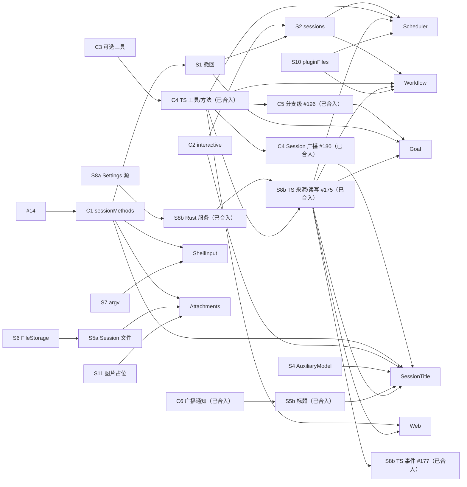

# 开发计划与优先级

Status: Draft. 依据：[总体设计](overview.md) §8 阶段与附录 B/F、[插件设计索引](plugins/README.md) 和 [#21–#30](https://github.com/arcships/dim/issues/31) 的讨论结论。

跟踪 issue：[#114](https://github.com/arcships/dim/issues/114)，每个工作项一个 issue 和一个 draft PR，各有唯一的负责人。

本文只排顺序、依赖和优先级，不重复设计内容，也不新增交付状态。ADR 008 之前的文字是历史，不再更新。设计文档仍是权威；本文与设计冲突时以设计为准，并回来更新本文。交付状态看 issue。

## 1. 状态

交付状态和合并状态以 issue 为准，主要是 [#114](https://github.com/arcships/dim/issues/114)。本文不新增交付状态；ADR 008 之前的文字是历史，不再更新。

## 2. 排期原则

1. **契约先行。** 多个插件共用的契约先定稿（只改文档），再开工：`sessionMethods`（4 个插件和 InputQueue 撤回用）、Settings 业务源（5 个插件用）、`SessionConfig.interactive`（2 个插件读）。契约定稿后再改，所有使用方都要跟着改。
2. **依赖从扩展指向核心。** 核心部件（Session 装配、ToolRegistry、Rpc、Mcp、SkillsCatalog）不硬依赖可选插件，按调用查找，或在自己装载时接入当时可用的（ADR 002 D3）。这是架构级的依赖规则，所有契约和插件设计都按它复核。
3. **core 按项拆 PR。** 每个工作项单独一个 PR。集中修改的文件（Rpc、装配、`agents.rs`、存储）各由一个负责人依次合入（§3.4）。
4. **插件按自己的依赖开工。** 一个插件依赖的工作项全部合入，它就开工，不等无关的 core 工作。第一个真实使用者负责验收对应的机制。
5. **core 项要有已 Ready 的使用者才开工。** 暂时没有使用者的项推迟。例外：插件作者直接使用的公开契约。M1 对外开放插件开发，开放前这些契约必须就位，不等内部使用者，例如 #2 动态事件（C8）。
6. **TypeScript first 的插件用 TypeScript 开发。** 用 TypeScript 是为了在业务规则还没验证时缩短验证和迭代周期（总体设计附录 C），所以按名访问运行时服务的 [#4](https://github.com/arcships/dim/issues/4) 要尽早做，分两段：C4（Session 级）和 C5（分支级）。安全边界、准入、输入和 Session 方法边界仍用 Rust。
7. **远期设计晚绑定。** 只细化即将开工的设计；P3 的设计等前置机制落地后再细化。

## 3. 工作清单

规模：S（几天）、M（1–2 周）、L（数周或需要 spike）。以下清单是计划；条目里的历史状态文字写于 ADR 008 之前，不再更新，状态看 issue。

### 3.1 立即做（文档与对齐）

1. ~~合入 #14、#16 并补 ADR 003 D3~~：已由 #14 完成（#16 关闭）。
2. ~~契约定稿：C1 `sessionMethods`、C2 `SessionConfig.interactive`、S8a Settings 业务源~~：#79、#83、#84、#90 已合入。核心部件不硬依赖可选插件的约束继续适用（#34、ADR 002 D3）。
3. ShellInput、Attachments 服务端与 CLI 输入链路已合入。Web 已确认 Ready，并实现可选 TypeScript 工具包；Scheduler、Workflow 的设计状态以各自所有者文档为准。两者的工具/方法、Settings owner 读写与事件前置已满足，Scheduler 可选包及业务验收由 #317 实现；Workflow 交付见其所有者文档；密钥存储由各插件自行决定，不增加共享凭据存储前置。SessionTitle 的 C6/S5b、C4 广播和 Provider 具名 AuxiliaryModel 绑定已交付，可选 TypeScript 包已实现并验证自动标题、手工重命名与关闭结算；通过 C4 配置显式安装；C5 与 Goal #199 已合入，Session 不读取分支业务状态；Goal 的剩余流程验收与产品安装由 #69 跟踪。
4. ~~决定 Goal 还是 Pursuit（D3）~~：已决定先做 Goal（#44）。
5. 确认可能不需要的工作：~~Permission 新类别~~（已确认不需要，现有 `Unclassified` 行为已符合，#45）、~~S3 活动句柄~~（已确认不需要：App Server 不自动卸载空闲 Session，#57）。
6. 为确定要做的运行时需求开 issue（总体设计附录 F）。rutis 是外部依赖，不向它提需求。
7. Provider 的 Desktop/CLI 完整管理由 [#329](https://github.com/arcships/dim/issues/329) 跟踪，负责人 zerob13；[方案](appserver/provider-management.md) 的实现与验收由 PR #349 交付。复用现有调用、重读和 CAS，无机制前置；Provider JSON 以可选字段保持 v19，接受旧 v19 二进制重写时丢失未知字段；v18 二进制拒绝 v19 数据库。客户端读取持久模型偏好后显式采用，服务端不自动应用；用量复用已交付的 account.usage 及原有包查询合同。S4 与 F3 已有 Session 采用流程保持，持久偏好取代 F3 原有的无持久偏好范围。
8. 插件契约迁移（[ADR 006](../adr/006-plugin-contract.md)）归 M1。M1 对外开放插件开发，按第 2 节第 5 条，插件作者直接使用的公开契约须在开放前就位；Dim 尚未发布，所以迁移不保留兼容路径。工作项见 §3.2 的“插件契约迁移”表，阶段与验收见[插件契约 §10](../zh/design/plugin-contract.md#10-迁移)。迁移已完成：P4 中 R5 的第二种形式随 #403 完成，TypeScript 与 Python 插件都是一行，以插件定义登记部件。P6 Scheduler（#70）的 loader 门槛所等的 rutis 0.16 升级（#379）已完成。对外开放前须满足 [#364](https://github.com/arcships/dim/issues/364)：第三方插件的部件注册工具后，模型就能看到这些工具，不需要写进配置。R6（#382）以可选的挂载列表 `SessionConfig.tools` 实现它：没有挂载列表的 Session（产品默认）声明全部宿主工具与部件注册的全部工具；有挂载列表的 Session 只声明其中列出的。工具调用是否执行仍由 Permission 决定，它不改变声明。
9. 对外发布前处理：[#294](https://github.com/arcships/dim/issues/294) 的权限语义已确定，`workspace-write` 对工作区外写入和修改逐次询问，读取策略不变；实现见 [#419](https://github.com/arcships/dim/pull/419)。其余事项：[#296](https://github.com/arcships/dim/issues/296)（依赖漏洞与许可证扫描）、[#297](https://github.com/arcships/dim/issues/297)（发布流水线的 action 固定到提交 SHA）、[#368](https://github.com/arcships/dim/issues/368)（发布包大小门槛）。

归下一个里程碑 [M2](https://github.com/arcships/dim/milestone/1)：Questions（#144/#178/#251）已由 #262 实现（#269、#336、#351）；Hooks（#143/#181）不归 M2：其设计已于 2026-10-31 Ready，归 M1，实现由 #755、#756、#757、#758 跟踪；ExternalAgent（#145/#182；[#254](https://github.com/arcships/dim/pull/254) 改为子 agent 形态，取代按模型的框架）的设计已合入，仍待 Ready 确认与实现；Pursuit（#146/#179/#252）的设计已于 2026-10-26 Ready，已由 [#422](https://github.com/arcships/dim/issues/422) 实现；回忆工具 `recall`（#129，设计见 [Recall](plugins/Recall.md)，2026-10-21 已 Ready，实现由 #310 跟踪）、摘要提示词/思考与目标长度评估（#170）也归该里程碑。#2 动态事件不归 M2，已于 2026-10-20 移入 M1（C8）：M1 对外开放插件开发，插件写自己的事件属于公开契约。其设计已于同日收敛（[ADR 001](../adr/001-harness-foundation.md#events-and-ownership-issue-2)）：Timeline 只检查信封与核心保留领域，并以不透明数据承载核心未定义的事件类型，Dispatcher 订阅只做过滤，能力事件声明只是描述契约；现有 `EventKind` 事件（含 F1、S1 加入的 4 个）不迁移。F1 的研究 #165、#169 的修复 #172 和 #128 的运行时调参 #183 已合入；#170 保留独立评估范围。插件契约的 #380（R1：Dispatcher 先回放历史、再接实时事件的注册）与 #381（R4：xtask 生成服务目录并标出 Capability）也归 M2：它们只新增能力或工具，不改变插件作者的写法，已于 2026-10-25 合入（#409、#408）。用户安装与启用第三方插件（[#384](https://github.com/arcships/dim/issues/384)）、效率测量与预算门槛（#363、#365、#366、#367）也归 M2。启动改为没有进展才失败、不再用固定总时限（[#387](https://github.com/arcships/dim/issues/387)），以及 Workflow 的用户定义与 `runs.json` 可能超过 16 MiB 桥接帧（[#343](https://github.com/arcships/dim/issues/343)，由 Workflow 在自己的数据布局内解决）也归 M2。

已撤回：Notifications。提醒归客户端，定时任务结果通知归 Scheduler，对外沟通渠道由各平台各自的插件和工具负责。

### 3.2 core 工作项

每项一个 PR。"负责线"表示改动集中的文件，同一条线上的项依次合入，不同线可以并行。

| ID | 内容 | 规模 | 负责线 | 前置 | 使用者 |
| --- | --- | --- | --- | --- | --- |
| C1 | `sessionMethods`：Session 门面按 namespace 查找，Rpc 经 Session 分发，含 Session 方法的每次调用进度（session-boundary A.2 只做 `progress`：方法声明 `progress` 后，Rpc 把调用期间的进度以 `management.progress` 只发给调用方连接，先于回复，断开后丢弃；`notify`、`closed`、`takeFinalReply` 不在内） | M | Rpc | #14 | ShellInput、Attachments、SessionTitle、Goal、S1 |
| C2 | `SessionConfig.interactive` 与 `session.create` 参数（只做这一个字段；存储保持 v13，旧记录缺省为交互） | S | Rpc | — | SessionTitle、S2、Questions（已由 #262 实现） |
| C6 | Session 广播通知记录，Rpc 原样转发 | S | Rpc | — | S5b |
| ~~C7~~ | ~~固定前缀读~~：不需要新接口，现有门面组合即可（#50，session-access §9.2） | — | — | — | — |
| C3 | 部件把工具注册到 ToolRegistry（#382），注册在部件卸载时撤回；ToolRegistry 不硬依赖可选插件：分支初始化首次读取 ToolRegistry 时纳入当时已注册的工具，并沿既有 BranchOpening 在 Session 接受输入前完成采用；之后注册或撤回的工具由 ToolRegistry 跟随，从下一个请求起提供或撤下，不需要重载（#241）；Session 的挂载列表 `SessionConfig.tools` 可选，没有时声明全部宿主工具与部件注册的全部工具（#364），有时只声明其中列出的，列出但没有部件注册的工具直接省略（#34） | S | 装配 | — | Web、Goal、Scheduler、Workflow |
| C4 | #4 Session 级：TypeScript 部件向 `toolRegistry` 注册工具、提供 `sessionMethods`，订阅 Session 广播，随 Session 装配和卸载；Session 装配不等可选插件的部件（#34，装配实现由 #132 跟踪，完整 C4 验收以其落地为前提） | L，先 spike | 装配 | C3、#132（验收） | 所有 TypeScript 插件 |
| C5 | #4 分支级：TypeScript 部件按名使用 `Dispatcher`、`Branch::input`、`TreeCommands` | M | 装配 | C4 | Goal |
| S1 | InputQueue 撤回：`input/withdraw`、`input/deleted`、`session.input.withdraw`（新事件需做格式决定） | M | 事件类型 | C1 | `Ctrl+S`/`/queue`、Goal、S2 |
| S2 | Agents `sessions` 服务：`launch`、`input`、`idle`、`withdraw` | L | `agents.rs` | C2、S1 | Scheduler、Workflow |
| S3 | ~~Session 活动句柄~~：不需要，App Server 不自动卸载空闲 Session（#57） | S | `agents.rs` | — | — |
| S4 | Provider `AuxiliaryModel`：会话外单次模型调用（[设计](appserver/auxiliary-model.md)；用途策略已撤回） | S | Provider | — | SessionTitle |
| S5a | SessionStore：Session 文件 | M | 存储 | S6 | Attachments |
| S5b | SessionStore：标题元数据与 `setTitle` | S | 存储 | C6 | SessionTitle |
| S5c | SessionStore：删除、清理、fork | M | 存储 | S5a | fork 功能 |
| S6 | FileStorage 列目录与删除 | S | 独立 | — | S5a |
| S7 | HostPlatform argv 辅助、每次启动时读 shell 配置 | S | 独立 | — | ShellInput |
| S8a | Settings 业务源（Rust）：每个所有者一个或多个源、两个作用域的变更通知、入口统一校验；目录形式的项目文件由所有者自己读 | M | Settings | A2 | Rust 所有者、S8b |
| S8b | Settings 语言中立服务、`settings.read/update`；#166 Rust 服务、#175 C4 行来源声明/TypeScript owner 读写及 #177 事件已合入；#185 撤销共享凭据服务，密钥由所有者管理 | M | Settings | Rust 部分依赖 S8a；TypeScript 来源、读写与事件依赖已合入的 C4 绑定 | Web、SessionTitle、Goal、Scheduler、Workflow |
| R1 | Rpc：管理插件处于 Failed 或 Unresolved 时返回不可重试的 `service_unavailable`（#116） | S | Rpc | — | 客户端 |
| S10 | `pluginFiles` 格式版本（二进制留给 P3） | S | 独立 | — | Scheduler、Workflow |
| S11 | ModelProvider：模型不支持图片时换成文本占位 | S | 独立 | — | Attachments |
| C8 | #2 动态事件：插件写自己领域的事件（Rust 与 TypeScript SDK），与原生事件一样持久化、恢复、可读可订阅；拒绝写入核心保留领域；作者指南（[ADR 001](../adr/001-harness-foundation.md#events-and-ownership-issue-2)）。存储格式变更与存储线对齐；给客户端展示的新协议不在 M1 | M | 事件类型 | — | 第三方插件作者 |

插件契约迁移（[ADR 006](../adr/006-plugin-contract.md)，归 M1）。编号前缀 PC 用来和本文的 P1–P7 插件项、R1 区分：

| ID | Issue | 内容 | 规模 | 前置 | 状态 |
| --- | --- | --- | --- | --- | --- |
| PC-P1 | #379 | rutis 0.16 升级：分支机制通道改用私有事件名，去掉中继，事件载荷改为 serde | M | — | 已完成 |
| PC-P2 | #371 | 服务目录，以及 Rust 按名字声明依赖 | M | PC-P1 | 已完成 |
| PC-P3a | #372 | 进程与简单部件迁为按名字依赖的 loader 行；同作用域部件的合并检查 | M | PC-P2 | 已完成 |
| PC-P3b | #373 | 核心分支与 Session 部件迁移；同作用域部件的合并检查 | L | PC-P3a | 已完成 |
| PC-P3c | #374 | App Server 宿主部件迁移；同作用域部件的合并检查 | M | PC-P3b | 已完成 |
| PC-R6 | #382 | 贡献向所有者登记：工具、工具来源、提示词来源、方法命名空间；去掉宿主侧预注册 | M | PC-P2 | 已完成（#407、#410） |
| PC-P3e | #402 | 每个功能是一个进程插件，登记自己的 Session 与分支部件 | L | PC-R6 | 已完成（#411、#413） |
| PC-P3d | #375 | 删除按层定型的插件 API | S | PC-P3a–c、PC-P3e、PC-R6 | 已完成（#412；同作用域合并检查与 P6 文档收尾 #415） |
| PC-P4 | #376 | 跨语言补齐：R2、R3、R5，`#[rutis::service]` 导出，SDK 与作者指南一起改 | L | PC-P3d | 已完成；R5 的第二种形式随 #403 完成 |
| PC-P5 | #380 | R1：Dispatcher 登记时先回放历史再跟随实时事件 | M | PC-P2 | 已完成（#409） |
| PC-R4 | #381 | 在 xtask 中生成服务目录并标出 Capability | S | PC-P2 | 已完成（#408） |

P3 的每一批都按功能检查同一作用域里的部件：只有一个所有者、又没有分开的理由（例如重载隔离）的就合并；合并单独提交，和迁移分开。检查结果：
- SkillContributions 并入 Skills：内容集合由 Skills 持有，经实例值交给它创建的 SkillContent，不再是服务。SkillContent 仍是 Session 自己的内容实例。
- SkillsCatalog 与 App Server 里同名的管理贡献部件已是同一个插件（#402）。
- Settings 与 SettingsMethods 保持分开：合并会让核心的 Settings 依赖管理方法表，表重载时所有依赖 Settings 的部分都要跟着重载（重载隔离）。
- PromptRegistry 与 PromptSources 保持分开：前者是提示词来源的所有者，后者和 Skills 一样是向它登记的贡献者（R6）；合并还会让核心的提示词表依赖 HostPlatform（ADR 002 D3）。

### 3.3 插件开工顺序

按依赖从少到多排列。依赖全部合入即可开工，不必等前一个插件做完。

| 顺序 | 插件 | 语言 | 依赖 |
| --- | --- | --- | --- |
| 1 | ShellInput | Rust | C1、S7 |
| 2 | Attachments | Rust | C1、S5a、S6、S11 |
| 3 | Web（已实现为内置 Rust 插件） | Rust | C3、C4、S8b（已交付） |
| 4 | SessionTitle | TypeScript | C1、C2、C4、C6、S4、S5b、S8b |
| 5 | Goal | Rust | C1、C3、C4、C5、S1、S8b |
| 6 | Scheduler | TypeScript | C4、S2、S8b、S10 |
| 7 | Workflow | TypeScript | C4、S2、S8b、S10 |

不被其他插件依赖、随时可以单独做的功能：生产压缩宿主与 `/compact`、用量查询（走现有的 `ResolveContextModel` 端口，不依赖 S4）；Session 删除和 fork（S5c）；Permission 命令规则；模型参数 effort/fast 与 `/agent`；MCP OAuth；HostPlatform OS 隔离（L，先 spike）；CLI 子命令、`/export`、`exec --json`。

P3 的 RemoteGateway、Modality、PluginManager 等 P1/P2 落地后，开工前集中复核设计；按 rutis 现有能力设计，不向 rutis 提需求。AcpGateway 首版支持子集已在 PR #441 实现，按[实施合同](acp-gateway-implementation.md) 复用现有 RPC；实际结果和客户端限制见[验收](acp-gateway-acceptance.md)。它不等待 `ConnectionEntry`、`EntryHost`；后两者随 RemoteGateway 另排。

### 3.4 合入顺序与冲突点

| 负责线 | 依次合入 | 说明 |
| --- | --- | --- |
| Rpc（`connection.rs`、`protocol.rs`、`methods.rs`），yyhhyyyyyy | R1 → C1 → C2 → C6 → S5b/S5c 的 Session 方法 | 冲突最多的地方 |
| 装配（`assembly.rs`、App Server `lib.rs`），zerob13 | C3 → C4 → C5；每个新插件的登记在这之后追加 | 新插件登记只加几行，按合入顺序 rebase |
| `agents.rs`，yyhhyyyyyy | S2 | |
| 存储（`storage/timeline.rs`），yyhhyyyyyy | S5a → S5b → S5c | 存储格式的改动依次做，每次单独做格式决定；#32 已决定不改格式（[格式决定](appserver/native-storage-format.md#32-格式决定)） |
| 事件类型（`events.rs` 与冻结样本） | S1 | 单独做格式决定 |
| 插件自己的 crate 或包 | 无冲突 | |

契约层面的冲突比文件冲突更要紧：C1、C2、S8a 一旦改动，所有使用者都要跟着改，所以放在 §3.1 先定稿。

### 3.5 按人按批次

每条串行负责线只由一个人负责，避免同一批文件在人之间来回交接。"批"只表示先后：前置一到就进下一批，不等整批结束。

| 批次 | eric8810（核心机制与契约） | yyhhyyyyyy（Rpc、Agents、存储、MCP） | zerob13（装配、TS 桥接、TS 插件、CLI、平台） |
| --- | --- | --- | --- |
| 1 | ~~A2 契约定稿~~ #79、~~A3 Goal 决策~~ #80、~~A4 权限类别~~ #81 | ~~S6 FileStorage~~ #87、~~R1 Failed 错误码~~ #117 | ~~C3 工具接入~~ #82、~~C4~~ #99/#141/#150/#173/#174/#180、~~S7 argv 辅助~~ #88、~~S10 pluginFiles~~ #91/#135 |
| 2 | ~~S8a Settings 源~~ #90、~~S4 AuxiliaryModel~~ #89 | ~~C1 sessionMethods~~ #83、~~C2 interactive~~ #84、~~S5a Session 文件~~ #95 | ~~装配前置~~ #137；F5 spike #112、设计 #152 已合入，产品实现 #189 已合入 |
| 3 | ~~S1 InputQueue 撤回~~ #94、S8b #119/#166/#175/#177 已合入，共享凭据服务由 #185 撤销、~~S11 图片占位~~ #92、~~F2 权限命令规则~~ #109 | ~~C6 广播通知~~ #85、~~S5b 标题~~ #96、~~P1 ShellInput 服务端~~ #101、~~S3 活动句柄~~（不需要） | ~~C5 设计与实现~~ #100/#195/#196；~~P1 CLI~~ #155、~~F6 CLI~~ #149/#153、~~F3 模型参数~~ #148 |
| 4 | ~~F1 压缩宿主~~ #108、~~研究与运行时调参~~ #165/#172/#183；P5 Goal 设计 #105、TypeScript 实现 #199 已合入（验收完成，#69 已关闭；产品安装归 PluginManager） | ~~S2 sessions~~ #98/#159、~~P2 Attachments 服务端~~ #102、~~S5c 删除和 fork~~ #97、~~F4 MCP OAuth 服务端~~ #111 | ~~F4 CLI~~ #151、~~CLI Attachments~~ #154/#160/#163/#164、~~作者指南~~ #167/#190；P3 Web 设计 #103 已合入且 Ready 已确认，可选 TypeScript 工具包已实现（#211），产品安装由 PluginManager 跟踪，P4 SessionTitle 合同 #228 与 Provider 绑定 #225 已合入；[SessionTitle 契约](plugins/SessionTitle.md) 已实现，公开流程验收通过，按 C4 配置显式安装 |
| 5 | C8 #2 动态事件（2026-10-20 移入 M1） | #126 空闲卸载设计 #188 已合入；R1 #194、R2 #201、R3 #200、R4 #202 及关闭分支修复 #204 已合入，已有 Ready 使用者，Agents 卸载流程及其验收可以开工 | P6/P7 设计 #106/#107、跟踪 #208、存储与保留期 #212 已合入；P6 Steer 单次投递、不补发已确认；P7 报告结算见 [#214](https://github.com/arcships/dim/pull/214)，内部 v2、拒绝 v1 并保留原字节已确认，迁移后续统一处理；进程装载与管理绑定 [#234](https://github.com/arcships/dim/pull/234) 已合入；功能依赖绑定已在 #237 评审确认，设计状态见各自所有者文档；Workflow 可选包与业务验收已实现（#306），Scheduler Ready #283 已合入，可选包与业务验收由 #317 实现；#126 是恢复旧工具可用性与反复创建 Session 的交付前置 |

跨人的交接（都不在同一批文件上）：

| 交付 | 交付方 | 等它的 |
| --- | --- | --- |
| A2 契约定稿 | eric8810 | C1、C2（yyhhyyyyyy） |
| C1 sessionMethods | yyhhyyyyyy | S1（eric8810） |
| S1 撤回 | eric8810 | S2（yyhhyyyyyy） |
| S4 AuxiliaryModel | eric8810 | P4（zerob13） |
| S8b C4 行来源声明与 TypeScript owner 读写 #175、事件 #177（已合入） | eric8810 | P3、P4、P6、P7（zerob13）；密钥由各插件自行管理 |
| C4 工具/方法绑定（已合入） | zerob13 | S8b 来源与读写（eric8810，已合入）及各 TS 插件 |
| C4 Session 广播 #168/#180（已合入） | zerob13 | P4 SessionTitle（zerob13）；其他插件按自身接口推进，不等待该广播 |
| C6 广播通知、S5b 标题（#85/#96 已合入） | yyhhyyyyyy | P4（zerob13） |
| S11 图片占位 | eric8810 | P2（yyhhyyyyyy） |
| S7 argv 辅助 | zerob13 | P1（yyhhyyyyyy） |
| S2 sessions | yyhhyyyyyy | P6、P7（zerob13） |
| C4、C5 TS 桥接 | zerob13 | P5（eric8810） |

第 2、4 批的服务端交付及 Attachments CLI 已合入；Web 的 Ready 已确认，可选 TypeScript 工具包已实现（#211），产品安装由 PluginManager 跟踪；Scheduler、Workflow 按各自所有者文档的 Ready 状态和合同推进。两者复用已交付的工具/方法、Settings owner 读写与事件。C6/S5b 与 C4 广播已交付；密钥管理归各插件，具名 AuxiliaryModel 由 Provider 提供；Goal #199 已合入且验收完成（#69 已关闭），产品安装由 PluginManager 跟踪，不设新的全局阶段屏障。

### 3.6 并发规则

- `docs/architecture/rust-agent/generated/` 下的生成文件不手工解冲突：rebase 后重跑 `xtask graph`。
- 不给还没落地的接口打桩，等接口合入再开工。
- 同时进行的工作数不超过维护者能确认的设计 PR 和实现 PR 数量。

### 3.7 客户端

客户端（原生 CLI、Web 工作区、Desktop、ACP、远程设备）的总体视图、能力覆盖、缺口与待决事项见[客户端](clients.md)（草案）。Desktop 在独立仓库，本仓库只负责它使用的 App Server 契约。负责人待定；里程碑待[客户端 §6](clients.md#6-decisions-for-the-maintainer) 的决定。

| 工作 | Issue / 设计 | 状态 |
| --- | --- | --- |
| 成员 transcript 卡片、子 agent 模型策略的运行时 | [#263](https://github.com/arcships/dim/issues/263)；[成员会话](member-conversation.md) §7–9、[子 agent 模型策略](subagent-model-policy.md) | 已实现；任务面板的成员详情与停止已由 #324 交付 |
| 任务面板中的 Workflow 运行 | [#264](https://github.com/arcships/dim/issues/264)；[Workflow 任务视图](workflow-task-view.md) | 原生 CLI 已实现；真实 Workflow 包的 App Server 流程待验证 |
| UI 事件传给 agent | [#386](https://github.com/arcships/dim/issues/386)；[Tui §3.6](plugins/Tui.md#36-ui-registry-and-ui-leaves) | 预留约定，未设计细节 |
| Web 第二阶段（排队、附件、fork、设置页面等） | [Web 工作区](web-workspace.md) §4、Q2 | 未设计；Q2 待决定 |
| 没有设计的 CLI 能力：`/timeline` 与消息操作、`/queue`、Skill 引用、排队消息的附件等 | [客户端 §4](clients.md#4-gaps-and-conflicts) | 待决定是否设计 |
| 文档与代码不一致：全屏终端界面、`/web` 归属、web 入口的管理方法 | [客户端 §4](clients.md#4-gaps-and-conflicts) | 待决定后修订相关文档 |
| ACP | [#436](https://github.com/arcships/dim/issues/436)；[AcpGateway](plugins/AcpGateway.md)、[验收](acp-gateway-acceptance.md) | 支持子集已实现于 PR #441，未发布；接入方 rutis 插件，RPC 框架和 Agent core 不变。acpx 基本聊天已验收，Lody MCP GUI 待登录后验收，不支持项另行评估 |
| 远程设备 | [RemoteGateway](plugins/RemoteGateway.md) | 草案，P3 |

## 4. 依赖图

ShellInput 与 Attachments 的服务端及 CLI 输入链路已合入。C4 工具/方法 #150、rutis 0.11 升级 #173、广播设计 #174 和运行时 #180 已合入，#63/#168 已关闭；#156 不采用。S8b Rust 服务 #166、C4 行来源声明与真实 Node owner 读写验收 #175、TypeScript 事件 #177 已合入；没有额外 manifest。#185 撤销共享凭据服务及其验收，S8b 已完成。原生 Session 广播目前只由 SessionTitle 使用，其他插件不因 #168 增加前置。S1 → S2 已合入；Web 的 Ready 已确认，可选工具包已实现（#211），产品安装由 PluginManager 跟踪；Scheduler、Workflow 的 Ready 设计细化 #208 已合入，密钥由各插件自行管理。C6 → S5b 已合入；Provider 已提供具名 AuxiliaryModel 绑定，SessionTitle 可选 TypeScript 包及公开流程验收已实现，默认 CLI profile 安装仍由后续产品装配负责。C5 #196 与 rutis 0.12.1 升级 #195 已合入；Goal #199 已合入并确定 Session 写输入、分支所有者决定的合同；#69 继续跟踪 Goal §10 的剩余流程验收与产品安装。

## 5. 设计变更空间

P6/P7 的设计状态见各自所有者文档（[Scheduler](plugins/Scheduler.md)、[Workflow](plugins/Workflow.md)）；下一步按既定合同实现可选 TypeScript 包并完成各自业务验收。[公开存储绑定](process-typescript.md#52-public-pluginfiles-binding)复用已有 PluginFilesPlugin 与宿主授权 product root；实际 Node 流程已覆盖公开进程行、仅 Session 配置、缺少根目录或父目录及 scope 收尾。Workflow 可选包与业务验收已实现（#306）；Scheduler 包仍在实施。不增加 core/rutis 能力，不借用私有插件入口；PluginManager #3 的产品安装仍另行推进。

P6/P7 的[公开 TS 进程装配与管理方法绑定](process-typescript.md)合同 #232 与实现 [#234](https://github.com/arcships/dim/pull/234) 已合入，归 #4 装配线（zerob13）。绑定复用既有运行时、进程行与管理调用；启动与重启按必需宿主部件判断就绪，可选进程行保留自身 Pending/失败状态。共享声明发布沿用既有基础设施规则：模块顶层加载卡住仍会使宿主启动超时，作者指南要求顶层不做业务 I/O；不扩超时或 rutis 能力。进程装载和管理绑定的实现不等于 P6/P7 Ready；功能依赖绑定见下文；P6 实时权限绑定已交付，P7 来源与结算的业务验收继续跟踪。

P6/P7 的[功能依赖绑定](process-typescript.md#51-p6p7-access-through-declared-feature-dependencies)已由维护者在 [#237 评审](https://github.com/arcships/dim/pull/237#pullrequestreview-5584479437)确认：仅可选工具行注入进程业务服务，不让 Session 核心依赖该服务；进程 owner 保持稳定依赖边界，新增高频重载依赖须重新决定可用性代价。真实 Node 流程验证 owner 重载时原生工作继续、新 Session 取得新 owner，以及旧工具绑定返回明确的不可重试错误。恢复使用服务端重启后还原，或 #126 尚待实现的空闲卸载后还原；后者也是该恢复路径的交付前置。#35 的访问选择已确定，不增加热接入、可选查找 API、事件协议或 rutis 升级前置；Workflow 可选包与业务验收已实现（#306），Scheduler Ready #283 已合入，包可开始实施；交付边界见各自所有者文档。

P6/P7 的[原生接入合同](p6-p7-bindings.md) #256、实时权限读取 #259 与受限文件访问 #265 已合入。sessions.input 已实现准入后自持任务，分支对每个 submissionId 只接受一次，并以真实 Node 崩溃、重载及 Session 恢复流程验证；Workflow 可选包已提供用户、项目与安装包三类定义来源、阶段引擎和后台报告；SDK 与真实 Node 验收对应关系见包 README 和 Workflow 附录 D。合同复用 rutis 的生成导出与 caller row，不增加 rutis 前置。Scheduler Ready #283 已合入，包可开始实施；Workflow 可选包与业务验收已实现（#306），显式产品安装及反复创建 Session 发布前的 #126 仍单独处理。

P6/P7 的每秒历史跟踪及现有停止边界已确认：按分支停止可能遇到后续轮次，已采用输入不能撤回，运行记录终结后仍可能被复用会话的后续轮次消费。这些是接受的首版限制，后续统一设计，不增加 core、条件停止协议或锁；不再作为待确认项；两项设计状态见各自所有者文档。

开发中一定会出现插件设计的细化和变更。以下流程让变更有固定入口，不打断排期。

### 5.1 设计状态

| 状态 | 含义 | 何时进入 |
| --- | --- | --- |
| Draft | 当前插件设计（ExternalAgent #182（#254 重设计为子 agent）已合入，仍待 Ready 确认） | — |
| Ready | 已按代码现状复核，开放问题已决定或明确推迟，维护者已确认 | 开工前的设计细化 PR 合入 |
| Implemented | 代码与设计一致；能力页移入或链接到 `architecture/rust-agent/plugins/`，由 `xtask check` 校验 | 实现 PR 合入 |

只有 Ready 的设计可以开工。

### 5.2 开工前的设计细化

每个插件和每份共享契约开工前，先提一个只改文档的小 PR：

1. 按当前代码复核依赖：前置项是否已按设计落地；有偏差的，以代码和已合入契约为准。
2. 决定或推迟附录里的开放问题，推迟的写明不影响本次实现的理由。
3. 列出需要改的共享契约（[session-boundary](contracts/session-boundary.md)、[session-access](contracts/session-access.md)、总体设计附录 B/F），一起改。
4. 按现行[原则](../architecture/rust-agent/principles.md)重新回答"Rule check"中受影响的行，特别是 §4 第 3、5、8 条。
5. 维护者确认后合入，状态改为 Ready。

### 5.3 实现中发现的变更

- **只影响本插件**：在实现 PR 里同步改设计文档，PR 描述单列"设计变更"一节。
- **影响共享契约或其它插件**：先停在该点，提契约变更 PR（列出受影响的插件文档），确认后再继续。
- **需要改基础设施**：按原则 §4 第 8 条，需求必须来自基础设施自身并在其内闭环，否则是插件自己的设计问题。插件不自己改 core，需求交给对应负责线的负责人。
- **中文译文**：`docs/zh/` 可以在一批工作完成后统一同步。

### 5.4 容量与重排

- 预留 20–30% 容量给 5.2/5.3 的工作。L 级项（C4、S2、OS 隔离）先做 spike，spike 结论可能改变设计和本文顺序。
- 每批工作完成后回顾：更新 §1 现状和 §3 工作清单。

## 6. 决策

| # | 问题 | 结论 | 影响 |
| --- | --- | --- | --- |
| D1 | #2 的上下文边界 | 已决定：插件事件只通过已采纳的输入和工具结果进入上下文；#2 已修订为同一口径 | #2 只剩以不透明数据承载核心未定义的事件类型；不设类型注册或写入类型检查（2026-10-20） |
| D2 | #4 是否尽早做，按 Session 级和分支级分段 | 是（§2 第 6 条） | TypeScript 插件何时能进入快速迭代 |
| D3 | Goal 与 Pursuit | 已决定先做 Goal（#80）。Pursuit 的评估插件设计（#179、#252）已于 2026-10-26 Ready，已由 #422 实现，仍属 M2 | C5 的使用者是 Goal；插件顺序 5 |
| D4 | 是否先做完全部 core 再做插件 | 已决定：不设全局阶段屏障；契约先行、core 按项拆 PR、插件按自己的依赖开工（§2） | 整体顺序 |
