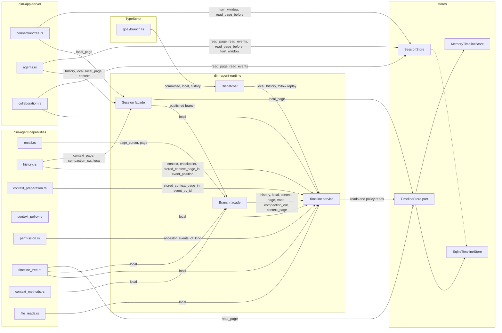
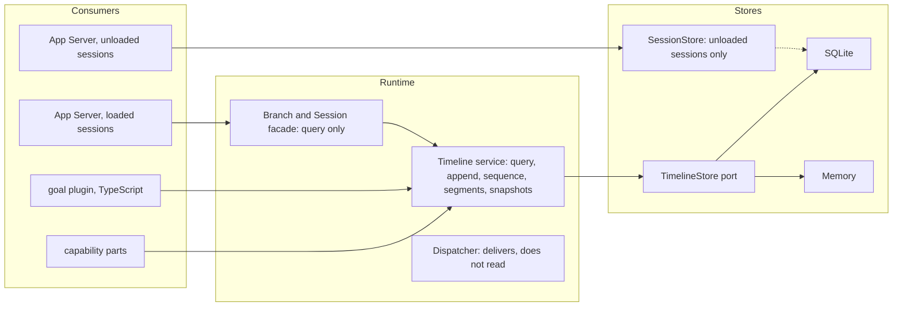

# Timeline read entries

Status: Proposed. Scope: every way a part, the App Server or a TypeScript plugin reads events from a Timeline, which of them the event query ([ADR 019](../adr/019-event-query.md), [plugin contract §5.4](plugin-contract.md#54-the-event-query)) replaces, and what is left. This document holds an audit and the decisions proposed in [ADR 020](../adr/020-timeline-read-convergence.md); a decision here takes effect when that ADR is accepted. Language: English.

Base: `origin/main` at `514225777`. Call sites exclude tests and examples. Every row below was read from source at that base, so the TypeScript paths it names, Goal's `runtime/plugins/goal/branch.ts` among them, are a pre-port snapshot.

## 1. The entries

### 1.1 `Timeline` service (`crates/dim-agent-runtime/src/core/timeline.rs`)

| Read | Defined | Production call sites |
| --- | --- | --- |
| `history(through)` | :727 | `dispatcher.rs:269`, `branch.rs:128`, `agent.rs:548` |
| `query(query)` | :756 | none |
| `page_cursor` / `page` | :822 / :835 | `recall.rs:184`, `:187`, `:208` through `branch.rs:133`, `:144` |
| `local(range)` | :898 | 16 sites, see §1.5 |
| `stored_page` | :921 | none |
| `stored_local` | :1071 | none |
| `ancestor_events_of_kind` | :955 | `permission.rs:525` |
| `event_by_id` | :972 | `context_preparation.rs:682`, `timeline.rs:973`, `:990` |
| `event_position` | :978 | `history.rs:163`, `:338`, `context_policy.rs:435`, `timeline.rs:1017` |
| `compaction_cut` | :1007 | `history.rs:989`, `:990` through `branch.rs:172`, `agent.rs:529` |
| `stored_context_page` / `_in` | :1050 / :1026 | `history.rs:1001`, `:204`, `:320`, `context_preparation.rs:648`, `branch.rs:185` |
| `context` | :1099 | `history.rs:246`, `:267`, `:440`, `branch.rs:166`, `agent.rs:525`, `agents.rs:1446` |
| `context_with_checkpoint` | :1322 | `history.rs:243`, `:262` |
| `checkpoint` | :1258 | `history.rs:178`, `:292`, `timeline.rs:1328` |
| `trace(sequence)` | :1401 | none; only the facades `branch.rs:190` and `agent.rs:660` reach it |

### 1.2 Same reads on other objects

`Branch` (`branch.rs`): `history` :126, `page_cursor` :132, `page` :138, `local` :146, `context` :164, `compaction_cut` :170, `context_page` :176, `trace` :188.
`Session` (`agent.rs`): `context` :524, `compaction_cut` :528, `context_page` :532, `history` :543, `local` :550, `local_page` :562, `trace` :659.
Submission lookup: `Branch::lookup` (`branch.rs:73`) to `Session::lookup` (`agent.rs:490`) to `TimelineContext::lookup` (`timeline_context.rs:392`) to a point read at :411; callers `connection/tree.rs:99` and `agents/sessions.rs:569`.
Deleting a `Timeline` method alone leaves these reachable.

### 1.3 Dispatcher reads exported to TypeScript (`core/dispatcher.rs`)

`local(start, through)` :257 and `history(through)` :265 read to the *committed* position (`.d.ts` says "committed events"). Replay `follow` :171 reads `local(..=through)` at :194. The one TypeScript part that calls them is `runtime/plugins/goal/branch.ts`: `committed()` :104, `local` :105, :176 and :205, `history` :207. It injects `dispatcher`, not the Timeline service. `npm/branch-services.d.ts` declares the old reads and `query` side by side.

### 1.4 Reads that bypass the service

| Read | Defined | Callers |
| --- | --- | --- |
| `TimelineStore::read_page`, called by the TimelineTree part itself | `timeline_store.rs:229` | `timeline_tree.rs:425`, `:668` (also behind `TreeTimeline::page` :180) |
| `Session::local_page` reads the store port directly | `agent.rs:562-585` | `agents.rs:677`, `:1007`, `connection/tree.rs:227`, `agents/sessions.rs:616` |
| `read_page_before` | :1409 | `agents.rs:763`, `connection/tree.rs:209` |
| `read_events` | :1539 | `agents.rs:688`, `collaboration.rs:1151` |
| `turn_window` | :1304 | `agents.rs:746`, `connection/tree.rs:197` |

These contradict §5.4's "a part reads facts through its branch's `timeline` service".

### 1.5 `local` call sites

`timeline_context.rs:411`, `timeline.rs:309`, `dispatcher.rs:194` (replay), `:262`, `branch.rs:162`, `agent.rs:555`, `collaboration.rs:1080`, `:2726` (`..=committed()`, the collaboration rebuild), `agents.rs:1009`, `context_policy.rs:531`, `timeline_tree.rs:566`, `:2291` (the whole parent prefix, to find the first tool use), `context_methods.rs:81`, `history.rs:981` and `:983` (cut validation), `file_reads.rs:143`.

### 1.6 Store port (`timeline_store.rs`)

### 1.7 Dependency graph

Every edge was read from a call site in this audit. An edge label lists the reads that cross it; the arrow into the store port is summarised because the calls inside `timeline.rs` were only partly enumerated. The dashed edge is the shared storage code, not a call.

Two things the graph shows. The `Session` facade reaches the store port without the Timeline service (`local_page`), and the TimelineTree part and the App Server reach a store without it as well, so deleting reads from `Timeline` alone leaves these routes into the same rows: the `Branch` and `Session` facades (§1.2), the Dispatcher exports (§1.3), `Session::local_page`, the TimelineTree part's own `TimelineStore::read_page`, and the `SessionStore` reads of the App Server (§1.4).

## 2. What each consumer needs

Each row was read from the consumer's source: what it takes from the Timeline, how it reads today, and whether it needs to read that way. The request the query takes is scope, from_event or from_sequence, kinds, flags, event_id, one predicate, order_by, direction, limit and offset.

| Consumer | What it needs | How it reads today | Does it need that read |
| --- | --- | --- | --- |
| Permission rebuild (`permission.rs:522`) | The last `permission/changed` among the ancestors; each event overwrites the policy, so only the last counts | All ancestor events of that kind, folded | One event: chain, that kind, descending, limit 1 |
| File reads (`file_reads.rs:136`) | The latest completed compaction after `established`, and whether its `retain_from` lies after that point | `local(established+1..=committed())`, then a search | One compaction event and one by-id position. The upper bound is `committed()`, so it reads events that may not be published yet |
| Manual compaction wait (`context_methods.rs:81`) | One `context/compaction` whose `command` equals a value | `local(after+1..=head)`, then `find` | Branch, kind, `command` equality, from `after+1`, limit 1 |
| Compaction policy reuse (`context_policy.rs:531`) | The `context/compaction` and `context/budget` facts an earlier attempt of the same prepare wrote, matched on `turn_id` | `local(through+1..)`, then a filter | Expressible: branch, both kinds, from_sequence `through+1`, predicate `turn_id`; the compaction `through` equality stays with the caller. Whether those facts are published when read was not verified; the read happens before this attempt writes its own budget fact (`context_policy.rs:553`) |
| Branch resume (`timeline_tree.rs:566`) | `branch/create-failed`, `branch/create`, `branch/ended`, folded into sets | `local(..=head)`, the whole branch | Three kinds, not the whole branch |
| Collaboration result fetch (`collaboration.rs:1080`) | One event whose id is known | A `results` table for the sequence, then `local(seq..=seq)`, then `find` | A by-id read; the `results` table exists for this read only |
| Session summary (`agents.rs:1003`) | The preview text of the first operator input, and the time of the event at `through` | `local_page` of the first 256 events, then `local(through..=through)` | The first `input/message` that has a `user`, ascending, stopping there (the `user` check stays with the caller); the update time is one point read at `through`. Not 256 events |
| Replay `follow` (`dispatcher.rs:194`) | Rebuild a part's own state from the branch's events up to `S = committed()` | `local(..=S)`, whole | Depends on the part: seven rebuild from kinds they do not subscribe to, and some need only a few kinds |
| Submission index at restore (`timeline.rs:309`) | The `submission_id` of every restored input | `local(1..=restored_sequence)` | One kind, `input/message` |
| Committed input (`timeline_context.rs:411`) | The event at a known sequence | `local(seq..=seq).pop()` | A point read |
| Goal inheritance (`goal/branch.ts:205`) | The last inherited input carrying the objective or status marker | The branch's own event id, then `history(at)` over the whole chain, filtered in TypeScript | The last matching `input/message` on the chain. The marker is inside `blocks`, which the one-equality predicate cannot reach |
| Budget input lookup (`context_preparation.rs:682`) | One input by id | `event_by_id` | A by-id read |
| Compaction cut position (`history.rs:163`) | Where the event named by `retain_from` sits in the chain | `event_position` | An id to a position; the reply carries positions |
| Cut validation (`history.rs:981`) | Whether a sequence ends an atomic batch | `local(through..=through)`; the store errors inside a batch | No event content, only batch structure; the query cannot give it |
| Recall (`recall.rs:184`) | Newest-first events of several kinds, folded, stopping once the answer is reached | `page_cursor` and `page` | Descending paging with an early stop |
| Collaboration rebuild (`collaboration.rs:2726`) | Approval inputs not yet handled, and every `collaboration/result` with its sequence | `local(..=committed())`, walked twice | Four kinds, not the whole branch. It reads to `committed()` |
| Branch tool default start (`timeline_tree.rs:2291`) | The `model/start` before this turn's first `tool-use`, minus one | `parent.local(..)`, whole parent | Two events, matched on `turn_id` and `request_id`. The predicate is one equality, so one match stays with the caller |
| Fork check and prefix (`agents.rs:1446`) | Whether the cut is legal, and the context before it | `validate_context_boundary_in` and `context` | Folding the prefix is the projection's job; the batch check is as above |
| History window (`connection/tree.rs:197`) | The newest turn's start and a descending page inside the window | `turn_window` and `read_page_before` | Descending paging, plus the newest `turn/start` |
| History page (`connection/tree.rs:227`) | A page from `after` for a client | `local_page` | Paging; that the page ends on a batch is a protocol rule |
| Submission lookup (`branch.rs:73`) | The input event of a submission id | `lookup`, then a point read `local(seq..=seq)` | A by-id read: `event_id`, limit 1 |

### 2.1 Five kinds of need

1. **One or two specific events**: permission, file reads, manual compaction, collaboration result, committed input, budget lookup, goal inheritance, branch tool default start. Most read a range and pick from it.
2. **One or a few kinds, then folded**: branch resume, submission index, collaboration rebuild, recall, context folding.
3. **Rebuild a part's own state**: the replay, in eleven parts. Some need a few kinds, some the whole prefix.
4. **An id turned into a position**: compaction cut position.
5. **Batch structure**: cut validation and the page edge of the history protocol. These are storage rows, not event content.

### 2.2 Where the query falls short

- One equality: goal's marker sits inside `blocks`; the branch tool start needs two conditions.
- Reading up to the committed position: replay, collaboration rebuild, file reads. Each reads facts it wrote itself.
- Batch structure: cut validation.

### 2.3 What the eleven rebuilds fold

Read from each part rebuild. The follow key list is what a part subscribes to; the fold is what its rebuild consumes. They differ.

| Part | Folds | State is |
| --- | --- | --- |
| Permission | permission/changed, ancestors and own, each overwrites the last | the last event |
| Wait | turn/start, turn/end | the last event |
| Approval | approval/request, approval/respond, approval/cancelled | unclosed pairs |
| ToolExecutor | step/tool-call, step/tool-result, stop/interrupt, turn/start, turn/end | unclosed pairs |
| ModelProvider | model/call, step/tool-use-start, step/tool-use, step/model-output-end, stop/interrupt, turn/start, turn/end; also steer.apply, which reads step/model-start and input/applied with a non-append mode | unclosed pairs |
| ContextPreparation | context/prepare, model/call, step/model-output-end, context/compaction-start, context/compaction, stop/interrupt, turn/start, turn/end; also steer.apply (step/model-start, input/applied) | unclosed pairs |
| BackgroundExec | exec/started, exec/ended, stop/interrupt, tagged input/message | unclosed pairs and unposted wakes |
| InputQueue | input/*, turn/*, stop/interrupt through state.step | accumulated |
| BranchLine | branch/*, input/*, stop/interrupt, step/tool-use, step/tool-result, turn/end | accumulated |
| Hooks | 12 followed kinds; replay hands it every event and it filters them itself | accumulated |
| Loop | input/applied, input/consumed, context/compact, context/compaction-start, context/compaction, stop/interrupt, turn/start, turn/end, step/model-start, context/prepare, step/tool-use-start, step/tool-use, step/model-output-end, step/tool-call, step/tool-result; the turn resets at turn/start | turn state, pending inputs, manual compactions |

What this shows:

- No part rebuilt from replay folds step/text or step/thinking, so a replay rebuild never meets a merged row. The context projection does fold them (history.rs replay), so a checkpoint resume read does meet merged rows.
- Two parts need only the last event (Permission, Wait). Six fold unclosed pairs. Three accumulate.
- A part folds kinds it does not subscribe to (Approval, ToolExecutor, ModelProvider, ContextPreparation, Loop), so its read selection must be written from its rebuild, not copied from its follow keys.
- Replay hands every part the whole branch prefix to the committed position, unfiltered. The decode of that prefix is shared during Loading ([restore-shared-read](appserver/restore-shared-read.md)), which lowers its cost but not its size.
- The hot window holds events until they are dispatched, not only until they are published. The query reads to the published head, so the tail a rebuild must add to it is this branch's own events written and not yet published; events published and not yet dispatched are in the store and the query returns them.

Not verified: whether each unclosed pair can cross a turn, so whether reading from the latest turn/start is enough; the second half of the Loop rebuild; how long the undispatched tail is during an opening.

## 3. What it does not express

| Need | Who | Why |
| --- | --- | --- |
| Read up to the *committed* position | goal (`goal/branch.ts:104`, `:176`), the collaboration rebuild `collaboration.rs:2726`, file reads `file_reads.rs:136` | the query clips at the published head; replay no longer needs this if it is removed (section 2.3) |
| Whether a position ends an atomic batch | cut validation, `history.rs:981` | batch ends are storage rows, not event content |
| A chain start by branch and sequence | policy reads at an ancestor's cut, a checkpoint `resume` on an ancestor | `from_sequence` names the queried branch only |
| More than one equality | two reads in `agents.rs` | the predicate is one equality |

## 4. Decision record (proposed in ADR 020)

1. Proposed (ADR 020): replay is removed. A part that needs facts still in flight (written, not yet dispatched) reads them through a Timeline read that returns the query result plus the undispatched tail. A part with no such need folds from its subscription alone. Section 7.7 gives the handover.
2. Proposed (ADR 020): the check that a position ends an atomic batch stays, and lives on the store port. It is not a field of the query.
3. Proposed (ADR 020): the checkpoint stores the resume event id and the caller continues with from_event, which names its branch. Section 7.6 shows the resume event is never step/text on the normal path. This changes a persisted structure, so it needs its own format decision with a version and a migration (ADR 020 D5). Known risk: when no entry is kept, resume falls back to the last event of the context, whose kind is not restricted; from_event is then slower but still resolves.
4. Proposed (ADR 020): reads of loaded sessions that bypass the service (`Session::local_page`, the TimelineTree part's own `TimelineStore::read_page`) move to the query in the bypass step of section 5. Reads of unloaded sessions stay on one `SessionStore` page read with the page shape of the query (section 7.3).
5. Proposed (ADR 020): `Branch` and `Session` keep one `query` that only forwards, with no `history`, `local`, `context` or `page`; the Dispatcher has no reads; the App Server keeps one store read for sessions that are not loaded, with the page shape of the query. Goal takes the Timeline service; whether the binding resolves `timeline` for a branch part is confirmed in the goal migration (section 6.6).
6. Proposed rule (ADR 020): a consumer that needs facts still in flight reads them through the Timeline read that adds the undispatched tail; a consumer with no such need folds from the query and its subscription. Which consumer is which (goal, file reads, collaboration rebuild) is settled in its own migration (section 6.6).

## 5. Order of work

The order follows dependency. Steps 3 to 6 wait on the answers in section 4.

1. #942, #996 (merged) and #975 land first.
2. Reads with no dependency on section 4: by-id reads, `compaction_cut`, and deleting `stored_page`, `stored_local` and `trace`.
3. Consumers of one or two events: permission, manual compaction wait, collaboration result, committed input, budget lookup, session summary.
4. Consumers that fold a few kinds: branch resume, submission index, recall, compaction policy reuse, context folding. Folding from a checkpoint depends on question 3.
5. Rebuild without replay, one part at a time: Permission and Wait first (the last event only), then the parts that fold unclosed pairs, then the three that accumulate. It needs the handover from the query to live delivery (question 1) and a test showing that the old and new rebuild give the same part state.
6. Collaboration rebuild, file reads, goal, the bypass reads, and finally the `Branch`, `Session` and Dispatcher reads (questions 2 to 4).

## 6. Target design

Status of this section: proposed. Items that depend on §4 are marked.

### 6.1 Principle

One read selects events: `query`. Everything that is not selecting events (batch structure, the committed position) is not a field of the query and has its own place (§6.4).

### 6.2 Dependencies

Rebuild: each part queries the kinds its rebuild folds (section 2.3), adds the undispatched tail from the hot window, and then receives live events. The handover must neither drop nor repeat an event; it is not designed yet (section 4, question 1).

### 6.3 API by layer

| Layer | Provides | Does not provide |
| --- | --- | --- |
| Timeline service | `query`, `append`, `sequence()`, branch segments, snapshot save and read | `history`, `local`, `page`, `page_cursor`, `context`, `policy_*`, `event_by_id`, `event_position`, `compaction_cut`, `ancestor_events_of_kind`, `stored_*` |
| Branch and Session facade | `query`, forwarding only, bounded at the published head | every other read |
| Dispatcher | `subscribe`, `sequence`, `committed`; live delivery only | `local`, `history`, and the replay of `follow` and `consume`, which are removed or reduced to live delivery if replay is removed (section 4, question 1) |
| Store port | `query(key, query, from, through)`, `append`, `head`, `read` and `read_segments` for restore and export, snapshots | reads shaped for one consumer |
| SessionStore | a paged read for sessions that are not loaded, with the page shape of `query` | anything for loaded sessions |

The request carries no read point. The service passes each segment its bound: an ancestor its cut, this branch its published head.

### 6.4 What stays outside the query (depends on §4)

| Need | Proposal | Question |
| --- | --- | --- |
| Read up to the committed position: replay, collaboration rebuild, file reads | Replay is removed (section 2.3); each part queries what it folds and adds the undispatched tail from the hot window. The other two need their facts checked for when they are published before they move | 1 |
| Whether a sequence ends an atomic batch | One validation on the store port, not a query field | 2 |
| A chain read that starts in an ancestor | The checkpoint stores the resume event id and the caller uses `from_event` | 3 |

### 6.5 Wiring

- Capability parts declare a dependency on the branch's Timeline service and call `query` on it. The facades are not in their path.
- The goal plugin injects the Timeline service instead of `dispatcher` for reads and calls `Timeline.query`. `npm/branch-services.d.ts` already declares `query` on `Timeline`. The `Services` interface in `npm/branch-services.d.ts` lists `timeline: Timeline`, so the name exists. Goal injects dispatcher, timelineIdentity, treeCommands, settings, branchLifecycle and sessionLifecycle today; whether the binding resolves `timeline` for a branch part was not verified. Goal also reads to the committed position (`dispatcher.committed()` :104, `local(turnStart, through)` :176), so it belongs to the same open question as file reads and the collaboration rebuild.
- The App Server reads a loaded session through `Session::query(branch, query)`, which forwards to `Branch::query` and then to the Timeline service.
- The App Server reads an unloaded session through `SessionStore`, because no Timeline service exists for it. The page shape matches `query`, so loading a session does not change the protocol.
- After the reads are deleted, `xtask types` regenerates `npm/branch-services.d.ts` and `xtask graph` regenerates `catalog.md`; nothing else in the generated files may change.

### 6.6 To confirm during development

None of these changes the design. Each is confirmed in the step named, by the method named.

| Item | Step | Method |
| --- | --- | --- |
| Handover from the query to live delivery against the current subscription mechanism | Section 5, step 5, with Permission and Wait first | A test that the old and new rebuild give the same part state |
| Whether an unclosed pair can cross a turn, so whether reading from the latest `turn/start` is enough | Section 5, step 5, per part | Read that part's fold |
| The rest of the Loop rebuild, and the full folds of BranchLine and Hooks | Section 5, step 5, per part | Read that part's fold |
| How long the undispatched tail is during an opening | Before step 2, with the performance baseline | Measure on the user store |
| Whether goal, file reads and the collaboration rebuild need in-flight facts | Section 5, step 6, per consumer | Check when its facts are published |
| Whether the facts read at `context_policy.rs:531` are published when read | Section 5, step 4 | Check the write and publish order |
| Whether the goal binding resolves `timeline` for a branch part | Section 5, step 6, goal | Read the binding |
| The Mermaid diagrams | Review | Render in a preview |

Verified in this revision: `steer.apply` reads only `step/model-start` and `input/applied`; the session summary needs the first operator input and one point read; goal injects `dispatcher` and reads to the committed position.

## 7. Proposed integration

This section holds what ADR 020 proposes. The query shape follows #996 and #975, which replace the cursor and range of ADR 019 D1/D2 and plugin contract §5.4 once accepted. Replay is removed in plugin contract §5.2 with the first rebuild that stops using it.

### 7.1 Decisions

| Topic | Decision |
| --- | --- |
| Request | scope, from_event or from_sequence (at most one, the named event is included), kinds, flags, event_id, one predicate, order_by (sequence only), direction, limit, offset. No read point, no cursor |
| Reply | events and one position per event |
| Predicate | One equality is pushed to the store. Any further condition is filtered by the caller. A sparse match costs extra pages; a short page still means the selection is exhausted |
| Event granularity | Unchanged. No step_id, no change to step/text or step/thinking |
| Merged rows | Stay inside the store. The store page unit is the event: offset, limit, start, bound and predicate are applied to events after a merged row is expanded, and every row the SQL selects must hold at least one event that passes the filter |
| Position of one event | Read it with event_id, not with from_event |
| Chain read with from_sequence | Applies to the queried branch only |

### 7.2 Consumers that move to the query

| Consumer | Request |
| --- | --- |
| Permission rebuild (permission.rs:522) | chain, permission/changed, descending, limit 1 |
| Manual compaction wait (context_methods.rs:81) | branch, context/compaction, command equality, from_sequence, limit 1 |
| Collaboration result fetch (collaboration.rs:1080) | event_id; the results table is removed |
| Committed input (timeline_context.rs:411) | from_sequence, limit 1 |
| Budget input lookup (context_preparation.rs:682) | event_id |
| Compaction cut position (history.rs:163) | chain, event_id; the position comes from the reply |
| Branch resume (timeline_tree.rs:566) | branch/create-failed, branch/create, branch/ended |
| Submission index (timeline.rs:309) | input/message |
| Recall (recall.rs:184) | chain, descending, its kinds, offset paging. Merged rows carry no event id, so it uses sequences, not from_event |
| History window and page (connection/tree.rs:197, :227) | descending page plus the newest turn/start; the batch edge of a page is the caller protocol rule |
| Goal inheritance (goal/branch.ts:205) | chain, input/message, descending; the marker sits inside blocks, so the caller checks each page and stops at the first match |
| Branch tool default start (timeline_tree.rs:2291) | request_id equality; turn_id is filtered by the caller |
| Submission lookup (branch.rs:73) | event_id, limit 1 |

### 7.3 Routes that bypass the service

- Loaded sessions: Session::local_page and the TimelineTree part own TimelineStore::read_page move to the query.
- Unloaded sessions: no Timeline service exists, so the App Server keeps one SessionStore page read with the page shape of the query.

### 7.4 Reads removed after the moves

On Timeline, Branch, Session and Dispatcher: history, local, page, page_cursor, context, context_with_checkpoint, event_by_id, event_position, compaction_cut, ancestor_events_of_kind, stored_page, stored_local, trace, stored_context_page and its _in form. Then xtask types and xtask graph regenerate the generated files, and nothing else in them may change.

### 7.5 Not decided

Still open: the handover details (section 7.7), which of goal, file reads and the collaboration rebuild need in-flight facts.

### 7.6 Checkpoint resume and the undispatched queue (read from source)

- Legal compaction cuts are turn starts, boundary events and the source events of history entries (context_policy.rs:2130), so retain_from is never step/text.
- projection_checkpoint sets resume to the source event of the first kept entry (history.rs:934-961). Entries are produced at input/consumed, model/output-end and step/tool-result (history.rs:618-749); step/text only fills a buffer. If no entry is kept, resume falls back to the last event of the context (history.rs:944), whose kind is not restricted. How often that happens was not measured.
- stream_checkpoint sets resume to the cut itself (history.rs:222).
- So storing the resume event id and reading with from_event works: these kinds are one event per row and their id is in the event_id column.
- The hot window is the undispatched queue. Dispatcher::run reads it through Timeline::read and pops with dispatched(); idle and close wait for dispatcher.sequence() to reach the tail. It stays. Parts see it only through Timeline reads, as the tail after a query. Its length during an opening was not measured.

### 7.7 Proposed: rebuild, in-flight facts, cut validation

- Replay is removed. Dispatcher delivers live events only; it no longer reads history.
- History for a rebuild is read with the query, limited to the kinds the part folds (section 2.3).
- A part that must also see facts written and not yet published adds the tail through a Timeline read. The hot window is that queue (section 7.6); parts do not touch it directly.
- A part with no such need rebuilds from the query and its subscription.
- Handover: subscribe and hold live events, take the cutoff `S`, read history and tail up to it, then release the held events above it and drop the rest. The query stops at the published head on its own, so the facts between that head and `S` come from the tail, and a fact at or below `S` that the read already returned is dropped rather than released, so each sequence is folded once. Checked against the current subscription mechanism by the flow test that folds every fact of a branch exactly once.
- The batch-end check lives on the store port.
- Per consumer, whether it needs in-flight facts is still to be settled: goal, file reads, collaboration rebuild. Each is decided when its own migration starts.
- The checkpoint stores the resume event id and the caller continues with from_event (proposed; needs a format decision, ADR 020 D5).
