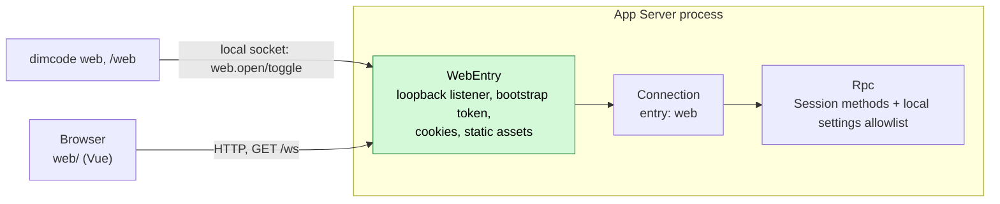

# Web workspace

Status: Accepted. Related: [RemoteGateway](plugins/RemoteGateway.md) (the target design), [overview §6.3 multiple nodes](overview.md#63-multiple-nodes), [App Server README](../../crates/dim-app-server/README.md).

The Web workspace is a browser frontend for the App Server, started by `dimcode web` or toggled from `/web` in the TUI. It replaces the TypeScript `dim web` host (Bun server, RCP v2) with the existing App Server protocol v3. Phase 1 ships a **local web entry**: a loopback-only subset of RemoteGateway that does not wait for its prerequisites (PluginManager #3, rutis call-scoped requests #5, extended `pluginFiles`, Settings business sources). When RemoteGateway lands it absorbs this entry; the browser side does not change because it speaks the same Session methods either way.

## 1. Structure



| Part | Where | Purpose |
| --- | --- | --- |
| `WebEntry` | `crates/dim-app-server/src/web_entry.rs`, process scope | Owns the loopback listener, the bootstrap and access tokens (memory only), static assets and the `web.*` management methods |
| `Connection` change | `connection.rs` | A connection accepted by WebEntry carries `entry: Web`; Rpc serves it Session methods (including the execution Session methods, decision E3 of RemoteGateway) and the explicit local settings allowlist (§4.3), never daemon or Web-entry controls |
| `dimcode web` | `crates/dim-cli` | Holder client: calls `web.open` over the local socket and keeps the connection; no HTTP stack in the CLI |
| TUI `/web` | `crates/dim-cli` | Calls `web.toggle`; the daemon owns the on/off state, so the TUI stays open |
| Frontend | `web/` at the repository root | Vue 3 + Vite app ported from the TypeScript `packages/cli-web`, with its transport rewritten for protocol v3 |

## 2. Local web entry

### 2.1 Lifecycle

The daemon is shared and normally spawned with `--no-ws`, so the entry is opened at runtime by a management method on the local socket rather than by a daemon flag.

The entry has two independent reasons to stay open:

- the daemon-owned `enabled` switch, toggled by the TUI;
- connected holders, such as a foreground `dimcode web`.

It is open while either reason exists and closes only when both are gone. The switch is memory-only and starts off after a daemon restart. `dimcode web` remains a holder: its exit releases that holder, while the TUI switch survives.

| Method | Params | Result |
| --- | --- | --- |
| `web.open` | `{port?}` | `{url, address}`; adds the calling connection as a holder and is idempotent. `url` is `http://127.0.0.1:<port>/#bootstrap=<token>` |
| `web.toggle` | `{port?}` | `{enabled, open, url?, address?}`; flips the daemon switch. Enabling starts the entry; disabling leaves it open if a holder remains. `url` is present while open |
| `web.disable` | `{}` | `{enabled, open, address?, connections}`; used by `dimcode web --off`; it clears the switch but does not disconnect holders |
| `web.status` | `{}` | `{enabled, open, address?, connections}` |

All are management methods (local transport only, protocol v3). Without `port` the entry binds the first free port from 43201 upward; an explicit `port` that is taken fails with `address_in_use`. A local connection that calls `web.open` holds the entry; the TUI switch does not need a holder. When the last reason disappears the listener stops, every token is dropped and web connections detach. Nothing is persisted, so after a daemon restart the entry is off; `dimcode web` opens it again or `/web` enables it. `web.open`/`web.toggle` fail with `web_assets_missing` when the binary was built without the frontend or the override directory has no build (§2.4).

### 2.2 Authentication

| Item | Rule |
| --- | --- |
| Bootstrap token | 32 random bytes, base64url, generated when the entry opens, valid until it closes; delivered only in the URL fragment, so it never reaches server logs or `Referer` |
| Exchange | `POST /api/auth/exchange {token}` → 204 and `Set-Cookie: dim_web=<access>; HttpOnly; SameSite=Strict; Path=/`. The bootstrap token can be exchanged more than once (several tabs) |
| Access token | 32 random bytes per exchange, held as SHA-256 hashes in memory, compared in constant time; dropped when the entry closes |
| Throttle | 5 failed exchanges free, then exponential backoff up to 60 s per entry → 429 with `Retry-After` |
| Origin and Host | Every `POST` and the `/ws` upgrade require `Origin` equal to `http://<Host>`, and `Host` must be the bound address (`127.0.0.1:<port>` or `localhost:<port>`), which blocks DNS rebinding |
| Bind | Loopback only in phase 1. No `Secure` cookie flag because the entry is plaintext loopback |

Tokens never appear in logs, diagnostics, the Timeline or protocol replies other than the `url` returned while opening or toggling the entry.

### 2.3 HTTP surface

| Path | Auth | Behavior |
| --- | --- | --- |
| `GET /api/health` | None | `{ok, serverVersion}` |
| `POST /api/auth/exchange` | Bootstrap token, Origin | §2.2 |
| `GET /api/auth/session` | Cookie | 204 while the cookie is valid, else 401; lets the page tell a revoked sign-in from an entry that is down |
| `POST /api/auth/logout` | Cookie, Origin | 204, clears the cookie and drops that access token |
| `GET /ws` | Cookie, Origin | WebSocket upgrade into an ordinary App Server connection (`entry: Web`), same framing and admission limits as the existing `/ws`; 401 without a valid cookie |
| other `/api/*` | — | 404 `{error:{code,message}}` |
| `GET /assets/*` | None | The frontend directory's files (confined to it; or, with `embedded-web`, the embedded build, gzip when the browser accepts it); `Cache-Control: max-age=31536000, immutable` |
| other `GET` | None | `index.html` (SPA fallback), `Cache-Control: no-store` |

Every response carries `Content-Security-Policy: default-src 'self'; style-src 'self' 'unsafe-inline'; img-src 'self' data: blob:; connect-src 'self'; frame-ancestors 'none'`, plus `X-Content-Type-Options: nosniff` and `Referrer-Policy: no-referrer`.

### 2.4 Assets

The frontend is a separate artifact, `dimcode-web`, not bytes in every `dimcode` executable. `scripts/stage-web.mjs` builds `web/` once per release (`npm ci`, `npm run build`, which runs `vue-tsc`), writes `web/dimcode-web.json` beside the build (`{version, protocolVersion, sourceCommit}`) and packs the same tree as a native archive `dimcode-web-VERSION.tar.gz` and an npm package `dimcode-web`, a platform-independent optional dependency of the `dimcode` wrapper. The entry serves files only from the directory it is given and canonicalizes request paths before opening them; gzip is not pre-applied to directory files.

The App Server takes the directory with `--web-assets DIR`. The CLI finds it, in this order, and passes it when it starts the daemon:

| Source | Set by |
| --- | --- |
| `DIMCODE_WEB_ASSETS` | the npm wrapper (the installed `dimcode-web` package's `web/`), or a developer's `vite build --watch` output (`./dev` passes the variable through) |
| `<executable directory>/../web` | a native archive unpacked beside `bin/` |
| `<product home>/web` | `dimcode web install`, or a user who unpacked the archive into the product home |

A directory counts when it holds `index.html`. One carrying `dimcode-web.json` with another `protocolVersion` is refused when the entry opens (`web_assets_incompatible`); without any directory, or without `index.html`, `web.open` fails with `web_assets_missing`. A daemon started without `--web-assets` but with `--product-home` looks at `<product home>/web` each time the entry opens, so a frontend installed there while it runs is used without a restart.

`dimcode web install` installs the frontend of the CLI's own version into `<product home>/web`, without a daemon: the Web workspace and the App Server protocol move together for now, so it never installs another version. A build the release flow did not produce has no published frontend to install and refuses before reading the registry; `DIMCODE_WEB_ASSETS` or the embedded-web build provide one built from the same source. It reads `dimcode-web@VERSION` from the npm registry (`https://registry.npmjs.org`, or `DIMCODE_NPM_REGISTRY` for a mirror), downloads `dist.tarball`, verifies it against `dist.integrity` (`sha512-…`), unpacks the package's `web/` beside the target and replaces the previous directory only once `index.html` is there. Running it again repairs or, after the CLI was upgraded, upgrades the frontend in the product home; in a build the release flow produced, when `DIMCODE_WEB_ASSETS` or `web/` beside `bin/` holds a frontend, that one comes first, and the command names it. It is the one place the CLI downloads the frontend; nothing installs it implicitly.

When the entry fails, the CLI says what to do instead of reporting an error. For `web_assets_missing` and `web_assets_incompatible` it is `dimcode web install` in a build the release flow produced, and `DIMCODE_WEB_ASSETS` or the embedded-web build in a build from source, which has nothing published to install; when the CLI itself finds a directory that the daemon lacks, the daemon was started with another source before the frontend was installed, and the CLI says to restart it with `dimcode daemon stop`. The incompatible-version hint names the build with the same label as `--version`. `dimcode web` exits 1 after the hint; TUI `/web` shows it as a notice.

For development against the repository checkout, and for a build that must carry the frontend (a single file to copy around), the Cargo feature `embedded-web` of `dim-app-server` (forwarded by `dimcode`) compiles the build in: `build.rs` then runs `npm ci` in `web/` when `package-lock.json` changed and `npm run build` when the frontend sources changed, gzip-compresses the output (fonts and images stay as built) and embeds it, and the entry answers with `Content-Encoding: gzip` or expands the file for a browser that does not accept it. With the feature, a build host without npm fails the build; without it, the build never touches `web/` or npm. A directory, when found, replaces the embedded build either way.

### 2.5 Protocol on the entry

| Item | Rule |
| --- | --- |
| Version | `hello` v3 with `clientKind: "web"`; v1/v2 → `protocol_version` |
| Methods | Rpc Session built-ins and execution Session methods on every Session of the host, plus the explicit settings methods in §4.3, the terminal methods in §4.4, the Git methods in §4.5 and the scheduled-task methods in §4.7. Other management methods, including `daemon.shutdown` and Web-entry controls, return `-32601 unknown_method` |
| Model list | The read-only management methods `provider.list`, `provider.catalog`, `provider.selection` and `account.providers` are also served (decision Q1); their replies carry no credentials (`provider.list` reports only `credentialConfigured` and header names). Managed Provider discovery follows §4.2. Switching uses the Session method `session.model.update` |

Compatibility: the bare `/ws` keeps today's rules (`hello` and `daemon.ping` only in protected profiles). Execution Session methods become reachable from the web entry; this is the same widening RemoteGateway records as E3, limited here to loopback connections authenticated by the local user's token.

### 2.6 Differences from RemoteGateway

| RemoteGateway | Phase 1 web entry |
| --- | --- |
| `entryHost` on Transport, call-scoped `authenticate`/`handle` | WebEntry owns its own listener and authenticates in process |
| Pairing codes, per-device tokens in `remote-devices.json`, rotation, revocation | One bootstrap token per open entry, access tokens in memory; closing the entry revokes everything |
| The user-only field `open` and the listener settings of the Settings source `remote` | `web.open`, held by the calling connection; no persisted state |
| Loopback by default, TLS or explicit plaintext for other addresses | Loopback only |
| `ConnectionEntry {name, deviceId}` | `entry: Web` on the connection |

## 3. CLI

`dimcode web [--port N] [--no-open]` connects to (or spawns) the daemon, calls `web.open`, prints where the workspace is in the welcome panel's box and opens the sign-in URL with `browser::open`. With `--no-open`, `DIMCODE_OAUTH_MANUAL=1` or no browser, it prints the full sign-in URL under the box instead; it is the local user's own terminal. It then stays in the foreground holding the entry until Ctrl+C or SIGTERM; its exit removes that holder and closes the entry only when the daemon switch is also off (§2.1). If the daemon stops first, it reports that and exits. Piped output is plain lines. `dimcode web --off` clears the daemon switch and exits; it does not disconnect a foreground holder.

`/web` in the TUI toggles the daemon switch and stays in the terminal. While the entry is open it opens the browser and reports that it is on; when no browser took the sign-in link, it prints that link instead. The Session keeps running. `/web` again turns the switch off, leaving the entry open if `dimcode web` is still holding it. This works in the daemon-owned leaf because the TUI is not the holder and does not hand the terminal to another process.

```
╭──────────────────────────────────────────────────────────────╮
│ ██████╗ ██╗███╗   ███╗                                       │
│ ██╔══██╗██║████╗ ████║  DIM Web is ready                     │
│ ██║  ██║██║██╔████╔██║  Opened in your browser               │
│ ██████╔╝██║██║╚██╔╝██║                                       │
│ ╚═════╝ ╚═╝╚═╝ ╚═╝ ╚═╝                                       │
│                                                              │
│ Web     http://127.0.0.1:43201/chat/<sessionId>              │
│ Resume  dimcode --resume <sessionId>                         │
│                                                              │
│ Press Ctrl+C to stop the Web workspace.                      │
╰──────────────────────────────────────────────────────────────╯
^C
Web workspace stopped.
```

The frontend directory is fixed when the daemon starts (§2.4); a daemon started without `--web-assets` reads `<product home>/web` on each open, so a frontend installed or replaced there is used without a restart, and an embedded build serves only while that directory has no `index.html`.

## 4. Frontend

`web/` is a Vue 3 + Vite + Pinia + vue-router project built with npm (Node from `.node-version`). It is ported from `packages/cli-web` in the TypeScript repository; components, styles and i18n move with minimal change, while the transport and data model are rewritten. `main.ts` creates the Pinia store before mounting the shell, so `stores/ui.ts` applies the color scheme before the first paint; creating it later flashes the wrong theme on load.

| Layer | Phase 1 |
| --- | --- |
| `rpc/client.ts` | JSON-RPC over `/ws`: `hello` v3 (`clientKind: "web"`), request timeout, heartbeat with `daemon.ping`, reconnect with backoff and re-attach. Strict readers at this boundary; the rest of the app uses typed data |
| `rpc/protocol.ts` | Hand-written types for the v3 methods and notifications the UI uses (`session.*`, `approval.*`, `session.event`, `session.state`, `session.model.progress`) |
| `projection.ts` | Folds `session.history` pages, `session.event` and `session.model.progress` into timeline rows (user, assistant text, thinking, tool call and result, approval), following `crates/dim-cli/src/projection.rs`; also tracks the waiting `ask_user` calls of each branch (`step/tool-call` until its batch's `step/tool-result`) and folds each branch's goal (`goal.ts`, a port of `crates/dim-cli/src/goal.rs`) |
| Sidebar | Workspaces combine Session summaries grouped by `cwd` with recently opened directories; new Session by `session.create {cwd}` with a typed path, native directory picker or known workspace. Session actions offer rename, archive, copy workspace path and confirmed deletion. Each Session row shows its state: waiting (a line holds an approval, a question or a plan review), running, unread (its main line's run ended while another page was shown; opening the Session clears it, and a reload forgets it) or idle; a collapsed workspace shows waiting before running. Waiting is known for the Sessions this page has opened, since only they are attached |
| Chat | Timeline (markdown, Shiki) with a message rail (one marker per user message from three messages on, as dim-agent's rail: hover shows the message and its first reply, a click scrolls it into view and marks it for a moment; `/timeline` is not offered, dim-agent has none), composer (submit, stop, model menu and permission preset picker, below; Escape stops a run unless a menu is open, as the CLI's Esc interrupts, and the processing row shows the run's elapsed time with that hint; ↑ on the first line of an empty draft, or of one still holding a recalled message, steps back through the main line's earlier messages and ↓ steps forward to an empty draft, a recalled message's file links becoming `@path` mentions again, and a draft the operator wrote is never replaced), approval prompt (`approval.request` → `approval.respond`; "Allow for this session" → `session.grants.add` and "Always allow" for a simple `exec` command → `permission.set_rules`, both before the allow; "Reject and say why" sends the operator's words with `session.submit` mode `steer`, then denies, so the model reads them at that tool result with the refusal), question prompt for `ask_user` (`step/tool-call` → `session.question.respond`, closed by `step/tool-result`); the approval and question prompts take the composer's place; queued messages of the main line above the composer (`input/message` until `input/applied` or `input/deleted`; Steer and Remove → `session.input.withdraw`, Steer resends the message's content with the withdrawal); composer attachments: pasted or dropped images are sent as image content blocks (`session.submit` with `user.content`), a paste longer than 16 KiB is stored with `attachment.put` when the Session serves it and its path is named in the message, as the TUI does (`crates/dim-cli/src/attachments.rs`); `@` file mentions: the composer offers the files of the Session's workspace from `session.files.search` (WorkspaceTools; the TUI picker's index and ranking), inserts a file as `@path` and sends it as a Markdown link to its absolute path (`[@path](/abs)`, as the TUI sends it); a directory steps into `@dir/`; a turn whose `write` or `edit` changed files ends with a row that opens its changes (`session.files.changes`: each file's status, and the commands whose changes are not undone) and undoes the restorable ones (`session.files.rewind`), shown where the Session serves both methods, and a rewind's record shows as a notice ([file rewind](file-rewind.md)) |
| Links | A Markdown link to a path in a reply is not a page. A file of the Session's workspace opens in the detail panel's Files tab (§4.6), at the lines the link names (`path:line`, `path:line:column`, `path:line-end`, `#L12` or `#L12-L20`). The macOS desktop app opens any other path, and any path clicked with ⌘ held, through its native `open_workspace_path` command: a file opens in its default application; with ⌘ held, and for a folder or package, an executable, a kind macOS would run or install, or a file no application opens, it is shown in Finder instead. A relative path resolves against the Session's directory, or against the folder of the file a preview shows, and a trailing `:line` or `:line:column` that is not part of the name is dropped. A browser copies a path the Files tab does not show. Links in the split pane skip the Files tab, which belongs to the routed Session |
| Session modes | The composer's mode menu and `/permissions` choose how `main` works: Ask (`ask`), Accept edits (`workspace-write`), Auto (`full-access`), Plan (plan mode over the current preset) and Read only (`read-only`), under [ADR 018](../adr/018-permission-is-the-preset.md), [ADR 022](../adr/022-the-ask-preset.md) and the [Permission policy contract](../architecture/rust-agent/plugins/Permission.md#policy-contract). The menu is offered where the connection serves `session.permission.get` and `session.permission.update` (the App Server serves them on the connection, not in a Session's method table), plus Plan where the Session lists `session.plan.set`. The client reads `session.permission.get` and `permission/changed`, displays the mode and tool lists, and preserves both lists in a versioned `session.permission.update`. Choosing a preset while planning first ends plan mode, which restores the preset it replaced, then sets the chosen one. Conflicts refresh without retrying. Choosing Auto requires confirmation. Shift+Tab in the composer steps through Ask, Accept edits and Plan, as the CLI cycles its permission modes; Auto and Read only are chosen in the menu, whose footer names the shortcut. A new Session starts with the preset last chosen on the new-Session page (Accept edits by default), set after `session.create` and before plan mode. Process isolation links to its Settings control. |
| Detail panel | The right panel shows the routed Session in one tab per view (`ui.detailView`): Changes, Files (§4.6, where the Session serves `session.files.read`), Plan, Background tasks, Terminal (§4.4), Git (§4.5, for a Session in a Git repository) and Lines. When the tabs do not fit with their names, all but the selected one show only their icons. The header's buttons open their tab and close the panel when it already shows it; `/diff` and `/tasks` open theirs. Plan shows the plan of the main line's latest `exit_plan_mode` call with the operator's decision (`structuredContent.approved`) and the main line's task list |
| Split view | A Session row's menu opens that Session beside the routed one while the shell is at least 1,100 px wide. The split pane shows its transcript and composer, swaps places with the routed Session or closes; the detail panel keeps following the routed Session. Only the pane last pressed or focused answers approvals from the keyboard. The split Session is remembered in browser storage |
| Changes | The Changes tab, whose header button shows once the main line changed a file, lists every file the main line's successful `write` and `edit` calls changed, sorted by path, with its line counts and each call's display diff in order — an edit's, or a write's when it replaced a file ([WorkspaceTools display diff](../architecture/rust-agent/plugins/WorkspaceTools.md#display-diff)), else the written content as added lines, the first 400 shown. Each line shows its number in its file (the old file for a removed line), read from the diff's hunk headers or, for a written file, its position. Picking a line opens a comment on it; comments stay per Session for the page load, mark their lines, and "Add to message" puts them into the main composer as one numbered message — each with its file, line and the line's text — without sending it. It folds the line's own rows and adds no RPC; changes made by commands are not seen, and undoing stays with each turn's changes row |
| Lines | Right detail panel with a Lines tree and one tab per opened line; each tab folds that line's own history and sends, stops, approves and ends on its `branchId` (§4.1) |
| i18n | `en` and `zh-CN` |

Features without a usable v3 backend are left out rather than stubbed: file-history rewind, workflows and git branch menu. The macOS desktop host supplies a native directory picker; a browser uses the absolute-path input. Settings and saved-session management follow §4.3.

### Workspace navigation and drafts

Opening a directory adds it to the sidebar before a Session exists. The last 20 opened directories are local navigation preferences, persisted in browser storage; saved Sessions still come exclusively from `session.summaries`. An empty directory can be removed from recent workspaces without deleting files. The new-Session route uses `?cwd=` to select a directory and restores its own draft. Once creation returns the canonical directory, that path replaces the typed alias in recent workspaces. A pending creation may finish after navigation, but only the still-active originating page can navigate to its new Session.

Composer drafts retain text, file mentions and unsent attachments in memory for the lifetime of the frontend application. New-Session drafts are scoped by working directory; existing drafts by Session and line. Switching pages or opening settings preserves these drafts; reloading or quitting clears them. Pending file reads and submission replies apply to the draft that started them. Successful submission clears only the submitted content; failure preserves it. Deleting a Session discards its drafts.

The attachment button and drag-and-drop accept UTF-8 text/code files and PNG, JPEG, WebP or GIF images, including on the first message of a new Session. Text files use `attachment.put`; the message names the original filename and returned path. The frontend rejects unsupported binary files, limits each file to 10 MiB, caps the combined image base64 payload at 10 MiB and permits at most 20 attachments. JSON payload limits leave space for RPC framing. It does not resize images. The project-file button searches `session.files.search` and inserts the same `@` references as the inline mention picker; it does not send a message or upload the project. It is available only after a Session provides file search.

### Session titles and actions

The sidebar, header, window title and archive list use the server title, falling back to the preview when absent. The rename dialog checks the Session's method table before calling `session.rename`; validation errors remain in the dialog. Replies and `SessionStore/title` notices carry revisions, so an older notice or directory snapshot cannot overwrite a newer title. Title ownership and persistence remain with [SessionTitle](plugins/SessionTitle.md).

Archive and delete actions are disabled while the Session is running. Deletion requires an explicit confirmation; cancellation does not call `session.delete`. Successful archive or deletion of the currently displayed Session navigates to a new draft in that workspace. Archive keeps the history and uses the existing restore page; deletion is permanent.

### 4.1 Lines and branch

A line is a Timeline of the same Session ([Timeline branches](timeline-branches.md) §1). The Web workspace keeps the main transcript in the center and follows lines in a right-side detail panel, modeled on the Kimi Code Web `/btw` panel (tabs, a scroll region with a composer, an empty state, and a full-screen panel on narrow shells). Unlike Kimi's read-only side chat, a Dim line continues to run tools and accepts operator input; the panel therefore includes `session.submit`, `session.stop`, approvals and `session.branch_end` for the line.

```
┌──────────────┬────────────────────────────────┬─────────────────────────────────┐
│ sessions     │ main Timeline                  │ [Lines] [parser ×] [docs ×] + × │
│              │ ⑂ parser race · b-7c            │ ⑂ parser race · b-7c            │
│              │ ◂ from b-7c (steer) …           │ from main · after message 3     │
│              │ [main composer]                │ … line transcript …             │
│              │                                │ ⑂ working · [message this line] │
└──────────────┴────────────────────────────────┴─────────────────────────────────┘
```

| Item | Contract |
| --- | --- |
| Input | v3 `branch/create`, `branch/create-failed`, `branch/end`, `branch/ended` facts; `session.state` for every branch; each branch's own `session.history` pages |
| Derived data | `web/src/lines.ts` owns the tree, line state and `after message N` count; `projection.ts` owns each line's transcript; `stores/chat.ts` owns one history cursor and live queue per branch |
| Actions | `session.branch_create {parentBranchId, at, prompt}`, `session.branch_end {branchId}`, `session.submit`/`session.stop` with the line's `branchId`; approvals use the request's `branchId` |
| Points | A user message's cut is its sequence minus one; a line's end is its newest `turn-end`. `session.branch_create` remains the validator; its refusal is shown in the dialog or line tab |
| Switching | Opening a line adds or activates a tab; closing a tab does not end the line; main stays the center transcript |
| Errors | `branch_missing`, `branch_ended`, `input_blocked`, an invalid cut and a disabled Branch tool are shown at the action that raised them; an ended line is read-only |
| State | Line tabs are per Session and live in `stores/ui.ts`; the tree is rebuilt from facts on reload and reconnect. No line list method or storage format is added |

**Not in this phase:** session fork, a drawn DAG, compare/adopt, per-line model selection and questions (`ask_user`). Each needs its own client design.

### Background commands

The detail panel's Background tasks tab, opened by its header button and `/tasks`, manages background commands. The existing
per-line history queue discovers every branch and folds `exec/started` and
`exec/ended` into the same Session projection. Identity is `(branchId, taskId)`;
the command label comes from its originating tool call, with the recorded
description as fallback. Running commands appear first, followed by completed
commands. A failed branch-history read leaves the list explicitly incomplete
and offers retry; reconnect and replay do not duplicate tasks.

Selecting a running command reads `session.exec.output` using its Session,
branch and task IDs. While the tab is shown and connected, it refreshes
one second after the preceding read settles, with at most one output request
outstanding. Selection changes and close/unmount invalidate replies and timers.
The preview follows the [background output contract](background-task-output.md):
plain text, the last 2,000 lines within 50 KiB. An empty preview, unavailable
capture, disconnected client and failed read are distinct states. A failed read
keeps the last preview and offers manual retry; it never invents a terminal
task state. Only `exec/ended` supplies the final status and result.

Stopping a command requires confirmation and calls the existing
`session.exec.stop` with the captured target. The action is disabled while
disconnected or pending. Leaving the tab only stops output polling. Member
agents and workflows keep their existing controls; this panel lists background
commands, separately from the model's to-do checklist.

```text
Detail panel: [Changes] [Files] [Plan] [Background tasks 2] [Terminal] [Lines]   ⤢ ×
  build / main          Running
  tests / test line     Running
  previous build        Stopped
  ─────────────────────────────
  Live output …         [Refresh] [Stop command]
```

### 4.2 Model discovery and slash commands

Model discovery uses `account.providers`. Its
descriptors identify managed Providers without account identity or
credentials. The client combines these descriptors with enabled entries from
`provider.list`, merging by Provider ID with the managed descriptor taking
precedence, then reads each Provider through `provider.catalog`. The catalog
owner determines account availability; a missing catalog contributes no models.
Account status, login and settings methods are admitted separately under §4.3.
Static Providers are not excluded merely because
`credentialConfigured` is false: anonymous Providers require no credential, and
the catalog already marks unavailable models. Disabled and unavailable models
remain unselectable. Discovery and catalog reads settle independently: a failed
read must offer retry without discarding successfully loaded Providers or being
presented as a successful empty list.

Each editable composer opens a command menu for a leading `/` followed by an optional
command-name prefix, not for a slash inside ordinary prose. Search filters the
available commands; categories and canonical English command names follow the
repository menu ordering convention. Arrow keys move selection, Enter executes,
and Escape dismisses without sending or deleting the draft. Mouse selection has
the same behavior. Command handling does not run during IME composition. Known
commands are handled locally rather than submitted as model input.

| Category | Command | Action and availability |
| --- | --- | --- |
| `model` | `/models` | Open the existing model picker when model selection is available |
| `session` | `/branch <prompt>` | Create a line from the shown line's newest finished turn and use the inline prompt as its opening input |
| `session` | `/compact` | Compact the main line's context (`session.context.compact`); listed when the Session's method table (`session.methods`) lists it. Reports the result as a notice |
| `session` | `/usage` | Show the main line's context window usage (`session.context.usage`); listed under the same condition as `/compact` |
| `session` | `/fork` | Fork the Session at its last finished turn (`session.fork {at}`) after a confirmation, then open the new Session; listed when the connection serves `session.fork` and main has a finished turn |
| `session` | `/goal [words]` | Show the main line's goal, folded from its own events (as the TUI folds it), or write it: `/goal OBJECTIVE`, `set`, `edit`, `pause`, `resume` and `clear` call `session.goal.<call>` with `branchId: main`; listed when the Session's method table lists `session.goal.set`. The menu fills `/goal ` for its words |
| `session` | `/review [focus]` | Ask the main line to review the workspace's uncommitted changes, untracked files included, and report problems by severity with file and line before changing anything, as Codex's `/review` does; the words after it name a focus. Sent as an ordinary message (`session.submit`) in the composer's language; listed when the Session is ready |
| `session` | `/diff` | Open the Changes view of the detail panel (below) |
| `session` | `/status` | Show the main line's model and reasoning effort, mode, context usage (the composer's last `session.context.usage` reading), working directory, Session ID and server version in one notice |
| `session` | `/copy` | Copy the main line's last reply as Markdown; the clipboard write happens within the key press or click that runs it, as WebKit requires |
| `model` | `/effort [value]` | List the main line model's reasoning effort choices (from `provider.catalog`, when the model advertises reasoning preferences), or set one with `session.model.update {modelPreferences: {reasoningEffort}}`, as `/effort` does in the TUI (`configure.rs`). Listed only when the model has choices. `/fast` is not offered: no model advertises service tiers yet |
| `model` | `/permissions` | Open the composer's mode menu (above). Listed where the connection serves `session.permission.get` and `session.permission.update` |
| `session` | `/lines` | Open the existing Session lines panel |
| `session` | `/new` | Navigate to the existing new-Session page, seeded with the current Session's working directory |

`/compact`, `/usage`, `/fork`, `/goal`, `/effort`, `/review`, `/diff`, `/status` and `/copy` belong to the main Session composer; a line composer does not list them, because the Session-wide cut and compaction are decided on main. Rename is offered through the sidebar's Session action menu using `session.rename`.

The model menu lists the current provider's first nine models, numbered for the keyboard, then two submenus: the
reasoning effort, when the catalog declares choices for the current model, and the other providers' models with a
search across all of them. The trigger shows the chosen effort beside the model. The effort labels are localized,
but its values are the provider's exact strings. A new Session passes an explicit choice through
`session.create.modelPreferences`; its initial model uses the workspace selection, then the global selection when
the workspace has none. Switching the draft's model clears that override. In an existing Session the selector
uses `session.model.update`, and Default sends `{reasoningEffort:{action:"clear"}}`. The displayed current value comes
from the main line's `context/configured.data.model_preferences`, including history replay and changes from another
client. A missing preference displays Default; a model with no declared choices has no selector. Configuration failures
keep the authoritative value and appear at the composer. Sending waits for a pending model or effort change.

The model picker links directly to provider settings and can save the current model as the global default. This reads `provider.selection` and uses its version in `provider.select`; a concurrent update is reported instead of overwritten. The action changes the global fallback for future Sessions, preserving workspace-specific defaults and the models of existing Sessions.

```text
[ Model ▾ ] [ Reasoning: High ▾ ] [ Send ]
```

Commands whose action is unavailable are omitted. Native-only commands are not
advertised. Shared actions follow the TUI's canonical names and argument flow,
not terminal-specific shortcuts. `/keys` and a separate `/help` are unnecessary;
the menu footer displays its keyboard controls.

Choosing `/branch` fills `/branch ` and focuses the composer without opening a
dialog. Submitting a nonempty prompt creates the line and opens it in the side
panel. In a line-panel composer its parent is that line, not `main`. With no
finished turn or after a creation error, show the reason and preserve the draft;
never submit a recognized branch command as model input unless explicitly escaped.
Only successful creation clears the submitted draft. The existing transcript
actions and new-child buttons retain their point-based dialogs. `/btw` is not an
alternate command name.
Unknown slash-prefixed text remains ordinary input. Escape marks the current
slash-prefixed draft as literal and preserves its text, including after the
menu closes while typing `/branch <prompt>`; Enter then sends it as a message.

```text
┌──────────────────────────────────────────────────┐
│ model     /models             Choose a model      │
│ session   /branch <prompt>    Open a line here    │
│           /lines             Show Session lines  │
│           /new               New Session         │
│ ↑↓ select · Enter confirm · Esc close            │
├──────────────────────────────────────────────────┤
│ /branch review the patch                         │
│                                 [model] [send]   │
└──────────────────────────────────────────────────┘
```

This reuses existing catalog reads, the model picker, routing, branch and fork methods and the Session context methods (`session.context.compact`, `session.context.usage`); it adds no new RPC, catalog cache or general management access.

### 4.3 Settings and account management on the local Web entry

This section defines the explicitly allowed settings methods for the
bootstrap-authenticated, loopback Web entry only; it does not change the
paired-device boundary of [RemoteGateway](plugins/RemoteGateway.md).

The reference is the TypeScript repository's `packages/cli-web`, especially its
`features/settings` components and `docs/packages/cli-web/settings-layout.md`.
Reuse its layout, labels and interaction patterns with the current Web tokens;
replace its `web.*` management bridge with the existing protocol v3 owners, not
a second settings store or a compatibility implementation of the old protocol.

#### Navigation and layout

Settings occupies the full shell instead of retaining the chat sidebar. On wide
screens, a 256 px category navigation sits beside independently scrolling page
content. On compact screens, `/settings` lists categories and each page has one
sticky parent/back bar. Back returns to chat without losing the selected Session.
Provider creation and detail use route-addressable dialogs over the provider list,
matching the reference implementation. Unsaved changes require confirmation when
leaving. English and Chinese labels follow the existing locale choice.

Forms use the shared page-content width and control size ladder. Action buttons
fit their labels with horizontal padding rather than stretching with a grid;
action groups wrap on narrow screens. Checkbox labels stay beside their controls.
Save actions follow all fields they submit, including model preferences. Provider
list and add-dialog searches are independent; the custom-provider form can return
to the picker, confirming before discarding a changed draft. Dialog close buttons
remain square at the top right.

Loading and failure states, including retry actions, remain inside the active
dialog rather than behind it. Error banners wrap long server messages without
widening the page. Account refresh retains the last successful usage and referral
display while loading or on failure; changing identity or signing out clears it.

During a connection loss, host-backed forms are disabled while navigation and
browser-owned appearance settings remain available. Provider dialogs show the
reconnection status inside the dialog and keep their close control available.
Reconnection reloads the current page unless it would replace an unsaved draft or
active MCP editor/authorization. Interrupted writes retain their error and draft;
they are not replayed automatically. Login status polling resumes with the same
authorization attempt rather than starting another login.

```text
┌──────────────────────┬────────────────────────────────────────────┐
│ ← Back               │ Providers                    [+ Add]       │
│ Account              │ ┌────────────────────────────────────────┐ │
│ Appearance           │ │ Dim account        OAuth     Connected │ │
│ Agent defaults       │ │ Custom provider    API key   3 models  │ │
│ Providers          ● │ └────────────────────────────────────────┘ │
│ Modality             │                                            │
│ MCP                  │ Provider detail opens in a dialog:         │
│ Plugins              │ connection / login / models / preferences  │
│ Skills               │                                            │
│ Permissions          │                                            │
│ Archived sessions    │                                            │
│ Diagnostics          │                                            │
└──────────────────────┴────────────────────────────────────────────┘
```

Keep the reference category order and align the functional scope with the legacy
CLI Web. Missing host capabilities require owner implementations, not permanent
placeholder pages. Actual runtime unavailability is shown as an actionable error,
never as a successful empty list or save.
Session-specific model, effort and approval decisions stay in chat. Browser theme
and text size remain browser-owned; persistent host defaults use their existing
Settings owner. Do not expose a generic configuration-file or JSON editor.

#### Account, Provider and model priorities

| Surface | Existing owner and required behavior |
| --- | --- |
| Dim account | `account.providers`, `account.status` and `account.usage`: signed-out, signing-in, signed-in and failure states; identity, available plan, credit, rolling-window and feature usage; refresh and confirmed sign-out |
| Dim login | Existing `account.login.*` browser and device attempts, including enterprise email; explicit open/copy, pending status, expiry, cancellation and manual browser callback completion |
| Provider management | `provider.management` is the edit snapshot, including drivers, actions and record version; list configured providers, offer known providers and custom creation, edit connection fields, enable/disable, refresh and confirmed deletion |
| Models | Existing `provider.models.*` and `provider.preferences.update`: search, enable/disable, create, edit, reset and delete where declared; expose supported limits, endpoint, reasoning and service-tier preferences without inventing defaults |
| Other OAuth providers | Follow the returned account namespace and declared login methods; reuse the existing Codex/Grok account owners rather than treating their credentials as static API keys |
| Chat integration | After a successful account, Provider or model mutation, reload authoritative discovery and reconcile the picker; preserve existing Session model-selection semantics |

Provider writes use the snapshot's expected version and the owner's field-operation
contract ([Provider management](appserver/provider-management.md)); a conflict
preserves the form and offers reload. Partial list failures retain healthy entries.
Render unavailable actions and reasons from owner data rather than guessing from
Provider names. A missing account build is an explicit unavailable state, not an
empty account or a request for users to enter private OAuth client IDs.

Account parity includes referral links and reward information, usage-reset credit
batches and confirmed application of those credits, and issuer-owned subscription
and pricing links. The account owner must supply typed projections and operations
for these features; the browser never calls the issuer directly. An unavailable
optional account feature must not prevent identity or usage from loading.

| Other settings category | Required legacy functionality |
| --- | --- |
| Appearance | Language, system/light/dark theme and text size, applied immediately |
| Agent defaults | Persisted model and supported execution defaults; no accidental mutation of an active Session |
| Modality | Operation defaults for image generation, editing, enhancement and understanding from `modality.capabilities`, written with `modality.configure` and its snapshot revision; understanding's Session consumer is a requirement on Agent/Prompt |
| MCP | List, add/edit transports, enable/disable, test, authentication/sign-out, confirmed removal and user↔project scope migration; secret fields stay omitted from edits and a move never writes them into `.mcp.json` |
| Plugins | List, enable/disable, installation/update/removal and the owner's typed settings surfaces |
| Skills | List, enable/disable, source installation, update and confirmed removal |
| Web search | The `web` source's search service, its endpoint and the proxy through `settings.view` and `settings.edit`: the API key and the proxy are write-only, shown only as set, kept when left empty and removed only when asked |
| Permissions | Default execution/network settings and user-scope command-rule management (exact/prefix allow/deny; project scope, patterns and per-rule ask are rejected, [§10.1](appserver/permission-command-rules.md#101-legacy-rule-kinds)), with confirmation for privilege increases. The Execution card reads `host.execution.backend` and shows the owner's sandbox-backend reason when the host has none; the browser never infers the platform |
| Archived sessions | `session.archive` commits the classification before the sidebar refreshes; `session.catalog {archived:true}` searches archived rows, restore clears the classification, and permanent deletion keeps its confirmation. Older servers without archive support display saved history. |
| Diagnostics | Safe version, protocol, connection and metadata with refresh, the model-request recording switch, and the start-up rule for process logs instead of a log-mode control ([logging controls](#diagnostics-the-legacy-logging-controls)) |

Use the current owner's semantics when old terminology no longer describes the
system, and document the mapping. Reuse existing Settings, MCP, PluginManager,
Skills and Session owners rather than adding parallel browser-only state.

#### Permissions: legacy rule kinds

The legacy CLI Web's Permissions page also offered project/workspace scope,
wildcard or regular expression matching and an `ask` decision. The
[command-rule design](appserver/permission-command-rules.md#101-legacy-rule-kinds)
rejects all three; this page shows the owner's one list and no placeholder for
them.

| Legacy surface | Current contract | On this page |
| --- | --- | --- |
| Project or workspace scope | One user-scope `permission` source; a project file is not read | No scope selector; the page says the rules are user-level and apply to every Session |
| Wildcard, glob or regular expression | Word-wise `exact`/`prefix`; `*` is a literal word; deny wins regardless of specificity | No pattern field, preview or parser; the form says matching is by words |
| `ask` decision, including `defaultAction` | `allow` or `deny`; an unmatched command follows the Session preset, and asking is the preset's decision alone ([ADR 018](../adr/018-permission-is-the-preset.md)) | No Ask choice in the rule row; the preset is the only tool-approval control |

**Known losses and replacements.** Per-workspace lists and pattern shortcuts are
gone with replacements: one user list and exact or prefix rules. Asking for one
command under a preset that otherwise runs is also gone, and after
[ADR 018](../adr/018-permission-is-the-preset.md) it has no replacement: asking is
the preset's decision alone. Nothing is browser-only: the page reads and writes
`permission.rules`/`permission.set_rules` at the Settings revision, reports a
conflict without retrying, and keeps no rule it has not saved.

#### MCP scope migration

The MCP detail offers “Move to project” and “Move to user” with a confirmation
that names the source and destination. The action sends `mcp.move` with the id,
both scopes, `cwd` for the project side and both source revisions from
`mcp.catalog`; it is not offered for a plugin entry or when `mcp.move` is not
advertised. Into project, the confirmation says that withheld values stay in the
user's local Dim configuration, the workspace file receives only the public
configuration, and the entry starts disabled. Into user, it says the entry keeps
its current enabled state. If a higher-precedence source holds the same id, the
confirmation states that the moved entry will be shadowed until that entry is
removed.

After a move the page reloads the catalog and opens the destination entry. When
`mcp.configuration` reports `secretsInUserScope`, the withheld editors (`args`,
environment, headers, bearer, URL and the metadata URL) are disabled with the
reason that they are edited in user scope; `mcp.save` is not offered, and
non-secret fields save through `mcp.update`. The page offers “Move to user to
edit” as the one-step action for a withheld field: it calls `mcp.move` from
project to user with the current revisions, then the entry is fully editable; the
same action is offered when `mcp_credentials_are_user_scoped` answers. On
`mcp_move_conflict` or `mcp_settings_conflict` the page keeps the form and
rereads. On `mcp_move_partial` it follows the direction's recovery: into project
remove the destination and retry, into user remove the project source; it never
removes the source while the destination may be incomplete, and it never resends
the move blindly because the destination id would answer `mcp_move_conflict`.

```text
┌ MCP · github ────────────────────────────────────────────┐
│ Source: user                                             │
│ [Move to project…]  [Remove]                             │
│ Withheld values stay in your local Dim configuration;    │
│ the workspace file gets only the public configuration.   │
│ The entry starts disabled.                               │
└──────────────────────────────────────────────────────────┘
```

Only `mcp.move` is added to the MCP page's admitted methods; no secret value is
read from the owner or stored in the browser.

#### Diagnostics: the legacy logging controls

The legacy CLI Web's Diagnostics page carried a daemon log mode
(`web.debug_logging`, `off`/`on`/`auto`), a trace archive location and the
diagnostics metadata cards. This repository has no equivalent for the mode, the
trace location or trace-archive creation and keeps the metadata cards, so this
section fixes what replaces each legacy surface. The metadata cards stay a
read-only projection: server version, protocol version, instance, connection
phase, `daemon.ping` Session and connection counts, round-trip latency and the
advertised methods. No read returns a credential, token, header, request body or
host file path.

| Legacy surface | Current contract | On this page |
| --- | --- | --- |
| Diagnostics metadata | `hello` and `daemon.ping` fields listed above | Kept |
| `off` | No `RUST_LOG`: the daemon keeps errors only ([ADR 005](../adr/005-observability.md) D1) | The default; nothing to set |
| `on` | A `RUST_LOG` directive string read when the daemon starts; not run-time state (D1) | The start-up rule and its steps; no control |
| `auto` | None: no daemon-side rule raises its own logging | Deliberately absent, below |
| Trace archive location | Removed with the diagnostics channel ([ADR 005](../adr/005-observability.md) D2, D5) | `dimcode export` and `daemon.log` named as the read paths |
| Component and subscription records | Not restored (D2, D4); a failed assembly is `session_build_failed`, and `xtask graph` shows the assembled services | Not shown |
| Effective log filter | The daemon does not report it | Not shown |

**User-visible change.** Compared with the legacy page, the Diagnostics page
keeps the metadata cards and the recording switch, has no log-mode control and
no trace location, and its process-log card states the rule and the two
commands. Nothing outside this page changes.

**No process-log mode control.** Process logging is the host's output layer
(ADR 005 D1): the App Server installs one `tracing` subscriber from `RUST_LOG`
when it starts, and D4 keeps one subscriber for the process rather than one per
Session. A mode control would add a process owner that reconfigures that
subscriber, a stored document, a management namespace, an admission row in the
settings allowlist, and a precedence rule against `RUST_LOG`, to produce output
that stays process-wide and describes work after it happened. The Web entry also
cannot stop or restart the daemon
([admission](#admission-and-sensitive-data)), so a stored mode could not take
effect from this page.

| Alternative | Why it is not chosen |
| --- | --- |
| Run-time mode: management method, reloadable filter, stored setting | A new observation control outside ADR 005 D1/D4; needs its own authority, admission, failure and persistence rules, and still cannot attribute process-wide output to the Session being diagnosed |
| Stored preference applied at the next start | Under native storage the document lives in the store, so the mode would have to be read before a subscriber exists, and store startup could not be logged at the mode's level; `RUST_LOG` would also need a precedence rule, and the effect still waits for a restart |
| `--log LEVEL` forwarded to the spawned daemon | Duplicates `RUST_LOG`, which the spawned daemon already inherits from the CLI's environment, and needs its own grammar and precedence |
| Restore the trace archive or show a trace location | ADR 005 removed the channel and the archive; a direction change is a new ADR, and the Timeline export already reads complete runs |

**What a user loses.** No process-log switch in any client, no `auto` rule (the
legacy rule is not in this repository, so it is dropped rather than
reconstructed), and no archive to point at. Raising process logging takes
`dimcode daemon stop` and a new start from a terminal with the filter set
(`RUST_LOG=debug dimcode`); `daemon.log` appends across starts, so a diagnosis
keeps the earlier evidence in one file. The complete record of what a run
committed is `dimcode export SESSION_ID`
([Timeline export](appserver/timeline-export.md)), and the model-request
recording switch on the same page is the record of model wire exchanges
([ADR 016](../adr/016-model-request-log.md)); that switch stays user scope,
so project content cannot enable it. The page keeps the three as separate cards:
the recording switch is not a process-log mode, and no card presents one as the
other.

**Compatibility.** Existing configuration needs no migration: this server serves
no `web` namespace, so any caller of `web.debug_logging.set` gets
`unknown_method` and changes nothing, and a legacy CLI `config.json` key
without a target field is reported as unsupported by the migration with its
source kept ([Migration](../../crates/dim-migration/src/settings.rs)).
`RUST_LOG` and `daemon.log` keep their behavior, and this decision stores
nothing: no format, revision or protocol change and no new error. The page adds
no read or write beyond the ones above, so its only write remains the recording
switch's `settings.update` with the read revision and its existing conflict
error.

**Verification.** No automated test: the decision changes no method, stored
document or emitted behavior. The page verifies by rendering with a disposable
home that the metadata, the recording switch and the start-up note appear and
that no mode control or trace location is offered. A later proposal that does
add a run-time control must first name its owner, levels, persistence,
authority and failure behavior, and then add disposable-home flows for the
emitted log lines, the off/on boundary, restart persistence, rejection of
project-origin input and safe reads, plus rendered Web verification. This adds
no part, event, service, configuration or stored document; §7 applies unchanged
and no requirement is raised to a mechanism owner.

#### Modality defaults

The current page writes Provider model capability declarations through
`provider.models.edit`; that is not a runtime default. The page is replaced by
the owner contract; Provider records, model descriptors, Agent defaults, chat
model selection and Session behavior are unchanged.

The page renders one row per operation the owner reports for the `image`
category — `generate`, `edit`, `enhance` and `understand`. It offers the owner's
`options`, an Automatic choice when no default is pinned, and shows `effective`
so automatic resolution is visible. Options carry ids only; the page joins
display names from its existing Provider list or catalog reads by
`{providerId, modelId}` and shows an id when no name is available. An unavailable
default stays selected with its reason; the page never replaces it with another
model. Save sends one `modality.configure` per changed key, using the revision
from the previous reply; a conflict stops the loop and keeps the draft, and keys
already accepted stay saved. A `modality_conflict` keeps the typed draft,
disables Save until reload and offers the owner's new snapshot; a stale page
reloads after any Provider or model mutation made in the Web session. A missing
owner method or an unavailable category is an actionable error, not an empty
success. In the product build no adapter exists, so `generate`, `edit` and
`enhance` show the owner's `adapter` reason and their defaults cannot be set;
`understand` resolves and displays its default. The page does not edit Provider
model capability declarations; those are Provider metadata, not a routing
default.

That page is currently the only Web editor of Provider's `modalityCapabilities`,
and it declares `image.generate` only. The replacement needs no new declaration
surface: an image operation's options are the models an available adapter
serves, an adapter's `operations` decides that, and understanding needs
Provider's `vision` capability, which the Provider model editor already edits.
After the replacement no Web surface declares `image.generate` or `image.edit`;
Provider's catalog, probe results and `provider.catalog` output are unchanged.

Image understanding is a Modality row, but its default has no runtime consumer
yet: the Session image-understanding path must read it through the Agent/Prompt
requirement in [Modality §9.4](plugins/Modality.md#94-session-image-understanding-consumer).
Until that lands the page resolves and displays the default and labels it as not
yet applied; it must not claim that the Session's image understanding already
uses it. Agent defaults remains the Session model selector, not the
understanding default.

```text
┌ Modality ────────────────────────────────────────────────┐
│ Image generation   [Automatic — currently P / M      ▾]  │
│ Image editing      [P / M                             ▾] │
│ Image enhancement  [P / M — no adapter in this build  ▾] │
│ Image understanding[P / M — not yet applied           ▾] │
│ reasons: no adapter in this build                        │
└──────────────────────────────────────────────────────────┘
```

#### Admission and sensitive data

Replace the read-only exception with an explicit, reviewed method allowlist for
the settings surfaces above and each supported additional category. Do not expose
whole management namespaces. Daemon shutdown, Web-entry management, UI-host
control and arbitrary file access remain unavailable. Unauthenticated and bare
WebSocket clients gain no management access. Advertised methods must use the same
filter as dispatch so the UI cannot mistake a blocked method for an available one.
Only `modality.capabilities` and `modality.configure` are admitted from the
`modality` namespace; task and realtime methods remain unavailable.

Audit every added read for secret-bearing fields before enabling it. Return only
owner-provided safe projections; any missing safe projection is a requirement for
that owner. API keys and secret headers are write-only password inputs, never
prefilled from storage. Tokens, PKCE verifiers and OAuth state stay on the host;
callback input and submitted keys stay in transient form memory and are cleared
after completion or cancellation. Never store them in browser persistence, route
URLs, logs, diagnostics or toast messages. Reconnect never resubmits a mutation.

Browser OAuth must also work when the browser is on a different machine from the
CLI: opening authorization happens in that browser, and manual completion reaches
the existing host attempt that validates the callback. Do not depend exclusively
on a callback listener on the CLI machine. Leaving a login flow explicitly cancels
its pending attempt; a terminal attempt cannot reopen after a late status reply.

#### Verification and ablation

Exercise authenticated Web dispatch and its negative controls through the real
App Server with a disposable home. Verify browser and device login against local
account fixtures, cancellation/expiry, safe account replies, Provider lifecycle,
version conflicts, model edits and chat-picker refresh. Render wide and compact
settings, Provider dialogs and login/error states, and inspect screenshots. Check
that reads and browser persistence contain no supplied fixture credentials.

Keep business validation, persistence and credential handling in their existing
owners. No new plugin, catalog, event format or generic form framework is needed;
shared login presentation serves account and Provider pages. Additional helpers
must justify a responsibility beyond translating an already typed owner reply.

### 4.4 Terminals

The detail panel's Terminal tab runs the operator's interactive shells in the Session's workspace, one tab each, as an editor's integrated terminal does. The App Server process owns them (the `Terminals` process row), so a terminal outlives page reloads, a closed panel and the Session's idle unload; unloading the plugin ends every one. They belong to the operator: no approval, Permission preset or sandbox applies, and the model never reads them.

| Method | Params → reply |
| --- | --- |
| `terminal.open` | `{owner, cwd, cols, rows}` → `{terminalId, cwd, title}`: the service environment's `$SHELL` (else zsh, bash or sh) as a login shell under a PTY in `cwd`, an existing absolute directory. Its environment is the service's with `TERM=xterm-256color`, `COLORTERM=truecolor` and, when no locale is set, `LANG=en_US.UTF-8`. `owner` groups terminals; the Web workspace passes the Session id |
| `terminal.list` | `{owner}` → `{terminals: [{terminalId, cwd, title, exited}]}` in opening order |
| `terminal.read` | `{terminalId, cursor, waitMs?}` → `{data, cursor, reset, exited, exitCode?}`: the output after byte `cursor`, waiting up to `waitMs` (25 s at most) for some. A terminal keeps its last 256 KiB; `reset` says output before the reply was dropped. `data` never ends inside a UTF-8 sequence. `exited` once the shell exited and its output ended |
| `terminal.write` | `{terminalId, data}` → `{}`: keystrokes and pastes |
| `terminal.resize` | `{terminalId, cols, rows}` → `{}`: 2–1,000 columns and 1–1,000 rows |
| `terminal.close` | `{terminalId}` → `{}`: ends the shell's process group |

Errors: `terminal_unknown` for an id that is not open, `terminal_limit` beyond 32 open terminals, `terminal_failed` when the PTY cannot start or take input, `invalid_params` for a bad `cwd` or size.

The frontend draws each terminal with xterm.js, loaded only once the tab is shown. A tab replays from cursor 0, then long-polls `terminal.read` and sends `terminal.write` in order; it refits to its size and follows the light and dark theme. Showing the tab for a Session without terminals opens one; closing the last tab leaves it empty. Ctrl+` shows or hides the tab.

```text
[Changes] [Plan] [Background tasks] [Terminal] [Lines]   ⤢ ×
[zsh 1 ×] [zsh 2 ×]                                       +
~/project % npm test
…
```

### 4.5 Git

The Web workspace shows where a Session's directory stands in Git and can start a Session in a worktree of its own, as Claude Code's desktop app does. The App Server process answers through the `git.*` management methods (the `GitWorkspace` process row), which run `git` and the GitHub CLI `gh` with the service's environment.

| Method | Params → reply |
| --- | --- |
| `git.inspect` | `{paths}` (at most 200) → `{places: [{path, root?, main?, branch?}]}`: for each directory the worktree containing it (`root`), the repository's main worktree (`main`) and the checked-out branch; `root` is absent outside a repository and `branch` on a detached HEAD |
| `git.status` | `{cwd}` → `{root, main, branch?, upstream?, ahead, behind, changed, managed}`: the branch against its upstream, the entries `git status` lists (untracked included) and whether the Web workspace created this worktree |
| `git.pr` | `{cwd}` → `{available: true, pullRequest}` with the current branch's pull request (`{number, title, state, draft, url, base, head, review?, checks: [{name, state, url?}]}`) or `null`; `{available: false, reason, message}` when `gh` is missing (`gh_missing`), signed out (`gh_auth`), the repository has no GitHub remote (`no_github_remote`) or `gh` failed (`failed`). A check's `state` is `success`, `failure`, `pending`, `skipped` or `neutral` |
| `git.worktree.create` | `{cwd, branch}` → `{path, branch}`: a linked worktree on a new branch from the HEAD of `cwd`'s worktree, at `<product home>/worktrees/<repository>-<hash>/<branch>`. A process without a product home fails `worktrees_unavailable` |
| `git.worktree.remove` | `{path}` → `{}`: removes a worktree created there; any other path fails `worktree_unmanaged`. Git refuses a worktree with uncommitted or untracked files; the branch stays |

Other errors: `git_not_repository`, `git_missing` and `git_failed` with Git's message; `invalid_params` for a bad branch name. A command that runs longer than 10 s (`gh`: 20 s) fails.

| Surface | Behavior |
| --- | --- |
| New Session | In a repository, "New worktree" starts the Session in a worktree on a new branch, `lacus/<date>-<random>` unless the operator types one |
| Sidebar | A Session whose directory is the root of a linked worktree is listed under the main worktree's workspace with its branch; the page inspects each Session directory once per load |
| Header | The workspace (the main repository for a worktree) and the branch; the branch opens the Git tab |
| Git tab | Branch, upstream and its ahead/behind counts, uncommitted entries, and for a worktree its location and main repository. The pull request with its state, review decision and checks, read on opening, every 60 s while shown and after each run. Without one, "Create pull request" sends the main line a prompt to push the branch and open it, so the agent's approvals apply. For a worktree the Web workspace created, "Remove worktree and archive session" removes it after confirmation, archives the Session and opens a new one in the main repository |

### 4.6 Files

The Files tab shows a file of the Session's workspace beside the conversation, as Claude Code's desktop app does. The Session method `session.files.read` of WorkspaceTools reads it ([WorkspaceTools, File view](../architecture/rust-agent/plugins/WorkspaceTools.md#file-view)); a path outside the workspace or a directory is left to the link's other handling (Links in §4).

```text
Files: [notes.md] [main.rs] [lib.ts*]                         [Go to file]
  src/lib.ts                        [Wrap] [Reload] [Open] [Finder] [Copy]
   5
   6  export function titles(items: Item[]): string[] {   ← lines a link named
   7    return items.map((item) => item.title)
```

| Surface | Behavior |
| --- | --- |
| Tabs | One per open file, per Session, for this page load. A link opens its file in the preview tab (italic), which the next link reuses; a double-click, or opening the file from Go to file, keeps it. A tab closes with its button or a middle click. Tabs with the same file name also show their folder |
| Go to file | Searches the workspace with `session.files.search` and keeps the chosen file open |
| Text | Numbered lines highlighted by the bundled Shiki grammars (a file over 256 KiB, or in another language, is plain), with the lines a link named marked and scrolled to the middle. Word wrap is on by default and remembered in this browser. A file over 2 MiB shows its beginning and says so; one that is not UTF-8 says some characters may be wrong |
| Preview | Markdown renders like a reply, its relative links resolving against its folder; SVG renders as an image. A preview is the default unless a link named lines; the toolbar switches to the source |
| Other files | An image shows; another binary file says it cannot be shown here |
| Freshness | The shown file is read again when its tab is shown and after each run; the view changes only when its size or modification time does |
| Toolbar | The path under the workspace, Reload, Copy path, and in the macOS desktop app "Open with default app" and "Show in Finder" through `open_workspace_path` |

### 4.7 Scheduled tasks

A scheduled task sends a prompt to a Session on a schedule, as Claude Code's desktop app does with its routines. The Scheduler process row owns the jobs and their runs ([Scheduler](plugins/Scheduler.md)); the Web entry admits its six management methods `schedule.list`, `schedule.save`, `schedule.delete`, `schedule.set_enabled`, `schedule.history` and `schedule.run_now` (A.3), with their replies and errors unchanged. A save from the page is a management save: the job's authority becomes the host's configured maximum, and a job without a policy runs read-only (§3.3).

```text
Sidebar: [New session] [Open workspace] [Scheduled tasks]
Scheduled tasks                                        [New task]
  Daily summary        Every day at 09:00 · dim · Next tomorrow 09:00   [on] [Run now] [⋯]
                       Completed today 09:00
```

| Surface | Behavior |
| --- | --- |
| Sidebar | "Scheduled tasks" opens the page where the entry admits `schedule.list` |
| List | Each job with its schedule in words, its workspace, its next window (or that it is paused, or why its schedule has none) and its latest run; read on opening, every 30 s and after each action |
| Actions | A switch pauses and resumes (`schedule.set_enabled`); "Run now" starts a run (`schedule.run_now`) of an enabled job, since the Scheduler skips one of a paused job, and says when the run is skipped; Edit, Run history and Delete are in the job's menu. Delete asks first and says that the Sessions its runs created go with it (Scheduler A.7) |
| Editor | Name, prompt, workspace (a known workspace, a typed path or, in the desktop app, the native folder picker), schedule, permission, model, Session mode and time limit, and whether it is enabled. Schedules are every day, weekdays or one day of the week at a time (a cron line in the server's zone), every N minutes or hours (`every_minutes`), once at a local time (`at`), or a custom cron line. Permission is read-only, edit the workspace or full access; runs answer no approvals, so `ask` is not offered. A model set on a job stays set, since a save cannot clear it. A new job starts in the workspace of the Session last shown |
| Run history | The job's last 50 runs (`schedule.history`) with their state, window or manual start, duration and detail; a run's Session opens in the chat page |

## 5. Build and release

`cargo build`, `./dev` and the CI workspace build need neither Node nor npm: the frontend is not part of the App Server crate unless `--features embedded-web` is given. The PR check builds the frontend once with `scripts/stage-web.mjs` (which type-checks `web/` through `vue-tsc`), and the release workflow runs the same script in its assembly job, so the frontend is built once per release, not once per platform. `collect-release.mjs` takes its `release-web` directory beside the six platform directories, adds `dimcode-web` to the wrapper's optional dependencies, and `publish-npm.mjs` and `check-native.mjs` expect its npm package and native archive ([release packaging](../release/README.md)).

## 6. Open questions

| # | Question | Proposal |
| --- | --- | --- |
| Q1 | Model selection needs the model list, which only management methods return | Decided: serve `provider.list`, `provider.catalog`, `provider.selection` and `account.providers` read-only on the web entry (§2.5) |
| Q2 | Settings pages (providers, MCP, skills) are management | Decided: serve an explicit settings allowlist on the authenticated local Web entry (§4.3); paired RemoteGateway devices remain Session-only |

## 7. Rule check

| Rule | How this document complies |
| --- | --- |
| §1 Capability and App Server boundary | WebEntry is App Server process code, not a Capability; Transport, Connection and Rpc gain only the `entry: Web` record and its method filter |
| §4.1, §4.9 Timeline writes | WebEntry writes no Timeline event; web calls reach Session owners exactly like local calls |
| §4.3 Before callbacks | No check at a Session entry; only the HTTP upgrade is authenticated |
| §4.7 Public events and services | The browser uses protocol v3 Session methods and notifications, and the explicit typed settings methods of existing owners |
| ADR 002 D1 Scope | Process-scoped: one entry per daemon |
| ADR 002 D4 Configuration | No configuration is persisted in phase 1; the port is a `web.open` parameter |
| ADR 002 D5 Language-neutral contracts | The HTTP surface and `web.*` methods are given in neutral form above |

## 8. Requirements raised to mechanism owners

Settings parity raises these requirements to the existing owners. Browser-only
defaults, archive flags or copied credentials cannot substitute for owner behavior.

| Owner | Problem and why existing mechanisms do not suffice | Required capability and ordering |
| --- | --- | --- |
| [Modality](plugins/Modality.md) | Model capability declarations do not select or execute image generation, editing, enhancement or understanding tasks | Typed per-operation defaults with owner-computed options, effective automatic resolution and actionable reasons; `modality.capabilities`/`modality.configure` consumed by task dispatch; save persists before success; exactly those two methods admitted on the Web entry. Understanding's Session consumer is the Agent/Prompt requirement in Modality §9.4. |
| [Session catalog](appserver/session-catalog.md) | A saved Session is not necessarily archived; reopening it cannot represent restore | Durable archive classification with search, restore and confirmed deletion; commit classification before publishing the new catalog view |
| Skills | Plugin packages do not cover manifest-free skill repositories or selective installation | Owner-managed repository preview, selected installation and loose-skill update/removal, with explicit overwrite confirmation and catalog publication after persistence |
| MCP | User and project sources have independent revisions, and safe projections deliberately hide credentials | `mcp.move` reads the complete entry internally, checks both source revisions, keeps withheld values in the user-scope `mcp-secrets` overlay instead of `.mcp.json`, starts a project destination disabled, and reports a partial move as an error recovered by direction (remove destination and retry, or remove source); exactly `mcp.move` is admitted for the control. |

Legacy permission patterns and tracing behavior do not override the current
[command-rule design](appserver/permission-command-rules.md) or accepted ADR 016;
the Permissions page follows
[§10.1](appserver/permission-command-rules.md#101-legacy-rule-kinds). A change to
either contract requires separate design alignment.
