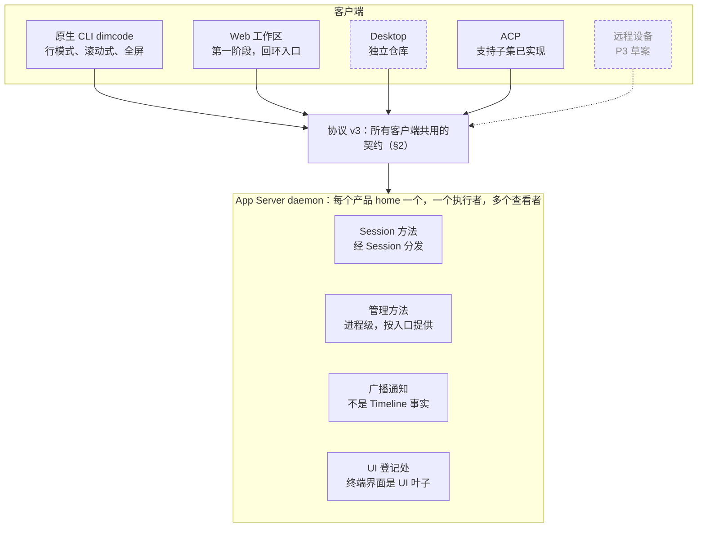
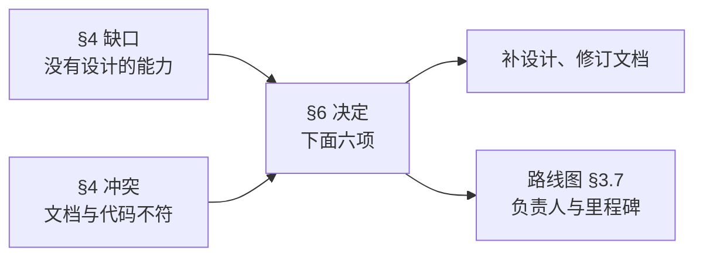

# 客户端

状态：草案。本文是 Dim 客户端的总体视图：有哪些客户端、它们共用什么、每个客户端覆盖哪些能力，以及哪些缺口还没有设计。本文不重复下层契约，每一行都链接到负责它的文档。总体设计：[总体设计](overview.md)；计划：[路线图](../../design/roadmap.md) §3.7（客户端负责线）。

到目前为止，客户端工作都是按功能分别设计的。本文把这些设计汇总起来，记下它们彼此之间、以及与代码之间不一致的地方，并列出规划客户端负责线之前需要做的决定（§6）。

## 1. 客户端

每个客户端都是 App Server daemon 的协议 v3 客户端。daemon 无界面、共享：每个产品 home 一个，一个执行者、多个查看者（[Tui §3.6](../../design/plugins/Tui.md#36-ui-registry-and-ui-leaves)）。客户端负责展示、协议适配和本地交互；执行、宿主配置和持久化的 Session 归 App Server（[功能清单](../../feature-list.md)）。

虚线框表示不在本仓库（Desktop）或还没有实现（远程设备）；虚线箭头表示还不存在的连接。

| 客户端 | 位置 | 形态 | 状态 | 设计 |
| --- | --- | --- | --- | --- |
| 原生 CLI `dimcode` | `crates/dim-cli`、`crates/dimcode` | 一个可执行文件里有三种界面：行模式客户端（`--no-tui` 或没有终端）、滚动式终端界面（默认）和全屏终端界面；`/tui` 在进程内切换两种终端界面 | 已实现 | [Tui](../../design/plugins/Tui.md)、[CLI 命令](cli-commands.md)、[原生 CLI 契约](../../../crates/dim-cli/README.md) |
| Web 工作区 | `web/`（Vue 3），入口在 `crates/dim-app-server/src/web_entry.rs` | 经仅限回环地址的 web 入口访问的浏览器前端，由 `dimcode web` 或 `/web` 打开 | 第一阶段已实现 | [Web 工作区](../../design/web-workspace.md) |
| Desktop | 独立仓库 | 桌面应用 | 不在本仓库 | 本仓库只负责它使用的 App Server 契约（§5） |
| ACP | `crates/dim-acp` | 可复用接入方宿主 rutis 插件；`dimcode acp` 是 stdio 入口，经公开 RPC v3 连接共享 daemon | 支持子集已实现，未发布（#436，PR #441）；acpx 基本聊天已验收；Lody MCP GUI 待登录后验收 | [AcpGateway](plugins/AcpGateway.md)、[验收](../../design/acp-gateway-acceptance.md) |
| 远程设备 | — | 经 RemoteGateway 配对的设备；将吸收第一阶段的 web 入口 | 草案，P3，未实现 | [RemoteGateway](plugins/RemoteGateway.md) |

## 2. 客户端共用的部分

| 契约 | 负责文档 |
| --- | --- |
| 线路协议 v3：分帧、`hello` 与功能声明、通知 | `crates/dim-app-server/src/protocol.rs`（没有文字版参考，见 §4 第 4 条）；[App Server README](../../../crates/dim-app-server/README.md) |
| Session 方法与管理方法之分，以及每种入口提供哪些方法 | [Session 边界](contracts/session-boundary.md)（A.3 入口）、[管理方法](../../design/appserver/management-methods.md) |
| 读取 Session：先 `session.attach`，再按固定的头部读 `session.history`，然后接收实时的 `session.event`、`session.state`、`session.model.progress`；由客户端自己折叠。attach 的回复携带该 Session 的 `SessionInfo`，其中 `model` 取自该 Session 最近采纳的配置，而 `session.summaries` 的条目在 [#795](https://github.com/arcships/dim/issues/795) 完成前仍报告创建时的模型，因此打开已知 Session 的客户端从它取模型，不读目录；重载期间标题字段缺失、`running` 为 false，随后的通知将其更正 | [Session 访问](contracts/session-access.md)、[CLI 命令](cli-commands.md)；[#276](https://github.com/arcships/dim/issues/276) 的处理结论 |
| 不属于 Timeline 事实的广播通知（`session.notice`，例如标题） | [Session 广播通知](appserver/session-notices.md) |
| 审批与提问：`approval.request` / `cancelled` / `resolved`；提问是一次未完成的 `ask_user` 调用，用 `session.question.respond` 回答 | [ADR 003](../adr/003-approval-scope.md)、[Questions](plugins/Questions.md) |
| 查看 Session 的界面：UI 登记处，终端界面作为 UI 叶子（`ui.open`、`ui.attach`、`ui.status`） | [Tui §3.6](../../design/plugins/Tui.md#36-ui-registry-and-ui-leaves) |
| 供所有客户端使用的 Provider 管理 | [Provider 管理](appserver/provider-management.md) |

CLI 要求协议 v3，以及 `session.create` 和 `session.history` 两项功能；web 客户端及其静态资源要求协议版本完全一致（[Web 工作区 §2.4](../../design/web-workspace.md)）。

## 3. 能力覆盖

行按[功能清单](../../feature-list.md)的章节排列。功能清单描述的是 `dimcode` 的目标能力，本表补上其他客户端。图例：**已实现**；**部分**：实现了一部分；**已设计**：有设计、未实现；**无**：既没有设计也没有实现；**不做**：已决定不在范围内；**—**：对该客户端不适用或不计划。Desktop 不在本表跟踪范围内（§5）。

### 3.1 Provider 与模型

| 能力 | CLI | Web | 来源 |
| --- | --- | --- | --- |
| 登录、登出（OAuth，守护进程描述的每个提供方） | 已实现 | — | [提供方账号](cli-commands.md#提供方账号) |
| API-key Provider 的添加/编辑/测试/启用/禁用/切换 | 已实现；删除：CLI 中无（服务端已支持）；模型列表编辑：`/models` → `Edit models` 与 `dimcode models PROVIDER` | 已实现，含模型列表与偏好写入（`provider.models.*`、`provider.preferences.update`） | [Provider 管理](appserver/provider-management.md) |
| 切换模型 | 已实现 | 已实现 | `session.model.update` |
| 推理强度、快速模式 | 已实现（`/effort`、`/fast`，以及 `/models` 中用 ←/→ 调整） | — | [模型配置](../../design/model-configuration.md) |
| 子 agent 模型策略 | 已完成（`/models` → Subagent models） | — | [子 agent 模型策略](../../design/subagent-model-policy.md)、[#263](https://github.com/arcships/dim/issues/263) |
| 辅助模型 | 服务端已按所有者设计（例如 SessionTitle）；没有客户端界面 | — | [AuxiliaryModel](appserver/auxiliary-model.md) |

### 3.2 Session 管理

| 能力 | CLI | Web | 来源 |
| --- | --- | --- | --- |
| 新建、恢复、Session 列表 | 已实现；`/resume` 打开时只列当前工作区，`Ctrl+S` 依次循环当前工作区、提供时的当前仓库 worktree 与所有工作区 | 已实现（按目录分组） | [CLI 命令](cli-commands.md#resume-选择面板) |
| 导出对话 | 行模式客户端和 `dimcode session export` 已实现；终端界面内：无 | — | [CLI 命令](cli-commands.md) |
| `/timeline` 与消息操作 | TUI 已实现；它同时取代了 `/history` 的翻页 | — | [Timeline UI §4.6](timeline-ui.md#46-timeline跳到某条消息) |
| 标题 | 自动生成：已实现（可选的 SessionTitle 包）；手动重命名：已设计 | — | [SessionTitle](plugins/SessionTitle.md) |
| Fork | CLI 中已设计（服务端 `session.fork` 已实现） | 后续阶段 | [Session 删除与 fork](appserver/session-deletion-and-fork.md) |
| 删除与清理 | CLI 中已设计（服务端 `session.delete` 已实现） | 后续阶段 | 同上 |
| 文件回滚、文件与对话一起回滚 | 不做 | 不做 | [总体设计](overview.md)附录 A |
| 请求快照导出 | 已实现（`dimcode export`）；过滤条件：已设计 | — | [Timeline 导出](appserver/timeline-export.md) |

### 3.3 会话内交互

| 能力 | CLI | Web | 来源 |
| --- | --- | --- | --- |
| 发送、排队（运行中按 `Enter`）、自动发送、引导（`Ctrl+S`，或草稿为空时按 `Enter`）、中断 | 已实现 | 发送和停止：已实现；排队：后续阶段 | InputQueue（S1） |
| 线：树、切换、新建、发送、停止、审批、结束 | 已实现 | 已实现（右侧 Lines 面板） | [Timeline 线](../../design/timeline-branches.md) §14、[Web 工作区](../../design/web-workspace.md#41-lines-and-branch) |
| `/queue` 面板与删除排队消息 | 无 | — | 服务端契约已实现（S1） |
| 取回排队消息重新编辑 | 已实现；带附件的消息会丢失附件（§4 第 3 条） | — | |
| 多行、粘贴、大段粘贴、图片、混合附件、`@` 文件、`!` / `!!` | 已实现 | 附件：后续阶段 | [CLI 附件输入](../../design/cli-attachment-input.md)、[ShellInput](plugins/ShellInput.md) |
| Skill 引用：`/` 选单列出 Skill，`$skill: <name>` 让它在随消息提交时加载 | 已实现 | 无 | [Skills](../../design/plugins/Skills.md#9-references-load-with-the-operators-input) |
| 剪贴板文本、图片、文件；选区复制；OSC 52 | 已实现 | 浏览器自带 | |
| 通过消息操作复制消息 | 无 | — | |
| 打开链接、工具分组、`/tools` | 已实现 | 已实现（渲染） | |
| 流式输出、运行状态、终端状态与进度 | 已实现 | 已实现 | |
| 文件改动反馈 | 已实现 | 已实现 | |
| 工具审批 | 已实现（`/permissions` 选择权限预设并管理命令规则；`/approvals` 与 `/approval` 是别名） | 已实现 | [ADR 003](../adr/003-approval-scope.md) |
| 用户提问（`ask_user`） | 已实现（行模式客户端与终端界面） | 无 | [Questions](plugins/Questions.md)（由 #269、#336、#351 实现） |
| 待办状态 | 不做 | 不做 | [总体设计](overview.md) §1 |
| 后台任务：命令与成员（详情、停止单个、全部停止） | 已实现 | — | [后台任务列表](../../design/background-task-list.md)、[输出](../../design/background-task-output.md)、[成员会话](../../design/member-conversation.md) |
| 后台任务：Workflow 运行 | 已完成 | 后续阶段 | [Workflow 任务视图](../../design/workflow-task-view.md)、[#264](https://github.com/arcships/dim/issues/264) |
| 成员 transcript 卡片 | 已实现 | — | [成员会话](../../design/member-conversation.md) §7–9、[#263](https://github.com/arcships/dim/issues/263) |

### 3.4 系统管理

| 能力 | CLI | Web | 来源 |
| --- | --- | --- | --- |
| `/settings`：主题、语言、启动形态、鼠标、通知、审批 | 已实现 | 后续阶段（需要先决定管理方法，§6） | 模型选择使用 `/model`（`/models`），不在 `/settings` 中。 |
| `/settings`：子 agent 模型、辅助模型、默认多模态模型、执行 Shell、沙箱、提示词语言 | 已在别处设计，没有客户端界面 | — | 总体设计 B.1、[Modality](plugins/Modality.md) |
| `/settings`：VS Code 聚焦、资源监控、套餐用量显示 | 无 | — | |
| `/settings`：ACP Session 显示 | 不支持：没有原生持久化 client-origin 字段 | — | [AcpGateway](plugins/AcpGateway.md#a5-client-label) |
| `/usage` | 上下文用量；当前模型使用 Dim OAuth 时也显示账号用量 | — | [CLI 用量报告](cli-commands.md#用量报告) |
| `/stats` | 不做 | — | [总体设计](overview.md)附录 A |
| `/debug`、调试日志配置 | 无（只有 daemon 的 `daemon.log`） | — | |
| `/tui` 模式切换 | 已实现 | — | [Tui](../../design/plugins/Tui.md) |
| 版本与升级 | 已实现（升级对话框）；`dimcode upgrade` 子命令：无 | — | |
| Web 访问（`/web`、`dimcode web`） | 已实现 | — | [Web 工作区](../../design/web-workspace.md) |

## 4. 缺口与冲突

§3 中没有设计的能力，按功能清单顺序：

1. 复制消息（`/timeline` 及其他消息操作见 [Timeline UI §4.6](timeline-ui.md#46-timeline跳到某条消息)）。
2. `/queue` 面板与删除排队消息（服务端契约已有）。
3. 取回带附件的排队消息：`QueuedInput` 只保存文本，附件会丢失。要么像功能清单写的那样由客户端拒绝取回，要么让队列保留附件。
4. 协议 v3 的文字版参考：线路格式只在 `protocol.rs` 里定义，相关说明分散在 App Server README 和各功能设计中。
5. Web 工作区里的提问：它处理审批，但不处理 `ask_user`，而 Web 工作区 §4 也没有把它列为推迟项。
6. Session 列表按项目/全部切换、`/debug`、其余 `/settings` 项、终端界面内导出、`dimcode upgrade`。

与代码或彼此之间不一致的文档：

| 说法 | 位置 | 事实 |
| --- | --- | --- |
| 只设计了滚动式界面；只有全屏才有的项目（回滚、鼠标、`/stats`）不在范围内 | [总体设计](overview.md)第 15 行、附录 A | 全屏终端界面、它的鼠标模式和 `/tui` 都已实现，并写在[原生 CLI 契约](../../../crates/dim-cli/README.md)里；回滚和 `/stats` 没有实现 |
| F6 不实现全屏界面 | [CLI 命令](cli-commands.md) | 同上 |
| `/web` 是 RemoteGateway 的新工作 | [总体设计](overview.md)附录 A | 已由第一阶段的 web 入口交付 |
| 远程入口从不提供管理方法；入口表里没有 web 入口 | [Session 边界](contracts/session-boundary.md) A.3、[RemoteGateway](plugins/RemoteGateway.md) | web 入口提供[Web 工作区 §2.5](../../design/web-workspace.md#25-protocol-on-the-entry) 定义的只读模型发现方法 |
| RemoteGateway 没有引用已经实现了它一部分的 web 入口 | [RemoteGateway](plugins/RemoteGateway.md) | [Web 工作区](../../design/web-workspace.md) §2.6 列出了两者的差别 |

## 5. 本仓库与 Desktop

Desktop 在独立仓库里。本仓库负责 Desktop 使用的 App Server 契约，不负责它的任何界面。Desktop 缺口的处理（[#276](https://github.com/arcships/dim/issues/276)–[#281](https://github.com/arcships/dim/issues/281)）定下的规则是：只有现有事实和机制支撑不了某项能力时，App Server 才改；这次逐条处理都没有改协议：

| Desktop 的需要 | 结论 |
| --- | --- |
| 当前轮次、分支头部、实时 Session 列表 | 从历史推出，分页读取 `session.catalog`（[#276](https://github.com/arcships/dim/issues/276)） |
| 在标准 daemon 上重命名和设置目标 | 目前由 `--session-rows` 安装 SessionTitle 和 Goal（[#277](https://github.com/arcships/dim/issues/277)、#290）；有了 [PluginManager](plugins/PluginManager.md) 以后，它们是默认 CLI 内置的插件 |
| 审批结果、待回答的提问 | `approval.resolved`（#289）；待回答的提问从历史中读取（[#278](https://github.com/arcships/dim/issues/278)） |
| 读取附件、归档、文件历史 | 附件路径来自 `attachment.put`；归档在客户端本地；回退用 `session.fork`（[#279](https://github.com/arcships/dim/issues/279)） |
| 分支元数据、重命名、按分支设置模型 | 来自 `branch/*` 事实；重命名在客户端本地；按分支设置模型不做（[#280](https://github.com/arcships/dim/issues/280)） |
| 本地工具、编辑/重试、用量、子 agent 关系 | 客户端运行的 MCP server；`session.fork` + `session.submit`；客户端统计用量；`collaboration/*` 事实（[#281](https://github.com/arcships/dim/issues/281)） |

Desktop 自己的能力覆盖和界面验收在它的仓库里跟踪。本仓库的契约支撑不了的能力，按同一规则在本仓库开 issue。

## 6. 需要维护者决定的事项

1. **全屏终端界面。** 代码已经交付了它，总体设计却说不在范围内。要么接受它在范围内（更新总体设计和 CLI 命令文档，并决定回滚和 `/stats` 是否仍不做），要么冻结它。
2. **Web 第二阶段的范围**，包括回环 web 入口能否为设置页面提供管理方法（Web 工作区 Q2），以及 Web 工作区是否必须支持提问。
3. **§4 中哪些缺口要做设计**，归哪个里程碑：`/timeline` 与消息操作、`/queue`、排队消息的附件。
4. **协议 v3 参考文档**（§4 第 4 条）：写一份，还是继续以代码为准。
5. **开放的客户端 issue 归哪个里程碑**：[#263](https://github.com/arcships/dim/issues/263)（成员 transcript 卡片、子 agent 模型策略的运行时）、[#264](https://github.com/arcships/dim/issues/264)（Workflow 视图）、[#386](https://github.com/arcships/dim/issues/386)（UI 事件传给 agent）。
6. **路线图中客户端负责线的负责人。**
