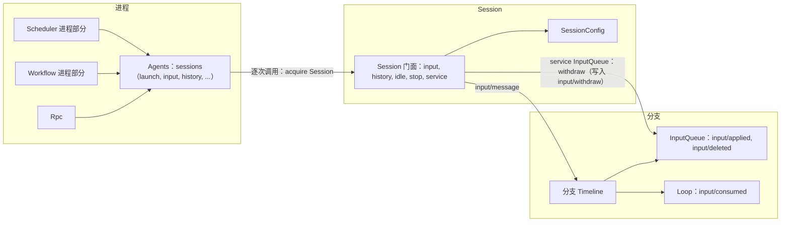
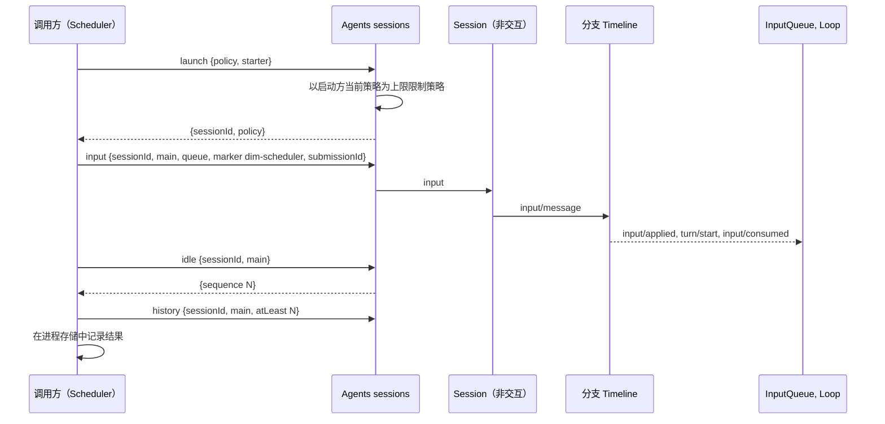
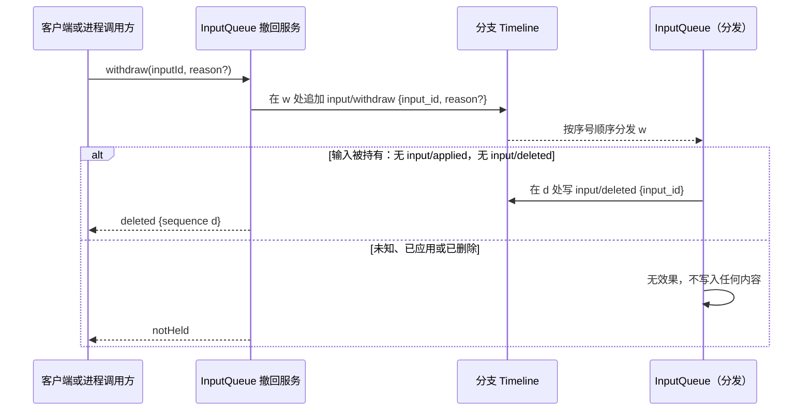

# Session 访问：Agents 与 Session 公共接口补充

状态：草案。总体设计：[总览 §3 集成](../overview.md#3-基于现有机制的集成)、[附录 B Agents 与 InputQueue](../overview.md#附录-b-现有插件的补充)；规则：[ADR 002](../../adr/002-plugin-scope.md) D1–D3、D5。阶段：P0。语言：语言中立合同；Rust 绑定见[附录 E](#附录-e-rust-绑定)。

> **离线资源节点。** 关于资源节点离线的各行描述的是 P3 多节点行为。#5 已撤回（rutis 是外部依赖，链接断开时会撤掉导入的服务），这些行在 P3 按总览 §6.3 重新设计：节点服务在每次调用时按 Session 的资源节点查找，该字段在 P3 加入 `SessionConfig`（[A.3](#a3-sessionconfig-字段)）。P1/P2 中每个 Session 都使用控制节点。

进程插件以 Collaboration 已有的方式访问 Session：通过 Agents 和公共的 Session 接口。本文把这种访问定义为语言中立的进程服务 `sessions`（ADR 002 D5），由 Agents 提供，因此 TypeScript 或 Python 进程插件（Scheduler、Workflow）可以按名称使用它。其方法为 `launch`、`input`、`lookup`、`history`、`withdraw`、`stop`、`idle` 和 `delete`，请求与回复均为数据（[A.1](#a1-sessions-服务)）。在 Rust 中，它是 `AgentIndex` 加上 `Session` 门面（[附录 E](#附录-e-rust-绑定)）。本文不增加任何宿主或门面插件。Agents 从不会重载的目录部分提供它，因此 Agents 重载只让进行中的调用失败，从不让调用方重载（D3，#35）；绑定、生命周期及其依据的 spike 见 [sessions 服务](../appserver/sessions-service.md)设计。

| 补充 | 所有者 | 使用方 |
| --- | --- | --- |
| `sessions` 服务：按名称、纯数据地访问 Session | Agents | Scheduler、Workflow 进程部分 |
| 策略以启动方为上限的 `launch` | Agents | Scheduler、Workflow |
| `SessionConfig` 字段 `interactive` | Agents | 从所属 Session 的 `SessionConfig` 读取它的插件（Questions、SessionTitle） |
| 带来源 raw 块的输入（标记、key、`submissionId`） | InputQueue 数据合同、运行时门面 | Scheduler、Workflow；Goal 分支部分写入相同形式，Hooks 分支部分（待设计）也会如此 |
| 固定前缀读取 | 运行时门面（`sequence` 与 `history`）与分页读 `AgentIndex::history_page`（A.5） | 进程调用方，以及依据 Timeline 事实做决定的分支部分 |
| 撤回（带可选 `reason` 的指令 `input/withdraw`，`reason` 在[总览附录 B.1](../overview.md#b1-session-与分支-capability) 中提议；结果 `input/deleted`、经 InputQueue 的 `sessionMethods` 提供的 `session.input.withdraw`） | InputQueue | 客户端、AcpGateway、Scheduler、Workflow |

Session 级与分支级插件不使用此接口访问自己的 Session。它们直接使用所属 Session 与分支的服务、分支 Dispatcher 和 Session 广播。

## 1. 结构



| 部分 | 作用域 | 状态 |
| --- | --- | --- |
| `sessions`（Agents） | 进程 | 补充；映射到现有的 `acquire` 与门面，外加 `launch` |
| `SessionConfig` 字段 `interactive` | Session 记录 | 补充 |
| Session 门面（[agent.rs](../../../../crates/dim-agent-runtime/src/agent.rs)、[branch.rs](../../../../crates/dim-agent-runtime/src/branch.rs)） | Session、分支 | 已存在 |
| InputQueue | 分支 | 变更：消费 `input/withdraw`，写入 `input/deleted`；撤回服务 |

本文定义的合同：`sessions` 服务及 `LaunchRequest`、`InputWrite`、`RawBlock`、`HistoryRequest`、`HistoryPage`、`LookupReply`、`WithdrawRequest`、`WithdrawReply` 与 `SessionsError`；`SessionConfig` 字段 `interactive` 与 `session.create` 的 `interactive` 参数；来源标记、key 与 `submissionId` 约定；以及撤回合同。使用的合同：运行时门面、Agents 装载、`input/message` 数据与消费合同、现有的上下文块元素格式、以及 Session 输入路径。

## 2. 数据与状态

| 状态 | 所有者 | 重建 |
| --- | --- | --- |
| 含 `interactive` 的 `SessionConfig` | Agents、Session 记录 | 恢复时从记录重建 |
| 输入及其 applied、consumed 与 deleted 事实；InputQueue 的持有集合 | InputQueue、Loop | 重载时从本地历史重建：某输入既无 `input/applied` 也无 `input/deleted` 时即被持有 |
| `sessions` 调用期间持有的租约 | Agents | 仅运行时 |
| 带 key 块的效果 | 历史投影（[history.rs](../../../../crates/dim-agent-capabilities/src/history.rs)） | 从固定前缀与压缩事实重建 |
| 调用方进度（运行、待定的 `submissionId`） | 调用方的进程存储 | 调用方的文档 |

输入从其 `input/message` 起处于待处理状态，直到引用其事件 id 的 `input/applied` 及随后的 `input/consumed`，或 `input/deleted` 出现为止。单独的 `input/withdraw` 从不改变输入是否待处理；只有 InputQueue 的结果事实会改变。每个“待处理输入”推导（Goal、AcpGateway、Scheduler、Workflow）都严格使用这条规则。

## 3. 流程

### 3.1 启动、写入、等待



调用方不持有锁。在其读取之后提交的事实排在其写入之前，由输入所有者处理。可能在结果不确定后重试的调用方，以同一 `submissionId` 重新提交：分支对每个标识只接受一次，并回复第一条输入的回执。

### 3.2 撤回



`input/withdraw { input_id, reason? }` 是指令事件，`input/deleted { input_id }` 是 InputQueue 的结果事实。合法生产方写入该指令：客户端经 InputQueue 通过 `sessionMethods` 提供的 `session.input.withdraw`（[session-boundary](session-boundary.md#a1-方法贡献)），进程调用方经 `sessions.withdraw`。InputQueue 按序号顺序消费指令，且只依据自身的决策状态做决定（[时间总线 §4](../../../architecture/rust-agent/time-bus.md#4-写入前的复核归各状态机)）：只有当 InputQueue 仍持有该 `input/message` 且尚未应用时，指令才生效。一旦 InputQueue 为某输入写入了 `input/applied`，该输入就归 Loop 所有，无法再撤回；Loop 无需改动。对于一个输入，`input/applied` 与 `input/deleted` 至多存在其一。

## 4. 时序与冲突

| 场景 | 顺序 | 结果 | 所有者 |
| --- | --- | --- | --- |
| 输入在 turn 的 `stop/interrupt` 之前，未被消费 | applied < interrupt | 保持待处理；由下一个 turn 消费 | Loop |
| 输入在 `stop/interrupt` 之后 | interrupt < input | Queue/Steer 启动 turn，Append 等待 | InputQueue、Loop |
| 输入被持有时撤回 | input < `input/withdraw`，无 `input/applied` | `input/deleted`；永不被应用或消费；不处于待处理 | InputQueue |
| 输入被应用后撤回 | `input/applied` < `input/withdraw` | 无效果，不写入任何内容；回复 `notHeld`；该输入照常被消费 | InputQueue |
| `sessions` 调用期间 Agents 重载 | — | 该调用以 `reloading` 失败；调用方不重载（#35）；已提交的输入保留；调用方重写前先调用 `lookup`。已受理的 `launch` 与 `delete` 则回复自己的结果（[sessions 服务 §8.3](../appserver/sessions-service.md#83-agents-索引重载)） | Agents、调用方 |
| Session 的资源节点离线 | — | 输入已提交；该节点上的工具调用以 `node_unavailable` 失败；没有任何部分进入 Pending | rutis 链接（#5） |
| 以比启动方更宽的策略启动 | — | 限制为启动方的当前策略 | Agents |

完整表格：附录 B。

## 5. 上下文映射

| 输入形式 | 模型看到的内容 | 位置 |
| --- | --- | --- |
| 标记块 | 一条 user 角色消息，原样包含 `<dim-<source> kind="...">` 元素 | 最先，位于该输入的消费位置 |
| 其他 raw 块 | 每块一条 user 角色消息，原样、按序 | 在标记之后 |
| 用户内容（文本、图像） | 一条用户消息 | 在同一输入的所有块之后 |
| 带 key 的块（`Live`） | 作为 raw 块；每个 key 的最新块保持生效 | 消费位置 |
| Retire 块 | 投递一次；该 key 失效 | 消费位置 |
| 已删除的输入（从未应用） | 无：其用户内容与 raw 块从不进入上下文，其带 key 的块从不生效，压缩也从不看到它。客户端可依据 `input/deleted` 将其显示为已删除 | — |

Queue 输入在 Loop 启动它所驱动的 turn 时被消费。Steer 输入在运行中 turn 的下一个边界被消费，分支空闲时会启动一个 turn。Append 输入随下一次模型请求被消费，从不启动 turn。经过压缩后，已消费的输入只保留在摘要中，但每个生效 key 的最新块会原样重放。子分支看到截至其切点的祖先前缀，包括切点处生效的 key，且从不采纳父分支的待处理输入。模型从不看到 `submissionId`、模式、`SessionConfig` 字段或租约。

## 6. 接口（摘要）

| 接口 | 模式 | 用途 |
| --- | --- | --- |
| `sessions.launch(LaunchRequest) -> {sessionId, policy}` | async | 为自动化创建非交互 Session，策略受上限约束 |
| `sessions.input(InputWrite) -> {inputId, sequence}` | async | 写入带来源 raw 块的输入 |
| `sessions.lookup({sessionId, branchId, submissionId}) -> LookupReply` | async | 在结果不确定后查找已提交的输入 |
| `sessions.history(HistoryRequest) -> HistoryPage` | async | 读取历史，可选为以已发布 head 为界的固定前缀 |
| `session.input.withdraw {sessionId, branchId, inputId, reason?}` | RPC | 客户端撤回；InputQueue 的 `sessionMethods`（命名空间 `session.input`） |
| `sessions.withdraw(WithdrawRequest) -> WithdrawReply` | async | 按 `input_id` 为调用方写入的输入写入 `input/withdraw`，并返回 InputQueue 的决定 |
| `sessions.stop({sessionId, branchId, reason?}) -> {sequence}` | async | 中断该分支的 turn |
| `sessions.idle({sessionId, branchId}) -> {sequence}` | async | 等待分支空闲；返回的序号是最后提交的序号，位于整批次边界 |
| `sessions.delete({sessionId}) -> {}` | async | 删除一个 Session：Agents 关闭它，并删除它的行与文件（[Session 删除](../appserver/session-deletion-and-fork.md#3-删除)） |
| `SessionConfig.interactive` | 数据 | 创建时配置 |
| `session.create {interactive}` | RPC | 非交互创建 |

## 7. 安全

只有控制节点进程中的插件持有 `sessions`，它从不经 RPC 入口或 rutis 链接导出。进程调用方凭写入时拿到的 `input_id` 撤回输入，客户端通过 Rpc 的 Session 授权撤回。标记是写给模型看的文本：共享组件（InputQueue、Agents、运行时）从不解析它；写入标记的插件可以解释自己写的内容。写入输入不授予任何权限，因为由此产生的工具调用由 Approval 与 Permission 按该 Session 的策略准入。`launch` 的策略上限是给守规矩的调用方用的约定，不是安全边界：`starter` 由调用方自己填，不传时上限是宿主的 Session 默认值（[sessions 服务 §11](../appserver/sessions-service.md#11-安全与权限)）。输入会重放进模型上下文，因此调用方不得把凭据或宿主安全设置放入其中。

## 8. 规则检查

| 规则 | 本文如何遵守 |
| --- | --- |
| §4 第 1 条（指令事件） | 撤回是指令 `input/withdraw`；只有 InputQueue 写结果 `input/deleted`，没有生效的撤回不写入任何内容，回复 `notHeld`。 |
| §4 第 2 条（交接） | `input/applied` 把输入从 InputQueue 交给 Loop；之后输入不能撤回，只能用 `stop/interrupt` 中断。 |
| §4 第 3 条（只用 before 回调） | 入口只检查参数格式和授权；不使用 before 回调。 |
| §4 第 4 条（核心不带业务含义） | `reason`、标记、key 和 `submissionId` 是通用数据；InputQueue 与 Agents 从不解释来源。 |
| §4 第 5 条（批次） | InputQueue 按序处理 `input/message` 与 `input/withdraw`；“撤回并作为 Steer 重新提交”在同一批次中先写撤回。 |
| §4 第 6 条（模型上下文） | 被删除的输入从不进入上下文；已消费的输入放在其消费位置（§5）。 |
| §4 第 7 条（公开事件与服务） | 进程调用方只通过 `sessions` 访问 Session，只通过 InputQueue 公开的撤回服务撤回输入。 |
| §4 第 8 条（需求） | #4 与可选部分的装配在 §9 提出；固定前缀读取由现有门面组合实现（§9.2）。 |
| §4 第 9 条（只有决定用的事实进 Timeline） | `SessionConfig`、租约和调用方进度不进 Timeline；只有输入、撤回的指令和结果，以及 `stop` 写入的 `stop/interrupt` 是事件；必需事件 `input/withdraw` 上的描述性字段 `reason` 符合第 9 条。`submissionId` 是必需事件 `input/message` 的字段，调用方的恢复决定经 `lookup` 读取它（#32）。 |
| §1（Capability 与 App Server 边界） | Agents 只提供访问；调用方的业务逻辑留在各自插件中。 |
| ADR 002 D1 | `sessions` 是 Agents 的进程服务；InputQueue 的撤回留在其分支部分，由其 Session 部分提供给客户端。 |
| ADR 002 D2 | 没有访问宿主或门面插件；调用方像 Collaboration 一样使用 Agents。 |
| ADR 002 D3 | Agents 重载让进行中的调用以 `reloading` 失败，从不让调用方重载（#35）；调用方用 `lookup` 解决结果不确定的写入。 |
| ADR 002 D4 | `SessionConfig.interactive` 是 Session 记录的创建数据，不是插件配置。 |
| ADR 002 D5 | `sessions` 是具名服务，方法与错误都是纯数据；Rust 类型只出现在附录 E。 |

## 9. 向机制所有者提出的需求

### 9.1 运行时服务按名称暴露（#4）

| 项 | 内容 |
| --- | --- |
| 被什么挡住 | ADR 002 D5：非 Rust 部分（SessionTitle、Goal、Web、Scheduler 与 Workflow 的 Session 部分、ExternalAgent、PluginManager）需要在没有手写 Rust 绑定的情况下使用运行时的类型化服务（Timeline、Dispatcher、InputQueue、Session 广播）。它们还用到的 App Server 服务（SessionStore 元数据、Settings、`AuxiliaryModel`）由各所有者的补充按名称提供（[总览附录 B.2](../overview.md#b2-app-server-进程插件)）。 |
| 考虑过的现有机制 | rutis 具名服务（`TypeKey::named`、`host_key`）：只对按名称注册的服务有效，而运行时按 Rust 类型注册这些服务。每个插件手写绑定：D5 不允许。先用 Rust 实现：在此需求落地前的退路。 |
| 需要的通用能力 | 运行时把每个公开的类型化服务也以稳定的服务名和纯数据方法形式注册，作用域与 key 不变。 |
| 对序号、批次、中断、重载的影响 | 无：按名称调用沿用类型化服务的顺序、批次和中断规则；具名服务随其所有者重载。 |
| 由谁实现、对应 issue | 运行时；[#4](https://github.com/arcships/dim/issues/4)。 |

### 9.2 固定前缀读取

已撤回（[#50](https://github.com/arcships/dim/issues/50)）：现有的 Session 门面组合即可实现，不需要改运行时。`Session::sequence(branch)` 返回已发布的 head；若它低于 `atLeast`，读取以 `future_sequence` 失败，否则用 `Session::query(branch, query)` 读到该 head 及以下。两者都只读已发布的事件，head 只会前移，因此前缀是固定的（A.5）。进程调用方用 `AgentIndex::history_page` 分页读取同一前缀（A.5）。

### 9.3 由插件身份确定调用方来源

已撤回（[#24](https://github.com/arcships/dim/issues/24)）：调用方凭写入时拿到的 `input_id` 撤回，不需要调用方来源。

### 9.4 按启用状态安装可选部分

| 项 | 内容 |
| --- | --- |
| 被什么挡住 | ADR 002 后果：可选的 Session 与分支部分只在启用时安装。 |
| 考虑过的现有机制 | 全部安装、在部分内部检查：这是 ADR 不允许的占位。在宿主侧调用 `AgentBuilder` 安装每个插件的部分：不是语言中立的（D5）；插件自己登记它的部分，profile 只列出它要求的部分。 |
| 需要的通用能力 | 每个插件都是进程中的一行，在运行期间向部件登记处登记它的 Session 部分与分支部分（[ADR 006 D3](../../adr/006-plugin-contract.md#d3-插件是一行每个实例挂载为它登记的部件)）。已安装但停用的插件没有运行中的行，什么也不登记，所以它的部分不会挂载。Session 等待的部分由 profile 要求（`AgentBuilder::require_part`）；其他已登记的部分都是可选的：Session 打开时已登记的，在发布前先让它加载结束，但不要求它处于 Active；它缺失、Pending 或 Failed 时只是该插件的功能不可用。对工具，部件在 apply 时把它们注册到 ToolRegistry，ToolRegistry 跟随这些注册：之后才注册的工具从下一个请求起提供，部件卸载时撤回的工具不再提供，都不需要重载 Session（session-boundary A.5，ADR 002 D3，#34，#241）。生成器不按 `interactive` 等 `SessionConfig` 字段选择部件，因此 fork 前后工具集合与提示词前缀保持一致（#30）。创建 Session 时已经开始装载的部件会在发布前稳定下来；始终无法稳定的部件使创建在截止时间失败。 |
| 对序号、批次、中断、重载的影响 | 分支初始化中的首次注册表读取在 Session 发布前确定首个请求的工具。之后部件的激活或退役只改变后续请求的工具；已绑定的请求保留其快照，带工具部分的配置把变化记为一次采用。Session 打开期间启用的插件，其部分挂载进每个打开的 Session；停用的插件，其部分从中卸下；两者对之后请求的影响相同。 |
| 由谁实现、对应 issue | 运行时（部件登记处与挂载器）；已在 [#402](https://github.com/arcships/dim/issues/402) 实现。 |

离线相关行用到的 #5 在 [ExternalAgent §9](../plugins/ExternalAgent.md#9-向机制所有者提出的需求) 提出。`input/withdraw` 的可选 `reason` 和 `LaunchRequest.agent` 的缺省值是 InputQueue 与 Agents 的变更，列在[总览附录 B](../overview.md#附录-b-现有插件的补充)。

## 附录 A. 接口细节

### A.1 sessions 服务

`sessions` 是由 Agents 提供的进程服务，没有实例 key。结构为 camelCase 字段的 JSON；字段名后的 `?` 表示可选，`|` 分隔备选项。除 `launch` 与 `delete` 外，每次调用都会 acquire 该 Session（必要时恢复），并在回复前保持其已装载。调用不携带调用方身份。各方法的步骤、策略上限与生命周期见 [sessions 服务](../appserver/sessions-service.md)设计。

| 方法 | 模式 | 请求 | 回复 | 错误 |
| --- | --- | --- | --- | --- |
| `launch` | async | `LaunchRequest` | `{sessionId, policy}` | `rejected`、`agent_unknown`、`session_closed`、`branch_missing`（启动方）、`branch_ended`（启动方）、`reloading`、`failed` |
| `input` | async | `InputWrite` | `{inputId, sequence}` | `rejected`、`ambiguous`、`session_closed`、`branch_missing`、`branch_ended`、`reloading`、`publication_unknown`、`failed` |
| `lookup` | async | `{sessionId, branchId, submissionId}` | `LookupReply` | `ambiguous`、`session_closed`、`branch_missing`、`branch_ended`、`reloading` |
| `history` | async | `HistoryRequest` | `HistoryPage` | `rejected`、`future_sequence`、`session_closed`、`branch_missing`、`reloading` |
| `withdraw` | async | `WithdrawRequest` | `WithdrawReply` | `rejected`、`session_closed`、`branch_missing`、`branch_ended`、`reloading`、`publication_unknown` |
| `stop` | async | `{sessionId, branchId, reason?}` | `{sequence}` | `session_closed`、`branch_missing`、`branch_ended`、`reloading` |
| `idle` | async | `{sessionId, branchId}` | `{sequence}` | `session_closed`、`branch_missing`、`branch_ended`、`reloading` |
| `delete` | async | `{sessionId}` | `{}` | `rejected`、`reloading`、`failed` |

```text
// LaunchRequest
{ "agent?": "string",                // Agent profile id；缺省：Agents 的默认 profile
  "cwd": "string",
  "model?": { "providerId": "string", "modelId": "string" },  // 优先于 profile 的模型
  "policy?": { /* PermissionPolicy 数据 */ },  // 收窄后的请求；缺省：启动方策略或只读默认值
  "starter?": { "sessionId": "string", "branchId": "string" } } // 上限；缺省：以宿主配置为界
// InputWrite
{ "sessionId": "string", "branchId": "string",
  "mode": "queue" | "steer" | "append",
  "submissionId": "<source>:<uuid>",
  "rawBlocks": [ RawBlock ],         // 第一个块是调用方的标记（A.2）
  "content": [ { "type": "text", "text": "..." } | { "type": "image", "...": "..." } ] }
// RawBlock
{ "text": "string", "key?": { "use": "live" | "retire", "name": "string" } }
// LookupReply
{ "status": "accepted", "inputId": "string", "sequence": 0 } | { "status": "unknown" }
// HistoryRequest
{ "sessionId": "string", "branchId": "string",
  "after?": 0,                        // 不含的下界；缺省：从分支开头
  "through?": 0,                      // 读取到此序号
  "atLeast?": 0,                      // 固定前缀读取（A.5）；不与 through 同时使用
  "limit?": 256 }                     // 每页条数，1 到 256；缺省：256
// HistoryPage：该分支自己在 (after, through] 内的事件，止于批次边界，
// 为 AgentEvent 记录，形式与 session.history 返回的相同
{ "through": 0, "events": [ { "id": "string", "sequence": 0, "type": "turn/end", "data": {} } ] }
// WithdrawRequest
{ "sessionId": "string", "branchId": "string", "inputId": "string",
  "reason?": "string" }                 // 复制到 input/withdraw，由客户端显示
// WithdrawReply
{ "status": "deleted", "sequence": 0 }   // input/deleted 的序号
| { "status": "notHeld" }                  // 未知、已应用或已删除；InputQueue 未写入任何内容
// SessionsError
{ "code": "rejected" | ..., "message": "string", "retryable": false }
```

每个方法也都可能以 `failed` 失败（A.6）。取消：调用方丢弃 `idle` 或 `history` 调用即结束它，没有任何效果。在回复前丢弃 `input` 会使结果不确定；调用方用 `lookup` 确认。

`launch` 创建一个 `interactive = false` 的 Session。生效策略是请求的策略，并以启动方的当前策略为上限；该策略是启动时读取的 Timeline 事实。没有启动方时，由管理方法启动的运行除非请求声明了策略，否则默认只读，并始终受宿主配置约束。

`delete` 即 Agents 的 Session 删除（S5c）：Session 已装载时先关闭它，再删除它的行与文件。不存在或已删除的 Session 回复 `{}`，因此调用方在任何错误后都可再次删除（[sessions 服务 §6.8](../appserver/sessions-service.md#68-delete)）。启动 Session 的调用方在删掉最后一条指向它的记录时删除它（[§8.7](../appserver/sessions-service.md#87-删除运行用的-session)）。

已实现：上表全部方法，由 Agents 的目录部分提供（S2，[#98](https://github.com/arcships/dim/pull/98)；`delete` 在 S5c 之后加入，[#97](https://github.com/arcships/dim/pull/97)）。`input` 和删除成功的 `withdraw` 都在其事件发布后才回复。

### A.2 来源输入约定

| 项目 | 规则 |
| --- | --- |
| 标记 | 第一个 raw 块是现有上下文块格式中的元素 `<dim-<source> kind="..." ...>body</dim-<source>>`。它是生产方插件写给模型看的文本；共享组件从不解析它，只有生产方插件可以解释自己写的内容（例如 Goal 折叠自己的块） |
| Key | `RawBlock.key`，`use` 为 `live` 或 `retire`，按分支 Timeline 区分。完整的 key 由写入方自己起；按约定以写入方自己的前缀开头（总览约束 14），不做检查 |
| 提交标识 | `<source>:<uuid>`，每次逻辑提交生成一个。分支对每个标识只接受一次：重复提交不写入，回复第一条输入的回执，输入被消费或撤回后也是如此。`sessions.lookup`（与 `session.input_lookup` 语义相同）查找已提交的输入（`accepted`、`unknown`），不写入。错误 `ambiguous`（来自 `input` 或 `lookup`）表示多条输入共用该标识，写于分支只接受一次之前。标识是已提交 `input/message` 的 `submission_id` 字段，随输入一起提交、分叉和删除，没有单独的记录（[sessions 服务 §6.3](../appserver/sessions-service.md#提交标识存放在哪里)，#32） |
| 绝不可能 | 写入 `input/message`、经 `withdraw` 的 `input/withdraw` 和经 `stop` 的 `stop/interrupt` 之外的事件；写入 `input/deleted`；编辑历史 |

### A.3 SessionConfig 字段

```text
// SessionConfig（新字段；已有：permissionPolicy, cwd, model, systemPrompt, tools?, collaborationRole）
{ "interactive": true }             // false：exec、自动化；缺省：true
```

`interactive` 表示 Session 有可交互的对象，能回答它的提问和审批：可以是通过客户端操作的用户，也可以是另一个 Session 或分支的 agent（例如 Collaboration 的 leader），不要求必须是人。ACP Session 是交互的：编辑器回答它的审批。`interactive` 在创建时固定。装配从不读取它（ADR 002 D3，#30），因此工具集合保持不变，fork 后保留提示词前缀及其 KV cache。关心它的插件直接从 Session 的配置读取：Questions（`ask_user` 照常声明，并回答当前没有可以回答的对象）和 SessionTitle（只为交互式的 leader Session 起标题）。

`session.create` 增加 `interactive?: bool`（默认 `true`），只在边界检查。`session.create` 拒绝未知字段，旧版守护进程会以 invalid params 拒绝带 `interactive` 的请求；因此客户端只在它为 `false` 时发送。

fork 复制源 Session 的整个 `SessionConfig`；权限预设随复制过来的 `permission/changed` 事实一起带过去（#26）。

格式决定：原生存储保持版本 13。`interactive` 是存储的配置 JSON 中一个增量的可选字段，缺少它的已存储记录表示 `true`，因为在该字段出现之前创建的每个 Session 都是客户端 Session。旧版守护进程忽略该字段，把非交互记录读成交互式；这一点可以接受。不升级到版本 14。

已实现（C2）：`session.create` 设置该字段，原生存储只在它为 `false` 时写入，因此交互式记录保持该字段出现之前的记录格式。这一省略规则属于 `SessionConfig` 的 serde 形式，目前只有原生存储序列化它；在其他地方（例如协议响应）暴露 `SessionConfig` 会沿用这一规则，须另行决定。它的读取方是 Questions 与 SessionTitle，两者从 Session 的配置读取它。Session fork（S5c）按字节复制存储的 `config` 文本，这一省略规则随之带到分叉中。

| 已存储的 `config` | 含 C2 的守护进程 | 旧版守护进程 |
| --- | --- | --- |
| 不含 `interactive`（C2 之前的全部记录，C2 之后的交互式记录） | 交互 | 交互 |
| `"interactive": false` | 非交互 | 交互（忽略该字段；可以接受） |

`tools` 是 Session 可选的挂载列表，创建时确定。`session.create {tools?}` 设置它；不带该参数时 Session 取其 Agent profile 可选的 `tools`，profile 没有列表时 Session 也没有（产品默认如此）。profile 或成员的列表限定该 agent 能看到的工具；有列表的 Collaboration 成员总是挂载 `agent`。没有挂载列表时，Session 按宿主的顺序声明全部宿主工具，再按名称声明部件经 `toolRegistry` 注册的全部工具。有挂载列表时，Session 按列表顺序只声明其中列出的宿主工具与注册工具；`[]` 不声明其中任何一个。两种情况下其他来源（MCP）的工具都排在其后，由来源自己的配置决定。列出但没有任何部件注册的工具不声明，并报告一次；有部件注册后即声明。重复名称使 Session 创建失败。已声明工具的调用是否执行由 Permission 决定，Permission 从不改变工具声明（[session-boundary A.5](session-boundary.md#a5-工具贡献)）。原生存储只在 Session 有挂载列表时写入 `tools`。

不在本合同中：`createdBy`（Session 来源）和 `session.create` 的 `client` 参数，等到有功能依据它们做决定时再加入。资源节点在 P3 加入（总览 §6.3）：一个增量的可选 `SessionConfig` 字段，缺省表示控制节点。

### A.4 撤回

| 项目 | 内容 |
| --- | --- |
| 指令 | `input/withdraw { input_id, reason? }`，一个分支指令事件。`reason` 是通用可选文本，不带业务含义，由客户端为被删除的输入显示；不带它的事件不变。生产方：撤回服务（客户端、进程调用方）。它本身从不是关于该输入的事实 |
| 结果事实 | `input/deleted { input_id }`，只由 InputQueue 写入，且只在它消费 `input/withdraw` 时仍持有该输入、尚未应用的情况下写入 |
| 持有 | InputQueue 从某输入的 `input/message` 起持有它，直到为其写入 `input/applied` 或 `input/deleted`。 |
| 无效果 | 未知 id、输入已应用或已删除：InputQueue 不写入任何内容，也没有失败事件；调用方收到的回复为 `notHeld` |
| 客户端路径 | `session.input.withdraw {sessionId, branchId, inputId, reason?, steer?}`，由 InputQueue 经 `sessionMethods` 提供（命名空间 `session.input`；Session 级部分 `InputMethods`，S1 已实现，调用分支的撤回服务），因此 Rpc 不点名任何所属服务 → `{status: "deleted", sequence}` 或 `{status: "notHeld"}`。带 `steer`（一个 `UserInput`）时，回复还带 `steer: {inputId, sequence}`，即新 Steer 输入 |
| 进程与分支部分路径 | 进程调用方使用 `sessions.withdraw`，分支部分使用 InputQueue 的分支撤回服务：按调用方写入输入时拿到的 `input_id` |
| 写入路径 | 该服务追加 `input/withdraw`，然后以 InputQueue 对该指令的决定作答。InputQueue 的复核只使用其自身的决策状态（持有集合），从不对另一所有者的事实加锁 |
| 撤回并作为 Steer 重新提交 | 一个原子批次：针对旧输入的 `input/withdraw` 加新的 Steer `input/message`。撤回只在旧输入仍被持有时生效；新输入无论如何都会写入 |
| 应用之后 | 已应用的输入无法撤回；Loop 照常消费它，无需改动 |

### A.5 固定前缀读取

`sessions.history` 取得并持有 Session；未装载时先恢复它。带 `atLeast` 时把 `through` 固定为调用时的已发布 head。若该 head 低于 `atLeast`，则以 `future_sequence` 失败，否则返回该分支自己截至该 head 的事件，按 `after` 与 `limit` 分页。它由现有门面组合实现：先用 `Session::sequence(branch)` 读 head，再用 `AgentIndex::history_page` 分页读取。活跃线经自身 query 分页；已结束的线经 `TimelineTree` 按固定 head 和批次边界分页。此入口不会为本进程未持有的 Session 回退到存储读取。需要祖先前缀的分支部分用同一个 query 读祖先链（§9.2）。分支 Dispatcher 或 Session 广播投递的每个事件都已发布，因此只要分支存在，`atLeast = event.sequence` 就会成功。

### A.6 错误

| 错误码 | 含义 |
| --- | --- |
| `session_closed`、`branch_missing` | 未写入任何内容（对 `launch` 而言，是启动方已关闭或不存在） |
| `branch_ended` | 分支已结束；未写入任何内容（对 `launch` 而言，是启动方） |
| `agent_unknown` | `launch` 指定的 Agent 没有装载 |
| `reloading` | Agents 索引、模型选择宿主或该 Session 的 Capability 未激活或正在重载；可重试（`input` 用同一 `submissionId`） |
| `rejected` | 参数格式以及该方法的边界检查（输入校验、位于批次中间的 history 游标、撤回服务的检查）；未写入任何内容 |
| `future_sequence` | 固定前缀读取超出已发布 head |
| `ambiguous` | 多条输入使用该 `submissionId`，写于分支只接受一次之前；`input` 不写入 |
| `publication_unknown` | 已提交（一条 `input`，或 `withdraw` 写下的 `input/deleted`），发布失败；恢复后重新提交、`lookup` 或 `history` |
| `node_unavailable` | 不由 `sessions` 返回：对离线资源节点的调用在该 Session 的工具内部失败 |
| `failed` | Session 故障、存储、模型解析、项目授权或 Session 构建 |

**input 生命周期：** 按 [S2 §6.2](../appserver/sessions-service.md#62-input)，input 准入前的索引停止或调用 row 已停止回复 `reloading` 且未写入。准入后，类型化 Rust 和具名调用都跨索引重载等待任务自身结果。调用方自身的生命周期与写入无关：调用的 row 重载时不等待它，回复丢失是可接受的损失。下一代以同一 `submissionId` 重新提交，得到同一回执，第一次写入尚未发布时也是如此。

## 附录 B. 完整冲突表

| 场景 | 序号顺序 | 结果 | 决定所有者 |
| --- | --- | --- | --- |
| 输入在 `stop/interrupt` 之前，未被消费 | applied < interrupt | 随下一个 turn 被消费 | Loop |
| 输入在 `stop/interrupt` 之后 | interrupt < input | Queue/Steer 启动 turn；Append 等待 | InputQueue、Loop |
| 输入被被中断的 turn 消费 | consumed < interrupt | 随该 turn 取消；保留在历史中 | Loop |
| 分支关闭 | close < write | `SessionClosed`/`BranchMissing` | 运行时门面 |
| 并发写入方 | Timeline 顺序 | 按序号顺序依模式应用 | InputQueue |
| 工具批次未结算 | input < `step/tool-result` | Steer 与 Append 在批次之后；Queue 在 `turn/end` 之后 | Loop |
| 被持有时的 `input/withdraw` | input < withdraw，无 `input/applied` | `input/deleted`；永不被应用或消费 | InputQueue |
| 应用之后的 `input/withdraw` | `input/applied` < withdraw | 无效果；`notHeld`；照常被消费 | InputQueue、Loop |
| 对同一输入的两次撤回 | withdraw₁ < withdraw₂ | 第一次删除（若被持有）；第二次 `notHeld` | InputQueue |
| 撤回未知 id | — | 无效果；`notHeld` | InputQueue |
| 撤回并作为 Steer 重新提交，旧输入已应用 | applied < batch | 旧输入照常被消费；新 Steer 输入照常应用 | InputQueue |
| 写入与消费之间发生压缩 | input < compaction < consumed | 放在摘要之后；已删除的输入从不被压缩看到 | ContextPreparation |
| 写入与消费之间切出子分支 | input < cut < consumed | 子分支不采纳它 | InputQueue（子分支） |
| 两个写入方，同一 key | Timeline 顺序 | 后者取代前者；所有者前缀按约定避免冲突 | 历史投影 |
| 读取决策依据、出现更新的事实、然后写入 | through < fact < write | 写入排在该事实之后 | 输入所有者 |
| Agents 重载 | — | 进行中的调用以 `reloading` 失败，已准入的 `launch`/`input` 与 `delete` 除外，它们回复自己的结果；调用方不重载（#35）；已提交的输入保留 | Agents |
| input 准入后索引重载 | admission < index stop | 已准入的 input 也回复自身追加/发布结果；准入前停止则 reloading 且未写入（S2 §6.2 / §8.3） | Agents |
| 提交后重启，回复丢失 | — | `lookup` 返回 `accepted`；无重复 | 调用方 |
| Session 未装载 | — | Agents 在调用前恢复它 | Agents |
| 资源节点离线 | — | 输入已提交；turn 运行，该节点上的调用以 `node_unavailable` 失败；没有依赖方重载或进入 Pending（对 #5 的要求） | rutis 链接 |

## 附录 C. 验收

1. `sessions.launch` 创建一个 `interactive = false` 的 Session，其策略以启动方为上限；TypeScript 进程插件可以按名称调用它。
2. `session.create {interactive: false}` 使该 Session 的 `SessionConfig` 中 `interactive = false`；`ask_user` 照常声明，并回答当前没有可以回答的对象。缺少该字段的已存储记录装载为交互式。
3. 在工具批次期间写入的 Queue、Steer 与 Append 按文档所述顺序被消费，标记位于用户内容之前。
4. 带 key 的块在压缩后保留，已 retire 的 key 不保留，子分支独立继承 key。
5. InputQueue 持有输入时的 `input/withdraw` 产生 `input/deleted`，且该输入永不被应用；在 `input/applied` 之后则不写入任何内容并回复 `notHeld`；对于一个输入，`input/applied` 与 `input/deleted` 至多存在其一。已删除输入的 raw 块与带 key 的块从不到达模型。
6. 在已分发的 `turn/end` 之后调用带 `atLeast` 的 `history`，返回的 `through` ≥ 该序号。

## 附录 D. 假设

| # | 假设 | 依据 | 若被否决的影响 |
| --- | --- | --- | --- |
| A1 | 每个来源输入都以一个标记块开头 | 现有 context-block 格式 | 每个插件自行定义识别方式 |
| A2 | 已移入 [A.3](#a3-sessionconfig-字段) 的格式决定 | — | — |
| A3 | 进程调用方可以对自己启动的 Session 调用 `idle` 和 `stop` | Collaboration 先例 | 另设停止路径 |
| A4 | “撤回并作为 Steer 重新提交”由 InputQueue 的 `session.input.withdraw` 通过可选参数 `steer`（新输入的用户内容）写成一个批次（S1） | 判断 | 单独的内建方法 |

## 附录 E. Rust 绑定

| 语言中立 | Rust |
| --- | --- |
| `sessions` | 基于 `Session` 门面的 `AgentIndex`（Agents）类型化方法（[agent.rs](../../../../crates/dim-agent-runtime/src/agent.rs)、[branch.rs](../../../../crates/dim-agent-runtime/src/branch.rs)）；由 Agents 的目录部分按名称暴露（[sessions 服务附录 A](../appserver/sessions-service.md#附录-a-rust-绑定)） |
| `launch` | `AgentIndex::launch(LaunchRequest) -> Result<LaunchReply, SessionsError>` |
| 逐次调用的 acquire | `AgentIndex::acquire(id)`（已有，crate 内部使用），返回 `SessionUse` 租约 |
| `input` | `Session::input(InputMessageData, branch)`（已有；对分支已持有的标识返回已提交的输入）；key 为 `InputBlock::Raw { key: Some(name), retire }` |
| `lookup` | `Session::lookup(branch, submission_id)`，与 `session.input_lookup` 共用：读分支的提交标识索引，等待找到的输入发布 |
| `history` | `Session::sequence(branch)`，低于 `at_least` 时以 `future_sequence` 失败，然后 `AgentIndex::history_page(id, branch, after, limit, through)` |
| `withdraw` | `Session::service::<InputQueue>(branch)`，然后 `InputQueue::withdraw(InputWithdrawData { input_id, reason }, None) -> Result<(Withdrawal, Option<Arc<AgentEvent>>), AgentError>`（S1）：追加 `input/withdraw`，在 InputQueue 写下决定后回复；`Withdrawal::Deleted { sequence }` 或 `Withdrawal::NotHeld`。Agents 等该 `input/deleted` 发布后才回复 `deleted` |
| `stop`、`idle` | `Session::stop`、`Session::idle`（已有） |
| `delete` | `AgentIndex::delete(id)`（S5c，crate 内部使用）：准入闸门、关闭、`SessionStore::delete_session`、遗忘 |
| `SessionConfig` | 下方的 Rust 结构体 |
| 错误 | 带 A.6 错误码的 `SessionsError`，由 `AgentError` 映射：`Closed` → `session_closed`，`UnknownBranch` → `branch_missing`，`BranchEnded` → `branch_ended`，`Reloading` → `reloading`，`InvalidInput` → `rejected`，其余 → `failed` |

```rust
pub struct LaunchRequest {
    pub agent: Option<String>,            // 缺省：Agents 的默认 profile
    pub cwd: String,
    pub model: Option<ModelId>,           // 优先于 profile 的模型
    // 没有 source 字段：调用方按输入 id 撤回（§9.3）
    pub policy: Option<PermissionPolicy>,
    pub starter: Option<SessionRef>,
}
impl AgentIndex {
    pub async fn launch(&self, request: LaunchRequest) -> Result<LaunchReply, SessionsError>;
}
pub struct SessionConfig {
    // 已有：permission_policy, cwd, model, system_prompt, tools, collaboration_role
    // 已存储记录中缺省：true；只写入 false
    #[serde(default = "default_interactive", skip_serializing_if = "is_interactive")]
    pub interactive: bool,
}
pub enum Withdrawal {                     // dim_agent_capabilities::input_queue（S1）
    Deleted { sequence: u64 },            // input/deleted 的序号
    NotHeld,                              // 未知、已应用或已删除
}
```

Session 级与分支级 Rust 插件以 `S:SessionConfig` 或 `Session::config()` 读取配置。
