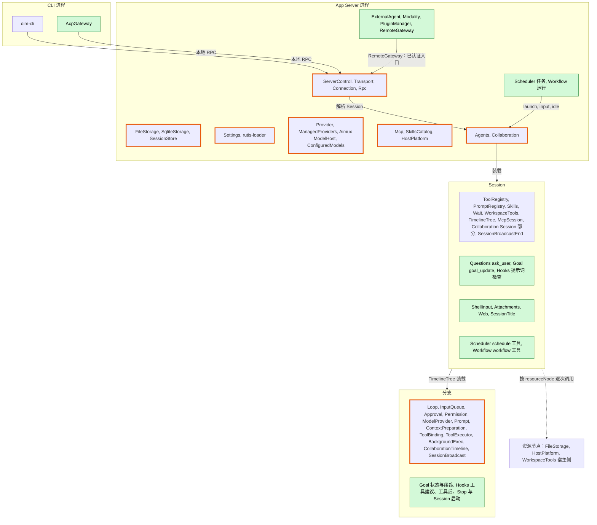
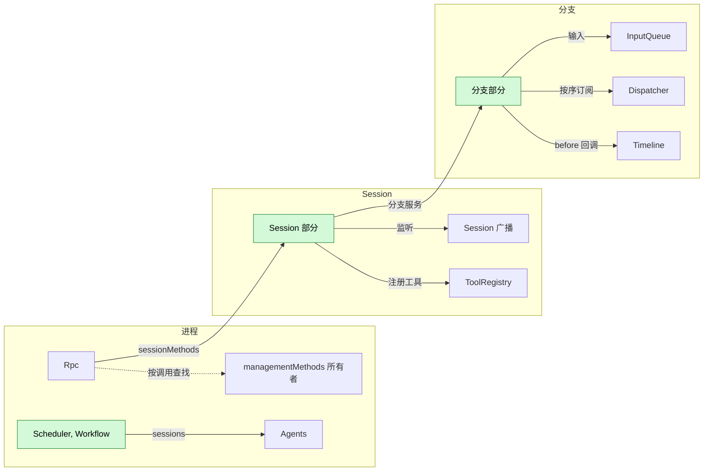
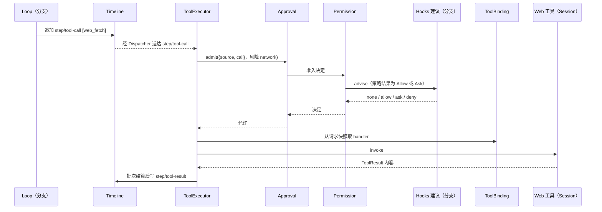
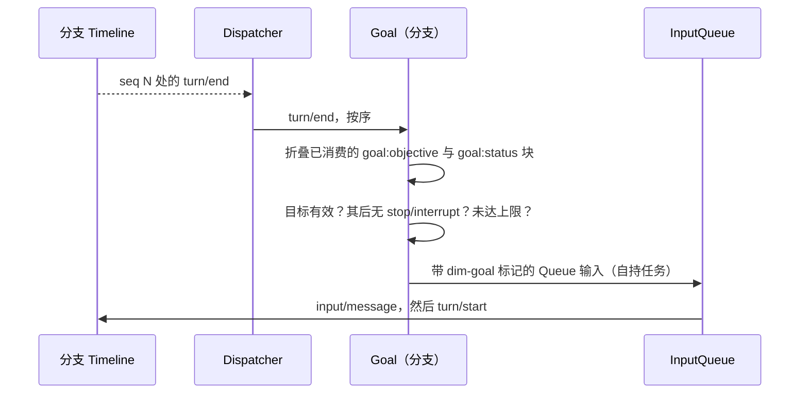
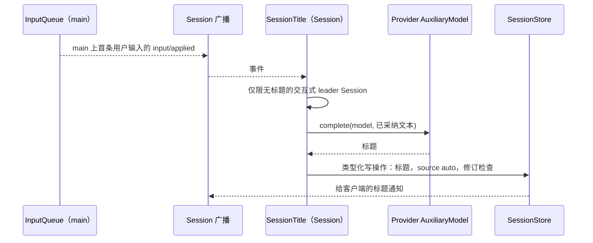
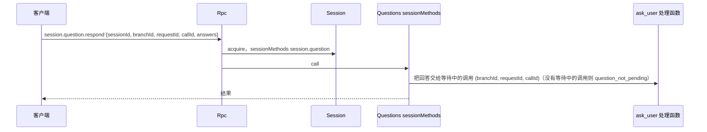
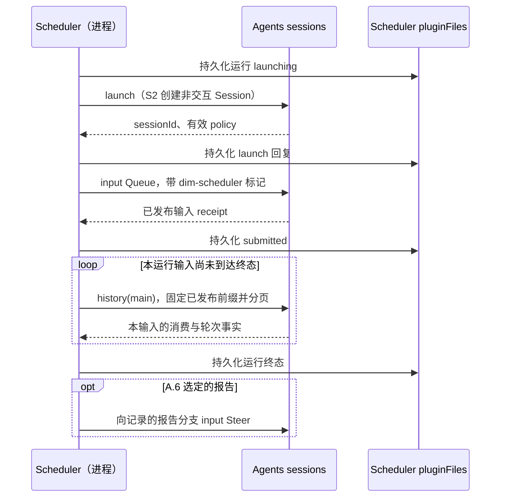
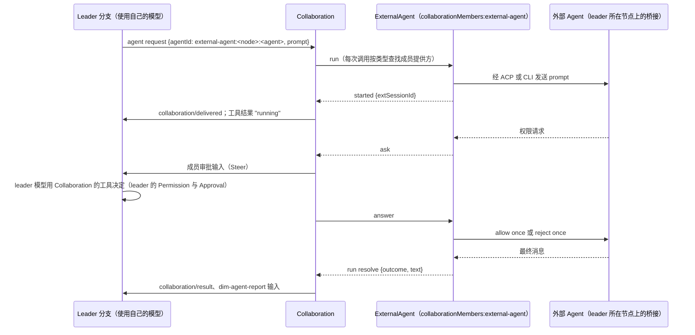

# 总体设计：未设计功能的插件

状态：草案

本文从 [CLI 功能清单](../../feature-list.md)出发，找出现有插件未覆盖的功能，并把新插件放入现有系统。每个新插件在 `docs/design/plugins/<Name>.md` 中设计。对现有插件的补充列在[附录 B](#附录-b-现有插件的补充)，由所属插件设计。

> **作用域规则**（[ADR 002](../adr/002-plugin-scope.md)）：插件的每一部分位于拥有其状态与生命周期的作用域（进程、Session 或分支），各部分只通过运行时已有的机制集成。不引入新机制。每个合同都是语言中立的（D5）：一个带作用域、实例 key 和纯数据方法的具名服务，因此任何语言的插件都可以提供或使用它（[§3.1](#31-合同形式)）。两份合同描述对现有接口的补充：[方法与工具贡献](contracts/session-boundary.md)（Rpc、ToolRegistry）和 [Session 访问](contracts/session-access.md)（Agents、Session 门面、InputQueue）。

正文涵盖前提、作用域图与划分、集成、目录、关键流程、约束、事件、阶段和待对齐问题。附录涵盖功能归属、现有插件的补充、实现语言、CLI 层、文档模板和向机制所有者提出的需求。

## 1. 范围与前提

| 项目 | 约定 |
| --- | --- |
| 终端形态 | 只设计 scrollback。功能清单中标为“仅全屏 TUI”的条目不在范围内 |
| 多模态 | 覆盖全部类别（图像、视频、语音、音乐、音频、3D 资产、动作、实时、OCR）。“仅特定 Desktop 构建”是可用性约束（[Modality](plugins/Modality.md)） |
| 不计划 | Todo 状态与 `plan` Skill |
| 动态事件 | 以 [#2](https://github.com/arcships/dim/issues/2) 为前提：Timeline 只检查信封和核心保留领域，以不透明数据承载核心未定义的事件类型；没有类型注册表，能力的事件声明只是描述契约 |
| 模型上下文 | 依据 [ADR 001](../../adr/001-harness-foundation.md)：模型只看到被采纳的输入和工具结果，插件事件不投影。#2 采用同一边界（[§9](#9-待对齐问题)） |
| 配置 | [ADR 002](../adr/002-plugin-scope.md) D4（由 [ADR 007](../adr/007-plugin-configuration.md) 纠正）：结构性插件配置（是否安装、一个名字用哪个插件、是否关闭、包路径）位于 PluginManager 的 `plugins.json`，由 PluginManager 对 loader 行执行（[PluginManager](plugins/PluginManager.md)，#3），可能重载该行。业务配置位于所有者的具名 Settings 来源，使用时读取，永不重载；Settings 已通过 S8a 支持 Rust 所有者，并通过 S8b 具名服务支持已声明的 TypeScript 所有者（[§6.4](#64-约定)，[路线图](../../design/roadmap.md) S8a/S8b）。项目文件保持自己的权威（ADR 001）；目录中的项目文件，例如 Workflow 的 `.dimcode/workflows/*.yaml`，不是 Settings 来源（Hooks 的 `.dimcode/hooks.json` 就是其中之一：`HooksSettings` 经 FileStorage 读取它，Hooks 的 Settings 来源 `hooks` 只保存用户文档；MCP 位于项目根下的 `.mcp.json` 才是其 Settings 来源的项目文件），由其所有者经 FileStorage 读取；这类配置运行的命令不需要批准（§6.4 批准范围）。项目目录为 `.dimcode/` |
| 现有设计 | [时间总线](../../architecture/rust-agent/time-bus.md)、[设计规则](../../architecture/rust-agent/principles.md)、[单树装配](../../architecture/rust-agent/single-tree.md)、[生命周期](../../architecture/rust-agent/lifecycle.md)、[事件驱动流程](../../architecture/rust-agent/event-driven-flows.md)、[工具贡献](../../architecture/rust-agent/tool-contributions.md)以及 ADR 001 信任合同均适用 |

## 2. 作用域划分

绿色部分为新增，橙色边框部分为变更。每个新插件部分位于拥有其状态的作用域。跨两个作用域的功能是一个插件包，每个作用域一个部分，与 SkillsCatalog、Skills 和 SkillsBranch 的做法相同。可选的 Session 与分支部分只在插件启用时安装，从不作为占位。

| 插件 | 进程 | Session | 分支 | 理由 |
| --- | --- | --- | --- | --- |
| Questions | — | `ask_user` 工具；`session.question.*` 方法；非交互 Session 中 `ask_user` 回答当前没有可以回答的对象 | —（运行中 `ask_user` 调用的等待者在 Session 部分；没有事件，回答就是工具结果） | 等待者就是 Session 级工具处理函数自己的调用 |
| Goal | — | `goal_update` 工具与 `session.goal.*` 方法，只写一条带 `goal:objective` 和/或 `goal:status` 块的 `input/message` | 目标状态由已消费的目标变更块按序号折叠得出；Goal 经 Dispatcher 消费 `turn/end`、`stop/interrupt` 或 `input/deleted` 时自己决定续跑 | 一个目标只属于一个分支：折叠只用该分支自己的事件，因此子分支和分叉 Session 从没有目标开始；续跑按序跟随其事件 |
| Hooks | App Server 中的配置（Settings 来源 `hooks`、`hooks-projects` 与 `hooks-plugins`，管理方法 `hooks.*` 与插件 `register`/`withdraw`/`plugins()`，`HookSources` 端口） | Hook 文档（用户、项目与插件）；执行器；向 Session 的 `submitChecks` 登记、由操作者输入入口调用的提交检查（`UserPromptSubmit`） | 向 Permission 登记的建议（`PreToolUse`）；经 Approval 回答 `PermissionRequest`；从 Dispatcher 运行 `PostToolUse`、`PostToolUseFailure`、`Stop`、`SessionStart`、`Notification` | 规则属于 Session；执行发生在分支 |
| ShellInput | — | `shell.*` Session 方法；在 Session 的工作区中运行并写入其输入 | — | 命令属于 Session |
| Attachments | — | `attachment.put`；通过 SessionStore 管理 Session 文件 | — | 附件是 Session 数据 |
| Web | — | `web_search`、`web_fetch` 工具 | — | 没有跨 Session 共享的状态 |
| SessionTitle | — | 通过 Session 广播观察首条用户输入的采纳（`input/applied`）；`session.rename`；标题由 SessionStore 保存 | — | 标题属于 Session |
| **已撤回（Notifications 已撤回）。** Notifications | — | 观察 Session 广播；`notify` 工具 | — | 触发源是 Session 的事件 |
| Scheduler | 触发器、运行历史；任务位于 Settings 业务来源 `schedule` | `schedule` 工具 | — | 调度跨越多个 Session |
| Workflow | 运行；定义位于 Settings 业务来源 `workflow` 或项目文件 | `workflow` 工具 | — | 一次运行跨越多个 Session |
| ExternalAgent | 在用外部会话、Collaboration 成员类型 | — | — | 外部 Agent 会话与进程是共享的宿主资源 |
| Modality | 任务、实时连接 | — | — | 任务与 provider 连接是共享的 |
| PluginManager | 插件配置（`plugins.json`） | `PluginTools`（`plugin` 工具） | — | 安装以宿主为单位 |
| RemoteGateway | 远程入口、设备 | — | — | 一个外部入口 |
| AcpGateway | 接入方宿主进程 | — | — | 可复用客户端进程插件，位于 daemon 外 |

管理不是插件。管理方法是关于宿主而不是某个 Session 的客户端 RPC 方法（[定义](contracts/session-boundary.md)）；由进程插件提供，方式是把命名空间注册到进程的方法表 `managementMethods`。每个 rutis 会话都把该服务导出给它的远端（语言运行时或 UI 叶子），因此在那里运行的代码也能注册命名空间；它是受信任的本地代码（[rutis 0.19 升级 M8](rutis-0.19-upgrade.md#m8-ui-leaf-是一个插件它的生命周期就是一条会话)）。Session 方法没有级别。Rpc 为本地连接提供 Session 方法和管理方法，从不向带 `deviceId` 的连接（已配对设备）提供管理方法。rutis 会话的对端通过导出的 `managementMethods` 服务使用管理方法，不经过 Rpc。

## 3. 基于现有机制的集成

插件从不新增接线插件（ADR 002 D2）。每项需求都对应插件自身作用域已有的机制：

| 需求 | 机制 | 使用方 |
| --- | --- | --- |
| 向 Session 提供工具 | 把它注册到本 Session 的 `toolRegistry`（[方法 A.5](contracts/session-boundary.md#a5-工具贡献)），工具集合会变化时注册一个工具来源（[工具贡献](../../architecture/rust-agent/tool-contributions.md)） | Questions, Goal, Web, Scheduler, Workflow |
| 提供指令 | PromptRegistry 提示词来源 | 现有 |
| 观察 Session 的事件 | 现有的 Session 广播（`session/<id>` 通道），由 Session 级插件监听 | SessionTitle |
| 按序观察并响应分支事件 | 分支 Dispatcher，由分支级插件订阅 | Goal, Hooks 工具后、turn 结束与 Session 启动 |
| 把内容放入模型上下文 | 分支输入（raw 块、带 key 的块）或工具结果（[Session 访问](contracts/session-access.md#a2-来源输入约定)） | Goal, Hooks, ShellInput, Scheduler, Workflow |
| 在写入提交前对其作出处理 | 由分支级插件注册的同步 Timeline before 回调（[single-tree](../../architecture/rust-agent/single-tree.md)）：在提交锁内变换草稿，不阻止写入，不等待外部工作，失败时提交原草稿（[原则 §4 第 3 条](../../architecture/rust-agent/principles.md)） | 暂无 |
| 关于某个 Session 的客户端方法 | 注册到该 Session 的 `sessionMethods` 的命名空间，由 Rpc 经该 Session 分发（[A.1](contracts/session-boundary.md#a1-方法贡献)） | Questions, Goal, SessionTitle, Attachments, ShellInput, InputQueue（`session.input.withdraw`） |
| 宿主管理方法 | 进程插件注册到 `managementMethods` 的命名空间，由 Rpc 按调用查找 | 现有管理方法, Settings（业务配置，`settings.read`/`settings.update`，S8b，已实现）, Scheduler, Workflow, ExternalAgent, Modality, PluginManager, RemoteGateway |
| 访问其他 Session | Agents 的 `sessions` 服务（`launch`、`input`、`history`、`idle` 等），与 Collaboration 的做法相同（[Session 访问](contracts/session-access.md#a1-sessions-服务)） | Scheduler, Workflow |

箭头是依赖边，指向相同或外层作用域（D3）。依赖方向从扩展指向核心（D3）：核心收集方从不依赖可选的贡献方。ToolRegistry 跟随可选插件注册与撤回的工具，从下一个请求起提供或撤下，不需要重载 Session（[A.5](contracts/session-boundary.md#a5-工具贡献)，#241），Rpc 在每次调用时查找管理方法所有者（虚线箭头，[方法 §3.2](contracts/session-boundary.md#32-管理方法)），Session 装配让打开时已登记的可选部件先加载结束，但不要求它们处于 Active（ADR 006 D3，发布），因此未激活或正在重载的提供方只影响它自己的功能。重载只跟随罕见的结构性操作（安装、升级、启用、禁用、崩溃）。其传播（包括使在途 turn 失败）是被接受并记录的代价，不增加任何阻止手段。业务配置变更永不重载（D4）。

### 3.1 合同形式

设计定义或使用的每个合同都是一个具名服务（ADR 002 D5）：服务名（camelCase）、作用域、实例 key，以及标注为 `sync` 或 `async` 的方法，其请求、回复和错误都是可序列化数据。取消是一个取消请求，或消费方丢弃该调用。插件在其 `provides` 和 loader 行中声明它提供的内容；消费方按服务名和作用域收集。工具和方法命名空间则是注册的：部件把工具注册到本 Session 的 `toolRegistry`，把方法命名空间注册到本 Session 的 `sessionMethods` 或进程的 `managementMethods`，注册持续到该部件卸载。rutis 跨语言调用此类服务（rutis-bridge 运行时、`host_key(name)`、`TypeKey::named`），因此 TypeScript 或 Python 部分无需手写 Rust 绑定即可满足合同。Rust trait、`TypeKey`、`Keyed<T>` 和 `AgentBuilder` 调用只出现在各文档的“Rust 绑定”附录中。

| 服务 | 作用域 | Key | 方法 | 定义于 |
| --- | --- | --- | --- | --- |
| `sessionMethods` | Session | — | `register(namespace, MethodDecl[], call): async`，其中 `call(MethodCall, cancelled, progress): async -> MethodReply` 是注册部件自己的函数 | [方法 A.1](contracts/session-boundary.md#a1-方法贡献) |
| `managementMethods` | 进程 | — | 同上 | [方法 A.1](contracts/session-boundary.md#a1-方法贡献) |
| `toolRegistry` | Session | — | `register(ToolDeclaration, execute): async`，其中 `execute(ToolCall, cancelled): async -> ToolResult` 是注册部件自己的函数 | [方法 A.5](contracts/session-boundary.md#a5-工具贡献) |
| `sessions` | 进程 | — | `launch`、`input`、`lookup`、`history`、`withdraw`、`stop`、`idle`、`delete` | [Session 访问 A.1](contracts/session-access.md#a1-sessions-服务) |
| `scheduleJobs`（可选包，[#317](https://github.com/arcships/dim/pull/317)） | 进程 | — | 供 `schedule` 工具使用的 Session 到进程的任务操作 | [Scheduler](plugins/Scheduler.md) |
| `workflowRuns`（可选包） | 进程 | — | 供 `workflow` 工具使用的 Session 到进程的运行操作 | [Workflow](plugins/Workflow.md) |

运行时现有的类型化服务（Timeline、Dispatcher、ToolHost 等）保持原样。[#4](https://github.com/arcships/dim/issues/4) 已部分交付：[C4 Session](../../design/session-typescript.md) 与 [C5 分支](../../design/branch-typescript.md) 绑定已按名称暴露各自文档列出的合同类别。其他类型化服务仍须由其所有者提供明确绑定；rutis 本身已经支持跨语言调用。

## 4. 插件目录

插件设计文档索引：[plugins/README.md](plugins/README.md)。

| 插件 | 作用域 | 职责 | 阶段 | 语言 | 文档 |
| --- | --- | --- | --- | --- | --- |
| Questions | Session | `ask_user`；回答就是工具结果；`session.question.respond` | P1 | Rust | [Questions](plugins/Questions.md) |
| ShellInput | Session | `!command` / `!!command`，作为 Session 方法 `shell.run/stop/list` | P1 | Rust | [ShellInput](plugins/ShellInput.md) |
| Attachments | Session | 大段文本的 `attachment.put`；Session 文件 | P1 | Rust | [Attachments](plugins/Attachments.md) |
| SessionTitle | Session | 由首条被采纳的用户输入生成标题；`session.rename` | P1 | Rust | [SessionTitle](plugins/SessionTitle.md) |
| Goal | Session + 分支 | 目标状态由 `goal:objective` 与 `goal:status` 输入块折叠得出；续跑；`goal_update`；`session.goal.*` | P2 | Rust | [Goal](plugins/Goal.md) |
| Web | Session | `web_search`、`web_fetch` | P2 | TypeScript 优先 | [Web](plugins/Web.md) |
| Hooks | 进程 + Session + 分支 | 使用 Dim 自有配置的命令 Hook，文档形状与脚本协议兼容 Claude Code / Codex，挂在业务所有者上：Permission（工具前建议）、Approval（权限请求）、操作者输入入口（提示词检查）、分支输入（工具后、Stop、Session 启动） | M1 | Rust | [Hooks](plugins/Hooks.md) |
| Scheduler | 进程 + Session | 定时任务；`schedule` 工具；运行结果报告 | P2 | TypeScript 优先 | [Scheduler](plugins/Scheduler.md) |
| Workflow | 进程 + Session | 跨 Session 的多阶段运行；`workflow` 工具 | P2 | TypeScript 优先 | [Workflow](plugins/Workflow.md) |
| Notifications | Session | 投递到渠道；`notify` 工具 | P2 | TypeScript 优先 | [Notifications](plugins/Notifications.md)（已撤回） |
| ExternalAgent | 进程 | 外部 Agent 作为 Collaboration 子 agent（一种成员类型） | P3 | TypeScript 优先 | [ExternalAgent](plugins/ExternalAgent.md) |
| AcpGateway | 接入方宿主进程 | 复用现有本地 RPC 的 ACP 服务；独立临时 MCP 绑定 | 支持子集已实现，未发布（PR #441） | Rust | [AcpGateway](plugins/AcpGateway.md)、[验收](../../design/acp-gateway-acceptance.md) |
| RemoteGateway | 进程 | 远程入口、配对、设备 | P3 | Rust | [RemoteGateway](plugins/RemoteGateway.md) |
| Modality | 进程 | 多模态任务与实时连接 | P3 | TypeScript 优先 | [Modality](plugins/Modality.md) |
| PluginManager | 进程 | 插件配置、从路径或 Git 安装、插件代码的 loader 行、向负责方登记内容 | M1 | Rust | [PluginManager](plugins/PluginManager.md) |

| 合同 | 所有者 | 定义 |
| --- | --- | --- |
| [方法与工具贡献](contracts/session-boundary.md) | Rpc, ToolRegistry | `sessionMethods`、`managementMethods`（及管理方法的定义）、`callChannel`、各入口获得的服务范围、`unknown_method`/`service_reloading`、现有管理方法的迁移与兼容、向 `toolRegistry` 注册工具 |
| [Session 访问](contracts/session-access.md) | Agents, InputQueue | `sessions` 服务；带受限策略的 `launch`、`SessionConfig.interactive`、来源 raw 块、固定前缀读取、撤回（经 `sessionMethods` 提供的 `session.input.withdraw`） |

## 5. 关键流程

### 5.1 使用 Session 工具与 Hooks 工具建议的工具调用

Timeline 上没有任何东西等待 Hook：建议在 Permission 的准入决定中运行，位于 ToolExecutor 的逐调用准入任务内。被拒绝调用的原因是 ToolExecutor 正常批次 `step/tool-result` 中的错误文本；Hooks 从不写 `step/tool-result`（[Hooks §3.1](plugins/Hooks.md#31-经-permission-的-pretooluse)）。建议端口是 Permission 与 Approval 的变更（[附录 B.1](#b1-session-与分支-capability)）。

### 5.2 由分支 Dispatcher 驱动的 Goal 续跑

每次目标变更（设置、编辑、暂停、恢复、清除，以及模型通过 `goal_update` 报告完成或受阻）都是一条 `input/message`，其 raw 块带 key `goal:objective`（设置、编辑）、`goal:status`（设置、暂停、恢复、完成、受阻、自动暂停），或退役两者（清除）；续跑不带 key，只被计数。压缩（[ContextCompaction](https://github.com/arcships/dim/blob/roadmap/f1-production-compaction-host-compact-and-u/docs/zh/design/plugins/ContextCompaction.md)，F1；PR #108 合并前为分支链接）原样保留从 `retain_from` 起的事件（最后几轮），并重放位于它之前的每个 key 最新的存活块，因此模型保有当前目标与状态；压缩是 Loop 的一个步骤，不写 `turn/*`，因此从不触发续跑决策。工具和 `session.goal.*` 方法只写这条事件，不读 Goal 的状态，也不做决定。Goal 的状态是已消费的块按序号折叠的结果，没有例外：每个 key 最新的存活块就是当前目标与状态，因此压缩重放的内容总与折叠结果一致；只有 `goal:objective` 存活时目标才存在。Goal 经 Dispatcher 消费 `turn/end`、`stop/interrupt` 或 `input/deleted` 时自己决定是否续跑，只用已消费的状态；把写入登记为自持任务后返回，写入前再用已消费的状态复核。被删除的输入不改变状态。一个目标只属于一个分支：折叠只用写在该分支上的事件，从不用继承的前缀，因此子分支和分叉 Session 的 `main` 从没有目标开始，在那里的变更只影响该分支；Goal 消费新分支的 `branch/start` 时，若继承的前缀中仍有存活的目标 key，就作为自持任务在那里写一次 `clear`，使新分支上的模型不把父分支的目标当作自己的。`stop/interrupt` 会暂停目标。如果中断落在续跑输入之后，最多多跑一个 turn，模型会看到已暂停的块。

### 5.3 通过 Session 广播的观察者（SessionTitle）

手动标题永不被覆盖。被删除的输入从不产生标题，只有已采纳的文本发给辅助模型。标题是 SessionStore 的进程级状态，不是 Timeline 事实：SessionTitle 通过 SessionStore 的类型化写操作写入，SessionStore 发出 Session 广播通知供客户端使用（约束 2）。

### 5.4 经 Session 分发的 Session 方法（Questions）

### 5.5 经 Agents 的定时运行

[Scheduler](plugins/Scheduler.md) 的设计状态以其所有者文档为准，可选包及其公开流程验证已实现（[#317](https://github.com/arcships/dim/pull/317)），安装按其 §1.3 显式进行。图示为其自持的 create 模式运行流程。S2、Settings 与 pluginFiles 的[公开装配](../../design/process-typescript.md#52-public-pluginfiles-binding)已提供。

跟踪器按 [§3.2](plugins/Scheduler.md#32-完成与超时) 读取自己输入的已发布历史，不保留原生 idle 等待。先保存运行终态，再按 [A.6](plugins/Scheduler.md#a6-运行结果投递) 尝试一次报告；失败记录后不补发。结果经目标分支正常消费输入进入模型上下文。

### 5.6 Collaboration 委派给外部 Agent

外部 Agent 是子 agent，不是模型（[#145](https://github.com/arcships/dim/issues/145)）：leader 保留自己的模型，经与 dim 成员相同的 `agent` 工具委派。ExternalAgent 提供成员类型 `external-agent`；请求、结果、唤醒输入与了结仍归 Collaboration。agent 的权限询问走 Collaboration 的成员审批路径（#19），从不进入任何模型流（#28）。从不选择 `always` 选项（[ExternalAgent §3.2](plugins/ExternalAgent.md#32-权限询问)）。

## 6. 通用约束

### 6.1 集成方式

[§3](#3-基于现有机制的集成) 中的表是穷尽的。只有当某作用域上的状态或行为没有现有插件拥有时，才新建插件部分；现有职责内的变化记录在[附录 B](#附录-b-现有插件的补充)。

### 6.2 约束

1. **最少事件**：只为影响后续行为、且无法从工具调用与结果、`input/*`、`turn/*` 或 `stop/interrupt` 推导出的结果新增事件（时间总线规则 3）。进程输出进入诊断。
2. **所有权**：声明事件类型即定义其数据合同。生产方使用所有者的公共服务。谁启动工作，谁写其开始与终态事实。决策只使用已消费的事实，从不使用其他插件的内存。没有 Timeline 的进程级状态（SessionStore 标题、Provider 连接条目、Agents profile、Settings 业务来源、插件存储）从不进入 Timeline：写入通过所有者的类型化公共写操作，需要在 UI 上显示时由所有者发出 Session 广播通知，供客户端使用。
3. **外部入口**：RPC 从不写事件。它调用所属服务，由该服务写入（先例 `approval.respond`）。Rpc 只做外部边界校验（参数格式、`sessionId` 授权）；图像嗅探、大小限制、模型能力等功能检查归各自所有者（上传方法的所有者、客户端，或构建请求时的 ModelProvider），不放在 Rpc、before 回调或 `session.submit` 中。竞争由 Timeline 序号裁决。
4. **重载与副作用**：已开始但未终止的工作结算为“未能在恢复后存活”，且从不重新执行。允许通过轮询已保存的 handle 恢复对外部任务的观察。
5. **作用域**：每个部分只依赖自身或外层作用域（D3）。Session 与分支部分读取所属 Session 的 `SessionConfig`。进程部分只通过 Agents 的 `sessions` 服务读取 Session。
6. **中断**：插件先取消在途工作并释放资源，再写终态事实（[中断](../../architecture/rust-agent/interrupt.md)）。
7. **准入**：新工具声明风险类别。不新增 Permission 类别：Permission 不认识的风险按未分类处理，ReadOnly 拒绝、WorkspaceWrite 询问、FullAccess 允许（`permission.rs`）；工具仍可声明 `persistent_configuration` 这类描述性的风险。由自动化启动的 Session 以启动方的策略为上限，Scheduler 任务和 Workflow 定义可以进一步收窄。由管理方法启动的运行除非另有声明，默认只读，并受宿主配置约束。`workflow` 使用 `agent` 工具的风险类别。
8. **依赖方向与重载代价**：核心部件从不依赖可选插件；可选插件重载或失败只影响它自己的功能（D3）。重载传到真正的依赖方时，可能使其在途 turn 失败；这一点被接受，并记录在每个插件的冲突表中，从不加以阻止。
9. **管理面**：管理方法（`account.*`、`provider.*`、`mcp.*`、`skills.*`、`settings.read`/`settings.update`，以及新进程插件的方法）由进程插件注册到 `managementMethods`；rutis 会话的远端也能访问该服务（[rutis 0.19 升级 M8](rutis-0.19-upgrade.md#m8-ui-leaf-是一个插件它的生命周期就是一条会话)）。Session 方法没有级别；`shell.*` 是普通 Session 方法。本地 RPC 服务两类方法，RemoteGateway 只服务 Session 方法，rutis 会话的对端通过导出的 `managementMethods` 服务使用管理方法（受信的本地代码）。不存在身份分级。`hello`、`daemon.*`、`agent.*` 和现有的 `session.*` 方法保持为 Rpc 内建方法；`daemon.shutdown` 是内建方法，从不提供给已配对设备（带 `deviceId` 的连接）。
10. **远程 Session 方法**：已配对设备可调用所有 Session 方法，包括 `session.permission.update` 和 `shell.*`（兼容性变更，[方法 A.4](contracts/session-boundary.md#a4-迁移与兼容性)）。
11. **在途工作**：没有共享注册表。每个所有者提供自己的查询与停止，由 CLI 汇总。
12. **撤回**：由 InputQueue 拥有的单一合同。`input/withdraw {input_id, reason?}` 是一个指令事件，可由任何合法生产方写入：客户端经 `session.input.withdraw`（InputQueue 通过 `sessionMethods` 提供的 Session 方法），进程调用方经 `sessions.withdraw`。InputQueue 按序消费它；只有当它仍持有该输入且尚未应用（无 `input/applied`）时，才写入结果事实 `input/deleted {input_id}`，且永不应用该输入。否则（未知、已应用或已删除）不写入任何内容，调用方收到的回复为 `notHeld`。已应用的输入无法撤回，Loop 不变。“撤回并作为 Steer 重新提交”是一个原子批次。每个待处理输入推导都排除已删除的输入，它们从不进入模型上下文（其带 key 的块从不生效）。
13. **提交前处理**：插件只能通过 Timeline before 回调，在另一个所有者的写入提交前对其作出处理，回调同步变换草稿，不阻止写入，不等待外部工作；该写入的消费方不做任何特定于插件的改动。
14. **低业务耦合**：raw 块标记与 key、配置 key 和方法命名空间都带所有者前缀。消费方为自己的任务选择的模型是它自己的配置，显式传给共享服务；共享服务不保存按消费方区分的策略。收集方从不点名贡献方。
15. **交互式 Session**：`interactive` 表示 Session 有可交互的对象，能回答它的提问和审批，可以是用户，也可以是另一个 Session 或分支的 agent（[Session 访问 A.3](contracts/session-access.md)）。`session.create` 设置 `interactive`（客户端只在其为 false 时发送）。Exec 和自动化创建非交互 Session；ACP Session 是交互的，因为编辑器回答它的审批。装配不依赖 `interactive`，因此 fork 前后工具集合与提示词前缀保持一致（#30）；这类 Session 中 `ask_user` 回答当前没有可以回答的对象。SessionTitle 只作用于交互式 leader Session。

### 6.3 多节点

rutis 节点通过连接行相连：连接把一个通道交给 rutis session，两个内核以各自的 id（`LocalId`）互相握手。session 把每个进程级共享名字导出给远端，并宣告自己的监听名，因此事件能到达任一端的监听器；插件以 loader 行 `<row>:<plugin>` 在远端运行，其中 `<row>` 是该连接的行。rutis-host 的 `dial` 和 `listen` 行就是这样的连接；Dim 目前都不使用（[rutis 0.19 迁移](https://github.com/arcships/rutis/blob/v0.19.3/docs/migration-0.19.en.md)，[#5](https://github.com/arcships/dim/issues/5)）。

| 规则 | 内容 |
| --- | --- |
| 控制节点 | 承载 App Server：Timeline、Session、配置来源、Provider、调度 |
| 资源节点 | 宿主资源所在之处（文件、进程、shell、隔离、本地 CLI）。每个 Session 将绑定一个，记为 `SessionConfig.resourceNode`，创建时固定；这是 P3 新增的可选字段，缺省即控制节点；P1/P2 中每个 Session 都使用控制节点 |
| 宿主服务 | Session 资源节点上的 FileStorage、HostPlatform、隔离以及 WorkspaceTools 宿主侧，在每次调用时按 Session 的 `resourceNode` 查找（#38）。没有 Session 的进程插件（Modality OCR、ExternalAgent 桥接）在自身业务配置中指定节点，使用时读取。ExternalAgent 的 agent 进程位于每节点一行的桥接 loader 行（其他节点上为 `<node>:external-agent-bridge`，`<node>` 是该节点的连接行），该行在自身存续期间把自己挂接到 ExternalAgent（[ExternalAgent §3.4](plugins/ExternalAgent.md#34-桥接生命周期)） |
| 节点绑定数据 | 隔离配置和外部 Agent 目录以节点和路径标识 |
| 离线 | 对离线资源节点的调用以 `node_unavailable` 失败；依赖方不重载，也不进入 Pending。节点服务在每次调用时按 `resourceNode` 查找，因此节点离线只让这些调用以 `node_unavailable` 失败；不向 rutis 提需求（#38）。该节点的 session 结束时，由资源节点自己的 HostPlatform 结束它启动的进程 |
| 认证 | 由连接的通道认证远端；握手中的 id 是自报的。session 导出每个共享名字，包括 `managementMethods`，所以已连接的节点被当作宿主代码信任（AGENTS 第 11 条） |
| 未来 | 跨控制节点协作不在此设计 |

### 6.4 约定

| 主题 | 约定 |
| --- | --- |
| 上下文 | 模型上下文只经由工具结果和输入；常驻规则经由提示词来源或带 key 的 raw 块 |
| 配置 | 每项一个来源，只经其所有者的接口写入。结构性条目（是否安装、一个名字用哪个插件、是否关闭）位于 PluginManager 的 `plugins.json`，只由 PluginManager 对 loader 行执行（[PluginManager](plugins/PluginManager.md)，#3）；插件不写自己的结构性字段。业务条目位于 Settings 来源：一个所有者有一个或多个具名来源，每个来源只保存一种文档类型（MCP 拥有 `mcp` 和 `mcp-projects`）；来源名使用 `[a-z0-9_-]`。Settings 不依赖任何插件。**S8a（Rust，已实现）：** 所有者为每个来源实现 `BusinessDocument`（名称、用户文件、可选的项目文件、`validate`、`Default`）；读取返回 `{revision, document}`，更新按 revision 做 CAS。Settings 没有自己的订阅接口：写入成功后在通道 `settings_changes(source)`（`settings/<source>`）上发出 rutis 事件 `settings.changed` `{source, scope, revision}`，用户和项目作用域都覆盖，从不带文档内容；新授权的项目在 `project_authorizations()` 上发出 `settings.project_authorized` `{root, cwd}`。使用方用 `ctx.events().on` 监听，监听器随其所在插件一起存亡；先读一次，再跟随事件。`SettingsChanged` 与 `settings_changes` 声明在 `dim-agent-capabilities` 中，任何 crate 中的所有者（MCP、Skills 目录）都监听同一个类型。校验和默认值只在 Settings 边界应用，即写入时和读取持久化文件时（文件缺失即默认文档）；使用方按交付的样子使用文档，不再校验，也不自带默认值。新的原生来源是 v13 `settings_documents` 契约下增量的 `user/<source>` 行。**S8b（随 TypeScript 桥接 C4，已实现）：** 语言中立的具名 `settings` 服务提供所有者读取、CAS 更新和同样的 `settings.changed` 事件，文档为 JSON（[Settings 合同](appserver/settings-service.md)）；每个所有者（Rust 与 TypeScript 相同）在自己进程行的 `apply` 中于运行时登记来源，该行卸载时登记撤回（[PluginManager §9 R1](plugins/PluginManager.md#9-向机制所有者提出的需求)）；一份声明包括 `userFile`、可选 `projectFile`、JSON Schema/默认值和 `userOnly` 指针，`BusinessDocument` 仍是 Rust 绑定。写入走两条路径之一：客户端管理方法 `settings.read`/`settings.update`，或所有者的类型化写入（包括代其工具发起的写入）；所有者代其工具发起、改动仅限用户字段的写入会被拒绝。JSON Schema 无法表达的规则（例如 CIDR）是所有者在使用时给出的诊断。Settings 不赋予任何字段特殊含义：密钥是所有者文档中的普通字段，是否保存、如何保存或加密由所有者决定（[settings-service §1.2](appserver/settings-service.md#12-决定密钥归其所有者)）。Scheduler 任务（来源 `schedule`）和保存的 Workflow 定义（来源 `workflow`，一个把名称映射到定义的文档，另含项目启用记录）是 Settings 文档。目录中的项目文件（Workflow 的 `.dimcode/workflows/*.yaml`）不是 Settings 来源：其所有者在项目文件权威下经 FileStorage 读取。Hooks 的 `.dimcode/hooks.json` 也属于此类；Hooks 的 Settings 来源 `hooks` 只保存用户文档。运行记录位于 `pluginFiles`（扩展后）。RemoteGateway 监听设置、Modality 的 OCR 组件路径和 ExternalAgent 桥接都是业务配置 |
| 批准范围 | Approval 与 Permission 只管 agent 决策引起的动作（模型的工具调用）。按用户或项目配置运行、而不是由 agent 决定的命令（连接时启动的 MCP stdio 服务、Hook 命令、工作流文件、插件）不属于 agent 体系，由该配置自己负责：启用即运行，不需要批准。功能开关（启用、禁用）是普通配置，与批准无关；来自项目来源的条目默认关闭，只能由用户本机配置启用。没有宿主本地批准（[ADR 003](../../adr/003-approval-scope.md)）；原有的 `mcp.approve`/`mcp.revoke` 及其批准记录已删除（[附录 B.2](#b2-app-server-进程插件)） |
| 安全设置 | 宿主安全设置从不进入 Timeline，回放和 fork 从不恢复或放宽它们。权限预设是 Timeline 事实（`permission/changed`），由子分支继承，fork 时随事实一起复制 |
| 持久化 | 进程存储使用 `pluginFiles`（扩展后）：每插件根目录、UTF-8 与二进制原子替换、锁、格式版本（[受信插件存储](../../../crates/dim-app-server/README.md#trusted-plugin-storage)）。Session 文件位于 SessionStore 之下 |
| 协议 | Rpc 内建方法优先于贡献的方法 |
| 国际化 | 用户可见文本属于 CLI；模型可见文本属于提示词来源 |

## 7. 新增 Timeline 事件

| 事件 | 写入方 | 必要性 |
| --- | --- | --- |
| `input/withdraw {input_id, reason?}` | 客户端（`session.input.withdraw`，由 InputQueue 提供）、进程调用方（`sessions.withdraw`） | 一个通过序号与采纳排序的指令；可选的 `reason`（通用文本，不带业务含义）是客户端为被删除输入显示的内容 |
| `input/deleted {input_id}` | InputQueue | 结果事实：被持有的输入永不被应用；队列状态必须可重建 |

Questions 不新增事件：待答问题是没有 `step/tool-result` 的 `ask_user` 的 `step/tool-call`，回答就是工具结果（[Questions §2](plugins/Questions.md#2-数据与状态)）。

| 不新增的事件 | 改用什么 | 原因 |
| --- | --- | --- |
| `goal/*` | 带 key 的 raw 块，包括终态块 | 目标状态是输入 |
| `shell/*` | `!command` 结果写为 Append 输入 | 不是分支在途工作 |
| `hook/*` | 工具拒绝表现为 ToolExecutor 写的错误结果，提示词拦截表现为 `input_blocked` 回复且不写入任何内容，上下文表现为 Hooks 输入（[Hooks](plugins/Hooks.md)） | Hooks 不声明事件 |
| `external_agent/*` | Collaboration 事实、审批事实 | 外部 Agent 是 Collaboration 成员；委派事实归 Collaboration |
| `session/titled` | SessionStore 进程级状态，经其类型化操作写入，并发出 Session 广播通知 | 不影响分支行为 |
| Workflow 与定时运行结果 | 工具结果、已消费的报告输入及 `pluginFiles` 记录 | 不需要插件自有 Timeline 事件或进程通知协议 |
| 排队消息转 Steer | `input/withdraw` + 新 Steer 输入，在一个批次中 | 无需单独事件 |

## 8. 阶段

前置条件总是落在早于其消费方的阶段。

| 阶段 | 内容 |
| --- | --- |
| P0 基础 | 由 `session.create` 设置的 `SessionConfig.interactive`；带 `launch` 的 `sessions` 服务；`sessionMethods` 分发；Rpc 表中的 `managementMethods` 及现有管理方法的迁移；向 ToolRegistry 注册工具；带变更通知的 Settings 业务来源（S8a）；语言中立的 `settings` 服务（S8b，随 C4）；`pluginFiles`（扩展：二进制、格式版本）；Provider `AuxiliaryModel`（会话外单次模型调用）；SessionStore 元数据与 Session 文件；FileStorage 列举与删除；HostPlatform argv 辅助 |
| P1 核心交互 | Questions（已重新设计，M2）、ShellInput、Attachments、SessionTitle；InputQueue 撤回；Permission 规则；模型参数；SessionStore 删除、清理与 fork；HostPlatform 隔离；#4 为非 Rust 部分按名称暴露运行时的类型化服务；CLI 子命令、图像转换、`/export`、`exec --json` |
| P2 功能扩展 | Goal、Web、Scheduler、Workflow；Collaboration 成员审批作为输入送到 leader；Mcp OAuth；生产环境压缩宿主 |
| P3 外部集成 | ExternalAgent、AcpGateway、RemoteGateway 及 Transport `EntryHost` 与 `ConnectionEntry {name, deviceId}`、Modality；PluginManager；资源节点（按 `resourceNode` 在每次调用时查找服务） |

ADR 002 中记录的 HostPlatform exec shell 变更（作为业务配置在每次 spawn 时读取）是独立工作，不阻塞任何阶段。

## 9. 待对齐问题

| 问题 | 状态 |
| --- | --- |
| 事件如何进入上下文 | 已决定：只有被采纳的输入和工具结果（ADR 001）。#2 已于 2026-10-15 修订为同一口径 |
| MCP stdio 隔离 | 待定：MCP stdio 进程是否默认隔离 |
| 远程访问取舍 | 待定：认证、断连与 TLS 部署，与 [#5](https://github.com/arcships/dim/issues/5) 相关（[RemoteGateway](plugins/RemoteGateway.md)） |
| TypeScript Session 部分 | C4 工具、Session 方法/事件及 C5 已发布分支合同已交付（[C4](../../design/session-typescript.md)、[C5](../../design/branch-typescript.md)）。Provider 的具名 [auxiliaryModel](appserver/auxiliary-model.md#43-具名绑定) 已可供 SessionTitle 使用；Scheduler/Workflow 的进程/包/管理绑定及 Ready 状态以各自所有者文档（§1.3）为准。其他服务类别以各自所有者已发布的绑定为准。 |
| 定时运行结果路由 | 由 [Scheduler A.6](plugins/Scheduler.md#a6-运行结果投递) 明确：运行所有者保存历史，经现有 Session 输入报告。设计状态见 Scheduler 的所有者文档；可选包及其公开流程验证已实现（[#317](https://github.com/arcships/dim/pull/317)）。 |
| 定时任务存活 | 已决定：守护进程必须存活（[Scheduler](plugins/Scheduler.md)） |
| FullAccess 与新类别 | 已决定：自动允许（约束 7） |
| 外部 Agent 权限 | 提议（#145）：外部成员的询问走 Collaboration 的成员审批路径；leader 的模型在 leader 的 Approval 与 Permission 下用 Collaboration 的工具决定（[ExternalAgent §3.2](plugins/ExternalAgent.md#32-权限询问)） |
| 外部成员 | 已决定（D5，#254）：`{leaderSessionId, agentId, extSessionId, cwd}` 持久化在 ExternalAgent 的 `pluginFiles` 存储中，重载或重启后用 ACP `session/load` 或 CLI resume 重新打开；restore 失败保留记录并返回 `restore_failed`；成员只在显式 `close` 时结束；leader 关闭或删除不级联（[ExternalAgent §3.5](plugins/ExternalAgent.md#35-重载或重启后的恢复)） |
| fork 时的权限预设 | 已决定：不特殊处理；预设随事实一起复制，应用层如需不同的预设，在 fork 后自行设置（#26） |
| 重载传播 | 已决定：罕见结构性操作的可接受代价（[ADR 002](../adr/002-plugin-scope.md) D3） |
| 由 Collaboration 成员运行 Workflow 阶段 | 未来功能：跨阶段复用成员的上下文。目前每个阶段都在启动的 Session 中运行（[Workflow](plugins/Workflow.md)） |

## 附录 A. 功能归属

“现有”表示由现有插件覆盖。“扩展”表示现有职责，列于附录 B。“新增”表示新插件（§4）。“CLI”指附录 D。

| 领域 | 功能 | 归属 |
| --- | --- | --- |
| Provider | OAuth / API-key Provider、`/connect`、`/models` | 现有：Provider、ManagedProviders、OAuth 插件、Aimux |
| Provider | `/effort`、`/fast` | 扩展：Prompt、Provider |
| Provider | 子 Agent 与辅助模型 | 扩展：Provider（`AuxiliaryModel`） |
| Session | `/new`、`/resume`、Session 列表 | 现有：Agents、SessionStore |
| Session | `/timeline`、`/export` | CLI |
| Session | Session 标题 | 新增：SessionTitle |
| Session | fork、删除、清理 | 扩展：SessionStore、Agents |
| Session | 请求快照导出 | Timeline 导出（[ADR 005](../../adr/005-observability.md) D3）；最终请求是 `model/call` 事实 |
| Session | 文件与对话回滚 | 不在范围内（仅全屏 TUI） |
| 交互 | 发送、排队、自动发送、Steer、中断 | 现有：InputQueue、Loop |
| 交互 | `Ctrl+S`、`/queue`、召回、删除排队消息 | 扩展：InputQueue（撤回） |
| 交互 | 多行编辑、历史、补全、引用、粘贴、剪贴板、复制、链接 | CLI |
| 交互 | 大段粘贴、混合附件 | 新增：Attachments；CLI 把图像转换为图像块 |
| 交互 | `!command`、`!!command` | 新增：ShellInput |
| 交互 | 流式输出、运行状态、文件变更反馈 | 现有事件，由 CLI 渲染 |
| 交互 | 工具审批 | 现有：Approval、Permission |
| 交互 | 用户提问 | 新增：Questions |
| 交互 | Todo 状态 | 不计划 |
| 交互 | 查看与停止后台任务 | 各所有者（BackgroundExec、Collaboration、Workflow、ShellInput），由 CLI 汇总 |
| 系统 | `/exit`、`/theme`、`/keys`、升级 | CLI |
| 系统 | `/settings` | 每项属于各自插件；由 CLI 汇总 |
| 系统 | `/usage` | 扩展：ContextPreparation、ManagedProviders |
| 系统 | `/language` | CLI；扩展：PromptSources |
| 系统 | `/debug`、调试日志 | 现有：进程日志（`daemon.log`、`RUST_LOG`，[ADR 005](../../adr/005-observability.md) D1） |
| 系统 | `/stats`、鼠标设置 | 不在范围内 |
| Agent 行为 | `/agent` | 扩展：Agents、Prompt、PromptSources |
| Agent 行为 | `/goal`、续跑、Goal 模式 | 新增：Goal（模式由目标状态覆盖） |
| Agent 行为 | `/approvals`、命令规则 | 扩展：Permission、Settings |
| Agent 行为 | 三个权限级别 | 现有：Permission |
| Agent 行为 | 沙箱 | 扩展：HostPlatform |
| Agent 行为 | `/compact`、自动压缩 | 扩展：ContextPreparation |
| Agent 行为 | `/scheduled`、定时任务 | 新增：Scheduler |
| 扩展 | `/plugins`、`/reload-plugins`、市场 | 新增：PluginManager |
| 扩展 | `/skills`、`/reload-skills`、Skill 来源 | 现有：SkillsCatalog、Skills；由 PluginManager 安装 |
| 扩展 | `plan` Skill | 不计划 |
| 扩展 | `AGENTS.md` | 现有：PromptSources |
| 扩展 | `/mcp`、MCP 连接 | 现有：Mcp、Settings；扩展：HTTP/SSE OAuth（[MCP OAuth](appserver/mcp-oauth.md)） |
| 扩展 | `/workflow`、`/workflow:save` | 新增：Workflow |
| 扩展 | `/external-agents` | 新增：ExternalAgent，经 Collaboration 委派 |
| 扩展 | 并行子 Agent | 现有：Collaboration；扩展：Provider 模型选择 |
| 扩展 | Hooks | 新增：Hooks |
| 扩展 | Web 搜索与抓取 | 新增：Web |
| 扩展 | Slack 与飞书 | 各平台各自的插件与工具；没有通用渠道，也没有 `notify` 工具 |
| 工作区工具 | `read`、`write`、`edit`、`glob`、`grep`、`exec`、`exec_stop`、`wait` | 现有：WorkspaceTools、BackgroundExec、Wait |
| 远程访问 | JSON-RPC 常驻服务 | 现有：Transport、Rpc |
| 远程访问 | ACP | 新增：AcpGateway |
| 远程访问 | `/web`、`/remote`、手机配对、远程 Session | 新增：RemoteGateway |
| 远程访问 | VS Code | CLI |
| CLI 命令 | 子命令、`exec --json`、`exec --verify` | CLI，调用各插件的 RPC |
| 多模态 | `image generate/edit/enhance`、`modality`、`modality task` | 新增：Modality |
| 多模态 | `image read` | 现有：视觉模型通过 `read` 读取图像（[WorkspaceTools](../../architecture/rust-agent/plugins/WorkspaceTools.md#read-results-and-images)） |
| 多模态 | `video`、`speech`、`music`、`audio`、`asset`、`motion`、`realtime` | 新增：Modality（由 provider 执行） |
| 多模态 | `ocr` | 新增：Modality（由宿主执行；OCR 运行时组件） |

## 附录 B. 现有插件的补充

**补充**是增加服务、方法或配置。**变更**是改变现有行为或合同，需要兼容性说明。#2 下的事件声明只是描述，不改变任何现有事件；`input/message` 不变。

### B.1 Session 与分支 Capability

| 插件 | 类型 | 内容 | 理由 |
| --- | --- | --- | --- |
| **已撤回（#28）。** Approval | 补充 | 在模型步骤打开期间，接受宿主来源的准入（由 ModelProvider 针对 `approval_ask` 流条目发起），写入普通的 `approval/request`、`approval/respond`、`approval/cancelled` 事实；通用，不了解 model kind | ExternalAgent（首个使用方） |
| InputQueue | 变更 | 按序消费 `input/withdraw {input_id, reason?}`（`reason`：提议的通用可选文本，最多 2 KiB，任何生产方都可写入，由客户端显示；InputQueue 做决定时忽略它；不带它的事件不变；设计规则 §4 第 9 条允许必需事件带描述性字段），只为它仍持有且未应用的输入写入 `input/deleted {input_id}`（否则不写入，`notHeld`）；经 `sessionMethods` 提供 `session.input.withdraw`（命名空间 `session.input`，提议中）；“撤回并作为 Steer 重新提交”作为一个批次；队列状态从事件重建（[Session 访问 A.4](contracts/session-access.md#a4-撤回)） | `Ctrl+S`、`/queue`；AcpGateway、Scheduler |
| Permission, ToolExecutor, Approval | 变更 | Approval 把 `AdmitCall.source` 传给 Permission 的准入决定；Permission 在其中（策略与命令规则之后、结果不是 Deny 时）调用向它登记的建议者并合并其 `none`/`allow`/`ask`/`deny` 建议（deny 优先，其次 ask，再次 allow；建议从不推翻 Deny）；Approval 在回应后的复核仍是普通 `decide`，不再询问；ToolExecutor 不变。通用，不带业务含义（[Hooks A.6.1](plugins/Hooks.md#a61-permission-的工具建议)） | Hooks `PreToolUse` |
| Rpc `session.submit` 与 `session.branch_create`、InputQueue `InputMethods`、CLI | 变更 | 写入操作者输入之前（`session.submit`、`session.branch_create {prompt}`、`session.input.withdraw {steer}`），入口调用向 Session 的 `submitChecks` 登记的检查；被拦下时调用以 `input_blocked`（消息 `Hook <source>: <reason>`，`data` 只有 `appError`）失败且不写入任何内容，否则把返回的块追加到该输入的用户内容中、操作者自己的内容之后，使其仍是操作者输入（新分支的提示词不带这些块）。`input_blocked` 在 App Server README 与 CLI 中加入保证未提交任何东西的 `session.submit` 错误。调用方断开不取消任何东西。不改事件与持久化格式。通用（[Hooks A.6.2](plugins/Hooks.md#a62-操作者输入入口处的提交检查)） | Hooks `UserPromptSubmit` |
| **已撤回（现有门面）。** 运行时 Session 门面 | 补充 | 按命名空间查找 `sessionMethods`：Rpc 经现有门面读取该 Session 唯一的 `sessionMethods` 表，固定前缀读取也由现有门面组合实现（#50） | Rpc；进程调用方 |
| ToolRegistry | 补充 | 任何语言的部件向 `toolRegistry` 注册工具（[方法 A.5](contracts/session-boundary.md#a5-工具贡献)） | 非 Rust 的 Session 工具 |
| Agent 装配 | 补充 | 收集每个已安装插件在 `provides` 中声明的具名服务；可选的 Session 与分支部分按已启用插件安装 | 所有 Session 插件 |
| Permission | 补充 | 命令规则在使用时读取（不新增风险类别：未知风险按未分类处理，#45） | `/approvals` |
| ModelProvider | 补充 | 构建请求时发送用户内容或工具结果中的图像，模型不支持图像或请求无法携带时改为文本占位；历史不变（从 Rpc 移出） | Attachments |
| Prompt, PromptSources | 补充 | Prompt 发布的已采纳模型配置；使用 PromptSources 现有的 `dim/session` System 条目，原子采纳 profile 的提示词和可选模型 | `/effort`、`/fast`、`/agent` |
| PromptSources | 补充 | 提示词语言来源 | `/language` |
| ContextPreparation | 补充 | 用量查询；手动压缩；实现 `ResolveContextModel` 的生产环境压缩宿主 | `/usage`、`/compact` |
| FileStorage | 补充 | 根目录下的目录列举与删除（S6）；目录创建（S5a，[Session 文件](appserver/session-files.md#7-filestorage-新增操作)） | Session 文件、清理 |
| HostPlatform | 补充 | 进程启动时的 OS 隔离只用于 agent 决定的命令（`exec` 与持久 shell；macOS seatbelt、Linux bubblewrap、Windows 明确不可用）、按节点的宿主本地配置；把给定字节写入子进程 stdin 然后关闭的进程启动，用于 Hook 命令这类配置命令，它们不施加 agent 沙箱，与 MCP stdio 服务器相同（[ADR 003](../adr/003-approval-scope.md) D2，[Hooks A.6.3](plugins/Hooks.md#a63-带初始-stdin-的进程启动)）；exec argv 辅助；每次 spawn 时读取 exec shell（ADR 002）；到控制节点的链接断开时，该节点的 HostPlatform 结束它启动的进程 | 沙箱；ShellInput、Hooks、ExternalAgent |

### B.2 App Server 进程插件

| 插件 | 类型 | 内容 | 理由 |
| --- | --- | --- | --- |
| Rpc | 变更 | 方法表：内建方法，然后是按调用查找、不依赖其所有者的 `managementMethods`（取代 `When<ProductServices>` 和 `When<ExecutionServices>`），然后是 Session 的 `sessionMethods`；供 provider 使用的 `callChannel`。从不向带 `deviceId` 的连接提供管理方法和 `daemon.shutdown`。`session.create {interactive}`（只在其为 false 时发送）。内建方法 `session.delete` 与 `session.fork`（S5c，已实现：[删除与分叉](appserver/session-deletion-and-fork.md)）。把 Session 广播通知记录以 `session.notice` 原样转发给已附加的 v3 客户端（C6，已实现：[通知](appserver/session-notices.md)）。v3 Session 列表中的 `title`/`titleSource`/`titleRevision`（S5b，已实现：[标题元数据](appserver/session-title-metadata.md#8-session-列表)）。只做外部边界校验（参数格式、`sessionId` 授权）；`session.submit` 只检查格式，不再校验图像（[方法](contracts/session-boundary.md)） | 所有方法所有者；SessionTitle |
| Transport, Connection | 变更 | 带升级认证器的 `EntryHost`；`ConnectionEntry {name, deviceId}` | RemoteGateway |
| Agents | 补充 | `sessions` 服务（[sessions 服务](appserver/sessions-service.md)）；`SessionConfig.interactive`；策略以启动方为上限的 `launch`，`LaunchRequest.agent` 可选（缺省为 Agents 的默认 profile；请求的 `model` 优先于 profile 的模型）；从另一个 Session 的切点创建（[删除与分叉](appserver/session-deletion-and-fork.md#6-分叉)）；经 Agents 的 Session 入口提供 `session.agent.update`，按精确 profile ID 解析并采纳提示词和模型 | Scheduler、Workflow、fork、`/agent` |
| Collaboration | 变更 | 成员模型：由用户的[子 agent 模型策略](../../design/subagent-model-policy.md)决定（`agent`：profile 的模型，否则为默认选择；`inherit`；`fixed`）；成员的审批请求作为一条 `input/message` 送到 leader 分支；leader 模型通过 Collaboration 的工具回答，这次工具调用经过 leader 的 Approval 与 Permission，Collaboration 通过 Approval 的公开 respond 操作写入回答（Approval 不变，#29）；按类型的成员提供方（`collaborationMembers:<kind>`，每次调用查找），用于不是 dim Session 的成员，其询问走同一条成员审批路径；`agent` 工具保持现有风险分类（[ExternalAgent §9.2](plugins/ExternalAgent.md#92-collaboration-成员提供方)） | ExternalAgent |
| SessionStore | 补充 | 带修订检查的标题元数据，只通过 `setTitle` 写入，变更时发出 Session 广播通知（进程级状态的所有者都发出这类通知）（S5b，已实现：`sessionMetadata` 服务，[标题元数据](appserver/session-title-metadata.md)）；删除与清理；fork（复制切点之前的事实）（S5c，已实现：[删除与分叉](appserver/session-deletion-and-fork.md)）；资源节点上的 Session 文件，fork 时共享，随最后一个所有者删除（S5a，已实现：`sessionFiles` 服务，[Session 文件](appserver/session-files.md)） | SessionTitle、Attachments、fork |
| Settings | 补充 | S8a（Rust，已实现）：每个所有者一个或多个具名业务来源，每个来源一种文档类型；没有自己的订阅接口：写入提交后在 `settings/<source>` 上发出 rutis 事件 `settings.changed` `{source, scope, revision}`，覆盖用户和项目作用域，不带文档内容；新授权的项目发出 `settings.project_authorized`；校验和默认值只在 Settings 边界应用；v13 `settings_documents` 契约下增量的 `user/<source>` 行（D4）。S8b（随 C4，已实现）：语言中立的 `settings` 服务，在 C4 行上声明 JSON Schema、默认值、允许的作用域和仅限用户的字段；管理方法 `settings.read`/`settings.update`；不提供凭据服务（§6.4） | 每个有业务配置的插件，包括用户编写的 Scheduler 任务（来源 `schedule`）和 Workflow 定义（来源 `workflow`） |
| Provider | 补充 | 基于捕获的已采纳模型配置，校验并映射已声明的 effort/tier 偏好；`AuxiliaryModel` 服务：`complete(model, request)`，在任何 Session 之外的一次非流式调用，模型由调用方从自己的配置中传入（[设计](appserver/auxiliary-model.md)）；[Desktop/CLI 管理补充提案](appserver/provider-management.md)：安全连接编辑、模型生命周期和仅供客户端采用的偏好；按 Modality 类别的非对话连接 | `/effort`、`/fast`、SessionTitle、Modality |
| `pluginFiles`（`PluginFilesPlugin`） | 补充 | 二进制读写与格式版本（[受信插件存储](../../../crates/dim-app-server/README.md#trusted-plugin-storage)）；代码位置不变 | Scheduler、Workflow、Modality、RemoteGateway、PluginManager、ExternalAgent |
| Mcp, Provider, SkillsCatalog, ManagedProviders, OAuth 插件 | 变更 | 把各自现有的管理命名空间注册到 `managementMethods`（线上兼容）；Mcp 的 `mcp.approve`/`mcp.revoke` 已删除，服务启用即运行，项目条目默认关闭、只能由用户本机配置启用（§6.4 批准范围） | Rpc 迁移 |
| ManagedProviders | 补充 | 套餐用量查询 | `/usage` |
| Mcp | 补充 | HTTP/SSE OAuth（[MCP OAuth](appserver/mcp-oauth.md)）；保存 PluginManager 登记的插件 MCP 配置（`register`/`withdraw`，[PluginManager §9 R2](plugins/PluginManager.md#9-向机制所有者提出的需求)） | MCP；PluginManager |
| SkillsCatalog | 补充 | 保存 PluginManager 登记的插件 Skills（`register`/`withdraw`，[PluginManager §9 R2](plugins/PluginManager.md#9-向机制所有者提出的需求)） | PluginManager |

## 附录 C. 实现语言

| TypeScript 优先 | Rust |
| --- | --- |
| 业务规则仍需验证 | 安全边界与准入：命令执行、审批、before 回调、隔离、远程入口 |
| 主要是外部 I/O 或协议 | 输入与 Session 方法边界 |
| 不在 turn 热路径上 | 在途工具调用的结算 |
| 失败只影响该功能 | loader 与插件管理；基础服务 |

TypeScript 进程插件如今以 loader 行运行（仅在配置时启动 Node，[App Server](../../../crates/dim-app-server/README.md)）。TypeScript 部分按名称提供和使用 [§3.1](#31-合同形式) 的语言中立合同。C4 Session 与 C5 分支绑定已支持各自文档列出的合同类别；[#4](https://github.com/arcships/dim/issues/4) 已部分交付，其他绑定仍由各自所有者提供（§9）。事件类型注册属于独立的 #2 工作项（§9）。API-key 基线不依赖 Node：TypeScript 优先的功能随固定版本的 Node 发布，没有 Node 时明确不可用。插件从 TypeScript 迁到 Rust 时，其语言中立合同、事件类型、工具与方法名以及存储格式保持不变；迁移只替换 loader 行，流程测试原样通过，且同一时间只装载一个实现。现有插件的补充使用 Rust。

## 附录 D. CLI 层

以下内容只在 CLI 中实现：多行编辑、输入历史、命令补全、`$` 与 `@` 引用、粘贴与拖放路径、剪贴板、消息复制、打开链接、`/timeline`、`/export`、`/exit`、`/theme`、`/keys`、界面语言、升级、VS Code 集成、子命令体系、`exec --json`、`exec --verify` 修复循环、汇总的后台任务，以及附带不可用原因的 Modality 类别列表。

## 附录 E. 插件文档模板

插件与合同文档使用以下布局：

- 头部（状态、总览链接、阶段、语言）和摘要。
- 1 结构：作用域图，以及标明各部分作用域的部分表。
- 2 数据与状态。
- 3 流程：时序图。
- 4 时序与冲突：关键竞争（包括重载传播），用简短表格列出。
- 5 上下文映射。
- 6 接口（摘要）。
- 7 安全。
- 8 规则检查：一张表，[设计规则](../../architecture/rust-agent/principles.md) §4 第 1–9 条、§1（Capability 与 App Server 边界）和 [ADR 002](../adr/002-plugin-scope.md) D1–D5 各占一行，每行用一句话回答，或写“不适用：<原因>”。
- 9 向机制所有者提出的需求：只列对运行时或 rutis 的需求，每项写 §4 第 8 条的五项，没有写“无”。由最需要该需求的文档写出，其他文档链接过去。需要其他插件做的变更列在[附录 B](#附录-b-现有插件的补充)，文档链接过去。
- 附录：接口细节、完整冲突表（在推导输入处包含 `input/deleted` 行）、错误与恢复、验收、假设和待对齐问题。

## 附录 F. 向机制所有者提出的需求

对运行时或 rutis 的每项需求一行；对其他插件的变更见[附录 B](#附录-b-现有插件的补充)。链接的文档写出[设计规则](../../architecture/rust-agent/principles.md) §4 第 8 条的五项，其他文档链接到它。

| 需求 | 所有者 | Issue | 需要方 | 五项说明 |
| --- | --- | --- | --- | --- |
| 非 Rust 部分的具名合同 | 运行时 | [#4](https://github.com/arcships/dim/issues/4) 部分交付：C4 [#63](https://github.com/arcships/dim/issues/63)、C5 [#64](https://github.com/arcships/dim/issues/64) 已交付 | 已支持的 C4/C5 合同类别；其他绑定仍由各自所有者决定 | [C4](../../design/session-typescript.md)、[C5](../../design/branch-typescript.md) |
| **已撤回（现有门面组合即可，#50）。** Session 门面上的固定前缀历史读取 | 运行时 | 待开 | 进程调用方、依据 Timeline 事实决定的分支部分 | [Session 访问 §9](contracts/session-access.md#9-向机制所有者提出的需求) |
| 装配按声明的 `provides` 类别安装已支持的 C4/C5 部分 | 运行时 | [#63](https://github.com/arcships/dim/issues/63)、[#64](https://github.com/arcships/dim/issues/64)：已实现 | TypeScript Session/分支部分；进程/包绑定单独确定 | [C4](../../design/session-typescript.md)、[C5](../../design/branch-typescript.md) |
| 任何语言向 `sessionMethods`、`managementMethods` 注册方法命名空间，以及向 ToolRegistry 注册工具 | 运行时 | C1 [#47](https://github.com/arcships/dim/issues/47)、C3 [#46](https://github.com/arcships/dim/issues/46)、C4 [#63](https://github.com/arcships/dim/issues/63)、[#382](https://github.com/arcships/dim/issues/382)：已实现 | Rpc、ToolRegistry | [方法与工具贡献](contracts/session-boundary.md) |
| **已撤回（rutis 是外部依赖）。** Session 级方法提供方卸载时等待其 `drain` 调用 | rutis 生命周期 | 待开 | Rpc | [方法与工具贡献 §9](contracts/session-boundary.md#9-向机制所有者提出的需求) |
| Timeline 承载核心未定义的事件类型 | 运行时 | [#2](https://github.com/arcships/dim/issues/2) | 目前没有消费者（Questions 重新设计后不定义事件） | [Questions §9](plugins/Questions.md#9-向机制所有者提出的需求) |
| **已撤回（rutis 是外部依赖）。** 经 rutis 链接导入的服务在链接断开期间保持登记，每次调用以 `node_unavailable` 失败（该节点上的进程由该节点自己的 HostPlatform 结束） | rutis | [#5](https://github.com/arcships/dim/issues/5) | ExternalAgent、Modality、ShellInput、Hooks、Attachments、Workflow、Scheduler、PluginManager、RemoteGateway | [ExternalAgent §9](plugins/ExternalAgent.md#9-向机制所有者提出的需求) |
| **已撤回（Notifications 已撤回）。** 定时结果的具名进程事件 | — | — | Scheduler 使用自持运行记录和现有 Session 输入 | [Scheduler A.6](plugins/Scheduler.md#a6-运行结果投递) |
| **已撤回（rutis 是外部依赖）。** 提供方在一次调用内向调用方发请求 | rutis | 待开 | RemoteGateway | [RemoteGateway §9](plugins/RemoteGateway.md#91-提供方在调用内向调用方发请求) |
| 进程级状态的所有者在变更提交后发出的 Session 广播通知记录 `{source, kind, data}` | 运行时（Session 广播） | [#49](https://github.com/arcships/dim/issues/49)（C6，已实现：[通知](appserver/session-notices.md)） | SessionTitle | [SessionTitle §9](plugins/SessionTitle.md#9-向机制所有者提出的需求) |
| **已撤回（rutis 是外部依赖）。** loader 可编辑层上的类型化操作 | rutis-loader | [#3](https://github.com/arcships/dim/issues/3) | PluginManager | [PluginManager §9](plugins/PluginManager.md#9-向机制所有者提出的需求) |
| 装配把 TypeScript 进程行的 `collaborationMembers:<kind>` 投影为原生成员提供方契约，并把已配置的类型交给 Collaboration | App Server 装配 | 待开 | ExternalAgent | [ExternalAgent §9.5](plugins/ExternalAgent.md#95-成员提供方的原生投影装配) |
