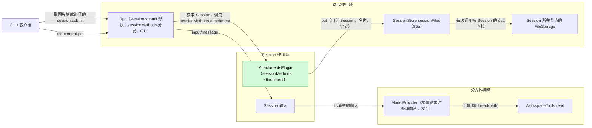
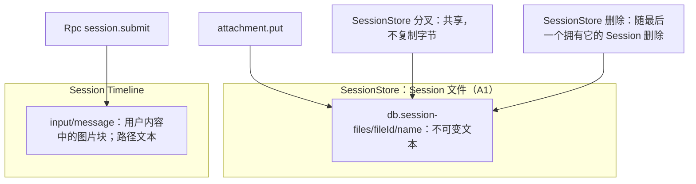
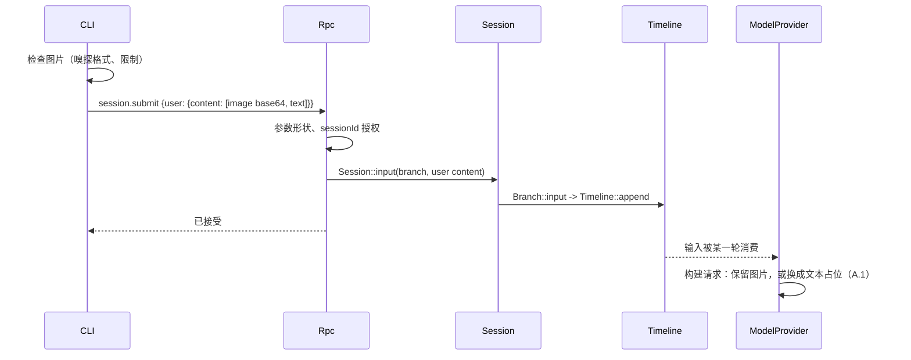

# Attachments

状态：Implemented（[#102](https://github.com/arcships/dim/pull/102)）；capability 页面 [Attachments](../../../architecture/rust-agent/plugins/Attachments.md)。总体设计：[overview §4](../overview.md#4-插件目录)。阶段：P1。语言：Rust。作用域：Session（[ADR 002](../../adr/002-plugin-scope.md)）。路线图条目 P2（[#66](https://github.com/arcships/dim/issues/66)）。依赖均已合入：C1（[#47](https://github.com/arcships/dim/issues/47)，[#83](https://github.com/arcships/dim/pull/83)）、S5a（[#59](https://github.com/arcships/dim/issues/59)，[#95](https://github.com/arcships/dim/pull/95)）、S6（[#51](https://github.com/arcships/dim/issues/51)，[#87](https://github.com/arcships/dim/pull/87)）和 S11（[#56](https://github.com/arcships/dim/issues/56)，[#92](https://github.com/arcships/dim/pull/92)）（[roadmap §3.3](../../../design/roadmap.md#33-插件开工顺序)）。

让用户在一次提交中附带图片和大段文本。图片不需要插件：CLI 检查图片（嗅探格式、限制），再在 `session.submit` 中把它们作为图片内容块发送；Rpc 只检查参数形状，模型的图片能力由 ModelProvider 在构建每个请求时处理（S11，[总体设计附录 B.1](../overview.md#b1-session-与分支-capability)）。Attachments 是一个小型 Session 插件，把命名空间 `attachment` 注册到本 Session 的 `sessionMethods`（[session-boundary](../contracts/session-boundary.md)），提供一个 Session 方法 `attachment.put`；契约是语言中立的，Rust 形式见[附录 G](#附录-g-rust-绑定)。该方法通过 SessionStore 的 `sessionFiles` 服务把文本附件（一次大段粘贴）存为不可变的 Session 文件，并返回其路径；用户文本引用该路径，模型在需要时用 `read` 读取文件。这些文件的分叉共享和删除属于 SessionStore 的行为（[Session 文件](../appserver/session-files.md)）。没有事件。

路线图条目 P2 实现服务端：Attachments capability、它在 App Server 中的安装，以及验证模型能读取已存文件的流程测试（附录 D）。图片部分属于 ModelProvider（S11）和 CLI（A.1、A.3），不属于 P2。

## 1. 结构



| 部分 | 作用域 | 依赖 | 提供 |
| --- | --- | --- | --- |
| `AttachmentsPlugin` | Session | `S:SessionIdentity`；`P:sessionFiles`（SessionStore）；`S:sessionMethods` | 把 `attachment`（`attachment.put`）注册到 `sessionMethods` |

Attachments 从不写 Timeline，从不看到图片，也不拥有任何数据。它唯一的进程级依赖 SessionStore 是 Agents 已经依赖的核心部件（[agents.rs](../../../../crates/dim-app-server/src/agents.rs) 中的 `When<(SessionStore, SqliteStorage)>`），因此它不增加重载边（ADR 002 D3）。

**安装。** App Server 的 `serve`（[lib.rs](../../../../crates/dim-app-server/src/lib.rs)）在主机有原生存储和本地执行（`native_home`）时，在 Mcp 的 Session 部分旁边安装 Attachments：只有原生存储才有 SessionStore，只有本地执行才给模型提供 `read`。该部分在 apply 时把 `attachment` 注册到本 Session 的 `sessionMethods`，因此该主机的每个 Session 都有 `attachment`；没有 Attachments 的主机对 `attachment.put` 回复 `unknown_method`，因为该 Session 没有任何命名空间拥有这个名称（[session-boundary A.1](../contracts/session-boundary.md#a1-方法贡献)）。

依赖的契约：

- `sessionMethods` 的分发、错误与调用归属（C1，[session-boundary A.1](../contracts/session-boundary.md#a1-方法贡献)）：Rpc 授权 `sessionId`，获取 Session（未加载时恢复它），在调用结算前一直持有它，并从该 Session 的方法表读取提供方。Attachments 使用 `drain` 中断方式（A.2），不使用进度。
- SessionStore 的 `sessionFiles.put`（S5a，[Session 文件 §9](../appserver/session-files.md#9-接口)）：`{sessionId, name, content} -> {fileId, path, bytes}`，错误码 `not_found`、`invalid`、`too_large`、`node_unavailable`、`cancelled`、`storage`。名称规则和 16 MiB 上限归 SessionStore，它在提交（txn 2）之前检查取消。
- FileStorage（S6，[#87](https://github.com/arcships/dim/pull/87)）：只经 SessionStore 访问，SessionStore 每次调用时按 Session 的节点查找它（#38）。Attachments 不引用任何 FileStorage 操作。
- `read`（WorkspaceTools）：读取绝对路径；`put` 返回的文件是 Session 自有文件，无需授权即可满足文件范围，工具准入仍遵循预设和工具列表（[Permission 合同](../../../architecture/rust-agent/plugins/Permission.md#policy-contract)）。
- ModelProvider 构建请求时对图片的处理（S11；需求见 [A.4](#a4-对其他所有者的需求)）。
- 传输帧限制，每个请求 16 MiB（`MAX_FRAME_BYTES`，[outbound.rs](../../../../crates/dim-app-server/src/outbound.rs)）。

本文定义的契约：`attachment.put`、其错误码与限制、CLI 的图片检查与粘贴引用格式。Attachments 不引用任何其他插件的内部类型。

## 2. 数据与状态



Attachments 没有状态：文件是 SessionStore 的数据，图片只存在于 Rpc 以用户为作者写入的 `input/message` 中。`attachmentId` 是该 Session 文件的 `fileId`，由 SessionStore 选定的随机 UUID。分叉继承的历史中路径仍然有效，因为 SessionStore 共享文件而非复制，且文件所在目录不属于任何单个 Session（A6）。

事件：无。图片是现有 `input/message` 的一部分；文本附件只以路径形式出现在用户文本中。

## 3. 流程

### 3.1 提交时的图片



不支持或过大的图片由 CLI 在发送前拒绝，并保留草稿。Rpc 不检查图片。ModelProvider 按每个请求所用的模型决定，历史中的输入从不改变。

### 3.2 文本粘贴

```text
Client        Rpc (C1)            Attachments          SessionStore          FileStorage
  |                               (Session)            (process)             (Session's node)
  |-- attachment.put {sessionId, name?, text | pdfBase64} -->|        |                    |
  |             | authorize sessionId,           |                    |                    |
  |             | acquire the Session            |                    |                    |
  |             |-- sessionMethods attachment -->|                    |                    |
  |             |                 | text empty? over 10 MiB?          |                    |
  |             |                 |-- put(own id, name, bytes) ------>|                    |
  |             |                 |                    | name, size; txn 1 (pending row)    |
  |             |                 |                    |-- create_directory, replace ------>|
  |             |                 |                    |   (read-only, synced)              |
  |             |                 |                    | token fired? abandon               |
  |             |                 |                    | txn 2: owner row, commit           |
  |             |                 |<-- {fileId, path, bytes} ---------|                    |
  |<-- {attachmentId, path, bytes} --------------|                    |                    |
  |-- session.submit {text: "... [Pasted text: <path> (<lines> lines)]"} --> input/message
```

只有在文件及其目录项已同步、txn 2 已提交之后才返回路径（[Session 文件 §5.1](../appserver/session-files.md#51-写入)）。每次调用都存一个新文件（A7）。客户端断开不取消任何东西：写入照常完成，文件留在 Session 中，回复被丢弃。

写入期间的卸载（Session 关闭；Session、Attachments 或 SessionStore 重载；或接纳该调用的 Rpc 装载被卸载）会触发调用的取消令牌。该调用是 `drain`：它以自己的结果回复，因此客户端总能知道文件是否存在。

```text
token fires during a put
  |
  SessionStore checks the token right before txn 2
  |-- txn 2 already committed --> reply {attachmentId, path, bytes}; the file stays with the Session
  '-- not committed ------------> cancelled: nothing owned, directory swept --> reply service_reloading
```

卸载会等待这次写入，就像它等待提供方接纳的每个调用一样（C1）。

### 3.3 模型如何读取文件

```text
Client      Rpc        Branch Timeline                      Model           WorkspaceTools
  |-- session.submit "... [Pasted text: /db-dir/dimcode.sqlite.session-files/<id>/paste.txt (120 lines)]"
  |          |-- input/message ->|
  |          |                   | input/applied, then consumed with a model request
  |          |                   |-- user text with the path ------>|
  |          |                   |<-- step/tool-call read {path, offset?, limit?}
  |          |                   |-- read(path) -------------------------------------->|
  |          |                   |<-- step/tool-result: numbered lines in content -----|
  |          |                   |-- the text, from this tool result on ------------>|
```

模型只在已采用的用户输入中看到路径，只在 `read` 结果中看到内容。`read` 按 `offset` 和 `limit` 分页读取大文件，与任何文件相同。在工具不含 `read` 的 Session 中，模型只能看到路径。

## 4. 时序与冲突

| 场景 | 结果 |
| --- | --- |
| 没有 Attachments 的主机 | `attachment.put` 得到 `unknown_method`；图片不受影响 |
| 写入期间卸载 | txn 2 已提交则回复路径，否则回复 `service_reloading` 且不存储任何内容；从不出现 `operation_interrupted`（§3.2） |
| 提交后切换到不支持图片的模型 | ModelProvider 用文本占位代替图片发送（A.1） |
| 图片输入的 `input/deleted` | 从未被应用或消费；文本文件保留在 Session 中 |
| 分叉与源 Session 的删除竞争 | 分叉先提交则保留文件，共享而不复制；否则分叉失败（[Session 文件 §6](../appserver/session-files.md#6-删除崩溃恢复与串行化)） |
| Session 所在节点的 FileStorage 未激活 | `attachment.put` 以 `node_unavailable` 失败；图片不受影响；不重载，也不进入 Pending；它激活后重试成功 |

完整表格：附录 B。

## 5. 上下文映射

| 附件 | 模型看到的内容 | 位置 |
| --- | --- | --- |
| 图片 | 输入的用户消息中的图片内容块（在其 raw 块之后）；请求所用模型无法接收时为文本占位（A.1） | 消费位置（`input/consumed`） |
| 文本附件 | 用户文本中的路径；内容只通过之后的 `read` 结果 | 消费位置的用户消息；内容在该工具结果的位置 |

压缩既不原样保留图片，也不原样保留文件内容，只保留摘要（若摘要保留了路径，路径仍在；文件也仍在）。子分支继承切点之前已消费的输入；分叉的 Session 继承固定前缀，共享的文件仍可读取。任何写入方写入的图片都经过同样的 ModelProvider 处理（A8）。模型只在路径中看到附件 id，从不看到被 CLI 拒绝的图片或诊断。

## 6. 接口（摘要）

| 接口 | 类型 | 用途 |
| --- | --- | --- |
| `attachment.put` | `sessionMethods`（Session，命名空间 `attachment`） | 把文本附件存为 Session 文件，返回其路径 |
| CLI 图片检查与粘贴引用 | 客户端契约（A.1、A.3） | 提交前嗅探格式、执行限制；用路径引用已存的粘贴 |
| 构建请求时的图片处理 | ModelProvider 补充（已实现，S11，A.1） | 按请求所用模型发送图片块，或换成文本占位 |
| `attachment.put` 错误 | `appError`（A.2、附录 C） | 拒绝原因 |

## 7. 安全

CLI 只为检查头部和限制而解码图片；ModelProvider 只为检查请求的适配器能否接收而解码；Rpc 不检查图片。文本附件由 SessionStore 写在它的 Session 文件目录下，从不写到客户端选择的路径：`name` 是一个文件名，由 SessionStore 校验。路径本身不授予任何权限：`put` 返回的文件是 Session 自有文件，无需授权即可满足读取范围，但不绕过工具准入（[Session 文件 §11](../appserver/session-files.md#11-安全)）。`attachment.put` 是用户的操作，不是 agent 的决定，因此不涉及 Approval（[ADR 003](../../adr/003-approval-scope.md) D1）。分叉共享其源 Session 拥有的每个文件（[Session 文件 §4](../appserver/session-files.md#4-分叉时共享)）；它的模型只从继承的历史中得知路径。内容是重放给模型的用户数据；CLI 不得隐式附加机密。错误消息和诊断不含内容。

## 8. 规则检查

规则：[原则 §1 与 §4](../../../architecture/rust-agent/principles.md)，[ADR 002](../../adr/002-plugin-scope.md) D1–D5。

| 规则 | 本文如何遵守 |
| --- | --- |
| §4.1 改别人的状态写指令 | Attachments 不改任何 Timeline 状态。Session 文件是 SessionStore 的进程级状态，只经它的类型化 `put` 修改。 |
| §4.2 交接后不能撤回 | Attachments 不处理输入；图片和路径只在 `input/message` 中进入，照常由 `input/applied` 交给 Loop。 |
| §4.3 只用 before 回调，不阻塞 | 没有 before 回调。入口处 Rpc 只检查参数形状和 `sessionId` 授权（C1）。功能检查归各自的所有者：Attachments 检查自己的内容规则（非空、10 MiB），SessionStore 检查它要变成路径组件的名称，CLI 和 ModelProvider 检查图片（A.1）。 |
| §4.4 核心不带业务含义 | 不改核心：Rpc 按命名空间找到 Attachments，ModelProvider 的图片处理对所有图片块一样，不区分写入方。 |
| §4.5 原子批次 | 不适用：Attachments 不写也不读 Timeline 事件。一次写入在 SessionStore 的原生存储中提交（txn 2），不是 Timeline 批次；之后的 `session.submit` 是一条普通输入。 |
| §4.6 上下文只含交接后的事件 | 路径只在已消费的输入中到达模型，内容只在 `read` 结果中到达；图片只来自已消费的输入；被删除的输入不进入上下文。 |
| §4.7 只用公开事件和服务 | Attachments 使用 `S:SessionIdentity`、SessionStore 的 `sessionFiles` 和 `sessionMethods` 契约。 |
| §4.8 向机制所有者提需求 | 基础设施不变，不向运行时或 rutis 提任何需求（§9）。Rpc 使用的 Session 门面按名读取来自方法契约（session-boundary §9.1），在 C1 中实现。Attachments 对 ModelProvider（S11）、SessionStore（S5a）和 App Server 装配的需要见 A.4。 |
| §4.9 只有后续决定要用的事实才进 Timeline | Attachments 不写事件；Session 文件是经 SessionStore 类型化操作写入的进程级状态，图片放在现有的 `input/message` 中。 |
| §1 Capability 与 App Server 边界 | Attachments 是放在自己 crate 中的 Session Capability；App Server 只负责安装它（§1），Rpc 不含图片或附件逻辑。 |
| ADR 002 D1 作用域 | Session 作用域：`attachment.put` 为自己的 Session 工作。文件是该 Session 的数据，因为分叉要共享它们，由进程作用域的 SessionStore 保存。 |
| ADR 002 D2 不设接线模块 | Rpc 经 Session 的 `sessionMethods` 按命名空间找到 `attachment.put`；没有任何东西引用 Attachments。 |
| ADR 002 D3 作用域依赖 | Attachments 依赖外层进程作用域中的核心部件。没有核心部件依赖它：Rpc 每次调用时查找命名空间，而它的进程级依赖 SessionStore 是 Agents 已有的依赖，因此 Attachments 不增加重载边。 |
| ADR 002 D4 配置 | 安装由主机的装配决定（结构性，§1）；Attachments 没有业务配置（限制是固定值，A2）。 |
| ADR 002 D5 合同语言中立 | `attachment.put`、它的错误和客户端契约都是语言中立的；附录 G 是 Rust 绑定。 |

## 9. 向机制所有者提出的需求

不向运行时或 rutis 提任何需求。Rpc 经 Session 门面读取该 Session 唯一的方法表 `sessionMethods`（[session-boundary A.1](../contracts/session-boundary.md#a1-方法贡献)）。Attachments 对其他插件和 App Server 装配的需要见 [A.4](#a4-对其他所有者的需求)。

## 附录 A. 接口细节

### A.1 图片处理（CLI 检查与 ModelProvider）

Rpc 只检查 `session.submit` 的参数形状（内容块格式正确）和 `sessionId` 授权；不解码、不嗅探、不限制图片（原则 §4 第 3 条）。当前代码也是如此。

CLI 在提交前检查：

| 图片 | 处理 |
| --- | --- |
| 文件、剪贴板或粘贴的路径 | 解码；按魔数嗅探格式（忽略声明的类型）；接受 PNG、JPEG、WebP、GIF（功能列表）；按共享规则缩放（见下）；设置 `media_type` |
| URL | 从不发送（A3） |
| 被拒绝 | 不发送；保留草稿并显示原因 |

图片是缩放，不是拒绝。规则与 `read` 相同，只在 [WorkspaceTools § read results and images](../../../architecture/rust-agent/plugins/WorkspaceTools.md#read-results-and-images) 写一次：`images::scale_image` 把图片变成可发送的——最长边不超过 2048 px、base64 编码不超过 5,000,000 字节，应用 EXIF 方向使像素正立，PNG 在其缩放后的 PNG 放得下时保持 PNG，否则用 JPEG，动画只发送第一帧。唯一的大小拒绝是该函数的 1 亿像素护栏，消息给出尺寸；不是图片的字节、本构建无法解码的格式和无效数据与以前一样被拒绝。

限制（A2）：每次提交最多 20 张图片，整个编码请求不超过 16 MiB 传输帧；仍然超出帧的提交被拒绝并保留草稿。块保持其顺序。

ModelProvider 补充（已在 S11 实现，`model_provider/images.rs`；[总体设计附录 B.1](../overview.md#b1-session-与分支-capability)），在构建模型请求时作用于每个图片块：

| 图片块 | 请求内容 |
| --- | --- |
| 请求所用模型接受图片输入，且适配器接受该块的格式和大小 | 原样发送 |
| 模型不接受图片输入（Provider 目录） | 文本 `[Image omitted: the current model does not accept images.]` |
| 能力未知 | 原样发送；由提供方决定（A4） |
| URL 来源、缺失或无法解码的 base64 数据，或 PNG、JPEG、WebP、GIF 以外的格式 | 文本 `[Image omitted: the image cannot be sent to this model.]`（A10） |

这里不检查大小：没有适配器公布按模型的图片大小上限，所以超大的图片照常发送，由提供方决定，与能力未知时相同（A4）。CLI 的缩放规则和限制（A2）在提交前仍然适用。

历史从不改变；每个请求按自己的模型重新决定。

为什么放在 ModelProvider：图片检查不能放在 RPC 入口或 App Server（原则 §4 第 3 条和 §1），CLI 的检查覆盖不到原始客户端和其他写入方。不采用的做法：在 `session.submit` 上由 Rpc 校验（入口检查）；`input/message` 上的 before 回调（写入时还不知道消费它的请求用哪个模型）；Attachments 上传方法（覆盖不到其他写入方）。这项处理不写事件，历史不变；每个请求按已采用的 `context/configured` 和 Provider 目录决定，中断和重载只影响正在构建的请求。[#27](https://github.com/arcships/dim/issues/27) 已确认，构建请求时的占位是对已采用输入的格式转换，不是新的上下文路径。

### A.2 `attachment.put`

命名空间 `attachment`，注册到本 Session 的 `sessionMethods`。其声明为一个 `MethodDecl`：`{name: "attachment.put", mutating: true, interruption: drain, progress: false, notifications: [], reply: direct}`。该部件的 `call(MethodCall, cancelled, progress)` 接受参数 `{sessionId, name?, text}`，回复 `{attachmentId, path, bytes}`；错误为 `MethodError` 数据。

| 字段 | 规则 |
| --- | --- |
| `sessionId` | Rpc 读取它来授权并获取 Session（C1）。Attachments 为自己的 Session（`SessionIdentity`）存储，即 Rpc 解析出的那个 Session |
| `name` | 可选，默认 `paste.txt`。规则归 SessionStore（`[A-Za-z0-9._-]{1,64}`，不以点开头，不区分大小写时不是 `auth.json` 或 `auth.json.lock`，是节点接受的单个路径组件；[Session 文件 §10](../appserver/session-files.md#10-错误限制与不可变性)）；Attachments 原样传递名称并映射 `invalid` |
| `text` | 非空；UTF-8 最多 10 MiB（A2）。以其 UTF-8 字节存储 |
| `attachmentId` | SessionStore 的 `fileId`，即文件的目录名 |
| `path` | SessionStore 的 `path`：Session 资源节点上的绝对路径，与 `read` 为该 Session 解析的方式一致（`<db>.session-files/<fileId>/<name>`，A1） |
| `bytes` | SessionStore 的 `bytes`，即存储的长度 |
| 单个请求的大小 | 一个传输帧，最多 16 MiB 的 JSON。更大的帧会在 Rpc 分发之前结束连接，因此由客户端检查编码后的请求（A.3） |

参数中有任何其他字段即为形状错误（`invalid_params`），与 `session.input.withdraw` 相同（Q10）。回复原样传递 SessionStore 的回复，不添加任何派生数据：客户端持有文本，引用格式也由客户端决定（A5）。

错误。除 `invalid_params` 外，Attachments 自己的错误码都是 `-32000`：

```text
attachment.put {sessionId, name?, text | pdfBase64}
  |
  Rpc (C1): dispatch errors of the contract (unknown_method, -32602, service_reloading)
  v
Attachments
  |-- params of the wrong shape ------------------------------> invalid_params (-32602)
  |-- text empty ---------------------------------------------> attachment_invalid
  |-- text over 10 MiB ---------------------------------------> attachment_too_large
  v
sessionFiles.put(own sessionId, name or "paste.txt", UTF-8 bytes, call token)
  |-- {fileId, path, bytes} ----------------------------------> {attachmentId, path, bytes}
  |-- not_found: Session record gone before txn 2 ------------> session_closed
  |-- invalid: name rejected ---------------------------------> attachment_invalid
  |-- too_large: over 16 MiB (cannot follow the 10 MiB check) -> attachment_too_large
  |-- node_unavailable: node's FileStorage not reachable -----> node_unavailable
  |-- cancelled: an unload fired the call's token ------------> service_reloading
  '-- storage: SQLite or FileStorage failure, Unsynced -------> storage_failed
```

`storage_failed` 与 SessionTitle 对同一 SessionStore 失败给出的码相同（[SessionTitle 附录 C](SessionTitle.md#附录-c-错误与恢复)），按 [#66](https://github.com/arcships/dim/issues/66) 的决定。`cancelled` 变为 `service_reloading`，因为没有存储任何内容、重试是安全的，这正是这个码告诉客户端的含义；Mcp 和 SkillsCatalog 的提供方对服务在调用中途关闭的情况也这样回复。不会出现 `operation_interrupted`，因为该调用是 `drain`。

### A.3 CLI 契约

CLI 读取图片（剪贴板、`@`、粘贴的路径），检查后（A.1）在 `session.submit` 中作为 base64 图片块发送。超过其阈值的粘贴通过 `attachment.put`；CLI 随后插入 `[Pasted text: <path> (<lines> lines)]`，行数由它自己统计（A5）。编码后的请求会超过 16 MiB 帧的粘贴，它与超过 10 MiB 的粘贴一样拒绝。任何拒绝都保留草稿。临时图片文件由 CLI 在收到提交回复后删除。这项契约随 CLI 的粘贴和图片处理实现（[总体设计附录 D](../overview.md#附录-d-cli-层)），不在路线图条目 P2 中；在那之前，任何 v3 客户端都可以调用 `attachment.put`。

### A.4 对其他所有者的需求

**ModelProvider：图片处理（S11，[#56](https://github.com/arcships/dim/issues/56)，实现见 [#92](https://github.com/arcships/dim/pull/92)）。** `attachment.put` 不调用 ModelProvider；功能的图片部分依赖它。Attachments 需要：

| # | 需要 | 原因 |
| --- | --- | --- |
| M1 | 在构建请求时，按每个请求所用的模型决定（已采用的 `context/configured` 和 Provider 目录）。历史、Timeline 和输入不变；不写事件 | 切换模型不能改写历史，之后每个请求都重新决定 |
| M2 | 作用于用户内容中的每个图片块，不论输入由谁写入（CLI、原始客户端、已配对设备、其他插件） | 功能检查归其所有者（A8）；CLI 的检查覆盖不到其他写入方 |
| M3 | 已知不接受图片输入的模型，在该块的位置得到文本占位，保持块的顺序 | 历史中有图片时，非视觉模型仍能工作 |
| M4 | 能力未知时原样发送图片 | A4 |
| M5 | URL 来源、无法解码的数据，或适配器不接受的格式或大小变为占位，而不是让模型调用失败 | A10：输入留在上下文中，调用失败会在每一轮重复 |
| M6 | 占位说明有一张图片被省略及其原因；A.1 给出建议措辞，最终文本由 S11 决定 | 模型应知道那里有过一张图片 |

#92 满足 M1 到 M4 和 M6。它收窄了 M5：不检查图片大小（原因见 A.1）。Attachments 接受这处收窄。

工具结果中的图片不在这项需求内。S11 如何读取能力、在 ModelProvider 的哪里转换，属于 S11 的设计。

**SessionStore：`sessionFiles`（S5a，[#59](https://github.com/arcships/dim/issues/59)，已在 [#95](https://github.com/arcships/dim/pull/95) 合入）。** 不超出 S5a 的设计：带上述错误码的 `put`、名称规则和 16 MiB 上限、在 txn 2 之前检查令牌，以及 dim-agent-capabilities `host` 中的 `SessionFilesHost`（Session 文件附录 A）。本次复核让 Session 文件 §9.2 与 A.2 一致：回复中没有 `lines`，`cancelled` 映射为 `service_reloading`，`storage` 映射为 `storage_failed`。

**FileStorage（S6，[#51](https://github.com/arcships/dim/issues/51)）。** 无：Attachments 只经 SessionStore 访问文件。

**Rpc 与 Session 门面：C1（[#47](https://github.com/arcships/dim/issues/47)，已在 [#83](https://github.com/arcships/dim/pull/83) 合入）。** 不超出已合入的契约：命名空间 `attachment`，经 Session 分发（恢复未加载的 Session），该 Session 没有部分注册 `attachment` 时为 `unknown_method`，提供方未激活时为 `service_reloading`，以及按 `drain` 中断方式的调用归属。不使用逐次调用的进度。

**App Server 装配（`serve`，装配线）。** 在设置了 `native_home` 时安装 Attachments（§1）。这是 P2 实现中的几行改动，像其他登记一样在装配线的工作之后追加（[roadmap §3.4](../../../design/roadmap.md#34-合入顺序与冲突点)）。

## 附录 B. 完整冲突表

| 场景 | 序号顺序 | 结果 | 决策归属 |
| --- | --- | --- | --- |
| 轮次运行时提交图片 | 按模式输入 | 与任何输入一样被应用和消费 | InputQueue、Loop |
| 图片输入被消费之前的轮次中断 | 已应用 < I | 待处理；由下一轮消费 | Loop |
| 被持有时对该输入的 `input/withdraw`（S1） | 输入 < withdraw < `input/deleted` | 从未被应用或消费；文本文件保留在 Session 中 | InputQueue |
| 提交与写入之间分支关闭 | 关闭 < 写入 | `Session::input` 以 `BranchMissing` 失败；不写任何内容 | 运行时门面 |
| 提交后切换模型 | 输入 < `context/configured` < 已消费 | 新模型不接受图片时使用占位（A.1） | ModelProvider |
| 适配器无法接收的图片（无法解码、格式不支持、过大） | 已消费 < 请求 | 每个请求中使用占位；历史中的输入不变 | ModelProvider |
| 并发的 Steer/Queue/Append | Timeline 顺序 | 不受影响 | InputQueue |
| `attachment.put` 之后从未提交 | — | 文件保留在 Session 中；随 Session 删除 | SessionStore |
| 两次写入，文本相同或不同 | — | 两个文件、两个路径（A7） | SessionStore |
| 对未加载的 Session 调用 `attachment.put` | — | Rpc 在分发前恢复它（C1） | Rpc、AgentIndex |
| 写入期间 Session 关闭（S5c 的删除先关闭 Session） | — | 关闭等待这次写入：txn 2 已提交则回复路径（之后删除会释放文件），否则回复 `service_reloading`；txn 2 时记录已不存在则为 `session_closed`（[Session 文件 §6](../appserver/session-files.md#6-删除崩溃恢复与串行化)） | Attachments、SessionStore |
| 写入期间 Attachments、Session 或 SessionStore 重载 | — | txn 2 已提交则回复路径，否则回复 `service_reloading`；新调用在提供方激活前得到 `service_reloading` | Attachments（调用所有者）、Rpc |
| 写入期间 Rpc 重载 | — | 调用的令牌触发，结果相同；Rpc 的卸载等待回复 | Attachments、Rpc |
| `session.submit` 期间 Rpc 重载 | — | `service_reloading`；客户端检查 `session.input_lookup`，然后以相同的 `submissionId` 重试 | Rpc、客户端 |
| 写入期间客户端分离或断开 | — | 写入照常完成；文件保留在 Session 中；回复被丢弃 | Rpc |
| 写入期间进程重启 | — | 回复丢失；已提交的文件保留在 Session 中，未提交的被清扫 | SessionStore |
| 分叉与源 Session 的删除竞争 | — | 分叉先提交则保留文件；否则分叉失败（[Session 文件 §6](../appserver/session-files.md#6-删除崩溃恢复与串行化)） | SessionStore |
| 压缩 | 已消费 < 压缩 | 只通过摘要保留；文件仍在 | ContextPreparation |
| 子分支切出 | 已消费 < 切点 | 子分支继承图片和路径；同一份文件 | 历史投影 |
| 工具不含 `read` 的 Session | — | 模型看到路径，但无法读取内容 | Session 配置 |
| 请求帧超过 16 MiB | — | 传输层在分发之前结束连接；不存储任何内容；CLI 先行检查（A.3） | 传输层 |
| 已配对的远程设备提交（P3） | — | 没有 CLI 检查；适用 ModelProvider 的处理（A.1） | ModelProvider |
| Session 所在节点的 FileStorage 未激活（P2：控制节点的 FileStorage 正在重载或已关闭；P3：节点离线） | — | `node_unavailable`；不存储任何内容；Attachments 保持加载；它激活后重试成功（SessionStore 每次调用时查找 FileStorage，#38） | SessionStore |

## 附录 C. 错误与恢复

| 代码 | JSON-RPC | 何时 | 存储 | 重试 |
| --- | --- | --- | --- | --- |
| `invalid_params` | `-32602` | 参数形状错误 | 无 | 修正请求后 |
| `attachment_invalid` | `-32000` | `text` 为空；`name` 被 SessionStore 拒绝 | 无 | 修正请求后 |
| `attachment_too_large` | `-32000` | `text` 超过 10 MiB | 无 | 否 |
| `session_closed` | `-32000` | txn 2 时 Session 记录已不存在（`not_found`） | 无所有者；被清扫 | 否 |
| `node_unavailable` | `-32000` | Session 所在节点的 FileStorage 不可达 | 无所有者；被清扫 | 是，稍后 |
| `service_reloading` | `-32000` | 卸载在 txn 2 之前中止了写入（`cancelled`） | 无所有者；被清扫 | 是 |
| `storage_failed` | `-32000` | SessionStore 存储失败（`storage`），包括持久性未确认 | 无所有者；被清扫 | 是 |

分发错误（该 Session 没有部分注册 `attachment` 时的 `unknown_method`、缺少 `sessionId` 时的 `-32602`、Session 或 Attachments 重载时的 `service_reloading`，以及 Rpc 无法获取 Session 时的错误）属于契约（[session-boundary 附录 C](../contracts/session-boundary.md#附录-c-错误与恢复)）。重试会存一个新文件；任何操作都不会自动重试。被 CLI 拒绝的图片从不发送。存储后没有后续提交的文件随其 Session 删除。

## 附录 D. 验收

P2 的流程测试，通过公开 RPC，在有原生存储和本地执行的 App Server 上进行，使用一次性的 `--home`：

1. `attachment.put {sessionId, text}` 返回 `{attachmentId, path, bytes}`：`path` 为 `<数据库目录>/<db>.session-files/<attachmentId>/paste.txt`，`bytes` 为文本的 UTF-8 长度。一次 `session.submit` 引用该路径；脚本化的模型用它调用 `read`，工具结果的内容中是该文本。相同文本的第二次写入返回另一个路径。
2. 给定的 `name` 被保留。空的 `text`、`../x`、`.hidden` 或 `AUTH.JSON` 这样的 `name`，以及 10 MiB 加一个字节的 `text`，以 `attachment_invalid` 或 `attachment_too_large` 被拒绝，Session 文件目录中不出现任何文件。
3. 没有原生存储的主机对 `attachment.put` 回复 `unknown_method`。

A.2 映射的其余部分也有测试（Q11）。通过 RPC：存储失败（`<db>.session-files` 处已有一个条目）回复 `storage_failed`，不拥有任何文件，重试会存下文件；已关闭的 Session 回复 `session_closed`。卸载、Session 记录在提交前已不存在、节点不活跃，这三种情况无法通过 RPC 可靠触发，因此在 Rpc 分发所用的 `sessionMethods` 契约上、基于真实的 SessionStore 测试：分别回复 `service_reloading`、`session_closed` 和 `node_unavailable`，都不存储任何内容。SessionStore 自己的 `too_large` 不会出现在 10 MiB 检查之后，没有测试。分叉共享和删除由 S5a 在 SessionStore 的 Rust API 上覆盖，由 S5c 通过 RPC 覆盖（`session.fork` 和 `session.delete` 尚不存在）。测试：[attachments_flow.rs](../../../../crates/dim-app-server/tests/attachments_flow.rs)。

图片部分，归 S11 和 CLI：

1. 非视觉模型：请求中是占位，历史中的输入不变；能力未知：发送图片。原始客户端用 `session.submit` 发送无法解码的图片时，Rpc 接受，请求中换成占位（S11）。
2. CLI：接受 PNG、JPEG、WebP 和 GIF 并使用嗅探出的媒体类型；标错类型的 JPEG 被纠正；BMP 和 URL 在发送前被拒绝；21 张图片、6 MiB 的图片和 9000 px 的边长在发送前被拒绝；保留草稿。

验证：`./dev check`、`cargo clippy --workspace --all-targets --locked -- -D warnings`、`cargo test --workspace --locked`，以及 `cargo run --locked -p xtask -- graph` 再 `check`，因为装配了新的 Capability。capability 页面是 [architecture/rust-agent/plugins/Attachments](../../../architecture/rust-agent/plugins/Attachments.md)（[roadmap §5.1](../../../design/roadmap.md#51-设计状态)）：xtask 生成本地执行图时按 `serve` 的方式安装 Attachments，`sessionFiles` 换成仅供生成图用、不存储任何文件的替身，因此 `check` 会校验该页面。

## 附录 E. 假设

| # | 假设 | 依据 | 若被否决的影响 |
| --- | --- | --- | --- |
| A1 | 文本附件是由 SessionStore 拥有的 Session 文件，存储在 Session 资源节点上的 `<db>.session-files/<fileId>/` 下；这个目录不属于任何单个 Session，因此路径在分叉和源 Session 删除后仍然有效。SessionStore 在控制节点上保存所有权行（[Session 文件](../appserver/session-files.md)） | 判断；`read` 在资源节点上运行 | 其他布局或内联文本内容 |
| A2 | 限制：每次提交 20 张图片和整个编码请求的 16 MiB 传输帧（CLI），10 MiB 文本（`attachment.put`）；更大的图片缩放到最长边 2048 px、base64 编码 5,000,000 字节，而不是拒绝。视觉模型读取图片时约用长边两千像素，多出的像素只会增加字节。10 MiB 文本在 16 MiB 帧下为普通文本的 JSON 转义留有余量 | 边界情况参考；判断 | 不同的限制或不缩放 |
| A3 | CLI 从不发送 URL 图片来源；ModelProvider 把它们换成占位 | 总体设计"最终内容"；判断 | 由提供方获取 URL |
| A4 | 模型能力未知时 ModelProvider 发送图片 | 判断 | 未知即换成占位 |
| A5 | CLI 选择粘贴阈值和引用格式，并自己统计行数 | [总体设计附录 D](../overview.md#附录-d-cli-层)（CLI）；判断 | 由服务端返回格式化的引用 |
| A6 | 分叉共享不可变文件（SessionStore 行为） | 维护者决定；把字节复制到新路径会破坏继承的路径 | 复制字节并重写路径，对固定历史不可能实现 |
| A7 | 不去重 | 判断 | 内容寻址的 id |
| A8 | 图片处理在 ModelProvider 构建请求时进行，因此覆盖所有写入方的图片 | 维护者决定：功能检查归其所有者 | 各写入方自行检查图片 |
| A9 | 分叉保持源 Session 的资源节点；分叉到其他节点不在范围内 | 维护者决定 | 文件必须在其他节点上可用 |
| A10 | 请求无法携带的图片换成文本占位，而不是让模型调用失败 | 判断：输入留在历史中，调用失败会在每一轮重复 | 在输入离开上下文之前模型调用一直失败 |

## 附录 F. 决定与推迟

| # | 问题 | 结论 |
| --- | --- | --- |
| Q1 | `attachment.put` 的中断方式 | 已决定：`drain`。无论哪种方式，卸载都会等待每个已接纳的调用（C1），因此 `drain` 不增加等待，而客户端能知道文件是否存在：路径，或不存储任何内容的 `service_reloading`。`report` 会回复 `operation_interrupted`（"可能已经提交"），客户端无法弄清，因为没有列出附件的方法 |
| Q2 | 回复字段 | 已决定：`{attachmentId, path, bytes}`，原样传递 SessionStore 的回复。去掉 `lines`：客户端持有文本并决定引用格式（A5），且不添加没有用处的 wire 字段（原则 §3） |
| Q3 | 由谁检查 `name` | 已决定：SessionStore，它把名称变成路径组件并拥有该规则（Session 文件 §10）。Attachments 把 `invalid` 映射为 `attachment_invalid`，只保留自己的内容规则 |
| Q4 | `sessionFiles` 错误的映射，包括存储失败 | 已决定（A.2）：`storage` 变为 `storage_failed`，与 SessionTitle 相同（[#66](https://github.com/arcships/dim/issues/66)）；`not_found` 变为 `session_closed`；`cancelled` 变为 `service_reloading`（Q1） |
| Q5 | Attachments 安装在哪里 | 已决定：在 `serve` 中，主机有原生存储和本地执行时安装（§1）。这样的主机的每个 Session 都装载该部分，因此没有按 Session 的启用。在这样的主机中关闭它推迟到 PluginManager（P3）：Attachments 没有配置也不持有状态，因此 P2 不需要开关 |
| Q6 | 路线图条目 P2 的范围 | 已决定：capability、它的安装和流程测试（附录 D）。CLI 部分（A.1 检查、A.3）是 CLI 的工作，图片占位是 S11。`attachment.put` 不调用 S11 |
| Q7 | 传输帧与 10 MiB 限制 | 已决定：限制不变；超过 16 MiB 的请求到不了 Attachments，因此由客户端检查编码后的大小（A.3） |
| Q8 | 资源节点 | 推迟到 P3：P3 在每次调用时按 `SessionConfig.resourceNode` 查找节点服务（[overview §6.3](../overview.md#63-多节点)）。SessionStore 已经每次调用时查找 FileStorage，并为每个文件记录其节点（Session 文件 §3.1），因此离线节点会得到 `node_unavailable`，Attachments 无需改动。P2 中每个 Session 都使用控制节点。早先的各行依赖 [#5](https://github.com/arcships/dim/issues/5)，它已撤回 |
| Q9 | 已配对设备 | 推迟到 RemoteGateway（P3）。Rpc 把 `attachment.put` 提供给每个被提供 Session 方法的连接（E3）；Attachments 不读取连接，因此无需改动 |
| Q10 | 参数中的未知字段 | 实现时决定：作为 `invalid_params` 拒绝，与 `session.input.withdraw` 和 `session.create` 一样。客户端只在契约变更之后发送新字段 |
| Q11 | 错误映射的测试 | 实现时决定：P2 测试 A.2 中每个可触发的码。RPC 无法可靠触发的码在 `sessionMethods` 契约上、基于真实的 SessionStore 测试（AGENTS.md 允许为此单独写测试） |

## 附录 G. Rust 绑定

Attachments 用 Rust 实现，放在自己的 crate `dim-agent-attachments` 中（[lib.rs](../../../../crates/dim-agent-attachments/src/lib.rs)），依赖 dim-agent-runtime 和 dim-agent-capabilities，不依赖 dim-app-server；`xtask check` 保证它位于 App Server 组合层之下。下面 C1 的名称来自已合入的 [#83](https://github.com/arcships/dim/pull/83)。

| 中立契约 | Rust 绑定 |
| --- | --- |
| 插件 | `TypedPlugin`；`Deps = (Keyed<SessionIdentity>, Keyed<SessionFilesHost>, Keyed<SessionMethods>)` |
| 安装 | `dim_agent_attachments::install(builder)`：`builder.require_feature(Feature::new("Attachments").session("Attachments", |names| names.part(AttachmentsPlugin)))`，一个登记自己 Session 部件的插件，由装配配置要求。`serve` 在设置了 `native_home` 时调用它；xtask 生成本地执行图时也调用它 |
| 命名空间 `attachment` | 在 `Keyed<SessionMethods>` 依赖上调用 `methods.register(ctx, "attachment", vec![MethodDecl::new("attachment.put", true, Interruption::Drain)], handler)`（`dim_agent_capabilities::methods`），在 `apply` 中、插件自己的 effect 之后调用。`Handler` 接受 `(method, params, CancellationToken, Progress)`；不使用 `Progress`（`progress: false`） |
| 参数与回复 | `methods::params::<T>(params)`（形状错误时为 `invalid_params`，包括未知字段）和 `methods::reply(value)` |
| `sessionFiles.put` | `SessionFilesHost(Arc<dyn SessionFilesService>)`：`put(session_id, name, content: Vec<u8>, cancel)` 返回 `StoredSessionFile {file_id, path, bytes}` 或 `SessionFileError {code: SessionFileErrorCode, message}`（[Session 文件附录 A](../appserver/session-files.md#附录-a-rust-绑定)）；`session_id` 来自 `SessionIdentity`，`cancel` 是处理函数的令牌 |
| 错误 | `NotFound` → `RpcError::closed()`；`Cancelled` → `RpcError::reloading()`；`Invalid`、`TooLarge`、`NodeUnavailable`、`Storage` 以及 Attachments 自己的检查 → `RpcError::app(-32000, code, message)`，码见 A.2 |
| 图片内容块 | `ContentBlock::Image { source: ImageSource { source_type: Base64 \| Url, media_type, data, url } }`（[content.rs](../../../../crates/dim-agent-types/src/content.rs)） |
