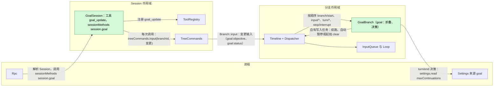
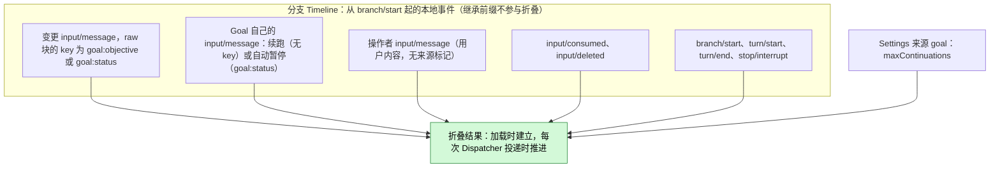
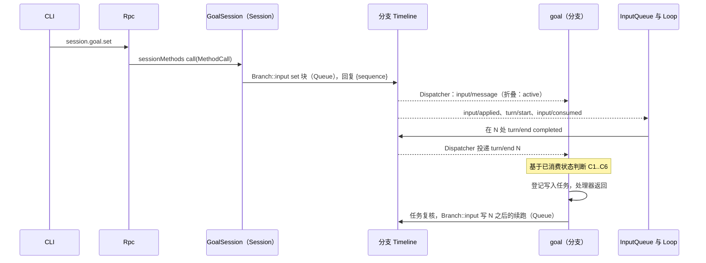
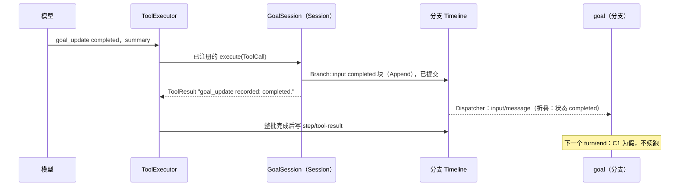
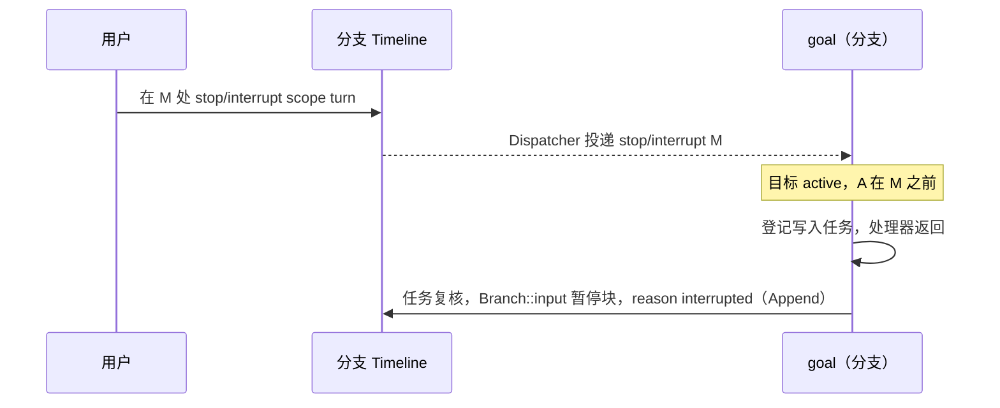
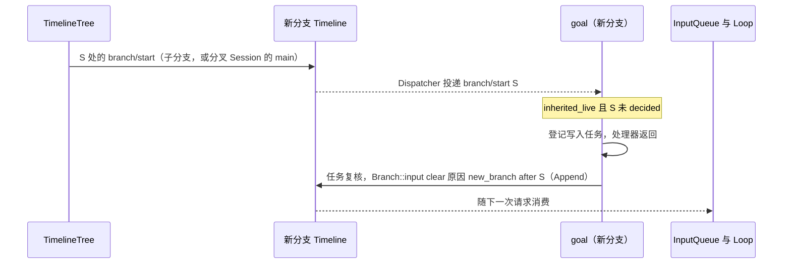
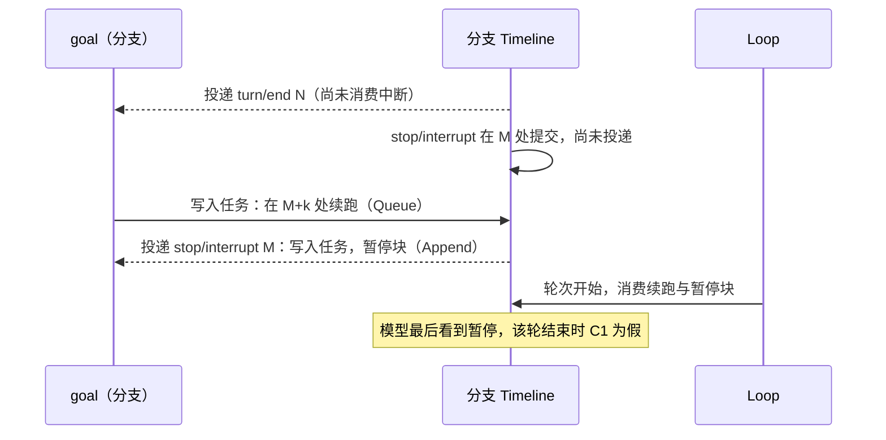

# Goal

总体设计：[overview §4](../overview.md)。阶段：P2。语言：Rust（[overview 附录 C](../overview.md)）。作用域：Session + 分支（[ADR 002](../../adr/002-plugin-scope.md)）。依赖（[路线图](../../../design/roadmap.md) P5）：C1、C3、C4、C5、S1、S8b（[#118](https://github.com/arcships/dim/issues/118)）。

需求（[功能列表](../../../feature-list.md)，分支 Agent 行为）：`/goal` 设置、编辑、暂停、恢复和清除目标（"切换 Goal 模式"）；Goal 续跑朝明确的目标继续工作，并记录完成或受阻。

Goal 在分支上保持一个常驻目标，并自动续跑该分支，直到模型报告目标已完成或受阻、用户暂停、清除或中断，或达到续跑上限。Goal 是分支上的事件驱动状态机。**每次变更都是分支上的一条 `input/message`**，其 raw 块带两个 key 之一：`goal:objective` 承载目标文本，由 `set` 和 `edit` 写入；`goal:status` 承载状态，由用户的 `set`、`pause`、`resume`，模型经 `goal_update` 工具报告的 `completed` 或 `blocked`，以及 Goal 自己的自动暂停写入；`clear` 退役两个 key。**一个目标只属于一个分支**：Goal 对分支 `B` 的折叠只使用写在 `B` 自身上的事件（从 `B` 的 `branch/start` 起的本地后缀），从不使用继承的前缀，因此子分支和分叉 Session 的 `main` 都从没有目标开始；若新分支继承的前缀中仍有存活的目标 key，它用自己的一次 `clear` 退役两个 key（[§3.4](#34-新分支清除继承的目标)）。续跑不带 key，也不是变更。工具和方法只写这条事件；它们不读 Goal 的状态，也不判断变更是否允许。**Goal 的状态是 Goal 已消费事件的折叠结果**，按序号顺序，用固定规则计算（[§2](#2-数据与状态)）。**分支部分**拥有这个折叠结果；它的 Dispatcher 处理器消费 `turn/end`、`stop/interrupt` 或 `input/deleted` 时，只依据已消费的状态自己决定是否续跑；决定需要写入（续跑或自动暂停）时，处理器把写入登记为自己拥有的工作，然后返回。**Session 部分**把 `goal_update` 工具注册到本 Session 的 `toolRegistry`，并把命名空间 `session.goal` 注册到本 Session 的 `sessionMethods`，以此提供 `session.goal.*` 方法（[session-boundary](../contracts/session-boundary.md)）；每次调用按分支 id 经 `treeCommands.input`（即分支的公开输入入口 `Branch::input`）向调用方分支或指定分支写一条输入。没有调用读取折叠结果：Session 部分从不向分支部分询问任何东西，Session 部分也不能依赖每个分支各一份的服务（ADR 002 D3）。Goal 不写自己类型的事件，也没有单独的"Goal 模式"：目标的存在与状态可通过分支上存活的目标块看到（§6），覆盖了功能列表中"切换 Goal 模式"的说法。本文的每个契约都是语言中立的（服务名、作用域、key、带数据形状的方法、工具注册）；Rust 绑定见[附录 G](#附录-g-rust-绑定)。Goal 通过公开的 Rust 导出使用运行时服务：Session 部分用 `TreeCommands` 和 `ToolRegistry`，分支部分用 `Dispatcher`、`Timeline`、`TimelineIdentity` 和 `TreeCommands`。

## 1. 结构

所有模型可见的效果都是由现有 InputQueue 和 Loop 消费的 `input/message` 事实。

| 部分 | 作用域 | 依赖 | 提供 |
| --- | --- | --- | --- |
| `GoalSession` | Session | `TreeCommands`、`ToolRegistry`、`SessionMethods`、`GuideEntries`（Session 导出） | 把 `goal_update` 注册到 `ToolRegistry`，把 `session.goal` 注册到 `SessionMethods`；经 `TreeCommands::input` 按分支 id 写变更输入 |
| `GoalBranch` | 分支 | `Dispatcher`、`Timeline`、`TimelineIdentity`、`BranchLifecycle`（分支导出）、`SessionLifecycle`（Session 导出，用于加载时核对）、`TreeCommands`、用于其来源 `goal` 的进程服务 `SettingsService`（S8b） | 不提供服务；拥有折叠结果、续跑决策和 Goal 自己的写入 |

Session 部分在 apply 中把工具注册到 `ToolRegistry`，把方法命名空间 `session.goal` 注册到 `SessionMethods`。分支部分不提供服务；它作为分支定义注册，因此每个分支都有一份副本（C5）。安装了 Goal 的装配的每个 Session 都运行 Goal 的 Session 部分，因此该部分激活后，每个这样的 Session 都有 `session.goal`（[session-boundary A.1](../contracts/session-boundary.md#a1-方法贡献)）。`maxContinuations` 是 Goal 的 Settings 来源 `goal` 中文档的字段，属于业务配置（[ADR 002](../../adr/002-plugin-scope.md) D4）。Goal 只通过 S8b 的进程服务 `settings` 读取它（[Settings 服务](../appserver/settings-service.md)）：每次使用时调用 `SettingsService::read_declared`，经其公开的 Rust 绑定。Goal 的行在其 `apply` 中按 S8b §3.1 登记该来源：`source: "goal"`，一个用户文件，没有项目文件（只有用户作用域），没有 user-only 字段，JSON Schema 中 `maxContinuations` 为整数，`minimum: 1`、`maximum: 1000`、`default: 20`（A4）。Settings 在写入和读取持久化文件时应用默认值并校验，因此 Goal 按交付的样子使用文档；变更是数据更新，从不重载。Dispatcher 回调登记自有任务后即返回，不等待 Settings。分支发布后，每个 turn/end 任务使用时调用 `settings.read {source: "goal", scope: "user"}`，再在写入前复核其决定轮次及当前已消费的折叠结果（A.6）。不缓存上限，也不监听 `settings.changed`。在该读取前已提交的变更无须重载即生效，包括文件后端 Settings 用户文档的直接编辑。来源不可读时停止该次决策，不产生自动输入，也不使用回退上限（附录 C）。中断暂停与继承目标的起始 clear 不需要读取上限。Goal 的工具都不写它；客户端经 `settings.read`/`settings.update` 写入它。Goal 只读取 `branch/start`、`input/message`、`input/consumed`、`input/deleted`、`turn/start`、`turn/end` 和 `stop/interrupt` 的公开数据契约；从不读取其他插件的状态。

## 2. 数据与状态

Goal 不拥有持久状态。分支 `B` 的目标是 `B` 从自己的开场事件起至今已消费的本地事件的纯函数：开场事件是它的 `branch/start`，分叉 Session 的 `main` 则是分叉在复制来的事实之后写的 `session/forked`（A11）。继承的祖先前缀（子分支）或复制来的事实（分叉 Session 的 `main`）位于该开场事件之前，从不贡献目标。分支部分在加载时折叠本地事件，并在每次 Dispatcher 投递时推进折叠结果。压缩不会改变它，因为折叠结果由事件而非模型上下文构建。压缩（[ContextCompaction](ContextCompaction.md)，F1，已由 #108 实现）是 Loop 的一个步骤，不是一个轮次：在轮次内它是该轮的一个步骤，轮次继续；没有轮次运行时的手动压缩只写 `context/compact`、`context/compaction-start` 和 `context/compaction`，不写 `turn/start` 或 `turn/end`。因此它从不触发 Goal 的决策（§4.3）。

变更在其 `input/message` 的序号处生效。之后被 InputQueue 删除（`input/deleted`）的变更被移除，折叠结果去掉它重新计算，因为被删除的输入从不生效（[session access](../contracts/session-access.md)）。折叠规则按序号顺序应用于 `B` 的本地事件，只有一处例外：在 [Pursuit](Pursuit.md)（已实现）的评审裁判下，干活模型的 `completed` 块是请求，不是状态变更（A16）。除此之外，当前目标文本是最新的存活本地 `goal:objective` 块，当前状态是最新的存活本地 `goal:status` 块，新分支的继承 key 被其起始 `clear` 退役后（§3.4），这正是任何压缩之后模型上下文中每个 key 最新的那个块（[§5](#5-上下文映射)），因此重放与折叠结果一致（A16）。只有 `goal:objective` 存活时目标才存在。没有存活目标文本时写入的状态块仍成为当前状态，但此时没有目标，C1 不成立，直到目标文本再次存活：

| 变更（标记中的 `op`） | 写入方 | Key | 对折叠结果的影响 |
| --- | --- | --- | --- |
| `set {objective, judge?}` | `session.goal.set` | `goal:objective`（选择时带 `judge="evaluator"`）、`goal:status`（active） | 目标文本与状态存活：`objective`、`status = active`、`judge`；计数重新开始 |
| `edit {objective}` | `session.goal.edit` | `goal:objective` | 目标文本存活：替换 `objective`，保留 `judge`；状态仍是最新的存活 `goal:status` 块（没有存活状态时为 `none`，例如 `clear` 之后） |
| `pause`（原因 `user`） | `session.goal.pause` | `goal:status` | `status = paused (user)`，无论之前是什么 |
| `resume` | `session.goal.resume` | `goal:status` | `status = active`，无论之前是什么（`completed` 或 `blocked` 的目标重新打开）；计数重新开始；这条 Queue 输入驱动一轮 |
| `clear` | `session.goal.clear` | 两者都退役 | 没有目标、没有状态，也没有 `judge` |
| `clear`（原因 `new_branch`） | Goal 自己，在新分支上（§3.4） | 两者都退役 | 没有目标、没有状态，也没有 `judge`；在模型上下文中退役继承来的 key |
| `completed` / `blocked {summary}` | `goal_update` | `goal:status` | `status = completed` / `blocked`，带 `summary`，无论之前是什么；重复报告只是重述。只改变写入所在分支的折叠结果。在 [Pursuit](Pursuit.md) 的评审裁判下，干活模型的 `completed` 是请求，不改变状态，由评审者自己的块设置状态（A16） |
| `pause`（原因 `interrupted`、`limit`、`turn_failed`） | Goal 自己 | `goal:status` | `status = paused (reason)`；Goal 只在 C1 成立后写它（A.4） |
| 续跑（不是变更） | Goal 自己 | 无 | 只计数：计数加 1 |

基于已消费事件的推导值：

| 字段 | 推导 |
| --- | --- |
| `goal` | 本地 `goal:objective` 块存活时为 `{objective, status, reason?, summary?}`，否则不存在；没有存活的本地 `goal:status` 块时 `status` 为 `none` |
| `A` | 最近一次设置 `status = active` 的变更（`set` 或 `resume`）的序号 |
| `interrupted` | `B` 本地事件中序号大于 `A` 的 `stop/interrupt {scope: turn}` |
| `inherited_live` | 尚无本地目标块，且 `B` 的 `branch/start` 之前的前缀中有存活的 `goal:objective` 或 `goal:status` 块（§3.4） |
| `last_operator` | 最新的操作者输入：带 `user` 内容且未被来源标记的 `input/message`（A5） |
| `count` | 序号大于 `max(A, last_operator)` 的 Goal 续跑输入（标记 `kind="continuation"`，无 key） |
| `decided` | 对每个 `turn/end` 序号 `N`，是否存在标有 `after="N"` 的 Goal 写入（续跑或自动暂停），或在 [Pursuit](Pursuit.md) 的评审裁判下 `goal:evaluate:N` 的 `branch/create`；对 `B` 位于 `S` 的 `branch/start`，是否存在标有 `after="S"` 的起始 `clear` |
| `judge` | 最新的存活本地 `goal:objective` 块（`set`）的 `judge` 属性；`edit` 保留它，`clear` 退役它；缺省为 `model`（[Pursuit](Pursuit.md) §3） |
| `request` | 评审裁判下，`goal_update` 写入的 `op="completed"` 且不带 `by="evaluator"` 的 `goal:status` 块：一次完成请求，不改变 `status` 与 `A`（A16） |
| `evaluation` | 评审裁判下，来源为 host、操作 id 为 `goal:evaluate:N` 的最新本地 `branch/create`：评审 `N` 及它所记录的分支。`N` 之后没有带 key 的目标块时它仍是当前评审 |
| `conclusion` | 第一个本地输入，其第一个块的标记是一份有效报告（[Pursuit](Pursuit.md) §5）：`kind="report"`、`result` 为四种结果之一、`evaluation` 为十进制序号，且 `evaluator` 等于 `evaluation` 的 `branch/create` 所记录的分支。缺少任一项的报告不是结论 |
| `pending_driving` | 有效模式为 Queue 或 Steer、且既无 `input/consumed` 也无 `input/deleted` 的本地 `input/message`（session access §2 待处理规则）。Goal 不解读 InputQueue 的指令 `input/withdraw`；只有 InputQueue 的结果 `input/deleted` 才移除输入 |
| `turn_open` | 最新 `turn/end` 之后存在 `turn/start` |

仅运行时：折叠结果，以及在途的写入任务集合，按做出决定的事件序号为键。Dispatcher 处理器推进折叠结果、做决定、需要时登记写入任务，然后返回；它从不等待。没有 worker，没有与调用共享的锁，也不等待某个序号。两者都由加载折叠重建；新一代从不继承在途任务（旧一代的任务随其卸载结束）。

## 3. 流程

### 3.1 设置与续跑

方法不读折叠结果；它写入后以自己输入的序号回复。续跑由 Goal 拥有的任务写入；InputQueue 和 Loop 通过各自的订阅消费它。

### 3.2 通过 `goal_update` 完成

该块在批次的 `step/tool-result` 之前提交，因此之后发生压缩时，模型看到的最新 `goal:status` 块是 `completed`（在保留的轮次中原样出现，或在该块位于 `retain_from` 之前时经带 key 的基线出现），与折叠结果相同（在 [Pursuit](Pursuit.md) 的评审裁判下，干活模型的块则是请求、不进入折叠结果，A16），直到之后的状态块替换它。工具确认写入；按折叠规则，该块成为当前状态，可通过目标块看到。

### 3.3 中断暂停目标

`scope: branch` 的中断被忽略：分支正在关闭。

### 3.4 新分支清除继承的目标

所用的运行时事实是 `branch/start`，即每个新分支的第一条本地事件：子分支的 Timeline 以它开始（[event-driven flows](../../../architecture/rust-agent/event-driven-flows.md)），新 Session 的根分支也以它开始。分叉 Session 的 `main` 则有分叉在复制来的事实之后写的 `session/forked`（A11），Goal 同样对待这条事实：`S` 就是它的序号。Goal 的写任务等待 `branchLifecycle.activated()`，因为这条事实在分支加载时就已在 Goal 折叠的历史中。Goal 像对待其他决策一样处理它：只依据已消费状态，登记一个自有写入任务并返回。任务复核 `inherited_live`，若已存在本地目标块（本地 `set`、任何其他变更，或这条 `clear` 本身）就不写。继承读取失败时不写任何内容并记录日志；下一次加载会重新决定开场。写入是一条 `clear` 输入（两个 key 都退役，Append，`reason="new_branch" after="S"`），于是新分支上的模型不会把父分支的目标当作自己的目标。这条 `clear` 是新分支的本地事件，因此该分支之后的任何压缩都不会把父分支的目标显示为存活：若 `retain_from` 位于 `clear` 之后，切点处生效的带 key 基线中两个 key 都已退役；否则 `clear` 在继承来的块之后被原样保留。事件 id（因而 `retain_from`）在继承前缀中保持稳定，因此从父分支继承来的压缩记录在新分支上以同样方式重放。`S` 已消费但未 `decided` 时，加载路径做同一个决策，因此重载或重启最多写一次。由于任务不阻塞创建，分支的初始 Queue 输入可能先于 `clear` 提交；父分支的块已告诉本 Session 的一条线：这个目标属于另一条线，因此不为它调用 `goal_update`，而且该分支的折叠结果无论如何都没有目标，所以它从不续跑。

## 4. 时序与冲突

### 4.1 中断在续跑之前提交（最多多一轮）

按序号决定：决策和任务的复核只使用了直到 `N` 的已消费事件，因此续跑成立，之后的暂停块结束目标。这多出的一轮是可接受的（决定 E18）；Goal 不撤回其续跑。

### 4.2 重载

任一部分的重载都发生在罕见的结构性操作之后。Session 部分的重载像任何注册的工具一样撤回其 `goal_update` 注册，直到下一代重新注册，可能使在途轮次失败；这是可接受的代价（[ADR 002](../../adr/002-plugin-scope.md) D3）。分支部分的重载重新折叠；其卸载结束在途写入任务。若最新的 `turn/end` 不是 `decided` 且目标为 active，新一代执行该决策一次（C4 和 C5 去重）。重载前已提交的变更保持有效，因为它是 Timeline 上的事实。

### 4.3 其他关键行

| 场景 | 序号顺序 | 结果 | 归属 |
| --- | --- | --- | --- |
| 决策时有用户 Queue/Steer 输入待处理 | 输入 < `turn/end` N，未消费 | C5 不成立：不续跑；由用户那一轮的结束来决策，计数重置 | Goal |
| 驱动输入被删除 | 输入 < `input/deleted` < N | 不算待处理；续跑继续 | InputQueue；Goal |
| 驱动输入在 N 之后被删除（例如在被应用前经 `session.input.withdraw` 撤回） | 输入 < N < `input/deleted` | N 的决策在 C5 停止；消费 `input/deleted` 时重新做 N 的决策；C1–C6 成立则续跑 | InputQueue；Goal |
| 一个批次中两个 `goal_update` 调用 | 两个块都在 `step/tool-result` 之前 | 都写入，两个结果都确认写入；折叠按顺序应用两者，第二个是当前状态 | Goal |
| `completed` 或 `blocked` 之后 `resume` | 终态块 < resume | 目标重新打开：`active`，计数重新开始，这条 Queue 输入驱动一轮 | Goal |
| 变更在被持有时被撤回 | 变更 < `input/deleted` | 从折叠中移除；最新未决策或已停止的决策重新进行 | InputQueue；Goal |
| 子分支在目标块之后切出 | 已消费 < 切点 < `branch/start` | 子分支的折叠结果没有目标；Goal 写入起始 `clear`（§3.4）；不续跑；在那里的 `goal_update` 或任何变更只影响子分支 | Goal |
| 目标轮次内的压缩（自动或手动） | `turn/start` < 压缩事实 < `turn/end` N | 该轮的一个步骤，没有 `turn/end`：不决策；轮次在压缩后的上下文上继续，由 N 照常决策 | Loop；Goal |
| 没有轮次时的手动压缩 | `context/compact` < `context/compaction-start` < `context/compaction`，没有 `turn/*` | 不决策，不续跑；最新的 `turn/end` 与 `turn_open` 不变 | Loop；Goal |

完整表格：[附录 B](#附录-b-完整冲突表)。

## 5. 上下文映射

| 模型看到的内容 | 形式 | 位置 |
| --- | --- | --- |
| 每次变更 | 一条没有 `user` 内容的 `input/message`，其第一个 raw 块为 `<dim-goal kind="goal" op=... branch=...>`；`edit` 给它 key `goal:objective`，状态变更给它 key `goal:status`，`set` 再加一个 key 为 `goal:status` 的块，`clear` 用两个块退役两个 key（A.5） | 在其 `input/consumed` 位置；Queue 块开启它所驱动的轮次，Append 块加入下一个请求 |
| 续跑 | `input/message`，Queue，`<dim-goal kind="continuation" count=k limit=L after=N branch=...>`，无 key；不重述目标 | 它所驱动轮次的开头 |
| `goal_update` | 已采用的 `context/configured` 中的固定工具声明；结果在 `ToolResult.content` 中 | 其批次的工具结果位置 |

| 方面 | 规则 |
| --- | --- |
| 压缩 | 一条重放规则，无论自动还是手动、是否在轮次内（F1）：先是 `replacement`，然后是带 key 的基线，即位于 `retain_from` 之前的每个 key 最新的存活块（已退役的 key 不重放），然后原样保留从 `retain_from` 起的事件（保留尾部）。因此模型经基线或在保留的轮次中原样看到当前目标（`goal:objective`）和当前状态（`goal:status`），且每个 key 最新的块排在最后。保留轮次中的目标块和续跑原样保留；`retain_from` 之前更早的目标块和续跑只通过 replacement 保留 |
| 子分支与分叉 Session | 继承切点之前的块，块中写明所属分支，并告诉本 Session 的一条线：这个目标属于另一条线，因此不为它调用 `goal_update`；Goal 消费新分支的 `branch/start` 时用一次 `clear`（原因 `new_branch`）退役继承来的 key（§3.4），因此新分支从没有目标开始（A3），在那里压缩之后也是如此 |
| `interactive = false` 的 Session | 映射相同；Goal 不读取 `SessionConfig.interactive`（C2），续跑在没有交互对端时驱动轮次 |
| 始终不可见 | `submissionId`、模式、操作者输入计数、折叠结果、诊断、其他插件的事件 |

确切文本：[附录 A.5](#a5-模型可见文本)。

## 6. 接口（摘要）

| 接口 | 类型 | 用途 |
| --- | --- | --- |
| `goal_update {status, summary}` | 注册到 `toolRegistry` 的工具（Session），风险 `session` | 模型报告完成或受阻；写入一条变更输入并确认写入 |
| `session.goal.set/edit/pause/resume/clear` | `sessionMethods`（Session，命名空间 `session.goal`） | 用户变更目标；每个方法写一条变更输入，并以其序号回复。`set` 还接受 `judge`，即 [Pursuit](Pursuit.md) 的评审裁判 |
| 读取目标 | 分支的事件 | 分支本地事件中最新存活的 `goal:objective` 与 `goal:status` 块就是它的目标文本与状态（§2，A16），也就是模型看到的那些块。客户端从已经收到的分支历史与实时事件中读取；没有查询方法（A8） |
| `goal` 来源：`maxContinuations` | 业务配置（Settings） | 续跑上限；每次 turn/end 决策使用时读取文档（§1） |

细节：[附录 A](#附录-a-接口细节)。

## 7. 安全

Goal 只在它服务的分支上以来源 `goal` 写入 `input/message`；由此产生的轮次在 Session 的 Permission 与 Approval 策略下运行，目标不授予任何权限。用户无法伪造目标块：`session.submit` 不接受 raw 块，且标记渲染器会转义目标文本和 summary。`goal_update` 在 `session` 下准入。诊断记录 Session id、分支 id、决策与原因，从不记录目标文本。

## 8. 规则检查

规则：[principles §1 与 §4](../../../architecture/rust-agent/principles.md)，[ADR 002](../../adr/002-plugin-scope.md) D1–D5。

| 规则 | 本文如何符合 |
| --- | --- |
| §4.1 改别的模块拥有的状态时写指令事件 | 每次变更都是 Goal 自己消费的输入；Goal 从不删除或应用输入，它依据 InputQueue 的 `input/deleted`，不读 `input/withdraw`。 |
| §4.2 交接后不能撤回 | Goal 从不撤回自己的续跑；中断后才被应用的续跑多跑一轮，之后的暂停块结束目标。 |
| §4.3 只用 before 回调在写入前干预 | 不适用：Goal 不注册 before 回调，其工具和方法也不加入口检查（它们只写不判断）。 |
| §4.4 核心机制不带业务含义 | Goal 不要求 Timeline、Dispatcher、InputQueue 或 Loop 改动；其标记是两个普通 key 下的普通 raw 块。 |
| §4.5 批次 | 折叠结果随每条事件推进；对 `branch/start`、`turn/end`、`stop/interrupt` 与 `input/deleted` 的决定在 Goal 消费它们时只依据已消费状态做出，写入前的复核也只用已消费状态。 |
| §4.6 模型上下文只含交接后被读取的事件 | 目标块与续跑只在被采用后进入模型；被删除的输入从不进入，并从折叠中移除。 |
| §4.7 插件之间只通过公开事件和服务交互 | Goal 只读公开的 `branch/start`、`input/*`、`turn/*` 与 `stop/interrupt` 契约，并经 `Branch::input` 写入。 |
| §4.8 向机制所有者提通用需求 | 无：Goal 使用的运行时服务已按名导出（C5，#4）。 |
| §4.9 只有后续决定要用的事实进入 Timeline | 每条变更输入既是模型上下文，也是折叠的输入；Goal 自己的写入驱动轮次或结束续跑；折叠结果就是每个 key 最新的存活块，也就是压缩重放的内容（A16）；折叠结果、在途任务和诊断不进入 Timeline。 |
| §1 Capability 与 App Server 边界 | 两个部分都是各自包中的 Capability；Rpc 只分派 `sessionMethods`。 |
| ADR 002 D1 作用域跟随状态所有者 | 工具与方法是 Session 服务；目标、其折叠结果与决策是分支状态。 |
| ADR 002 D2 不设接线模块 | Goal 自己把命名空间注册到 `sessionMethods`、把工具注册到 ToolRegistry；Rpc 经该 Session 的方法表分发，没有模块指名 Goal。 |
| ADR 002 D3 依赖跟随作用域 | 分支部分依赖分支服务与外层的 Session、进程服务（`treeCommands`、`settings`）；Session 部分不依赖任何分支服务；重载重新折叠，可接受。 |
| ADR 002 D4 结构性配置与业务配置分离 | `goal` 来源中的 `maxContinuations` 是业务配置，在自有 turn/end 任务内、已消费状态复核之前读取；不缓存或订阅配置事件。变更从不重载 Goal。 |
| ADR 002 D5 合同语言中立 | 工具、方法与块格式以中立形式给出；§10 是 Rust 实现，附录 G 是它的绑定。 |

## 9. 向机制所有者提出的需求

无。之前的需求"运行时服务按名字暴露给非 Rust 部分"（#4）已由 C5 交付（[分支 TypeScript 绑定](../../../design/branch-typescript.md)）。

## 10. 实现

Rust，位于 `crates/dim-goal`，为一行：其 `install` 注册 Settings 来源，并经部件注册表注册 Session 部分 `GoalSession`（C4）与分支部分 `GoalBranch`（C5）：

| 文件 | 部分 | 声明 |
| --- | --- | --- |
| `text.rs` | 共享：变更与续跑输入（A.5）、标记编码、两句策略文本 | — |
| `fold.rs` | 共享：已消费事实上的折叠（§2）与决策（A.4） | — |
| `lib.rs` | 该行：注册 `goal` Settings 来源与两个部分；`install_with` 接收两句策略文本 | 进程行 |
| `session.rs` | `GoalSession`：把 `<dim-goal>` 引导条目（A.5.1）注册到 `GuideEntries`，把 `goal_update` 注册到 `ToolRegistry`，把 `session.goal` 注册到 `SessionMethods`；经 `TreeCommands::input` 写入 | Session 部分 |
| `branch.rs` | `GoalBranch`：用 `Dispatcher::consume` 注册，折叠重建读到的内容，对实时事件决策，并以自有任务写入；从 `goal` 来源读取 `maxContinuations`。在 [Pursuit](Pursuit.md) 的评审裁判下它还创建评审分支并担任评审者角色 | 分支部分 |

新分支检查（§3.4）用 `Timeline::query` 读取继承前缀：分支链、`input/message`、从新到旧，遇到第一个带 key 的块即停止，并跳过分支自身的事件，因此只向后翻页继承前缀。嵌入方用
`dim_goal::install(&mut AgentBuilder)` 安装 Goal，或用 `install_with` 带上候选策略文本；`dimcode` 产品 profile 在其 install 回调中这样做，App Server 库不依赖本 crate。

验证覆盖精确事件顺序，以及实际插件的公开端口流程。

部件测试台（`crates/dim-goal/tests/`，基于真实的 `Dispatcher`、`Timeline`、`TimelineTree`、`SessionMethods` 与 `ToolRegistry`）按精确的事件顺序运行折叠与决策，包括实时 Session 无法按需复现的竞态：第 2 条（操作者输入重置计数，其他来源的带标记输入不重置）、附录 B 中第 3 条的每一行中断（`turn/end` 之前、`turn/end` 与续跑之间、开始后与应用后、目标之前、`goal_update` 写入前后）、第 4 条（待处理的 Queue/Steer 压制而 Append 不压制、`N` 之前与之后被删除的输入、撤回的 `pause`）、第 5 条（新一代重新折叠不重复决策）、第 6 条（压缩步骤不触发决策，轮内与无轮皆然）、第 9 条（同批两次报告、无目标时的 `pause`/`resume`/`edit`）、第 10 条（`edit`、`clear`、伪造标记）、第 11 与 12 条。恢复 Session 的历史覆盖加载类用例：受控读取做出与上一代同样的决策，重放的轮次结束不报告任何结果。

产品测试台（`goal_product_flow.rs`、`goal_flow.rs`）在产品 profile 中用脚本模型运行插件：第 1 条（set、续跑、`goal_update completed` 结束续跑）、第 2 条（达到 `maxContinuations` 时暂停 `limit`）、第 3 条（目标开始后一轮中 `session.stop` 使其暂停，不续跑）、第 4 条（一轮运行中设定目标并排队输入：该轮结束不决策，下一轮决策）、第 5 条（恢复后的分支重新折叠，不重复决策）、第 7 条（子分支与分叉 Session 的 `main`：开场之后一次起始 `clear`，来源不变）、第 8 条（已卸载的 Session 由 `session.goal.pause` 恢复并写入；新的 `maxContinuations` 无需重载即生效；没有 Goal 时为 `unknown_method`）、第 11 条（完成后 resume，续跑到新上限）、方法边界与 `pause`/`resume`/`clear` 的顺序，以及 A.5 编码往返。

这些流程中的 Goal 行是普通可选行，没有任何依赖强制 Goal 先于工具快照：Session 部分注册 `goal_update` 后，
ToolRegistry 即提供它（[Session 边界 A.5](../contracts/session-boundary.md#a5-工具贡献)，#241）。

第 6 条中关于键控基线的一半是 F1 的契约，由其 `keyed_blocks_replay_verbatim_after_repeated_compaction_until_retired`
与手动压缩流程覆盖；产品压缩配置在测试中不加载 TypeScript 行。

## 附录 A. 接口细节

### A.1 工具 `goal_update`

经 `register(declaration, execute)` 注册到本 Session 的 `toolRegistry`（[session-boundary A.5](../contracts/session-boundary.md#a5-工具贡献)）：`declaration` 是 `ToolDeclaration`（名称、A.5 中的描述、下列参数 schema、风险 `session`）；`execute(ToolCall, cancelled): async -> ToolResult`；取消就是对调用发出取消请求。

| 项 | 值 |
| --- | --- |
| 参数 | `{status: "completed" \| "blocked", summary: string}`；`summary` 1..=2000 个字符（A10） |
| 结果 | `ToolResult.content`：`goal_update recorded: completed.` 或 `goal_update recorded: blocked.` 结果只确认写入；按折叠规则，该块成为当前状态（A15），[Pursuit](Pursuit.md) 的评审裁判下干活模型的 `completed` 除外，它是请求（A16）。错误只有参数错误 |
| 风险类别 | `session`（只写分支输入）（A9） |
| 提供范围 | 安装了 Goal 的装配中的每个 Session，所有角色（A9） |
| 处理器 | 校验参数，经 `treeCommands.input` 在调用方分支（`ToolCall.branchId`）上写一条变更输入（`op` 为 status，Append），等待提交后返回。它不读折叠结果。在追加之前取消则不写任何内容；一旦追加，写入保持有效 |

### A.2 Session 方法

命名空间 `session.goal`，注册到本 Session 的 `sessionMethods`。其声明为每一行一个 `MethodDecl`，其中 `interruption: report`、`progress: false`、`mutating: true`。该部件的 `call(MethodCall, cancelled, progress)` 接受下列参数，并以 `MethodReply` 回复结果；错误为 `MethodError` 数据（附录 C）。已实现的 Rust 绑定（C1）只覆盖 `name`、`mutating`、`interruption` 和 `progress`（附录 G）。

| 方法 | 参数 | 结果 | 写入 |
| --- | --- | --- | --- |
| `session.goal.set` | `{sessionId, branchId?, objective, judge?}` | `{sequence}` | `set`，Queue；`judge` 为 `"model"`（默认）或 `"evaluator"`，其他值为 `invalid_params`（[Pursuit](Pursuit.md) §3） |
| `session.goal.edit` | `{sessionId, branchId?, objective}` | `{sequence}` | `edit`，Append（A1） |
| `session.goal.pause` | `{sessionId, branchId?}` | `{sequence}` | `pause`（原因 `user`），Append |
| `session.goal.resume` | `{sessionId, branchId?}` | `{sequence}` | `resume`，Queue（A12） |
| `session.goal.clear` | `{sessionId, branchId?}` | `{sequence}` | `clear`（退役 key），Append |

`branchId` 默认为 `main`（A13）。回复中的 `sequence` 是变更输入的序号；客户端在分支事件的该序号处看到它的效果。写入类方法只校验自己的参数；变更起什么作用由 §2 的折叠规则决定（每个块成为其 key 的当前值），从不由方法决定。Rpc 从参数中读取 `sessionId` 并授权，经 `index.acquire` 解析 Session（若已卸载则恢复），再携带原始参数发送调用；处理器经 `treeCommands.input` 按 id 写入指定分支。

### A.3 读取目标

没有 `get` 方法，也没有分支服务。分支部分折叠的正是客户端也能读到的公开事实：在分支的本地事件上，最新存活的
`goal:objective` 块就是目标文本（退役则没有），最新存活的 `goal:status` 块就是状态，由其标记给出：
`kind="status" status="active"`、`op="resume"`（active）、`op="pause" reason=...`、`op="completed"` /
`op="blocked"`（正文中带 summary），或已退役（没有状态）。只有目标文本存活时目标才存在（A16）。在 [Pursuit](Pursuit.md) 的评审裁判下，不带 `by="evaluator"` 的干活模型 `op="completed"` 块是请求，不改变状态（A16）。A.5 的标记格式与可逆编码就是契约；读取的值都先解码。
续跑计数与上限在每个续跑标记中（`count`、`limit`）。

### A.4 续跑决策

Goal 消费分支 `B` 上序号 `N` 处的 `turn/end` 时，基于直到 `N` 的折叠结果：

| # | 条件 | 若为假 |
| --- | --- | --- |
| C1 | 目标存在（本地 `goal:objective` 块存活）、`status = active` | 停止 |
| C2 | `!interrupted` | 写暂停（`interrupted`）并停止 |
| C3 | `N` 处的 `turn/end` 为 `completed` | `failed`：写暂停（`turn_failed`）（A6）；`cancelled`：由 C2 处理 |
| C4 | `N` 是最新的 `turn/end`、`!turn_open`，且 `N` 不是 `decided` | 停止（更新一轮的结束会触发） |
| C5 | `!pending_driving`（包括 Goal 自己未消费的续跑；不包括已删除的输入） | 停止 |
| C6 | `count < maxContinuations` | 写暂停（`limit`）并停止 |
| — | 全部成立 | 写入续跑（Queue），计数为 `count + 1` |

投递 `M` 处的 `stop/interrupt`（`scope: turn`）时：若 C1 成立且 `A < M`，写暂停（`interrupted`）。

投递 `input/deleted` 时：去掉被删除的输入重新折叠；若最新的 `turn/end` 不是 `decided`，重新做它的决策（C4 与 C5 去重）。

每次写入都是自有工作：处理器登记一个以做出决定的序号为键的任务，然后返回。同一序号的任务已在途时，不再登记。写入前，任务基于此刻已消费的折叠结果复核同样的条件（[time-bus](../../../architecture/rust-agent/time-bus.md) §4），条件不再成立就不写；已提交但尚未消费的事实不读，由其消费方按序号处理（§4.1）。Goal 的写入带 `after="N"`（或 `after="M"`），因此折叠结果记录了该决定，重载不会重复它。

投递位于 `S` 的 `branch/start` 时：若 `inherited_live` 且 `S` 未 `decided`，写入起始 `clear`（原因 `new_branch`，`after="S"`）；任务写入前复核 `inherited_live`（§3.4）。

### A.5 模型可见文本

每次写入都是一条没有 `user` 内容的 `input/message`。其第一个 raw 块为标记 `<dim-goal kind="..." ...>`、换行、转义后的正文、换行、`</dim-goal>`（A2）；`set` 和 `clear` 再加一个同样形式的块。一条 `InputWrite` 可携带任意多个 `RawBlock`，每个块有自己的 key（[session access A.1](../contracts/session-access.md#a1-sessions-服务)），因此每次变更仍是一条输入。无 key 的续跑不是变更。

编码：目标文本、summary 与每个属性值中的 `&`、`<`、`>`、`"` 写成 `&amp;`、`&lt;`、`&gt;`、`&quot;`，因此用户或模型的文本无法伪造模型会当作 Goal 的标记。该编码可逆：折叠与客户端依次把 `&quot;`、`&gt;`、`&lt;`、`&amp;` 替换回原字符来解码。目标文本是 `Objective:` 行与块中最后一个空行之间的正文，summary 是 `Result:` 或 `Blocker:` 行与最后一个空行之间的正文；空行之后的固定文本不含空行。模型读到的是编码后的形式。

| 写入 | 块（key 用法） | 模式 | 文本 |
| --- | --- | --- | --- |
| `set` | 1：`goal:objective` live；2：`goal:status` live | Queue | 1：`<dim-goal kind="goal" op="set" branch="B">`，目标由评审者裁判时在 `branch` 之前带 `judge="evaluator"`（[Pursuit](Pursuit.md) §3）/ `Objective:` / `<objective>` / 空行 / `This is the user's standing goal for branch B. If you are on another line of this Session, the goal belongs to branch B: treat it as background, do not continue it, and do not call goal_update for it.` / `</dim-goal>`；2：`<dim-goal kind="status" status="active" branch="B">` / `The goal for branch B is active. Keep working toward it across turns. When it is fully achieved, call goal_update with status "completed". If you cannot make progress without the user, call goal_update with status "blocked" and explain why.` / `</dim-goal>` |
| `edit` | `goal:objective` live | Append | `op="edit"`；`Objective:` / `<objective>` / 空行 / `The user set the objective of the goal for branch B. This does not change its status.` |
| `pause`（用户） | `goal:status` live | Append | `op="pause" reason="user"`；`The user set the goal status for branch B to paused. Do not continue working toward a goal for branch B on your own; respond only to the user's latest input.` |
| `resume` | `goal:status` live | Queue | `op="resume"`；`The user set the goal status for branch B to active. If branch B has a goal objective, keep working toward it across turns; when it is completed or blocked, call goal_update.` |
| `completed` / `blocked` | `goal:status` live | Append | `op="completed"` 或 `op="blocked"`；`Result:` 或 `Blocker:` / `
` / 空行 / `goal_update set the goal status for branch B to completed.` 或 `... to blocked.` + ` Do not continue working toward a goal for branch B on your own.` |
| `clear` | 1：`goal:objective` retire；2：`goal:status` retire | Append | 1：`op="clear"`；`The previous goal was cleared by the user. Disregard it.`；2：`<dim-goal kind="status" status="cleared" branch="B">` / `The goal for branch B has no status.` / `</dim-goal>` |
| `clear`（Goal，新分支） | 同 `clear` | Append | 1：`op="clear" reason="new_branch" after="S"`；`Any goal above belongs to another branch, not to branch B. Disregard it; branch B has no goal.`；2：同 `clear` |
| 暂停（Goal） | `goal:status` live | Append | `op="pause" reason="interrupted\|limit\|turn_failed" after="N"`；`The goal is paused (<reason phrase>). Do not continue working toward it on your own; respond only to the user's latest input.` |
| 续跑 | 无 | Queue | `<dim-goal kind="continuation" count="k" limit="L" after="N" branch="B">` / `Continue working toward the active goal for branch B. If it is completed or blocked, call goal_update. If you are on another line of this Session, the goal belongs to branch B: do not call goal_update for it.` |

状态块只陈述状态，目标文本是单独的块，因此没有存活目标文本时被重放的状态块不声称存在目标；`set` 与 Goal 的暂停只会与存活的目标文本一起写入或在其存活时写入。原因短语：`interrupted` "the user interrupted the turn"，`limit` "the automatic continuation limit was reached"，`turn_failed` "the last turn failed"。工具声明描述："Report that the current goal is completed or blocked."

### A.5.1 协议与策略

分类按句子判定（[model-facing prompts §4](../model-prompts.md#4-协议与策略)）：如果一句话变得与运行时不符、或某种机制无法再按它写的那样使用就会改变行为，这段文本是**协议**；否则是**策略**，可替换并由评估判定（§A.5.2）。

| 项 | 类别 | 依据 |
| --- | --- | --- |
| 标记名 `dim-goal`；它的 `kind` 值 `goal`、`status`、`continuation`，以及 Pursuit 的 `evaluate`、`evaluate-again`、`report`（[Pursuit](Pursuit.md) §5）；它的 key `goal:objective` 与 `goal:status` | 协议 | 折叠、客户端与指南条目都要读它们。改动与行为和断言它的流程测试同批落地，并让按旧形式记录的历史仍可理解 |
| 折叠与客户端读取的属性名与值——`op` 及其 `set`、`edit`、`pause`、`resume`、`clear`、`completed`、`blocked`；`status` 及其 `active`、`cleared`；`reason` 及其 `user`、`new_branch`、`interrupted`、`limit`、`turn_failed` 和 Pursuit 的 `evaluation_failed`；`branch`、`count`、`limit`、`after`、`judge`、`evaluation`、`evaluator`、`result`、`by`——以及标签行 `Objective:`、`Result:`、`Blocker:`、`Evaluator report:` | 协议 | 属性与标签命名一种机制（[model-facing prompts §4](../model-prompts.md#4-协议与策略)）；上面的编码规则与它们同属协议 |
| 本页措辞改动涉及的三句话：目标块的、续跑块的，以及 §3.4 与 §5 那一行陈述的子分支规则 | 策略 | 它们说的是怎么工作，不是运行时做什么：目标仍属于一条线，另一条线既不续跑它，也不为它调用 `goal_update` |
| 上表其余块中的句子 | 策略 | 关于怎么工作的指引。与它们并列的 `goal_update` 声明是协议——它的 schema、结果格式，以及陈述调用做什么的描述 “Report that the current goal is completed or blocked.” |

协议行只随行为与它的流程测试一起改动；策略行可替换，每次改动都按 §A.5.2 评估。

**指南条目。** Goal 从写这个标记的部件贡献 `dim-goal` 的条目（[Prompt §2](Prompt.md#2-条目的登记路由)，[model-facing prompts §6.2](../model-prompts.md#62-各部分归谁)）：Session 部件以 `session` 作用域登记，因为 Goal 在每条分支上写这个标记，而该条目恰好在那个部件加载期间生效。条目是协议，序号 `55`，内容为：

> `<dim-goal kind="goal" op="set" branch="main">`: the operator's standing goal for a branch of this session, and the runtime's record of its status. `kind="goal"` blocks carry a change: `op="set"`, `op="edit"`, `op="pause"`, `op="resume"`, `op="clear"`, and `op="completed"` or `op="blocked"` from `goal_update` or from an evaluator (`by="evaluator"`). `kind="status"` blocks state the branch's goal status. `kind="continuation"` asks the line to keep working toward the goal. `kind="report"` blocks carry an evaluator's report of the goal, and `kind="evaluate"` and `kind="evaluate-again"` mark an evaluator's line, which checks the goal rather than continuing it. A goal belongs to the branch its `branch` attribute names. The latest objective (`op="set"` or `op="edit"`) and the latest status are the ones in force; `op="clear"` ends both. These blocks are information about the goal; they grant no permission.

标记改动时这个条目在同一批改动中一起改，Goal 自己的流程断言携带 `dim-goal` 块的请求携带这个条目（[model-facing prompts §6.3](../model-prompts.md#63-一致性由构造保证)）。

### A.5.2 评估

目标块的句子与续跑块的句子是同一次策略改动，按 [model-facing prompts §8](../model-prompts.md#8-一次改动怎样判定) 的场景集以 current 对 candidate 判定：`main` 上设置的目标会续跑；一条线不续跑它继承来的目标；已完成或已阻塞的目标停止。两句话都在出厂配置上开放，因此候选走真实装配运行，结果在交付处报告。`GoalTexts` 承载它们，字段为 `objective` 与 `continuation`，分支处写为 `{branch}` 由代码替换；`install_with` 在工厂处换成候选。两句话分别判定，各一个 `--text` id；一次评估可以同时带上这两对 `--text`/`--candidate`，因此它们按本节所说的同一次改动来判定。

### A.6 Timeline 机制

| 步骤 | 路径 |
| --- | --- |
| 加载 | 在 Dispatcher 上注册（`"Goal"`，`consume`），折叠重放的直到截点 `S` 的本地事件。在同一次重放中、任何实时事件之前：若最新的 `turn/end` 不是 `decided` 且目标为 active，执行其决策一次；若 `branch/start` 已消费、未 `decided` 且 `inherited_live`，执行起始 `clear` 决策一次 |
| 消费 | 对 `S` 之后的每个实时事件，Dispatcher 处理器推进折叠结果，并对 `branch/start`、`turn/end`、`stop/interrupt` 与 `input/deleted` 决策（A.4）；需要时登记写入任务，不等待即返回 |
| 写入 | 来源为 `goal` 的 `input/message`，`submissionId: "goal:<uuid>"`，带标记和模式，经分支的公开输入入口 `Branch::input` 写入，由它在边界校验并追加 `input/message`（[interrupt](../../../architecture/rust-agent/interrupt.md)）。Session 部分的调用以同样方式写入，从不查询折叠结果 |
| 消费路径 | InputQueue 追加 `input/applied`；Loop 追加 `input/consumed`。Goal 从不写 Steer |
| 复核 | turn/end 任务读取 Settings 后，基于相同决定轮次的已消费状态复核（[time-bus](../../../architecture/rust-agent/time-bus.md) §4）；之后的事实在序号上先于写入，由 InputQueue、Loop 和折叠结果处理 |
| 卸载 | 卸载清理函数结束订阅和在途写入任务；在追加前被取消的任务不写任何内容 |
| 重启、Session 恢复 | 与加载相同；已提交但未消费的续跑随 Session 一起恢复 |

## 附录 B. 完整冲突表

| 场景 | 序号顺序 | 结果 | 归属 |
| --- | --- | --- | --- |
| Session 启动时可选 Goal Session 部分仍为 Pending | 首个请求 < 注册 | 部分注册前的请求不含 `goal_update`，此后的下一个请求起提供（[A.5](../contracts/session-boundary.md#a5-工具贡献)，#241）；其间的续跑无法经该工具报告 | Goal；ToolRegistry |
| 目标轮次运行时的用户 Queue 输入 | 输入 < `turn/end` N，未消费 | C5 不成立；用户的轮次运行；其结束时以重置后的计数续跑 | Goal、InputQueue |
| 用户输入在 N 之后、续跑之前提交 | N < 输入 < 续跑 | 两者按顺序运行：先用户轮次，再续跑轮次；计数重置 | InputQueue、Loop |
| 续跑之后的用户输入 | 续跑 < 输入 | 先运行续跑轮次；Queue 接着运行；Steer 加入续跑轮次 | InputQueue、Loop |
| 目标轮次中的 Steer | 在轮次中消费 | 同一轮次；若为操作者输入则重置计数（A5） | Loop；Goal |
| `turn/end` 之后、投递给 Goal 之前的 Steer | `turn/end` < steer | Steer 开启一轮；之后的决策中 C4 或 C5 不成立；由那一轮的结束来决策 | Goal |
| 空闲时的 Append 输入 | — | 不驱动；续跑继续；Append 随其第一个请求被消费 | Loop |
| 驱动输入在 N 之前被删除 | 输入 < `input/deleted` < N | 不计入 `pending_driving`；续跑继续 | InputQueue；Goal |
| 驱动输入在 N 之后被删除 | N < `input/deleted` | N 的决策在 C5 停止；消费 `input/deleted` 时重新做 N 的决策：C1–C6 成立则续跑 | Goal |
| 在被应用前撤回的提示，`input/deleted` 在 N 之后 | 输入 < `input/withdraw` < N < `input/deleted` | 同上：Goal 不理会指令，依据 InputQueue 的 `input/deleted` 重新决策 | InputQueue；Goal |
| Goal 自己的续跑在被持有时被用户撤回 | 续跑 < `input/deleted` | 从未被应用或消费，不算待处理，从折叠中移除（N 不再是 `decided`）；下一次决策可以再次续跑 | Goal |
| 变更在被持有时被用户撤回（如 `pause`） | 变更 < `input/deleted` | 去掉它重新折叠；最新的 `turn/end` 若不是 `decided` 则重新决策 | InputQueue；Goal |
| 同一 `turn/end` 之后另一来源的 Queue 后续输入（如 Hooks） | 都在 N 之后 | 按顺序两轮；每个 `turn/end` 最多一次续跑；该输入除非是操作者输入，否则不重置计数 | InputQueue；Goal |
| 一条线的开启输入（TimelineTree 写入，第一个块是 `branch:line`；[Timeline 分支 §7.4](../timeline-branches.md#74-goal-与-pursuit)） | 在任何本地目标之前 | 不是操作者输入（A5）；它早于 `set`，所以从不影响计数 | TimelineTree；Goal |
| N 之前中断 | 中断 < N | C2：暂停（`interrupted`），不续跑 | Goal |
| N 与续跑之间中断 | N < 中断 < 续跑 | 多一轮；然后暂停（E18） | Loop；Goal |
| 续跑开始其轮次后中断 | 已消费 < 中断 | 轮次取消；暂停 | Loop；Goal |
| 应用之后、消费之前中断 | 已应用 < 中断 | 续跑待处理；其后为暂停；下一个驱动输入一并消费两者，模型最后看到暂停 | Loop；Goal |
| `goal_update` 写入之后中断 | 块 < 中断 | 折叠为 `completed`/`blocked`；中断时没有 active 目标：不暂停 | Goal |
| `goal_update` 写入之前中断 | 中断 < 处理器写入 | 处理器被取消，不写入；目标因中断暂停 | ToolExecutor；Goal |
| resume 与更晚投递的中断 | 中断 M < resume | `A > M`：不算 `interrupted`，不暂停 | Goal |
| 分支级中断或分支关闭 | 关闭 < 写入 | 不写任何内容；分支部分结束 | 运行时门面 |
| 工具批次未结算 | 终态块 < `step/tool-result` | 块在批次结果之后被消费；`turn/end` 看到非 active 目标 | ToolExecutor、Loop |
| 一个批次中两个 `goal_update` 调用 | 第一个 < 第二个 | 都写入，都确认写入；折叠按顺序应用两者，所以第二个是当前状态 | Goal |
| 目标不是 active 时的 `goal_update` | — | 写入；该块成为当前状态（`paused` 的目标变为 `completed` 或 `blocked`；在 [Pursuit](Pursuit.md) 的评审裁判下 `completed` 是请求，目标保持暂停，A16）；没有存活目标文本时没有目标；结果确认写入 | Goal |
| `blocked` 之后 `completed`、反之，或两者之后 `pause` | 第一个 < 第二个 | 最新的胜出；重复报告以新的 summary 重述状态 | Goal |
| `completed` 或 `blocked` 之后 `resume` | 终态块 < resume | 重新打开：`active`，计数重新开始，这条 Queue 输入驱动一轮；压缩重放 resume 块 | Goal |
| `goal_update` 与 `edit`/`clear`/`pause` | 序号顺序 | 折叠按序号应用；后来的变更覆盖先前的 | Goal |
| 没有目标时的 `pause` 或 `resume` | — | 写入；状态 key 变为存活，压缩会重放它，但没有目标，C1 不成立；`resume` 仍驱动一轮，不续跑 | Goal |
| 没有目标时的 `edit` | — | 目标文本变为存活，因此目标存在，状态为最新的存活状态（`clear` 之后为 `none`）；只有该状态为 `active` 时才续跑 | Goal |
| 目标写入与其消费之间压缩 | 写入 < 压缩 < 已消费 | 块位于其消费位置，在 `retain_from` 之后，因此被原样保留；之后某次 `retain_from` 位于它之后的压缩，在它仍是该 key 最新块时经带 key 的基线重放它 | 历史投影 |
| 多个目标块之后压缩 | — | `retain_from` 之前只重放最新的 `goal:objective` 块和最新的 `goal:status` 块（带 key 的基线），续跑不重放；保留轮次中的目标块和续跑原样保留；折叠读取事件 | 历史投影；Goal |
| 目标轮次内的压缩步骤（准备中的自动压缩，或步骤边界处的手动压缩） | `turn/start` < 压缩事实 < `turn/end` N | 该步骤不产生 `turn/end`：不决策；轮次在压缩后的上下文上继续，由 N 照常决策 | Loop；Goal |
| 没有轮次运行时的手动压缩 | `context/compact` < `context/compaction-start` < `context/compaction`，没有 `turn/*` | 不决策，不续跑；C4 用到的最新 `turn/end` 与 `turn_open` 不变 | Loop；Goal |
| 轮次结束时有待执行的手动压缩 | `turn/end` N < 压缩事实 | 该步骤在 N 之后立即运行，不属于任何轮次；Goal 照常对 N 决策；其续跑等到该步骤的 `context/compaction` 之后，再驱动一个基于压缩后上下文准备的轮次 | Loop；Goal |
| 压缩步骤期间中断（已决定：压缩不做特殊处理） | 步骤运行中 < `stop/interrupt` M | 步骤以 `cancelled`（或 `completed`）结束；若 C1 成立且 `A < M`，Goal 按现有中断规则在 M 上暂停（`interrupted`）；没有轮次时，已待处理的续跑仍多驱动一轮，模型最后看到暂停（§4.1，E18） | Loop；Goal |
| 子分支或分叉 `main` 上的压缩 | — | 继承前缀中可能带有父分支的目标块和压缩记录；本地起始 `clear` 要么位于 `retain_from` 之前（基线中两个 key 都已退役），要么被原样保留，因此不会把父目标显示为存活；折叠只用本地事件 | 历史投影；Goal |
| 子分支在目标写入与其消费之间切出 | 写入 < 切点 < 已消费 | 子分支不采纳它；子分支的折叠结果没有目标；若其前缀中有存活的目标 key，Goal 写入起始 `clear`（§3.4） | InputQueue（子分支）；Goal |
| 子分支在消费之后切出 | 已消费 < 切点 < `branch/start` | 子分支的折叠结果没有目标；Goal 写入起始 `clear`；不续跑；在那里的 `goal_update` 只影响子分支（A3） | Goal |
| 在子分支上设置目标 | — | 子分支自己的 key 与折叠结果；父分支不受影响；若 `set` 在起始 `clear` 任务写入前提交，复核发现本地目标块，不写 | Goal |
| 子分支上的任何变更（`edit`、`pause`、`goal_update`） | — | 只影响子分支的折叠结果，它从没有目标开始；父分支不受影响（A3） | Goal |
| Session 分叉 | 复制的事实 < `session/forked` | 分叉的 `main` 从没有目标开始；若复制来的目标 key 存活，Goal 写入起始 `clear`（A11） | Goal |
| `branch/start` 之后分支部分重载或重启 | — | 起始 `clear` 最多写一次：`decided` 与 `inherited_live` 复核去重 | Goal |
| 未决策的 `turn/end` 之后分支部分重载或重启 | — | 加载时执行一次决策；`decided`、C4、C5 去重 | Goal |
| 写入任务在途时分支部分卸载 | — | 任务结束；若尚未追加，新一代在加载时重新决策 | Goal |
| `goal_update` 或目标轮次期间 Session 部分重载 | — | 像任何注册的工具一样撤回后重新注册 `goal_update`；在途轮次可能失败（结束时暂停 `turn_failed`）；已提交的变更保持有效（D3） | ToolRegistry；Goal |
| Session 空闲卸载 | — | 各部分随 Session 卸载；方法调用会恢复它；恢复时重新折叠 | AgentIndex；Goal |
| Session 关闭 | — | 方法返回 `session_closed` | Rpc |
| 重复 `resume` | — | 两条 Queue 输入，两轮；每条都设置 `active` 并重新开始计数 | Goal（A12） |
| 重复 `set` | — | 每次都设置新目标；计数重新开始 | Goal（A12） |
| 轮次失败 | `turn/end {failed}` | 暂停（`turn_failed`）（A6） | Goal |
| 达到上限 | count = limit | 暂停（`limit`） | Goal |
| 资源节点离线 | 节点上的调用失败 | Goal 不使用节点服务：输入照常提交，轮次照常运行；工作区工具调用以 `node_unavailable` 作为工具错误失败；不重载，也不进入 Pending（[overview §6.3](../overview.md)） | Goal；WorkspaceTools |
| 客户端断开 | — | 无影响 | — |

## 附录 C. 错误与恢复

| 错误码 | 原因 |
| --- | --- |
| `invalid_params`（`-32602`） | 缺少 `sessionId`（Rpc）；目标文本或 summary 为空或超长（A10），分支 id 格式错误 |
| `session_closed` | Session 或分支正在关闭或已不存在 |
| `session_invalid_input` | 未知的 `branchId`（运行时的未知分支错误经 `RpcError` 映射） |
| `service_reloading` | Session 正在重载，或 Goal 的 Session 部分正在启动或处于新旧两代之间；调用未被接纳，什么都没写 |
| `service_unavailable` | Goal 的 Session 部分已失败或在修复前无法运行；调用未被接纳，什么都没写 |
| `operation_interrupted` | 已接纳的调用期间 Goal 的 Session 部分或 Rpc 卸载（`interruption: report`）；写入可能已提交，可在分支事件中看到 |
| `unknown_method` | 装配未安装 Goal（未记录 `session.goal`），或方法未声明 |

不存在"没有目标""不是 active"这类状态错误：每次变更都会写入并成为其 key 的当前值；没有存活目标文本时写入的状态不产生目标。Goal 从不自行重试写入。进程退出只留下已提交的事实；下次加载重新折叠它们。

Settings 读取失败时只记录错误码，turn/end 任务不写入。客户端不会收到事件或通知：active 目标仍显示 active，但不会自动续跑。Goal 保持当前状态，在下一次普通决策触发或重载时重新判断，不替换为 20 或旧文档。例如，文件后端中手工编辑的 `goal.json` 不合法时，续跑会停止，直到修正文档并再次触发决策。决定轮次已被更新 turn/end 取代的任务不写入。

## 附录 D. 验收

通过 Session 方法、`goal_update` 工具和 Timeline 事件进行的流程测试（假模型）：

1. 在空闲分支上设置目标会开启一轮；正常结束写入续跑；`goal_update completed` 结束续跑；completed 块位于该批次的 `step/tool-result` 之前。
2. 上限：`maxContinuations = 2` 时，第三次决策写入暂停（`limit`）；操作者输入重置计数；来自其他来源的带标记输入不重置。
3. 中断各行：`turn/end` 之前、在 `turn/end` 与续跑之间提交（最多多一轮）、开始之后、应用之后；`goal_update` 写入之前与之后。
4. 待处理的 Queue/Steer 输入抑制续跑；Append 不抑制；已删除的输入不抑制；在其抑制的 `turn/end` 之后被删除的输入会重新触发该决策；被撤回的 `pause` 从折叠中移除。
5. 未决策的 `turn/end` 之后分支部分重载和重启：恰好一次决策。
6. `completed` 之后压缩（模型裁判）：压缩后上下文中最新的 `goal:status` 块是 `completed`，而非 `active`，且它是分支的当前状态。目标块位于 `retain_from` 之前时，带 key 的基线包含最新的 `goal:objective` 块和最新的 `goal:status` 块，不含续跑；保留轮次中的目标块和续跑被原样保留。目标轮次内的压缩（自动与手动）不写 `turn/end`，也不引起 Goal 的写入；没有轮次时的手动压缩不写 `turn/*`，也不产生续跑；`turn/end` 时待执行的手动压缩先于续跑的轮次运行。
7. 父分支设置目标后创建的子分支：子分支从第一条事件起没有目标，Goal 恰好写一次起始 `clear`，其后子分支的上下文中没有被当作自身目标的父目标，也不续跑；子分支重载或重启不写第二次 `clear`；在子分支上的 `goal_update` 或 `set` 只改变子分支的目标，从不改变父分支的。分叉 Session 的 `main`：相同，没有目标，一次起始 `clear`。
8. 已卸载的 Session：`session.goal.pause` 恢复它并写入。未安装 Goal 的装配：`unknown_method`。下一次 turn/end 决策读取 `goal` 当前的 `maxContinuations`，包括文件后端 Settings 中不发出 `settings.changed` 的用户文件直接编辑；无须重载。Settings 读取失败时不生成自动输入，也不使用缓存/默认上限。
9. 一个批次中的两个 `goal_update` 调用都返回确认，折叠结果显示第二个状态；没有目标时 `pause` 与 `resume` 写入的块会被压缩重放，而此时没有目标；没有目标时 `edit` 使目标存在，状态为最新的存活状态；工具和方法从不读折叠结果。
10. `edit`（只改变 `goal:objective`）、`clear`（两个退役的 key 都不重放）、目标文本或 summary 中伪造的 `</dim-goal>` 被转义；分支最新存活的块在每次写入的 `sequence` 处反映每种状态。
11. 设置 → `completed` → `resume`：目标重新打开（`active`，计数重新开始），resume 输入驱动一轮，其正常结束写入续跑；resume 之后压缩，上下文中最新的 `goal:status` 块是 resume 块，目标为 `active`。
12. 设置 → `completed` → `blocked`：当前状态为 `blocked` 及第二个 summary；每次状态变更之后压缩，上下文中最新的 `goal:status` 块就是当前状态。

## 附录 E. 假设

| # | 假设 | 依据 | 若被否决的影响 |
| --- | --- | --- | --- |
| A1 | `set`、`resume` 和续跑使用 Queue；`edit`、`pause`、`clear`、`goal_update` 和 Goal 的暂停使用 Append | 判断（总体设计只为续跑固定了 Queue）；方法无法知道状态，所以 `edit` 从不开启一轮 | 设置不会在空闲分支上开始工作，或暂停会开启一轮 |
| A2 | 附录 A.5 中的确切块格式与文本；目标与状态是分开的 key（`goal:objective`、`goal:status`），`set` 和 `clear` 在一条输入中写两者，续跑不带 key | 判断；[session access A.1](../contracts/session-access.md#a1-sessions-服务) 允许一条输入携带多个带 key 的 raw 块 | 文本与解析一起改变；若只有一个 key，压缩只重放最新的变更，状态变更后会丢失目标 |
| A3 | 一个目标只属于一个分支：折叠只使用该分支的本地事件，新分支用一次起始 `clear` 退役存活的继承目标 key | 用户决定 | 子分支会续跑或完成父分支的目标，或那里的模型会把父目标当作自己的 |
| A4 | `maxContinuations`（来源 `goal`）默认 20，范围 1..=1000 | 判断 | 不同的默认值 |
| A5 | 计数只在 `set`、`resume` 和操作者输入时重新开始：带 `user` 内容且第一个 raw 块不是来源标记 | 判断 | 其他插件的自动输入会重置上限 |
| A6 | 失败的轮次暂停目标（`turn_failed`） | 判断（避免因提供方错误进入重试循环） | 失败轮次会继续并消耗上限 |
| A7 | 暂停不中断正在运行的轮次 | 判断 | 暂停也会调用 `stop` |
| A8 | 没有状态查询：客户端读取最新存活的目标块，这也是模型看到的内容（2026-10-18 决定：调用方只写，所有者决定；Session 部分不读分支状态） | 决定 E18；决定 §3（无 Goal 模式） | 查询需要 Session 部分读取每个分支各一份的服务，违反 ADR 002 D3 |
| A9 | `goal_update` 风险为 `session`，提供给所有角色 | 判断 | 工具对某些角色隐藏，或在其他类别下准入 |
| A10 | 目标文本 ≤ 4000 个字符，summary ≤ 2000 | 判断 | 其他限制 |
| A11 | 分叉 Session 的 `main` 从没有目标开始。分叉在其事务中、复制来的事实之后写 `session/forked`（[fork §6.5](../appserver/session-deletion-and-fork.md#65-打开分叉)）；Goal 从它之后折叠，并据此做起始 `clear` 决策 | 用户决定（2026-10-19）：分叉本身就是 Goal 消费的事实。不在此处写 `branch/start`，因为 Prompt 把根分支的 start 当作新 Session | — |
| A12 | `resume` 总是驱动一轮（重新打开 completed 或 blocked 的目标，或使 active 的空闲目标重新开始工作）；重复的 `set` 和 `resume` 不去重 | 判断；方法看不到 `turn_open` 或待处理输入 | 重新开始的目标需要再次 `set`，或重复 resume 需要读取状态 |
| A13 | `branchId` 默认为 `main`；任何分支都可以持有自己的目标 | 判断 | Goal 限于 `main` |
| A14 | 变更在其 `input/message` 序号处生效，被 InputQueue 删除时从折叠中移除 | 判断：轮次中写入的暂停必须在 Append 被应用之前就阻止该轮的续跑 | 变更改为在 `input/applied` 处生效，轮次中写入的暂停将无法阻止该轮的续跑 |
| A15 | 第二次 `goal_update`，或没有 active 目标时的 `goal_update`，返回写入确认而不是错误，其块成为当前状态（A16；在 [Pursuit](Pursuit.md) 的评审裁判下，干活模型的 `completed` 是请求） | 决定 G1（行为变化；去掉调用方的判断，以此回应 PR 评审"Goal 调用要看到之前已提交的写入"） | 工具需要读取并等待折叠结果，重新引入调用方判断 |
| A16 | 折叠规则：每个 key 最新的存活本地块就是当前目标文本与状态，只有本地 `goal:objective` 块存活时目标才存在。例外在 [Pursuit](Pursuit.md)（已实现）的评审裁判下生效：在该评审裁判下，干活模型的 `completed` 块（不带 `by="evaluator"`）是请求，不改变状态；状态仍由最新的其他 `goal:status` 块给出（目标运行时为 `active`），直到评审者的结局或变更取代它，所以重放出的最新块可能读作 `completed`，目标却是 active | 用户决定（回应 PR 评审"Keep replayed Goal status consistent with the fold"）；Pursuit 例外是针对该设计的维护者决定（2026-10-22） | 压缩后重放的状态可能与折叠结果不一致 |

## 附录 F. 待对齐问题

| 问题 | 说明 |
| --- | --- |
| 对 active 的空闲目标 `edit` | `edit` 是 Append（A1），在空闲分支上不开始工作；用户用 resume 重新开始。如果用户需要，可以加一条规则：Goal 消费 `edit` 时开始续跑 |
| ~~评审裁判~~ | 已解决：[Pursuit](Pursuit.md) 在 `set` 上加 `judge: "evaluator"`：此时 `goal_update completed` 是一个请求，由评审分支决定，在此期间目标保持 active，这是 A16 中的例外。模型裁判是默认值，没有变化 |
| ~~A11 与 fork 设计~~ | 已解决：分叉在复制来的事实之后写 `session/forked`，Goal 从它之后折叠（A11） |

## 附录 G. Rust 绑定

Goal 以 Rust 实现（§10）；中立契约的绑定如下。

| 中立契约 | Rust 绑定 |
| --- | --- |
| 注册到 `toolRegistry` 的工具 `goal_update` | `Key<ToolRegistry>`；在 Session 部分的 `apply` 中调用 `ToolRegistry::register(ctx, ToolContribution {definition, handler})`；取消请求 = 批次 `CancellationToken`；`cancelled` = `HostError::Cancelled` |
| 注册到 `sessionMethods` 的命名空间 `session.goal` | `Key<SessionMethods>`；在 Session 部分的 `apply` 中调用 `SessionMethods::register(ctx, "session.goal", Vec<MethodDecl>, handler)`。声明 = `MethodDecl` 列表（`name`、`mutating`、`interruption: Report`、`progress: false`）；`call` = 处理器 `(method, params, CancellationToken, Progress)`，返回 `Result<Value, RpcError>`（[session-boundary 附录 F](../contracts/session-boundary.md#附录-f-rust-绑定)） |
| Key | `const OBJECTIVE_KEY: &str = "goal:objective"` 与 `const STATUS_KEY: &str = "goal:status"`；输入的 raw 块携带 key，退役该 key 的变更把块的 `retire` 置位；续跑不带 key |
| 卸载清理函数 | `ctx.effect` |
| `goal` Settings 来源 | 进程行中调用 `SettingsService::register_declared`；每次决策用 `SettingsService::read_declared(SOURCE, SettingsScope::User, &cancel)` 读取 |
| 写入任务 | `TaskTracker` 上的自有工作，由 `Dispatcher` 处理器的 `consume` 生成，以做出决定的序号为键；`ctx.effect` 的清理关闭并等待它 |
| 写入 | 经 `TreeCommands::input`，来自 Session 部分的调用和写入任务 |
| Context 与重建 | 服务经 `ctx.require_at` 取得；分支事实经 `Timeline::query(TimelineQueryScope::Branch, ..)`，来源经 `TreeCommands::info`；角色解析前等待 `SessionLifecycle::activated`；重建先折叠事实，再在任何实时事件之前执行 `decide_end`、`settle` 与 `decide_start` |
