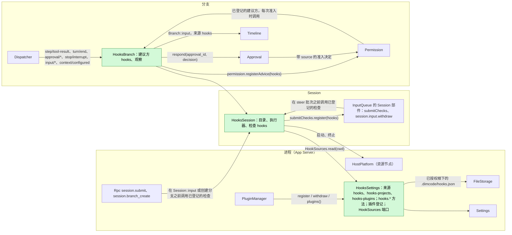
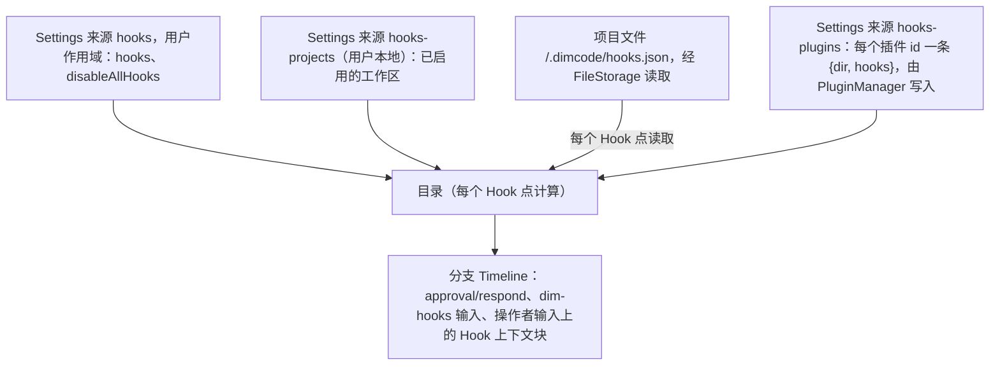
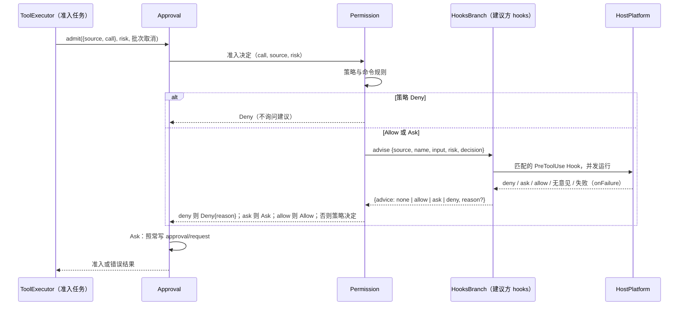
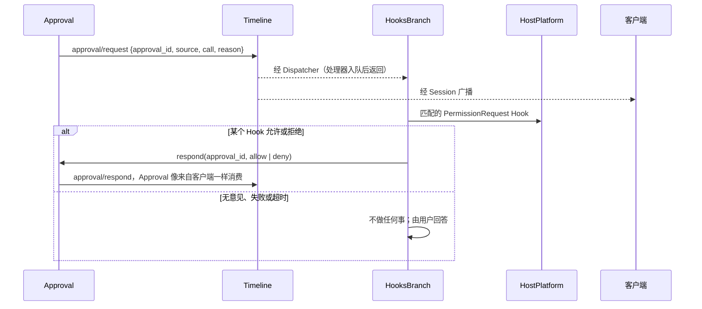
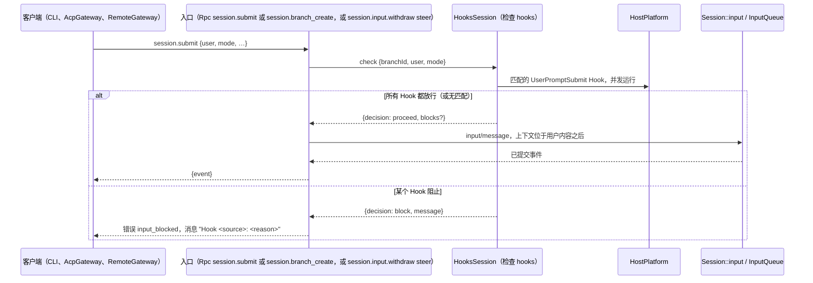
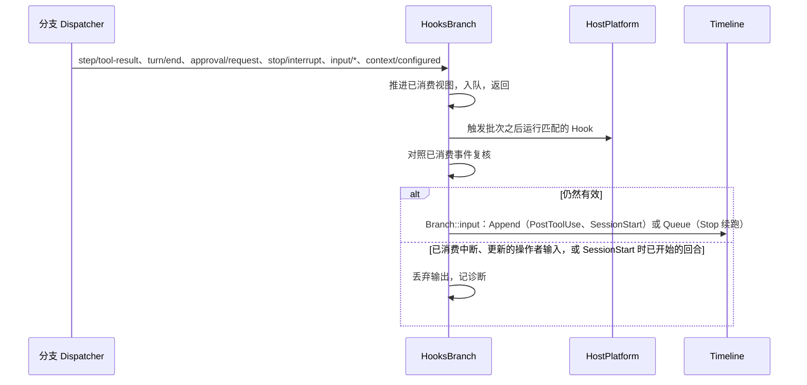

# Hooks

状态：Ready（[#143](https://github.com/arcships/dim/issues/143)）；已采纳 2026-10-22 与 2026-10-31 的维护者决定（§10）。总体设计：[overview](../overview.md)（Hooks）。阶段：M1（用户、项目与插件来源）。语言：Rust。作用域：[ADR 002](../../adr/002-plugin-scope.md)（进程 + Session + 分支）。

Hooks 在 Session **业务操作**的固定节点运行用户配置的命令，并把每个命令的决定交给该操作的所有者。Dim 只读取自己的 Hook 配置，不加载 Claude Code 或 Codex 的 Hook 文件。为便于迁移，文档形状（事件名、匹配组、命令处理器、`timeout`、`onFailure`）与脚本协议（stdin JSON、退出码、决定与输出字段）沿用 Claude Code 与 Codex，所以现有脚本和粘贴过来的配置都能工作（附录 G）。

Hooks 从不挂在基础设施上。已撤回的设计（[#21](https://github.com/arcships/dim/issues/21)）让 Timeline `before` 回调变成异步，以便命令扣住一次写入；本设计不这样做，Hooks 不注册任何 before 回调。Timeline、Dispatcher、事件信封与装配都不变。每个 Hook 点改为挂在本来就决定该操作的业务所有者上，经由该所有者的公开事件或服务：

| Hook 点 | 业务操作 | 作决定的所有者 | Hook 的决定如何到达所有者 |
| --- | --- | --- | --- |
| `PreToolUse` | 工具调用的准入 | Permission（由 Approval 的 `admit` 调用） | Permission 在准入决定中调用向它登记的建议方；`HooksBranch` 登记 `hooks`（新的通用建议登记，A.6.1） |
| `PermissionRequest` | 审批提问 | Approval | Hooks 像客户端一样经 Approval 的公开 `respond` 回答（现有） |
| `UserPromptSubmit` | 操作者输入的提交 | 操作者输入入口：Rpc `session.submit` 与 `session.branch_create`，以及 InputQueue 的 `session.input.withdraw {steer}` | 入口在写入之前调用向 Session 的 `submitChecks` 登记的检查；`HooksSession` 登记 `hooks`（新的通用提交检查表，A.6.2） |
| `PostToolUse`、`PostToolUseFailure`、`Stop`、`SessionStart` | 工具结果后、turn 后、Session 启动时的上下文 | InputQueue（输入） | Hooks 写来源为 `hooks` 的分支输入（现有） |
| `Notification` | 等待用户的审批 | —（观察） | 不向任何所有者传递（现有） |

`UserPromptSubmit` 不是 Timeline 的 Hook 点：Session 输入不一定是用户的（Goal、Scheduler、Collaboration、ShellInput 与 Hooks 自己都会写输入），所以命令只在操作者输入进入的地方运行，且在写入任何东西之前。命令经 HostPlatform（Session 的资源节点）运行；Hook 命令只在 Hooks 自己的任务或调用方自己的任务中等待（Permission 的准入决定运行在 ToolExecutor 按调用的准入任务中；提交检查运行在 Rpc 调用中），从不在 Dispatcher 处理器内或提交锁下等待。契约以语言中立形式给出（[ADR 002 D5](../../adr/002-plugin-scope.md#d5-合同语言中立)）；Rust 绑定见附录 H。

### 所有者检查

每个 Hook 点都对照了其所有者今天在 `main` 上暴露的内容：

| Hook 点 | 所有者现状 | 缺口 | 解决办法 |
| --- | --- | --- | --- |
| `PreToolUse` | `Approval::admit(AdmitCall {source, call}, risk, cancel)` 为准入调用 `Permission::decide(call, risk, cancel)`，并在允许后的复核中再次调用；`decide` 已经会等待命令规则端口；Deny 变成 `HostError::failed(reason)`，即该调用结果的错误文本 | `decide` 无法询问其他方，也收不到 `source`（调用 id 只在 `AdmitCall.source` 中）；它分不清准入与复核 | A.6.1：Approval 只在准入决定时传入 `source`；Permission 在那里调用向它登记的建议方。ToolExecutor 无需改动 |
| `PermissionRequest` | `approval/request {approval_id, source, call, reason}`；`Approval::respond(approval_id, decision)` 接受消费到的第一个回应，否则 `Unknown`/`Cancelled`/`Closed`；`approval/respond {approval_id, decision}` 没有 reason | 拒绝时没有原因 | 可直接使用；Hook 拒绝显示 Approval 的通用文本（决定 7） |
| `UserPromptSubmit` | Rpc `session.submit {sessionId, submissionId?, branchId?, text? \| user?, mode?}` 构造 `InputMessageData` 并调用 `Session::input`；Rpc `session.branch_create {sessionId, parentBranchId, at, prompt}` 创建一个 host 分支，其第一条 Queue 输入就是该提示词，作为操作者的话（TimelineTree `first_input`）；InputQueue 的 `session.input.withdraw {…, steer?}` 把撤回与新的 Steer 输入作为一个批次写入。其他输入（Goal、Scheduler、Collaboration、ShellInput、Hooks）由其所有者经 `Branch::input` 进入 | 没有入口在写入前询问任何人。带 `user` 内容、且第一个 raw 块是 `<dim-…>` 标记的输入会被读作来源输入（Goal A5），而历史先渲染 raw 块、后渲染用户内容，所以上下文不能作为操作者输入的 raw 块 | A.6.2：三个入口都先调用向 `submitChecks` 登记的检查，把返回的上下文追加到输入的 `user` 内容中、操作者自己的内容之后，所以该输入仍是操作者输入，无需改历史或约定 |
| `PostToolUse(Failure)` | `step/tool-result {turn_id, request_id, call_event_id?, results: [{call_id, result}]}`、`ToolResult.is_error` | 无 | Dispatcher 订阅 |
| `Stop` | `turn/end {turn_id, status: completed \| failed \| cancelled}` | 无 | Dispatcher 订阅，仅 `completed` |
| `SessionStart` | 没有 Session 启动事实；有 `branch/start`，以及 `main` 上没有 `turn/start` | 无需 | 由历史推导（§3.4） |
| `Notification` | `approval/request` | 无 | Dispatcher 订阅 |
| `PreCompact`、`PostCompact` | `context/compaction-start {trigger}`（策略已被调用）、`context/compaction {outcome}` | 阻止需要 ContextCompaction 中的压缩准入端口 | 暂不支持（决定 6） |
| `SessionEnd` | Session 关闭是生命周期，不是 Timeline 事实；工作必须在服务移除前结算（AGENTS 规则 8） | 关闭时运行命令会拖延关闭 | 暂不支持（决定 6） |
| 配置 | Settings 的 `BusinessDocument` 来源，带用户文件和可选项目文件；两者都是单纯的文件名（`validate_file` 拒绝任何路径分隔符），所以项目文件位于已授权的项目根下（MCP：`mcp` 配 `.mcp.json`，启用状态在 `mcp-projects`）。目录中的项目文件，例如 Workflow 的 `.dimcode/workflows/*.yaml`，不是 Settings 来源：其所有者在 Settings 授权的根下经 FileStorage 读取（[总览](../overview.md)，配置）。Rust 来源没有通用的客户端写入，所以每个 Rust 所有者保留自己的管理方法 | `.dimcode/hooks.json` 不能作为 Settings 来源的项目文件 | App Server 中的 `HooksSettings`，仿照 MCP（决定 5；§1、A.7）：用户文档是 Settings 来源 `hooks`，`HooksSettings` 在 Settings 为该 `cwd` 授权的项目根下经 FileStorage 读取 `.dimcode/hooks.json`（A.2） |

## 1. 结构



| 部件 | 作用域 | 依赖 | 提供 |
| --- | --- | --- | --- |
| `HooksSettings` | 进程，App Server（Settings 与 MCP 的管理所在之处） | Settings（`BusinessDocument` 来源 `hooks`，仅用户作用域，`hooks-projects` 与 `hooks-plugins`；它为某个 `cwd` 授权的项目根）；FileStorage（在该根下读取 `<project>/.dimcode/hooks.json`） | 管理方法 `hooks.catalog`、`hooks.save`、`hooks.set_enabled`（A.7）；插件 Hook 文档的所有者操作 `register`、`withdraw` 与 `plugins()`（[PluginManager §3.7](PluginManager.md#37-内容登记)）；返回某个 `cwd` 生效来源的 Session 端口 `HookSources`（A.2） |
| `HooksSession` | Session（可选；由 Hooks 插件在启用期间登记） | `HookSources`；HostPlatform；`SessionConfig.cwd`；`submitChecks`（InputQueue 的 Session 部件） | 向 `submitChecks` 登记提交检查 `hooks`，由操作者输入入口调用（A.6.2）；供 `HooksBranch` 使用的私有目录与命令执行器 |
| `HooksBranch` | 分支（可选；由 Hooks 插件在启用期间登记） | `HooksSession` 的执行器；`Dispatcher`、`Approval`、`Permission`、`Branch::input` | 向分支的 Permission 登记建议方 `hooks`（A.6.1）；观察与上下文类 Hook |

`HookSources` 沿用 `CommandRulesHost` 与 `SkillSettingsHost` 的现有宿主端口模式：agent 侧部件从不提及 Settings 或 App Server。Hooks 的部件向各自的所有者登记：`HooksBranch` 向 Permission，`HooksSession` 向 `submitChecks`。Permission 与入口不依赖任何建议方或检查（[ADR 002 D3](../../adr/002-plugin-scope.md#d3-依赖跟随作用域并从扩展指向核心)）：没有登记时，Permission 只按策略与命令规则决定，入口不经检查直接写入操作者输入。

**重载。** 启用、停用或升级 Hooks 只重载 Hooks 插件（D3）。已打开的 Session 与分支随它的登记变化挂载或卸下它的部件（[ADR 006 D3](../../adr/006-plugin-contract.md#d3-插件是一行每个实例挂载为它登记的部件)）。在它的部件卸载前，它们结算已接受的工作（AGENTS 规则 8）：终止运行中的命令，并按当时运行的 Hook 的 `onFailure` 回答每个未决的提交检查（A.5）。它们的登记随之撤下。建议尚未返回的调用会看到该建议被丢弃，视为 none，Permission 在没有它的情况下决定；Hooks 正在回答的审批留给用户。Hooks 的部件未挂载期间的提交与调用不经过 Hooks（A9）。编辑 Hook 文档、启用状态或 `disableAllHooks` 是业务配置，在下一个 Hook 点读取，从不重载（[D4](../../adr/002-plugin-scope.md#d4-结构性配置与业务配置分离)）。

**节点。** 资源节点离线时，启动进程以 `node_unavailable` 失败；每个 Hook 点把它当作 Hook 失败处理（附录 C）。

**依赖的契约：** `Approval::admit` 与 `AdmitCall.source`、`Permission::decide` 与 `permission.registerAdvice`（A.6.1）；Approval 的 `respond` 与 `approval/request`、`approval/respond`、`approval/cancelled` 事实；Rpc `session.submit` 与 `session.branch_create`，以及 InputQueue 的 `session.input.withdraw {steer}`，和 Session 表 `submitChecks`（A.6.2）；`InputMessageData.user`（上下文追加在操作者自己的内容之后）；`step/tool-result`、`turn/start`、`turn/end`、`stop/interrupt`、`context/configured`（只读）；来源输入约定（[Session 访问 A.2](../contracts/session-access.md#a2-来源输入约定)）；Settings 的 `BusinessDocument`、`settings.changed` 与已授权的项目根；FileStorage 读取；App Server 的 `ManagementMethods`；HostPlatform 的 `build_process_spec`、进程监管，以及把给定字节写入 stdin 的进程启动（A.6.3）。**本文定义的契约：** Hook 文档格式、命令协议、Hooks 的 `hooks` 登记给出的建议与检查回复、`hooks.*` 方法、`HookSources`、来源名 `hooks`（标记 `dim-hooks`，键命名空间 `hooks:`）。Hooks 不声明任何事件。

## 2. 数据与状态



Hooks 不拥有 `StateCell`，不声明事件，也不缓存任何东西。目录在每个 Hook 点从 `HookSources` 重新计算（A6）。Hooks 唯一保存的是 PluginManager 登记的内容：Settings 来源 `hooks-plugins`，如同 Mcp 保存 `mcp-plugins`（A.2），所以插件文档在 Hooks 自身重载后仍然存在。Hooks 据以决定的其他一切都是它经 Dispatcher 订阅消费到的分支事实：审批请求、工具结果、turn 与中断。被阻止的提交不写任何东西，因此不留状态。重载后的 `HooksBranch` 没有需要重建的未结工作；命令是副作用，从不重跑。

## 3. 流程

### 3.1 经 Permission 的 PreToolUse



等待发生在 Permission 的异步决定内，它本来就运行在 ToolExecutor 按调用的准入任务中，也本来就等待一个宿主端口（命令规则）。Timeline 与 Dispatcher 上没有任何等待。`deny` 让 Permission 以 `Hook <source>: <reason>` 拒绝，Approval 将其作为 `HostError::failed` 返回，ToolExecutor 在批次 `step/tool-result` 中把它写为该调用的错误文本。`ask` 把 Allow 变成审批提问。`allow` 把 Ask 变成 Allow，调用无需提问即运行（决定 1；§7）。Hook 从不推翻策略或命令规则的 Deny，因为那时不会询问建议。用户回应后 Approval 的复核是普通决定，不再询问建议。中断取消批次令牌，Permission 丢弃建议调用，Hooks 终止命令。工具在请求绑定中未知的调用在 `admit` 之前就失败，不运行任何 Hook。

### 3.2 经 Approval 的 PermissionRequest



这与 Rpc 的 `approval.respond` 使用 Approval 的方式完全相同。由 Approval 决定：它接受消费到的第一个回应，对之后的回应答 `Unknown`，允许后复核策略。若用户先回答，或 Approval 写了 `approval/cancelled`（中断、关闭），Hooks 消费到后终止命令。客户端先看到请求，再像看到其他回应一样看到 Hook 的 `approval/respond`。

### 3.3 操作者输入入口处的 UserPromptSubmit



入口在自己的 Rpc 调用中、写入任何东西之前运行检查；调用等待各 Hook，受其超时限制（`UserPromptSubmit` 默认 30 秒）。放行时，各 Hook 的上下文成为标记为 `<dim-hooks kind="prompt-submit">` 的文本块，每个 Hook 一个，按目录顺序，追加到同一个 `input/message` 的 `user` 内容中、操作者自己的内容之后；操作者自己的内容从不被编辑。该输入没有 raw 块，所以仍是操作者输入，Goal 仍会因它重新开始计数（Goal A5）。读取该输入 `user` 内容的消费方（渲染它的客户端、SessionTitle 的标题文本）会在操作者的文本之后看到这些块。阻止时什么都不写：没有 `input/message`、没有事件、没有 turn；调用以应用错误 `input_blocked`（代码 `-32000`，`data.appError` 为 `input_blocked`）失败，其消息为 `Hook <source>: <reason>`。`input_blocked` 加入保证未提交任何东西的 `session.submit` 错误集合，所以 CLI 报告的是阻止，而不是输入可能已入队的不确定结果。`steer` 被阻止的 `session.input.withdraw` 既不写撤回也不写 Steer 输入，所以旧输入仍留在队列中。提示词被阻止的 `session.branch_create` 不创建分支；放行时，各 Hook 的上下文被丢弃并记诊断，因为分支的第一条输入只由提示词构成。被阻止提交的 `submissionId` 对 `session.input_lookup` 仍是未知，所以重试会再次运行 Hook。客户端断开不取消任何东西，与任何已接受的调用一样（[session-boundary A.1](../contracts/session-boundary.md#a1-方法贡献)）：检查照常完成，入口如同客户端仍连接时一样写入或拒绝输入。只有入口自身调用被中断（Rpc 装载或入口的提供方卸载，或 Session 关闭）才会提前结束检查：命令被终止，什么都不写，调用以该中断已有的错误失败。AcpGateway 把因 `input_blocked` 失败的 `session.submit` 报告为 ACP 停止原因 `refusal`，消息作为 `agent_message_chunk`（决定 9）。

### 3.4 观察与上下文类 Hook



`PostToolUse` 对 `step/tool-result` 批次中结果不是错误的每个匹配调用运行，`PostToolUseFailure` 对结果为 `is_error` 的每个匹配调用运行；一个批次写一个 Append 输入。`Stop` 在结果为 `completed` 的 `turn/end` 上运行；阻止会写一个携带原因的 Queue 续跑输入，连续最多 3 次（A8）。`SessionStart` 在 `main` 的历史中没有 `turn/start` 且没有 `hooks:session-start/*` 带键块时运行一次；其 Append 输入与任何空闲 Append 一样，等待第一个驱动输入。分支上已有回合开始时，`SessionStart` 的输出同样被丢弃，因为该块必须先于第一个回合。`Notification` 在 `approval/request` 上运行，不写任何东西。带 `async: true` 的处理器可在上述任何点运行，没有任何东西等待或读取它们的输出。`HooksBranch` 按分支上生效的声明解析每个工具事件的迁移别名（G.2）。

## 4. 时序与冲突

| 场景 | 序号顺序 | 结果 | 所有者 |
| --- | --- | --- | --- |
| PreToolUse 运行时中断 | 批次取消 | Permission 丢弃建议；命令终止；调用按取消结算 | ToolExecutor、Permission |
| 用户先于 PermissionRequest Hook 回答 | `approval/respond`（用户）< Hook 的 respond | Hook 的 respond 得到 `Unknown`；消费到用户回应时终止命令 | Approval |
| 同一分支上 Hook 运行期间有两个提交 | — | 每个调用等待自己的检查；输入按检查完成的顺序写入 | 入口 |
| 提交检查期间中断 | 尚未写入任何东西 | 对检查无影响；输入随后像中断之后到达的任何输入一样写入 | 入口、InputQueue |
| 提交检查期间客户端断开 | — | 不取消任何东西：检查照常完成，输入如同客户端仍连接时一样被写入或拒绝 | 入口 |
| Stop 续跑与更新的操作者输入 | `turn/end` < 输入被消费 < 写入 | 不写续跑 | Hooks |
| 提交检查期间 Hooks 重载 | — | 卸载前由运行中 Hook 的 `onFailure` 回答；之后的提交不经过 Hooks（A9） | Hooks、生命周期 |
| 资源节点离线 | 按调用 | `node_unavailable` = Hook 失败 → `onFailure` | Hooks |

完整表格：附录 B。

## 5. 上下文映射

| 来源 | 模型看到什么 | 位置 | 压缩 | 子分支 |
| --- | --- | --- | --- | --- |
| `SessionStart` 上下文 | Append 输入，标记 `<dim-hooks kind="session-start">`，每个 Hook 一个带键 `hooks:session-start/<n>` 的 raw 块 | 随第一个驱动输入 | 每个键重放最新块 | 切点处仍有效则继承 |
| `UserPromptSubmit` 上下文 | 文本块，标记 `<dim-hooks kind="prompt-submit">`，每个 Hook 一个 | 在操作者的输入内，操作者自己的内容之后；不附加到 `session.branch_create` 的提示词 | 仅摘要 | 同输入 |
| `UserPromptSubmit` 阻止 | 无：不写输入 | — | — | — |
| `PreToolUse` 拒绝 | ToolExecutor `step/tool-result` 中的错误文本 `Hook <source>: <reason>` | 与调用配对 | 仅摘要 | 在切点之前则有 |
| `PreToolUse` 允许、`PermissionRequest` | 除调用的普通结果外无 | — | — | — |
| `PostToolUse(Failure)` 上下文或阻止原因 | Append 输入，标记 `kind="post-tool"`，带 `call_id` 与 `tool` | 本 turn 的下一次模型请求 | 仅摘要 | 同输入 |
| `Stop` 阻止原因 | Queue 输入，标记 `kind="follow-up"` | 它驱动的 turn 开始处 | 仅摘要 | 同输入 |
| `Notification`、`async` 处理器 | 无 | — | — | — |

模型从不看到 Hook 配置、命令、退出码、诊断或 `UserPromptSubmit` 的阻止原因。

## 6. 接口（摘要）

| 接口 | 类型 | 用途 |
| --- | --- | --- |
| 建议方 `hooks`（`permission.registerAdvice`） | 由 `HooksBranch` 在运行期间向分支的 Permission 登记；Permission 每次准入时调用它（A.6.1） | `PreToolUse` 决定 |
| 检查 `hooks`（`submitChecks.register`） | 由 `HooksSession` 在运行期间向 Session 的 `submitChecks`（InputQueue）登记；操作者输入入口在写入前调用它（A.6.2） | `UserPromptSubmit` 决定 |
| `Approval.respond` | 现有分支服务 | `PermissionRequest` 结果 |
| `input_blocked` | `session.submit`、`session.branch_create` 与 `session.input.withdraw` 的 Rpc 应用错误；消息 `Hook <source>: <reason>` | 被阻止的提交 |
| `hooks.catalog`、`hooks.save`、`hooks.set_enabled` | App Server 管理方法（命名空间 `hooks`），与 `mcp.*` 类似 | 生效的 Hook、用户文档写入、项目启用（A.7） |
| `HookSources` | App Server 绑定的 Session 端口 | 某个 `cwd` 的生效来源（A.2） |
| `hooks`（用户作用域）、`hooks-projects` | Settings 来源（`BusinessDocument`） | 用户的 Hook 文档；用户本地的项目启用（A.1、A.2） |
| `.dimcode/hooks.json` | 由 `HooksSettings` 经 FileStorage 读取的项目文件 | 项目的 Hook 文档（A.1、A.2） |
| Hook 文档格式、命令协议 | 本文定义 | A.1、A.3 |

## 7. 安全

Hook 命令因配置而运行，不是 agent 的决定，因此无需批准，启用即运行（[ADR 003](../../adr/003-approval-scope.md) D2、AGENTS 规则 11）。用户 Hook 按用户所写启用。项目来源 `.dimcode/hooks.json` 默认停用：在用户为该工作区启用项目 Hook 之前，仓库什么都不运行（D3）。启用记录在用户本地来源 `hooks-projects` 中，只经 `hooks.set_enabled` 写入，所以项目文件不能启用自己。启用后，文件中的编辑在下一个 Hook 点生效（D4）。没有授权、指纹、哈希或信任提示。

**`PreToolUse` 的 `allow` 会扩大权限，这是被接受的（决定 1）。** `allow` 准入 Permission 的策略本会询问的调用。这一权限来自用户启用的配置，而不是 agent：用户 Hook 是用户自己的规则，如同 allow 命令规则；项目 Hook 只有在用户为该工作区启用项目 Hook 之后才能这样做，按 ADR 003 D3/D4，这意味着信任该项目的配置。它从不推翻 Deny（策略、不允许的工具或命令规则），因为那时不会询问建议；并且任何 Hook 的 `deny` 或 `ask` 都优先于 `allow`。Approval 与 Permission 仍只管辖 agent 的决定：调用仍是 agent 的，准入仍是 Permission 根据它所请求的建议作出的决定。

`PermissionRequest` 经与用户相同的路径回答 Approval 提出的问题，Approval 仍复核策略并把回答记录为 `approval/respond`。`UserPromptSubmit` 只阻止提交或加入带署名的块；从不编辑用户文本。没有 Hook 编辑工具输入（`updatedInput` 被忽略）。Hook 命令是配置命令（[ADR 003](../../adr/003-approval-scope.md) D2）：HostPlatform 在 Session 的资源节点上启动它，不施加 agent 沙箱，与启动 MCP stdio 服务器相同。沙箱设置管辖的是 agent 决定的命令，即 `exec` 与持久 shell，而不是配置（[ADR 010](../../../adr/010-sandbox-opt-in.md) D1）。stdin 包含提示词与工具输入；诊断只保留来源、事件、退出状态、耗时与有界的 stderr 摘录。

## 8. 规则检查

规则：[principles §1 与 §4](../../../architecture/rust-agent/principles.md)、[ADR 002](../../adr/002-plugin-scope.md) D1–D5、AGENTS 规则 11 与 [ADR 003](../../adr/003-approval-scope.md)。

| 规则 | 本文如何遵守 |
| --- | --- |
| §4.1 用指令事件改他人状态 | Hooks 不改变其他所有者的状态：审批只经 Approval 的 `respond`（由 Approval 写 `approval/respond`），工具准入由 Permission 根据它自己请求的建议决定，提交由其入口写入。Hooks 只写自己的输入。 |
| §4.2 交接后不可撤回 | `UserPromptSubmit` 在输入存在之前决定；工具建议是准入的一部分，在执行之前；交接后 Hooks 只写新的输入。 |
| §4.3 before 回调只同步变换；入口只校验格式与权限 | Hooks 不注册 before 回调。入口自己不检查提示词：它们调用向通用表 `submitChecks` 登记的检查，并写下它们的回答。在入口而不是 Timeline 上运行是维护者的决定（2026-10-22），因为只有入口处的输入才确知是操作者的。 |
| §4.4 核心不带业务含义 | Timeline、Dispatcher 与 before 不变；Permission 的建议方与 Session 的 `submitChecks` 是通用登记，不带 Hooks 语义。 |
| §4.5 读完整批次 | 观察类 Hook 与复核在整个触发批次之后运行；`PostToolUse(Failure)` 每个结果批次写一个输入。 |
| §4.6 上下文只来自已交接事件 | 被阻止的提交从不写入；提示词上下文随被采用的操作者输入进入；拒绝原因经 ToolExecutor 的结果进入；其他输出作为被采用的 Hooks 输入进入。 |
| §4.7 只用公开事件与服务 | Hooks 读取公开事件，调用 `Approval.respond` 与 `Branch::input`；Permission 与入口调用向它们登记的建议方与检查。不读取任何内部状态。 |
| §4.8 基础设施不变 | 无改动：Timeline、Dispatcher、信封、装配、生命周期与门面均不改。对业务所有者的需求按本规则格式写在 A.6。 |
| §4.9 只有决定所需事实进 Timeline | Hooks 不新增事件，也不新增字段；配置在 Settings 中，诊断在目录中。 |
| §1 Capability 与 App Server 边界 | `HooksSession` 与 `HooksBranch` 是位于独立 crate 的 Capability；`HooksSettings` 与 Settings 并列位于 App Server，与 MCP 的管理类似，并绑定 `HookSources`。 |
| ADR 002 D1 作用域 | 配置及其方法按宿主（进程）；目录、执行器与提交检查随 Session；建议与观察随其所用事实所在的分支。 |
| ADR 002 D2 不设接线模块 | Hooks 经所有者自己的登记与服务挂接；`HookSources` 是 Hooks 自己的配置所有者的 agent 侧端口，不是为他人写的适配器。 |
| ADR 002 D3 依赖 | Hooks 依赖核心部件（Approval、Permission、InputQueue 的 `submitChecks`、Timeline）并向它们登记；Permission 与入口不依赖任何建议方或检查，没有 Hooks 也能工作。 |
| ADR 002 D4 配置 | Hook 文档与启用是 Settings 来源中使用时读取的业务数据；不重载。 |
| ADR 002 D5 语言中立契约 | 文档格式、命令协议、`permission.registerAdvice`、`submitChecks`、`HookSources` 与 `hooks.*` 都是中立的；Rust 绑定见附录 H。 |
| AGENTS 11 / ADR 003 | Hook 命令无需批准，启用即运行；项目来源默认停用，只有用户本地的 `hooks-projects` 能启用它；Approval 与 Permission 仍只管辖工具调用，而 `allow` 建议是来自用户启用配置的权限（§7）。 |

## 9. 向机制所有者提出的需求

对运行时与 rutis：无。Hooks 不需要基础设施改动，也不需要事件或持久化改动。它需要其所有者提供三项通用能力，按 §4 规则 8 的五项写在 A.6，并列入 [overview 附录 B.1](../overview.md#b1-session-与分支-capability)：

- Permission 与 Approval：向分支的 Permission 登记（`permission.registerAdvice`）并在准入决定中调用的建议方，由 Approval 传入调用的 `source`（A.6.1）。
- InputQueue（Session 表 `submitChecks`，以及负责 `session.input.withdraw {steer}` 的 `InputMethods`）、Rpc（`session.submit`、`session.branch_create`）与原生 CLI：向 `submitChecks` 登记并在写入操作者输入之前调用的检查、`input_blocked` 错误，以及它在保证未提交任何东西的 `session.submit` 错误中的位置（A.6.2）。
- HostPlatform：启动进程时把给定字节写入其 stdin，然后关闭（A.6.3）。

AcpGateway 自己的设计把 Hooks 对 `session.submit` 的 `input_blocked` 拒绝报告为拒绝消息加停止原因 `refusal`（[AcpGateway §4.2](AcpGateway.md#42-prompt-与取消)），因此 Hooks 不对它提出需求（决定 9）。不属于需求的：Settings 来源 `hooks`（仅用户作用域）、`hooks-projects` 与 `hooks-plugins` 是 `BusinessDocument` 来源（现有机制，v13 中新增 `user/<source>` 行），且 `hooks-plugins` 只由所有者操作写入，任何 `hooks.*` 方法都不写它；`.dimcode/hooks.json` 是目录中的项目文件，由其所有者在 Settings 授权的根下经 FileStorage 读取，与 Workflow 的定义文件相同（[总览](../overview.md)，配置）；`hooks.*` 方法使用现有的 `ManagementMethods`；HostPlatform 的 shell 形式 `build_process_spec` 已覆盖 `command`（不支持 exec 形式的 `args`，附录 G）。

## 10. 决定

### 10.1 维护者决定

#### 2026-10-22

| # | 决定 |
| --- | --- |
| — | Dim 只读取自己的 Hook 配置：不导入 Claude 或 Codex 的文件；文档形状与脚本协议保持兼容以便迁移（附录 G） |
| — | 项目 Hook：Dim 自己的 `.dimcode/hooks.json`，默认停用，在用户本地配置中按工作区启用（ADR 003） |
| — | `UserPromptSubmit` 在操作者输入入口运行，而不是在 Timeline 上；没有 `hold`、没有 `input/release`、没有 before 回调、没有提示词暂扣标志、没有持久化改动 |
| 1 | `PreToolUse` 的 `allow` 准入该调用（§7） |
| 2 | `onFailure` 默认为 `continue` |
| 5 | 配置所有者：App Server 中的 `HooksSettings`，含来源 `hooks`、`hooks-projects` 与 `hooks.*` 方法，同 MCP |
| 6 | 摘要表中的八个事件受支持；其余都不支持（原因见附录 G.1） |
| 7 | `PermissionRequest` 拒绝显示 Approval 的通用文本；`approval/respond` 不变 |
| 8 | stdin 的 `permission_mode` 为 Dim 的预设值；没有 `transcript_path` |
| 9 | AcpGateway 把 Hook 阻止报告为 `refusal` |

#### 2026-10-31

| # | 决定 |
| --- | --- |
| — | 阶段为 M1，覆盖用户、项目与插件来源；A.6.1 与 A.6.2 已接受（§10.2） |
| — | Hook 命令是配置命令：HostPlatform 在 Session 的资源节点上启动它，不施加 agent 沙箱，与启动 MCP stdio 服务器相同（§7） |
| — | 插件 Hook：PluginManager 调用 Hooks 的所有者操作 `register`、`withdraw` 与 `plugins()`；Hooks 把文档保存在 `hooks-plugins`，在 `hooks.catalog` 中列出，并为其命令提供 `DIM_PLUGIN_ROOT`（A.2、A.7） |
| — | 事件的 stdin 对象（A.3）写入 HostPlatform 为它启动的进程的 stdin，写完即关闭；环境新增 `DIMCODE_HOME` 与 `DIM_PLUGIN_ROOT`（A.6.3） |
| — | Hook 经 `dimcode export "$DIM_SESSION_ID"` 读取 Session 的 Timeline；没有 `transcript_path`（A.3） |
| — | `PreCompact`/`PostCompact`、`SessionEnd` 与 `SubagentStart`/`SubagentStop` 仍不支持，原因见 G.1 |
| — | 原生 CLI 新增 `dimcode hooks list`、`dimcode hooks enable\|disable`、`dimcode hooks edit` 与 `dimcode hooks set PATH`（[CLI 命令](../cli-commands.md#命令)） |

### 10.2 已接受的所有者改动

| 事项 | 所有者 | Issue |
| --- | --- | --- |
| A.6.1：向分支的 Permission 登记并在准入决定中调用的建议方，含 `allow` | Permission、Approval | [#758](https://github.com/arcships/dim/issues/758) |
| A.6.2：`submitChecks` 表、`input_blocked`，以及它在保证未提交任何东西的 `session.submit` 错误中的位置 | Rpc（App Server）、InputQueue、CLI | [#757](https://github.com/arcships/dim/issues/757) |
| 插件来源：所有者操作、`hooks-plugins`、`DIM_PLUGIN_ROOT`（[PluginManager §3.7](PluginManager.md#37-内容登记)） | Hooks、PluginManager | [#756](https://github.com/arcships/dim/issues/756) |

本文中没有等待维护者回答的问题。

## 附录 A. 接口细节

### A.1 Hook 文档格式

用户文档是 Settings 来源 `hooks`（仅用户作用域）；项目文档是 `<workspace>/.dimcode/hooks.json`，由 `HooksSettings` 在 Settings 授权的项目根下经 FileStorage 读取，并以同一文档类型校验。两者都使用 Claude Code / Codex 的形状：一个按事件名作键的对象，每个事件包含带命令处理器的匹配组。

```json
{
  "hooks": {
    "PreToolUse": [
      { "matcher": "Bash|mcp__fs__.*",
        "hooks": [ { "type": "command", "command": "$DIM_PROJECT_DIR/scripts/guard.sh", "timeout": 10, "onFailure": "block" } ] }
    ],
    "UserPromptSubmit": [ { "hooks": [ { "type": "command", "command": "~/bin/prompt-check" } ] } ]
  },
  "disableAllHooks": false
}
```

| 字段 | 规则 |
| --- | --- |
| `hooks.<Event>` | `SessionStart`、`UserPromptSubmit`、`PreToolUse`、`PermissionRequest`、`PostToolUse`、`PostToolUseFailure`、`Stop`、`Notification`。其他事件名列为 `unsupported`，从不运行 |
| `matcher` | 同 Claude：空、缺省或 `*` 匹配全部；只含字母、数字、`_`、`-`、空格、`,` 和 `|` 的值是按 `|` 或 `,` 拆分的精确名称列表；其余都是不加锚定的正则表达式。工具事件匹配 Dim 工具名或其迁移别名（G.2）。`SessionStart`：`startup`。`Notification`：`permission_prompt`。对 `UserPromptSubmit` 与 `Stop` 忽略。无效表达式使该组为 `invalid` |
| `hooks[].type` | `command`。其他类型（`http`、`mcp_tool`、`prompt`、`agent`）为 `unsupported` |
| `hooks[].command` | shell 形式，由节点的执行 shell 运行，工作目录为 `SessionConfig.cwd`。存在 `commandWindows` 时，在 Windows 节点上取代它 |
| `hooks[].timeout` | 正整数秒；默认 600，`UserPromptSubmit` 为 30 |
| `hooks[].onFailure` | `continue`（默认）或 `block`；失败、超时或取消的含义（A.5） |
| `hooks[].async` | `true`：运行，但没有东西等待它，其输出被忽略 |
| `hooks[].args`、`hooks[].if` | 该处理器为 `unsupported`，从不运行：exec 形式与权限规则过滤器未实现，而忽略它们会改变实际运行的内容 |
| `hooks[].statusMessage`、其他未知字段 | 忽略 |
| `disableAllHooks` | 仅在用户文档中遵守：任何来源的 Hook 都不运行。在项目文件中忽略 |

项目启用是用户本地来源 `hooks-projects`：`{ "enabled": ["<workspace>", …] }`，以 Settings 已授权的规范化项目根为键（同 MCP 的 `mcp-projects`，每个工作区一个来源，而不是条目 id）。

### A.2 来源与顺序

| 来源 id | 文档 | 启用 |
| --- | --- | --- |
| `user` | Settings 来源 `hooks`，用户作用域 | 按所写 |
| `project` | `<workspace>/.dimcode/hooks.json`，经 FileStorage 读取 | `hooks-projects` 列出该工作区时 |
| `plugin:<id>` | 插件包的 Hook 文档，由 PluginManager 以 `register({plugin, dir, document})` 登记 | 在 PluginManager 保持登记期间；`withdraw({plugin})` 移除它 |

插件文档保存在 Settings 来源 `hooks-plugins` 中，每个插件 id 一条 `{dir, hooks}`，如同 Mcp 保存 `mcp-plugins`；`plugins()` 列出 Hooks 持有的 id，Hooks 在自身重载后恢复它们。登记的文档与其他文档一样校验（A.1）：Hooks 拒绝的文档以 `refused` 报告给 PluginManager，不留任何条目，其中的 Hook 都不运行。插件来源的命令获得指向 `dir` 的 `DIM_PLUGIN_ROOT`（A.3），其目录条目的 `path` 就是该 `dir`，另列启用状态。

`HookSources.read(cwd, cancel)` 按来源返回其 id、路径、启用状态与文档或错误。工作区是 Settings 为 `cwd` 授权的项目根，如同 `mcp.catalog` 的解析方式；没有项目的 `cwd` 没有项目来源。目录顺序为表中顺序，再按文档顺序。同一 Hook 点上 `command` 字符串与插件目录都相同的处理器只运行一次；插件之间的命令从不合并，因为 `DIM_PLUGIN_ROOT` 赋予它们不同的含义（A.3）。文档在每个 Hook 点读取；缺失的项目文件视为空，无法读取或无效的文件列为 `invalid` 并记诊断，其中的 Hook 都不运行。

### A.3 命令协议

| 通道 | 内容 |
| --- | --- |
| stdin | 一个 UTF-8 JSON 对象，然后 EOF。公共字段：`hook_event_name`、`session_id`、`cwd`、`permission_mode`（Dim 预设：`read-only`、`ask`、`workspace-write`、`full-access`）、turn 范围内时的 `turn_id`，以及 Dim 字段 `branch_id`、`dim_source`（`user`、`project` 或 `plugin:<id>`）。没有 `transcript_path` |
| 环境 | HostPlatform 的基础环境，加 `DIM_PROJECT_DIR`、`DIM_HOOK_EVENT`、`DIM_SESSION_ID` 与 `DIMCODE_HOME`；仅插件来源加 `DIM_PLUGIN_ROOT` |
| 退出 0 | stdout 为空、一个 JSON 对象（A.4），或纯文本——凡不是单个 JSON 对象的值，包括其他 JSON 值——对 `SessionStart` 与 `UserPromptSubmit` 为上下文，其他事件忽略 |
| 退出 2 | 该事件的阻止结果（A.4）；stderr（前 2 KiB）为原因 |
| 其他退出码、信号、超时、启动失败、stdout 超过 64 KiB、`node_unavailable` | 失败：记诊断，然后按处理器的 `onFailure`（A.5） |

事件字段：

| 事件 | stdin 字段 |
| --- | --- |
| `PreToolUse` | `tool_name`、`tool_input`、`tool_use_id`、`risk`、`permission_decision`（`allow` 或 `ask`：Permission 自己的决定） |
| `PermissionRequest` | `tool_name`、`tool_input`、`tool_use_id`、`approval_id`、`reason` |
| `PostToolUse`、`PostToolUseFailure` | `tool_name`、`tool_input`、`tool_use_id`、`tool_response: {content, is_error}` |
| `UserPromptSubmit` | `prompt`（文本块以换行连接；不传图片）、`mode` |
| `Stop` | `stop_hook_active`（该 turn 由 Hooks 续跑驱动） |
| `SessionStart` | `source: "startup"` |
| `Notification` | `notification_type: "permission_prompt"`、`message` |

`tool_name` 是 Dim 工具名，`tool_input` 是 Dim 的输入；`tool_use_id` 是调用的 `source`（`BranchSource::Tool`）中的 `call_id`。

`DIMCODE_HOME` 是运行该 Session 的 App Server 所配置的产品 home，不是守护进程继承的环境：产品守护进程总是有并设置它；开发 profile（`--model-config`、`--mock-model`）没有产品 home，也不设置，因此在那里归档的 Hook 自行传入 `dimcode export --database PATH`。`DIM_PLUGIN_ROOT` 是插件来源登记时的 `dir`（A.2）；用户与项目来源没有。

**归档。** 需要 Session 历史的 Hook 用 `dimcode export "$DIM_SESSION_ID"` 读取该 Session 的 Timeline（[Timeline 导出](../appserver/timeline-export.md)），它读取 `DIMCODE_HOME` 指定的 home（[ADR 005](../../../adr/005-observability.md) D3）。没有 `transcript_path`（决定 8）。

### A.4 结果

| 事件 | 读取的 stdout JSON | 退出 2 | 结果 |
| --- | --- | --- | --- |
| `PreToolUse` | `hookSpecificOutput.permissionDecision`（`deny`、`ask`、`allow`、`defer`）及 `permissionDecisionReason`；旧式 `decision: "block"` / `"approve"` 及 `reason` | 拒绝 | `deny` → 建议拒绝；`ask` → 建议提问；`allow`/`approve` → 建议允许；`defer` → 无意见 |
| `PermissionRequest` | `hookSpecificOutput.decision.behavior`（`allow`、`deny`） | 忽略 | `respond(allow)` / `respond(deny)`；无 → 不做任何事 |
| `UserPromptSubmit` | `decision: "block"` 及 `reason`；`hookSpecificOutput.additionalContext` | 阻止 | 阻止 → `input_blocked`；上下文 → 操作者内容之后的一个文本块 |
| `PostToolUse(Failure)` | `decision: "block"` 及 `reason`；`hookSpecificOutput.additionalContext` | stderr 作为上下文 | Append 输入 |
| `Stop` | `decision: "block"` 及 `reason`；`hookSpecificOutput.additionalContext` | stderr 作为原因 | Queue 续跑（先原因，后上下文） |
| `SessionStart` | `hookSpecificOutput.additionalContext` | 失败 | 带键 Append 块 |
| `Notification` | — | 失败 | — |

`Stop` 的阻止若原因为空（退出 2 而无 stderr，或 `decision: "block"` 没有 `reason`），不写续跑输入；运行器记一条警告，写明处理器的来源与事件。

上下文与原因每个 Hook 各最多 16 KiB。Dim 不支持的字段（`updatedInput`、`updatedPermissions`、`updatedToolOutput`、`message`、`continue`、`stopReason`、`suppressOutput`、`systemMessage`、`initialUserMessage`、`sessionTitle`）被忽略并记诊断。

### A.5 并发、合并、超时与失败

| 项 | 规则 |
| --- | --- |
| 并发 | 一个 Hook 点上匹配的处理器并发运行；结果按目录顺序合并，因此结果与所选原因都与完成顺序无关 |
| `PreToolUse` | 任一拒绝 → 拒绝；否则任一提问 → 提问；否则任一允许 → 允许；否则无意见。原因取目录顺序中第一个拒绝：一旦得知拒绝，目录顺序中排在它之后的处理器被终止，排在它之前的处理器运行到结束，因为它们的拒绝将优先 |
| `PermissionRequest` | 任一拒绝 → 拒绝；否则任一允许 → 允许；否则不做任何事 |
| `UserPromptSubmit` | 任一阻止 → 阻止（目录顺序中第一个阻止，适用相同的提前终止规则）；否则放行，每个上下文为操作者内容之后的一个文本块，按目录顺序。`async` 处理器不参与决定，也不会被阻止终止：它在自己的超时、入口调用被中断或 Hooks 的部件卸载时结束 |
| `PostToolUse(Failure)`、`Stop` | 全部输出按目录顺序合为一个输入 |
| 超时 | 每个处理器的 `timeout`；终止进程树 |
| 失败 | 失败、超时与取消按处理器的 `onFailure` 映射：`continue` = 无意见（`PreToolUse`）、不做任何事（`PermissionRequest`）、不带其上下文地放行（`UserPromptSubmit`）；`block` = 拒绝、拒绝、以 `Hook <source> did not finish` 阻止。观察类 Hook：只记诊断 |
| 取消 | `PreToolUse`：Permission 丢弃建议调用（批次取消、分支关闭）。`PermissionRequest`：请求已被回答或消费到 `approval/cancelled`。`UserPromptSubmit`：只有入口自身的调用被中断时（Rpc 装载或入口的提供方卸载、Session 关闭）入口才丢弃检查；客户端断开不取消任何东西。卸载：未决检查按 `onFailure` 回答（§1）。进程总是经 `ctx.effect` 结束 |

### A.6 对其他插件的改动

#### A.6.1 Permission 的工具建议

| 项 | 内容 |
| --- | --- |
| 被什么挡住 | §4 规则 3 禁止在 before 回调中等待，规则 8 要求 Timeline 不变，所以 `PreToolUse` 命令不能扣住 `step/tool-call`。规则 7 禁止替 Permission 决定。Permission 是每个调用“能否运行”的所有者，包括其预设无需询问即允许的调用。目前 `Permission::decide(call, risk, cancel)` 只询问它的命令规则端口，收不到调用身份，并且对准入与 Approval 允许后的复核做完全相同的调用。 |
| 考虑过的现有机制 | `step/tool-call` 上的异步 before（已撤回，#21）；订阅 `step/tool-call` 的 Dispatcher（在交接给 ToolExecutor 之后运行，与执行竞争，规则 2）；回答 `approval/request`（只对本来就要提问的调用存在）；`CommandRulesHost`（由 profile 绑定的单一 Session 端口，只用于 `execute_process` 调用的命令，且按静态规则决定）。向所有者登记，与工具向 ToolRegistry 登记相同（[rutis 使用 R6](../rutis-usage.md#r6-贡献向所有者登记)）：建议方沿用它。 |
| 需要的通用能力 | Approval 的 `admit` 在准入决定中把 `AdmitCall.source` 传给 Permission；复核仍是普通 `decide`。Permission 保存分支的建议方。分支部件在运行期间向分支的 Permission 登记建议方：`permission.registerAdvice(name, advise)`。登记属于发起调用的部件，在它卸载时撤下；同名的第二个建议方登记失败。`HooksBranch` 登记 `hooks`。在准入决定中，策略与命令规则之后、且结果不是 Deny 时，Permission 按名称顺序调用此刻已登记的每个建议方：`advise {source, name, input, risk, decision: "allow" \| "ask"}` → `{advice: "none" \| "allow" \| "ask" \| "deny", reason?}`（异步；取消 = Permission 丢弃调用）。任一 deny → `Deny {reason}`；否则任一 ask → `Ask {reason}`；否则任一 allow → `Allow`；否则 Permission 自己的决定。提供方错误视为 `none`。Permission 不依赖任何建议方；`HooksBranch` 依赖 Permission。不带业务含义：任何分支部件都可登记建议方。建议永远不能推翻 Deny，因为那时不会询问建议。ToolExecutor 不变：它本来就把调用 id 放在 `AdmitCall.source` 中。 |
| 对序号、批次、中断、重载的影响 | 序号与批次：无新事件；被拒调用的错误文本在 ToolExecutor 现有的批次结果中；被允许的调用不写 `approval/request`。中断：批次令牌取消决定，从而取消建议调用。重载：调用中途撤下的建议方，其未返回的建议被丢弃，视为 `none`；没有已登记的建议方时，Permission 只按策略与命令规则决定。一个调用的准入延迟增加建议所需时间。 |
| 由谁实现与 issue | Permission 与 Approval（`dim-agent-capabilities`）；[#758](https://github.com/arcships/dim/issues/758)（§10.2）。 |

#### A.6.2 操作者输入入口处的提交检查

| 项 | 内容 |
| --- | --- |
| 被什么挡住 | `UserPromptSubmit` 命令必须在操作者输入被写入之前作出决定：一旦提交，InputQueue 会在同一个 Dispatcher 步骤内应用 Steer、Append 或空闲 Queue 输入（规则 2），而 §4 规则 3 禁止在 before 回调中等待。Session 输入不一定是操作者的（Goal、Scheduler、Collaboration、ShellInput、Hooks 也会写输入），所以 Timeline 层面的 Hook 分不清用户提示词与其他输入。只有操作者输入到达的入口才知道。目前 `session.submit`、`session.branch_create {prompt}`（其提示词作为操作者的话成为新分支的第一条输入）与 `session.input.withdraw {steer}` 写入时不询问任何人。 |
| 考虑过的现有机制 | 异步 before（已撤回，#21）；用新的 `hold` 字段与 `input/release` 指令扣住输入的同步 before 回调（上一版：需要改 InputQueue、历史与持久化格式，并且除了看有没有标记之外分不清操作者输入与其他输入）；事后的 `input/withdraw`（应用之后不可靠）；在客户端内检查（CLI、网关：每个客户端都得实现，且没有一个可靠）。向所有者登记，与工具向 ToolRegistry 登记相同（[rutis 使用 R6](../rutis-usage.md#r6-贡献向所有者登记)）：检查沿用它。 |
| 需要的通用能力 | Session 的提交检查是 Session 表 `submitChecks`，它是 InputQueue 的 Session 部件提供的 Session 服务，由操作者输入入口读取。Session 部件在运行期间向它登记检查：`submitChecks.register(name, check)`。登记属于发起调用的部件，在它卸载时撤下；同名的第二个检查登记失败。`HooksSession` 登记 `hooks`。在写入操作者输入之前，`session.submit` 与 `session.branch_create`（Rpc）以及带 `steer` 的 `session.input.withdraw`（InputQueue 的 `InputMethods`）按名称顺序调用此刻已登记的每个检查：`check {entry: "submit" \| "branch" \| "steer", branchId, user, mode}` → `{decision: "proceed", blocks?: [text]} \| {decision: "block", message}`（异步；入口的调用等待）。第一个 block 结束调用：名称顺序中排在它之后的检查不再被调用。`session.branch_create` 以 `{entry: "branch", branchId: parentBranchId, user: {content: [prompt]}, mode: "queue"}` 检查其提示词。调用方断开不取消任何东西，与任何已接受的调用一样（[session-boundary A.1](../contracts/session-boundary.md#a1-方法贡献)）；只有入口自身调用的中断（Rpc 装载或入口的提供方卸载、Session 关闭）才取消检查，此时什么都不写，调用以该中断已有的错误失败。任一 block → 调用以应用错误 `input_blocked`（`-32000`，`data.appError` 为 `input_blocked`，消息 = 回复中的 `message`）失败，什么都不写（带 `steer` 时，撤回与新输入都不写；`branch` 时不创建分支）。`input_blocked` 加入协议 v3 中保证未提交任何东西的 `session.submit` 错误（App Server README 的提交错误，以及原生 CLI 中对应的列表，否则 CLI 会提示输入可能已入队）。否则入口写入输入，所有 `blocks` 作为文本块按名称顺序追加到其 `user` 内容中、操作者自己的内容之后；输入不为它们带 raw 块，所以仍是操作者输入。`session.branch_create` 无法附加它们，因为分支的第一条输入只由提示词构成，所以不带它们创建分支。提供方错误视为放行。入口不依赖任何检查；`HooksSession` 依赖 `submitChecks`。不带业务含义：任何 Session 部件都可登记检查。 |
| 对序号、批次、中断、重载的影响 | 序号：输入在检查之后写入时才取得序号；其他来源的输入不受影响。批次：steer 批次仍是一个批次，写或不写。中断：对运行中的检查无影响。重载：调用中途撤下的检查在撤下前回答，或其回答被丢弃并视为放行。当 `submitChecks` 表本身不存在（InputQueue 的 Session 部件正处于两代之间）时，`session.submit` 与 `session.branch_create` 返回 `service_reloading` 且不写入任何内容，`session.input.withdraw {steer}` 同样返回 `service_reloading`，因为它的 `session.input` 命名空间随该部件一同撤下（该部件失败后则为 `service_unavailable`）；此时没有入口不经检查直接写入。表存在但没有已登记的检查（Hooks 已卸载）时，入口不经检查直接写入操作者输入（A9）。持久化：无；`user` 内容中的文本块是现有形式。一次提交的延迟增加检查所需时间。 |
| 由谁实现与 issue | App Server 的 Rpc（`session.submit`、`session.branch_create`）、InputQueue（`submitChecks`、`InputMethods`）与原生 CLI（`dim-app-server`、`dim-agent-capabilities`、`dim-cli`）；`input_blocked` 加入 Rpc 错误表与未提交错误集合；[#757](https://github.com/arcships/dim/issues/757)（§10.2）。 |

#### A.6.3 带初始 stdin 的进程启动

| 项 | 内容 |
| --- | --- |
| 被什么挡住 | Hook 命令从 stdin 收到一个 JSON 对象，然后 EOF（A.3）。HostPlatform 的 `spawn` 启动进程时关闭 stdin，`ProcessTree` 也没有暴露 stdin，所以无法把该对象交给命令。 |
| 考虑过的现有机制 | 命令行参数：会出现在进程列表中，而且各 shell 的引号规则会改变它。命令读取的临时文件：协议改变，命令还必须知道路径，并需要权限与清理，粘贴过来的 Claude/Codex 脚本于是不再可移植（G.3）。HostPlatform 的 `spawn_pty`（`crates/dim-agent-capabilities/src/host_platform.rs:1913`）：是终端而不是管道，回显与行规程会改变字节，也没有单纯的 EOF。 |
| 需要的通用能力 | HostPlatform 的进程启动接受可选的 stdin 字节：启动进程，把字节写入子进程的 stdin，然后关闭它。不传的调用方得到今天的行为，即启动时关闭 stdin。不带业务含义：任何调用方都可以带初始 stdin 启动进程。 |
| 对序号、批次、中断、重载的影响 | 不涉及事件、批次或锁；写入发生在调用方自己的进程任务中，从不在 Dispatcher 处理器内或提交锁下。Hook 的写入受与这次运行相同的等待与取消约束，终止进程树即结束它。 |
| 由谁实现与 issue | HostPlatform（`dim-agent-capabilities`）；属于核心实现（[#755](https://github.com/arcships/dim/issues/755)）。 |


### A.7 管理方法

由 `HooksSettings` 把命名空间 `hooks` 注册到 App Server 的 `managementMethods`，与 `mcp.*` 类似；从不提供给已配对的远程设备。

| 方法 | 参数 | 结果 |
| --- | --- | --- |
| `hooks.catalog`（不修改状态） | `{cwd?}` | `userRevision`、`userDocument`（用户文档的存储形式，`hooks.save` 以该版本替换它）、`projectsRevision`；每个来源：`source`、`path`（插件来源为 `dir`）、`enabled`、`state`（`ok`、`missing`、带消息的 `invalid`）；每个处理器：`event`、`matcher`、`command`、`timeout`、`onFailure`、`async`、`state`（`ok`、`unsupported`、`invalid`）；`disableAllHooks` |
| `hooks.save` | `{expectedRevision, document}` | `{revision}`；以 CAS 写 `hooks` 的用户作用域，由其 `BusinessDocument` 校验 |
| `hooks.set_enabled` | `{cwd, enabled, expectedRevision}` | `{revision}`；为 Settings 给 `cwd` 授权的项目根以 CAS 写 `hooks-projects` |

项目文件在仓库中编辑，不经这些方法。`hooks-plugins` 只由所有者操作写入（§1），这里的方法都不写它。Hooks 没有写配置的工具，也没有 agent 可达的写配置路径。原生客户端的管理界面是 `hooks.catalog`、`hooks.save` 与 `hooks.set_enabled` 的客户端界面：`/hooks` 面板、`dimcode hooks list|enable|disable`、`dimcode hooks edit` 与 `dimcode hooks set PATH`（[CLI 命令](../cli-commands.md#命令)）。

## 附录 B. 完整冲突表

| 场景 | 序号顺序 | 结果 | 所有者 |
| --- | --- | --- | --- |
| 批次中一个调用被 PreToolUse 拒绝 | 一个批次 | 该调用准入失败并带 Hook 原因；其他照常运行；一个批次结果 | Permission、ToolExecutor |
| `workspace-write` 预设下，对预设本会询问的调用（`exec`）PreToolUse 允许 | — | 被准入；没有 `approval/request` | Permission |
| `read-only` 预设下，对写入或 `exec` 调用 PreToolUse 允许 | — | 预设拒绝它（只读从不询问）；不询问建议；被拒绝 | Permission |
| 对不允许的工具或命令规则拒绝的调用 PreToolUse 允许 | — | 不询问建议；被拒绝 | Permission |
| 两个 Hook 分别给出 PreToolUse 允许与提问 | — | 提问 | Permission |
| 宽松预设下 PreToolUse 提问 | — | `approval/request`；由用户（或 PermissionRequest Hook）回答 | Approval |
| 两个 PreToolUse 拒绝以相反顺序完成 | — | 等待较早的处理器；使用它的原因 | Hooks |
| PreToolUse 期间中断 | 批次取消 | 建议被丢弃、进程树终止、调用取消 | ToolExecutor |
| 已批准调用复核期间策略收紧 | `approval/respond` 之后 | 复核决定；不再询问建议 | Approval、Permission |
| PermissionRequest Hook 允许，用户随后拒绝 | Hook respond < 用户 respond | Hook 的回答生效；用户的得到 `Unknown` | Approval |
| PermissionRequest 期间 `approval/cancelled` | — | 命令终止，不写任何东西 | Approval、Hooks |
| 非交互 Session 中的 PermissionRequest | — | 相同；Hook 可以回答无人会回答的问题 | Approval |
| 提示词被阻止 | — | `input_blocked`；没有事件；没有 turn | 入口、Hooks |
| 带上下文放行提示词 | — | 一个 `input/message`，上下文作为文本块位于操作者自己的内容之后；Goal 因它重新开始计数 | 入口 |
| `session.branch_create` 的提示词被阻止 | — | `input_blocked`；没有 `branch/create`，没有分支 | Rpc、Hooks |
| `session.branch_create` 的提示词带上下文被放行 | — | 只由提示词创建分支；上下文被丢弃并记诊断 | Rpc、Hooks |
| Steer 重新提交被阻止 | — | 撤回与 Steer 都不写；旧输入仍留在队列中 | InputQueue `InputMethods` |
| 被阻止后用相同 `submissionId` 重试 | — | Hook 再次运行；查询结果为 `unknown` | 入口 |
| 同一分支两个提示词 | 检查并发 | 按检查完成的顺序写入；每个调用方得到自己的事件 | 入口 |
| 来源输入（Goal、Hooks、Scheduler、Workflow、Collaboration、ShellInput） | — | 不做提交检查 | — |
| 检查期间客户端断开 | — | 不取消任何东西；检查照常完成，输入被写入或拒绝 | 入口 |
| 检查期间 Rpc 或入口的提供方卸载，或 Session 关闭 | — | 命令终止；不写任何东西；调用以该中断已有的错误失败 | 入口、Hooks |
| PostToolUse 输出与之后的中断 | 结果 < 中断被消费 < 写入 | 不写 | Hooks |
| Stop 续跑与用户输入 | `turn/end` < 输入被消费 < 写入 | 不写 | Hooks |
| Stop 续跑上限 | 连续 3 次续跑 | 不再续跑；记诊断 | Hooks |
| Stop 续跑与 Goal 续跑 | 都在 `turn/end` 之后 | 两个 Queue 输入都保留，按序 | InputQueue |
| 子分支 | — | 有自己的 `HooksBranch`；对子分支的 `session.submit {branchId}` 与 `main` 一样被检查 | Hooks |
| 压缩 | — | 重放 Session 启动的带键块；其他经摘要；不运行任何压缩 Hook | 历史投影 |
| Hooks 或 Settings 重载 | — | Hooks 部件结算未决检查后重载；编辑文档从不重载 | 生命周期、Hooks |
| 首个 turn 前恢复 Session | — | 若未写过 session-start 块则再次运行 `SessionStart` | Hooks |
| Session 分叉 | 复制的 turn | 不运行 `SessionStart` | Hooks |
| `cwd` 在任何项目之外 | — | 只有用户来源 | HooksSettings |
| 启用后项目文件被编辑 | — | 新内容在下一个 Hook 点生效 | Hooks |
| 资源节点离线 | — | Hook 失败 → `onFailure` | Hooks |
| 客户端分离 | — | 对工具与观察类 Hook，以及在该客户端调用中运行的检查都无影响 | — |

## 附录 C. 错误与恢复

| 情况 | 结果 |
| --- | --- |
| 超时、启动失败、错误退出、输出超限、`node_unavailable` | Hook 失败 → `onFailure`（A.5）；记诊断 |
| 无效文档或匹配器 | 列为 `invalid`；其中的 Hook 都不运行 |
| 不支持的事件、处理器类型或处理器字段（`args`、`if`） | 列为 `unsupported`；从不运行 |
| 分支输入被拒（分支已关闭） | 丢弃输出；记诊断 |
| `Approval.respond` 返回 `Unknown`、`Cancelled` 或 `Closed` | 忽略 |
| `HookSources` 读取失败 | 所有来源 `invalid`；该 Hook 点不运行任何 Hook |
| 经 FileStorage 读取项目文件失败或无法解析 | 项目来源列为 `invalid`；用户来源照常运行 |
| 卸载时有未决检查 | 在服务移除前按 `onFailure` 回答 |

## 附录 D. 验收

1. A.3/A.4 中每个事件的每种退出码与 stdout 情形，包括超时与 `onFailure`。
2. 完全访问预设下，三个调用中一个被 `PreToolUse` 拒绝：没有 `approval/request`，该调用不执行，其错误文本在唯一的批次 `step/tool-result` 中；Hooks 不写 `step/tool-result`。
3. 在要求询问 `exec` 的预设下，`PreToolUse` 的 `allow` 让调用无 `approval/request` 即运行；同一点上另一个 Hook 的 `ask` 产生普通的 `approval/request`；命令规则的 Deny 不被推翻；回答后 Approval 的复核不运行任何 Hook。
4. `PermissionRequest` Hook 允许时经 Approval 写 `approval/respond`，调用在策略复核后运行；用户先回答则 Hook 的回答为 `Unknown`。
5. `UserPromptSubmit` 阻止：`session.submit` 以 `input_blocked` 失败，消息为 `Hook <source>: <reason>`，分支上没有新事件；原生 CLI 报告的是阻止，而不是不确定的结果。带上下文允许：一个 `input/message`，其上下文文本块在模型请求中位于操作者自己的内容之后，Goal 因它重新开始计数。提示词被阻止的 `session.branch_create` 不创建分支。检查期间断开的客户端，其输入仍被写入或拒绝。Goal 或 Scheduler 输入不运行提示词 Hook。
6. 带被阻止 `steer` 的 `session.input.withdraw` 什么都不写；旧输入之后仍被应用。
7. 经 AcpGateway，被阻止的提示词以 `refusal` 结束，原因作为文本。
8. 带 `.dimcode/hooks.json` 的仓库在 `hooks.set_enabled` 启用该工作区之前什么都不运行；之后编辑该文件在下一个 Hook 点生效，无需再次询问。仓库或主目录中的 Claude 或 Codex 文件从不被读取。
9. 粘贴过来的匹配器为 `Bash` 的 Claude `PreToolUse` 组对 `exec` 运行，并读取 `tool_input.command`。
10. 两个都拒绝的 `PreToolUse` 处理器若以相反的目录顺序完成，得到第一个处理器的原因。
11. Timeline、Dispatcher、before 机制与事件格式不变；没有写入等待 Hook 命令。

## 附录 E. 假设

| # | 假设 | 依据 | 若被否决的影响 |
| --- | --- | --- | --- |
| A1 | 以 Claude/Codex 文档形状作为原生格式 | 复制粘贴即可迁移；一个解析器 | 需要 Dim 格式加转换器 |
| A2 | 一个点的处理器并发运行；按目录顺序合并 | Claude 的行为；延迟有界 | 串行，延迟累加 |
| A3 | 每个 Hook 点重新读取文档 | 不需要监视器，也不需要缓存 | 需要监视器 |
| A4 | 项目启用按工作区 | 一个项目来源（决定） | 需要按处理器的 id |
| A5 | 匹配器别名只涉及名称；`tool_name` 与 `tool_input` 保持 Dim 的 | 输入模式不同 | 按工具转换输入 |
| A6 | 提示词 Hook 只看到文本 | 图片不是文本 | 传附件路径 |
| A7 | `SessionStart` 只运行 `startup`，对 `main` 没有 turn 的每个 Session | Dim 没有 resume/clear/compact 启动；带键块已能在压缩中保留 | 更多来源 |
| A8 | Stop 续跑连续最多 3 次 | Goal 先例；Claude 的 `stop_hook_active` | 无界循环 |
| A9 | Hooks 未装载期间的提交与调用不经过 Hooks | 罕见的结构性操作（D3）；调用仍经过 Permission 与 Approval | 入口在 Hooks 重载期间拒绝输入 |
| A10 | 用 `dimcode export` 读取 Session 需要资源节点宿主机上有该产品 home，或由 Hook 自行传入 `--database` 路径（A.3） | 该节点运行 Session 与 Hook 进程 | 远程资源节点没有这个 home，其上的 Hook 无法读取 Session |

## 附录 F. 待对齐问题

| 问题 | 说明 |
| --- | --- |
| 把 Questions 作为通知 | Questions 经 `ask_user` 工具调用提问（[Questions](Questions.md)）；Claude `Notification` 的 `elicitation_dialog` 对应物将观察该调用。Questions 已达到 Ready；该对应物尚未设计，仍不支持 |
| pi 扩展 | pi 的 Hook 是 TypeScript 扩展处理器，不是命令；运行它们需要 TypeScript 插件运行时（#4），不属于本机制 |

两者都不属于本设计，仍不支持。

## 附录 G. 从 Claude Code 与 Codex 迁移

Dim 不读取 Claude 或 Codex 的文件，也没有导入命令。迁移时复制 `hooks` 对象：把 `~/.claude/settings.json` 或 `~/.codex/hooks.json` 中的复制到用户文档（用 `dimcode hooks edit`、`dimcode hooks set PATH` 或 `/hooks` 面板中的 Ctrl+E，它们调用 `hooks.save`），把仓库的 `.claude/settings.json`、`.claude/settings.local.json` 或 `.codex/hooks.json` 中的复制到 `.dimcode/hooks.json`，然后启用该工作区（`hooks.set_enabled`）。Codex 在 `config.toml` 中的 `[hooks]` 表需改写为 JSON。脚本只要仅使用下面的兼容部分，就继续可用。

### G.1 事件

| Claude Code | Codex | Dim | 说明 |
| --- | --- | --- | --- |
| `PreToolUse` | `PreToolUse` | `PreToolUse` → Permission 建议 | `allow` 准入，`deny`/`ask` 同 Claude；`defer` 为无意见；忽略 `updatedInput` |
| `PermissionRequest` | `PermissionRequest` | `PermissionRequest` → Approval | 忽略 `updatedInput`、`updatedPermissions`、`message` |
| `PostToolUse` | `PostToolUse` | `PostToolUse` | 非错误结果；忽略 `updatedToolOutput` |
| `PostToolUseFailure` | — | `PostToolUseFailure` | 错误结果 |
| `UserPromptSubmit` | `UserPromptSubmit` | 提交入口处的 `UserPromptSubmit` | 只有文本；阻止是 `input_blocked` 错误 |
| `Stop` | `Stop` | `Stop` → Queue 续跑 | 有上限（A8） |
| `SessionStart` | `SessionStart` | `SessionStart` → 带键 Append | 只有 `startup` |
| `Notification` | — | `approval/request` 上的 `Notification` | 只有 `permission_prompt` |
| `PreCompact`、`PostCompact`、`SessionEnd`、`Subagent*`、其他 | `PreCompact`、`PostCompact`、`SessionEnd`、`Interrupt`、`Subagent*` | 不支持 | 在目录中列为 `unsupported`。`PreCompact`/`PostCompact`：阻止需要 ContextCompaction 中的压缩准入端口；只观察的形式不需要所有者改动，以后可以加。压缩不从 Timeline 移除任何东西，而 `Stop` 在每轮完成后运行，所以归档不会丢失内容。`SessionEnd`：Session 关闭是生命周期，包括空闲卸载，工作必须在服务移除前结算（AGENTS 规则 8）；关闭时运行命令会拖延关闭。`SubagentStart`/`SubagentStop`：Collaboration 成员是它自己的 Session，有自己的 `SessionStart` 与 `Stop` |

### G.2 工具名

匹配器同时对 Dim 工具名和别名测试，所以粘贴过来的匹配器仍选中相同的工具；stdin 上的 `tool_name` 始终是 Dim 名。别名是工具声明的属性，`HooksBranch` 在每个工具事件上用同一种方式解析它：分支已采用工具部分时，别名来自该部分的声明；只有分支未采用任何工具部分时，才读取注册表。

| Dim 工具 | 匹配器接受的别名 |
| --- | --- |
| 声明风险为 `execute_process` 的任何工具（`exec`，即 shell 工具） | `Bash` |
| `read` | `Read` |
| `write` | `Write` |
| `edit` | `Edit` |
| `glob` | `Glob` |
| `grep` | `Grep` |
| MCP 工具（Dim 把它们命名为 `mcp_<label>_<digest>`） | `mcp__<server id>__<original tool name>`，取自声明的 `metadata.mcpServerId` 与 `metadata.mcpOriginalToolName`，`HooksBranch` 从分支已采用的 `context/configured` 读取；MCP 工具总是经已采用的工具部分声明（[工具贡献 §7](../../../architecture/rust-agent/tool-contributions.md#7-动态工具来源)） |

Codex 的 `apply_patch` 没有别名：它的输入是补丁，而 Dim 的 `write` 与 `edit` 接受文件参数，所以针对它的脚本必须改写。

### G.3 差异

| 方面 | Claude Code / Codex | Dim |
| --- | --- | --- |
| 配置文件 | `settings.json` 各层级、`hooks.json`、`config.toml` 的 `[hooks]`、受管、插件、skill 与 subagent Hook | 只有用户文档（Settings `hooks`）与 `.dimcode/hooks.json` |
| 项目信任 | Codex：哈希绑定信任与 `/hooks` 审查；Claude：交互会话的工作区信任对话框列出文件夹的设置将会启用的 Hook，`claude -p` 与 SDK 运行从不显示它 | 在用户启用工作区之前停用；没有哈希；之后的编辑生效（ADR 003 D4） |
| `disableAllHooks` | Claude：最高优先级的文件胜出；项目的 `false` 覆盖用户的 `true` | 只有用户文档 |
| 处理器类型与字段 | `command`、`http`、`mcp_tool`、`prompt`、`agent`；`args`、`if` | 只有 `command`；`args`/`if` 处理器不运行 |
| 超时 | Claude：600 秒（`UserPromptSubmit` 为 30 秒）；Codex：600 秒 | 同 Claude |
| stdin | `transcript_path`；`permission_mode`（`default`、`plan`、`acceptEdits`、`bypassPermissions` 等）；`tool_name` 用各产品的名称 | `transcript_path` 由 `dimcode export` 读取 Session 取代（A.3）；`permission_mode` 为 `read-only`、`workspace-write` 或 `full-access`；`tool_name` 与 `tool_input` 是 Dim 的（G.2），所以 MCP 工具的 `tool_name` 是它的 Dim 名称，不是 `mcp__<server>__<tool>` |
| 环境 | `CLAUDE_PROJECT_DIR`、`CLAUDE_PLUGIN_ROOT` | `DIM_PROJECT_DIR`、`DIMCODE_HOME`；请替换粘贴命令中的 `$CLAUDE_PROJECT_DIR`。Dim 不设置 `CLAUDE_PLUGIN_ROOT` 与 `GROK_PLUGIN_ROOT`，引用它们的粘贴命令无法解析；插件以 `$DIM_PLUGIN_ROOT` 提供 Dim 形式 |
| `PreToolUse` | `allow` 跳过提问；`updatedInput` 改写输入 | `allow` 跳过提问但从不推翻 Deny；输入从不被改写 |
| `PermissionRequest` 拒绝 | Claude/Codex 显示 `message` | Approval 的通用文本 |
| `UserPromptSubmit` 阻止 | 提示词被擦除，显示原因 | `session.submit` 以 `input_blocked` 失败；ACP `refusal` |
| 输出字段 | `continue`、`stopReason`、`systemMessage`、`suppressOutput` 等 | 忽略并记诊断（A.4） |

## 附录 H. Rust 绑定

| 中立 | Rust |
| --- | --- |
| 准入决定 | `Permission::admit_decision(call, source: &BranchSource, risk, cancel)`，由 `Approval::admit` 使用；`decide` 保留给复核 |
| `permission.registerAdvice` | trait `AdviseTool`，含 `advise(ToolAdviceRequest, CancellationToken) -> HostFuture<ToolAdviceReply>`；`Permission::register_advice(ctx, name, Arc<dyn AdviseTool>)`，经分支的 `Keyed<Permission>` 调用，保存在一张 `Registrations` 表中，随调用方撤下；`HooksBranch` 登记 `hooks`；Permission 每次准入时调用它持有的建议方（A.6.1） |
| `submitChecks` | Session 服务 `SubmitChecks`，是登记在 Session 组中的名字，也是 `PublicService`，所以 Rpc 经 `Session::session_service::<SubmitChecks>()` 读取它；由 InputQueue 的 Session 部件提供；`SubmitChecks::register(ctx, name, Arc<dyn CheckSubmission>)`，含 `check(SubmitCheckRequest, CancellationToken) -> HostFuture<SubmitCheckReply>`，保存在一张 `Registrations` 表中，随调用方撤下；`HooksSession` 经 `Keyed<SubmitChecks>` 登记 `hooks`；`Connection::submit`、`Connection::create_branch` 与 `InputMethods` 在 `Session::input`、`Session::branch` / steer 批次之前调用已登记的检查（A.6.2） |
| `input_blocked` | `RpcError::app(-32000, "input_blocked", message)`；`data` 只有 `{appError}` |
| `Approval.respond` | 经 `Keyed<Approval>` 调用 `Approval::respond(approval_id, ApprovalDecision)` |
| `HookSources` | Session 端口 `HookSourcesHost(Arc<dyn ReadHookSources>)`，由 App Server 绑定，如同 `CommandRulesHost` 与 `SkillSettingsHost` |
| `hooks`、`hooks-projects`、`hooks-plugins` | App Server 中的 `BusinessDocument` 类型（`hooks`：`USER_FILE` 为 `hooks.json`，没有 `PROJECT_FILE`；`hooks-projects`：`USER_FILE` 为 `hooks-projects.json`；`hooks-plugins`：`USER_FILE` 为 `hooks-plugins.json`，每个插件 id 一条 `{dir, hooks}`，如同 `mcp/config.rs` 中的 `McpPluginServers`） |
| `.dimcode/hooks.json` | 由 `HooksSettings` 经 `FileStorage::path(root, ".dimcode/hooks.json")` 与 `read_limited` 读取，`root` 来自 `SettingsService::project_root(cwd)`，解析为 `hooks` 文档类型 |
| `register`、`withdraw`、`plugins()` | `HooksService::register_plugin(plugin: String, dir: PathBuf, document: serde_json::Value, cancel: &CancellationToken) -> Result<()>`、`withdraw_plugin(plugin: String, cancel: &CancellationToken) -> Result<()>`、`plugins(cancel: &CancellationToken) -> Result<Vec<String>>` 与 `plugin_refusal(&self, plugin: &str) -> Option<String>`，如同 `McpService` 的（`crates/dim-app-server/src/mcp.rs`）：被拒绝的文档不留条目，并为 `plugin_refusal` 记住原因；PluginManager 在其 `Owners` 中经 `names.key()` 读取该服务，`Kind::Hooks` 加入 `OWNERS` 与 `CONTENT`（[PluginManager §3.7](PluginManager.md#37-内容登记)） |
| `hooks.*` | `Keyed<ManagementMethods>`；`methods.register(ctx, "hooks", …)` |
| 执行器 | Session 服务 `HooksRuntime`，Hooks 私有；进程来自 `HostPlatform::build_process_spec` 与 `spawn`，事件的 stdin 对象（A.3）作为初始 stdin（A.6.3），由 `ctx.effect` 持有 |
