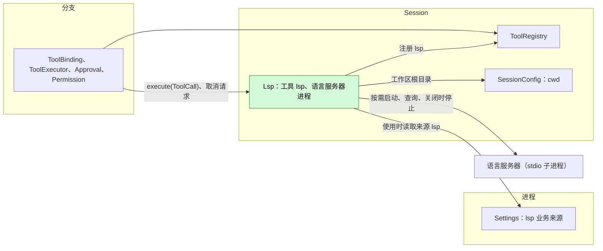
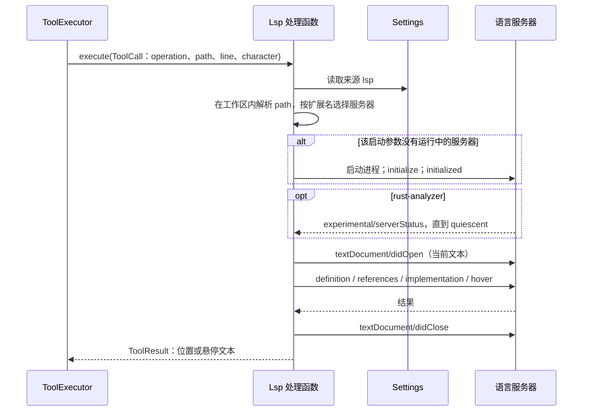

# Lsp

状态：已实现为 `dim-app-server` 内置 Rust 插件。语言：Rust。作用域：[ADR 002](../../adr/002-plugin-scope.md)（Session）。参考：deepseek-harness 的 LSP seam（`docs/subsystems/lsp.md`、`packages/lsp/{lsp,lsp-stdio,tool-lsp}`）。

Lsp 是一个 Session 插件，向模型提供一个只读工具 `lsp`，含四种语义查询：`goToDefinition`、`findReferences`、`goToImplementation` 与 `hover`。工具由它注册到本 Session 的 `toolRegistry`（[工具贡献](../../../architecture/rust-agent/tool-contributions.md)；[session-boundary A.5](../contracts/session-boundary.md#a5-工具贡献)）。每次调用由一个语言服务器作答：Lsp 在第一次需要它的调用时为本 Session 的工作区启动服务器，在部件装载期间保留，部件卸载时（Session 关闭或空闲卸载时）停止。服务器来自用户的 Settings 来源 `lsp`，以及在 `PATH` 上查找的四个内置命令。Lsp 不写任何 Timeline 事件，因为每次调用与结果本身已是工具调用事实；它在使用时读取配置，因此编辑配置不会重载任何东西（[ADR 002 D4](../../adr/002-plugin-scope.md)）。

## 1. 结构



| 部件 | 作用域 | 依赖 | 提供 |
| --- | --- | --- | --- |
| `lsp` | 进程，App Server 在本地执行时 | `settings`、`partRegistry` | 登记 Settings 来源 `lsp` 与 Session 部件 `Lsp` |
| `Lsp` | Session | `settings`、`toolRegistry`、`sessionConfig` | 注册 `lsp`；持有本 Session 的语言服务器进程；不提供任何名称 |

**依赖的契约：** 已实现的 [C4 工具绑定](../../../design/session-typescript.md)、[Settings 声明式来源](../appserver/settings-service.md)、`SessionConfig.cwd`，以及 Permission 既有的 `read_filesystem` 风险。**本文定义的契约：** `lsp` 工具、其结果格式与错误代码，以及 `lsp` 文档。

Lsp 是内置进程 row，与本地执行的各 row（HostPlatform、WorkspaceTools、MCP）一同登记，因为它的服务器是读取本地工作区的本地子进程。与 Web 一样，它不增加注册表或宿主端口。内置 row 的启停状态归 [PluginManager](PluginManager.md) 所有，与 Web 相同；显式 `plugin.reload` 返回 `not_reloadable`。Settings 重载时，依赖它的 `Lsp` 部件随之重载：注册被撤回、服务器被停止，下一代重新注册后工具再次提供，不需要重载 Session（#241）。

## 2. 数据与状态

| 数据 | 所有者 | 生命周期 |
| --- | --- | --- |
| `lsp` 文档中的 `servers` | Settings（只由客户端写） | 每次调用时读取 |
| 语言服务器进程，每个服务器 id 一个 | `Lsp`（Session） | 从第一次选中该服务器的调用起，到部件卸载（Session 关闭或空闲卸载）、服务器结束或某次调用发现其启动参数已变为止 |
| 在途调用 | `Lsp`（Session） | 一次调用 |

Lsp 不持有 Timeline 状态，也没有 `StateCell`。没有任何东西需要重建：重载或恢复后，服务器在下一次调用时重新启动。每个服务器只看到一个工作区文件夹，即规范化后的 Session `cwd`。

## 3. 流程

### 3.1 一次调用



1. 参数在处理函数内检查（附录 A）。`line` 与 `character` 从 1 开始，`character` 按 UTF-16 代码单元计数。Lsp 把它们转换为协议使用的从 0 开始的 UTF-16 位置并对照文件文本检查，再把结果位置转换回从 1 开始。
2. `path` 相对于 Session 工作区，或为绝对路径。解析符号链接后，它必须是工作区内不超过 4 MiB 的 UTF-8 文件。
3. 按文件扩展名（转为小写）选择服务器（§3.2）。没有可用服务器时调用以 `LSP_UNAVAILABLE` 失败；`lsp` 的声明不变。
4. 每次查询都用 `didOpen`（版本 1）发送文件当前文本，答复后关闭，因此服务器按文件在磁盘上的当前内容作答，文档状态不会留到调用之后。同一服务器的查询逐个进行，不同服务器并行。
5. `findReferences` 总是包含声明。`LocationLink` 结果取其目标的选中范围。
6. 结果最多列出 100 个位置，全文最多 16 000 字符，被省略的部分有标记说明。一次调用的总预算是 60 秒。

### 3.2 选择服务器

已配置的服务器在 `extensionToLanguage` 中列出它服务的扩展名，并给出每个扩展名的 LSP language id。对一个扩展名：

1. 使用列出它的已配置服务器。有两个服务器都列出它时，调用以 `LSP_SETTINGS_INVALID` 失败。
2. 否则使用列出它的内置服务器，前提是没有同 id 的已配置服务器。已配置条目整体替换同 id 的内置条目。
3. 否则调用以 `LSP_UNAVAILABLE` 失败。

| 内置 id | 命令 | 扩展名 |
| --- | --- | --- |
| `rust-analyzer` | `rust-analyzer` | `.rs` |
| `typescript-language-server` | `typescript-language-server --stdio` | `.ts`、`.tsx`、`.mts`、`.cts`、`.js`、`.jsx`、`.mjs`、`.cjs` |
| `gopls` | `gopls` | `.go` |
| `pyright` | `pyright-langserver --stdio` | `.py`、`.pyi` |

内置命令在其服务器启动时到 App Server 的 `PATH` 上查找；找不到命令时调用以 `LSP_UNAVAILABLE` 失败。有两个内置服务器启动时带有 `initializationOptions`，同 id 的已配置条目会替换它们：

- `rust-analyzer` 关闭构建脚本、过程宏展开和保存时检查（`checkOnSave`，工作区加载完成后它也会跑一次 `cargo check`），因为它们会编译并运行工作区代码，而 `read_filesystem` 调用不得运行这些代码；同时打开它自己的文件监视，因为 Lsp 不发送文件变更通知。
- `typescript-language-server` 把 `tsserver.useSyntaxServer` 设为 `never`。否则在项目加载完成前，由只认识已打开文件的语法服务器作答；而一次查询只打开它自己的文件，于是第一次 `goToDefinition` 会停在 import 处，`findReferences` 会漏掉其他文件。

### 3.3 服务器生命周期

- **启动。** 进程以命令和参数运行，工作目录为 Session 工作区，环境为 App Server 的环境再叠加条目的 `env`。它在 stdin 与 stdout 上以 `Content-Length` 分帧收发 JSON-RPC；其 stderr 保留有界的尾部，用于错误消息。`initialize` 发送 App Server 的进程 id、作为 `rootUri` 和唯一工作区文件夹的工作区、条目的 `initializationOptions`，以及这些客户端能力：UTF-16 位置、definition 与 implementation 的 link、markdown 或纯文本 hover、工作区文件夹，以及 rust-analyzer 的 `experimental/serverStatus`。服务器选用其他位置编码、拒绝 `initialize`、退出或 60 秒内不答复时，视为不可用。
- **就绪。** rust-analyzer（按 `serverInfo.name` 识别）会在工作区加载完成前就答复。发给它的查询会等待 `quiescent: true` 的 `experimental/serverStatus`。其他服务器在 `initialized` 之后即就绪。
- **服务器发来的请求。** `workspace/configuration` 对每一项返回 `null`，`workspace/workspaceFolders` 返回工作区，`workspace/applyEdit` 返回 `applied: false`；进度、能力登记与刷新请求得到空结果。其余请求答复“方法不存在”。Lsp 从不应用编辑，也不执行服务器命令。
- **替换。** 某次调用的启动参数（id、命令、参数、环境、初始化选项、工作区）与运行中的服务器不同，或发现服务器已结束时，在该服务器当前查询结束后将其退役，并启动新的服务器。
- **卸载。** 部件卸载时（Session 关闭，或空闲时被卸载，见[空闲卸载](../appserver/idle-unload.md)），Lsp 先取消在途调用，再向每个服务器发送 `shutdown` 与 `exit`、关闭其输入，2 秒内未退出的进程会被停止。恢复后的 Session 在下一次调用时重新启动服务器。

## 4. 时序与冲突

| 场景 | 结果 | 负责方 |
| --- | --- | --- |
| 请求进行中发生回合中断或调用取消 | 发送 `$/cancelRequest`；调用返回 `LSP_CANCELLED`；2 秒内未结清该请求的服务器被停止，并在下一次调用时被替换 | Lsp |
| rust-analyzer 加载期间预算耗尽 | 返回 `LSP_TIMEOUT`，说明仍在加载；服务器继续加载，供下一次调用使用 | Lsp |
| 请求期间预算耗尽 | 同取消，返回 `LSP_TIMEOUT` | Lsp |
| 同一服务器的两次调用 | 第二次在自己的预算内等待第一次 | Lsp |
| 服务器退出 | 在途调用以 `LSP_SERVER_FAILED` 失败；下一次调用启动新的服务器 | Lsp |
| 配置编辑 | 从下一次调用起生效；启动参数变化会替换进程 | Lsp |
| 两次调用之间 agent 编辑了文件 | 被查询的文件按当前内容发送；其他文件靠服务器自己的文件监视 | Lsp |
| 调用中 Lsp 或 Settings 重载 | 调用以 reloaded 结算；旧部件的清理停止其服务器 | ToolExecutor |
| 调用中进程重启 | ToolExecutor 结算已提交的调用；Lsp 不重复任何操作 | ToolExecutor |
| App Server 被强制结束 | 服务器发现输入关闭、客户端进程已不存在，自行退出 | 服务器 |

## 5. 上下文映射

| 模型看到 | 形式 | 位置 |
| --- | --- | --- |
| `lsp` 的名称、描述、输入 schema | 工具声明 | Session 挂载它时，位于已采用的 `context/configured.tools`：没有挂载列表（`SessionConfig.tools`）时总是挂载，有列表时须由列表点名 |
| 位置、悬停文本、错误 | `ToolResult.content`（仅文本） | 该调用所在批次的工具结果位置 |

- 压缩：声明作为配置保留；结果只通过摘要保留。
- 永不可见：`structuredContent`（错误的 `code`）、配置、进程。
- 无论是否安装或配置了任何服务器，声明都相同。

### 5.1 面向模型的文本

声明是内置的，整体是 protocol（[面向模型的提示词 §4](../model-prompts.md#4-协议与策略)）：schema 与描述 “Ask the workspace's language server about the symbol at a position: goToDefinition, findReferences (includes the declaration), goToImplementation or hover. line and character are 1-based; character counts UTF-16 code units. Returns path:line:character locations or hover text.”。结果文本是 protocol：

| 文本 | 类别 |
| --- | --- |
| `<path>:<line>:<character>` 各行、`No results.`、`No hover information.` | Protocol：结果格式；工作区内的路径相对于工作区，工作区外为绝对路径，其他 URI 原样给出 |
| `… <n> more locations omitted (limit 100).` 与 `… truncated (limit 16000 characters).` | Protocol：上限 |
| `lsp failed: <code>: <message>` | Protocol：附录 A.3 的代码；模型读取代码并据此行动 |
| 悬停文本，以及空结果后附带的 rust-analyzer 健康状态消息 | 服务器自己的内容，作为 material 承载 |

Lsp 不写标记，也不贡献 guide 条目。

## 6. 接口（摘要）

| 接口 | 类型 | 用途 |
| --- | --- | --- |
| `lsp` | 注册到 `toolRegistry`（Session）的工具，风险 `read_filesystem` | 在某个位置执行四种只读查询之一 |
| 来源 `lsp` | Lsp Settings 来源中的业务配置，使用时读取 | 已配置的语言服务器 |

没有 Session 方法、`managementMethods` 或 CLI 子命令；客户端用 `settings.read`/`settings.update` 配置服务器。

### 6.1 登记与来源

进程 row `lsp` 在 App Server 本地执行时登记。它的 apply 登记 Settings 来源 `lsp`（用户文件 `lsp.json`，没有项目文件，`/servers` 为仅用户字段），并向 `partRegistry` 登记 Session 部件 `Lsp`。每个 Session 挂载该部件；部件注入 `settings`、`toolRegistry` 与 `sessionConfig`，登记清理与工具，在调用之前不做 I/O。

该来源没有项目文件、`servers` 为仅用户字段，是因为只要某次调用选中服务器，其命令就会在不经审批的情况下运行：因配置而运行的命令不需要主机本地审批，只有用户本地配置才能启用它（[ADR 003](../../adr/003-approval-scope.md)）。若有项目文件，仓库就能决定运行哪些命令。

```json
{
  "type": "object",
  "additionalProperties": false,
  "properties": {
    "servers": {
      "type": "object",
      "default": {},
      "additionalProperties": {
        "type": "object",
        "required": ["command", "extensionToLanguage"],
        "additionalProperties": false,
        "properties": {
          "command": { "type": "string", "minLength": 1 },
          "args": { "type": "array", "items": { "type": "string" } },
          "env": { "type": "object", "additionalProperties": { "type": "string" } },
          "extensionToLanguage": {
            "type": "object",
            "minProperties": 1,
            "propertyNames": { "pattern": "^\\.[a-z0-9_+-]+$" },
            "additionalProperties": { "type": "string", "minLength": 1 }
          },
          "initializationOptions": {}
        }
      }
    }
  }
}
```

每次调用读取用户作用域的来源 `lsp`；读取失败或文档不匹配时，调用以 `LSP_SETTINGS_INVALID` 失败，不启动任何进程。

## 7. 安全

- 准入：`lsp` 声明 `read_filesystem`；每次调用都经过 Approval 与 Permission。
- 被查询的文件必须解析到 Session 工作区内。结果位置可以指向工作区外（例如标准库），只作报告。
- 服务器是受信任的本地程序，以 App Server 的权限和环境运行，与 MCP stdio 服务器相同；Lsp 不增加沙箱，管控模型命令的 `Process isolation` 开关不作用于它们。
- Lsp 拒绝 `workspace/applyEdit`，也不发送 `workspace/executeCommand`。
- 内置 rust-analyzer 不运行构建脚本、过程宏或 `cargo check`。服务器的其他行为由服务器自己决定，例如 rust-analyzer 的 `cargo metadata` 会解析依赖。

## 8. 规则检查

两个部件都不是 Capability：都不注入 `dispatcher` 或 `timeline`（[插件契约 §6](../plugin-contract.md#6-capability)）。

| 规则 | 本文如何遵守 |
| --- | --- |
| 原则 §4 第 1 条（改别人的状态写指令） | Lsp 不改其他模块的状态；工具结果由其所有者 ToolExecutor 写入。 |
| 原则 §4 第 2 条（交接） | 不适用：Lsp 不接手任何对象，只执行 ToolExecutor 交给它的调用。 |
| 原则 §4 第 3 条（只用 before 回调） | 不在写入前干预；参数检查在工具处理函数内部。 |
| 原则 §4 第 4 条（核心不带业务含义） | 不改核心；工具使用通用的工具注册合同。 |
| 原则 §4 第 5 条（批次） | 不适用：Lsp 依据调用参数和配置做决定，不依据事件。 |
| 原则 §4 第 6 条（上下文只含交接后的事件） | 结果只以 ToolExecutor 写入的 `step/tool-result` 事实进入模型。 |
| 原则 §4 第 7 条（只用公开事件和服务） | Lsp 只使用 `toolRegistry`、`sessionConfig` 和 Settings 业务来源。 |
| 原则 §4 第 8 条（向机制所有者提需求） | 不提需求（§9）。 |
| 原则 §4 第 9 条（只有后续决定要用的事实才进 Timeline） | Lsp 不写事件；它的进程是关闭时结算的 I/O 资源，不是状态。 |
| 原则 §1（Capability 与 App Server 边界） | 不是 Capability。与 Web 一样，Lsp 是 App Server 内置 row（`lsp`）加一个 Session 部件（`Lsp`）：其配置是 Settings 来源，其服务器只在 App Server 本地执行时运行。不增加宿主端口。 |
| ADR 002 D1（作用域跟随状态） | Session 作用域：进程服务于一个 Session 的工作区，在其部件卸载时结束，不跨 Session 共享。 |
| ADR 002 D2（不设接线模块） | 没有接线模块；内置服务器是部件内的一张表。 |
| ADR 002 D3（依赖跟随作用域） | Settings 是进程服务，`toolRegistry` 与 `sessionConfig` 属于 Session；必需服务缺失则该部件装配失败，Session 在没有它的情况下继续运行。 |
| ADR 002 D4（结构配置与业务配置分离） | row 的启停状态归 PluginManager 所有；`lsp` 文档是每次调用时读取的业务配置。 |
| ADR 002 D5（合同语言中立） | 工具、结果与文档语言中立；Rust 形式见附录 C。 |

## 9. 向机制所有者提出的需求

无。工具注册、声明式 Settings 来源与 `SessionConfig` 都已有合同与实现。Lsp 不提 core、rutis、loader、生命周期或 HostPlatform 需求；它像启动 MCP stdio 服务器那样自行启动进程。

## 附录 A. 工具

### A.1 参数

| 参数 | 类型 | 规则 |
| --- | --- | --- |
| `operation` | string | 必填；`goToDefinition`、`findReferences`、`goToImplementation` 或 `hover` |
| `path` | string | 必填；非空；相对于 Session 工作区，或为绝对路径 |
| `line` | integer | 必填；从 1 开始；不超过文件行数 |
| `character` | integer | 必填；从 1 开始的 UTF-16 代码单元；最多到行尾之后一位 |

未知参数以 `LSP_INVALID_INPUT` 失败。

### A.2 结果

```
src/lib.rs:12:8
src/main.rs:3:5
/Users/me/.rustup/toolchains/stable/lib/rustlib/src/rust/library/core/src/option.rs:572:1
```

位置按文件分组，组内保持服务器返回的顺序，最多 100 个，更多时后跟 `… <n> more locations omitted (limit 100).`。空结果是 `No results.`；没有内容的悬停是 `No hover information.`；悬停文本是服务器给出的 markdown 或纯文本，带语言标记的字符串转为代码块，各部分之间空一行。rust-analyzer 报告的健康状态不是 `ok` 时，其消息附在空结果之后。完整文本最多 16 000 字符。没有 `structuredContent`。

### A.3 错误

每个错误都是错误 `ToolResult`（`isError: true`），内容为 `lsp failed: <code>: <message>`，`structuredContent` 为 `{ "code": "<code>" }`。错误不影响其他调用或 Session。

| 代码 | 含义 |
| --- | --- |
| `LSP_INVALID_INPUT` | 参数违反 A.1，或文件不存在、在工作区外、不是普通文件、超过 4 MiB 或不是 UTF-8 |
| `LSP_UNAVAILABLE` | 没有为该扩展名配置或内置服务器、找不到其命令，或它无法启动（退出、拒绝 `initialize`、选用其他位置编码、60 秒内无答复）；消息附带服务器 stderr 的尾部 |
| `LSP_UNSUPPORTED_OPERATION` | 服务器没有声明该操作 |
| `LSP_SERVER_FAILED` | 已启动的服务器退出、以错误答复或发来格式错误的结果 |
| `LSP_TIMEOUT` | 60 秒预算耗尽：在等待更早的查询、启动或加载，或等待答复 |
| `LSP_SETTINGS_INVALID` | 来源 `lsp` 无法读取、不匹配，或有两个服务器列出了该扩展名 |
| `LSP_CANCELLED` | 调用被取消，或 Session 正在关闭 |

### A.4 假设

| # | 假设 | 若被否决的影响 |
| --- | --- | --- |
| A1 | 只有一个工作区文件夹，即 Session `cwd`；嵌套项目由服务器自己的发现机制找到 | 改为按文件确定项目根，每个服务器可有多个进程 |
| A2 | 模型使用从 1 开始的行与 UTF-16 字符，与参考 seam 相同 | 若改用字符列，每个结果文件都要换算 |
| A3 | 四个内置服务器及其选项是实现选择 | 表格变化 |
| A4 | 60 秒预算、100 个位置、16 000 字符、4 MiB 文档 | 上限变化 |
| A5 | rust-analyzer 是 Lsp 唯一等待就绪的服务器，按 `serverInfo.name` 识别 | 就绪方式改为可按服务器配置 |
| A6 | 服务器保留到部件卸载；Lsp 自身没有空闲计时 | 每个服务器增加空闲计时 |
| A7 | 操作集合封闭；不提供符号、调用层次、诊断与重命名 | 新增操作即修改本工具合同 |

## 附录 B. 验收

1. 在隔离 home 下用本地模拟模型，于小型 Rust 或 TypeScript 工作区的 Session 中调用 `lsp`：`goToDefinition` 返回定义处的 `path:line:character`，`findReferences` 返回声明与每处使用。
2. `PATH` 上没有对应服务器时，调用返回 `LSP_UNAVAILABLE`，声明不变。
3. 部件卸载（Session 关闭、空闲卸载、App Server 停止）会停止服务器进程。

## 附录 C. Rust 绑定

| 中立形式 | Rust |
| --- | --- |
| row `lsp` | `lsp::LspPlugin`，在 App Server 的本地执行 row 中以 `register_part` 登记；其 apply 调用 `SettingsService::register_declared` 与 `PartRegistry::register(…, PartScope::Session, "Lsp", …)` |
| 为 `lsp` 调用 `toolRegistry.register` | Session 部件注入 `Key<ToolRegistry>`，调用 `tools.register(ctx, ToolContribution {definition, handler})`；部件卸载时撤回注册 |
| 清理 | `ctx.effect` 取消在途调用、等待其结束，再关闭服务器 |
