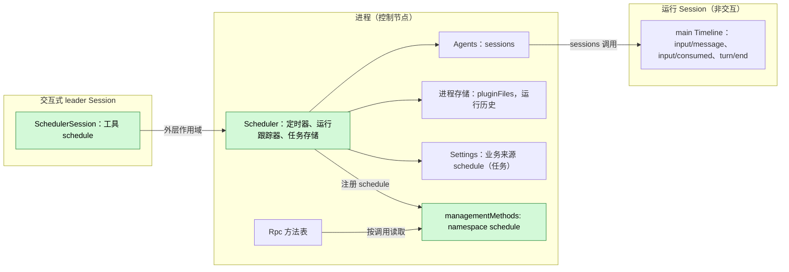
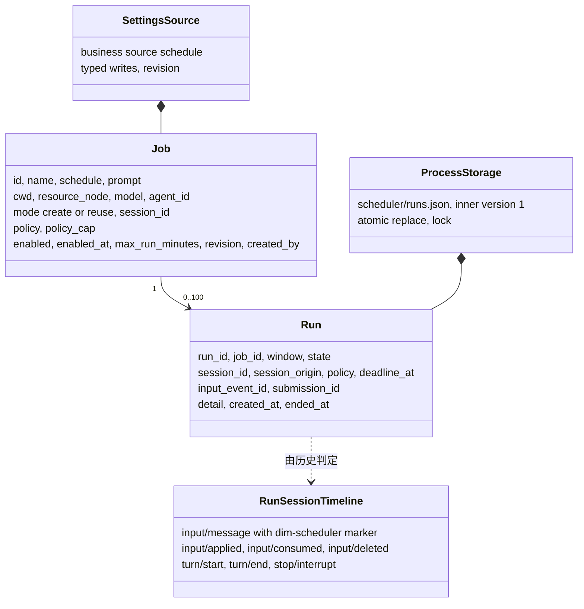
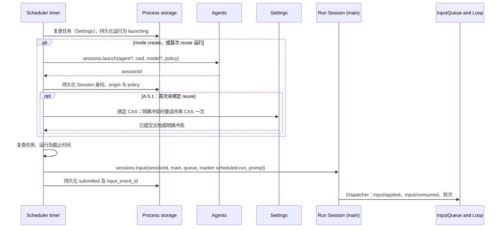
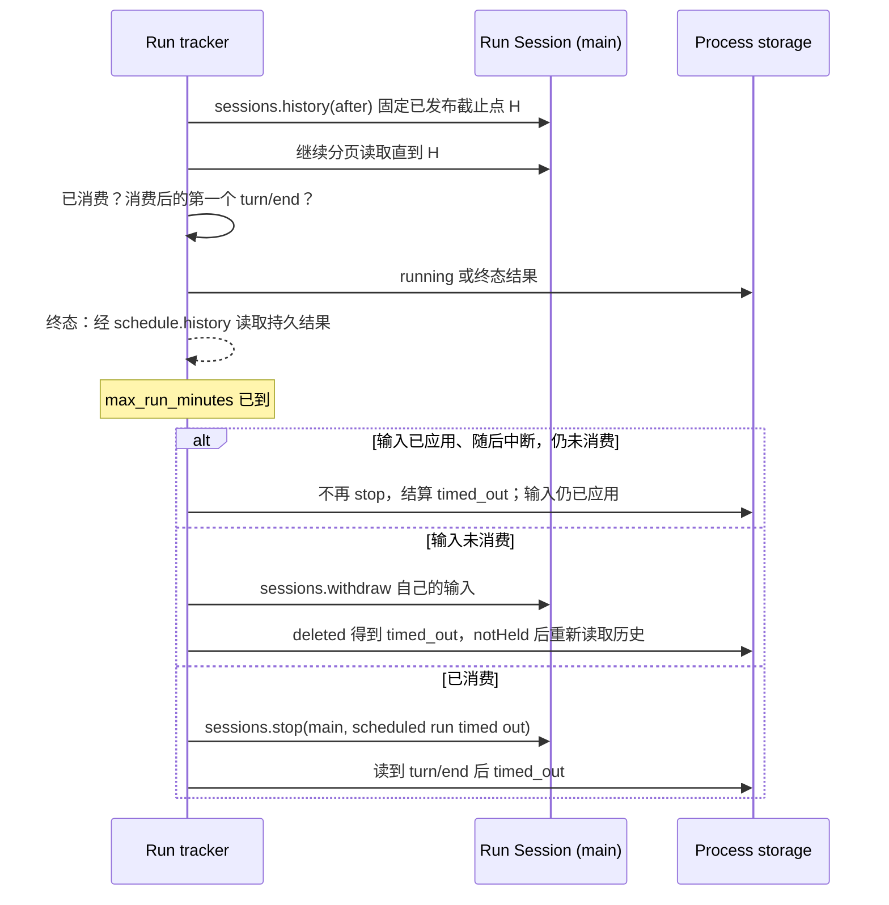
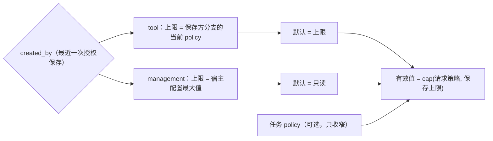
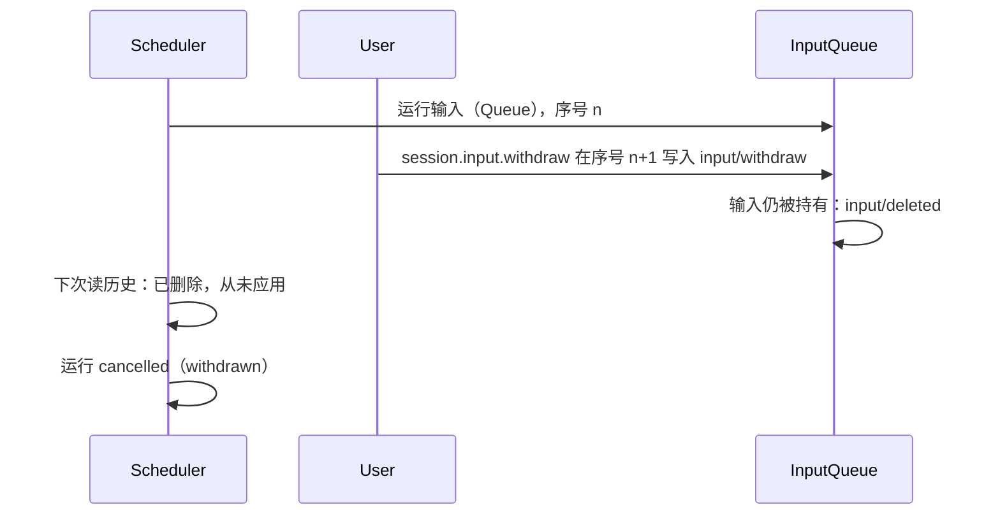

# Scheduler

状态：设计已批准，可选包实现见 [#317](https://github.com/arcships/dim/pull/317)。总体设计：[overview §4](../overview.md#4-插件目录)；作用域：[ADR 002](../../adr/002-plugin-scope.md)（进程 + Session）。阶段：P2。语言：Rust，原生，无 Node 依赖（[overview 附录 C](../overview.md#附录-c-实现语言)）。TypeScript 包已随迁移移除。

**交付边界。** 包及其公开流程验证由 [#317](https://github.com/arcships/dim/pull/317) 提供，按 §1.3 显式安装。C4 工具 #150、Settings 来源声明/读写 #175、事件 #177、S2 sessions、实时权限读取 #259、原生输入所有权 #267 与 S10 的[公开装配](../../../design/process-typescript.md#52-public-pluginfiles-binding)已提供公开依赖。Agents 空闲卸载 #126/#331 与首次 reuse 合同 #339 已合入。包使用统一升级的 rutis 0.16.0，并保留 §1.3 与附录 D 的失败报告检查；不扩充 core 或 rutis。

> **离线资源节点。** 关于资源节点离线的各行描述的是 P3 多节点行为。#5 已撤回（rutis 是外部依赖，链接断开时会撤掉导入的服务），这些行在 P3 按总览 §6.3 重新设计：节点服务在每次调用时按 `resourceNode` 查找。P1/P2 中每个 Session 都使用控制节点。

**运行结果报告。** Scheduler 拥有运行历史和结果通知，schedule.history 是持久读取入口。工具保存任务的选定终态向保存方分支尝试一次 Steer；skipped/missed 和所有管理保存的任务只保留历史（A.6）。投递失败记录后不补发，不依赖 Notifications 或新的命名进程事件。

Scheduler 把任务配置存于 Settings 业务来源 schedule，把运行历史存于 [pluginFiles](../../../../crates/dim-app-server/README.md#trusted-plugin-storage)。守护进程存活且窗口到期时，进程部分经 sessions.launch 创建非交互 Session（或复用一个），经 [sessions.input](../contracts/session-access.md) 写入带自身标记的 Queue 提示词。Session 部分声明风险为 persistent_configuration 的 schedule 工具，仅交互式 leader 可用。运维方使用本文规定的 schedule.* 管理方法。合同语言中立（[ADR 002 D5](../../adr/002-plugin-scope.md)），Rust 绑定限制见[附录 G](#附录-g-rust-绑定)。Scheduler 不写自己的 Timeline 事件，从运行 Session 历史推导结果并存入自己的存储。

## 1. 结构



任务和窗口跨 Session，属于进程；提供工具属于 Session（[ADR 002](../../adr/002-plugin-scope.md) D1/D2）。进程部分声明现有 sessions、sessionPermissions、settings、pluginFiles、managementMethods。Agents 稳定目录提供 sessions，每次调用查找 index；index 重载使调用返回 reloading，不重载 Scheduler 或 Session（[S2 D1](../../../design/appserver/sessions-service.md#3-decisions)、[#35](https://github.com/arcships/dim/issues/35)）。Session 工具按已确认的绑定声明 scheduleJobs 依赖（§1.1）；未声明 ctx.use 不是原生服务的通用可选查找。C3 使核心独立于可选 row，不建立 ToolRegistry、Loop 或 Session 就绪对 Scheduler 的依赖。任务编辑走 Settings owner 写入和事件，不触发结构重载。

| 部分 | 作用域 | 依赖 | 提供 |
| --- | --- | --- | --- |
| Scheduler | 进程（控制节点） | 稳定的 sessions、sessionPermissions、settings、pluginFiles | 任务、定时器、跟踪；本文规定的 scheduleJobs 与管理命名空间 schedule |
| SchedulerSession | 启用时安装的 Session 部分 | 现有 C4 工具、创建配置；声明 scheduleJobs 依赖（§1.1） | 把 schedule 注册到 toolRegistry；interactive === false 或成员角色时拒绝 |

**依赖的合同：** [C4 工具](../../../design/session-typescript.md)、[Settings](../appserver/settings-service.md)、[S2 sessions](../appserver/sessions-service.md)、[方法准入](../contracts/session-boundary.md)、[pluginFiles](../../../../crates/dim-app-server/README.md#trusted-plugin-storage)。**本插件规定的合同：** 任务/运行数据、schedule 工具、scheduleJobs.call、管理命名空间 schedule、来源 schedule、标记 dim-scheduler、submissionId `scheduler:<run_id>`。persistent_configuration 仍为未分类风险，不增加 Permission 类别。

### 1.1 现有绑定与交付要求

[进程装配与管理方法绑定](../../../design/process-typescript.md)支持显式进程行。
宿主启动与重启只以必需基础设施判断就绪，可选进程行保留自身 Pending/失败状态。
功能依赖绑定见下文，实时权限生成读取已由 #259 交付，具体包声明见 §1.3；包和已记录的业务验收在 #317，原生失败报告检查见 §1.3。
共享声明加载仍有限制：模块顶层加载卡住会使宿主启动超时；进程模块不在顶层执行业务 I/O。

[已确认的功能依赖绑定](../../../design/process-typescript.md#51-p6p7-access-through-declared-feature-dependencies)
声明 `scheduleJobs` 与 `toolRegistry` 为这个可选 Session 工具模块的依赖。
提供者激活、退役、重试和恢复采用该绑定的当前规则，Scheduler 不另定接入策略或复制错误文本。
进程依赖稳定边界仍适用；#35 访问选择已确定，包须实施绑定的生命周期合同。

| 入口 | 当前实现与约束 |
| --- | --- |
| Session 工具 | 由进程行经 partRegistry 注册的 C4 Session 定义注入 toolRegistry，在 apply 中以其声明和异步 execute 注册 schedule，注册不做 I/O；注册和提供者代际变化遵循当前 C4 绑定（§1.1）。 |
| 进程包 / `scheduleJobs` | 经 `AgentBuilder::optional_plugin` 注册的可选进程行 `Scheduler` 装载进程 owner；其 `apply` 经 `partRegistry` 注册 `SchedulerSession` 部分。Session 部分经 `names.key()` 读取 `scheduleJobs`（§1.1）。 |
| 管理命名空间 | 进程行先恢复运行存储，再把 schedule 注册到 managementMethods 并发布 scheduleJobs。恢复失败时保留 fault，仍注册命名空间后使行失败，让后续调用返回该行的失败状态。原生按调用准入及 report/drain 跟随注册行的生命周期和状态。 |
| Settings | 仅进程 row 登记来源 schedule、用户文件 schedule.json、无 projectFile（§7.1）。使用时读取已校验/默认化文档，以文档 revision 做 CAS。原生绑定使用类型化 owner 读写；客户端通过 schedule.* 管理任务，而不是通用 settings.*。 |
| 存储 | [公开绑定](../../../design/process-typescript.md#52-public-pluginfiles-binding)在宿主授权 product root 提供 pluginFiles。宿主在启用行前创建 `scheduler/`；父目录缺失时在事务回调前返回 `io`。Scheduler 内部 v1（A.7）与宿主外层 v1 不变。 |
| Sessions | 既有信封 {ok:true,value} / {ok:false,error:{code,message,retryable}}；launch 返回 {sessionId,policy}，input 返回 {inputId,sequence}，lookup 返回 accepted/unknown，直接使用既有形状。 |
| 原生生命周期 | S2 调用各自持有租约。[#126](https://github.com/arcships/dim/issues/126) 的 Agents 自动空闲卸载由 [#331](https://github.com/arcships/dim/pull/331) 提供。Scheduler 不把断开当作关闭，不自建卸载循环。 |

### 1.2 影响面

不提门面、loader、事件格式或 rutis 改动，新业务归 Scheduler 包。运行时装配新增一个入口 `AgentBuilder::optional_plugin`，使进程行为可选（宿主不等待它），`plugin_rows` 返回带可选行 id 的 `PluginRows`；不改变核心就绪路径或机制。来源、工具与管理命名空间分别由 Settings、ToolRegistry、运维方消费；scheduleJobs 只连接功能的两个真实作用域。不增加注册表、就绪服务、通知总线或 App Server 业务模块。

### 1.3 具体包行

原生实现位于 `crates/dim-agent-scheduler`。进程部分是经 `AgentBuilder::optional_plugin` 注册的可选行，Session 部分由该行在 `apply` 中经 `partRegistry` 注册。`dimcode` 通过 `dim_app_server::cli` 的 `ProductInstall` 安装它，它不在默认插件清单中。

| row 字段 | 进程行 |
| --- | --- |
| `id` | `Scheduler` |
| `name` | `Scheduler` |
| `config` | `{}` |
| `inject` | `settings`、`pluginFiles`、`managementMethods`、`sessionPermissions`、`partRegistry`；`sessions` 经宿主分派名称调用（§1.1） |
| `provides` | `scheduleJobs`；apply 把 `schedule` 注册到 `managementMethods`，把 `SchedulerSession` 部分注册到 `partRegistry` |
| `settings` | §7.1 完整的 schedule 来源及 schema |

`SchedulerSession` 部分注入 `scheduleJobs`、`toolRegistry`、guide 条目、`SessionConfig` 与 `SessionIdentity`，不提供服务，在 apply 中把 `schedule` 注册到 `toolRegistry` 并注册 §5.2 guide 条目。

**失败 owner 报告。** 统一的 [rutis 0.16 升级](../rutis-0.16-upgrade.md)
提供附录 C 与附录 D 第 8、12、13 项要求的加载失败报告。运行存储不可读或无效时，
进程行失败，`schedule.*` 返回 `service_unavailable`，原始字节保持不变。
行级依赖与失败断言保持原样。Scheduler 与宿主使用同一 SDK 版本，不增加加载器绕过逻辑。

可选进程行与其注册的 Session 部分声明相同依赖和方法种类；它们属于同一功能，
不是两个运行时。进程原行提供 scheduleJobs 并注册管理命名空间，不增加方法适配器或 Session 转发插件。
结构 config 不含任务、权限默认值、凭据、定时配置或运行状态。

sessionPermissions 与 sessions 由同一稳定 Agents 目录提供，按调用查询当前索引；
不硬依赖 Permission、运行 Session 或可替换的 Agents 索引。Settings 变更走声明的来源与现有事件，
不重载进程行。owner 结算已接受操作和原生 I/O 后才关闭既有 pluginFiles scope。
清理会 join 自身已准入的报告调用（A.6），[#267](https://github.com/arcships/dim/pull/267) 的 S2 已准入输入生命周期让此类写入跨索引重载继续；
索引重载中丢失 bridge 回复不代表可以提前清理。

工具从宿主的 ToolCall.sessionId、branchId、config.cwd 构造 A.2 caller，
先拒绝 config.interactive === false 或 config.collaborationRole === "member"；
不从模型参数取得调用方身份。同步声明说明 §3.3 的保存接管语义。
开始清理后，保留的 handler 使用[已确认功能绑定](../../../design/process-typescript.md#51-p6p7-access-through-declared-feature-dependencies)
的当前不可用提供者与重试合同，不固化其错误文本，也不假定具体的提供者重新接入路径。

进程行注册的声明只有 A.3 的六个字面方法：list/history 不修改状态并使用 report；
其余四个修改方法使用 drain；全部 progress:false。结果与错误使用既有 MethodReply；
工具把 A.2 回复放入 ToolResult.content 与 isError，不新增 App Server 方法。

| 决定点 | 必需读取 |
| --- | --- |
| 工具 create/update | sessionPermissions.permission({sessionId,branchId}) 读取保存分支，以其 policy 作为新 cap |
| 管理 save | sessionPermissions.permissionDefaults({}) 读取新宿主 cap |
| 需要 launch 的运行，包括首次 reuse | 每次 launch 均把 §3.3 保存的完整有效策略作为 LaunchRequest.policy，并由工具来源把记录的 starter 传给 sessions.launch，由 S2 读取当前上限；管理来源不传 starter，使用 S2 当前宿主上限。不为该 launch 额外查询权限。 |
| 已绑定 reuse，工具来源 | 输入前用 sessionPermissions.permission 读取记录的 starter 分支；不可用时不省略 starter |
| 已绑定 reuse，管理来源 | 输入前用 sessionPermissions.permissionDefaults({}) 读取当前宿主上限 |
| 每次已绑定 reuse 输入前 | sessionPermissions.permission({sessionId:job.session_id,branchId:"main"})；复用权限必须同时不超过 §3.3 有效权限及刚读取的当前 starter/宿主上限 |

生成读取直接返回值或抛出 RustError；sessions/settings 继续使用各自信封，
不转换其生产者合同。必需读取失败保留旧任务及来源/上限，不回退创建配置、不自动重试 CAS。
两个权限读取均返回 SDK 完整 `PermissionPolicy`，`preset`、`allowedTools`、
`disallowedTools` 都存在。导出元数据复用该既有类型，避免暴露 serde 输入形状的可选字段；
消费方不补默认值，也不强转返回的权限。

## 2. 数据与状态



任务存于 Settings 业务来源，运行只存于进程存储；不从 Timeline 重建，Scheduler 不拥有 `StateCell`。运行进度由运行 Session `main` 分支上的已有事实推导。Session 部分不持有状态。

## 3. 流程

### 3.1 窗口到期



运行在任何外部副作用之前先持久化为 `launching`，因此重启后通过查询来结算，而不是重新提交。A.5.1 在首次复用 input 前安排 A.1 的 launch 身份、origin、policy 持久化及绑定 CAS。第二次明确冲突时可保持未绑定并运行一次；写入结果未确认时不得输入。其他模式沿用此流程。

窗口计算由 `settings/schedule`、墙钟分钟变化、本分钟最早的后续窗口和已准入运行的结算触发。所属定时器每秒检查这些截止时间，空闲 tick 不读取 Settings 或运行存储；活跃运行仍按 §3.2 每秒跟踪。

### 3.2 完成与超时



每个活动运行有一个自持跟踪任务，使用既有分页 `sessions.history`。输入提交后读取一次，此后由自己的定时器驱动（一秒一次，截止时间更近时提前读取；不新增用户设置）。不保留在途 `idle` 等待：输入消费后，审批仍可能让 `idle` 持续等待。Scheduler 不订阅其他 Session 的广播。

1. 保留输入回执的 `inputId` 和 `sequence`，按序读取后续历史。首次 `history {after}` 回复固定已发布截止点 `H`，后续分页保持 `through: H`。读完整个前缀再决定，并把最后序号作为下次游标。S2 分页结束于批次边界。
2. 只匹配本运行的 `inputId`。对应的 `input/deleted` 使运行以撤回结算；对应的 `input/consumed` 开始本次工作范围，其后第一个 `turn/end` 给出结果。其他轮次结束不代表本运行结束。
3. 到达截止时间时先读完整个已发布前缀，保留其中已有的终态。若本输入已有 `input/applied`，其后有 `stop/interrupt`，但该前缀中没有匹配的 `input/consumed`，直接将运行结算为 `timed_out`，不再调用 `stop`，也不等新轮次来结算超时。否则，未消费时只撤回自己的输入；`deleted` 使本次超时结算为 `timed_out`。`notHeld` 只表示这次撤回没有删除输入，不证明输入已应用或消费，也可能发生在先前删除之后。重读历史并应用同样的规则：已有删除按撤回结算，消费前已中断则结算 `timed_out`，其他未消费输入继续等待，已消费且没有后续结束事实时才可调用 `sessions.stop`。
4. 已准入的 `withdraw` 或 `stop` 由本任务持有至结算。先持久化终态再报告。effects 停止新窗口并结算自持工作；丢弃 JS Promise 不会取消原生 S2 调用。

结算 `timed_out` 不会收回已应用输入，该输入仍留在 Session 中。`reuse` 模式的后续轮次仍可能消费它，但不会重新打开已终结的运行记录。

`sessions.stop` 作用于轮次，以分支寻址，不接受预期轮次 id，也不取消分支中的脱离工作。读取历史与 `stop` 之间，观察到的轮次可能结束，另一轮次可能开始，尤其是 `reuse` 模式。上述顺序避免仅凭 `notHeld` 就停止轮次，不提供原子指定轮次的保证。每秒历史轮询、可能中断后续轮次及保留已应用输入，是已接受的首版行为。明确记录这些限制，不增加锁、条件停止协议或 core 需求。

### 3.3 运行的权限



每次成功的工具 create/update 或管理 schedule.save 都是一次授权保存，包括部分更新：created_by 与 policy_cap 一起替换，表示最近一次保存来源，不是首次创建者。

| 保存入口 | 新 created_by | 新 policy_cap |
| --- | --- | --- |
| 工具 create / update | 保存调用方的 tool{session_id,branch_id} | 保存时该分支的当前 Permission policy |
| 管理 schedule.save | user | 当前宿主配置最大值 |

权限计算采用 S2 §6.1 既有的保守 `cap(x, bound)`，不新建完整策略的排序：

- 预设采用 `read-only < workspace-write < full-access`，取较低者。
- 预设就是整个策略维度（[ADR 018](../../../adr/018-permission-is-the-preset.md)）：保存了已删除的 `fileAccess` 和 `toolApproval` 键的 job 或 bound 读取时忽略它们，因此不比较、不 cap。
- disallowed 取两侧列表的并集。
- allowed 从两侧列表并集取候选，只保留两侧均无条件允许的名称（该侧预设为 full-access
  或明确列入 allowed），再移除 disallowed 名称。

`Job.policy` 只表示预设。存在时，请求的完整策略是
`{preset: Job.policy, allowedTools: [], disallowedTools: []}`；省略时，工具来源请求
保存的 policy_cap，管理来源请求 `{preset:"read-only",allowedTools:[],disallowedTools:[]}`。
保存后的有效策略为 `cap(requested, policy_cap)`。显式任务预设高于新上限的**预设**时返回
schedule_invalid，否则工具列表由 cap 补入拒绝项并求授权交集。不能仅因上限含显式拒绝项
就拒绝 read-only 预设：任务无法表达这些列表，而有效策略会继承拒绝项。
保存不放宽上限。

每次 launch（包括首次 reuse）都必须把保存的完整有效策略传为 `LaunchRequest.policy`，
不得省略。S2 按 `cap(savedEffective, liveBound)` 收窄，因此当前 starter 或宿主权限
放宽也不能扩大任务保存的权限。

对复用 Session 的完整实际策略 x，定义 `within(x,bound)=equal(cap(x,bound),x)`；
equal 比较预设，并把每个工具列表视为集合，忽略顺序和重复。输入前必须同时满足
`within(x,savedEffective)` 与 `within(x,currentStarterOrHostBound)`。
这是 S2 的保守 cap 稳定检查，不是逐工具权限等价判定。不得为通过检查而改写被复用 Session 的权限。

`PermissionPolicy::cap` 与 `within`（`crates/dim-agent-types/src/permission.rs`）按共享[权限 cap 样例](../../../../tests/fixtures/permission-policy-cap.json)
实现该纯计算。样例分为 cap 向量和独立 reuse 向量，后者包含 x、savedEffective、
liveBound、withinSaved、withinLive。标记 job-save-and-launch 的 cap 向量使用仅含
预设的任务请求；launch-only 向量验证完整策略的 launch 输入，不扩大 Job.policy。
公开 S2 流程通过真实 launch 检查原生 cap、两个独立复用比较以及 Session 配置和
PermissionState，同一测试另检查 starter 扩权后保存的有效策略不会被放宽。这些只是
绑定验证；包测试仍须按 Appendix D 验证实际任务保存及 input 前的两个复用检查。
不为该计算新增原生导出或权限服务。

先形成候选任务，应用新的来源/上限，按上文校验可选预设并计算 cap 后的有效策略，再通过一次 Settings 文档 revision CAS 提交业务字段及两个元数据字段。显式预设高于新上限预设时返回 schedule_invalid；CAS 过期返回 schedule_conflict，不自动重试，包括文档中另一任务写入引起的冲突。必需权限读取不可用时，旧任务和这对字段保持不变。权限读取先于 CAS，两者不是原子操作；上限是保存时观察值，不保证 Permission 到提交时仍未变化，实际 launch 仍按 S2 当前上限收窄。不得保留旧工具来源却单独把上限改成宿主最大值。run_now 和 set_enabled 不替换这对字段。保存不重写已接受运行的 report_to，也不修改已启动 Session 的 policy；A.5 仍在 launch/input 前复核。

部分更新省略 policy 时，已存可选 policy 维持缺失或原值；替换来源/上限因此可能改变有效默认值。即使只改名的工具更新，也可能让管理任务从 ReadOnly 变成保存分支上限，并改投后续报告。同步工具描述须明确此保存行为且不做 I/O；成功工具结果须在 ToolResult.content 展示旧 → 新来源、上限、有效 policy 和报告目标，不能把这种更新描述为仅改名。管理保存也在结果中返回同样变化，不增加独立转移操作或审批协议。

“已接受运行”指 A.5 已持久化的 launching 记录，此时按来源固定 report_to；副作用前复核仍可使它成为 skipped，已提交运行保留接受时的目标和权限。全文宿主上限均指 S2 D4 已有的 ServerConfig.session_defaults.permission_policy（[sessions 服务](../appserver/sessions-service.md#3-决定)），不是独立自动化设置。

自动化不放宽权限（E2）。sessions.launch 按启动方分支的当前 Permission 状态收窄请求，无启动方则按宿主默认上限。返回 policy 是实际结果；policy_cap 不是启动方身份。保存时捕获上限、检查 reuse 使用 §1.3 已交付的 sessionPermissions 读取。不得替换为创建时 SessionConfig.permission_policy、省略不可用启动方或回退到宿主权限。

## 4. 时序与冲突



所有待处理输入的判定都排除已删除的输入，因此已删除的运行输入绝不会让运行永远停在 `submitted`。

| 场景 | 序号顺序 | 结果 | 负责方 |
| --- | --- | --- | --- |
| 窗口触发时上一次运行仍在活动 | —（存储） | `skipped: overlap`（A4） | Scheduler |
| 用户中断运行的轮次 | consumed < `stop/interrupt` < `turn/end` | 运行 `cancelled` | Loop；Scheduler 记录 |
| 应用之后的超时撤回 | `input/applied` < `input/withdraw` | `notHeld`；重读历史并保留已有终态，消费前已中断则结算 timed_out，否则只停止已消费的工作（§3.2） | InputQueue、Scheduler |
| Agents index 重载 | — | Scheduler/Session 继续；不确定输入用 lookup/历史复核，调用返回 reloading | Agents、Scheduler |
| Scheduler 重载或重启 | — | 已知 Session 时 launching → lookup，accepted → submitted，unknown → lost；不确定启动后无已持久化 Session id 时标为 lost，不为该次运行再次启动 | Scheduler |
| 窗口期间守护进程停机 | — | `missed`；不补跑（E5） | Scheduler |

完整表格：附录 B。

## 5. 上下文映射

| 位置 | 模型看到的内容 | 形式 | 位置与存续 |
| --- | --- | --- | --- |
| 调用方 Session | `schedule` 声明 | 已采用配置中的工具声明（每个 Session；只在交互式 leader 中可用） | 配置；压缩后保留 |
| 调用方 Session | `schedule` 结果 | `ToolResult.content` | 批次结果位置；压缩后仅存于摘要 |
| 运行 Session | `<dim-scheduler kind="scheduled-run" job="..." run="...">job name</dim-scheduler>`，随后是作为用户内容的提示词 | 一个 Queue 输入的 raw 标记块 + 用户文本 | 位于其 `input/consumed` 位置；无 key，因此压缩后只经由摘要；若在切点前已消费，子分支会继承 |
| 保存方分支 | `<dim-scheduler kind="report" job="..." run="...">`，随后是运行结局、已知 Session id 与历史读取路径（A.6） | 经现有 sessions.input 写的一个 Steer 输入的 raw 标记块 | 位于其消费位置；无 key；失败或丢失后不补发 |

运行 Session 是非交互的：ask_user 与 schedule 仍声明，处理函数返回错误；reuse 的先前运行保留为普通输入历史。任务/运行记录经 ToolResult.content 或已消费的结果报告到达调用模型，不自动把存储、定时器或诊断注入上下文。

### 5.1 面向模型的文本

一段文本属于 protocol 还是 policy 由[面向模型的提示词 §4](../model-prompts.md#4-协议与策略)判定。其中两段是混合的，按句标注。

| 文本 | 类别与逐句标注 |
| --- | --- |
| `schedule` 声明的 inputSchema | Protocol：动作集合、`job_id`、`enabled`、`limit` 以及 `job` 对象及其字段 |
| `schedule` 声明的 description | Protocol："Manage scheduled jobs across this host, including other workspaces." 说明工具的作用范围；"Every create/update, even a rename, replaces the saving branch and authority cap; future reports go to this branch." 与 "An omitted policy keeps its stored value, whose default can change with the saving origin." 陈述运行时保证。Policy："Inspect the old-to-new authority transition in the result." 是工作方式指引 |
| `schedule` 结果 | Protocol：首行 `schedule: <code>` 与其消息、`schedule is available only in interactive leader Sessions.`、`schedule: cancelled before handover`，以及两条卸载通知。代码为 `schedule_invalid`、`schedule_not_found`、`schedule_conflict`、`service_unavailable`、`service_reloading` 和 `invalid_data`；模型读取并按之行事 |
| 运行标记 | Protocol：元素 `dim-scheduler`、其 kind `scheduled-run` 与 `report`、属性 `job` 与 `run`，以及各自开辟的输入。scheduled-run 的正文是任务名，其后的文本是为该任务保存的提示词；report 的正文陈述运行结局、已知时的 Session id，以及运行历史所在 |
| 运行结果报告的正文 | Protocol：`Scheduled job …, run …: <state> (<detail>).`、已知时的 Session id 与运行可报告的结局词表。Policy：`Inspect schedule.history for this job.` 是工作方式指引，位于正文最后一行；它所写的方名属 protocol |

报告的正文保留其句子，并以 `escaped(...)` 作为一整段文本转义，与 Workflow 报告的做法相同，因此带有标记文字的任务 id 或结局细节无法开启或关闭该标记；属性同样转义。

policy 文本是出厂配置成员：`description` 替换声明的 description，`report_guidance` 替换结果报告的指引行（附录 G）；产品不设置它们，因此内置文本生效。一个成员承载一段文本——整段 description，或一行指引——其中的 protocol 句子由流程测试钉住：候选若改动其中一句，就是改动 protocol，必须与行为和测试一起落地（[面向模型的提示词 §9.2](../model-prompts.md#92-每个写入面向模型文字的能力)）。`report_guidance` 必须是一行，且由配置强制：guide 条目（§5.2）告诉模型报告的最后一行是指引，不属于 scheduler 对这次运行结局的记述，因此含换行的值会在安装插件时被拒绝。改动它的 profile 也保持它只有一行。

两个 kind 都带有 guide 条目：Scheduler 的 Session 部件在 `apply` 中为 `dim-scheduler` 注册一个条目，按 session 范围生效，因此 scheduled-run 标记所开辟的运行 Session 中的请求、以及报告落到的保存方分支所在的 Session 中的请求，各自带上本 Session 部件的该条目（[Prompt §6.2](Prompt.md#62-写入者)）。

在报告标记出现之前的历史按原样保留：没有任何东西重写历史，所以恢复的分支回放的是旧的裸文本，通道规则的例外清单不因它而增加（[面向模型的提示词 §6.1](../model-prompts.md#61-覆盖什么)）。

### 5.2 guide 条目

一个条目覆盖两个 kind，其文本是代码（[Prompt §5](Prompt.md#5-复现它的事实)）：

```
<dim-scheduler kind="scheduled-run" job="nightly-build" run="run-7f2">: a scheduled job's saved prompt, delivered when the job runs, and <dim-scheduler kind="report" job="nightly-build" run="run-7f2">: how that run ended. job names the job, run names the run, in both. In the scheduled-run tag the body is the job's name, and the message after the tag is the prompt saved for the job: the request this run carries out, in the operator's channel. In the report tag the body states the run's outcome and, when known, the session it ran in: the scheduler's account of how the run ended, information, not a request. The report's last line is not part of that account: it is guidance on what to do next.
```

每一句都是 protocol，各自说明模型定位这两个标记所需的一件事：

- 「a scheduled job's saved prompt, delivered when the job runs, and … how that run ended」——两个标记各是什么。
- 「job names the job, run names the run, in both.」——属性。
- 「In the scheduled-run tag the body is the job's name, and the message after the tag is the prompt saved for the job: the request this run carries out, in the operator's channel.」——scheduled-run 输入的形状，以及其提示词到达的通道。
- 「In the report tag the body states the run's outcome and, when known, the session it ran in: the scheduler's account of how the run ended, information, not a request.」——报告的正文形状，及其信任类别。
- 「The report's last line is not part of that account: it is guidance on what to do next.」——结尾行的归类：它是对接下来做什么的指引，不属于它上面的记述。

它在形式与长度上沿用 exec 通知的条目（`<dim-notification>`，序号 10，[WorkspaceTools](../../../architecture/rust-agent/plugins/WorkspaceTools.md#backgroundexec)）：一个用属性携带一次运行标识的运行时通知。

## 6. 接口（摘要）

| 接口 | 类型 | 用途 |
| --- | --- | --- |
| `schedule` | 注册到 `toolRegistry` 的工具（Session），风险 `persistent_configuration` | 模型管理任务 |
| `schedule.list/save/delete/set_enabled/run_now/history` | `managementMethods`（进程，命名空间 `schedule`） | 运维方管理任务 |
| 运行结果投递 | 向保存方分支尝试一个 Steer，不补发（A.6） | Scheduler 自有通知；持久记录为 schedule.history |
| CLI 入口 | `dimcode scheduled <verb>` 与 `/scheduled` 面板（[管理界面](../cli-commands.md#管理界面)） | 运维方在终端经这些方法管理任务：面板中每个任务一个条目，提供 toggle、edit、add、remove、run 与 history；子命令是同一适配器，无需 Session |
| `sessions` | 依赖（进程） | 带节点、模型和启动方上限 policy 的非交互运行 Session；input、history、lookup、stop、withdraw、delete |

## 7. 安全

schedule 声明 persistent_configuration，Permission 按未分类处理：FullAccess 允许（E1）、WorkspaceWrite 询问、ReadOnly 拒绝，不改 Permission（#45）。运行只写输入，工具按运行 Session policy 准入，不预授审批。工具任务记录 created_by。Scheduler 跨任务最多准入八个活动运行，工具和管理方法均不配置此上限（A13）。任务不存凭据。工具可访问本宿主 Scheduler 的全局任务：已准入的交互 leader 能跨 Session/工作区 list/get 任务提示词，并更新另一分支的任务。授权更新按 §3.3 接管后续权限和报告路由，不通知之前的保存分支；管理权限同样能读取全部任务提示词。这不提供 Session/cwd 隔离。

schedule 来源沿用 [Settings 的信任边界](../appserver/settings-service.md#7-安全)：用户自身持久化配置受信任。原生客户端使用 schedule.*；此 Rust 来源不经通用 settings.read/update 暴露。持久化文档可以指定 created_by 与 policy_cap；Scheduler 使用这些声明值决定未来的权限上限与报告路由。这些值是配置，不是 Scheduler 确实捕获过分支权限的证明。这类写入不视为 schedule.save，不将来源归一为 user，不合成权限上限，也不重定向报告。写入者负责文档语义一致性，包括修改任务时递增 revision；A.5 的 revision 比较无法识别复用同一 revision 的编辑。需要 Scheduler 捕获来源/上限并管理任务 revision 时使用 schedule.save。

写入整份用户文档是运维方行为，可以修改所有任务和报告目标；它的范围大于始终捕获 user 且只记历史的管理 schedule.save。项目来源不得提供这些权限。进程内插件仍受信任（AGENTS.md 规则 11），不受 Settings 沙箱隔离。来源编辑不修改已接受运行固定的 report_to 或已启动权限。未来运行仍应用 §3.3 的实时 starter/宿主上限及 reuse 检查；配置的 policy cap 不授予超出这些上限的权限。包须在 launch 或 reuse 输入前执行这些实时权限检查。不增加来源证明服务、签名、额外元数据存储、Settings 限制或 core 协议。

### 7.1 Settings 来源

Scheduler 进程 row 在其 apply 中登记唯一来源（[Settings §3.1](../appserver/settings-service.md#31-来源登记)）；Session 定义不登记它。

| 声明 | 值 |
| --- | --- |
| source | schedule |
| userFile | schedule.json；原生 profile 改用 Settings 既有 user/schedule 行 |
| projectFile | 缺省：仅用户 scope，无项目作用域或合并 |
| 文档根 | 对象，含 jobs（数组，默认 []）；任务字段与约束见 A.1/A.4 |
| 旧字段 | max_concurrent_runs（整数，最小 1，默认 4）仅为持久化文档兼容而保留读取，任务写入保留其值，不影响准入。固定上限为八（A13），不要求可配置的并发字段或 userOnly 声明。 |

Settings 在外部边界统一应用默认值并校验文档。非法文档返回错误，不视为空任务列表。来源只保存任务；A.7 内部 v1 运行历史仍保存在 pluginFiles 中。读取或修改该文档不触发包的结构重载。

## 8. 规则检查

规则：[principles §1 与 §4](../../../architecture/rust-agent/principles.md)，[ADR 002](../../adr/002-plugin-scope.md) D1–D5。

| 规则 | 本文如何符合 |
| --- | --- |
| §4.1 改别的模块拥有的状态时写指令事件 | Scheduler 只通过 `sessions` 改动运行 Session（输入、写 `input/withdraw` 的 `withdraw`、写 `stop/interrupt` 的 `stop`）；结果由 InputQueue 和 Loop 决定并写入。 |
| §4.2 交接后不能撤回 | 撤回只删除仍被持有的输入；notHeld 后读历史，本输入消费且无后续终态才可 stop（§3.2）。 |
| §4.3 只用 before 回调在写入前干预 | 不适用：Scheduler 不加入口检查，也不注册 before 回调；任务校验是它对自己方法和工具的边界校验。 |
| §4.4 核心机制不带业务含义 | 既有工具、Settings、存储、sessions；通知策略归 Scheduler。 |
| §4.5 决定前读完整个批次 | 读完首页固定的已发布前缀 `H` 再决定，后续分页保持同一截止点。S2 分页结束于批次边界（§3.2、A.5）。 |
| §4.6 模型上下文只含交接后被读取的事件 | 运行提示词和结果报告只作为已消费的 Queue/Steer 输入到达模型；被撤回的输入被删除，模型看不到。 |
| §4.7 公开事件和服务 | 既有 sessions/sessionPermissions/settings/pluginFiles；本文规定的 scheduleJobs 归本功能，不假定读取私有 Permission 或 AgentIndex 租约。 |
| §4.8 向机制所有者提需求 | 无（§9）；公开绑定和首版策略已明确，实现直接采用。P3 节点另行设计。 |
| §4.9 只有后续决定使用的事实进 Timeline | 不写 Scheduler Timeline 事件，任务在 Settings、运行在进程存储。 |
| §1 Capability 与 App Server 边界 | 进程插件拥有任务和运行，Session Capability 提供工具；通过 pluginFiles 存储，不设 App Server 业务模块。 |
| ADR 002 D1 作用域跟随状态所有者 | 任务跨越 Session（进程部分）；工具属于 Session（Session 部分）。 |
| ADR 002 D2 不设接线模块 | 现有 Rpc/ToolRegistry 消费业务方法/工具，不设接线插件或通知总线。进程行把其命名空间注册到 managementMethods；Scheduler 自己的方法由包实现。 |
| ADR 002 D3 依赖跟随作用域 | 稳定 sessions 隔离 index 重载；C3 隔离核心与可选 row；可选工具行按 §1.1 的可用性约束声明 owner 依赖。 |
| ADR 002 D4 结构性配置与业务配置分离 | 任务和运行上限是 Settings 业务来源 `schedule` 中使用时读取的业务数据；没有结构性变化。 |
| ADR 002 D5 语言中立 | 直接使用既有服务名称/信封，本文规定的合同与绑定限制明确区分（§1.1、附录 G）。 |

## 9. 向机制所有者提出的需求

唯一新增机制是绑定用到的运行时装配入口：`AgentBuilder::optional_plugin`（可选进程行）、`plugin_rows` 返回的 `PluginRows`，以及用于 Session 部分的 `PartRegistry::register`。以现有 C3/C4、S2、Settings、pluginFiles 为前提；附录 F 区分已明确的绑定和包验收，实现除这些装配入口外不增加可选服务 API、通知协议、运行时事件或基础设施需求。

## 附录 A. 接口细节

### A.1 记录

| 记录 | 字段 |
| --- | --- |
| Job | `id`、`name`、`schedule`（A.4）、`prompt`（文本 ≤ 32 KiB）、`cwd`、`resource_node`（仅 P3；当前包不含该字段，使用控制节点）、`model`（`None` = profile 的模型）、`agent_id`（可选；`None` = Agents 的默认 profile）、`mode`（`create` \| `reuse`）、`session_id`（`reuse` 在首次运行时绑定）、`policy`（可选预设，只收窄）、`policy_cap`（最近一次授权保存时与 created_by 一起捕获）、`enabled`、`enabled_at?`（启用时必须存在，禁用时不存在）、`max_run_minutes`（默认 60，A7）、`revision`、`created_by`（`user` \| `tool{session_id,branch_id}`；最近一次授权保存） |
| Run | `run_id`、`job_id`、`window`（时刻或 `manual`）、`state`、`deadline_at?`、`session_id?`、`session_origin?`（`launch` \| `reuse`）、`policy?`（运行 Session 的实际权限）、`input_event_id?`、`submission_id`、`report_to`（工具保存任务的保存方分支；管理保存任务无此字段）、`created_at`、`ended_at`（仅终态）、`detail`。终态 `state` 即运行结果；时间戳使用 UTC `YYYY-MM-DDTHH:mm:ss.sssZ`，固定三位小数，使时间顺序与字典序一致。 |

运行状态：`skipped`（重叠、容量、禁用、节点不可用、policy、任务改变、`settings_read_failed` 和 `binding_unconfirmed`）、`missed`、`launching`、`submitted`、`running`，终态 `completed`/`failed`/`cancelled`/`timed_out`/`lost`。A.5.1 的 `binding_conflict` 是继续运行时的 Run.detail 诊断，不是跳过结果。每个任务保留最近 100 次终态运行，活动运行、自持 Session 清理尚未结算的记录，以及每个仍被引用 Session 的最后一条 launch 所有权记录另行保留（A8、A.7）。Settings 来源 `schedule` 保存一个任务文档及 §7.1 的旧兼容字段。Settings 在写入和读取持久化数据时应用 Scheduler 的文档默认值与校验；Scheduler 直接使用交付的任务。任务写入是 Scheduler 对该文档的类型化写入，按文档 revision 做 CAS，因此工具保存和管理保存绝不会静默互相覆盖，但不认证其他客户端/文件写入（§7）。Job.revision 是选中任务的 revision，由 Scheduler 每次任务变更时推进；它不同于 CAS 使用的 Settings 不透明文档 revision。运行记录使用现有 `pluginFiles` 事务（A.7）。

以下字段是重启后仍需使用的事实，保留在上述既有记录中，不增所有权存储或调度状态文档。

| 字段 | 生产方与约束 | 使用方 |
| --- | --- | --- |
| `Job.enabled_at` | 创建时启用或由禁用转为启用的成功 Settings CAS，写入本次保存的 UTC 时间；禁用时移除。已启用任务再次保存时保留，包括修改调度格式。本地直接配置遵循同一约束；没有 schema 默认值，也不在装载时替换为当前时间。 | A.4 的 `every` 锚点；重载不改变相位。 |
| `Run.deadline_at` | 随已接受的 `launching` 记录保存为 `created_at + snapshot.max_run_minutes`；已接受运行必填，达到终态后保留。直接生成的 `skipped`/`missed` 记录无此字段。 | §3.2 跟踪器，含任务被修改或删除后的恢复；启动/准入耗时计入上限。 |
| `Run.session_origin` | 与 `session_id`、`policy` 原子保存：本次运行成功 S2 launch 回复才记为 `launch`，既有目标通过实时权限检查后记为 `reuse`。三个字段一起存在或一起缺失。 | A.7 只可删除有实际 `launch` 记录的身份；其他运行的 `reuse` 记录不产生所有权。 |
| `Run.policy` | 输入前保存 launch 返回的实际权限，或 §1.3 检查并接受的 reuse 目标当前权限；不从 Job.policy/policy_cap 填默认值。 | 历史展示本次观察到的权限，不授予权限，也不保证后续 Permission 变化不会收窄它。 |

`Run.policy` 直接保存既有原生 PermissionPolicy（preset、工具名单，
allowedTools、disallowedTools），取自 launch(...).value.policy 或
sessionPermissions.permission(...).policy，不缩减成 preset，也不重建缺失的工具规则。
它和 `Job.policy_cap` 在保存及重载时均保留可选字段。Settings schema 与 inner-v1 解码器
不为这些字段填默认值；旧记录保留省略状态，内部文档版本仍为 1，不迁移或重新解释旧记录。

`Job.enabled_at` 与运行时间戳采用同一 UTC `YYYY-MM-DDTHH:mm:ss.sssZ` 格式。
Settings 属性为 string，maxLength 为 24，pattern 为
`^[0-9]{4}-(0[1-9]|1[0-2])-(0[1-9]|[12][0-9]|3[01])T([01][0-9]|2[0-3]):[0-5][0-9]:[0-5][0-9][.][0-9]{3}Z$`。
Job schema 复用 Settings 的 draft-2020-12 条件校验能力：enabled 为 true 时必填，否则禁止此字段。

`submitted`/`running` 要求三个 Session 字段及输入回复的 `input_event_id` 均已存在；`launching` 可以早于 Session 回复。
终态保留已经获知的字段，失败或不确定的 launch 不虚构这些值。后续 reuse 运行引用同一个 Session 时，
最初的 launch 记录仍是所有权依据；任务或保留运行仍引用它时，A.7 不可裁剪最后一条依据。

### A.2 工具 `schedule`

schedule 工具不按交互性改变注册（#30）；config.interactive === false 或成员角色时拒绝（A9），省略 interactive 表示 true。C4 交付原始创建配置，不是实时权限。构造声明不做 I/O；所有动作声明 persistent_configuration（A10）。execute(ToolCall, cancelled) 使用第二个按引用取消 Promise；函数在结算前清理，ToolExecutor 拥有工具终态事实；取消不撤销已持久化保存。

本文规定的进程服务 scheduleJobs.call(JobRequest) → JobReply，JobRequest = {action, job_id?, job?, enabled?, limit?, caller:{sessionId,branchId,cwd}}；JobReply = {content:string,records:JSON} 或 {code,message}。caller 分支供既有 S2 starter 使用；依赖绑定遵循 §1.1，该插件业务服务已由包实现。

| 参数 | 类型 | 规则 |
| --- | --- | --- |
| `action` | `list` \| `get` \| `create` \| `update` \| `delete` \| `set_enabled` \| `run_now` \| `history` | 必填 |
| `job_id` | string | 除 `list`、`create` 外均需 |
| `job` | object：`name`、`schedule`、`prompt`、`cwd?`、`model?`、`mode?`、`policy?`、`max_run_minutes?` | `create`、`update`（部分） |
| `enabled` | bool | `set_enabled` |
| `limit` | integer ≤ 50 | `history` |

cwd 默认取调用方 Session 配置；P3 前没有 resource_node，使用控制节点（A11）。保存时捕获实时权限（A15）使用 §1.3 的生成读取入口。job/run id 和模型后续操作所需记录（含 §3.3 的保存变化）均放在 ToolResult.content，structuredContent 仅供持久化/UI。校验失败返回 isError，不把服务或协议失败掩饰为成功。

工具 list 不输出提示词正文；其他任务结果提供最多 4 KiB 的 UTF-8 提示词预览和明确的 `prompt_truncated` 标记。任务名称最多 256 字节，运行原因最多 512 字节。任务/运行身份及保存前后的权限转换仍写入模型可见的 content，管理方法和结构化记录保留完整数据。这些是字段上限，list 总量仍随任务数量增长。

### A.3 管理方法

命名空间 `schedule` 注册到 `managementMethods`：其声明列出下列方法（除 `list` 和 `history` 外均为 `mutating`）；其 `call(MethodCall, cancelled, progress): async -> MethodReply` 分派它们。参数和结果是 JSON 对象；错误为 `{code, message}`，业务代码见附录 C，JSON-RPC 错误映射归 Rpc。

| 方法 | 参数 | 结果 |
| --- | --- | --- |
| `schedule.list` | `{}` | 任务及 `next_window`、最近一次运行 |
| `schedule.save` | `{job, revision?}` | 已保存任务按 §3.3 一起替换为 created_by: user 和宿主最大 policy_cap，并返回旧 → 新变化；可选 revision 检查 Job.revision，内部写入另用 Settings 文档 CAS；任一冲突均返回 schedule_conflict |
| `schedule.delete` | `{job_id}` | 从 Settings 删除任务；按 A.7 清理其终态历史和自持 Session。活动运行和未结算的清理记录保留至结算；不停止活动运行（A14） |
| `schedule.set_enabled` | `{job_id, enabled}` | 暂停/恢复 |
| `schedule.run_now` | `{job_id}` | 它接受或跳过的 `Run` 记录（A.1）：`run_id`、`job_id`、`window`、`state`、`detail`、`created_at`、`ended_at`、`submission_id`，以及该运行实际具备的 A.1 可选字段 |
| `schedule.history` | `{job_id, limit?}` | 运行列表，最新在前 |

进程行的 schedule 命名空间（§1.3）复用现有准入：list/history 为 report，变更为 drain，使已接受工作在卸载前结算。Pending/重载 owner 返回 service_reloading，Failed/Unresolved 返回 service_unavailable，禁用/不存在返回 unknown_method。

### A.4 调度格式

| 类型 | 形式 | 规则 |
| --- | --- | --- |
| `cron` | `{cron: "m h dom mon dow", tz?: IANA}` | 五个字段，支持列表、范围、步长；`tz` 默认为控制节点时区；DST 空缺时刻跳过，重复时刻只触发一次 |
| `every` | `{every_minutes: n}` | `n` ≥ 1；窗口位于 `anchor + k·n`，anchor = `Job.enabled_at`（A.1） |
| `at` | `{at: RFC 3339 instant}` | 一个窗口；触发或错过后任务被禁用 |

粒度为一分钟（A1）。间隔之后只考虑最新到期窗口：它在其时刻后 60 s 内被观察到时触发（A2），否则用一条 `missed` 记录合并这段时间；更早的窗口不补跑。定时器在每次 tick 和唤醒时评估墙钟时间，因此挂起期间的时间绝不补跑。

### A.5 Timeline 与 Capability 机制

已接受的业务快照保持不变。A.5.1 规定首次 reuse 的绑定顺序；只有确认的绑定写入
才推进本次运行的比较 revision，不采用不同的业务字段。

已接受的任务快照是为该运行的接受操作从 Settings 读到的 `Job` 值。既有运行任务在持久化 `launching` 时
保留此值及其 `Job.revision`，后续 Settings 读取不替换它。两次复查均以此快照为准；只有 A.5.1
确认绑定后，才用该提交回复中的任务 revision 推进比较值，不替换已接受的业务字段。
快照仅在运行时保留：重载/重启通过 lookup/history 结算已接受工作，不重新启动或重提其输入，因此 `Run`
不持久化任务 revision。

| 步骤 | 路径 |
| --- | --- |
| 触发 | 定时器任务为每个已启用任务计算下一个窗口；到窗口时应用 overlap、capacity（A13）、启用与 policy 规则；以新的 `run_id` 持久化 `launching` |
| Session | sessions.launch {agent?,cwd,model?:{providerId,modelId},policy,starter?:{sessionId,branchId}} → {sessionId,policy}；policy 始终是 §3.3 保存的完整有效策略；Agents 选择 profile/model 并按当前上限收窄。输入前持久化返回身份/权限；reuse 调用恢复已绑定 Session。实时上限和 reuse 读取按 §1.3，业务验收仍见附录 D。 |
| 写入 | `sessions.input {sessionId,branchId:"main",mode:"queue",submissionId:"scheduler:<run_id>",rawBlocks:[{text:"<dim-scheduler …>…</dim-scheduler>"}],content:[{type:"text",text:prompt}]}` → `{inputId,sequence}`；Scheduler 输入边界构建/转义标记。S2 接受 RawBlock {text,key?}，不是结构化 marker；保存 receipt 为 submitted。 |
| 消费 | InputQueue 追加 `input/applied`；Loop 追加 `input/consumed { input_id }` 并驱动轮次 |
| 完成 | 自持历史跟踪（§3.2）：读完每个固定的已发布前缀；本输入消费后为 running，其后第一个 turn/end 给出结果；本输入删除后为 cancelled: withdrawn，除非本任务的超时撤回返回 deleted（timed_out）。 |
| 超时 | 先读完整个已发布前缀，保留已有终态；已应用、随后中断且本输入未消费 → timed_out，不再 stop，输入仍已应用。否则只撤回自己未消费的输入；deleted → timed_out；notHeld → 重读历史，不证明消费。只停止已消费的工作；sessions.stop 作用于轮次，以分支寻址，无预期轮次 id（§3.2）。 |
| 复查 | sessions.launch/恢复 reuse 前、sessions.input 前各从 Settings 读取选中任务、从存储读取运行。运行已有终态则保留；否则到达或超过 Run.deadline_at 时持久化 timed_out，不再 launch/写运行输入。launch、restore 或实时权限读取等待期间到期也遵循此规则：结算已准入调用，保存成功 launch 回复的身份/权限后再做最终输入前检查，该 Session 仍归 A.7 清理。未到期时将当前 Job.revision 与运行任务保留的快照 revision 比较，不用 Settings 文档 revision，因此其他任务编辑不跳过本运行。任务被删除或改变时结算 skipped，detail 原因为 changed；任务被禁用时结算 skipped: disabled。两者只记历史，不再 launch/input；已经 launch 返回的已知 Session 仍归 A.7 清理。读取/截止检查与随后副作用不原子，后来的保存或时钟推进仍可竞争，不增锁或条件 launch/input 协议。 |
| 重载或重启 | index 重载不重载消费方。已知 sessionId 时用 sessions.lookup {sessionId,branchId:"main",submissionId} 结算不确定输入：accepted → submitted，unknown → lost，不重提；不确定启动后无已持久化 id 时标为 lost，不重新启动，该输入查询不能恢复 Session id。 |
| 运行结果 | 持久化终态，由 schedule.history 读取。按 A.6 的任务来源/结果规则选择报告，只有被选中的报告才尝试一个 Steer、在 detail 记录投递失败，不重试。 |

#### A.5.1 首次复用的绑定与输入

未绑定的 `reuse` 任务在首次输入前尝试确认已 launch Session 的 `Job.session_id`，
供后续窗口复用。由其他任务写入造成第二次明确冲突时，仍符合条件的本次运行不跳过，
而是在任务保持未绑定的情况下执行一次。Scheduler 通过既有 Settings 写入、运行记录
及 S2 调用安排自身顺序。

1. 保持已接受任务的业务字段、权限及报告目标不变。按 A.5 检查，只 launch 一次，
   先在运行中持久化 A.1 的实际 Session 身份、origin 和 policy，再尝试写任务。
2. 重读 Settings 文档及运行。保留已有终态，否则按接受 revision 检查选中任务。
   任务须仍启用、`mode: reuse` 且没有 `session_id`。使用此次重读的完整文档及
   其文档 revision 构建 CAS，只设置选中任务的 `session_id` 并递增其 `revision`，
   保留其他任务及所有字段，包括 `created_by`、`policy_cap` 和 `enabled_at`。
   这是内部记账，不是授权保存。重读失败结算 `skipped: settings_read_failed`，
   不输入、不写绑定。
3. 明确的 Settings `conflict` 表示没有写入。重读一次，按同一接受 revision 再查
   任务仍启用、`mode: reuse` 且未绑定。使用新文档及其 revision 重建选中任务的
   绑定，再 CAS 一次。任务改变/删除/已有绑定或已是 `mode: create` 均结算
   `changed`，后两项即使没有推进 revision 也拒绝；禁用则为 `disabled`，已有终态
   保持不变。重读失败为 `skipped: settings_read_failed`。第二次明确冲突时，在
   `Run.detail` 记录 `binding_conflict`，沿原接受 revision 继续步骤 5，
   不再 CAS 或 launch。
4. CAS 确认回复携带 `{revision, document}`。从已提交文档中取选中任务的 revision，
   作为本次运行输入前复查和后续记账的比较 revision。只有该比较值改变，已接受的
   prompt、model、权限及报告目标保持不变；第二次冲突路径仍使用原接受 revision。
5. 在一次 `sessions.input` 前按 A.5 复查终态、截止时间及选中任务。第二次冲突路径
   须确认任务仍是接受 revision、启用、`mode: reuse` 且未绑定。符合时在原 launch
   Session 输入一次，`Run.detail` 保留 `binding_conflict`，任务保持未绑定；
   否则沿既有检查结算且不输入。后续保存仍可与读取/输入竞争，不增条件输入准入保证。

| 绑定结果 | 运行行为 |
| --- | --- |
| 绑定前任务改变或删除 | 沿用 `changed` 结算，不再输入 |
| 绑定前任务禁用 | 沿用 `disabled` 结算，不再输入 |
| 任务已有绑定或已是 `mode: create`，即使仍是接受 revision | `skipped: changed`，本次不写绑定、不输入 |
| Settings 重读失败 | `skipped: settings_read_failed`，不输入、不写绑定 |
| 第一次明确的 `conflict` | 没有写入；按步骤 3 重读、复核后只重试一次 |
| 第二次明确的 `conflict`，任务在步骤 5 仍符合条件 | 没有写入；原 launch Session 输入一次，Run.detail 记录 binding_conflict，任务保持未绑定；不再 CAS 或 launch |
| 明确的 `user_only_field` 或 `invalid_document` 拒绝 | 没有写入；`failed: binding_rejected`，记录拒绝代码，不重试、不输入 |
| 可能已提交：`unsynced`、`failed`、`closed`、`cancelled` 或桥接异常 | `skipped: binding_unconfirmed`，不重试、不输入；不得宣称写入未提交 |
| CAS 已提交但回复丢失 | 同样跳过；下一次运行从任务文档读取实际绑定，不从本运行记录推断 |
| 绑定成功，随后输入前检查失败 | 保留已确认绑定，按既有检查结算且不输入 |
| 绑定前、绑定期间或绑定后、输入前重启 | 已知 Session 的运行仍是 `launching`；若无已接受输入，既有 lookup 返回 `unknown` 并结算 `lost`。本运行不重读/改写绑定、不重新 launch 或输入；下一次运行读取 Settings 才能知道 CAS 是否提交 |

Settings `unsynced` 表示内容已就位且已发布 `settings/schedule`；其他可能已提交回复
也不能证明没有写入。只有明确 `conflict` 才允许有限重试。两次其他任务写入可以令绑定
均未提交，但仍符合条件的本任务照常执行首次窗口一次；后续窗口沿未绑定路径，不增加
后台修复绑定或额外 CAS 重试。

绑定跳过仍按 A.6 只记历史。`binding_conflict` 不是终态跳过，该运行沿普通跟踪及来源
规则报告。写入被拒的 `failed` 和恢复产生的 `lost` 同样沿 A.6。保留 launch 所有权
收据；跳过、`binding_conflict` 窗口、`failed: binding_rejected` 或 `lost` 运行所引用的
Session，在记录仍属于任务最近 100 条终态运行时保持被引用，A.7 只在全部引用离开
保留范围后删除它。任务仍未绑定时，后续每个窗口可能再
launch 一个 Session。不增加立即删除策略，也不从旧运行推断绑定。

同一窗口到期的未绑定 reuse 任务会并发写同一个 Settings 文档，最多同时有
八个（A13），因而可能彼此冲突。后续窗口若 launch 新 Session，不会继承
首次窗口的历史。

一次性禁用使用 A.4 的既有已记录窗口检查：已有准入输入或终态运行时，由定时器普通
结算禁用。仅绑定不禁用任务；第二次冲突路径执行首次窗口，不产生一个令任务未执行
便禁用的终态跳过。一次性 `at` 任务的绑定回复未确认时，只记录跳过历史、不输入，
随后由普通结算禁用而不运行。本路径不另加输入后禁用写入。手动 `run_now` 不禁用其调度；
禁用失败或清理不能撤回已准入输入。

验收扩展既有公开流程：挂起绑定 CAS，验证待回复或结果未确认时没有输入。一次其他
任务写入引发冲突时重读、复核、重试，保留该编辑并在原 Session 以不变权限执行。
两次其他任务写入引发明确冲突时，仍恰好输入一次，detail 记录 binding_conflict，任务
保持未绑定且保留两次编辑，不增 CAS/launch；同时覆盖一次性 `at` 任务。任务改变、
禁用、已有绑定、同 revision 改为 create 或重读失败时，不再输入或 CAS/launch。
绑定期间到期则保留已确认绑定，由既有输入前检查结算 `timed_out` 且不输入。
区分明确拒绝与全部可能已提交回复。丢失已提交回复并重启时不重提；绑定前/期间重启
结算 `lost`，按来源报告，后续复用仅从 Settings 取得绑定。覆盖未使用 Session 保留、
绑定后任务改变、普通一次性禁用及授权保存/报告规则不变。这是必需验收，不是 #317
已通过的证据。

本合同适用于 §3.1 首次复用流程、A.1 诊断、附录 B/C 绑定结果及附录 D.14 公开验收。
授权任务写入保持既有冲突规则。

### A.6 运行结果投递

运行历史包含任务/运行身份、已知 Session 身份、终态、固定原因文本和结束时间，schedule.history 读取所有结果的持久记录。路由按最近一次授权保存（§3.3）决定：工具保存任务在启动前，把 created_by 中的 {session_id,branch_id} 复制到运行的 report_to；管理保存任务（created_by: user）不设置 report_to，只保留历史。接受时点为 §3.3 定义的持久化 launching。run_now 也按此规则执行，调用它不改变任务来源，也不提供替代目标。删除或保存任务不改变已接受运行的回报目标。投递复用现有 sessions.input，把最终模型可见内容放入已采用输入。

| 最近一次授权保存 | 终态结果 | 投递 |
| --- | --- | --- |
| 工具 | `completed`、`failed`、`cancelled`、`timed_out`、`lost` | 向已记录保存方分支尝试一次 Steer |
| 工具 | `skipped`、`missed` | 只保留历史，不尝试报告 |
| 管理 | 任意终态 | 只保留历史，不尝试报告；管理请求不增加目标字段 |

**已确认投递策略：** 对选定需要报告的结果，既有运行任务先持久化终态，再向该 report_to 最多调用一次 sessions.input，mode:"steer"。该输入以 `<dim-scheduler kind="report" job="…" run="…">` 标记开头；正文保留其句子，并以 `escaped(...)` 作为一整段文本转义，与 Workflow 报告的做法相同，其中包含已知运行 Session id、终态/原因及 schedule.history 读取入口；属性携带任务与运行的 id，同样转义。Steer 可在当前工具批次之后处理，并唤醒空闲分支。等待实际 S2 回复，定时器、工具取消和卸载不放弃已准入原生调用；该调用与记录写入结算后才关闭存储。

失败或不确定回复，包括 reloading、publication_unknown、目标缺失/关闭或 bridge 异常，都在现有 Run.detail 追加固定诊断文本，经 history 暴露，保持运行终态 state 不变；通知失败不代表运行失败。诊断无法持久化时报告存储错误，保留既有字节。不重试、不借 lookup 重发，不改投 main、其他 Session 或外部渠道。成功发布的输入之后被撤回，也不补发。

恢复不重放已达终态记录的通知。持久化结果后、发送前，或记录投递失败前崩溃，可能丢失该通知/诊断，持久化运行结果仍可读取；这是已接受的单次尝试策略。不增 pending 报告字段、发件箱、第二份存储、格式改动、通知服务或重放协议。

### A.7 运行存储与保留期

进程 owner 打开一个 `pluginFiles` scope，使用相对于宿主授权根的 `scheduler/runs.json`。文本为一个 JSON 文档 `{ "version": 1, "runs": [Run] }`，`Run` 定义见 A.1。宿主 S10 的 `{version:1,text}` 是另一层封装；Scheduler 只交付内部 JSON 文本，不自行读写外层。任务只存于 Settings；运行记录任务身份和执行结果，不另存可编辑的任务配置。

这是 Scheduler 首次生产的格式，包尚未写出已提交的运行格式。内部 v1 包含 A.1 的全部字段与约束，
不会用默认截止时间、权限或 Session 来源接受不完整的 v1 记录；此类字节返回 invalid_data 并保持不变，不执行迁移。

文件缺失表示没有运行历史。在此持久化边界拒绝损坏 JSON、缺失或未知版本、非法记录字段和重复 `run_id`，不自动重置、重写、备份或迁移原字节。读取时校验一次，此后直接传递类型化记录。改变已提交格式时必须使用新的内部版本并明确兼容策略。

每次运行状态转换使用现有 `scope.withLock` 的读/修改/`file.replace` 事务。启动 Session 或提交输入前先完成所需的持久化转换；任何 `sessions` 调用都在释放文件事务后进行。不增 JavaScript 互斥锁、存储服务、日志或另一份成为权威的内存副本。读取或替换失败即停止新的运行副作用并报告存储错误，不当作空历史或已确认转换。清理先停止新窗口，结算自持操作和记录写入，再关闭文件 scope。

保留策略遵循 [S2 §8.7](../appserver/sessions-service.md#87-删除运行用的-session)。`launching`、`submitted`、`running` 为活动状态；A.1 其余状态为终态，必须有 `ended_at`。每个仍存在的任务按 `ended_at` 保留最近 100 条终态记录，同时间以 `run_id` 排序；全部活动运行、自持清理未结算的记录，以及每个仍被引用 Session 的最后一条 launch 所有权记录另行保留。终态运行自持的报告调用与诊断写入结算后，记录才可清理；这是活动 I/O 的所有权，不是持久化 pending 报告。任务删除后，其活动运行按 A14 继续，自持工作结算后才可清理。

只有从 Scheduler 自己成功的 `sessions.launch` 回复中持久化（`session_origin: "launch"`）的 Session 身份可删除。计算保留引用时排除待淘汰记录，并要求没有活动/保留运行或仍存在的 reuse 任务引用该 Session。reuse 任务保留 Session 及最后一条 launch 所有权记录，不受运行历史淘汰影响；删除任务释放此引用，但 Session 清理仍等活动运行结束。fork 和外部提供的 Session 身份不归 Scheduler，不按此策略删除。

先调用现有 `sessions.delete`，再移除保存该自持 Session 身份的最后一条过期记录。失败或结果不确定时保留记录并报告错误，下次保留期清理重新读取它，不另设清理队列。删除确认后原子移除过期记录。因此删除成功、记录移除前崩溃时仍有身份可复核；清理失败可暂时保留超过 100 条终态记录。launch 回复丢失而没有持久化 Session 身份时仍适用附录 F 的已知限制。

启动恢复后、每次终态转换后及 schedule.delete 后执行保留期清理。失败清理仍留下过期记录时，经 owner 的定时器每分钟重试一次，即使已经没有任务或新运行。每次先读运行快照，再读当前 Settings 任务引用；任一读取失败都跳过删除与裁剪，保留全部记录并报告错误。Settings 不可读不表示 reuse 任务已被删除。读取失败而跳过的清理也按同一分钟节奏重试。

## 附录 B. 完整冲突表

| 场景 | 序号顺序 | 结果 | 负责方 |
| --- | --- | --- | --- |
| 窗口触发时上一次运行仍在活动 | — | `skipped: overlap`；无输入（A4） | Scheduler |
| 运行活动时 `run_now` | — | 拒绝，`skipped: overlap` | Scheduler |
| 复用的 Session 忙碌 | 先前事实 < 运行输入 | 以 Queue 写入；在运行中的轮次之后消费（A5） | InputQueue、Loop |
| 复用的 Session：用户并发 Steer/Queue/Append | Timeline 顺序 | 按序号顺序依模式应用；运行按自身 `input_id` 跟踪 | InputQueue |
| 用户中断运行的轮次 | consumed < interrupt < `turn/end` | `cancelled` | Loop |
| 中断发生在运行输入之前 | interrupt < input | 输入启动一个轮次 | Loop |
| 输入已应用，消费前中断 | applied < interrupt，本输入未消费 | 输入留待下一轮次消费；运行在截止时间前为 submitted，届时不再 stop 而结算 timed_out；后续消费不重新打开记录（§3.2） | Loop；Scheduler 记录 |
| 用户在输入仍被持有时撤回运行输入 | input < `input/withdraw`，无 `input/applied` | `input/deleted`；运行 `cancelled: withdrawn` | InputQueue、Scheduler |
| 用户在应用之后撤回 | `input/applied` < `input/withdraw` | `notHeld`；运行继续 | InputQueue |
| 超时撤回与应用竞争 | `input/applied` < `input/withdraw` | `notHeld`；按 §3.2 重读历史，保留已有终态，消费前已中断则结算 timed_out，否则只停止已消费的工作 | InputQueue、Scheduler |
| 超时撤回发生在其他删除之后 | `input/deleted` < `input/withdraw` | `notHeld`；匹配删除后结算 cancelled: withdrawn，不再等待不可能发生的消费 | InputQueue、Scheduler |
| 写入前分支关闭或 Session 关闭 | — | 复用目标不存在时按原生权限读取代码结算 `failed: session_closed` 或 `failed: branch_missing`，保留 reuse 绑定（A6）；其他权限读取失败仍为 `skipped: policy_read_failed` | Scheduler |
| 运行活动时 Session 关闭 | — | 历史读取失败；`failed` | Scheduler |
| 运行期间压缩 | — | 无影响：`input/consumed` 和 `turn/end` 保留在本地历史中 | — |
| 在运行 Session 中创建子分支 | — | 忽略；运行只使用 `main` | Scheduler |
| 运行 Session 在跟踪读取之间因空闲卸载 | — | 跟踪器不长期持有租约；下次历史读取 acquire/恢复。空闲卸载资格归 Agents（#126） | Agents |
| Agents index 在运行中重载 | — | Scheduler/Session 继续，用 S2 复核 reloading/不确定回复 | Agents、Scheduler |
| 运行中 Scheduler 重载或重启 | — | A.5 结算；绝不重新提交 | Scheduler |
| schedule 调用期间 Scheduler 重载 | — | 提供者结算已接受工作，C3 保持核心继续；新调用与保留调用遵循 §1.1 当前提供者代际合同 | Scheduler、ToolExecutor |
| 窗口期间守护进程停机 | — | `missed`；不补跑 | Scheduler |
| 触发时资源节点离线，`create` | — | 因节点不可用而被拒的 launch → `skipped: node_unavailable`，不重试（A6）；已启动的 Session 照常运行，其节点服务调用失败为 `node_unavailable`（见下一行） | Agents、Scheduler |
| 资源节点离线，reuse 或运行中（P3） | — | 不属 P1/P2，等待 P3 节点设计，不提新的 rutis 需求 | 节点服务、Scheduler |
| 复用 Session 的 policy 高于任务的有效 policy | — | `skipped: policy` | Scheduler |
| 运行 Session 中有待处理审批 | `approval/request` | 等待任一客户端的 `approval.respond` 或超时 | Approval；Scheduler |
| 首次复用绑定 CAS（A.5.1） | 文档 revision | 一次明确冲突重读/复核并重试；第二次明确冲突时，符合条件的未变任务仍输入一次、记录 binding_conflict 且保持未绑定。可能已提交则跳过且不输入/重试；输入前重启通过 lookup 结算 | Scheduler |
| 重复/迟到的 `schedule.save` | revision | 过期 revision 被拒 | Scheduler |
| `schedule` 调用在保存后被中断 | save < interrupt | 已保存的任务保留；工具结果取消 | ToolExecutor；Scheduler |
| 客户端断开 | — | 无影响 | — |

## 附录 C. 错误与恢复

| 情况 | 结果 |
| --- | --- |
| 无效任务（调度、提示词大小、未知节点、policy 超过上限） | `schedule_invalid` 或错误工具结果 |
| 原始 cron 无效 | list 为该任务显示 schedule_error；定时器跳过该任务，继续处理其他任务 |
| 副作用前 Settings 复查失败 | 仅该已接受运行结算 skipped: settings_read_failed；其他跟踪继续，来源读取可恢复 |
| 历史传输读取失败 | 跟踪器下次读取时重试同一已发布前缀；不令整个 owner 失败 |
| launch 失败 | 运行 `failed`；窗口不重试 |
| A.5.1 的首次复用绑定 CAS | 明确冲突重读/复核后只重试一次；第二次明确冲突时，符合条件的未变任务仍输入一次、记录 binding_conflict 且保持未绑定。改变/禁用/已有绑定/create 任务不输入；明确文档/用户字段拒绝结算失败；可能已提交则跳过且不重试/输入。下次运行从 Settings 的任务文档读取绑定 |
| 写入结果不确定（重载、发布未知） | 运行保持 `launching`；通过查询结算 |
| 存储不可读或格式版本未知 | Scheduler 应用失败（不静默重置） |
| 进程退出 | 定时器停止；下次启动时结算 |

错误代码：`schedule_invalid`、`schedule_conflict`、`schedule_not_found`、`service_reloading`。

## 附录 D. 验收

用可控时钟经管理方法和 schedule 工具验证真实桥接流程：

1. 每种调度类型产生预期窗口，包括 DST 空缺/重叠以及 `at` 自行禁用。重启保留 enabled_at；修改已启用任务不重置锚点，禁用/重新启用才改变锚点；拒绝缺少锚点的启用配置，保留原字节。
2. create 任务启动非交互 Session，输入带标记/提示词，取得已发布 receipt，持久运行完成且可读；另行验证确认后的通知策略。
3. 重叠：活动运行期间的窗口为 `skipped: overlap`。
4. `reuse` 遇到忙碌 Session：输入排在运行中的轮次之后。
5. 消费后用户中断 → cancelled；持有期间超时 → input/deleted 和 timed_out。create 模式的输入已应用、消费前中断时，无需新输入或再次 stop，截止时间到即结算 timed_out，释放 overlap 名额供下个窗口使用。reuse 模式重复此场景：后续轮次可能消费保留的输入，但运行保持 timed_out。notHeld 后读完整个已发布前缀：已有删除按撤回结算，已有完成保留完成，消费前已中断则结算 timed_out，其他未消费输入继续等待，本输入消费后才可按分支寻址停止轮次。覆盖审批让 idle 持续等待的场景，历史跟踪仍能看到消费。记录 §3.2 与后续轮次的竞态，不声称有条件停止指定轮次的保证。
6. 用户在输入被持有时撤回运行输入 → `input/deleted` 且 `cancelled: withdrawn`。
7. 时钟跳变 → 一条 `missed` 记录，无运行。
8. 带 `launching` 运行重启：已接受的恢复，未知的 → `lost`；无重复输入。任务被修改/删除后仍采用原 deadline_at；输入前已保存实际 policy 与 session_origin，拒绝字段组合不完整的 v1 记录且保留原字节。分别挂起 launch、reuse restore 和实时权限读取直到到期后释放：输入前检查 now >= deadline_at 时结算 timed_out，不产生运行输入、withdraw 或 stop；实际 launch 回复的 Session 保留自持清理资格，既有 reuse 目标不因此获得所有权，已有终态保持不变。清理重启后仍区分 launch/reuse，并在最后一个引用消失前保留原 launch 所有权记录。
9. Agents index 重载时 Scheduler/Session 保持加载；复核不确定写入，不重复输入；Scheduler 自身重载只影响本功能。
10. Policy：WorkspaceWrite 下工具保存的任务最多以 WorkspaceWrite 运行；管理保存的任务默认 ReadOnly。WorkspaceWrite 下保存后把 starter 放宽到 FullAccess，再 launch 仍最多为 WorkspaceWrite；显式 ReadOnly 任务仍是 ReadOnly。按共享 cap 样例覆盖预设顺序、full-access 无条件授权、授权交集、拒绝并集、集合比较和保守完整策略检查。read-only 预设在含显式拒绝项的上限下保存成功并继承拒绝项；较高预设在 CAS 前失败。reuse 任一 saved-effective 或当前上限 within 失败时均不输入、不改写被复用权限。
11. 非交互和成员 Session 中声明了 `schedule`，调用时返回错误结果；WorkspaceWrite 下询问，FullAccess 下允许。
12. 可选提供者缺失/Pending 不阻塞原生 Session；失败管理 owner 返回 service_unavailable，禁用则 unknown；P3 节点场景等待自身设计。
13. 保留活动运行及每个仍存在任务的最近 100 条终态记录。没有活动/保留运行或 reuse 任务引用时，经 sessions.delete 删除自持 Session，再移除最后一条所有权记录；失败或结果不确定时保留记录。删除任务后先等活动运行结束再删除其 Session；仍存在的 reuse 任务保留 Session。fork 和外部 Session 保留。覆盖启动/终态/任务删除触发的清理、无任务时的重试、Settings 读取失败保留 reuse Session、Session 已删除但记录未移除时的重启、固定精度时间戳、非法内部版本保留原字节，以及发布前的 #126。
14. 覆盖 A.6 两种任务来源的各类终态，包括 run_now。工具保存任务的 completed/failed/cancelled/timed_out/lost 向已记录保存方分支尝试一个 Steer，内容含模型可见 id/结果，成功回执表示已发布。工具保存任务的 skipped/missed 和所有管理保存任务均可经 history 读取，不产生报告输入或投递失败诊断；管理保存任务的运行无 report_to。报告失败或不确定回复记录诊断，不改变运行结果、不重试，重载后亦不补发。目标缺失/关闭不改投。终态持久化后、input 前崩溃可丢失报告，恢复不重放终态记录。卸载/任务删除清理时挂起已准入报告调用，存储和运行记录仍由任务持有，直至调用与诊断写入结算后才继续清理；不增 pending 字段或改变内部 v1 格式。

   跨来源编辑：从工具分支 A 保存一个没有显式 policy 的 create 模式任务，启动运行并观察其输入已发布。随后管理 schedule.save 将来源/上限一起替换为 user/宿主最大值，后续运行采用管理只读默认值且只记历史；再从 FullAccess 工具分支 B 省略 policy 只改名时，两者一起替换为 B/其当前上限，后续运行采用 FullAccess 并报告给 B。验证工具描述说明接管，结果展示 ReadOnly → FullAccess 及来源/上限/报告目标变化。已接受运行仍报告给 A，已启动权限不变。policy 超过新上限、CAS 过期或必需权限读取失败均保留旧任务及字段对；run_now 和 set_enabled 不改来源/上限字段对。在 launching 记录提交后、launch 前挂起运行、修改其任务，验证 skipped: changed 且不 launch/input；在 launch 后 input 前重复，保留自持 Session 供清理。修改另一任务不跳过本运行。授权保存沿用不重试 CAS 的规则。A.5.1 覆盖另一任务引起的一次绑定冲突及重读/复核重试；第二次明确冲突时，符合条件的未变任务仍输入一次、detail 记录 binding_conflict、任务保持未绑定，包含一次性 at 任务。任务改变/禁用/已有绑定/create、读取失败、明确拒绝及可能已提交回复沿各自结果。绑定前/期间重启结算 lost 并按来源报告，不重复 launch/input。验证下次运行只从 Settings 得知绑定，未使用 Session 遵循最近 100 条终态引用的保留规则。覆盖全局跨工作区工具可见性。

15. 经用户自身持久化配置修改任务来源/权限上限，并递增 revision。未来运行使用配置的报告目标，仍受实时 starter/宿主上限约束，不替换字段或虚构 Scheduler 保存。已接受运行保留原目标和权限。展示同 revision 的原始编辑不会被已接受运行的 revision 复核识别（§7）。缺少配置时使用文档默认值；非法文档保持非法；拒绝项目 scope。工具和管理方法配置并发的尝试被拒绝，不改变任务。旧 max_concurrent_runs 小于或大于八时，仍准入八个不同任务的活动运行，第九个因容量跳过。任务写入保留旧字段；此 Rust 来源仍不经通用 settings.* 暴露。

## 附录 E. 假设

| # | 假设 | 依据 | 若被否决的影响 |
| --- | --- | --- | --- |
| A1 | 格式 `cron`、`every`、`at`；一分钟粒度 | 功能清单（“recurrence”）；判断 | 格式变化 |
| A2 | 窗口宽限 60 s | 判断 | 其他错过检测方式 |
| A4 | 重叠：跳过新窗口 | 判断 | 排队或并行运行 |
| A5 | 复用的忙碌 Session：入队 | 判断 | 忙碌时窗口被跳过 |
| A6 | 失败绝不重试，也不回退到 `create` | 判断 | 回退策略 |
| A7 | `max_run_minutes` 默认 60 | 判断 | 运行无上限 |
| A8 | 每个仍存在任务的最近 100 条终态运行，另保留活动运行和未结算清理记录（A.7） | 数量为判断；所有权/顺序遵循 S2 §8.7 | 其他保留策略 |
| A9 | 工具只在交互式 leader Session 中可用；在其他 Session 中处理函数拒绝 | [Overview §6.2](../overview.md#62-约束) 约束 15；判断 | 运行可创建任务 |
| A10 | 所有动作使用一个风险类别 | [Overview §6.2](../overview.md#62-约束) 约束 7 | 拆分出只读工具 |
| A11 | 工具创建的任务使用调用方的资源节点 | 判断（overview §6.3） | 允许其他节点 |
| A13 | 跨任务最多八个活动运行，由 Scheduler 固定，不供用户配置。同一任务仍在活动时，后续窗口跳过，不排队补跑。 | 维护者决定 | 其他上限 |
| A14 | 删除任务不停止其活动运行 | 判断 | 删除即停止运行 |
| A15 | 每次授权保存时一起捕获来源/上限（§3.3） | E2 范围内的用户决定 | 其他保存授权语义 |

已决定：每秒历史跟踪及现有停止/保留输入的边界（§3.2，维护者决定）、运行 policy（E2）、FullAccess 允许 `persistent_configuration`（E1）、守护进程存活（E5）、任务存于仅用户 scope 的 Settings 来源 `schedule`，使用 schema 默认值，信任本地整文档写入且不重建来源证明（§7/§7.1）、运行历史存于 `pluginFiles`（用户决定）、A.6 的报告结果范围、保存方分支 Steer 且只尝试一次/不补发、管理保存任务只保留历史，以及每次授权保存一起替换来源/上限（§3.3，用户决定）、`LaunchRequest.agent` 可省略（用户决定）、撤回自己的输入、作用域（[ADR 002](../../adr/002-plugin-scope.md)）。

## 附录 F. Ready 与交付边界

首版业务选择和公开绑定已明确。剩余包工作属于交付验收，不是未决设计选择。
完成附录 D 前不宣称 Scheduler 完整行为已交付。

| 项目 | 状态 |
| --- | --- |
| 行级失败报告 | rutis 0.19.3 提供失败 owner 诊断和 service_unavailable。附录 D 第 8 项不完整 v1 拒绝、第 12 项已知失败 owner 检查和第 13 项非法内部版本检查使用原失败断言验收；不绕过 loader。 |
| 公开运行存储 | process-typescript §5.2 已提供 pluginFiles 既有提供者与真实公开 Node 存储验收。插件须在发起运行副作用前持久化必要转换，不借用私有 managed 插件入口、不用 Node 文件系统旁路。 |
| 存活表述 | 功能清单要求交互式终端存活；本设计保持“守护进程存活”（E5）；已记录，非开放问题 |
| 包绑定 | #317 按 §1.3 实现具体进程行及其 Session 定义、命名依赖、管理准入和调用方权限，使用与宿主一致的 rutis 0.19.3。 |
| 权限捕获 / reuse | #259 提供生成的 sessionPermissions，§1.3 指定读取位置；包 README 记录保存/CAS/reuse 流程证据，包含已接受的 #339 绑定规则。 |
| 原生输入生命周期 | A.6 保留已准入报告至结算，已合入的 #267 提供该 S2 生命周期；包 README 记录真实报告/清理证据，包括失败 owner 检查。 |
| 报告 | A.6 确定 Steer 投递到最近保存者分支，单次尝试、不补发；选定终态报告，skipped/missed 与管理保存只记历史。 |
| 跟踪与停止 | §3.2 每秒读取历史；按分支停止可能中断后续轮次，已采用输入不能撤回。已接受这些限制，不扩充条件停止能力。 |
| 记录完整性 | A.1 在既有 Job/Run 中明确启用锚点、接受时截止时间、实际权限与 Session 来源；A.7 明确首次生产的完整内部 v1。记录合同已由 #270 接受；实施后按附录 D 验收重启、超时与所有权保留；不提出 core/协议需求。 |
| 原生空闲生命周期 | [#126](https://github.com/arcships/dim/issues/126) 已由 #331 合入。Scheduler 复用 S2 租约，不实现宿主卸载。 |

已知首次复用限制（A.5.1）：同一窗口到期的未绑定 reuse 任务会并发写同一个 Settings 文档，最多同时有八个（A13），因而可能彼此冲突。两次明确冲突时，首次窗口仍可执行并在 detail 记录 binding_conflict，但任务保持未绑定。这些运行及 `failed: binding_rejected`、`lost` 和跳过运行引用的 Session 均沿最近 100 条终态记录的引用保留规则。任务未绑定时，后续每个窗口都可能分配另一个 Session，不继承首次窗口的历史，不承诺更紧分配上限。未确认绑定回复仍跳过且不输入，只记历史，并由普通结算禁用一次性 `at` 任务而不运行。输入前重启时，已知 Session 的运行经 lookup 结算 lost，不修复绑定；工具保存任务的 lost 沿用 A.6 报告。

已知恢复限制：launch 可能在调用方消失后完成，Session id 尚未持久化。此时运行标为 lost，不再次启动；Scheduler 无法识别所产生的 Session 来跟踪或按保留期删除。明确记录该限制，留给后续统一恢复设计，不在此增加幂等协议、注册表或基础设施门槛。

## 附录 G. Rust 绑定

Scheduler 以原生 Rust 实现，没有 TypeScript 包、Node 进程或回退路径。上文合同不变，只更换绑定。

位置：独立业务 crate `crates/dim-agent-scheduler`，不属于 App Server 代码（principles §1）。产品入口经 App Server 的原生 profile 安装函数（`process_entry(args, provider, install)`）安装它，App Server crate 不依赖它；未安装它的宿主没有 `schedule.*` 方法和 `schedule` 工具。进程部分经 `AgentBuilder::optional_plugin` 添加，并在其 `apply` 中经 `partRegistry` 注册 `SchedulerSession` 部分。两部分都使用现有 Rust 名称：`Names::key`、`Key<T>`、`require_at`、`provide_as` 与 `PartRegistry::register`。

| 中立 | Rust |
| --- | --- |
| 注册到 toolRegistry 的工具 schedule | Session 部分经 `names.key()` 取得 `ToolRegistry`，在 apply 中调用 `tools.register(ctx, ToolContribution {definition, handler})` |
| 注册到 `managementMethods` 的命名空间 `schedule` | 进程部分取得 `ManagementMethods` 并调用 `methods.register(ctx, "schedule", declarations, handler)`；Rpc 按调用查找，不依赖 Scheduler |
| scheduleJobs | 以 `names::register::<ScheduleJobs>(catalog, None)` 注册的进程组名称；Session 部分经 `names.key()` 读取，没有接线部分或转发插件 |
| sessionPermissions、settings、pluginFiles | App Server 的类型化服务（`SessionPermissions`、`SettingsService`、`PluginFileTransactions`），经 `names.key()` 取得；crate 依赖 `dim-app-server`，`xtask check` 允许该依赖 |
| sessions | 共享的 host-dispatch 名称，以 JSON 信封调用；其原生请求类型是 App Server 私有实现 |
| 权限 cap | `dim-agent-types` 中的 `PermissionPolicy::cap` 与 `within`，与 S2 launch 使用同一函数，并按共享样例测试 |
| 进程存储 | App Server 的类型化 `PluginFileTransactions` 服务；宿主写 `{version: 1, text}` 信封，Scheduler 提供内部 v1 文本，字节与 TypeScript 版本相同 |
| 定时器 / 跟踪 | 进程部分拥有：定时器、运行任务、恢复与保留在其任务跟踪器中运行，在方法与服务注册后启动。卸载时（`ctx.cancellation_token()`）停止新工作并结束等待，清理在存储 scope 关闭前等待跟踪器；已接纳的 `sessions` 调用先结算。仍活动的运行留在文件中，由下一代恢复。Session 工具返回 §1.3 的卸载结果及 `schedule: cancelled before handover` |
| policy 文本 | `install_with(builder, SchedulerTexts {description, report_guidance})`；`install` 使用内置文本。含换行的 `report_guidance` 被拒绝 |
| guide 条目 | Session 部分取得 `GuideEntries`，注册 §5.2 的条目，session 范围，order 110 |
| 可选行 | `AgentBuilder::optional_plugin`：宿主不等待该行，依赖缺失或运行存储不可读只让 Scheduler 失败（附录 D 第 12 项） |
| Cron 与时区 | `croner` 与 `chrono-tz`，由 `deny.toml` 检查。墙钟时间落在夏令时空档的触发被跳过，回拨时重复的时间只在较早的那一刻触发一次 |
| 测试 | 经管理方法、`schedule` 工具与 CLI wire 测试的公开流程，脚本模型可挂起一个 turn；不添加私有辅助函数单元测试（AGENTS.md Testing） |
