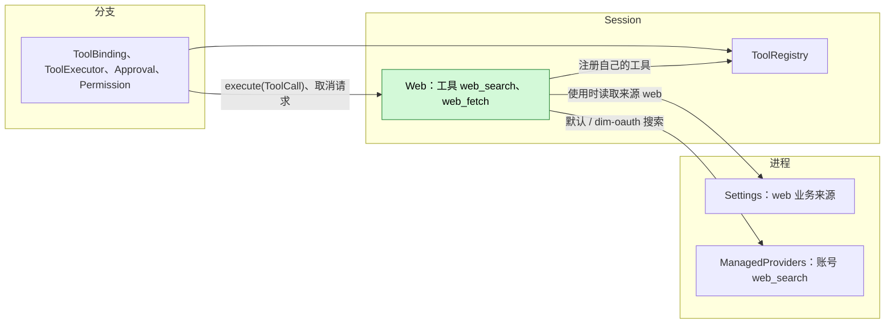
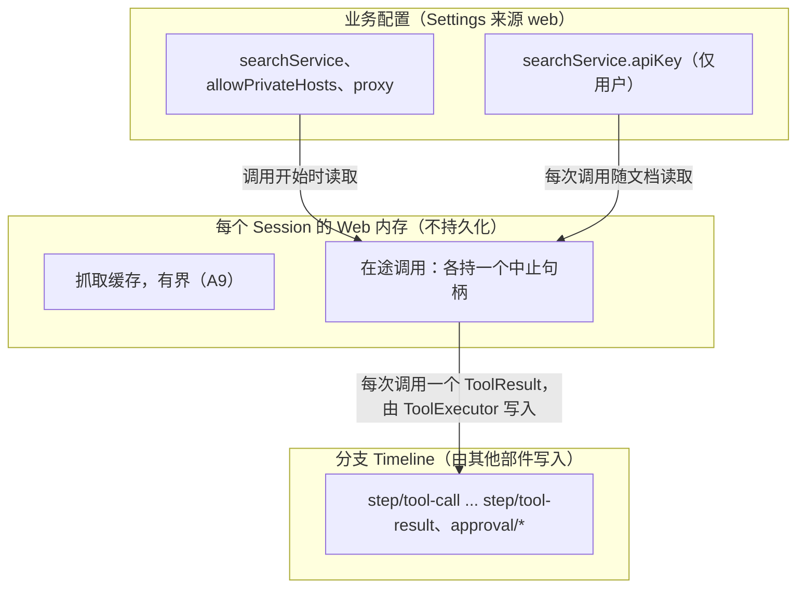
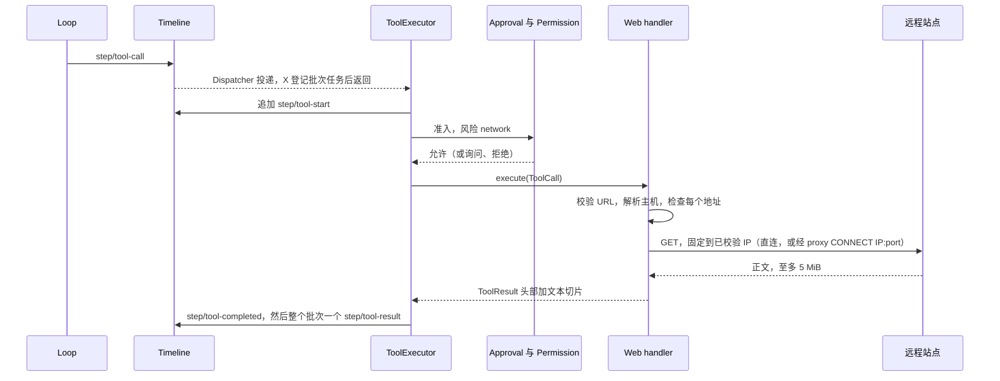
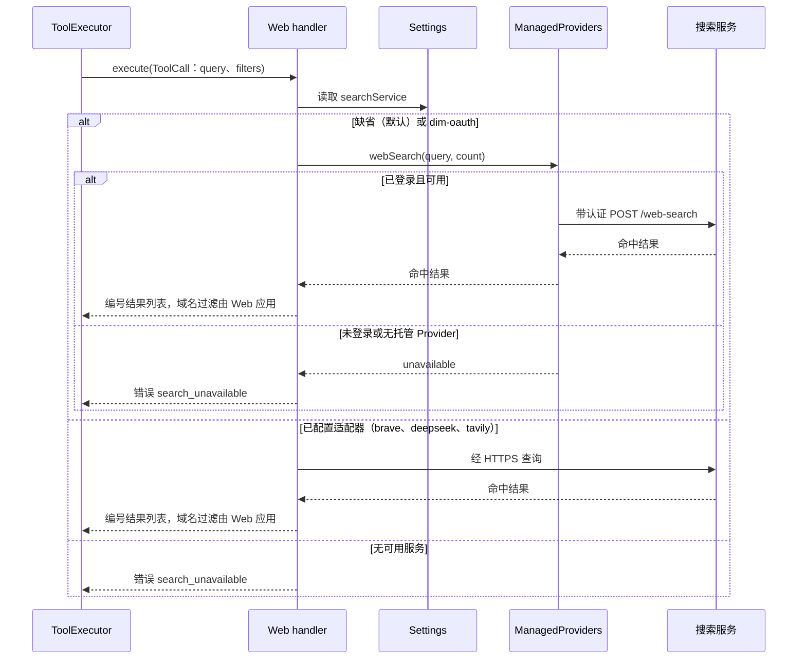
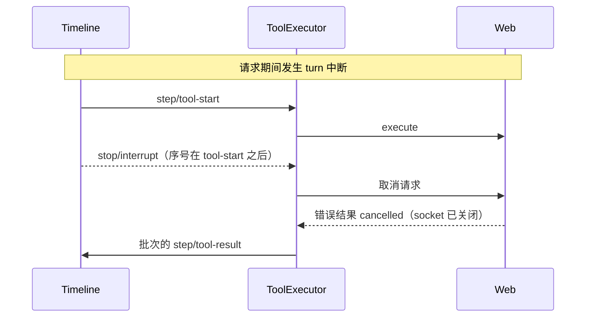

# Web

状态：已实现为 `dim-app-server` 内置 Rust 插件。总体设计：[overview](../overview.md)（Web）。阶段：P2。语言：Rust。作用域：[ADR 002](../../adr/002-plugin-scope.md)（Session）。

Web 是一个 Session 插件，向模型提供 `web_search` 与 `web_fetch`，这两个工具由它注册到本 Session 的 `toolRegistry`（[工具贡献](../../../architecture/rust-agent/tool-contributions.md)；[session-boundary A.5](../contracts/session-boundary.md#a5-工具贡献)，[ADR 002 D5](../../adr/002-plugin-scope.md)）。搜索交给已配置的内置搜索适配器；抓取下载一个公开页面并返回有界文本。Web 不持有跨 Session 共享的状态，不写任何 Timeline 事件（每次调用与结果本身已是工具调用事实），并在使用时从自己的 Settings 来源 `web` 读取业务配置，因此编辑配置不会重载任何东西（[ADR 002 D4](../../adr/002-plugin-scope.md)）。

## 1. 结构



| 部件 | 作用域 | 依赖 | 提供 |
| --- | --- | --- | --- |
| `web` | 进程，当 home 存在时 | `settings`、`partRegistry` | 登记 Settings 来源 `web` 与 Session 部件 `Web` |
| `Web` | Session | `settings`、`toolRegistry`、`managedProviders` | 把 `web_search` 与 `web_fetch` 注册到 `toolRegistry`；持有本 Session 的抓取缓存；不提供任何名称 |

**依赖的契约：** 已实现的 [C4 工具绑定](../../../design/session-typescript.md)、[Settings 具名服务与 row 来源声明](../appserver/settings-service.md)、[托管 Provider 契约](../../../../crates/dim-app-server/README.md#managed-provider-contract)及 Permission 既有的 `network` 风险。#150 提供工具，#166/#175 提供 Settings，#177 提供 Settings 事件。Web 不消费 Session 广播，不等待 #168。**本文定义的契约：** 两个工具、结果格式和 `web` 业务文档。

Web 是 App Server 的内置进程 row。该 row 登记 Settings 来源 `web` 与 Session 部件，不增加 Web 专属注册表或宿主端口。当 `searchService` 缺省（默认）或为 `{"kind": "dim-oauth"}` 时，`web_search` 通过 `managedProviders` 发起带认证的 relay 查询，使 OAuth 令牌留在 Rust 托管 Provider 内；当 `searchService` 显式配置为 `brave` 等适配器时，Web 直接请求该适配器。工具按调用读取 Settings，已有事件无需为此再建订阅或缓存失效协议。非致命配置诊断放入既有 `ToolResult.structuredContent`。

搜索 API 密钥是 `searchService.apiKey`，Web Settings 来源中的仅用户字段（[settings-service §1.2](../appserver/settings-service.md#12-决定密钥归其所有者)）。Unix 上的文件存储 profile 以 0600 权限写用户文档。原生 profile 将其作为 `user/web` 存入 SQLite；权限边界是产品 home，Unix 新建目录使用 0700，Windows 继承父目录 DACL；已有目录权限保持不变，数据库没有独立的 0600 保证。`userOnly` 限制写入，不屏蔽本地读取：该字段只经客户端方法 `settings.update` 写入，Web 从不写；本地客户端可经 `settings.read` 读回，远程与配对客户端不能。Web 每次调用随文档读取密钥，从不保留，也不把它放入声明、结果、`structuredContent`、诊断、错误或日志。

**重载。** 内置 `web` row 的启停状态归 PluginManager 所有，见 §6。显式 `plugin.reload` 返回 `not_reloadable`。Web 依赖进程服务 Settings，以及它要注册的本 Session 的 `toolRegistry`。Settings 重载时，其依赖方 Web 部件随之重载：ToolRegistry 不依赖 Web（session-boundary A.5），因此 Session 照常运行：Web 重载期间其注册被撤回，Web 重新注册后其工具从下一个请求起再次提供，不需要重载 Session（#241）；在途调用由 ToolExecutor 以 reloaded 结算。这遵循依赖生命周期（[ADR 002 D3](../../adr/002-plugin-scope.md)）。配置编辑从不重载。

**节点。** 请求从承载该 Session 的 App Server 进程发出，而非从 Session 的资源节点发出（A2）。

## 2. 数据与状态



Web 不拥有任何 Timeline 状态，也没有 `StateCell`。Web 被应用时缓存为空；不从 Timeline 重建任何内容。

## 3. 流程

### 3.1 一次 `web_fetch` 调用



handler 运行在 ToolExecutor 的任务上，只依据其参数与调用开始时读取的配置作决定。更长的页面通过带 `start_char` 的后续调用读取；跨主机重定向以提示形式返回，使新主机获得自己的准入（A10）。

### 3.2 一次 `web_search` 调用



Web 启用时 `web_search` 始终被声明；默认（`searchService` 缺省或为 `{"kind": "dim-oauth"}`）经 `managedProviders` 使用已登录的 Dim 账号搜索，在有可用账号或配置可用服务之前以 `search_unavailable` 失败（A3）。更换服务或账号登录状态变化在下一次调用生效。

## 4. 时序与冲突



| 场景 | 结果 | 负责方 |
| --- | --- | --- |
| 调用期间编辑配置 | 调用继续使用开始时读取的值；下一次调用使用新值 | Web |
| 两次调用之间移除服务 | 下一次 `web_search` 返回 `search_unavailable` | Web |
| 调用中途 Web 或 Settings 重载 | 调用以 reloaded 结算；ToolRegistry 与 Loop 照常运行，Web 的工具在 Web 重新注册前不可用，之后从下一个请求起提供（D3，#241） | ToolExecutor |
| 调用中途进程重启 | ToolExecutor 将已提交的调用结算为未能在恢复中存活；Web 从不重复请求 | ToolExecutor |
| 结果之后发生压缩 | 抓取的文本只经摘要保留 | ContextPreparation |

完整表格见附录 B。

## 5. 上下文映射

| 模型看到的内容 | 形式 | 位置 |
| --- | --- | --- |
| `web_search`、`web_fetch` 的名称、描述、输入 schema | 工具声明 | Session 挂载它们时，位于被采用的 `context/configured.tools`：没有挂载列表（`SessionConfig.tools`）时总是挂载，有列表时挂载其中列出的 |
| 搜索结果、抓取文本、错误、重定向提示 | `ToolResult.content`（仅文本） | 该调用所在批次的工具结果位置 |

- 压缩：声明作为配置保留；结果只经摘要保留。
- 子分支继承其祖先前缀中的结果。
- 非交互 Session 看到相同的工具，也可以使用它们；各 Session 的工具集合保持相同（#30）。
- 从不可见：`structuredContent`、服务名、配置、API 密钥、私有主机例外、诊断。
- 抓取的页面文本是不可信的第三方内容，放入工具结果时不加指令框定（A14）。

### 5.1 面向模型的文本

两个声明是内置的，整体是 protocol（[面向模型的提示词 §4](../model-prompts.md#4-协议与策略)）：两个 schema，以及两个描述——它们陈述各调用做什么、返回什么：“Search the web. Returns numbered titles, URLs and snippets.” 与 “Read a public web page as text. Use start_char to continue at the returned final URL.”，后者点明续读参数与结果携带的最终 URL。两类结果文本都是 protocol：

| 文本 | 类别 |
| --- | --- |
| `web_fetch failed: <code>: <message>` 与 `web_search failed: <code>: <message>` | Protocol：结果格式与其代码（附录 C）；模型读取代码并据此行动 |
| `web_fetch` 头部中的 `URL:`、`Title:`、`Content-Type:` 与 `Characters: <start>-<end> of <total>` 各行 | Protocol：结果格式 |
| `[Truncated: call web_fetch again with start_char=<end> to continue.]` 与 `Redirected to <url>; call web_fetch with that URL to follow it.` | Protocol：继续读取的句柄；模型把它们回传 |
| 搜索结果列表、抓取的文本片段与重定向提示中的 URL | 服务与页面自己的内容，作为 material 承载 |

Web 不写标记、不贡献 guide 条目；它的声明没有 policy 文本。

## 6. 接口（摘要）

| 接口 | 类型 | 用途 |
| --- | --- | --- |
| `web_search` | 注册到 `toolRegistry` 的工具（Session），风险 `network` | 查询已配置的服务；编号结果列表 |
| `web_fetch` | 注册到 `toolRegistry` 的工具（Session），风险 `network` | 抓取一个公开的 `http(s)` URL；带分页的有界文本切片 |
| `web` 来源 | Web 的 Settings 来源中的业务配置，使用时读取 | 搜索服务、私有主机例外、代理 |

没有 Session 方法、`managementMethods` 或 CLI 子命令：受保护客户端经已实现的 `settings.read`/`settings.update` 修改配置，不假设已有 `/settings` 界面。细节见附录 A。

### 6.1 注册与来源

home 存在时，App Server 登记进程 row `web`。其 apply 向 `partRegistry` 登记 Settings 来源 `web`（用户文件 `web.json`，无项目文件）和 Session 部件 `Web`。每个 Session 挂载该部件。部件注入 `settings`、`toolRegistry` 与 `managedProviders`。其 apply 只登记资源清理和两个工具，在调用发生前不做 I/O。Rust 形式见附录 G。

该 row 登记的来源 schema，`userOnly` 路径为 `/searchService` 与 `/allowPrivateHosts`：

```json
{
  "type": "object",
  "additionalProperties": false,
  "properties": {
    "searchService": {
      "type": "object",
      "required": ["kind"],
      "additionalProperties": false,
      "properties": {
        "kind": { "type": "string", "minLength": 1 },
        "endpoint": { "type": "string", "format": "uri" },
        "apiKey": { "type": "string", "minLength": 1, "writeOnly": true }
      }
    },
    "allowPrivateHosts": {
      "type": "array",
      "items": { "type": "string" },
      "default": []
    },
    "proxy": { "type": "string", "format": "uri", "writeOnly": true }
  }
}
```

执行沿工具 handler，并带上该调用的取消令牌。每次调用读取 user scope 的 `web` 来源。读取失败，或已存文档无法反序列化为 web 文档时，调用以 `settings_unavailable` 失败，不建立连接。Web 不用默认值顶替该文档。配置了 API 密钥适配器时，密钥是 `searchService.apiKey`。当 `searchService` 缺省或为 `{"kind":"dim-oauth"}` 时，`web_search` 调用 `managedProviders`，不读取 OAuth 令牌。

Settings 将 `format: "uri"` 作为注解。Web 在构造 HTTP 请求时解析 `searchService.endpoint` 和 `proxy`，不重新校验 Settings 文档。端点无法解析时，`web_search` 返回 `search_unavailable`；代理无法解析时，`web_search` 返回 `search_unavailable`，`web_fetch` 返回 `connect_failed`。均不建立连接、不回退为直连，诊断不包含配置值。

初始来源是用户文件 `web.json`，按 user scope 读取，不声明 projectFile，也没有隐式用户/项目合并（A16）。私有主机例外由客户端写入；Web 没有写配置工具。App Server 在存在产品 home 时注册内置 Web row；Web 无需安装包。[PluginManager 验收项 5](PluginManager.md#附录-c-验收m1) 规定其启停状态：`plugin.disable {"name":"web"}` 从已打开 Session 的下一轮起撤回其工具；`plugin.enable {"name":"web"}` 在该 Session 及新 Session 中恢复工具。该状态在重启后保留。显式 `plugin.reload` 返回 `not_reloadable`。

## 7. 安全

- 准入：两个工具都声明 `network`；每次调用都经过 Approval 与 Permission（read-only 拒绝，workspace-write 询问，FullAccess 允许）。
- SSRF：Web 自行解析名称，按封禁范围检查每个地址，只连接已检查的地址，有无 `proxy` 都一样；跨主机重定向需要一次新调用与新的准入（A.4、A10）。
- 无环境权限：仅 `GET`；不带 cookie、已存站点凭据或客户端证书；除模型写出的 URL 外不携带 Session 中的任何内容（A8）。
- API 密钥：每次调用随文档读取；从不出现在声明、结果、`structuredContent`、诊断或错误中。
- 经 URL 外泄是 `network` 类别的固有风险，由准入控制。
- 使用 `proxy` 时，Web 请代理对已校验的 IP 和端口做 HTTP `CONNECT`，从不把主机名交给代理，代理不解析目标名称；TLS SNI 和 `Host` 头用原主机名。固定连接和私有地址保护与直连相同（A.4）。

## 8. 规则检查

| 规则 | 本文如何遵守 |
| --- | --- |
| 原则 §4 第 1 条（改别人的状态写指令） | Web 不改其他模块的状态；工具结果由其所有者 ToolExecutor 写入。 |
| 原则 §4 第 2 条（交接） | 不适用：Web 不接手任何对象，只执行 ToolExecutor 交给它的调用。 |
| 原则 §4 第 3 条（只用 before 回调） | 不在写入前干预；参数检查在工具处理函数内部。 |
| 原则 §4 第 4 条（核心不带业务含义） | 不改核心；工具使用通用的工具注册合同。 |
| 原则 §4 第 5 条（批次） | 不适用：Web 依据调用参数和配置做决定，不依据事件。 |
| 原则 §4 第 6 条（上下文只含交接后的事件） | 结果只以 ToolExecutor 写入的 `step/tool-result` 事实进入模型。 |
| 原则 §4 第 7 条（只用公开事件和服务） | Web 只使用 `toolRegistry`、`managedProviders` 和 Settings 业务来源。 |
| 原则 §4 第 8 条（向机制所有者提需求） | 复用已实现的 C4、`managedProviders` 与 Settings 绑定；适配器 API 密钥是 Web 自己的仅用户字段，账号 OAuth 令牌留在 Rust 托管 Provider 内。 |
| 原则 §4 第 9 条（只有后续决定要用的事实才进 Timeline） | Web 不写事件；抓取缓存只在内存中。 |
| 原则 §1（Capability 与 App Server 边界） | Web 是内置 Session Capability。代码是 App Server 进程 row `web` 与 Session 部件 `Web`。不增加 Web 专属宿主端口。 |
| ADR 002 D1（作用域跟随状态） | Session 作用域：Web 不持有跨 Session 共享的状态。 |
| ADR 002 D2（不设接线模块） | 没有接线模块；搜索适配器是内置的（A1）。 |
| ADR 002 D3（依赖跟随作用域） | Settings 在外层进程作用域；必需服务缺失则 Web 部件装配失败，Session 在没有它的情况下继续运行。 |
| ADR 002 D4（结构配置与业务配置分离） | 内置 row 的结构性启停状态归 PluginManager 所有（§6）；`web` 文档是 Web 自己 Settings 来源中的业务配置，每次调用时读取。 |
| ADR 002 D5（合同语言中立） | 契约语言中立；Rust 形式见附录 G。 |

## 9. 向机制所有者提出的需求

无。工具注册、来源声明、Settings 读写/事件都已有合同与实现；API 密钥是 Web 自己的字段。Web 不另提 core、rutis、loader、生命周期、可选依赖或诊断服务需求。必需服务缺失则这一 row 的组装失败。

## 附录 A. 接口细节

### A.1 工具

Web 在 apply 中把每个工具注册一次到本 Session 的 `toolRegistry`（[session-boundary A.5](../contracts/session-boundary.md#a5-工具贡献)）：

| 方法 | 类型 | 请求 | 回复 |
| --- | --- | --- | --- |
| `toolRegistry.register` | 异步 | `ToolDeclaration {name, description, inputSchema, risk: "network"}`、`execute` | 注册完成时无返回值 |
| `execute`（Web 自己的函数） | 异步 | `ToolCall {sessionId, branchId, turnId, callId, arguments, config}, cancelled: Promise<void>` | `ToolResult {content: [{type: "text", text}], isError, structuredContent?}` |

C4 额外传入现有按引用的 `cancelled` Promise。其完成时 Web 先中止请求并释放 socket/定时器，再结算自己的调用；row 的 effect 同样释放其持有资源。ToolExecutor 负责中断终态，Web 不写第二条取消事实，也不重试未知结果。业务错误是 `isError: true` 的 `ToolResult`（附录 C）；运行时/协议绑定故障仍按 C4 的调用失败处理，不伪装成成功或业务结果。参数由 handler 校验；违反时返回错误结果，不访问网络。

### A.2 `web_search`

| 参数 | 类型 | 规则 |
| --- | --- | --- |
| `query` | string | 必填；去除首尾空白后 1 到 500 个字符（A4） |
| `max_results` | integer | 可选；1 到 10；默认 5（A4） |
| `allowed_domains` | string[] | 可选；至多 10 个主机名；结果限制在这些主机及其子域 |
| `blocked_domains` | string[] | 可选；至多 10 个；与 `allowed_domains` 互斥 |

服务支持时域名过滤会传给服务，且在任何情况下 Web 都会对返回列表应用过滤。`ToolResult.content`：

```
Search results for "<query>" (<n> results)

[1] <title>
<url>
<snippet>

[2] ...
```

标题与摘要为纯文本，各占一行，各自至多 500 个 Unicode 标量值。零结果返回 `No results for "<query>".`（不是错误）。不显示服务名。`structuredContent` 为客户端携带 `{ results: [{ title, url, snippet, published_at? }], diagnostics?: [{code, message}] }`。总时限 20 s（A5）。

### A.3 `web_fetch`

| 参数 | 类型 | 规则 |
| --- | --- | --- |
| `url` | string | 必填；绝对 `http` 或 `https`；至多 2048 个字符；不含 userinfo；去除 fragment（A6） |
| `start_char` | integer | 可选；默认 0；转换后文本中的偏移 |
| `max_chars` | integer | 可选；1000 到 50000；默认 20000（A7） |

`ToolResult.content`：

```
URL: <final url>
Title: <title, if any>
Content-Type: <media type>
Characters: <start>-<end> of <total>
[Truncated: call web_fetch again with start_char=<end> to continue.]
[Download limit reached: the page exceeds <limit> and later content is missing.]

<converted text slice>
```

标题在两种结果字段中均独立限制为 500 个 Unicode 标量值；`max_chars` 限制正文切片。方括号行仅在适用时出现。`structuredContent`：`{ url, final_url, status, content_type, title?, start, end, total, truncated, download_limited, diagnostics?: [{code, message}] }`。

| 项目 | 规则 |
| --- | --- |
| 方法与头部 | 仅 `GET`；`User-Agent: dim-web/<version>`；`Accept` 优先 HTML 与文本；不带 cookie、凭据或 referrer（A8） |
| 限制 | 连接 10 s；整个调用 30 s；解码后正文至多 5 MiB，之后关闭连接并设置 `download_limited`（A5） |
| 状态码 | 2xx 转换；3xx 按重定向规则；4xx/5xx 为错误 `http_status`，带状态码与原因短语，不含正文 |
| 重定向 | 至多 5 跳，每跳重新校验。指向不同主机（小写化、去掉前导 `www.`）的重定向不跟随：非错误提示 `Redirected to <url>; call web_fetch with that URL to follow it.`（A10） |
| `text/html`、`application/xhtml+xml` | 字符集先取头部，再取 `<meta>`，否则以 UTF-8 加替换字符解码；移除 `script`、`style`、`noscript`、`template`、`svg`、`iframe`、导航与表单控件；优先主体内容；转为带绝对链接的 Markdown；规范化空白 |
| `text/plain`、`text/markdown`、`text/csv`、`application/json`、`application/xml`、`text/xml`、`*+json`、`*+xml` | 解码后的文本原样返回（合法 JSON 美化输出） |
| 其他类型 | 错误 `unsupported_content_type`，指明类型（A11） |
| 转换结果为空 | 非错误结果，含头部与 `(no text content)` |
| 切片 | 按 Unicode 标量值取 `[start_char, start_char + max_chars)`；`start_char >= total` 返回带头部的空切片 |
| 缓存 | 转换后文本以最终 URL 为 key，每个 Session，15 分钟，至多 50 MiB，使分页无需重新抓取（A9） |

### A.4 地址策略

| 规则 | 内容 |
| --- | --- |
| 解析 | Web 解析主机名，校验每个解析出的地址，按 DNS 顺序尝试已校验地址，直到连接成功或达到共享连接时限（固定），直连或经 `proxy` 都一样，因此检查与连接之间不可能发生 DNS 重绑定 |
| 默认封禁 | 回环（`127.0.0.0/8`、`::1`）、未指定地址、RFC 1918、链路本地（`169.254.0.0/16`、`fe80::/10`，含云元数据）、CGNAT `100.64.0.0/10`、唯一本地 `fc00::/7`、组播、广播、保留范围，以及这些地址的 IPv4 映射与 IPv4 兼容 IPv6 形式；主机名 `localhost` 与 `*.localhost` |
| 字面 IP | 仅当按相同规则为公网地址时允许 |
| 端口 | 公网地址上的任意端口（A12） |
| 例外 | `allowPrivateHosts`：精确主机名或 CIDR；默认为空。这是仅限用户的字段：经客户端方法 `settings.update` 写入，从不由 Web 写入（S8b）。Settings 只检查它是字符串数组；Web 在使用时解析每一项，忽略既不是主机名也不是 CIDR 的项并作为诊断报告 |
| 代理 | 使用 `proxy` 时，Web 照上面解析并校验，再向代理发 HTTP `CONNECT <已校验 IP>:<端口>`，`http` 和 `https` 都如此；TLS SNI 和 `Host` 头用原主机名；代理从不收到作为连接目标的主机名。代理拒绝 `CONNECT` 时调用以 `connect_failed` 失败（A15） |

Fake-IP DNS 答案同样受此策略约束。合成的基准测试地址（`198.18.0.0/15`）默认封禁；请配置真实地址 DNS 答案，或在 `allowPrivateHosts` 中显式添加可信主机例外。搜索端点与已配置的代理均不会隐式绕过地址校验。

### A.5 业务配置（Settings 来源 `web`）

| 字段 | 类型 | 默认值 |
| --- | --- | --- |
| `searchService` | `{ kind: "brave" \| "deepseek" \| "tavily" \| "dim-oauth", endpoint?: string, apiKey?: string }` 或缺省；仅用户。除 `dim-oauth` 外的适配器都需要 `apiKey`；`endpoint` 替换其默认地址 | 缺省（已登录时经 `managedProviders` 使用 `dim-oauth`；否则 `web_search` 返回 `search_unavailable`） |
| `allowPrivateHosts` | string[] | `[]` |
| `proxy` | string（URL） | 缺省 |

每次调用时读取，按交付的样子使用：Settings 在写入和读取持久化文件时按 Web 声明的 schema 校验文档并应用默认值，Web 不再校验。Web 没有写配置的工具，因此文档只经客户端方法写入（S8b）。变更是带通知的数据更新，从不触发重载。row 的结构性启停状态归 PluginManager 所有（§6）。内置适配器 id 是实现选择（A13）。API 密钥是 `searchService.apiKey`（§1）。

### A.6 Timeline 与 Capability 机制

| 步骤 | 路径 |
| --- | --- |
| 提供 | Web 把 `web_search` 与 `web_fetch` 注册到 `toolRegistry`，直到其 row 卸载；ToolRegistry 声明 Session 挂载的那些（没有挂载列表时两者都声明，有列表时声明其中列出的）；ToolBinding 采用它们。Web 不写入任何内容 |
| 调用 | ToolExecutor 在 Dispatcher 上消费 `step/tool-call`，登记批次任务后返回；每次调用依次为 `step/tool-start`、准入、在执行器任务上运行 handler、`step/tool-completed`，然后每个批次一个 `step/tool-result` |
| Dispatcher | Web 没有订阅 |
| 状态与复检 | 无 `StateCell`；不消费事实；决定使用参数与调用开始时读取的配置 |
| 终态事实 | 由 ToolExecutor 写入；Web 对每次调用恰好返回一个 `ToolResult` |
| 重载 | 卸载撤回 Web 的注册并中止在途请求；ToolExecutor 将其以 reloaded 结算（[工具贡献 §4](../../../architecture/rust-agent/tool-contributions.md)）；下一代重新注册 |
| 进程重启 | 已提交但无结果的调用由 ToolExecutor 的重建结算；Web 从不重复请求 |

## 附录 B. 完整冲突表

| 场景 | 序号顺序 | 结果 | 负责方 |
| --- | --- | --- | --- |
| 派发前 turn `stop/interrupt` | interrupt < `step/tool-call` 被消费 | 不执行 | ToolExecutor |
| 审批期间 turn `stop/interrupt` | `approval/request` < interrupt | `approval/cancelled`；不发送请求 | Approval |
| 请求期间 turn `stop/interrupt` | `step/tool-start` < interrupt | 调用被取消；socket 中止；错误 `cancelled`；中止前已完整转换的响应原样返回 | ToolExecutor、Web |
| 分支级中断或分支关闭 | 分支中断 | 同 turn 中断 | ToolExecutor |
| 批次中有另一个长调用 | Web 已返回，另一调用仍在运行 | 结果保留到批次的 `step/tool-result` | ToolExecutor |
| 并发 Steer/Queue/Append | 任意 | 对调用无影响；Steer 在批次结果之后消费 | Loop |
| 对暂存输入的 `input/withdraw` / `input/deleted` | 任意 | 无影响；Web 不消费输入 | InputQueue |
| 结果之后发生压缩 | `step/tool-result` < 压缩 | 文本只经摘要保留 | ContextPreparation |
| 子分支切分 | 切分在 `step/tool-result` 之后 | 子分支继承该结果 | — |
| 调用运行时编辑配置 | — | 调用继续使用开始时读取的值 | Web |
| 无可用服务时的 `web_search` | — | 错误 `search_unavailable` | Web |
| 调用中途 Web 或 Settings 重载 | 尚无结果 | 调用以 reloaded 结算；依赖方重载（D3） | ToolExecutor |
| 调用中途进程重启 | 已提交，无结果 | 结算为未能在恢复中存活；不重复 | ToolExecutor |
| Session 卸载与恢复 | `branch/resume` | Web 重新应用；缓存为空 | Lifecycle |
| Session 资源节点离线 | — | 无影响；Web 不使用节点服务 | — |
| 取消后迟到的 handler 调用 | 已收到取消请求 | 不访问网络，返回 `cancelled` | Web |
| 两个分支抓取同一 URL | — | 相互独立的请求；缓存由先完成者填充 | Web |
| 客户端断开 | — | 无影响 | — |

## 附录 C. 错误与恢复

每个错误都是错误 `ToolResult`（`isError: true`），内容为 `web_fetch failed: <code>: <message>` 或 `web_search failed: ...`。任何错误都不影响其他调用或 Session。

| 代码 | 含义 |
| --- | --- |
| `invalid_input` | 参数违反附录 A |
| `blocked_address` | 主机或某一重定向跳解析到被封禁地址；消息只指明规则 |
| `dns_failed`、`connect_failed`、`tls_failed` | 网络错误；`connect_failed` 包括代理无法解析或拒绝 `CONNECT` |
| `timeout` | 达到连接或整个调用的时限 |
| `http_status` | 最终状态非 2xx |
| `too_many_redirects` | 同主机跳转超过 5 次 |
| `unsupported_content_type` | 类型不在 A.3 中 |
| `search_unavailable` | 无可用服务或已登录账号、端点或代理无法解析、适配器不可用或缺少所需的 API 密钥 |
| `search_failed` | 服务错误或数据无效；消息经缩短并去除秘密 |
| `settings_unavailable` | `web` 来源无法读取，或已存文档与 web 文档不符 |
| `cancelled` | 调用被取消 |

恢复：Web 不持有持久工作；重载与重启只丢失缓存。

## 附录 D. 验收

经公开接口的流程测试：测试 Session 中的工具调用、一个只能通过测试用 `allowPrivateHosts` 条目访问的本地 HTTP 服务器、一个伪造的搜索适配器。

1. 无服务时 `web_search` 返回 `search_unavailable`；配置一个服务后下一次调用无需重载即成功；移除后下一次调用失败。 对 schema 合法但无法解析的端点或代理，按 §6.1 返回错误，不建立连接或回退为直连。
2. `web_search` 格式、域名过滤、零结果、服务错误。
3. `web_fetch` 的 HTML 头部与 Markdown；`start_char` 分页至结尾；`max_chars`；下载上限提示。
4. 纯文本、JSON、不支持的类型、404、空页面。
5. 同主机重定向至多 5 次；第六次失败；跨主机重定向返回提示。
6. 回环、私有、链路本地、IPv4 映射 IPv6、`localhost` 以及解析到私有地址的主机名均被封禁；DNS 重绑定测试未建立连接，直连和使用 `proxy` 都要测（测试代理只收到 `CONNECT <已校验 IP>:<端口>`，SNI 和 `Host` 为主机名）。
7. Permission：read-only 拒绝，workspace-write 询问，FullAccess 允许。
8. 派发前、审批期间与慢响应期间中断（socket 关闭，一个结果）。
9. 重启结算不重复任何请求。
10. 非交互 Session 声明两个工具。
11. 诊断与结果从不包含 API 密钥。

## 附录 E. 假设

| # | 假设 | 依据 | 若被否决的影响 |
| --- | --- | --- | --- |
| A1 | 搜索服务（包括基于账号的服务）是内置适配器；没有后端注册表 | ADR 002 D2 | 由 Web 拥有的搜索后端契约 |
| A2 | 请求从承载 Session 的 App Server 进程发出 | 判断 | 经资源节点的服务进行网络访问 |
| A3 | Web 部件 Active 时始终声明 `web_search`，无可用搜索服务时失败 | ADR 002 D4（配置从不重载） | 声明将随配置变化 |
| A4 | 查询长度 500；`max_results` 1 到 10，默认 5 | 判断 | 限制改变 |
| A5 | 连接 10 s，抓取 30 s，搜索 20 s；下载 5 MiB | 判断 | 限制改变 |
| A6 | 仅 `http`/`https`，至多 2048 个字符，不含 userinfo | 判断 | 输入面更宽 |
| A7 | `max_chars` 1000 到 50000，默认 20000，`start_char` 分页 | 判断 | 结果的界定方式不同 |
| A8 | 仅 `GET`，固定 user agent，不带 cookie 或凭据 | 判断 | 带认证的抓取需要单独设计 |
| A9 | 缓存按 Session，15 分钟，至多 50 MiB，以最终 URL 为 key | 判断 | 每个切片都重新抓取；切片之间可能不一致 |
| A10 | 跨主机重定向只报告，不跟随 | 判断 | 重定向会到达从未准入的主机 |
| A11 | PDF 与图片不转换 | 判断 | 增加提取或图片内容块 |
| A12 | 公网地址上任意端口 | 判断 | 限制为 80/443 |
| A13 | 内置适配器列表是实现选择 | overview 未指定服务 | 由 overview 固定某个服务 |
| A14 | 抓取内容周围不加框定文本 | 判断 | 需要定义模型可见的框定 |
| A15 | 配置的代理支持对 IP 地址做 HTTP `CONNECT`，`http` 和 `https` 目标都支持 | 维护者决定：有无代理都是同一个固定连接保证 | 只接受主机名的代理不能用；私有地址保护将依赖代理 |
| A16 | 初始来源只声明用户文件 `web.json`，按 user scope 读取；无隐式项目合并 | 维护者决定 | 先定义项目来源与合并业务语义，再配置既有 projectFile |

## 附录 F. 实施边界

| 问题 | 当前边界 |
| --- | --- |
| 初始范围 | 工具参数、网络/内容策略及 A1–A16 已获维护者确认。Web 是内置进程 row `web` 及其 Session 部件。可选包的产品安装仍属于 PluginManager。 |
| 配置诊断 | 非致命且仅供 UI/持久化的配置诊断放入 ToolResult.structuredContent；模型需要采取动作的信息仍必须放在 content，不新增通道 |
| HTML 转文本 | 扫描器，不是浏览器。后面出现 `>` 的 `<` 即开始一个标签，正文里单独的 `<` 也算。script、style 与导航在这次扫描之前用正则去掉。 |
| 内容编码 | 解码 `gzip`、`deflate` 与 `identity`。`br` 与其他编码以 `connect_failed` 失败。不完整的 gzip、带 zlib 封装的 deflate 或原始 deflate 流均以 `connect_failed` 失败；若已经达到下载上限，则返回截断后的正文并带 `download_limited`。服务器省略 zlib 封装时回退为原始 deflate。 |
| User-Agent | `dim-web/` 加上 `dim-app-server` 的包版本 |

## 附录 G. Rust 绑定

当前的 Rust 绑定。工具名与数据形状不变。

| 语言中立 | Rust |
| --- | --- |
| 为 `web_search`、`web_fetch` 调用 `toolRegistry.register` | Session 部件注入 `Keyed<ToolRegistry>`，在 `apply` 中为每个工具调用 `tools.register(ctx, ToolContribution {definition, handler})`；部件卸载时注册撤回 |
| 声明 / `execute` | `ToolDefinition` / 带 `CancellationToken` 的 handler；disposer 中止在途请求（[工具贡献 §4](../../../architecture/rust-agent/tool-contributions.md)） |
