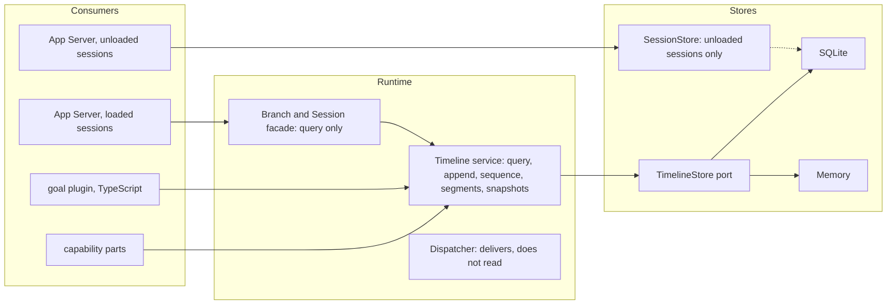

# Timeline 读取入口

状态：提议中。范围：部件、App Server 或 TypeScript 插件从 Timeline 读取事件的全部方式，其中哪些会被事件查询（[ADR 019](../../adr/019-event-query.md)、[插件契约 §5.4](plugin-contract.md#54-the-event-query)）取代，以及还剩什么。本文是审计，加上 [ADR 020](../../adr/020-timeline-read-convergence.md) 提议的决策；决策在该 ADR 被接受后生效。语言：中文。English: [English](../../design/timeline-read-entries.md)。

基线：`origin/main` 的 `514225777`。调用点不含测试和示例。下面每一行都是在该基线上从源码读出来的，因此其中点名的 TypeScript 路径（含 Goal 的 `runtime/plugins/goal/branch.ts`）是移植前的快照。

## 1. 入口

### 1.1 `Timeline` 服务（`crates/dim-agent-runtime/src/core/timeline.rs`）

| 读 | 定义 | 生产调用点 |
| --- | --- | --- |
| `history(through)` | :727 | `dispatcher.rs:269`、`branch.rs:128`、`agent.rs:548` |
| `query(query)` | :756 | 无 |
| `page_cursor` / `page` | :822 / :835 | `recall.rs:184`、`:187`、`:208`，经 `branch.rs:133`、`:144` |
| `local(range)` | :898 | 16 处，见 §1.5 |
| `stored_page` | :921 | 无 |
| `stored_local` | :1071 | 无 |
| `ancestor_events_of_kind` | :955 | `permission.rs:525` |
| `event_by_id` | :972 | `context_preparation.rs:682`、`timeline.rs:973`、`:990` |
| `event_position` | :978 | `history.rs:163`、`:338`、`context_policy.rs:435`、`timeline.rs:1017` |
| `compaction_cut` | :1007 | `history.rs:989`、`:990`，经 `branch.rs:172`、`agent.rs:529` |
| `stored_context_page` / `_in` | :1050 / :1026 | `history.rs:1001`、`:204`、`:320`、`context_preparation.rs:648`、`branch.rs:185` |
| `context` | :1099 | `history.rs:246`、`:267`、`:440`、`branch.rs:166`、`agent.rs:525`、`agents.rs:1446` |
| `context_with_checkpoint` | :1322 | `history.rs:243`、`:262` |
| `checkpoint` | :1258 | `history.rs:178`、`:292`、`timeline.rs:1328` |
| `trace(sequence)` | :1401 | 无；只有门面 `branch.rs:190` 和 `agent.rs:660` 能到达它 |

### 1.2 其他对象上的同名读

`Branch`（`branch.rs`）：`history` :126、`page_cursor` :132、`page` :138、`local` :146、`context` :164、`compaction_cut` :170、`context_page` :176、`trace` :188。
`Session`（`agent.rs`）：`context` :524、`compaction_cut` :528、`context_page` :532、`history` :543、`local` :550、`local_page` :562、`trace` :659。
提交查找：`Branch::lookup`（`branch.rs:73`）经 `Session::lookup`（`agent.rs:490`）到 `TimelineContext::lookup`（`timeline_context.rs:392`），再到 :411 的点读；调用方 `connection/tree.rs:99`、`agents/sessions.rs:569`。
只删 `Timeline` 上的方法，这些读仍然可达。

### 1.3 Dispatcher 导出给 TypeScript 的读（`core/dispatcher.rs`）

`local(start, through)` :257 和 `history(through)` :265 读到*已分配*位置（`.d.ts` 写的是 "committed events"）。重放 `follow` :171 在 :194 读 `local(..=through)`。调用它们的 TypeScript 部件只有 `runtime/plugins/goal/branch.ts`：`committed()` :104，`local` :105、:176、:205，`history` :207。它注入的是 `dispatcher`，不是 Timeline 服务。`npm/branch-services.d.ts` 同时声明了旧的读和 `query`。

### 1.4 绕过服务的读

| 读 | 定义 | 调用方 |
| --- | --- | --- |
| `TimelineStore::read_page`，由 TimelineTree 部件自己调用 | `timeline_store.rs:229` | `timeline_tree.rs:425`、`:668`（也在 `TreeTimeline::page` :180 之后） |
| `Session::local_page` 直接读存储端口 | `agent.rs:562-585` | `agents.rs:677`、`:1007`、`connection/tree.rs:227`、`agents/sessions.rs:616` |
| `read_page_before` | :1409 | `agents.rs:763`、`connection/tree.rs:209` |
| `read_events` | :1539 | `agents.rs:688`、`collaboration.rs:1151` |
| `turn_window` | :1304 | `agents.rs:746`、`connection/tree.rs:197` |

这些与 §5.4 的“部件通过其分支的 `timeline` 服务读取事实”相矛盾。

### 1.5 `local` 调用点

`timeline_context.rs:411`、`timeline.rs:309`、`dispatcher.rs:194`（重放）、`:262`、`branch.rs:162`、`agent.rs:555`、`collaboration.rs:1080`、`:2726`（`..=committed()`，协作重建）、`agents.rs:1009`、`context_policy.rs:531`、`timeline_tree.rs:566`、`:2291`（整段父分支前缀，用来找第一次工具使用）、`context_methods.rs:81`、`history.rs:981` 和 `:983`（裁剪点校验）、`file_reads.rs:143`。

### 1.6 存储端口（`timeline_store.rs`）

### 1.7 依赖图

每条边都是本次审计从调用点读出来的。边上的标签列出经过它的读；指向存储端口的那条是概括写的，因为 `timeline.rs` 内部的调用只枚举了一部分。虚线表示共用的存储代码，不是调用。

```mermaid
flowchart LR
  subgraph TS[TypeScript]
    goal[goal/branch.ts]
  end
  subgraph CAP[dim-agent-capabilities]
    recall[recall.rs]
    hist[history.rs]
    prep[context_preparation.rs]
    pol[context_policy.rs]
    perm[permission.rs]
    tree[timeline_tree.rs]
    ctxm[context_methods.rs]
    reads[file_reads.rs]
  end
  subgraph APP[dim-app-server]
    conn[connection/tree.rs]
    agents[agents.rs]
    collab[collaboration.rs]
  end
  subgraph RT[dim-agent-runtime]
    Agent[Session facade]
    Branch[Branch facade]
    Disp[Dispatcher]
    TL[Timeline service]
  end
  subgraph ST[stores]
    Port[TimelineStore port]
    SS[SessionStore]
    Sql[SqliteTimelineStore]
    Mem[MemoryTimelineStore]
  end
  goal -->|committed, local, history| Disp
  Disp -->|local, history, follow replay| TL
  recall -->|page_cursor, page| Branch
  ctxm -->|local| Branch
  hist -->|context, checkpoint, stored_context_page_in, event_position| TL
  hist -->|context_page, compaction_cut, local| Agent
  prep -->|stored_context_page_in, event_by_id| TL
  pol -->|local| TL
  perm -->|ancestor_events_of_kind| TL
  reads -->|local| TL
  tree -->|local| TL
  tree -->|local| Branch
  tree -->|read_page| Port
  conn -->|local_page| Agent
  conn -->|turn_window, read_page_before| SS
  agents -->|history, local, local_page, context| Agent
  agents -->|read_page, read_events, read_page_before, turn_window| SS
  collab -->|local| TL
  collab -->|read_page, read_events| SS
  Agent -->|published branch| Branch
  Agent -->|local_page| Port
  Branch -->|history, local, context, page, trace, compaction_cut, context_page| TL
  TL -->|reads and policy reads| Port
  Port --> Sql
  Port --> Mem
  SS -.-> Sql
```

图说明两件事。`Session` 门面不经过 Timeline 服务就能到达存储端口（`local_page`）；TimelineTree 部件和 App Server 也都不经过服务就能读存储。所以只删 `Timeline` 上的读，下面这些通往同一批数据行的路径仍然存在：`Branch` 和 `Session` 门面（§1.2）、Dispatcher 的导出（§1.3）、`Session::local_page`、TimelineTree 部件自己的 `TimelineStore::read_page`，以及 App Server 的 `SessionStore` 读（§1.4）。

## 2. 每个消费方需要什么

每一行都读自消费方的源码：它从 Timeline 拿什么、现在怎么读、是否需要这样读。查询接受的请求是 scope、from_event 或 from_sequence、kinds、flags、event_id、一个 predicate、order_by、direction、limit 和 offset。

| 消费方 | 需要什么 | 现在怎么读 | 是否需要这样读 |
| --- | --- | --- | --- |
| 权限重建（`permission.rs:522`） | 祖先中最后一条 `permission/changed`；每条都会覆盖 policy，所以只有最后一条有效 | 取祖先里该类型的全部事件再折叠 | 一条事件：链范围、该类型、倒序、`limit 1` |
| 文件读取（`file_reads.rs:136`） | `established` 之后最近一次已完成的压缩，以及它的 `retain_from` 是否落在该点之后 | `local(established+1..=committed())`，再搜索 | 一条压缩事件加一次按编号查位置。上界是 `committed()`，所以会读到可能尚未发布的事件 |
| 手动压缩等结果（`context_methods.rs:81`） | 一条 `command` 等于给定值的 `context/compaction` | `local(after+1..=head)`，再 `find` | 本分支、类型、`command` 等值、从 `after+1` 起、`limit 1` |
| 压缩策略复用（`context_policy.rs:531`） | 同一次准备中前一次尝试写下的 `context/compaction` 和 `context/budget` 事实，按 `turn_id` 匹配 | `local(through+1..)`，再过滤 | 可表达：本分支、两种类型、`from_sequence` 取 `through+1`、predicate 取 `turn_id`；压缩的 `through` 等值留给调用方。读取时这些事实是否已发布未核实；该读发生在本次尝试写自己的 budget 事实之前（`context_policy.rs:553`） |
| 分支恢复（`timeline_tree.rs:566`） | `branch/create-failed`、`branch/create`、`branch/ended`，折叠成集合 | `local(..=head)`，整个分支 | 三种类型，不需要整个分支 |
| 协作结果取回（`collaboration.rs:1080`） | 一条已知编号的事件 | 先用 `results` 表查序号，再 `local(seq..=seq)`，再 `find` | 按编号读；`results` 表只为这一次读存在 |
| 会话摘要（`agents.rs:1003`） | 第一条操作员输入的预览文本，以及 `through` 处事件的时间 | 取前 256 条事件的 `local_page`，再 `local(through..=through)` | 第一条带 `user` 的 `input/message`，升序，找到即停（`user` 检查留给调用方）；更新时间是 `through` 处的一次点读。不需要 256 条事件 |
| 重放 `follow`（`dispatcher.rs:194`） | 从分支截至 `S = committed()` 的事件重建部件自己的状态 | `local(..=S)`，整段 | 因部件而异：七个部件折叠了自己没有订阅的类型，有些只需要少数几种类型 |
| 恢复时的提交索引（`timeline.rs:309`） | 每条已恢复输入的 `submission_id` | `local(1..=restored_sequence)` | 一种类型，`input/message` |
| 已提交输入（`timeline_context.rs:411`） | 已知序号处的事件 | `local(seq..=seq).pop()` | 点读 |
| goal 继承判断（`goal/branch.ts:205`） | 继承来的、带目标或状态标记的最后一条输入 | 先取本分支的事件编号，再对整条链 `history(at)`，在 TypeScript 里过滤 | 链上最后一条匹配的 `input/message`。标记在 `blocks` 内部，单一等值谓词够不到 |
| 预算补读输入（`context_preparation.rs:682`） | 按编号取一条输入 | `event_by_id` | 按编号读 |
| 压缩切点位置（`history.rs:163`） | `retain_from` 所指事件在链中的位置 | `event_position` | 编号换位置；回复里带位置 |
| 裁剪点校验（`history.rs:981`） | 某个序号是否是一次原子写入的末尾 | `local(through..=through)`；落在批内时存储报错 | 不涉及事件内容，只涉及批结构；查询给不了 |
| 回忆（`recall.rs:184`） | 几种类型的事件，由新到旧，折叠，够答案就停 | `page_cursor` 和 `page` | 倒序分页加提前停止 |
| 协作重建（`collaboration.rs:2726`） | 尚未处理的审批输入，以及每条 `collaboration/result` 和它的序号 | `local(..=committed())`，遍历两遍 | 四种类型，不需要整个分支。它读到 `committed()` |
| 分支工具默认起点（`timeline_tree.rs:2291`） | 本轮第一次 `tool-use` 之前的 `model/start`，序号减一 | `parent.local(..)`，整个父分支 | 两条事件，按 `turn_id` 和 `request_id` 匹配。谓词只有一个等值，所以其中一个匹配留给调用方 |
| fork 校验与前缀（`agents.rs:1446`） | 切点是否合法，以及切点之前的上下文 | `validate_context_boundary_in` 和 `context` | 折叠前缀是投影的工作；批检查同上 |
| 历史窗口（`connection/tree.rs:197`） | 最新一轮的起点，以及窗口内的一页倒序事件 | `turn_window` 和 `read_page_before` | 倒序分页，加最新一条 `turn/start` |
| 历史分页（`connection/tree.rs:227`） | 从 `after` 起给客户端的一页 | `local_page` | 分页；页尾落在批上是协议规则 |
| 提交查找（`branch.rs:73`） | 某个提交编号对应的输入事件 | `lookup`，再点读 `local(seq..=seq)` | 按编号读：`event_id`，`limit 1` |

### 2.1 五类需求

1. **一两条特定事件**：权限、文件读取、手动压缩、协作结果、已提交输入、预算补读、goal 继承、分支工具默认起点。多数是读一段范围再从中挑。
2. **一种或几种类型，再折叠**：分支恢复、提交索引、协作重建、回忆、上下文折叠。
3. **重建部件自己的状态**：重放，共十一个部件。有的只需要几种类型，有的需要整段前缀。
4. **编号换位置**：压缩切点位置。
5. **批结构**：裁剪点校验，以及历史协议的页边界。这是存储行，不是事件内容。

### 2.2 查询不够用的地方

- 一个等值：goal 的标记在 `blocks` 内部；分支工具默认起点需要两个条件。
- 读到已分配位置：重放、协作重建、文件读取。它们读的都是自己写下的事实。
- 批结构：裁剪点校验。

### 2.3 十一个重建各自折叠什么

读自每个部件的 rebuild。follow 的 key 列表是部件订阅的类型；折叠是它的 rebuild 实际消费的类型。两者不同。

| 部件 | 折叠 | 状态是 |
| --- | --- | --- |
| Permission | permission/changed，祖先和本分支，后一条覆盖前一条 | 最后一条事件 |
| Wait | turn/start、turn/end | 最后一条事件 |
| Approval | approval/request、approval/respond、approval/cancelled | 未闭合的配对 |
| ToolExecutor | step/tool-call、step/tool-result、stop/interrupt、turn/start、turn/end | 未闭合的配对 |
| ModelProvider | model/call、step/tool-use-start、step/tool-use、step/model-output-end、stop/interrupt、turn/start、turn/end；还有 steer.apply，它读 step/model-start 和非追加模式的 input/applied | 未闭合的配对 |
| ContextPreparation | context/prepare、model/call、step/model-output-end、context/compaction-start、context/compaction、stop/interrupt、turn/start、turn/end；还有 steer.apply（step/model-start、input/applied） | 未闭合的配对 |
| BackgroundExec | exec/started、exec/ended、stop/interrupt、带标记的 input/message | 未闭合的配对和未发出的唤醒 |
| InputQueue | input/*、turn/*、stop/interrupt，经 state.step | 累积 |
| BranchLine | branch/*、input/*、stop/interrupt、step/tool-use、step/tool-result、turn/end | 累积 |
| Hooks | 12 种被跟随的类型；重放把每条事件都交给它，由它自己过滤 | 累积 |
| Loop | input/applied、input/consumed、context/compact、context/compaction-start、context/compaction、stop/interrupt、turn/start、turn/end、step/model-start、context/prepare、step/tool-use-start、step/tool-use、step/model-output-end、step/tool-call、step/tool-result；turn 在 turn/start 处重置 | turn 状态、待处理输入、手动压缩 |

这说明：

- 靠重放重建的部件都不折叠 step/text 或 step/thinking，所以重放式重建不会碰到合并行。上下文投影会折叠它们（history.rs 的 replay），所以从检查点续读会碰到合并行。
- 两个部件只需要最后一条事件（Permission、Wait）。六个折叠未闭合配对。三个累积。
- 部件会折叠自己没有订阅的类型（Approval、ToolExecutor、ModelProvider、ContextPreparation、Loop），所以它的读取选择必须按它的 rebuild 来写，不能照抄 follow 的 key。
- 重放把整段分支前缀一直交到已分配位置，不做过滤。这段前缀的解码在 Loading 阶段是共用的（[restore-shared-read](appserver/restore-shared-read.md)），降低了成本，没有减小体量。
- 热窗口保留事件直到它们被分发，而不只是直到被发布。查询读到发布头为止，所以重建要在它之后补上的尾巴，是本分支已写入、尚未发布的事件；已发布、尚未分发的事件在存储里，查询读得到。

未核实：每个未闭合配对能否跨 turn，也就是从最近一个 turn/start 起读是否足够；Loop rebuild 的后半段；打开期间未分发尾巴有多长。

## 3. 查询表达不了的

| 需求 | 谁 | 原因 |
| --- | --- | --- |
| 读到*已分配*位置 | goal（`goal/branch.ts:104`、`:176`）、协作重建 `collaboration.rs:2726`、文件读取 `file_reads.rs:136` | 查询在已发布头处截断；如果重放被取消，重放不再需要它（§2.3） |
| 某个位置是否是一次原子写入的末尾 | 裁剪点校验，`history.rs:981` | 批末尾是存储行，不是事件内容 |
| 链读按分支加序号起步 | 祖先截点处的策略读、祖先上的检查点 `resume` | `from_sequence` 只指被查的分支 |
| 多于一个等值 | `agents.rs` 里的两处读 | 谓词只有一个等值 |

## 4. 决策记录（ADR 020 提议）

1. 建议（ADR 020）：取消重放。需要在途事实（已写入、尚未分发）的部件，通过一个 Timeline 读拿到查询结果加未分发的尾巴。没有这个需要的部件，只靠订阅折叠。交接见 §7.7。
2. 建议（ADR 020）：“某个位置是否是原子批末尾”的检查保留，放在存储端口上。它不是查询的字段。
3. 建议（ADR 020）：检查点存 resume 的事件编号，调用方用 from_event 续读，from_event 自带分支。§7.6 说明正常路径下 resume 事件不会是 step/text。这改变了持久化结构，需要单独的格式决定（版本和迁移，ADR 020 D5）。已知风险：没有保留条目时 resume 退回上下文的最后一个事件，类型不受限；此时 from_event 更慢，但仍能解析。
4. 建议（ADR 020）：绕过服务的已装载会话读（`Session::local_page`、TimelineTree 部件自己调的 `TimelineStore::read_page`）在 §5 的绕过服务那一步迁到查询。未装载会话的读保留一个 `SessionStore` 分页读，页形状与查询相同（§7.3）。
5. 建议（ADR 020）：`Branch` 和 `Session` 只保留一个只做转发的 `query`，不再有 `history`、`local`、`context` 或 `page`；Dispatcher 不再有读；App Server 为未装载的会话保留一个存储读，页形状与查询相同。goal 改用 Timeline 服务；绑定能否为分支部件解析 `timeline`，在 goal 的迁移中确认（§6.6）。
6. 建议规则（ADR 020）：需要在途事实的消费方，通过加上未分发尾巴的 Timeline 读取得；没有这个需要的消费方，用查询和订阅折叠。goal、文件读取、协作重建各属于哪一类，在各自迁移中判定（§6.6）。

## 5. 工作顺序

顺序按依赖排列。第 3 到 6 步要等 §4 的答案。

1. #942、#996（已合并）和 #975 先落地。
2. 不依赖 §4 的读：按编号读、`compaction_cut`，以及删除 `stored_page`、`stored_local` 和 `trace`。
3. 取一两条事件的消费方：权限、手动压缩等结果、协作结果、已提交输入、预算补读、会话摘要。
4. 折叠少数几种类型的消费方：分支恢复、提交索引、回忆、压缩策略复用、上下文折叠。从检查点续读依赖问题 3。
5. 不用重放的重建，一次一个部件：先 Permission 和 Wait（只要最后一条），再折叠未闭合配对的部件，最后是三个累积的部件。这需要从查询到实时投递的交接（问题 1），以及一个证明新旧重建得到相同部件状态的测试。
6. 协作重建、文件读取、goal、绕过服务的读，最后是 `Branch`、`Session` 和 Dispatcher 上的读（问题 2 到 4）。

## 6. 目标设计

本节状态：建议。依赖 §4 的条目已标明。

### 6.1 原则

只有一个读用来选事件：`query`。不属于选事件的东西（批结构、已分配位置）不是查询的字段，有各自的位置（§6.4）。

### 6.2 依赖

重建：每个部件查询它的 rebuild 折叠的类型（§2.3），从热窗口补上未分发的尾巴，然后接收实时事件。交接既不能丢事件也不能重复；它还没有设计（§4，问题 1）。

### 6.3 各层的 API

| 层 | 提供 | 不提供 |
| --- | --- | --- |
| Timeline 服务 | `query`、`append`、`sequence()`、分支段、快照的保存和读取 | `history`、`local`、`page`、`page_cursor`、`context`、`policy_*`、`event_by_id`、`event_position`、`compaction_cut`、`ancestor_events_of_kind`、`stored_*` |
| Branch 和 Session 门面 | `query`，只转发，上界为已发布头 | 其余所有读 |
| Dispatcher | `subscribe`、`sequence`、`committed`；只做实时投递 | `local`、`history`，以及 `follow` 和 `consume` 的重放；取消重放后，它们被删除或缩减为只做实时投递（§4，问题 1） |
| 存储端口 | `query(key, query, from, through)`、`append`、`head`、供恢复和导出用的 `read` 和 `read_segments`、快照 | 为单个消费方定制的读 |
| SessionStore | 为未装载会话提供的分页读，页形状与 `query` 相同 | 任何针对已装载会话的读 |

请求不带读取点。服务给每一段传它的上界：祖先传它的截点，本分支传它的已发布头。

### 6.4 留在查询之外的（依赖 §4）

| 需求 | 建议 | 问题 |
| --- | --- | --- |
| 读到已分配位置：重放、协作重建、文件读取 | 取消重放（§2.3）；每个部件查询它折叠的类型，再从热窗口补上未分发的尾巴。另外两处要先核实它们的事实在何时发布，才能迁移 | 1 |
| 某个序号是否是原子批末尾 | 存储端口上的一个校验，不是查询字段 | 2 |
| 从祖先开始的链读 | 检查点存 resume 的事件编号，调用方用 `from_event` | 3 |

### 6.5 接线

- 能力部件声明对其分支的 Timeline 服务的依赖，并直接调它的 `query`。门面不在它们的路径上。
- goal 插件读事件时注入 Timeline 服务而不是 `dispatcher`，调用 `Timeline.query`。`npm/branch-services.d.ts` 已经在 `Timeline` 上声明了 `query`。该文件的 `Services` 接口列出了 `timeline: Timeline`，所以这个名字存在。goal 目前注入 dispatcher、timelineIdentity、treeCommands、settings、branchLifecycle 和 sessionLifecycle；绑定能否为分支部件解析 `timeline` 未核实。goal 还读到已分配位置（`dispatcher.committed()` :104、`local(turnStart, through)` :176），所以它和文件读取、协作重建属于同一个未决问题。
- App Server 通过 `Session::query(branch, query)` 读已装载的会话，它转发到 `Branch::query`，再到 Timeline 服务。
- App Server 通过 `SessionStore` 读未装载的会话，因为它没有 Timeline 服务可用。页形状与 `query` 一致，所以装载与否不改变协议。
- 删除这些读之后，`xtask types` 重新生成 `npm/branch-services.d.ts`，`xtask graph` 重新生成 `catalog.md`；生成文件里其余内容不得变化。

### 6.6 开发时确认

下面各项都不改变设计。每一项在所列步骤中、用所列方法确认。

| 项 | 步骤 | 方法 |
| --- | --- | --- |
| 从查询到实时投递的交接，对照现有订阅机制 | §5 第 5 步，先做 Permission 和 Wait | 新旧重建得到相同部件状态的测试 |
| 未闭合配对能否跨 turn，也就是从最近一个 `turn/start` 起读是否足够 | §5 第 5 步，逐个部件 | 读该部件的折叠 |
| Loop rebuild 的后半段，以及 BranchLine 和 Hooks 的完整折叠 | §5 第 5 步，逐个部件 | 读该部件的折叠 |
| 打开期间未分发尾巴有多长 | 第 2 步之前，随性能基线 | 用用户库实测 |
| goal、文件读取、协作重建是否需要在途事实 | §5 第 6 步，逐个消费方 | 核查其事实何时发布 |
| `context_policy.rs:531` 读到的事实在读取时是否已发布 | §5 第 4 步 | 核查写入与发布的顺序 |
| goal 的绑定能否为分支部件解析 `timeline` | §5 第 6 步，goal | 读绑定代码 |
| Mermaid 图 | 评审 | 在预览里渲染 |

本次修订已核实：`steer.apply` 只读 `step/model-start` 和 `input/applied`；会话摘要只需要第一条操作员输入和一次点读；goal 注入的是 `dispatcher`，并且读到已分配位置。

## 7. 提议的集成

本节记录 ADR 020 提议的内容。查询的形状沿用 #996 和 #975，它们被接受后取代 ADR 019 D1/D2 和插件契约 §5.4 里的游标与区间。重放在第一个不再使用它的重建落地时，随插件契约 §5.2 一起改。

### 7.1 决定

| 主题 | 决定 |
| --- | --- |
| 请求 | scope、from_event 或 from_sequence（至多一个，被指的事件包含在内）、kinds、flags、event_id、一个 predicate、order_by（只有 sequence）、direction、limit、offset。没有读取点，没有游标 |
| 回复 | 事件，以及每条事件一个位置 |
| 谓词 | 一个等值下推到存储。其余条件由调用方过滤。命中稀疏会多花几页；页短仍然表示选择已读尽 |
| 事件颗粒度 | 不变。不加 step_id，不改 step/text 和 step/thinking |
| 合并行 | 留在存储内部。存储的页单位是事件：offset、limit、起点、上界和谓词，都在合并行展开成事件之后再作用于事件；SQL 选出的每一行必须至少包含一条通过过滤的事件 |
| 单条事件的位置 | 用 event_id 读，不用 from_event |
| 带 from_sequence 的链读 | 只作用于被查的分支 |

### 7.2 迁到查询的消费方

| 消费方 | 请求 |
| --- | --- |
| 权限重建（permission.rs:522） | 链范围、permission/changed、倒序、limit 1 |
| 手动压缩等结果（context_methods.rs:81） | 本分支、context/compaction、command 等值、from_sequence、limit 1 |
| 协作结果取回（collaboration.rs:1080） | event_id；删除 results 表 |
| 已提交输入（timeline_context.rs:411） | from_sequence、limit 1 |
| 预算补读输入（context_preparation.rs:682） | event_id |
| 压缩切点位置（history.rs:163） | 链范围、event_id；位置取自回复 |
| 分支恢复（timeline_tree.rs:566） | branch/create-failed、branch/create、branch/ended |
| 提交索引（timeline.rs:309） | input/message |
| 回忆（recall.rs:184） | 链范围、倒序、它自己的类型、用 offset 分页。合并行没有事件编号，所以它用序号，不用 from_event |
| 历史窗口和分页（connection/tree.rs:197、:227） | 倒序分页加最新一条 turn/start；页的批边界是调用方的协议规则 |
| goal 继承判断（goal/branch.ts:205） | 链范围、input/message、倒序；标记在 blocks 内部，所以调用方逐页检查，找到第一条匹配就停 |
| 分支工具默认起点（timeline_tree.rs:2291） | request_id 等值；turn_id 由调用方过滤 |
| 提交查找（branch.rs:73） | event_id、limit 1 |

### 7.3 绕过服务的路径

- 已装载的会话：`Session::local_page` 和 TimelineTree 部件自己调的 `TimelineStore::read_page` 迁到查询。
- 未装载的会话：没有 Timeline 服务，所以 App Server 保留一个 `SessionStore` 分页读，页形状与查询相同。

### 7.4 迁移之后删除的读

在 Timeline、Branch、Agent 和 Dispatcher 上：history、local、page、page_cursor、context、context_with_checkpoint、event_by_id、event_position、compaction_cut、ancestor_events_of_kind、stored_page、stored_local、trace、stored_context_page 及其 _in 形式，。然后 xtask types 和 xtask graph 重新生成生成文件，其中其余内容不得变化。

### 7.5 未决定

仍然开放：交接的细节（§7.7）、goal、文件读取和协作重建中哪些需要在途事实。

### 7.6 检查点 resume 与未分发队列（读自源码）

- 合法的压缩切点是 turn 开始、边界事件和历史条目的来源事件（context_policy.rs:2130），所以 retain_from 永远不会是 step/text。
- projection_checkpoint 把 resume 设为第一个被保留条目的来源事件（history.rs:934-961）。条目产生于 input/consumed、model/output-end 和 step/tool-result（history.rs:618-749）；step/text 只往缓冲里追加。如果没有条目被保留，resume 退回到上下文的最后一个事件（history.rs:944），它的类型不受限制。这种情况多频繁没有测量。
- stream_checkpoint 把 resume 设为切点本身（history.rs:222）。
- 所以存 resume 的事件编号并用 from_event 读是可行的：这几类事件都是一事件一行，它们的 id 在 event_id 列里。
- 热窗口就是未分发队列。Dispatcher::run 通过 Timeline::read 读它，并用 dispatched() 弹出；空闲和关闭都等待 dispatcher.sequence() 追上尾部。它保留。部件只通过 Timeline 的读看到它，作为查询之后的尾巴。打开期间它的长度没有测量。

### 7.7 建议：重建、在途事实、裁剪点校验

- 取消重放。Dispatcher 只投递实时事件；它不再读历史。
- 重建用的历史用查询读，限定在该部件折叠的类型上（§2.3）。
- 还必须看到已写入、尚未发布的事实的部件，通过一个 Timeline 读补上尾巴。热窗口就是那个队列（§7.6）；部件不直接碰它。
- 没有这个需要的部件，用查询和它的订阅重建。
- 交接：订阅并挂起实时事件，取截点 `S`，读历史和尾巴到截点，再放出截点之上被挂起的事件、丢掉其余的。查询自身在发布头截止，所以发布头到 `S` 之间的事实来自尾巴；读已经返回的、不大于 `S` 的事实要丢掉而不是放出，这样每个序号只折叠一次。已对照现有订阅机制，用“把分支每条事实恰好折叠一次”的流程测试核对过。
- 批末尾检查放在存储端口上。
- 每个消费方是否需要在途事实仍待确定：goal、文件读取、协作重建。各自在自己的迁移开始时决定。
- 检查点存 resume 的事件编号，调用方用 from_event 续读（建议；需要格式决定，ADR 020 D5）。
